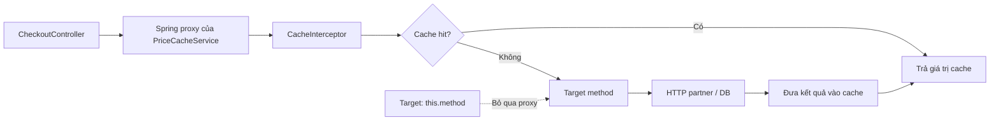
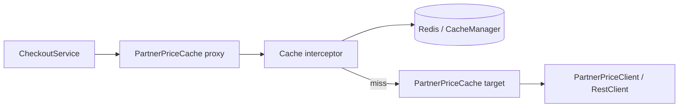
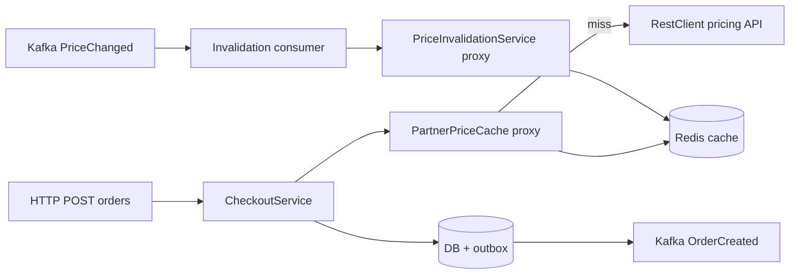

# Spring AOP, lời gọi nội bộ và trường hợp annotation không có hiệu lực

## 1. Bối cảnh: tại sao có @Cacheable nhưng hệ thống vẫn gọi downstream?

Trong hệ thống **Spring Boot Integration**, một API tạo đơn có thể tra cứu giá qua HTTP client, đọc dữ liệu từ PostgreSQL qua JDBC/jOOQ, lấy trạng thái từ Redis, tiêu thụ Kafka/RabbitMQ rồi cập nhật cache. Khi tích hợp nhiều phụ thuộc mạng, cache giúp giảm latency, tải downstream và chi phí; vì vậy Spring Cache thường được bật bằng `@EnableCaching` và gắn `@Cacheable` vào một phương thức service.

Nhưng có tình huống rất phổ biến:

```java
@Service
class PriceService {
    @Cacheable("productPrices")
    public PriceQuote findPrice(String sku) {
        return partnerClient.fetchPrice(sku);
    }

    public PriceQuote getPriceForCheckout(String sku) {
        return findPrice(sku); // Lời gọi nội bộ cùng object
    }
}
```

Giả sử controller gọi `getPriceForCheckout("SKU-42")` nhiều lần. Dù `findPrice` có `@Cacheable`, phương thức truy cập đối tác vẫn có thể chạy **mỗi lần**. Không nhất thiết Redis bị lỗi hay cấu hình TTL sai: nguyên nhân có thể là lời gọi đi **thẳng tới phương thức trên object**, không qua interceptor của Spring AOP.

**Quy tắc cốt lõi:** Ở chế độ proxy mặc định, annotation cache có hiệu lực khi một phương thức phù hợp được gọi **qua Spring-managed proxy**. Lời gọi `this.findPrice(...)` hoặc `findPrice(...)` bên trong cùng instance không đi lại qua proxy nên không chạy cache advice. Đổi JDK proxy sang CGLIB bằng `proxyTargetClass=true` **không tự chữa self-invocation**.

Sau bài này, người học cần:

- Hiểu đường gọi proxy và điều kiện để `@Cacheable`, `@CachePut`, `@CacheEvict` được áp dụng.
- Nhận diện self-invocation, phương thức `private`/`final`, object tự khởi tạo và các điều kiện làm annotation "không chạy".
- Tách bean hợp lý để cache advice bao quanh đúng thao tác nghiệp vụ.
- Phân biệt lỗi proxy với cache hit/miss, key sai, TTL, điều kiện `condition`/`unless` hoặc backend Redis.
- Kiểm thử cache thực qua Spring context, nhiều luồng và một Redis thật khi cần.
- Gắn cache với transaction, HTTP client, database, broker và cơ chế invalidation có kiểm soát.

## 2. Spring Cache dựa trên AOP proxy như thế nào?

Với `@EnableCaching` ở chế độ mặc định `AdviceMode.PROXY`, Spring tìm các phương thức có cache annotation và tổ chức một **cache interceptor**. Ứng dụng thường nhận một bean **proxy** thay vì tự gọi trực tiếp target trong mọi hoàn cảnh.



Quy trình thường gặp với `@Cacheable`:

1. Caller lấy bean do Spring container quản lý.
2. Caller gọi phương thức public đủ điều kiện qua proxy.
3. Cache interceptor xác định tên cache, tạo key từ tham số, đánh giá `condition` nếu có.
4. Nếu có entry hợp lệ, trả giá trị đã cache **mà không chạy body** của phương thức.
5. Nếu miss, gọi body (chẳng hạn RestClient/JDBC), có thể kiểm tra `unless` trên kết quả, rồi ghi cache theo chính sách.
6. Caller nhận kết quả hoặc exception từ quá trình xử lý.

Điều này có nghĩa `@Cacheable` **không chỉ là metadata** để một tiến trình khác tự quét lúc runtime; nó phụ thuộc vào cơ chế tạo proxy và đường gọi thực tế. Cách hiểu này cũng hữu ích với `@Transactional`, `@Async` và những Spring AOP advices khác, dù từng annotation có semantics riêng.

### 2.1. Phân biệt target và proxy

```text
Đúng đường gọi:  Controller -> proxy.findPrice() -> CacheInterceptor -> target.findPrice()
Không chạy advice: target.getForCheckout() -> this.findPrice()
Không chạy advice: new PriceService(...).findPrice() [không được Spring quản lý]
```

Lời gọi từ ngoài bean vào một phương thức public annotated có thể được intercept. Nếu phương thức đó tiếp tục gọi một phương thức annotated khác **trong cùng bean**, lời gọi thứ hai không tự đi lại qua proxy.

Một lỗi chẩn đoán là nhìn thấy log `@Cacheable` tại source rồi kết luận "cache đã bật". Cần kiểm tra proxy **ở runtime** và xác nhận số lần repository/client thực sự được gọi.

## 3. Bật cache annotation đúng cách trong Spring Boot

### 3.1. Dependency và @EnableCaching

Ví dụ cho Spring Boot 3.2+ (Java 17+, Spring Framework 6.1+) và Spring Data Redis tương thích:

```kotlin
// build.gradle.kts; để Spring Boot dependency management quản lý versions
implementation("org.springframework.boot:spring-boot-starter-cache")
implementation("org.springframework.boot:spring-boot-starter-data-redis")
implementation("org.springframework.boot:spring-boot-starter-actuator")
```

```java
import org.springframework.cache.annotation.EnableCaching;
import org.springframework.context.annotation.Configuration;

@Configuration
@EnableCaching
class CachingConfiguration {
}
```

`spring-boot-starter-cache` cung cấp cơ chế cache abstraction và auto-configuration thích hợp; `spring-boot-starter-data-redis` cung cấp Redis implementation nếu chọn Redis. Spring Boot có thể tự tạo `CacheManager` tùy các dependencies và cấu hình có mặt, nhưng việc có một `CacheManager` bean **không đồng nghĩa** mọi `@Cacheable` đã hoạt động: phải bật cơ chế xử lý annotation bằng `@EnableCaching` (hoặc cấu hình tương đương).

Trong một ứng dụng có Caffeine, Redis hoặc nhiều cache managers, cần xác định provider/bean thực sự được dùng. Với nhiều managers, quy định `cacheManager`/`cacheResolver` rõ ràng; không tin rằng tất cả cache đều đang chia sẻ dữ liệu giữa các instance khi thực tế dùng cache in-memory.

### 3.2. Ví dụ cache tên và key theo contract

Giả sử cần đọc giá từ đối tác, trong đó tenant đã được xác thực có thể có giá khác:

```java
import java.math.BigDecimal;
import java.time.Instant;

record PriceQuote(
        String sku,
        BigDecimal amount,
        String currency,
        Instant observedAt) {
}
```

```java
import org.springframework.stereotype.Component;
import org.springframework.web.client.RestClient;

@Component
class PartnerPriceClient {
    private final RestClient http;

    PartnerPriceClient(RestClient.Builder builder) {
        this.http = builder
                .baseUrl("https://pricing.internal.example")
                .build();
    }

    PriceQuote fetch(String tenantId, String sku) {
        return http.get()
                .uri("/api/prices/{sku}", sku)
                .header("X-Tenant-Id", tenantId)
                .retrieve()
                .body(PriceQuote.class);
    }
}
```

Địa chỉ upstream là ví dụ, không phải endpoint thực. Production cần TLS, authentication, connect/read timeout, bulkhead, quan sát và chính sách fallback. `tenantId` **phải đến từ danh tính/ủy quyền đáng tin cậy**, không chuyển tiếp tùy tiện từ request header người dùng.

Tạo service chuyên trách **tra cứu có cache**:

```java
import org.springframework.cache.annotation.Cacheable;
import org.springframework.stereotype.Service;

@Service
public class PartnerPriceCache {
    private final PartnerPriceClient partner;

    public PartnerPriceCache(PartnerPriceClient partner) {
        this.partner = partner;
    }

    @Cacheable(
            cacheNames = "partnerPrices",
            key = "'v1:' + #p0 + ':' + #p1",
            unless = "#result == null")
    public PriceQuote find(String tenantId, String sku) {
        return partner.fetch(tenantId, sku);
    }
}
```

Đây là ví dụ minh họa:

- `cacheNames="partnerPrices"` chọn namespace cache; tên cache phải trùng cấu hình `CacheManager`.
- `key="'v1:' + #p0 + ':' + #p1"` dùng vị trí tham số; `#p0` là `tenantId` và `#p1` là `sku`. Cách này không phụ thuộc việc compiler giữ tên tham số qua `-parameters`.
- `unless="#result == null"` không cache một kết quả null sau khi method trả về.
- Cache hit trả giá đã lưu mà không gọi HTTP.

Đầu vào phải được validate/canonicalize tại boundary **trước khi** gọi proxy, vì cache lookup và tính key xảy ra **trước khi** method body chạy. Nếu chỉ đặt validation trong body của `find()`, một cache hit có thể bỏ qua validation đó. Chuỗi key ghép dấu `:` ở trên chỉ an toàn nếu giá trị đã được chuẩn hóa, không có xung đột delimiter và scope tenant đúng. Với key phức tạp, dùng `KeyGenerator` riêng có kiểm thử hoặc một khóa cấu trúc canonical.

## 4. Self-invocation: lời gọi nội bộ bỏ qua cache advice

### 4.1. Mẫu lỗi dễ gặp

```java
import org.springframework.cache.annotation.Cacheable;
import org.springframework.stereotype.Service;

@Service
class InventoryService {
    private final PartnerPriceClient partner;

    InventoryService(PartnerPriceClient partner) {
        this.partner = partner;
    }

    @Cacheable(cacheNames = "partnerPrices", key = "#p0 + ':' + #p1")
    public PriceQuote fetchPrice(String tenantId, String sku) {
        return partner.fetch(tenantId, sku);
    }

    public PriceQuote priceForCheckout(String tenantId, String sku) {
        // TƯỞNG là đi qua cache; thực tế là gọi target trực tiếp.
        return fetchPrice(tenantId, sku);
    }
}
```

Nếu controller gọi `inventoryService.fetchPrice(...)` **qua Spring proxy**, `@Cacheable` có thể hoạt động. Nhưng khi controller gọi `inventoryService.priceForCheckout(...)`, target chạy và gọi `this.fetchPrice(...)`, nên bỏ qua interceptor cho `fetchPrice`. Kể cả gọi `priceForCheckout()` từ proxy, phần gọi **nội bộ** vẫn không quay lại proxy.

Vì sao? Spring AOP proxy đứng **ngoài** object mục tiêu; `this` bên trong method là target object. JVM thực thi lời gọi trực tiếp trên target, không phải trên wrapper proxy. Đặt `@Cacheable` thêm ở method nội bộ không thay đổi đường gọi đó.

### 4.2. Cách sửa ưu tiên: tách bean chịu trách nhiệm cache

Tách phần đọc giá thành `PartnerPriceCache` ở phần 3 và inject sang service điều phối:

```java
import org.springframework.stereotype.Service;

@Service
public class CheckoutService {
    private final PartnerPriceCache cachedPrices;

    public CheckoutService(PartnerPriceCache cachedPrices) {
        this.cachedPrices = cachedPrices;
    }

    public PriceQuote getPriceForCheckout(String tenantId, String sku) {
        // Call qua bean proxy do Spring inject.
        return cachedPrices.find(tenantId, sku);
    }
}
```



Ưu điểm của tách bean:

- Lời gọi đi rõ ràng qua proxy.
- Mỗi bean có một trách nhiệm: điều phối nghiệp vụ, tra cứu có cache, HTTP client.
- Test dễ kiểm soát hit/miss bằng số lần gọi client.
- Có thể thay cache provider và TTL mà không đưa logic AOP vào service nghiệp vụ.
- Tránh phụ thuộc vào Spring API như `AopContext.currentProxy()` ở tầng domain.

**Không khuyến khích giải pháp đầu tiên là tự inject chính mình.** Self-injection với `@Lazy` hoặc lấy proxy qua `ApplicationContext` có thể làm việc trong một số trường hợp, nhưng tạo coupling, phụ thuộc thứ tự tạo bean, nguy cơ circular reference và khó bảo trì. Nếu dùng `AopContext.currentProxy()` cần bật expose-proxy phù hợp, làm code phụ thuộc AOP và không giải quyết mọi đường gọi. Cách tách bean thường rõ ràng hơn.

### 4.3. AspectJ có thể chặn self-invocation không?

Có thể sử dụng **AspectJ weaving mode** thay vì proxy:

```java
import org.springframework.cache.annotation.EnableCaching;
import org.springframework.context.annotation.AdviceMode;
import org.springframework.context.annotation.Configuration;

@Configuration
@EnableCaching(mode = AdviceMode.ASPECTJ)
class AspectJCacheConfiguration {
}
```

Nhưng cấu hình này **chỉ là một phần**: cần dependencies như `spring-aspects` và cơ chế compile-time/load-time weaving phù hợp. AspectJ thay đổi cách advice được áp dụng vào bytecode, nên có thể xử lý self-invocation; nó không phải bản vá miễn phí khi chỉ đổi một enum. Trong phần lớn dự án Spring Boot Integration, proxy + tách bean đơn giản hơn và ít rủi ro vận hành hơn.

## 5. Các trường hợp annotation không có hiệu lực hoặc có vẻ như không có hiệu lực

| Tình huống | Điều xảy ra | Cách kiểm tra/sửa |
| --- | --- | --- |
| `this.cachedMethod()` trong cùng bean | Không đi qua proxy; interceptor bị bỏ qua | Tách bean; gọi qua proxy được Spring inject |
| Object tạo bằng `new Service(...)` | Không được container quản lý, không có proxy | Để Spring tạo và inject bean |
| Chưa bật `@EnableCaching` | Cache annotations chưa được xử lý | Bật ở configuration được quét/nạp |
| Sai `CacheManager` hoặc tên cache | Đọc nhầm backend, cache khác hoặc lỗi tên | Xem CacheManager thực tế, cấu hình cacheNames |
| Phương thức `private` | Proxy thường không thể advice lời gọi private | Đặt annotation ở public method của bean |
| Phương thức `final`/class `final` | Class-based proxy không thể override final method/class | Mở method/class hoặc thiết kế qua interface/proxy phù hợp |
| Proxy JDK nhưng method chỉ có ở concrete class | Proxy phơi bày interface, có thể gây injection/call mismatch | Inject interface hoặc cấu hình proxy phù hợp |
| Annotation chỉ trên interface | Có thể chạy ở interface-based proxy nhưng không chắc ở class-based/weaving | Ưu tiên đặt annotation ở concrete implementation |
| Gọi trong `@PostConstruct`/constructor | Proxy có thể chưa sẵn sàng cho self call | Chuyển việc gọi sang bean khác sau khởi tạo |
| `condition` trả false | Bỏ qua caching theo thiết kế | Kiểm tra SpEL và input |
| `unless` trả true | Method chạy, nhưng không lưu kết quả | Kiểm tra giá trị trả về và điều kiện |
| Key thay đổi giữa hai lần gọi | Hai cache misses là đúng semantics | Chuẩn hóa key, kiểm tra arguments/SpEL |
| TTL ngắn, eviction hoặc cache bị xóa | Cache entry không còn trước lần gọi sau | Kiểm tra TTL, eviction, invalidation, Redis health |
| Nhiều application replicas dùng cache local | Một replica miss dù replica khác đã lưu | Dùng cache phân tán nếu cần |
| Giá trị null hoặc return type xử lý đặc biệt | Provider/annotation có quy tắc cache null và wrapper | Xác minh `unless`, serializer, cache config |
| Body trả exception | Mặc định không cache exception như một giá trị | Xử lý lỗi/fallback rõ ràng |
| Reactive/async return | Cơ chế cache có semantics theo phiên bản và adapter | Kiểm tra tài liệu Spring 6.1+ và test bất đồng bộ |

Không nên dừng chẩn đoán ở câu "proxy không chạy". **Nếu interceptor thực sự chạy nhưng luôn miss**, phải kiểm tra key, backend, expiration, serialization hoặc những điều kiện khác trong bảng.

## 6. JDK dynamic proxy, CGLIB và giới hạn phương thức

Trong Spring AOP, hai kiểu proxy phổ biến:

1. **JDK dynamic proxy:** proxy qua những interface mà bean thực thi; caller nên inject/call qua interface.
2. **Class-based proxy (CGLIB):** tạo subclass để advice những method có thể override; không intercept được `final` method bằng cơ chế override.

Spring Boot có những mặc định proxy riêng cho các dạng cấu hình AOP; điều quan trọng không phải đoán mặc định, mà là **kiểm tra proxy thực tế của bean** và loại method được advice. Không mặc định thay `proxyTargetClass=true` giải quyết lời gọi nội bộ.

### 6.1. Lỗi với private hoặc final

```java
@Service
class IncorrectCacheService {

    @Cacheable("a")
    private String privateLookup(String id) { // Không thể advice qua proxy
        return loadFromRemote(id);
    }

    @Cacheable("b")
    public final String finalLookup(String id) { // Không thể override bởi CGLIB
        return loadFromRemote(id);
    }
}
```

Code này chỉ mô tả **lỗi thiết kế**, không phải class hoàn chỉnh để build. Với proxy-based caching, phương thức public, không-final, được gọi từ bean khác là lựa chọn ít bất ngờ nhất. Các mức visibility như protected/package-private có thể chịu khác biệt theo loại proxy và phiên bản framework; không dựa vào chúng cho cache contract cần ổn định qua các phiên bản.

Trong Kotlin, class/method thường là `final` theo mặc định. Dự án có thể dùng Kotlin Spring/all-open plugin để những class được annotation Spring phù hợp trở thành open, hoặc khai báo `open` tường minh nơi cần proxy. Cần kiểm tra cấu hình build chứ không chỉ xem annotation.

### 6.2. Kiểm tra proxy ở runtime

```java
import org.springframework.aop.support.AopUtils;
import org.springframework.stereotype.Component;

@Component
class CacheProxyDiagnostic {
    CacheProxyDiagnostic(PartnerPriceCache cache) {
        boolean isProxy = AopUtils.isAopProxy(cache);
        System.out.println("PartnerPriceCache is proxied: " + isProxy);
    }
}
```

Đây là đoạn diagnostic; production nên dùng logger có mức phù hợp thay vì `System.out`. `AopUtils.isAopProxy` giúp kiểm tra object được inject, nhưng **một bean có thể là proxy vì advice khác**, không chắc cache advice đã áp dụng đúng method. Kết hợp kiểm tra số lần gọi dependency và nội dung cache mới là bằng chứng đáng tin.

## 7. @Cacheable, @CachePut và @CacheEvict không giống nhau

| Annotation | Lúc nào method body chạy? | Vai trò |
| --- | --- | --- |
| `@Cacheable` | Bỏ qua body nếu cache hit; chạy khi miss | Read-through caching / memoization |
| `@CachePut` | Thường **luôn chạy** method body rồi cập nhật cache theo kết quả | Ghi/synchronize giá trị vào cache |
| `@CacheEvict` | Chạy method và xóa entry (mặc định sau khi method thành công) | Invalidate dữ liệu sau thao tác thay đổi |
| `@Caching` | Gom nhiều cache annotations trên một phương thức | Kết hợp nhiều thao tác có quy tắc rõ |
| `@CacheConfig` | Cấu hình chung cacheNames/keyGenerator... ở class | Giảm lặp metadata |

### 7.1. @Cacheable: chỉ nên cache công việc đọc

```java
@Cacheable(cacheNames = "partnerPrices",
           key = "'v1:' + #p0 + ':' + #p1",
           condition = "#p0 != null && #p1 != null",
           unless = "#result == null")
public PriceQuote find(String tenantId, String sku) {
    return partner.fetch(tenantId, sku);
}
```

- `condition` được đánh giá trước khi tra cache và chạy body; ví dụ trên bỏ cache nếu input thiếu, nhưng **không thay validation nghiệp vụ**.
- `unless` được đánh giá sau khi body trả kết quả; nếu true, không ghi kết quả đó vào cache.
- Trên cache hit, body **không được chạy**. Nếu body vừa đọc DB vừa trừ tồn kho, ghi audit bắt buộc hoặc gửi HTTP có side effect, cache hit sẽ bỏ qua các tác dụng đó. **Không đặt side effect bắt buộc trong phương thức @Cacheable**.
- Cache hit cũng bỏ qua validation hay kiểm tra quyền nếu chúng chỉ nằm trong body. Cần kiểm tra authorization **trước** cache lookup và đưa scope tenant/quyền phù hợp vào key.

### 7.2. @CachePut và @CacheEvict khi dữ liệu thay đổi

Giả sử upstream thông báo giá đã đổi. Một thiết kế có thể cập nhật DB nguồn rồi evict cache:

```java
import org.springframework.cache.annotation.CacheEvict;
import org.springframework.stereotype.Service;

@Service
class PriceInvalidationService {
    @CacheEvict(cacheNames = "partnerPrices",
                key = "'v1:' + #p0 + ':' + #p1")
    public void invalidate(String tenantId, String sku) {
        // Xóa entry sau khi method này kết thúc thành công.
        // Không gọi this.invalidate() từ cùng bean để mong advice chạy.
    }
}
```

Một method `@CachePut` có thể trả về dữ liệu mới rồi ghi vào đúng cache key; điều quan trọng là giá trị được cache phải cùng kiểu và ý nghĩa với cache read. Nếu ghi dữ liệu thành công ở DB rồi mới cập nhật cache, cần xét transaction boundary và khả năng cache update fail.

Không đặt `@Cacheable` và `@CachePut` bừa bãi trên cùng một method: annotation thứ nhất có thể bỏ chạy body còn annotation thứ hai cần chạy body, tạo semantics khó dự đoán. Đặt read/write qua các phương thức/bean rõ ràng.

### 7.3. beforeInvocation và allEntries

`@CacheEvict(beforeInvocation=true)` sẽ cố evict **trước** khi method chạy; nếu method sau đó thất bại, cache đã bị xóa. Mặc định `beforeInvocation=false`: evict sau khi method trả thành công, nhưng **không tự đảm bảo sau khi DB transaction commit** nếu giao dịch được mở ở bên ngoài.

`@CacheEvict(allEntries=true)` xóa mọi entry trong cache được chọn, không chỉ của một tenant hay SKU. Đây là thao tác rất rộng khi cache dùng chung. Với cache phân tán, cần cân nhắc tải Redis và cache stampede trước khi dùng xóa toàn bộ.

## 8. Key, cache name và sự cô lập dữ liệu

Spring Cache mặc định sử dụng `SimpleKeyGenerator`: không có tham số -> `SimpleKey.EMPTY`; một tham số -> chính tham số (theo quy tắc key generator); nhiều tham số -> `SimpleKey` chứa danh sách tham số. Đây là mặc định hợp lý cho nhiều trường hợp, nhưng **chỉ đúng nếu identity và equality của tham số phù hợp cache contract**.

Trong hệ thống multi-tenant, key chỉ chứa `sku` có thể gây trả giá của tenant A cho tenant B. Dù Redis sử dụng prefix cache name, **phải đưa tenant hoặc phạm vi dữ liệu phù hợp vào key** nếu cùng cache chứa dữ liệu cho nhiều tenant.

### 8.1. Những trường hợp key sai

| Vấn đề | Ví dụ | Hậu quả |
| --- | --- | --- |
| Thiếu tenant | key chỉ dùng `sku` | Lộ/nhầm dữ liệu giữa tenant |
| Dùng object mutable | key chứa DTO bị thay đổi sau khi lưu | Cache miss khó đoán, equality/hashCode khác |
| Ghép chuỗi không phân định | `tenantId + sku` | `ab`+`c` và `a`+`bc` va chạm |
| Đổi key format không version | Thêm một trường cho quy tắc tính giá | Đọc nhầm entry cũ không tương thích |
| Không chuẩn hóa locale/case | `sku-A`, `SKU-a` | Dư thừa hoặc trùng dữ liệu theo nghiệp vụ |
| Key chứa email/token | `key="#email"` | Tăng rủi ro lộ thông tin ở Redis/log |
| Key không tương thích serializer | Key object tùy biến ở local nhưng Redis serialize khác | Miss hoặc xung đột giữa các node |

Nên dùng giá trị đã được kiểm soát từ identity hệ thống (tenant ID đáng tin), định danh nghiệp vụ ổn định và schema version. Nếu key mang PII, cân nhắc thiết kế lại định danh opaque và chính sách retention/ACL. Đừng dùng raw key, user ID hay `orderId` làm **metric tags**: cardinality tăng theo mỗi thực thể.

### 8.2. SpEL tham số và compiler flags

```java
// Dùng tên tham số nếu project giữ metadata -parameters phù hợp.
@Cacheable(cacheNames = "partnerPrices", key = "#tenantId + ':' + #sku")
public PriceQuote find(String tenantId, String sku) { /* ... */ }

// Có thể dùng vị trí tham số khi không muốn phụ thuộc tên compile-time.
@Cacheable(cacheNames = "partnerPrices", key = "#p0 + ':' + #p1")
public PriceQuote find(String tenantId, String sku) { /* ... */ }
```

Đoạn mã trên chỉ minh họa biểu thức; phương thức có body giả lược. Nếu Spring không khám phá được tên tham số, biểu thức `#tenantId`/`#sku` có thể không hoạt động như dự kiến. Kiểm tra compiler metadata, exception SpEL và giá trị key thực tế, không chữa bằng cách tắt validation.

## 9. TTL, serialization và cache provider khác với Spring AOP

`@Cacheable` không thiết lập TTL một cách độc lập. **TTL, eviction, serialization và replication** nằm ở cấu hình provider như Redis, Caffeine hoặc hệ thống cache khác. Lời gọi có đi qua proxy vẫn có thể miss khi entry hết hạn hoặc bị eviction.

### 9.1. RedisCacheManager với TTL rõ ràng

Với Spring Data Redis 3.x, ví dụ chỉ cấu hình một cache `partnerPrices` chứa kiểu `PriceQuote`:

```java
import java.time.Duration;

import org.springframework.cache.CacheManager;
import org.springframework.context.annotation.Bean;
import org.springframework.context.annotation.Configuration;
import org.springframework.data.redis.cache.RedisCacheConfiguration;
import org.springframework.data.redis.cache.RedisCacheManager;
import org.springframework.data.redis.connection.RedisConnectionFactory;
import org.springframework.data.redis.serializer.Jackson2JsonRedisSerializer;
import org.springframework.data.redis.serializer.RedisSerializationContext;

@Configuration
class RedisPriceCacheConfiguration {

    @Bean
    CacheManager cacheManager(RedisConnectionFactory connectionFactory) {
        var serializer = new Jackson2JsonRedisSerializer<>(PriceQuote.class);

        var cacheConfig = RedisCacheConfiguration.defaultCacheConfig()
                .entryTtl(Duration.ofSeconds(90))
                .disableCachingNullValues()
                .computePrefixWith(name -> "integration:v1:" + name + "::")
                .serializeValuesWith(
                        RedisSerializationContext.SerializationPair
                                .fromSerializer(serializer));

        return RedisCacheManager.builder(connectionFactory)
                .cacheDefaults(cacheConfig)
                .build();
    }
}
```

Đây là cấu hình **minh họa dành riêng cho cache một kiểu `PriceQuote`**; nếu cùng `CacheManager` phục vụ nhiều kiểu value, cần cấu hình serializer phù hợp **theo từng cache** và hợp đồng version JSON rõ ràng. Không dùng Java JDK serialization hoặc deserialization polymorphic rộng cho dữ liệu không đáng tin mà chưa đánh giá bảo mật và tương thích. Khi thay đổi định dạng value, có thể đổi namespace/version, migration hoặc chủ động xóa entry cũ theo chính sách.

```yaml
spring:
  data:
    redis:
      host: "${REDIS_HOST:localhost}"
      port: "${REDIS_PORT:6379}"
      connect-timeout: 1s
      timeout: 2s
```

Các property ở trên chỉ phục vụ kết nối. Nếu ứng dụng chạy sau Redis Sentinel/Cluster hoặc managed Redis, cấu hình topology, TLS, ACL và credential phải đúng môi trường. Không hardcode password vào mã nguồn; giữ client timeout và pool/connection limits phù hợp với dependency.

### 9.2. Khi cache Redis bị lỗi

Một lỗi kết nối Redis lúc đọc/ghi cache có thể ném exception qua cache interceptor. `@Cacheable` **không tự bảo đảm fallback** về database hoặc HTTP nguồn. Có thể thiết kế `CacheErrorHandler` để xử lý một số lỗi cache, hoặc một adapter ở tầng service với circuit breaker/bulkhead, nhưng phải phân biệt:

- Cache dữ liệu tra cứu **có thể tái tạo**: có thể cho phép tiếp tục đến nguồn gốc khi Redis down, với rate limit/concurrency để tránh cache stampede.
- Cache chứa **idempotency keys, quyền, quota, locks**: bỏ qua lỗi cache có thể tạo tác dụng phụ trùng hoặc vượt giới hạn; không được mặc định fail-open.
- Cache miss hàng loạt sau Redis restart: có thể tăng mạnh tải HTTP/DB; dùng TTL jitter, request coalescing/single-flight hoặc warm-up có kiểm soát.

Một cache hit cũ cũng không đảm bảo dữ liệu cập nhật; cần đánh giá mức stale data được phép của tồn kho/giá. Nếu giá dùng cho thanh toán, nên có bước xác nhận lại theo policy trước khi commit giao dịch.

## 10. Đồng thời, sync=true và giới hạn chống cache stampede

`@Cacheable(sync=true)` đề nghị cache provider đồng bộ việc tính giá trị cho cùng một key khi cache miss để giảm nhiều lời gọi tính toán trùng. Nhưng:

- Tính năng phụ thuộc **cache provider thực tế**; không mặc định là distributed lock xuyên mọi instance.
- Spring Cache hạn chế cách dùng `sync=true` kết hợp một số thuộc tính, ví dụ chỉ một cache được chỉ định và không dùng `unless` trong trường hợp sync.
- Không dùng như cơ chế khóa nghiệp vụ để trừ tiền, trừ tồn kho hoặc chống trùng event.
- Khi một lệnh tải dữ liệu chậm, nhiều caller chờ cùng key vẫn có thể bị ảnh hưởng; cần timeout/deadline.
- Với Redis và nhiều application replica, phải kiểm thử khả năng đồng bộ thật của provider/implementation; một lock tại JVM không đủ chống stampede toàn hệ thống.

Ví dụ thích hợp cho dữ liệu có thể tính lại:

```java
@Cacheable(cacheNames = "catalogDescriptions",
           key = "#p0", sync = true)
public String description(String sku) {
    return catalogRepository.loadDescription(sku);
}
```

Đây là cách giảm lặp tính toán trong phạm vi provider hỗ trợ, không cam kết tải xuống repository chỉ xảy ra đúng một lần trên cả cluster. Nếu downstream HTTP có quota, ngoài `sync=true` còn cần bulkhead/rate limiter và quan sát số lần gọi thực tế.

## 11. Cache và @Transactional: không tự động nhất quán

Các annotation `@Transactional` và `@CacheEvict`/`@CachePut` có thể cùng áp dụng qua proxy, nhưng thứ tự advices và thời điểm commit phải được thiết kế.

Ví dụ cập nhật giá trong DB rồi evict:

```java
@Service
class PriceCommandService {
    private final PriceRepository repository;
    private final PriceInvalidationService invalidation;

    PriceCommandService(PriceRepository repository,
                        PriceInvalidationService invalidation) {
        this.repository = repository;
        this.invalidation = invalidation;
    }

    @Transactional
    public void updatePrice(String tenantId, String sku, BigDecimal amount) {
        repository.update(tenantId, sku, amount);
        invalidation.invalidate(tenantId, sku);
    }
}
```

Trong ví dụ, `PriceRepository` là repository nghiệp vụ do ứng dụng tự viết. Vấn đề: `invalidate()` có thể evict cache **trước khi transaction DB của `updatePrice()` commit**. Một request khác thấy miss, đọc dữ liệu DB cũ rồi ghi lại cache; ngay sau đó transaction commit giá mới, cache có thể giữ giá cũ đến TTL.

Các phương án cần cân nhắc:

1. **Evict sau commit** bằng transaction synchronization/application event listener phase `AFTER_COMMIT` khi nằm trong cùng tiến trình và semantics phù hợp.
2. Dùng `TransactionAwareCacheManagerProxy` hoặc transaction-aware manager được cấu hình để trì hoãn một số thao tác put/evict cho đến sau commit, hiểu rõ các giới hạn hỗ trợ của cache provider.
3. Dùng version/cache key hoặc cập nhật cache có điều kiện theo version để giảm overwrite stale data.
4. Với DB → broker → nhiều service, dùng **transactional outbox** phát `PriceChanged` sau commit, consumer invalidation idempotent và có cơ chế sửa sai khi event trễ/mất.
5. Áp dụng TTL phù hợp mức stale data được phép; không coi TTL là giải pháp thay thế mọi event invalidation.

**Cảnh báo:** Dù có transaction-aware cache, Redis cache và DB không tự trở thành một distributed atomic transaction. Nếu ghi DB thành công nhưng Redis down, hệ thống vẫn cần fallback/reconciliation. Nếu cache eviction là một phần bắt buộc để tránh quyết định sai, hãy thiết kế bước kiểm tra trạng thái/version ở nguồn dữ liệu đáng tin.

## 12. Khi cache chạy trong luồng Kafka/RabbitMQ hoặc Spring Integration

Với consumer:

```text
Kafka OrderCreated
   -> Validate eventId / tenantId
   -> Business service
   -> PartnerPriceCache proxy
   -> DB update + outbox
   -> ACK/commit offset theo policy
```

Cache **chỉ tăng tốc đọc**, không thay thế idempotency. Consumer có thể nhận lại cùng `eventId` vì at-least-once delivery, và cache hit không ngăn nó ghi DB hoặc gọi dịch vụ thanh toán lần nữa. Muốn chống trùng, dùng unique constraint/inbox hoặc idempotency key tại đích, phối hợp với transaction theo yêu cầu.

Trong Spring Integration:

- `ServiceActivator`/handler có thể gọi bean cache qua proxy khi reference do Spring inject.
- Nếu handler gọi `this.load(...)` trong cùng bean, vấn đề self-invocation vẫn xảy ra.
- Nếu message được xử lý bởi executor hoặc reactive flow, cache key phải đến từ context/data đã truyền rõ; không phụ thuộc mù vào `ThreadLocal` tenant/security context.
- Khi Spring Integration flow ghi DB rồi publish broker, transactional outbox vẫn cần thiết nếu phải bảo đảm event không bị mất sau commit; cache annotation không tạo atomicity xuyên các resource.

Nếu một method annotated trả về `CompletableFuture`, `Mono` hoặc `Flux`, hành vi cache kết quả bất đồng bộ phụ thuộc Spring Framework, cache provider và kiểu trả về. Spring Framework 6.1+ có hỗ trợ cache adaptation cho một số async/reactive return types, nhưng **không** được suy rằng mọi phiên bản và mọi provider đều hỗ trợ giống nhau. Kiểm thử cache hit/miss, null/empty, exception và context propagation trên stack đang triển khai; tránh tự động cache một object `Publisher` mà không xét semantics.

## 13. Kiểm thử chứng minh self-invocation và cách sửa

Mock trực tiếp đối tượng `new Service(...)` rồi gọi method không thể chứng minh cache advice hoạt động, vì không có proxy. Bài test dưới đây nạp **Spring context thật**, bật caching và dùng `ConcurrentMapCacheManager` làm cache test để tập trung vào behavior của AOP. Đây không phải test Redis TTL/serialization.

```java
import java.util.concurrent.atomic.AtomicInteger;

import org.junit.jupiter.api.Test;
import org.springframework.aop.support.AopUtils;
import org.springframework.beans.factory.annotation.Autowired;
import org.springframework.cache.CacheManager;
import org.springframework.cache.annotation.Cacheable;
import org.springframework.cache.annotation.EnableCaching;
import org.springframework.cache.concurrent.ConcurrentMapCacheManager;
import org.springframework.context.annotation.Bean;
import org.springframework.context.annotation.Configuration;
import org.springframework.test.context.junit.jupiter.SpringJUnitConfig;

import static org.junit.jupiter.api.Assertions.*;

@SpringJUnitConfig(CacheProxyBehaviorTest.TestConfig.class)
class CacheProxyBehaviorTest {

    @Autowired CounterService counter;
    @Autowired AtomicInteger repositoryCalls;

    @Test
    void externalCallIsCachedButInternalCallBypassesAdvice() {
        assertTrue(AopUtils.isAopProxy(counter));

        assertEquals(1, counter.cachedValue("A"));
        assertEquals(1, counter.cachedValue("A")); // Hit
        assertEquals(1, repositoryCalls.get());

        assertEquals(2, counter.internalCall("B"));
        assertEquals(3, counter.internalCall("B"));
        assertEquals(3, repositoryCalls.get()); // 2 internal calls -> 2 loads
    }

    @Configuration
    @EnableCaching
    static class TestConfig {
        @Bean
        CacheManager cacheManager() {
            return new ConcurrentMapCacheManager("counter");
        }

        @Bean
        AtomicInteger repositoryCalls() {
            return new AtomicInteger();
        }

        @Bean
        CounterService counterService(AtomicInteger calls) {
            return new CounterService(calls);
        }
    }

    static class CounterService {
        private final AtomicInteger calls;

        CounterService(AtomicInteger calls) {
            this.calls = calls;
        }

        @Cacheable(cacheNames = "counter", key = "#p0")
        public int cachedValue(String key) {
            return calls.incrementAndGet();
        }

        public int internalCall(String key) {
            return cachedValue(key); // Bỏ qua proxy
        }
    }
}
```

**Kỳ vọng**: lần gọi `cachedValue("A")` qua bean proxy chỉ tăng counter một lần; hai lần `internalCall("B")` vẫn tăng hai lần. Việc cho hai key khác nhau giúp quan sát rõ hai đường gọi. Test này dùng một method public, không-final và proxy Spring thực sự. Nếu project mặc định tạo JDK interface proxy, cần inject interface tương ứng; ví dụ không khai báo interface nên class-based proxy được sử dụng nếu caching proxy được tạo phù hợp.

### 13.1. Test tách bean đúng cách

Trong bài integration test khác, inject `CheckoutService` và mock/stub **PartnerPriceClient** qua Spring context để đếm số lần gọi. Gọi:

```text
checkoutService.getPriceForCheckout("tenant-a", "SKU-42")  # miss, HTTP 1 lần
checkoutService.getPriceForCheckout("tenant-a", "SKU-42")  # hit, HTTP vẫn 1 lần
checkoutService.getPriceForCheckout("tenant-b", "SKU-42")  # key khác, HTTP 2 lần
```

Kiểm tra outcome qua counter hoặc Mockito spy đặt ở dependency, không chỉ kiểm tra hai response bằng nhau. Nếu hai response trùng dữ liệu, điều đó **không chứng minh** cache được truy cập. Khi kiểm thử Redis thật, dùng môi trường riêng/Testcontainers Redis có TTL/serialization thật và kiểm tra hai service instance chia sẻ key đúng, không dùng Redis production để test phá dữ liệu.

### 13.2. Test condition, TTL, transaction và invalidation

| Tình huống | Phép thử | Kỳ vọng |
| --- | --- | --- |
| Self-invocation | Gọi annotated method từ cùng target | Repository/client vẫn chạy mỗi lần |
| Call xuyên bean | Gọi annotated method qua bean inject | Lần thứ hai hit nếu key giống và TTL chưa hết |
| Key theo tenant | Cùng SKU ở hai tenant khác nhau | Hai entry độc lập |
| `condition=false` | Gọi với tham số không đủ điều kiện | Không cache; validation vẫn đúng |
| `unless=true` | Upstream trả null theo contract | Không lưu null nếu cấu hình đã định |
| Cache miss đồng thời | Nhiều request cùng key | Có giới hạn tải và semantics `sync` được chứng minh nếu dùng |
| Redis timeout | Giả lập Redis down/chậm | Fallback hay lỗi theo class dữ liệu, không treo vô hạn |
| DB rollback | Thay đổi dữ liệu rồi rollback | Không giữ cache value phản ánh một giao dịch thất bại |
| Eviction sau commit | Commit giá mới và đọc lại qua proxy | Không trả mãi giá cũ do race |
| Redis TTL/serializer | Ghi, đọc, hết hạn, restart và schema update | Đúng thời gian sống và định dạng |
| Broker redelivery | Consumer xử lý cùng `eventId` lần nữa | Business side effect idempotent; cache không được coi là dedup |

Test `@Cacheable` phải có **Spring AOP thật**. Test serialization/TTL cần cache provider thật. Test giao dịch cạnh tranh cần DBMS thật và nhiều transaction; không suy tất cả đặc tính từ `ConcurrentMapCacheManager`.

## 14. Trình tự chẩn đoán khi annotation "không chạy"

Khi log cho thấy upstream bị gọi nhiều lần, áp dụng theo thứ tự:

1. **Xác định đường gọi:** caller gọi method annotated trực tiếp qua bean được inject, hay gọi từ `this.method()`/`new`/constructor/`@PostConstruct`?
2. **Kiểm tra Spring context:** `@EnableCaching` có được load, component scan thấy bean, cache manager có tồn tại và đúng backend?
3. **Kiểm tra proxy:** dùng `AopUtils.isAopProxy(bean)`; xem bean được inject qua interface hay concrete class, method có public/non-final không.
4. **Kiểm tra annotation:** đặt ở concrete method được proxy intercept; `cacheNames` và `cacheManager` có đúng; có `condition`, `unless` hoặc `cacheResolver` không?
5. **Kiểm tra key:** ghi chẩn đoán một giá trị key đã được an toàn hóa ở môi trường test; kiểm tra thứ tự tham số, tenant, version, serializer và tính ổn định.
6. **Kiểm tra backend:** Redis/Caffeine/CacheManager nào đang dùng, có TTL/eviction, lỗi connection, prefix, cache clear hoặc hai instance tách biệt?
7. **Kiểm tra execution:** phương thức có throw exception không, return type có được provider hỗ trợ, có lời gọi song song hoặc async/reactive không?
8. **Kiểm tra transaction và event:** đã update DB chưa commit, cache có bị invalidation trước commit hoặc event đến trễ không?
9. **Đếm actual load:** dùng counter/timer của downstream để xác minh hit/miss, không dựa vào response giống nhau hoặc annotation hiện diện trong source.

Khi bật log DEBUG/TRACE để chẩn đoán cache, cần kiểm tra logger names/level của phiên bản Spring thực tế và **không log raw cache key chứa PII**. Với Micrometer, dùng nhãn hữu hạn như `cache="partnerPrices"`, `outcome="hit"/"miss"/"error"`, `dependency="pricing"`. Không gắn `tenantId`, `sku` có cardinality lớn, `userId`, `orderId` hoặc `correlationId` làm nhãn metric. ID chi tiết chỉ nên xuất hiện trong log/trace bảo vệ theo chính sách dữ liệu nếu cần.

## 15. Tình huống tích hợp: cache giá trong luồng đặt hàng

Một API `POST /orders` gọi `CheckoutService` để lấy giá, ghi đơn vào database và phát event `OrderCreated`. Hệ thống nhận `PriceChanged` từ Kafka để vô hiệu hóa giá cũ.



Thiết kế cần trả lời:

- **Giá nào được coi là authoritative?** Giá có thể được cache 90 giây, nhưng khi tạo giao dịch thực phải áp policy chốt giá/version và kiểm tra giá trị hợp lệ.
- **Ai được phép đọc giá của tenant?** Authorization phải xảy ra trước cache lookup; key có scope tenant để tránh lộ dữ liệu giữa các nhóm.
- **Cách tránh stale price sau thay đổi?** Event invalidation có thể trễ hoặc bị giao lại; consumer idempotent và outbox/inbox bảo đảm đường phát trạng thái quan trọng.
- **Redis down thì sao?** Nếu giá chỉ là dữ liệu tra cứu, có thể fallback có kiểm soát. Nếu cache là nguồn xác thực quota/idempotency, không fail-open.
- **Có xảy ra self-invocation không?** Checkout gọi `PartnerPriceCache` qua bean inject; invalidation consumer gọi `PriceInvalidationService` qua proxy; không dùng `this.invalidate()` nội bộ.
- **Làm sao biết cache thực sự giảm tải?** Đo số outbound HTTP calls, cache hit/miss, p95/p99 latency và lượng traffic fallback, không đưa mỗi order/customer ID vào metric tags.

**Đừng dùng @Cacheable như một transaction boundary.** Nó quyết định có gọi lại một phương thức hay không; xử lý lỗi, atomicity giữa DB/Redis/Kafka, retry message và idempotency vẫn phải do những lớp nghiệp vụ và giao dịch phù hợp đảm nhiệm.

## 16. Lỗi thiết kế thường gặp và checklist

### Lỗi thường gặp

- Gắn `@Cacheable` rồi gọi method bằng `this.cachedMethod()` ở cùng bean.
- Dùng `proxyTargetClass=true` để chữa self-invocation nhưng không thay đường gọi.
- Đặt annotation lên `private`/`final` method hoặc class không phù hợp proxy.
- Tự tạo object với `new` rồi mong Spring auto cache.
- Chỉ thêm Redis starter mà quên bật `@EnableCaching` hoặc cấu hình CacheManager.
- Kiểm tra cache bằng unit test gọi trực tiếp target thay vì Spring proxy.
- Không đưa tenant vào key, khiến người dùng A có thể nhận dữ liệu của B.
- Đặt validation/authorization bắt buộc **chỉ trong body** phương thức cacheable.
- Cache thao tác có side effect (trừ tồn kho, gửi thanh toán, ghi audit bắt buộc).
- Giả định `@Cacheable` tự đặt TTL hoặc tự fallback khi Redis down.
- Evict cache trước DB commit, tạo race đọc giá cũ rồi cache lại.
- Dùng `@Cacheable(sync=true)` như distributed lock bảo đảm business exactly-once.
- Dùng cache hit làm chứng cứ consumer đã xử lý event và ack message.
- Gắn raw cache key/user ID vào metric tags, tạo cardinality và rủi ro lộ dữ liệu.

### Checklist trước khi triển khai

- [ ] Bean annotated do Spring quản lý, `@EnableCaching` và CacheManager được bật/kiểm chứng đúng profile.
- [ ] Lời gọi đến method cacheable đi **qua Spring proxy**; không self-invocation trong path quan trọng.
- [ ] Method được advise là public, không final, annotation ở concrete implementation; kiểu proxy/injection phù hợp.
- [ ] Cache key ổn định, gồm tenant/scope nếu cần, được validate trước lookup và có version strategy.
- [ ] `@Cacheable` chỉ dùng cho thao tác đọc có thể bỏ body khi cache hit; không có side effect bắt buộc.
- [ ] `@CachePut`/`@CacheEvict` có chính sách cập nhật/invalidation phù hợp transaction boundary.
- [ ] TTL, serialization, cache prefix, eviction và Redis topology được định nghĩa ở provider.
- [ ] Đã phân biệt cache dữ liệu có thể tái tạo và state quan trọng; Redis outage không gây fail-open nguy hiểm.
- [ ] Cơ chế `sync=true` (nếu dùng) được test trên provider thật; có timeout/bulkhead chống stampede.
- [ ] Có test Spring context chứng minh proxy interception và self-invocation; có integration test Redis khi cần.
- [ ] Có test DB commit/rollback, event redelivery, outbox/inbox và invalidation theo nghiệp vụ.
- [ ] Metrics theo cache/operation/outcome có cardinality hữu hạn; log/trace không tiết lộ key hoặc PII tùy tiện.

**Kết quả mong muốn:** Đội phát triển biết kiểm tra **đường gọi qua proxy** trước khi kết luận một cache annotation có hiệu lực. Cách tách bean, thiết kế key/TTL, kiểm thử Spring context và đặt transaction/invalidation đúng ranh giới giúp cache thực sự giảm tải cho HTTP client, database và broker mà không làm sai dữ liệu hoặc che khuất lỗi tích hợp.
