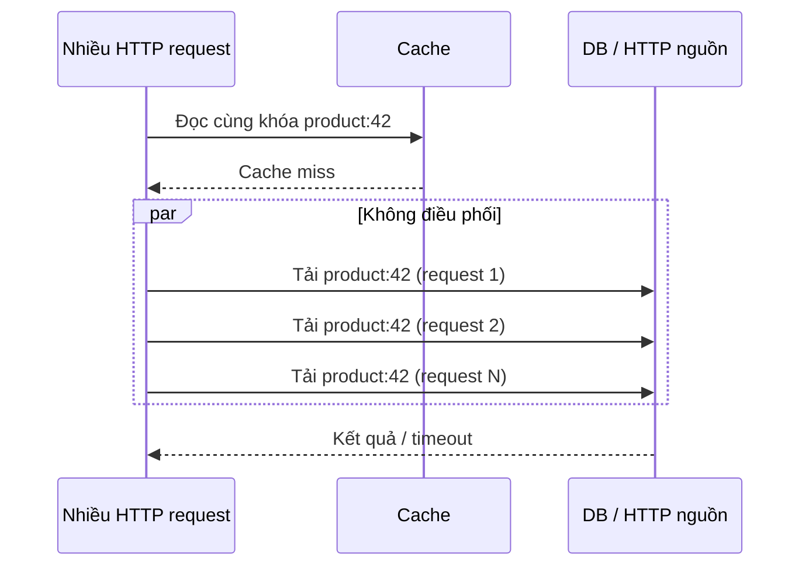
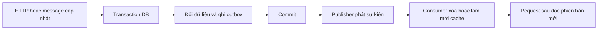

# Tránh cache stampede và xử lý lỗi cache theo yêu cầu nghiệp vụ

Trong một ứng dụng Spring Boot, cache thường nằm giữa HTTP API và nguồn dữ liệu như cơ sở dữ liệu, dịch vụ HTTP bên ngoài hoặc một hệ thống xử lý qua broker. Cache giúp giảm độ trễ và tải cho hệ thống nguồn, nhưng cũng tạo ra một điểm cần điều phối: khi nhiều request cùng không tìm thấy dữ liệu trong cache hoặc khi cache gặp lỗi, ứng dụng sẽ xử lý ra sao?

Bài này tập trung vào hai quyết định liên quan chặt chẽ: **hạn chế nhiều request đồng thời tải cùng một dữ liệu (cache stampede)** và **xác định hành vi khi cache hoặc hệ thống nguồn bị lỗi dựa trên hợp đồng nghiệp vụ**. Ví dụ dùng Spring Cache, Caffeine và Redis; cách triển khai cụ thể phải phù hợp với số instance, độ mới của dữ liệu và hậu quả của việc trả kết quả sai.

## 1. Hiểu đúng các kiểu tải bất thường vào hệ thống nguồn

Giả sử endpoint `GET /products/42` đọc thông tin sản phẩm qua một cache có TTL là 60 giây. Sản phẩm `42` được truy cập rất nhiều. Đúng lúc entry hết hạn, 500 request cùng đến:

1. Các request đều kiểm tra cache và thấy *miss*.
2. Nếu không có cơ chế điều phối, cả 500 request cùng truy vấn cơ sở dữ liệu hoặc gọi HTTP đến nhà cung cấp.
3. Nguồn dữ liệu chậm đi, các request tích tụ và có thể gây timeout dây chuyền.
4. Retry thiếu kiểm soát tiếp tục khuếch đại lượng request.

Đó là **cache stampede**, còn được gọi là *thundering herd* trong ngữ cảnh này. Mất cache ở một khóa rất nóng có thể gây tải lớn hơn nhiều so với mức bình thường.



Cần phân biệt các hiện tượng gần nhau:

| Hiện tượng | Nguyên nhân điển hình | Biện pháp chính |
| --- | --- | --- |
| **Stampede** | Nhiều request đồng thời miss **cùng một khóa** | Gom lượt tải theo khóa (*single-flight*), phối hợp giữa instance, phục vụ dữ liệu cũ có giới hạn |
| **Cache avalanche** | Rất nhiều khóa hết hạn cùng lúc hoặc cache bị ngắt diện rộng | Phân tán TTL, làm nóng cache, hạn chế tải và thiết kế đường dự phòng |
| **Cache penetration** | Request lặp lại cho khóa không tồn tại, không tạo entry hữu ích | Cache kết quả “không tồn tại” trong thời gian ngắn, xác thực đầu vào và giới hạn request |

Ba hiện tượng có thể cùng xảy ra. Ví dụ Redis ngừng hoạt động làm toàn bộ request phải đọc DB, còn các mã sản phẩm không tồn tại tạo thêm lượng truy vấn vô ích.

## 2. Chọn cơ chế chống stampede theo phạm vi triển khai

Không có một kỹ thuật phù hợp cho mọi cache. Trước tiên cần biết cache thuộc từng JVM, dùng chung trong Redis hay có nhiều tầng.

| Cơ chế | Tác dụng | Phạm vi / giới hạn |
| --- | --- | --- |
| *Single-flight* theo khóa | Nhiều caller dùng chung một lượt tải dữ liệu | Chỉ trong tiến trình hoặc phạm vi bộ điều phối |
| TTL có **jitter** | Tránh rất nhiều entry hết hạn đúng một thời điểm | Không tự giải quyết stampede ở một khóa nóng |
| *Refresh ahead* / *stale-while-revalidate* | Phục vụ dữ liệu vẫn được phép dùng trong khi tải bản mới | Cần giới hạn tuổi dữ liệu; không hợp với mọi nghiệp vụ |
| Khóa phân tán trong Redis | Chỉ một instance được ưu tiên tải lại cùng một khóa | Cần lease, xử lý chủ khóa chết, đọc lại cache và đường dự phòng |
| Giới hạn đồng thời, timeout, circuit breaker | Bảo vệ DB / dịch vụ HTTP khi miss hoặc lỗi cache | Có thể phải trả lỗi có kiểm soát khi quá tải |
| Negative caching | Giảm miss lặp lại cho dữ liệu được xác nhận không tồn tại | TTL ngắn; không cache timeout, lỗi 5xx hoặc kết quả phụ thuộc quyền truy cập sai phạm vi |

Thường nên phối hợp nhiều cơ chế: single-flight để giảm số lượt tải, TTL jitter để tránh đồng loạt hết hạn và giới hạn đồng thời để bảo vệ hệ thống nguồn nếu cache bị gián đoạn.

## 3. Single-flight trong một instance với Spring Cache và Caffeine

Với cache cục bộ của một ứng dụng Spring Boot, `@Cacheable(sync = true)` cho phép Spring yêu cầu cache provider đồng bộ việc tính giá trị khi nhiều lời gọi cùng miss một khóa. Khi dùng Caffeine, các request trong **cùng instance** có thể chia sẻ một lượt truy vấn nguồn cho khóa đó.

Ví dụ Gradle:

```gradle
dependencies {
    implementation 'org.springframework.boot:spring-boot-starter-cache'
    implementation 'com.github.ben-manes.caffeine:caffeine'
}
```

```yaml
# application.yml
spring:
  cache:
    type: caffeine
    cache-names: productById
    caffeine:
      spec: maximumSize=10000,expireAfterWrite=60s
```

```java
@Configuration
@EnableCaching
class CachingConfiguration {
}

@Service
class ProductQueryService {
    private final ProductRepository repository;

    ProductQueryService(ProductRepository repository) {
        this.repository = repository;
    }

    @Cacheable(cacheNames = "productById", key = "#p0", sync = true)
    public ProductView findById(Long productId) {
        Product product = repository.findById(productId)
                .orElseThrow(() -> new ProductNotFoundException(productId));

        return new ProductView(
                product.getId(), product.getName(), product.getPrice());
    }
}
```

Ví dụ giả định `ProductRepository`, `Product`, `ProductView` và `ProductNotFoundException` đã được định nghĩa trong ứng dụng. `#p0` dùng tham số đầu tiên làm cache key, tránh phụ thuộc vào việc giữ tên tham số khi biên dịch.

**Cách hoạt động:** request đầu tiên gặp miss sẽ gọi `repository.findById`. Các request đồng thời tìm cùng khóa sẽ đợi kết quả của lượt tải đang chạy thay vì cùng truy vấn DB. Khi hoàn tất, giá trị được đưa vào cache để các request tiếp theo dùng lại.

Các giới hạn cần nhớ:

- `sync = true` phụ thuộc vào khả năng của `Cache` implementation. Cần kiểm chứng trên provider đang dùng; không mặc định mọi provider đều có single-flight hiệu quả.
- Nó chỉ đồng bộ trong phạm vi cache implementation. Nếu mỗi instance có Caffeine riêng, **10 instance vẫn có thể tạo tối đa 10 lượt tải** cho cùng khóa tại cùng thời điểm; không có khóa liên tiến trình.
- `@Cacheable` hoạt động qua Spring proxy. Lời gọi từ một phương thức đến phương thức cacheable khác **trên cùng object** thường bỏ qua proxy và không kích hoạt caching.
- Với `sync = true`, chỉ dùng một cache name và không kết hợp `unless`; các tùy chọn đánh giá sau khi tải giá trị bị hạn chế bởi hợp đồng đồng bộ.
- Nếu DB ném exception, lượt tải không tạo entry thành công; nhiều request sau đó vẫn có thể tiếp tục miss. Phải dùng thêm timeout, bulkhead hoặc chính sách phản hồi khi nguồn đang lỗi.

**Khi phù hợp:** dữ liệu đọc nhiều, ít thay đổi, ứng dụng đơn instance hoặc chấp nhận mỗi instance tự tải một lần. Khi hệ thống mở rộng nhiều instance và Redis là cache dùng chung, chỉ sử dụng single-flight cục bộ chưa đủ cho một khóa cực nóng.

## 4. Phối hợp nhiều instance khi dùng Redis

Với Redis dùng chung, một mẫu triển khai là **đọc cache → xin quyền tải theo khóa → đọc cache lần nữa → tải nguồn → ghi cache → thả quyền**. Khóa phối hợp nhằm giảm số lần gọi nguồn, không được xem là cơ chế bảo đảm tính đúng đắn của một giao dịch nghiệp vụ.

```text
Request đọc cache:product:42
  ├─ Hit  → trả dữ liệu
  └─ Miss
       ├─ SET lock:product:42 <token> NX PX <lease-ms> thành công
       │    ├─ Đọc cache:product:42 lần nữa
       │    ├─ Nếu vẫn miss: tải DB / HTTP nguồn có timeout
       │    ├─ SET dữ liệu cùng TTL có jitter
       │    └─ Thả khóa nếu token còn khớp (thao tác nguyên tử)
       └─ Không lấy được khóa
            ├─ Chờ ngắn có jitter, đọc lại cache với số lần hữu hạn
            └─ Vẫn miss: phục vụ stale / tải có giới hạn / trả 503
               theo chính sách nghiệp vụ
```

`SET ... NX PX ...` tạo khóa chỉ khi chưa tồn tại và có thời hạn tự hết. Mỗi chủ khóa dùng token ngẫu nhiên riêng; **không** dùng cặp thao tác `GET` rồi `DEL` tách rời để thả khóa, vì khóa có thể đã hết hạn và được chủ khác nhận trong khoảng giữa hai lệnh. Có thể dùng Lua để kiểm tra và xóa nguyên tử:

```lua
-- KEYS[1] = lock key; ARGV[1] = token của chủ khóa
if redis.call('GET', KEYS[1]) == ARGV[1] then
    return redis.call('DEL', KEYS[1])
end
return 0
```

Các quyết định cần làm rõ trước khi triển khai:

1. **Lease:** phải tính đến p99 của truy vấn nguồn, độ trễ mạng và việc tiến trình tạm dừng. Nếu lease hết khi chủ đầu tiên chưa xong, chủ thứ hai có thể cùng tải. Cần timeout, có thể gia hạn lease an toàn khi thật sự cần và tuyệt đối không giả định khóa Redis là bảo đảm *exactly-once*.
2. **Đọc lại sau khi có khóa:** vì một instance khác có thể vừa ghi entry trước khi instance hiện tại xin được khóa. Bỏ bước này tạo tải nguồn thừa.
3. **Không khóa vô hạn:** đặt giới hạn thời gian đợi và tổng số lần thử. Nếu khóa bị giữ lâu hoặc Redis lỗi, hệ thống phải có đường thoát rõ ràng.
4. **Không để nguồn bị ngập khi cache chết:** giới hạn số lượt fallback đồng thời và tốc độ gọi DB / API ngoài; áp dụng circuit breaker, bulkhead và deadline ở HTTP client khi thích hợp.
5. **Không dùng khóa cache để bảo vệ cập nhật quan trọng:** lease hết hạn, partition mạng và tiến trình dừng có thể tạo nhiều người xử lý. Với ghi dữ liệu cần dùng version/optimistic locking, ràng buộc DB, hoặc fencing token được nguồn dữ liệu kiểm tra.

Trong hệ thống ít tải, chi phí vận hành của khóa phân tán có thể lớn hơn lợi ích. Đo mức đồng thời theo *hot key* và QPS vào nguồn trước khi lựa chọn cơ chế này.

## 5. TTL jitter và làm mới dữ liệu có kiểm soát

### 5.1. Phân tán thời điểm hết hạn

Nếu một đợt nạp dữ liệu tạo 100.000 entry đều có TTL đúng 10 phút, rất nhiều entry có thể cùng hết hạn. Có thể thêm *jitter* độc lập cho từng lần ghi:

```text
baseTtl = 300 giây
jitter = số ngẫu nhiên từ 0 đến 60 giây
effectiveTtl = baseTtl + jitter
```

Ví dụ khi ghi Redis: dùng `SET` với `EX` hoặc `PX` bằng thời gian đã tính. Không nên chỉ thêm jitter một lần ở cấu hình chung rồi dùng lại cho mọi key. Nếu có quy định dữ liệu **không được cũ hơn 5 phút**, không được cộng jitter khiến TTL vượt quá giới hạn đó; chọn dải TTL nằm trong ngân sách độ mới hoặc tách TTL kỹ thuật khỏi quy tắc kiểm tra `updatedAt`/`version`.

### 5.2. Stale-while-revalidate

Với dữ liệu cho phép cũ trong một khoảng ngắn, lưu hai mốc thời gian trong entry:

```text
freshUntil = 10:05   → đến mốc này có thể trả ngay
staleUntil = 10:07   → trước mốc này được trả bản cũ và kích hoạt refresh
10:07 trở đi        → bản cũ không còn hợp lệ; dùng chính sách lỗi
```

Request đến sau `freshUntil` có thể nhận ngay bản hiện tại, đồng thời chỉ một worker thực hiện refresh. Nếu refresh thất bại, entry cũ vẫn còn để phục vụ cho đến `staleUntil`; sau đó không được trả vô hạn. **TTL lưu trữ của cache phải đủ dài đến `staleUntil`**, nếu không entry đã bị xóa trước khi có cơ hội phục vụ stale.

Caffeine hỗ trợ `refreshAfterWrite` thông qua `LoadingCache`/`AsyncLoadingCache`: sau khi đủ tuổi, lượt đọc có thể kích hoạt refresh bất đồng bộ và vẫn nhận bản hiện tại trong lúc refresh. Cần cấu hình thêm thời hạn hết hạn và kiểm chứng hành vi khi refresh lỗi. `@Cacheable` với `expireAfterWrite` đơn thuần **không** tự cung cấp stale-while-revalidate.

Chỉ dùng stale khi hợp đồng dữ liệu cho phép. Danh mục sản phẩm hay cấu hình hiển thị có thể chấp nhận vài chục giây; quyền truy cập, hạn mức thanh toán, số dư hoặc tồn kho dùng để ra quyết định giao dịch thường không nên dựa vào bản cũ.

### 5.3. Negative caching

Nếu API nhận rất nhiều request cho `productId` không tồn tại, chỉ cache dữ liệu thành công sẽ khiến mỗi request đều truy vấn DB. Với trường hợp đã xác nhận chắc chắn “không tồn tại”, có thể cache một giá trị phân biệt với cache miss, ví dụ `Optional.empty()` hoặc một kiểu kết quả `NotFound`, với TTL ngắn.

Quy tắc an toàn:

- Chỉ negative-cache phản hồi chắc chắn, ví dụ bản ghi không có trong DB hoặc HTTP `404` được hệ thống nguồn bảo đảm là ổn định trong khoảng TTL.
- Không chuyển **timeout, lỗi mạng, HTTP 429, 5xx** thành “không tồn tại”; đây là tình trạng không xác định hoặc lỗi tạm thời.
- Nếu kết quả phụ thuộc tenant, quyền người dùng, locale hoặc phiên bản dữ liệu, key phải bao gồm các thành phần phạm vi tương ứng; không dùng một entry `403` hoặc “không thấy” toàn cục cho mọi người dùng.
- TTL cho kết quả không tồn tại nên ngắn hơn hoặc được chọn riêng so với TTL của dữ liệu tồn tại, nhất là khi bản ghi có thể được tạo ngay sau đó.

## 6. Phân loại lỗi trước khi chọn fail-open hay fail-closed

**Cache miss** là trạng thái bình thường; **cache unavailable** là lỗi hạ tầng; **source unavailable** là lỗi của nguồn dữ liệu. Ba tình huống này không tương đương và không nên bị gộp thành một nhánh `catch` trả `null`.

- **Fail-open với cache:** khi cache đọc hoặc ghi thất bại, tiếp tục xử lý nghiệp vụ qua nguồn dữ liệu đáng tin cậy, nếu nguồn vẫn đáp ứng được và thao tác được phép. Ví dụ: truy vấn mô tả sản phẩm vẫn đọc DB khi Redis ngừng hoạt động.
- **Fail-closed cho quyết định nhạy cảm:** khi không thể xác minh một điều kiện quan trọng, từ chối hoặc trì hoãn thao tác. Ví dụ: không thể kiểm tra quyền mua, hạn mức hoặc trạng thái khóa tài khoản thì không mặc nhiên cho phép.
- **Stale-if-error có giới hạn:** khi nguồn dữ liệu lỗi, trả giá trị cache còn nằm trong ngân sách tuổi dữ liệu đã thỏa thuận; kèm chỉ báo degraded nếu hợp đồng API cần thể hiện.
- **Controlled failure:** khi cache hỏng và nguồn vượt quá ngưỡng chịu tải, trả lỗi như `503 Service Unavailable` có hướng dẫn retry phù hợp thay vì để mọi request cùng dồn xuống nguồn.

| Tình huống | API đọc danh mục sản phẩm | Quyết định thanh toán / quyền truy cập |
| --- | --- | --- |
| Cache miss, DB/HTTP nguồn khỏe | Tải từ nguồn, cache lại | Xác minh tại nguồn có thẩm quyền |
| Cache GET lỗi, nguồn khỏe | Bỏ qua cache với giới hạn đồng thời, ghi log/metric | Xác minh trực tiếp tại nguồn; nếu không thể, từ chối |
| Cache PUT lỗi sau khi tải thành công | Có thể trả dữ liệu mới; chấp nhận hit rate thấp tạm thời | Không dùng cache PUT như bằng chứng giao dịch đã hoàn tất |
| Nguồn lỗi, có bản stale còn hợp lệ | Có thể trả stale nếu SLA cho phép | Không dùng stale để quyết định cho phép hành động nhạy cảm |
| Cache và nguồn đều lỗi | Trả 503 hoặc stale còn được phép | Trả lỗi có kiểm soát, không tự suy diễn trạng thái hợp lệ |
| Cache invalidation lỗi sau cập nhật | Phát lại invalidation, dùng TTL/version để giới hạn dữ liệu cũ | Phải có cơ chế nhất quán từ nguồn dữ liệu và quy trình phục hồi cụ thể |

**Fail-open/closed là quyết định theo thao tác và dữ liệu**, không phải một cờ chung cho toàn Redis. Cùng một ứng dụng có thể fail-open khi đọc nội dung giới thiệu, nhưng fail-closed khi không xác minh được quyền truy cập.

## 7. Xử lý lỗi Spring Cache có chủ đích

Trong Spring Cache, `CacheErrorHandler` cho phép quyết định cách xử lý exception của những thao tác cache do abstraction thực hiện. Mặc định, handler đơn giản thường ném lại exception. Nếu muốn cache đọc thất bại nhưng nguồn vẫn được gọi, có thể chủ động bỏ qua lỗi GET cho **những cache được phép**; lỗi ghi hoặc xóa cần chính sách riêng.

```java
@Configuration
@EnableCaching
public class CacheErrorPolicyConfiguration implements CachingConfigurer {
    private static final Logger log = LoggerFactory.getLogger(
            CacheErrorPolicyConfiguration.class);

    @Override
    public CacheErrorHandler errorHandler() {
        return new SimpleCacheErrorHandler() {
            @Override
            public void handleCacheGetError(
                    RuntimeException ex, Cache cache, Object key) {
                if (!"productById".equals(cache.getName())) {
                    throw ex;
                }
                log.warn("Cache GET unavailable: cache={}", cache.getName(), ex);
                // Cho phép Spring tiếp tục gọi nguồn cho cache productById.
            }

            @Override
            public void handleCachePutError(
                    RuntimeException ex, Cache cache, Object key, Object value) {
                if (!"productById".equals(cache.getName())) {
                    throw ex;
                }
                log.warn("Cache PUT unavailable: cache={}", cache.getName(), ex);
                // Giá trị mới đã được tải từ nguồn; chấp nhận bỏ qua cache PUT.
            }

            @Override
            public void handleCacheEvictError(
                    RuntimeException ex, Cache cache, Object key) {
                log.error("Cache eviction failed: cache={}", cache.getName(), ex);
                throw ex; // Buộc luồng cập nhật phải có xử lý/khôi phục riêng.
            }

            @Override
            public void handleCacheClearError(RuntimeException ex, Cache cache) {
                log.error("Cache clear failed: cache={}", cache.getName(), ex);
                throw ex;
            }
        };
    }
}
```

Ví dụ giả định các import Spring Cache, `Logger` và `LoggerFactory` đã có. Chính sách GET/PUT ở đây **chỉ áp dụng cho `productById`**; cache khác giữ hành vi ném lỗi. Không log raw cache key nếu key có mã định danh nhạy cảm. Đồng thời, việc bỏ qua lỗi GET **không** thay thế giới hạn số request vào DB.

Những lưu ý quan trọng:

1. `CacheErrorHandler` xử lý lỗi phát sinh từ thao tác cache của Spring Cache; nó không tự xử lý mọi `RedisTemplate`, HTTP client, repository hay lỗi trong hàm tải dữ liệu.
2. Đường đi đồng bộ của `@Cacheable(sync = true)` có thể sử dụng `Cache.get(key, Callable)` và cách bọc exception riêng của cache provider. Cần **kiểm thử fault injection trên phiên bản Spring/cache thực dùng** để xác nhận chính sách lỗi GET hoạt động như dự kiến; nếu fail-open là yêu cầu bắt buộc, cân nhắc quản lý cache read-through bằng mã tường minh và bọc lỗi tại đúng ranh giới cache.
3. Ném exception khi eviction lỗi **không đồng nghĩa rollback được DB**. Nếu transaction DB đã commit trước khi cache bị xóa, caller có thể nhận lỗi dù dữ liệu đã đổi. Không retry mù quáng một thao tác ghi không có idempotency.
4. Trong luồng cập nhật quan trọng, cần thiết kế invalidation có thể thử lại, key gắn version hoặc đồng bộ qua outbox; không dựa vào `@CacheEvict` đơn lẻ để bảo đảm tính nhất quán xuyên hệ thống.

## 8. Cache và giao dịch: xử lý cập nhật, event và trùng lặp

Cache là **bản sao để tăng tốc truy cập**, không thay thế nguồn sự thật. Với API cập nhật sản phẩm hoặc luồng nhận thông điệp từ broker, thứ tự DB commit và invalidation rất quan trọng:



Ở luồng đơn giản, có thể xóa cache sau khi transaction commit, nhưng cần biết nếu tiến trình chết sau commit và trước khi xóa thì entry cũ sẽ còn tồn tại đến TTL. Với hệ thống có yêu cầu khôi phục chắc chắn hơn, có thể ghi **outbox trong cùng transaction với thay đổi DB**; publisher gửi event sau đó, consumer xử lý invalidation theo cách lặp lại an toàn.

Một event từ broker có thể được giao lại. Xóa cùng cache key nhiều lần thường là idempotent; còn thao tác cộng tồn kho, trừ tiền hoặc ghi trạng thái **không** được thực hiện nhiều lần chỉ vì event bị gửi lại. Dùng idempotency key, ràng buộc duy nhất hoặc version tại cơ sở dữ liệu. Cache lock không phải công cụ chống xử lý trùng lặp có độ tin cậy giao dịch.

Để tránh event cũ ghi đè dữ liệu mới, cân nhắc chỉ **evict** cache theo key và để lần đọc sau lấy phiên bản mới; nếu bắt buộc update cache từ event thì kiểm tra version/sequence trước khi ghi. Với nhiều tenant, key nên có cấu trúc rõ ràng như `tenant:{tenantId}:product:{productId}:v{schemaVersion}`, có ranh giới truy cập và kế hoạch thay đổi schema.

## 9. Bảo vệ nguồn bằng timeout, retry và giới hạn đồng thời

Khi cache không thể phục vụ request, lưu lượng sẽ chuyển sang DB hoặc HTTP client. Cần dự phòng trường hợp cả cache và nguồn bị lỗi:

- **Timeout theo deadline:** đặt connect timeout, read/response timeout và deadline tổng cho lượt tải; không để request đợi không giới hạn trong lúc giữ quyền single-flight.
- **Retry có ngân sách:** chỉ retry lỗi tạm thời khi thao tác an toàn/idempotent, số lần hữu hạn, exponential backoff kèm jitter; không retry 500 request đồng thời một cách đồng bộ.
- **Bulkhead / semaphore:** giới hạn số lượt miss được phép truy vấn nguồn cùng lúc; nếu đầy thì dùng stale còn hợp lệ hoặc trả phản hồi quá tải được định nghĩa trong API.
- **Circuit breaker:** ngừng gọi nguồn một thời gian khi tỷ lệ lỗi vượt ngưỡng, giảm cascade failure; đường dự phòng phải tuân thủ freshness và quyền truy cập.
- **Rate limit:** hạn chế request bất thường theo client/tenant/key, đặc biệt đối với ID không tồn tại.

Với HTTP client, phải phân biệt `404` thực sự (có thể negative-cache) với `429`, `503` và timeout (không thể coi là không tồn tại). Với broker, phải thiết lập ack/retry/dead-letter và idempotency theo hợp đồng xử lý message; cache miss không phải lý do tự động phát lại cả giao dịch.

## 10. Quan sát và cảnh báo theo mục tiêu nghiệp vụ

Chỉ theo dõi hit ratio là chưa đủ: cache vẫn có thể hit cao nhưng một khóa cực nóng bị stampede khi hết hạn. Dùng Micrometer, Actuator và hệ thống metric/log/tracing của ứng dụng để đo các tín hiệu sau:

| Nhóm tín hiệu | Ví dụ cần theo dõi | Ý nghĩa |
| --- | --- | --- |
| Cache | Hit/miss, eviction, TTL, latency, lỗi GET/PUT/evict | Phát hiện cache hoạt động bất thường |
| Single-flight / lock | Số người chờ theo khóa đã gom nhóm, thời gian chờ, lock timeout | Phát hiện thundering herd và điểm nghẽn |
| Nguồn dữ liệu | DB QPS, connection pool, p95/p99 latency, HTTP 429/5xx | Xác nhận cache miss không gây quá tải nguồn |
| Đường dự phòng | Số lần fail-open, stale served, rejected/503, circuit mở | Thấy mức độ suy giảm dịch vụ thực tế |
| Tính đúng | Tuổi dữ liệu trả về, độ trễ invalidation, version mismatch | Phát hiện sai lệch với hợp đồng freshness |

Đặt ngưỡng cảnh báo theo baseline của từng API. Ví dụ, nếu Redis báo lỗi liên tục và DB QPS tăng đột ngột, kích hoạt giới hạn fallback trước khi connection pool cạn kiệt. Không gắn raw product ID, user ID hoặc tenant ID làm tag metric có cardinality lớn; dùng các nhãn nhóm ổn định, còn chi tiết tra cứu qua trace/log có kiểm soát.

Khi trace `GET /products/{id}`, nên phân biệt span lấy cache, span tải DB/HTTP và span refresh để chẩn đoán chính xác phần gây chậm. Metric cache của Spring Boot phụ thuộc cache provider và cách cấu hình; xác minh metric nào thực sự được bind thay vì mặc định chúng luôn xuất hiện.

## 11. Kịch bản kiểm thử cần có

| Kịch bản | Cách tạo tình huống | Kỳ vọng có thể đo được |
| --- | --- | --- |
| Nhiều miss cùng khóa trong một JVM | Xóa entry, phát 100 request đồng thời | Với Caffeine và `sync=true`, nguồn được tải xấp xỉ 1 lần cho cùng khóa trong đợt đó, khi các request thật sự chồng lấn |
| Nhiều instance miss cùng khóa | Gửi đồng thời vào nhiều replica | Nếu chỉ dùng cache cục bộ, vẫn có thể tải một lần trên **mỗi replica**; nếu dùng điều phối Redis, số tải giảm theo thiết kế |
| TTL đồng loạt hết hạn | Nạp nhiều key cùng lúc, rút ngắn TTL | Jitter trải rộng thời điểm miss; DB QPS không tăng đột biến như cấu hình không jitter |
| Cache GET timeout | Tạm ngắt Redis hoặc inject timeout | API fail-open chỉ với dữ liệu cho phép; số lượt vào nguồn vẫn bị giới hạn |
| Cache PUT/evict lỗi | Inject exception vào cache provider | PUT không làm sai response dữ liệu đã tải; evict kích hoạt cảnh báo và cơ chế phục hồi |
| Nguồn HTTP/DB lỗi | Cho nguồn trả 503 hoặc timeout | Không cache lỗi như `404`; stale chỉ xuất hiện trong cửa sổ được phép; hết cửa sổ trả lỗi có kiểm soát |
| Không tồn tại / vừa được tạo | Đọc ID không có, sau đó tạo bản ghi | Negative entry hết hạn sớm hoặc được invalidation; bản ghi mới trở nên truy cập được |
| Event bị giao lại / sai thứ tự | Gửi trùng hoặc đảo thứ tự event | Không cập nhật nghiệp vụ hai lần; event cũ không ghi đè version mới |
| Key khác tenant | Đọc cùng `productId` ở hai tenant | Không lộ dữ liệu chéo tenant hoặc chéo quyền |

Nên dùng test đồng thời có `CountDownLatch`/barrier để nhiều request thực sự cùng bắt đầu, fake repository có bộ đếm để kiểm chứng số lượt tải, và fault injection cho Redis/HTTP/DB. Test phải kiểm tra cả **kết quả trả về**, **số lần gọi nguồn**, **độ trễ**, **tính mới** và **đường xử lý lỗi**; test chỉ kiểm tra `@Cacheable` xuất hiện không chứng minh stampede đã được giải quyết.

## 12. Quy trình chọn chính sách cho một endpoint

Trước khi bật cache cho một luồng tích hợp mới, trả lời lần lượt:

1. **Nguồn sự thật là gì?** DB, API bên ngoài hay một state store từ broker? Có thể đọc lại nguồn trong lúc lỗi cache không?
2. **Được cũ tối đa bao lâu?** Ghi thành số giây/phút cụ thể và xác định có được stale-if-error hay không.
3. **Tải đồng thời lớn nhất là bao nhiêu?** Một instance hay nhiều replica? Cần single-flight cục bộ, khóa phân tán hoặc refresh chủ động?
4. **Nếu cache GET, PUT hoặc evict lỗi thì API phải trả gì?** Định nghĩa riêng cho truy vấn đọc, cập nhật và quyết định nghiệp vụ nhạy cảm.
5. **Nếu DB/API nguồn cũng lỗi thì sao?** Giới hạn timeout, retry, fallback, bulkhead và phản hồi HTTP theo hợp đồng.
6. **Dữ liệu được làm mới và invalidation bằng cách nào?** Theo TTL, sự kiện broker, outbox hay version? Làm sao phục hồi khi tiến trình chết?
7. **Làm sao chứng minh hành vi đúng?** Có kịch bản kiểm thử concurrent miss, cache outage, source outage, stale expiration và event trùng lặp không?

Một thiết kế thực dụng cho danh mục sản phẩm thường bắt đầu bằng Caffeine với `@Cacheable(sync = true)` khi chạy ít replica, TTL hợp lý và timeout tại nguồn. Khi cần cache dùng chung trên nhiều replica, đánh giá Redis, phân tán TTL và chỉ bổ sung khóa phân tán nếu số liệu chứng minh một hot key gây tải không chấp nhận được. Với dữ liệu có ràng buộc tài chính, phân quyền hoặc toàn vẹn giao dịch, ưu tiên xác minh từ nguồn có thẩm quyền và bảo đảm idempotency/transaction trước khi tối ưu cache.

**Nguyên tắc cốt lõi:** cache có thể giảm tải và độ trễ, nhưng khi cache miss hoặc hỏng, ứng dụng vẫn phải giữ đúng hợp đồng nghiệp vụ. Chống stampede bảo vệ *khả năng chịu tải*; fail-open, fail-closed, freshness và invalidation bảo vệ *tính đúng của kết quả*.
