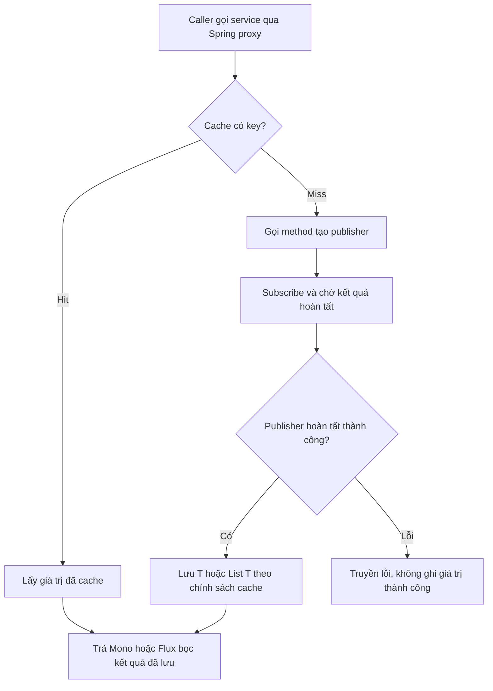

# Phân biệt cache đồng bộ với kiểu trả về reactive theo phiên bản

## Bối cảnh và mục tiêu

Trong **Spring Boot Integration**, cache thường đứng giữa một service và nguồn dữ liệu chậm như cơ sở dữ liệu, HTTP API hoặc adapter tích hợp. Đổi kiểu trả về của service từ `ProductDto` sang `Mono<ProductDto>` không tự động biến tầng cache thành bất đồng bộ. Hơn nữa, cùng một `@Cacheable` có thể lưu **đối tượng publisher** hoặc **giá trị do publisher phát ra**, tùy phiên bản Spring Framework đang chạy.

Sau bài này, người học có thể:

- Phân biệt truy cập cache đồng bộ, thuộc tính `@Cacheable(sync = true)` và phương thức trả về `Mono`/`Flux`.
- Giải thích hành vi cache trước và từ **Spring Framework 6.1**, kể cả `CompletableFuture`, `Mono`, `Flux`.
- Cấu hình một `CacheManager` phù hợp cho service reactive, nhận diện trường hợp backend cache vẫn có thể chặn luồng.
- Chọn chiến lược kiểm thử, khóa cache, xử lý lỗi và migration đúng với hợp đồng dữ liệu của luồng tích hợp.

## 1. Ba khái niệm dễ bị nhầm

| Khái niệm | Ý nghĩa thực tế | Có bảo đảm I/O không chặn luồng không? |
|---|---|---|
| **Cache API đồng bộ** | Các thao tác như `Cache.get(key)` trả kết quả trực tiếp; một backend từ xa có thể chờ I/O ngay trên luồng gọi. | **Không**. |
| **`@Cacheable(sync = true)`** | Yêu cầu cache provider phối hợp việc tính giá trị cho cùng một key khi nhiều lời gọi bị miss đồng thời (*single-flight* theo khả năng của provider). | **Không**; `sync` nói về phối hợp tính toán, không nói về reactive hay non-blocking. |
| **Kiểu trả về reactive** | `Mono<T>` biểu diễn luồng 0–1 phần tử; `Flux<T>` biểu diễn luồng 0–n phần tử, có subscription và khả năng backpressure. | Chỉ riêng chữ ký `Mono`/`Flux` **không** chứng minh mọi đoạn bên trong, kể cả cache, đều non-blocking. |
| **Truy xuất cache bất đồng bộ** | `Cache.retrieve(...)` (Spring Framework 6.1+) sử dụng `CompletableFuture` và yêu cầu backend hỗ trợ tương ứng. | Hợp đồng của thao tác `retrieve` là không blocking; cần kiểm tra implementation, cấu hình và đường đi thực tế. |

Ví dụ, `@Cacheable(sync = true)` trên một phương thức trả về `String` vẫn là cache cho một kết quả đồng bộ. Ngược lại, `@Cacheable` trên phương thức trả về `Mono<String>` có thể vận hành theo cơ chế giá trị reactive từ Framework 6.1 dù không đặt `sync = true`.

**Nguyên tắc kiểm tra:** xem đồng thời **phiên bản Spring Framework + loại kết quả + `CacheManager`/provider + cách method được gọi qua proxy**. Chỉ nhìn vào annotation hoặc chỉ nhìn vào `Mono` là chưa đủ.

## 2. Mốc phiên bản quyết định giá trị nào được lưu

| Dòng phiên bản | Hành vi với `@Cacheable` trả về `Mono`/`Flux` | Ý nghĩa khi phát triển Spring Boot |
|---|---|---|
| **Spring Framework 5.x–6.0** | Cơ chế cache thông thường xem `Mono`/`Flux` như một **giá trị trả về** và có thể lưu chính đối tượng `Publisher`. Với publisher lạnh, mỗi subscription vẫn có thể chạy lại truy vấn. | Gặp ở Spring Boot 2.x và Boot 3.0–3.1 theo dependency được quản lý mặc định. Không suy ra rằng dữ liệu phát ra đã được memoize. |
| **Spring Framework 6.1** | Cache annotation nhận biết `CompletableFuture`, `Mono`, `Flux`; cache **giá trị hoàn tất/phát ra**, thay vì cache publisher. | Mốc thay đổi đáng chú ý từ Spring Boot **3.2**. Cần đánh giá tương thích khi nâng từ 3.1 lên 3.2. |
| **Spring Framework 6.2** | Tiếp tục cơ chế thích ứng kết quả bất đồng bộ/reactive của 6.1. | Spring Boot **3.4–3.5** thường dùng nhánh này; cần xem provider để xác nhận cơ chế thực tế. |
| **Spring Framework 7.x** | Tiếp tục hỗ trợ `CompletableFuture`/`Mono`/`Flux`; tài liệu nhấn mạnh thêm các giới hạn về Reactor `Context` và khả năng bảo toàn backpressure khi cache. | Tương ứng hệ Spring Boot **4.x** theo dependency được quản lý mặc định; kiểm tra BOM thực tế trước khi áp dụng tùy chọn riêng của phiên bản. |

Các cặp Spring Boot–Spring Framework trên là **mốc tham khảo theo dòng phát hành mặc định**, không phải quy tắc suy ra chức năng từ số version của Boot. Với dự án override dependency hoặc dùng BOM tùy chỉnh, hãy kiểm tra **version của `spring-context`/Spring Framework được resolve**. Sự thay đổi hành vi thuộc **Spring Framework**, còn Spring Boot chủ yếu cung cấp cấu hình tự động và quản lý dependency.

### Cơ chế trước Spring Framework 6.1

```java
@Cacheable(cacheNames = "products", key = "#p0")
public Mono<ProductDto> findProduct(String id) {
    return remoteGateway.findProduct(id); // Mono lạnh (cold), gọi HTTP khi subscribe
}
```

Ở cách xử lý cũ, cache có thể giữ đối tượng `Mono` trả về bởi method. Hai lần gọi method với cùng key có thể cùng nhận một publisher đã lưu, nhưng **hai lần subscribe** vào publisher lạnh vẫn có thể phát sinh **hai HTTP request**. Nếu publisher đã được người viết chủ động memoize bằng `Mono.cache()`, hành vi khác đi, nhưng đó là cơ chế riêng của Reactor và phụ thuộc vòng đời publisher được giữ trong bộ nhớ.

### Cơ chế từ Spring Framework 6.1



Với cache annotation từ 6.1, dữ liệu được lưu theo **hình dạng kết quả**:

| Chữ ký method | Thứ được lưu ở lần miss hoàn tất | Thứ caller nhận khi hit | Điểm cần lưu ý |
|---|---|---|---|
| `ProductDto` | `ProductDto` | `ProductDto` | Hành vi cache đồng bộ truyền thống. |
| `CompletableFuture<ProductDto>` | `ProductDto` khi future hoàn tất | `CompletableFuture<ProductDto>` chứa giá trị cache | Future lỗi không được xem là kết quả thành công. |
| `Mono<ProductDto>` | Giá trị `ProductDto` do `Mono` phát ra | `Mono<ProductDto>` được tái tạo từ kết quả cache, qua cơ chế tương thích `CompletableFuture` | Không lưu nguyên `Mono` lạnh như cách cũ. |
| `Flux<ProductDto>` | **Toàn bộ `List<ProductDto>`** sau khi `Flux` hoàn tất | `Flux<ProductDto>` phát lại danh sách | Cache theo **toàn bộ luồng**; không lưu từng phần tử khi chúng vừa đến. |

`Mono.empty()` và `Flux.empty()` cần được kiểm thử riêng: chính sách lưu `null`/kết quả rỗng phụ thuộc abstraction và provider. Không nên suy luận chỉ từ chữ ký rằng một kết quả rỗng chắc chắn được lưu hoặc không được lưu. `onError` không tạo một giá trị business thành công để cache, nhưng lỗi từ cache provider có thể phát sinh trước hoặc trong lúc truy xuất và phải được xử lý ở tầng tích hợp.

## 3. Ví dụ cấu hình: Spring Boot + WebFlux + Caffeine

Ví dụ dưới đây nhắm tới **Spring Framework 6.1+**. Giả sử ứng dụng có `spring-boot-starter-cache`, `caffeine` và các dependency Reactor/WebFlux cần thiết. Với Spring Boot 3.2–3.5, có thể cấu hình rõ ràng `CacheManager` để tránh phụ thuộc vào lựa chọn provider tự động.

```java
import org.springframework.cache.CacheManager;
import org.springframework.cache.annotation.EnableCaching;
import org.springframework.cache.caffeine.CaffeineCacheManager;
import org.springframework.context.annotation.Bean;
import org.springframework.context.annotation.Configuration;

@Configuration
@EnableCaching
public class CacheConfiguration {

    @Bean
    CacheManager cacheManager() {
        CaffeineCacheManager manager = new CaffeineCacheManager(
                "productById", "productsByCategory");
        manager.setCacheSpecification("maximumSize=10000,expireAfterWrite=300s");
        manager.setAsyncCacheMode(true); // Spring Framework 6.1+
        return manager;
    }
}
```

`setAsyncCacheMode(true)` tạo các native Caffeine **AsyncCache**, hỗ trợ `Cache.retrieve(...)`; đây là cấu hình được Spring khuyến nghị cho việc cache kết quả reactive từ 6.1. Một Caffeine cache đồng bộ mặc định không tự nhiên cung cấp đầy đủ cùng khả năng async. Trên Spring Boot mới hơn, có thể có property cấu hình chế độ cache Caffeine; khi cần hỗ trợ nhiều nhánh Boot, cấu hình `CacheManager` rõ ràng như trên giúp dễ kiểm chứng.

```java
import org.springframework.cache.annotation.Cacheable;
import org.springframework.stereotype.Service;
import reactor.core.publisher.Flux;
import reactor.core.publisher.Mono;

record ProductDto(String id, String name) {}

interface ProductGateway {
    Mono<ProductDto> findById(String id);
    Flux<ProductDto> findByCategory(String category);
}

@Service
public class ProductQueryService {
    private final ProductGateway gateway;

    public ProductQueryService(ProductGateway gateway) {
        this.gateway = gateway;
    }

    @Cacheable(cacheNames = "productById", key = "#p0")
    public Mono<ProductDto> findById(String id) {
        return gateway.findById(id);
    }

    @Cacheable(
            cacheNames = "productsByCategory",
            key = "#p0",
            unless = "#result.isEmpty()")
    public Flux<ProductDto> findByCategory(String category) {
        return gateway.findByCategory(category);
    }
}
```

**Diễn giải một lần gọi `findById("A1")`:**

1. Request đi qua Spring proxy và tra cache `productById` với key `A1`.
2. Nếu miss, Spring gọi method và thích ứng publisher để lấy giá trị từ `gateway.findById`.
3. Sau khi phát thành công `ProductDto`, kết quả được lưu theo chính sách provider. Lần gọi sau với cùng key có thể trả `Mono` từ giá trị đã lưu, giảm một lượt HTTP/DB downstream.
4. Nếu dùng `findByCategory`, Spring chờ `Flux` hoàn tất để thu thành `List<ProductDto>` rồi cache. Ở thời điểm `Flux` còn phát dở, **chưa có danh sách hoàn chỉnh** để lưu.

Trong ví dụ `unless = "#result.isEmpty()"`, `#result` của phương thức `Flux` được đánh giá sau khi thu thập thành `List`, nên có thể loại trừ kết quả danh mục rỗng khỏi cache. `unless` kiểm tra **kết quả đã tạo**, còn `condition` kiểm tra điều kiện **trước khi thực thi**. Đây là khác biệt quan trọng khi cần tránh negative caching quá lâu đối với API bên ngoài.

> **Giới hạn quan trọng:** `Flux` bị thu thành danh sách làm tăng bộ nhớ và giảm lợi thế streaming; không dùng cách này cho luồng vô hạn (`Flux.interval`, sự kiện broker liên tục), kết quả rất lớn, hoặc luồng cần backpressure từng phần tử. Với các luồng đó, hãy cache từng bản ghi/truy vấn hữu hạn ở tầng thích hợp hoặc dùng giải pháp thiết kế riêng.

## 4. `sync = true` giải quyết vấn đề nào?

Giả sử 100 request đồng thời cùng hỏi sản phẩm `A1` khi cache trống. Với `sync = false` (mặc định), nhiều request có thể cùng tải sản phẩm, gây **cache stampede**. Với `sync = true`, Spring yêu cầu cache provider phối hợp việc tải cùng key để tránh tính lại không cần thiết.

```java
@Cacheable(cacheNames = "productById", key = "#p0", sync = true)
public Mono<ProductDto> findById(String id) {
    return gateway.findById(id);
}
```

Điều kiện cần xem xét:

- `sync = true` là **gợi ý cho provider**, không tự tạo khóa phân tán dùng chung cho nhiều instance ứng dụng. Phải xác nhận semantics cụ thể của provider trong trường hợp cache miss đồng thời.
- Phải dùng **một cache name**; không được kết hợp `unless` hoặc một cache operation khác trên cùng method. Nếu cần hậu kiểm `#result`, hãy thiết kế luồng khác thay vì gắn cả `sync = true` và `unless`.
- Với cache reactive, phương thức `Cache.retrieve(key, valueLoader)` phải được provider triển khai tương thích để phối hợp future; Caffeine `setAsyncCacheMode(true)` là lựa chọn minh họa rõ ràng.
- **Reactor `Context`**: ở trường hợp reactive không `sync`, subscriber lúc miss có thể cung cấp `Context` cho publisher. Với `sync = true`, cache có thể chủ động subscribe để chia sẻ một phép tính, nên không thể mặc định kỳ vọng subscriber `Context` được truyền tới tải dữ liệu. Nếu kết quả phụ thuộc tenant, locale hoặc quyền truy cập, hãy đưa các yếu tố đó vào tham số/key hoặc tránh cache kết quả phụ thuộc context theo cách này.

Do đó, `sync = true` hợp với kết quả **có thể chia sẻ an toàn cho tất cả caller cùng key**. Ví dụ giá sản phẩm công khai theo SKU có thể phù hợp; dữ liệu có quyền truy cập phụ thuộc token hoặc context riêng của từng request thì phải rà soát key và bảo mật trước khi cache.

## 5. Reactive return không đồng nghĩa với cache provider non-blocking

Spring Cache là một abstraction chung. Hai đường đi có thể hoàn toàn khác nhau:

```text
Mono<T> từ service  -- Spring cache adapter --> Caffeine AsyncCache
    : in-memory, hỗ trợ CompletableFuture-based retrieval

Mono<T> từ service  -- Spring cache adapter --> Redis/remote cache
    : cần kiểm tra driver, implementation, Cache.retrieve và write path
```

Một backend cache từ xa có thể có đường đọc/ghi **blocking**; đặt method trả `Mono<T>` chỉ thay hình thức kết quả, không làm biến mất chỗ chờ mạng. API `Cache.retrieve(...)` được giới thiệu trong Framework 6.1 với hợp đồng truy xuất bất đồng bộ, nhưng không phải mọi `Cache` đều triển khai nó. Provider không hỗ trợ có thể ném `UnsupportedOperationException`.

Riêng Redis, Spring Data Redis có `RedisCacheWriter.supportsAsyncRetrieve()` từ nhánh **3.2**; khả năng thực tế còn phụ thuộc writer và Redis driver. Vì vậy không thể kết luận “đã dùng RedisCacheManager là reactive cache” hoặc “đã dùng WebFlux thì cache không blocking”. Với ứng dụng cần end-to-end non-blocking, xác minh đường gọi cache bằng tài liệu API, kiểm thử runtime và quan sát event-loop; cân nhắc trực tiếp `ReactiveRedisTemplate`/`ReactiveRedisOperations` nếu cần kiểm soát cụ thể chuỗi reactive.

**Không dùng `block()`/`blockOptional()` trên luồng Netty event loop** để chuyển cache hoặc database bất đồng bộ thành đồng bộ. Nếu phải kết nối một adapter blocking cũ, hãy đặt ranh giới blocking trên scheduler phù hợp và đo tải; đừng coi việc bọc nó bằng `Mono.just(...)` là đủ.

## 6. Khác biệt khi dùng `@CachePut`, `@CacheEvict` và giá trị rỗng

Từ Framework 6.1, cách thích ứng kết quả bất đồng bộ/reactive không chỉ áp dụng cho `@Cacheable`:

| Annotation | Ý nghĩa khi method trả kết quả reactive |
|---|---|
| `@Cacheable` | Đọc cache trước; nếu miss, thực hiện phương thức, lưu giá trị/snapshot khi kết quả có thể cache. |
| `@CachePut` | Luôn thực thi method; ghi kết quả khi giá trị được phát ra/hoàn tất theo hợp đồng annotation. |
| `@CacheEvict` | Theo mặc định, xóa sau khi xử lý method hoàn tất; `beforeInvocation = true` xóa trước lời gọi. |

Với `Flux`, `@CachePut`/`@CacheEvict` có thể phải thu toàn bộ phần tử trước khi tiến hành thao tác sau thực thi. Vì thế, không nên dựa vào việc “publisher đã được trả về” để kết luận cache đã được cập nhật hoặc xóa. Nếu database được cập nhật trong giao dịch, cần xác định lúc commit và thứ tự thực thi của cache eviction để tránh đọc giá trị cũ giữa các bước; tránh giả định rằng các annotation cache tự cung cấp tính nguyên tử giữa database và cache.

Một số chính sách cần được quyết định theo business contract:

- **Không tìm thấy sản phẩm** (`Mono.empty()`): có cho phép negative caching không? Nếu có, TTL ngắn bao nhiêu để không giữ trạng thái “không tồn tại” quá lâu?
- **Lỗi HTTP 5xx, timeout, lỗi broker**: không coi đó là “không có dữ liệu”. Thường không lưu response lỗi như dữ liệu thành công; cấu hình retry/circuit breaker và quan sát lỗi riêng.
- **Dữ liệu cá nhân hoặc đa tenant**: key phải chứa định danh phân vùng hợp lệ. `key = "#p0"` trong ví dụ chỉ phù hợp khi `id` là duy nhất toàn cục và kết quả độc lập với user/tenant.
- **Thay đổi dữ liệu nguồn**: áp dụng TTL, `@CacheEvict` hoặc invalidation theo sự kiện sau khi cập nhật thành công; cân nhắc eventual consistency giữa cache và backend.

## 7. Migration từ Spring Boot 3.1 sang 3.2 hoặc mới hơn

Một migration tưởng nhỏ có thể thay đổi ý nghĩa của cùng đoạn code:

```java
@Cacheable("legacyFeed")
public Flux<EventDto> streamEvents(String source) {
    return brokerAdapter.stream(source);
}
```

- **Framework 6.0:** có khả năng cache đối tượng `Flux` (publisher), nên mỗi subscription có thể tiếp tục nhận dữ liệu theo tính chất publisher.
- **Framework 6.1+:** cache annotation cố thu toàn bộ `Flux` thành `List` khi miss. Với một stream không kết thúc, danh sách không bao giờ hoàn tất, tạo rủi ro bộ nhớ và không có giá trị hoàn chỉnh để ghi vào cache.

Cách sửa đúng là **bỏ cache ở luồng sự kiện vô hạn** và chuyển điểm cache xuống một API snapshot hữu hạn, ví dụ `Mono<List<EventDto>> findLatestEvents(...)` có giới hạn số lượng và thời gian truy vấn. Không nên chuyển sang `block()` để “ép hoàn thành” stream.

Spring Framework từ **6.1.3** có tùy chọn tương thích `-Dspring.cache.reactivestreams.ignore=true` (hoặc khai báo trong `spring.properties` trên classpath) để bỏ qua xử lý đặc biệt cho Reactive Streams publisher và trở lại cách coi publisher như giá trị đồng bộ. Đây chỉ là **biện pháp chuyển tiếp hẹp**, hữu ích trong một số code cũ chủ động dùng `Mono.cache()`/`Flux.cache()`, không phải khuyến nghị cấu hình mặc định. Nếu nâng cấp, hãy kiểm tra kỹ loại cache provider, cold/hot publisher, nhu cầu streaming và hợp đồng dữ liệu trước khi chọn tùy chọn này.

Quy trình rà soát đề xuất:

1. Xác định version Framework thực chạy và các method `@Cacheable` trả `CompletableFuture`, `Mono`, `Flux`.
2. Phân loại mỗi luồng: hữu hạn hay vô hạn, có kết quả phụ thuộc `Context`/tenant hay không, có cần backpressure hay không.
3. Kiểm tra `CacheManager`/provider có hỗ trợ `retrieve` và `sync = true` theo mong đợi không; thiết lập TTL, giới hạn bộ nhớ và chính sách `null`.
4. Kiểm thử miss/hit, miss đồng thời, completion/error/cancel, cache eviction và số lượt gọi downstream; đối chiếu trước/sau nâng cấp.
5. Triển khai theo từng luồng, theo dõi hit/miss, lỗi, độ trễ p95/p99, bộ nhớ và tải backend.

## 8. Kịch bản kiểm thử tối thiểu

Ví dụ với một `ProductGateway` giả có bộ đếm số lần **subscription thực sự gọi downstream** (`AtomicInteger` tăng bên trong `Mono.defer(...)`):

```java
AtomicInteger calls = new AtomicInteger();

Mono<ProductDto> backend(String id) {
    return Mono.defer(() -> {
        calls.incrementAndGet();
        return Mono.just(new ProductDto(id, "Bàn phím"));
    });
}
```

Đặt backend giả này phía sau một **Spring bean được gọi qua proxy** có `@Cacheable`, dùng `StepVerifier` để subscribe tuần tự hai lần bằng cùng key:

```java
StepVerifier.create(productService.findById("A1"))
        .expectNextMatches(p -> p.id().equals("A1"))
        .verifyComplete();

StepVerifier.create(productService.findById("A1"))
        .expectNextMatches(p -> p.id().equals("A1"))
        .verifyComplete();

assertThat(calls.get()).isEqualTo(1); // kỳ vọng với cấu hình cache 6.1+ phù hợp
```

Đây là **đoạn trích kiểm thử** (cần khai báo fixture `productService`, import JUnit/AssertJ/Reactor Test và cache test mới cho từng case), không phải một test class độc lập. Cần có các case riêng:

| Kịch bản | Điều cần chứng minh |
|---|---|
| Miss rồi hit với cùng key | Backend được subscribe một lần sau hai yêu cầu tuần tự; kết quả giống nhau. |
| Hai key khác nhau | Mỗi key dẫn đến lần tải riêng; không có va chạm key. |
| Nhiều miss đồng thời với `sync = true` | Provider thật chỉ khởi tạo số tải kỳ vọng cho cùng key; kiểm chứng mức đồng bộ theo deployment. |
| `Flux` 3 phần tử, hoàn tất | Có thể phát lại cả 3 phần tử khi hit; cache chứa một snapshot sau khi complete. |
| `Flux` vô hạn hoặc bị cancel | Không tạo cache entry hoàn tất; kiểm soát tiêu thụ bộ nhớ và hủy subscription. |
| `Mono.empty()`/`Flux.empty()` | Kết quả tương ứng đúng chính sách null/empty và `unless`. |
| `Mono.error(...)` | Lỗi đến caller, không bị biến thành business data hay cache kết quả thành công. |
| Update/evict | Sau khi dữ liệu đổi, lần đọc tiếp theo nhận dữ liệu mới theo chính sách invalidation. |
| Tenant/authorization | Cache key không trả dữ liệu của tenant/user khác. |

Tránh test bằng cách gọi `this.findById(...)` trong cùng service: ở chế độ proxy mặc định, **self-invocation không đi qua interceptor cache**. Với test integration, lấy service từ Spring context và gọi từ bean/test ở ngoài. Đo **số lần subscribe downstream**, vì chỉ đếm số lần gọi method Java có thể che giấu khác biệt giữa cache publisher và cache dữ liệu.

## 9. Bảng quyết định nhanh

| Tình huống | Hướng tiếp cận |
|---|---|
| Truy vấn JDBC chặn luồng, trả DTO thường | Dùng cache đồng bộ phù hợp (Caffeine/Redis cache theo profile), giới hạn TTL; không tuyên bố reactive. |
| WebFlux truy vấn trả `Mono<DTO>` hữu hạn, Spring Framework 6.1+ | Dùng `@Cacheable` với provider phù hợp async retrieval; cân nhắc `sync = true` nếu dữ liệu không phụ thuộc subscriber context. |
| `Flux<DTO>` ngắn, hữu hạn, cần cache toàn bộ kết quả | Có thể cache snapshot `List<DTO>`; đặt giới hạn kích thước và TTL. |
| `Flux` stream sự kiện vô hạn hoặc cần backpressure chặt | Không cache toàn luồng bằng `@Cacheable`; cache query/snapshot nhỏ hoặc thiết kế chuyên biệt. |
| Nâng cấp từ Framework 6.0 lên 6.1+ | Kiểm tra thay đổi từ cache publisher sang cache emitted values, khả năng provider và các test subscription. |
| Backend Redis dùng cho service reactive | Xác minh `supportsAsyncRetrieve`, driver và code path I/O; nếu cần, thiết kế trực tiếp bằng reactive Redis API. |

## Tài liệu tham khảo

- [Spring Framework 6.2 – Declarative Annotation-based Caching](https://docs.spring.io/spring-framework/reference/6.2/integration/cache/annotations.html): semantics `@Cacheable`, `sync`, `Mono`, `Flux`, `@CachePut`, `@CacheEvict`.
- [Spring Framework 6.1 – `Cache` API](https://docs.spring.io/spring-framework/docs/6.1.21/javadoc-api/org/springframework/cache/Cache.html): `Cache.get` và `Cache.retrieve`.
- [Spring Framework 6.1 – `CaffeineCacheManager`](https://docs.spring.io/spring-framework/docs/6.1.12/javadoc-api/org/springframework/cache/caffeine/CaffeineCacheManager.html): `setAsyncCacheMode(true)`.
- [Spring Framework 6.1 – `@Cacheable` Javadoc](https://docs.spring.io/spring-framework/docs/6.1.x/javadoc-api/org/springframework/cache/annotation/Cacheable.html): giới hạn của `sync = true`.
- [Spring Framework 6.x Upgrade Notes](https://github.com/spring-projects/spring-framework/wiki/Upgrading-to-Spring-Framework-6.x): thay đổi xử lý Reactive Streams và property tương thích.
- [Spring Boot – Caching](https://docs.spring.io/spring-boot/reference/io/caching.html): auto-configuration, cache provider và Caffeine.
- [Spring Data Redis – `RedisCacheWriter` API](https://docs.spring.io/spring-data/redis/docs/3.2.x/api/org/springframework/data/redis/cache/RedisCacheWriter.html): `supportsAsyncRetrieve()`.
