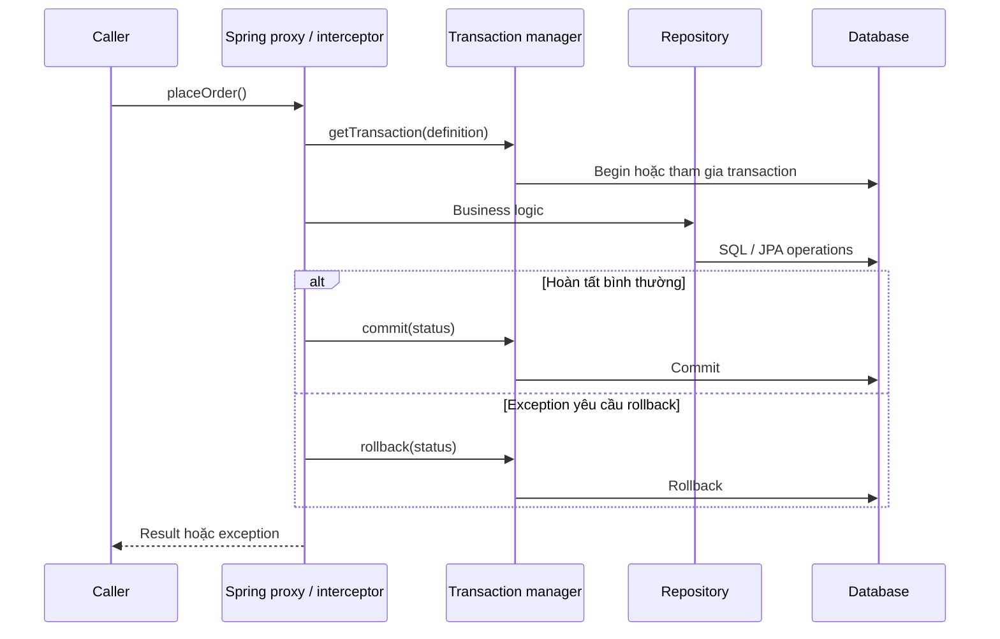
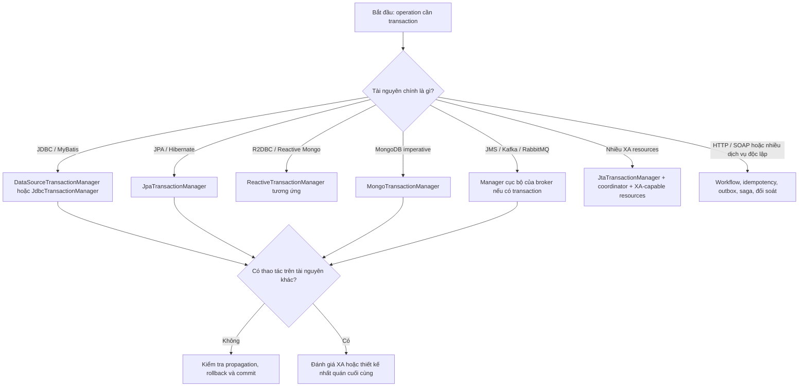
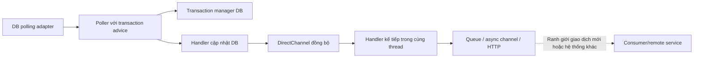
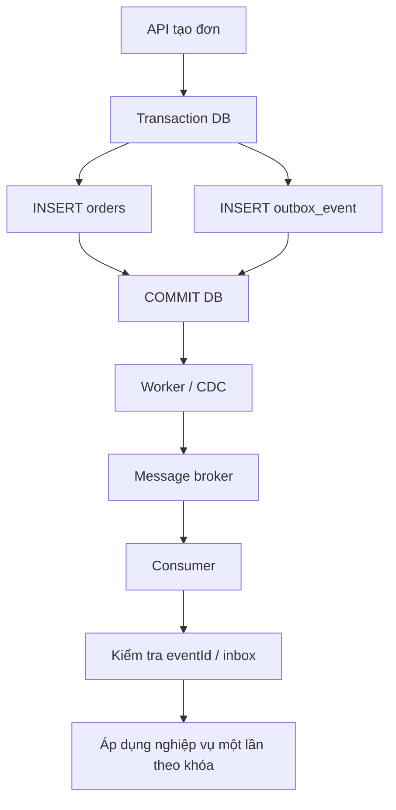

# PlatformTransactionManager và lựa chọn bộ quản lý giao dịch

## 1. Bài toán giao dịch trong tích hợp hệ thống

Một ứng dụng Spring Boot thường truy cập nhiều tài nguyên: database quan hệ qua JDBC hoặc JPA, MongoDB, Redis, Kafka, RabbitMQ, JMS, HTTP API và các adapter của Spring Integration. Khi một luồng nghiệp vụ vừa ghi dữ liệu vừa gửi thông điệp, câu hỏi quan trọng không chỉ là “có dùng `@Transactional` không?”, mà còn là **giao dịch nào đang được mở, ai quản lý nó và thao tác nào thực sự tham gia giao dịch đó**.

Trong module **SPRING_BOOT_INTEGRATION**, mục tiêu là tổ chức tích hợp hệ thống qua HTTP client, cơ sở dữ liệu, cache, broker thông điệp và các adapter của Spring Integration. Vì vậy, việc chọn transaction manager ảnh hưởng trực tiếp đến cách quản lý cấu hình, tính nhất quán dữ liệu, lỗi, xử lý trùng lặp, kiểm thử và quan sát luồng tích hợp.

Xét ví dụ dịch vụ đặt hàng:

1. Ghi bản ghi đơn hàng vào PostgreSQL.
2. Gọi ERP qua SOAP/HTTP để kiểm tra hạn mức.
3. Phát sự kiện `OrderCreated` lên Kafka.

`@Transactional` có thể giúp rollback các thao tác **trên database được quản lý trong một giao dịch**, nhưng không mặc nhiên hủy lệnh SOAP đã xử lý ở ERP, cũng không biến việc ghi PostgreSQL và phát Kafka thành một lần commit nguyên tử. Để giải quyết đúng bài toán, trước tiên phải hiểu **`PlatformTransactionManager`**.

Sau bài học, bạn có thể:

- Giải thích `PlatformTransactionManager` tham gia vào `@Transactional`, `TransactionTemplate` và vòng đời commit/rollback như thế nào.
- Chọn transaction manager phù hợp với JDBC, JPA, JTA/XA, hệ thống thông điệp và phân biệt giao dịch imperative với reactive.
- Cấu hình và chỉ định manager khi ứng dụng có nhiều `DataSource` hoặc nhiều tài nguyên giao dịch.
- Xác định ranh giới mà một transaction manager **không** bao phủ và chọn outbox, idempotency, đối soát hoặc saga cho các luồng tích hợp nhiều hệ thống.

## 2. `PlatformTransactionManager` là gì?

`PlatformTransactionManager` là interface cốt lõi của Spring cho **quản lý giao dịch kiểu imperative**. Nó tạo hoặc tham gia một giao dịch hiện có theo `TransactionDefinition`, sau đó commit hoặc rollback thông qua `TransactionStatus`.

Mô hình rút gọn:

```java
public interface PlatformTransactionManager extends TransactionManager {
    TransactionStatus getTransaction(TransactionDefinition definition);
    void commit(TransactionStatus status);
    void rollback(TransactionStatus status);
}
```

`TransactionDefinition` chứa chính sách như **propagation**, **isolation**, **timeout** và **readOnly**. `TransactionStatus` thể hiện trạng thái của lần xử lý giao dịch, bao gồm khả năng đánh dấu `rollbackOnly`. Transaction manager cụ thể biết cách bắt đầu, liên kết, commit hoặc rollback tài nguyên tương ứng: JDBC `Connection`, JPA `EntityManager`, một phiên giao dịch JMS hay giao dịch do JTA coordinator điều phối.

Spring tách hai trách nhiệm:

| Trách nhiệm | Thành phần | Ý nghĩa |
|---|---|---|
| Xác định **khi nào** mở/đóng transaction | `@Transactional`, `TransactionInterceptor`, `TransactionTemplate` | Bao quanh đoạn xử lý nghiệp vụ bằng ranh giới giao dịch. |
| Xác định **tài nguyên nào** được mở/commit/rollback | `PlatformTransactionManager` cụ thể | Tương tác với database driver, persistence provider, broker hoặc transaction coordinator. |

Sơ đồ một lời gọi `@Transactional` thông thường:



Đây là sơ đồ logic. Với `PROPAGATION_REQUIRED`, Spring có thể **tham gia giao dịch sẵn có**, nên mỗi lần gọi `getTransaction` không nhất thiết tạo một transaction vật lý mới. Cơ chế thực tế còn phụ thuộc transaction manager, propagation và tài nguyên.

### Không phải mọi transaction đều là một transaction phân tán

Một transaction manager cục bộ thường chỉ chịu trách nhiệm cho một tài nguyên hoặc một loại tài nguyên đã được cấu hình. Ví dụ `DataSourceTransactionManager` quản lý giao dịch của JDBC `Connection` từ một `DataSource`. Nó không thể tự động điều khiển HTTP request, Kafka producer hay một database kết nối độc lập. **Cùng nằm trong một phương thức Java không có nghĩa các thao tác cùng tham gia một transaction.**

## 3. `@Transactional` sử dụng manager như thế nào?

Ví dụ đơn giản với Spring JDBC:

```java
import org.springframework.jdbc.core.JdbcTemplate;
import org.springframework.stereotype.Service;
import org.springframework.transaction.annotation.Transactional;

@Service
public class StockReservationService {

    private final JdbcTemplate jdbc;

    public StockReservationService(JdbcTemplate jdbc) {
        this.jdbc = jdbc;
    }

    @Transactional
    public void reserve(String sku, int quantity) {
        int updated = jdbc.update("""
            UPDATE inventory
               SET reserved = reserved + ?
             WHERE sku = ? AND stock - reserved >= ?
            """, quantity, sku, quantity);

        if (updated != 1) {
            throw new IllegalStateException("Insufficient stock");
        }

        jdbc.update("""
            INSERT INTO reservation_log(sku, quantity)
            VALUES (?, ?)
            """, sku, quantity);
    }
}
```

Nếu hai lệnh dùng cùng `DataSource` và cùng giao dịch Spring, một `RuntimeException` từ lệnh thứ hai thường khiến cả cập nhật tồn kho lẫn ghi log bị rollback. Nhưng để điều đó xảy ra, cần đồng thời thỏa các điều kiện:

- Phương thức được gọi **qua Spring proxy/transaction interceptor** hoặc một cơ chế quản lý giao dịch tương đương; lời gọi trực tiếp bên trong cùng object (`this.reserve(...)`) thường không được advice kiểu proxy xử lý.
- Transaction manager được chọn phải quản lý đúng `DataSource` mà `JdbcTemplate` sử dụng.
- Các thao tác JDBC phải lấy kết nối qua cơ chế tích hợp Spring như `JdbcTemplate` hoặc `DataSourceUtils`, thay vì tự mở một kết nối độc lập ngoài transaction.
- Database và engine/bảng phải thực sự hỗ trợ transaction cho các thao tác liên quan.
- Exception phải kích hoạt rollback theo quy tắc đã cấu hình; mặc định phổ biến là rollback cho `RuntimeException` và `Error`, không tự động rollback với mọi checked exception.

Nếu dùng `@Async`, chuyển công việc sang executor hoặc gửi message qua broker, transaction context gắn với thread hiện tại **không tự động đi theo** lời gọi mới. Với xử lý reactive, Spring dùng một mô hình ngữ cảnh khác được trình bày ở phần sau.

## 4. Những transaction manager thường gặp

Tên các implementation dưới đây có thể xuất hiện ở các module Spring khác nhau; dependency và phiên bản phải tương thích với dự án. Đặc điểm chọn lựa quan trọng là **loại tài nguyên được quản lý**, không chỉ tên class.

| Manager | Tài nguyên và bối cảnh phù hợp | Ranh giới chính |
|---|---|---|
| `DataSourceTransactionManager` | JDBC với một `DataSource`; Spring JDBC, MyBatis hoặc truy cập JDBC thông qua Spring | Quản lý JDBC `Connection` cục bộ; không tự nối transaction của `DataSource` khác. |
| `JdbcTransactionManager` | Cũng là JDBC với một `DataSource`; có hỗ trợ dịch ngoại lệ commit/rollback sang hệ thống `DataAccessException` của Spring | Là một lựa chọn chuyên biệt cho JDBC; vẫn là transaction cục bộ trên một `DataSource`. |
| `JpaTransactionManager` | JPA/Hibernate với một `EntityManagerFactory` | Quản lý transaction JPA; có thể phối hợp JDBC qua **cùng `DataSource`** khi cấu hình đáp ứng điều kiện, nhưng không gom nhiều database độc lập thành XA. |
| `JtaTransactionManager` | Môi trường JTA, đặc biệt khi cần coordinator cho nhiều **XA-capable resources** | Muốn atomic commit nhiều tài nguyên cần hạ tầng JTA/XA và cấu hình từng tài nguyên thực sự tham gia. |
| `JmsTransactionManager` | Giao dịch cục bộ của JMS `Session` với một `ConnectionFactory` | Không tự động atomic cùng database; muốn JMS + DB tham gia một XA cần cấu hình JTA/XA phù hợp. |
| `KafkaTransactionManager` | Transaction của Kafka producer cho các bản ghi Kafka tương ứng | Không tự tạo atomic commit giữa Kafka và database quan hệ. |
| `RabbitTransactionManager` | Transaction cục bộ của RabbitMQ channel | Không cam kết atomic cùng database khác. |
| `MongoTransactionManager` | MongoDB giao dịch trên `ClientSession` | Cần deployment MongoDB có hỗ trợ transaction; không tự bao phủ SQL, Kafka hoặc HTTP. |

Ngoài các implementation imperative trên, Spring có **`ReactiveTransactionManager`** cho xử lý không chặn (non-blocking): ví dụ `R2dbcTransactionManager` cho R2DBC và `ReactiveMongoTransactionManager` cho reactive MongoDB. Các manager reactive **không triển khai `PlatformTransactionManager`**; chúng dùng Reactor context để truyền trạng thái thay vì chỉ dựa vào `ThreadLocal`.

**Redis** cần lưu ý riêng: lệnh `MULTI`/`EXEC` có cơ chế nhóm lệnh riêng, nhưng không biến Redis thành một thành viên XA phổ quát khi đặt cạnh database trong `@Transactional`. Tương tự, **HTTP/REST/SOAP không có `PlatformTransactionManager` chung** để rollback một yêu cầu đã được hệ thống đích xử lý.

## 5. Cách lựa chọn manager theo stack dữ liệu

Một quy tắc thực dụng: xác định **API truy cập dữ liệu chính** của transaction, sau đó kiểm tra xem các thao tác cần atomic có nằm trên cùng tài nguyên được manager đó quản lý hay không.



Các trường hợp chọn lựa hay gặp:

1. **Ứng dụng dùng `JdbcTemplate` để ghi PostgreSQL:** chọn manager JDBC cho đúng `DataSource`.
2. **Ứng dụng dùng Spring Data JPA/Hibernate:** thông thường chọn `JpaTransactionManager` gắn với `EntityManagerFactory` tương ứng.
3. **Ứng dụng dùng JPA và có thêm `JdbcTemplate` trên cùng database:** thường có thể dùng `JpaTransactionManager` cho cả luồng, nếu JDBC lấy connection qua cơ chế Spring từ **chính `DataSource`** của JPA. Phải xác nhận mapping của persistence provider và cấu hình manager; không mặc định mọi trường hợp đều tham gia cùng một connection.
4. **Ứng dụng dùng hai `DataSource` độc lập:** hai manager cục bộ tạo hai transaction độc lập. Muốn bảo đảm commit nguyên tử trên cả hai, phải xem xét JTA/XA hoặc thiết kế lại ranh giới nghiệp vụ.
5. **Ứng dụng ghi DB rồi gửi Kafka hoặc gọi HTTP:** chọn manager DB cho ghi DB, còn độ tin cậy của việc gửi và kết quả phía ngoài phải thiết kế riêng.

### Spring Boot chọn manager mặc định ra sao?

Spring Boot cung cấp auto-configuration cho nhiều stack dữ liệu và có thể tạo transaction manager khi các điều kiện dependency/bean phù hợp. Ví dụ ứng dụng Spring JDBC thuần có thể nhận JDBC transaction manager; ứng dụng JPA thường nhận JPA transaction manager. **Đừng dựa vào suy đoán rằng cứ có starter nào thì chắc chắn manager cụ thể được chọn**: các `DataSource`, `EntityManagerFactory`, bean tự khai báo và cấu hình transaction của ứng dụng đều ảnh hưởng kết quả.

Trong hệ thống chỉ có một transaction manager phù hợp, `@Transactional` không chỉ định tên thường dễ hiểu. Khi có nhiều manager, nên **chỉ định rõ tên** để tránh phụ thuộc vào cách phân giải manager mặc định hoặc thay đổi cấu hình ngoài ý muốn.

## 6. JDBC: một `DataSource`, một manager cục bộ

Với truy cập JDBC thuần, transaction manager gắn với `DataSource` cung cấp connection cho DAO/repository:

```java
import javax.sql.DataSource;
import org.springframework.context.annotation.Bean;
import org.springframework.context.annotation.Configuration;
import org.springframework.jdbc.support.JdbcTransactionManager;
import org.springframework.transaction.PlatformTransactionManager;

@Configuration
class JdbcTxConfiguration {
    @Bean("transactionManager")
    PlatformTransactionManager transactionManager(DataSource dataSource) {
        return new JdbcTransactionManager(dataSource);
    }
}
```

Đây là cấu hình **minh họa khi ứng dụng đã có một `DataSource` và chưa có bean transaction manager khác cùng tên**. Trong dự án Spring Boot có auto-configuration phù hợp, không nhất thiết phải khai báo bean này; cấu hình thủ công cần kiểm tra tránh tạo trùng và chọn sai manager.

Spring quản lý `Connection` liên kết với transaction của thread hiện tại. `JdbcTemplate` tham gia đúng transaction thông qua hạ tầng Spring JDBC. Một connection được tự mở bằng `DriverManager.getConnection(...)` có thể không liên quan đến transaction đang hoạt động, cho dù SQL đó được chạy trong cùng phương thức `@Transactional`.

### Khi nào dùng `JdbcTransactionManager` thay `DataSourceTransactionManager`?

`JdbcTransactionManager` phát triển từ `DataSourceTransactionManager`, bổ sung khả năng dịch một số ngoại lệ xảy ra khi commit/rollback sang hệ thống ngoại lệ truy cập dữ liệu của Spring. Nếu toàn bộ stack là JDBC và phiên bản Spring Framework hỗ trợ, đó là lựa chọn hợp lý. Điểm này **không làm thay đổi phạm vi atomic**: cả hai vẫn quản lý transaction cục bộ trên một `DataSource`, không tự trở thành XA.

### JPA và JDBC cùng tham gia transaction khi nào?

Với JPA, `JpaTransactionManager` quản lý `EntityManager` và giao dịch của JPA provider. Nếu code JPA và `JdbcTemplate` cùng dùng underlying JDBC `DataSource`, và `JpaTransactionManager` được cấu hình đúng để exposing JDBC connection, cả hai **có thể** tham gia cùng một transaction cục bộ. Ngược lại, dùng JPA qua một `EntityManagerFactory` và JDBC qua một `DataSource` kết nối khác thì không có đảm bảo đó là cùng giao dịch.

Với Hibernate, thao tác SQL của JPA có thể được trì hoãn đến lúc `flush` hoặc commit. Vì vậy kiểm thử phải xác nhận thứ tự ghi thực tế, ràng buộc khóa, lỗi unique constraint và kết quả rollback, thay vì chỉ nhìn thứ tự gọi method Java.

## 7. Ứng dụng có nhiều `DataSource` hoặc nhiều manager

Giả sử `ordersDataSource` và `billingDataSource` truy cập hai database độc lập. Đặt tên rõ ràng cho từng manager:

```java
import javax.sql.DataSource;
import org.springframework.beans.factory.annotation.Qualifier;
import org.springframework.context.annotation.Bean;
import org.springframework.context.annotation.Configuration;
import org.springframework.jdbc.support.JdbcTransactionManager;
import org.springframework.transaction.PlatformTransactionManager;

@Configuration
class MultiDataSourceTxConfiguration {

    @Bean("ordersTxManager")
    PlatformTransactionManager ordersTxManager(
            @Qualifier("ordersDataSource") DataSource dataSource) {
        return new JdbcTransactionManager(dataSource);
    }

    @Bean("billingTxManager")
    PlatformTransactionManager billingTxManager(
            @Qualifier("billingDataSource") DataSource dataSource) {
        return new JdbcTransactionManager(dataSource);
    }
}
```

Hai `DataSource` phải được cấu hình và cấp cho đúng DAO/JdbcTemplate tương ứng; đoạn trên cố ý chỉ thể hiện **phần transaction manager**. Khi gọi code nghiệp vụ:

```java
import org.springframework.stereotype.Service;
import org.springframework.transaction.annotation.Transactional;

@Service
public class OrdersService {

    private final OrdersRepository orders;

    public OrdersService(OrdersRepository orders) {
        this.orders = orders;
    }

    @Transactional(transactionManager = "ordersTxManager")
    public void confirm(long orderId) {
        orders.markConfirmed(orderId);
    }
}
```

`OrdersRepository` trong ví dụ là abstraction của ứng dụng, phải sử dụng `ordersDataSource`. Nếu muốn thao tác vào billing, phương thức billing cần được quản lý bởi `billingTxManager` phù hợp. **Hai annotation dùng hai manager không tạo ra một transaction atomic chung**. Nếu `orders` commit thành công nhưng `billing` thất bại, mỗi transaction cục bộ có thể đang ở trạng thái khác nhau.

Các cách xác định manager trong Spring:

| Cơ chế | Khi nào dùng | Điểm cần biết |
|---|---|---|
| `@Transactional("ordersTxManager")` | Phương thức thuộc đúng một tài nguyên, muốn thể hiện rõ bằng code | Tên/qualifier phải phân giải được transaction manager hợp lệ. |
| `@Transactional(transactionManager = "ordersTxManager")` | Tương đương cách trên, rõ ý hơn trong cấu hình phức tạp | `value` và `transactionManager` là alias của nhau. |
| Bean được chọn làm mặc định (`@Primary`, cấu hình transaction, quy tắc lựa chọn của Spring) | Ứng dụng có quy ước rõ một manager chính | Không thay thế việc kiểm tra manager nào được interceptor lựa chọn. |
| `TransactionManagementConfigurer` | Cần cấu hình mặc định cho annotation-driven transactions | `annotationDrivenTransactionManager()` trả về `TransactionManager` mặc định cho advice. |
| `TransactionTemplate` với manager được inject rõ | Muốn quyết định ranh giới transaction bằng code | Bảo đảm template dùng chính manager được chọn. |

**Không đặt `@Primary` với kỳ vọng nó nhập nhiều transaction cục bộ lại với nhau.** Nó chỉ giúp một số điểm inject/phân giải bean chọn đối tượng ưu tiên; khả năng atomic hoàn toàn phụ thuộc implementation và tài nguyên thực sự tham gia.

## 8. Quản lý giao dịch bằng `TransactionTemplate`

Không phải mọi transaction đều tiện biểu diễn bằng annotation. Khi chỉ một đoạn nhỏ của phương thức cần transaction, hoặc cần đặt giao dịch bên trong một workflow phức tạp, `TransactionTemplate` giúp mở/đóng ranh giới rõ ràng:

```java
import org.springframework.beans.factory.annotation.Qualifier;
import org.springframework.stereotype.Service;
import org.springframework.transaction.PlatformTransactionManager;
import org.springframework.transaction.support.TransactionTemplate;

@Service
public class ImportService {

    private final TransactionTemplate ordersTx;
    private final OrdersRepository orders;

    public ImportService(
            @Qualifier("ordersTxManager") PlatformTransactionManager txManager,
            OrdersRepository orders) {
        this.ordersTx = new TransactionTemplate(txManager);
        this.orders = orders;
    }

    public void importOne(ImportedOrder order) {
        // Bước kiểm tra/gọi dữ liệu ngoài có thể thực hiện trước transaction.
        ordersTx.executeWithoutResult(status -> {
            orders.insert(order);
            orders.recordImport(order.externalId());
        });
    }
}
```

`ImportedOrder` và `OrdersRepository` là kiểu miền nghiệp vụ minh họa. `executeWithoutResult` phù hợp với callback không có giá trị trả về. Khi callback ném exception, template xử lý commit/rollback theo semantics của `TransactionTemplate` và `PlatformTransactionManager` tương ứng. Nếu muốn chủ động đánh dấu rollback theo một kết quả nghiệp vụ, có thể dùng `status.setRollbackOnly()`.

Khác với advice dựa trên proxy, callback của `TransactionTemplate` bắt đầu transaction ngay tại vị trí gọi `execute(...)`, nên phù hợp khi cần giới hạn thời gian giữ khóa hoặc tách một đoạn ghi dữ liệu khỏi lệnh HTTP dài. Dù vậy, **đặt một HTTP call bên trong callback không làm HTTP call trở thành một thành viên transaction**.

## 9. Propagation, isolation, timeout và rollback

Việc chọn đúng manager mới là bước đầu. `TransactionDefinition` quyết định cách lời gọi mới xử lý khi đã có transaction trước đó.

| Propagation | Hành vi chính | Ghi chú thiết kế |
|---|---|---|
| `REQUIRED` | Tham gia transaction hiện có hoặc tạo mới nếu chưa có | Mặc định phổ biến cho nghiệp vụ ghi database. |
| `REQUIRES_NEW` | Tạm dừng transaction đang có và mở transaction mới | Có thể cần thêm connection; transaction bên trong commit độc lập với transaction bên ngoài. |
| `NESTED` | Dùng savepoint bên trong transaction hiện có khi manager/tài nguyên hỗ trợ | Chủ yếu hữu ích với JDBC savepoint; không được hiểu mặc định là transaction XA hoặc áp dụng như nhau cho mọi JPA provider. |
| `SUPPORTS` | Tham gia transaction nếu đã có; nếu không thì chạy không có transaction | Phù hợp tác vụ có thể đọc cả hai cách nếu semantics cho phép. |
| `MANDATORY` | Bắt buộc phải có transaction hiện tại | Giúp phát hiện caller quên mở transaction. |
| `NOT_SUPPORTED` | Tạm dừng transaction hiện tại để chạy không có transaction | Hữu ích với đoạn không cần giữ giao dịch mở. |
| `NEVER` | Ném lỗi nếu đang có transaction | Thể hiện ràng buộc không được gọi trong giao dịch. |

Ví dụ:

```java
@Transactional(
    transactionManager = "ordersTxManager",
    propagation = Propagation.REQUIRED,
    isolation = Isolation.READ_COMMITTED,
    timeout = 10,
    rollbackFor = OrderImportException.class
)
public void processOrder(...) {
    // Các thao tác trên ordersDataSource tham gia giao dịch này.
}
```

Trong đó `OrderImportException` là checked exception riêng do ứng dụng định nghĩa; thêm `rollbackFor` khi muốn lỗi đó rollback. `Isolation.READ_COMMITTED` chỉ có hiệu lực nếu database/driver và manager hỗ trợ cách áp dụng tương ứng. `timeout = 10` là **timeout của transaction theo giây**, không thay thế timeout của HTTP client, JDBC query hoặc broker. `readOnly = true` thường là tín hiệu/hint để framework và driver tối ưu hoặc hạn chế ghi trong một số cấu hình, không phải một cơ chế bảo mật thay cho quyền database.

### Quy tắc rollback và `rollbackOnly`

- Mặc định, `@Transactional` thường rollback khi `RuntimeException` hoặc `Error` đi qua interceptor; với checked exception, có thể dùng `rollbackFor` hoặc quy tắc được cấu hình ở cấp ứng dụng.
- Nếu exception bị `catch` và **không** rethrow hay đánh dấu rollback, interceptor có thể coi phương thức đã hoàn tất bình thường và yêu cầu commit.
- Một đoạn xử lý bên trong có thể đánh dấu transaction hiện tại là `rollbackOnly`. Nếu outer method tiếp tục và yêu cầu commit, Spring có thể báo `UnexpectedRollbackException`: không được coi đây là lỗi “ngẫu nhiên”, mà là tín hiệu commit không thể được thực hiện do transaction đã bị đánh dấu rollback.
- `REQUIRES_NEW` tạo phạm vi commit riêng; nó phù hợp một số nhu cầu ghi audit độc lập, nhưng có thể làm sai kỳ vọng “mọi thứ rollback cùng nhau” và gây áp lực lên connection pool khi các transaction lồng nhau chờ connection.

### Transaction dài và tài nguyên bị khóa

Tránh mở một transaction database rồi đợi ERP/SOAP/REST vài chục giây trước khi commit. Việc giữ connection và lock lâu làm tăng nguy cơ deadlock, lock contention, cạn connection pool và timeout. Khi có thể, tách bước gọi dịch vụ ngoài ra trước/ngoài transaction hoặc chuyển thành workflow nhiều trạng thái có đối soát. Tuy nhiên cần cân nhắc tính đúng đắn: chuyển HTTP call ra ngoài transaction có thể tạo **cửa sổ race** nếu nghiệp vụ đòi hỏi dữ liệu không được thay đổi giữa hai bước.

## 10. Giao dịch trong Spring Integration flow

Spring Integration điều phối thông điệp qua channel, endpoint, transformer, handler, poller và adapter. Một luồng có thể bắt đầu từ database poller, gọi HTTP outbound gateway, ghi DB và phát sự kiện. Transaction manager được sử dụng tại **điểm bắt đầu giao dịch**, ví dụ ở transactional poller hoặc service/handler được advice bằng `@Transactional`.



Khi cấu hình poller có transaction advice, các thao tác DB đồng bộ qua cùng connection và manager có thể thuộc phạm vi giao dịch poller. Nhưng giao dịch đó **không tự động chạy xuyên qua** `ExecutorChannel`, `QueueChannel` được xử lý sau, broker bên ngoài, HTTP gateway hoặc thread mới. Khi một thông điệp đã qua ranh giới bất đồng bộ, consumer phía sau thường cần transaction, idempotency và cơ chế xử lý lỗi riêng.

Một lỗi thiết kế thường gặp là cho rằng “toàn bộ integration flow nằm trong DSL nên nằm trong một transaction”. Phải xác định chính xác **channel nào đồng bộ**, handler chạy ở thread nào, adapter truy cập tài nguyên nào, nơi transaction bắt đầu/kết thúc và cách message được xác nhận (acknowledge). Với polling nhận dữ liệu từ DB, cần làm rõ việc đọc/chọn bản ghi, đánh dấu đang xử lý và commit có nằm trong cùng transaction hay không để tránh hai worker lấy trùng.

## 11. Database, Kafka, RabbitMQ và JMS có cùng commit được không?

Mỗi hệ thống có cơ chế giao dịch riêng. Sự tồn tại của một transaction manager bên phía broker không có nghĩa một manager DB sẽ điều khiển cả broker.

| Tổ hợp | Có thể giao dịch cục bộ? | Atomic xuyên hai tài nguyên? | Hướng xử lý thường dùng |
|---|---|---|---|
| JDBC + JDBC trên **cùng `DataSource`** | Có | Có, trong phạm vi cùng transaction DB | Một manager JDBC/JPA phù hợp. |
| JPA + JDBC **cùng DB/cùng connection được enlist** | Có | Có, khi cấu hình đúng | `JpaTransactionManager` và tích hợp JDBC đúng. |
| Hai database độc lập | Có trên từng DB | Không với hai manager local riêng biệt | JTA/XA khi phù hợp; nếu không, saga/đối soát. |
| Database + Kafka | Có local transaction ở từng hệ | Không bảo đảm chỉ từ việc dùng DB manager + Kafka manager | Transactional outbox, idempotent consumer, quản lý offset. |
| Database + RabbitMQ | Có local transaction ở từng hệ | Không bảo đảm chỉ từ hai local managers | Outbox + publisher confirms, xử lý trùng lặp. |
| Database + JMS | Có local transaction | Có thể qua JTA/XA nếu cả JDBC và JMS resource hỗ trợ XA và được enlist | XA hoặc outbox/inbox, tùy yêu cầu. |
| Database + HTTP/SOAP | Database có transaction; HTTP không có cơ chế transaction chung | Không | Workflow, idempotency, compensation, truy vấn trạng thái. |

### Spring Kafka transactions và thứ tự commit

`KafkaTransactionManager` có thể quản lý transaction phía Kafka producer. Một luồng có thể cấu hình đồng bộ transaction Kafka với transaction database trong cùng tiến trình, nhưng **đây không mặc nhiên là distributed 2-phase commit**. Thứ tự commit ảnh hưởng tình huống hỏng: database đã commit nhưng Kafka commit lỗi hoặc ngược lại (tùy cấu hình). Không dùng cách đồng bộ này như bằng chứng rằng đơn hàng và sự kiện luôn atomic.

Với luồng “ghi DB, sau đó phải phát sự kiện” mà **không được mất sự kiện**, transactional outbox thường dễ kiểm chứng hơn:

1. Trong **một** database transaction, ghi đơn hàng và một bản ghi `outbox_event`.
2. Commit DB; cả hai bản ghi cùng thành công hoặc cùng rollback.
3. Worker/CDC phát event từ outbox sang broker; đánh dấu hoặc theo dõi trạng thái phát sau khi có kết quả xác nhận phù hợp.
4. Consumer dùng `eventId` hoặc business key để xử lý **idempotent**, vì việc gửi lại/nhận trùng vẫn có thể xảy ra.



Outbox không đảm bảo consumer chỉ **nhận** một lần; mục tiêu là dữ liệu nghiệp vụ và “ý định phát sự kiện” được commit cùng nhau, sau đó đường truyền và consumer được thiết kế chịu được delivery lặp.

### JMS và lựa chọn JTA/XA

Nếu ứng dụng cần một transaction thực sự gồm JDBC và JMS, `JtaTransactionManager` chỉ là **cầu nối Spring tới môi trường JTA**. Muốn XA 2-phase commit, cần transaction coordinator, XA driver/`XADataSource`, JMS `XAConnectionFactory`, enlistment đúng và cách xử lý recovery. Không phải mọi broker, cấu hình hoặc framework adapter đều hỗ trợ XA trong môi trường đang chạy.

JTA/XA tăng độ phức tạp vận hành: participant có thể ở trạng thái in-doubt sau crash, giao dịch kéo dài giữ tài nguyên, và cần log/recovery của coordinator. 2PC không thay thế idempotency hoặc đối soát cho các hệ thống **không** tham gia XA như REST/SOAP.

## 12. Giao dịch và mô hình reactive

Không dùng `PlatformTransactionManager` của JDBC để giả định transaction được truyền xuyên chuỗi `Mono`/`Flux` không chặn. Trong Spring reactive, `ReactiveTransactionManager` gắn transaction với **Reactor context**. `R2dbcTransactionManager` quản lý transaction của R2DBC connection; reactive MongoDB có manager riêng.

Ví dụ `TransactionalOperator` với R2DBC:

```java
import org.springframework.r2dbc.core.DatabaseClient;
import org.springframework.stereotype.Service;
import org.springframework.transaction.reactive.TransactionalOperator;
import reactor.core.publisher.Mono;

@Service
public class ReactiveReservationService {

    private final DatabaseClient db;
    private final TransactionalOperator tx;

    public ReactiveReservationService(DatabaseClient db, TransactionalOperator tx) {
        this.db = db;
        this.tx = tx;
    }

    public Mono<Void> reserve(String sku, int quantity) {
        return db.sql("UPDATE inventory SET reserved = reserved + :q WHERE sku = :sku")
                .bind("q", quantity)
                .bind("sku", sku)
                .fetch()
                .rowsUpdated()
                .flatMap(updated -> updated == 1
                        ? Mono.<Void>empty()
                        : Mono.error(new IllegalStateException("Unknown item")))
                .as(tx::transactional);
    }
}
```

Ví dụ chỉ minh họa transaction reactive, **chưa kiểm tra điều kiện tồn kho**; trong ứng dụng thật cần điều kiện cập nhật có khóa/điều kiện hoặc cơ chế concurrency control phù hợp. `TransactionalOperator` phải được tạo từ đúng `ReactiveTransactionManager` của `DatabaseClient` đang sử dụng.

Không nên trộn blocking JPA/JDBC vào reactive chain rồi nghĩ cả hai cùng transaction vì có một annotation trên method. Nếu cần phối hợp imperative với reactive, hãy xác định rõ ranh giới và cân nhắc kiến trúc bất đồng bộ, vì transaction context và mô hình thực thi khác nhau.

## 13. Gọi API bên ngoài: transaction kết thúc ở đâu?

Xét ví dụ:

```java
@Transactional("ordersTxManager")
public void createOrder(CreateOrderCommand cmd) {
    orders.insert(cmd);
    erpSoapClient.createOrder(cmd); // Gọi hệ thống ngoài qua HTTP.
}
```

Nếu `erpSoapClient.createOrder(...)` thành công ở ERP nhưng một lỗi khiến transaction DB rollback, **đơn hàng ERP vẫn có thể tồn tại**. Ngược lại, nếu DB đã commit rồi HTTP timeout, hệ thống có thể không biết ERP có hoàn tất hay chưa. Đặt `@Transactional` lên method không cung cấp rollback xuyên network.

Một thiết kế an toàn hơn cho operation ghi qua HTTP/SOAP thường gồm:

| Trạng thái workflow | Ý nghĩa | Hành động tiếp theo |
|---|---|---|
| `PENDING` | Đã ghi nhận yêu cầu nội bộ, chưa có kết quả từ ERP | Đưa vào hàng đợi xử lý hoặc bắt đầu request có kiểm soát. |
| `CONFIRMED` | ERP xác nhận hoàn tất | Lưu reference ID, cho phép bước nghiệp vụ tiếp theo. |
| `REJECTED` | ERP từ chối chắc chắn theo quy tắc nghiệp vụ | Thông báo lỗi phù hợp, không retry mù. |
| `UNKNOWN` | Mất kết nối/timeout sau khi gửi, chưa rõ ERP đã commit chưa | Tra cứu theo business key/request ID; đối soát trước khi gửi lại. |

Nếu đối tác hỗ trợ idempotency key, sử dụng khóa duy nhất cho cùng **ý định nghiệp vụ**, giữ nguyên khóa qua các lần retry. Nếu không có idempotency, phải dùng API tra cứu, cơ chế đối soát hoặc yêu cầu vận hành rõ ràng. Khi một thao tác đã thành công ở hệ thống khác, cơ chế **compensation** có thể tạo lệnh đảo nghiệp vụ, nhưng không đồng nghĩa với rollback ACID: nó có thể thất bại, mất thời gian hoặc không thể đảo hoàn toàn.

## 14. Những lỗi lựa chọn transaction manager phổ biến

| Triệu chứng | Nguyên nhân khả dĩ | Cách kiểm tra |
|---|---|---|
| `@Transactional` vẫn commit một phần | Lời gọi không đi qua proxy, exception bị catch, thao tác dùng connection độc lập, sai manager | Đặt log tại entry point, kiểm tra bean manager và resource thực tế, xác nhận rollback bằng test. |
| `NoUniqueBeanDefinitionException` hoặc lỗi không tìm được manager | Có nhiều manager mà không chỉ rõ hoặc bean name không khớp | Dùng qualifier/name cụ thể; kiểm tra auto-configuration và bean definitions. |
| JPA rollback nhưng câu lệnh JDBC vẫn còn | JDBC dùng `DataSource`/connection khác với JPA hoặc truy cập không đi qua Spring | Đối chiếu `EntityManagerFactory`, `DataSource` và cách lấy connection. |
| `UnexpectedRollbackException` | Inner operation đã đánh dấu giao dịch `rollbackOnly`, outer vẫn yêu cầu commit | Theo dõi propagation và điểm bắt/catch exception; không bỏ qua rollback marker. |
| Database commit nhưng Kafka không có event | Hai hệ thống không atomic, crash hoặc broker commit thất bại | Kiểm tra outbox/producer confirm và retry có idempotency. |
| Transaction có vẻ không tác dụng với `@Async` | Code chạy trong thread khác | Thiết kế transaction riêng tại async handler và message boundary. |
| Lỗi lock timeout hoặc cạn connection | Transaction giữ khóa/connection quá lâu; `REQUIRES_NEW` cần thêm connection | Đo thời gian giao dịch, trace HTTP bên trong transaction, phân tích pool. |
| Test rollback tốt nhưng production vẫn sai | Test dùng `@Transactional` bao toàn bộ test, không thực hiện commit thật hoặc bỏ qua callback sau commit | Thêm test integration có commit thực tế và sự cố giữa các bước. |

Để xác minh một transaction đang hoạt động trong **imperative, thread-bound code**, có thể dùng API hỗ trợ chẩn đoán:

```java
import org.springframework.transaction.support.TransactionSynchronizationManager;

boolean active = TransactionSynchronizationManager.isActualTransactionActive();
String name = TransactionSynchronizationManager.getCurrentTransactionName();
```

Đây chỉ là tín hiệu chẩn đoán, **không chứng minh** một thao tác HTTP/Kafka hoặc một `DataSource` khác đang được enlist. Đừng xây logic nghiệp vụ phụ thuộc vào kết quả kiểm tra này thay cho thiết kế ranh giới rõ ràng.

## 15. Kiểm thử lựa chọn manager và ranh giới commit

Một bộ test hữu ích phải chứng minh **hành vi commit/rollback quan sát được**. Tránh những test chỉ xác nhận annotation có mặt hoặc mock `PlatformTransactionManager` rồi coi như database thật đã rollback.

Các tình huống nên kiểm tra:

1. **Cùng manager, cùng database:** hai lệnh ghi; lỗi ở lệnh thứ hai phải khiến lệnh thứ nhất rollback.
2. **Checked exception:** có/không có `rollbackFor`; quan sát bản ghi được commit hay rollback.
3. **Self-invocation:** gọi trực tiếp phương thức có `@Transactional` bên trong cùng bean và so sánh với lời gọi đi qua proxy.
4. **Nhiều `DataSource`:** xác minh mỗi DAO thực sự dùng connection của manager được đặt tên; chứng minh không có atomic commit xuyên hai local managers.
5. **JPA + JDBC:** xác minh cùng transaction khi cấu hình dùng chung `DataSource` và kiểm tra cả trường hợp `flush` lỗi.
6. **Database + broker/HTTP:** mô phỏng mất kết nối sau commit DB, gửi trùng, SOAP timeout sau khi server xử lý; xác nhận workflow/outbox/inbox và quy tắc đối soát.
7. **Propagation:** kiểm tra `REQUIRES_NEW`, `NESTED` khi tài nguyên hỗ trợ, và trường hợp `rollbackOnly` dẫn tới `UnexpectedRollbackException`.

Khi viết test Spring, cần cẩn thận với `@Transactional` trên **test method**: Spring Test có thể rollback sau test theo mặc định, làm một số lỗi commit hoặc callback `AFTER_COMMIT` không xuất hiện. Với những test cần chứng minh commit, sử dụng transaction điều khiển riêng, `TestTransaction` hoặc phương án setup test phù hợp. Integration test với database/broker thật hoặc Testcontainers thường cung cấp bằng chứng đáng tin cậy hơn mock cho các tình huống quản lý tài nguyên.

## 16. Quan sát và vận hành transaction

Khi có lỗi tích hợp, metric “HTTP request thất bại” không đủ cho biết database đã commit chưa. Hãy gắn observability với **điểm chuyển trạng thái**:

- **Tracing:** ghi span cho nghiệp vụ, transaction database và các lời gọi outbound; thể hiện rõ khoảng thời gian mở transaction, điểm gửi broker/HTTP và điểm commit.
- **Metric:** thời lượng giao dịch, số rollback, deadlock, transaction timeout, kết nối đang dùng trong pool, độ trễ broker, sự kiện outbox tồn đọng và số workflow `UNKNOWN` chờ đối soát.
- **Log:** transaction manager được chọn (ở log cấu hình/chẩn đoán), operation, correlation ID, business key được bảo vệ và mã lỗi chuẩn hóa. Không đưa dữ liệu cá nhân hoặc token vào log mặc định.
- **Alert:** số giao dịch phải đối soát tăng, outbox phát chậm, pool cạn, deadlock tăng hoặc tỷ lệ lỗi commit/rollback tăng sau khi cấu hình thay đổi.

Không cần log nguyên SQL và payload cho mọi request trong production. Khi điều tra, hãy bật logging transaction có kiểm soát theo thời hạn và phạm vi cần thiết, bởi log ở mức debug/trace có thể chứa thông tin nhạy cảm hoặc tạo tải lớn.

## 17. Checklist chọn `PlatformTransactionManager`

Trước khi viết một phương thức `@Transactional` trong module tích hợp:

- [ ] Xác định operation cần atomic **trên tài nguyên nào**, thuộc một DB, một broker hay nhiều hệ thống.
- [ ] Xác định API truy cập dữ liệu: JDBC, JPA, Mongo imperative, JMS, Kafka, RabbitMQ hay R2DBC/reactive.
- [ ] Chọn manager quản lý **đúng** `DataSource`, `EntityManagerFactory`, `ConnectionFactory` hoặc producer phù hợp.
- [ ] Nếu có nhiều manager, đặt tên rõ ràng và chỉ định `transactionManager`/`TransactionTemplate` tại ranh giới nghiệp vụ.
- [ ] Kiểm tra self-invocation, thread/async boundary, cơ chế lấy connection và hiệu lực của propagation/isolation/timeout.
- [ ] Xác định rollback rules cho lỗi kỹ thuật và nghiệp vụ, bao gồm checked exception và trường hợp exception bị catch.
- [ ] Với JPA + JDBC, xác minh chúng thực sự dùng cùng resource trong cùng transaction; với hai DB, không giả định hai local manager là XA.
- [ ] Với DB + broker hoặc DB + HTTP/SOAP, chọn outbox/inbox, idempotency, saga hoặc đối soát theo yêu cầu; đánh giá XA nếu môi trường hỗ trợ và thực sự cần.
- [ ] Kiểm thử commit thật, rollback, timeout, retry, trạng thái chưa xác định và khả năng phục hồi sau crash.
- [ ] Quan sát duration, commit/rollback, lock, outbox backlog và các giao dịch cần đối soát.

## 18. Kết luận

`PlatformTransactionManager` là abstraction để Spring điều khiển **giao dịch imperative trên tài nguyên cụ thể**. `@Transactional` chỉ xác định ranh giới và chính sách; manager được chọn mới quyết định resource nào tham gia. JDBC, JPA, JMS, Kafka, RabbitMQ, MongoDB và JTA có những khả năng, điều kiện cấu hình và phạm vi đảm bảo khác nhau; reactive transaction sử dụng `ReactiveTransactionManager` riêng.

Trong tích hợp Spring Boot thực tế, lựa chọn đúng manager phải đi cùng quyết định về **ranh giới nhất quán**. Giữa các database độc lập, broker và HTTP/SOAP, khi không có một cơ chế phối hợp transaction thực sự, hãy quản lý workflow state, outbox, idempotency, compensation và đối soát. Đây là cách biến một phương thức có `@Transactional` thành một luồng tích hợp đáng tin cậy khi lỗi mạng, retry, thay đổi hợp đồng và crash xảy ra.
