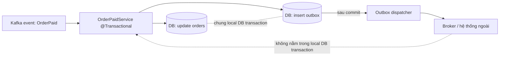
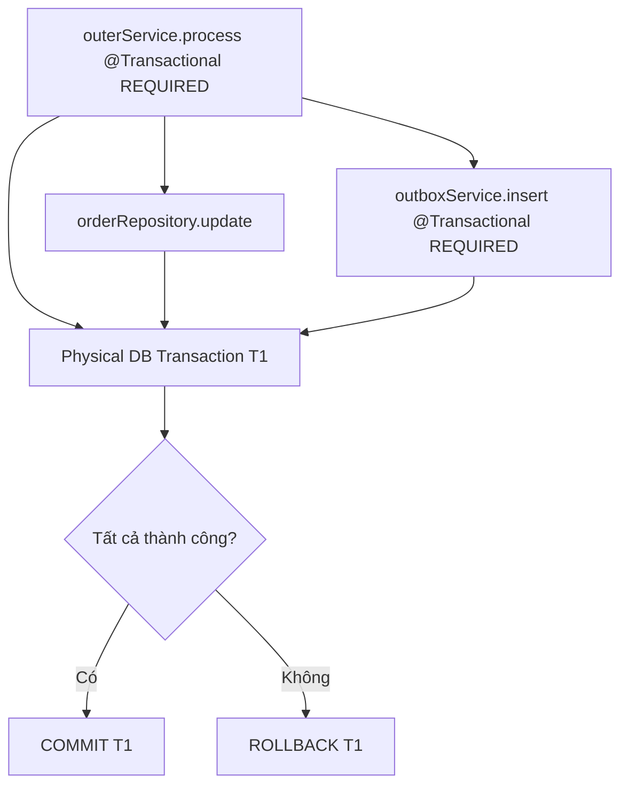

# `@Transactional`, propagation và isolation

## 1. Bối cảnh: giao dịch quan trọng thế nào trong tích hợp Spring Boot?

Một dịch vụ Spring Boot có thể đọc PostgreSQL, cập nhật đơn hàng, ghi bản ghi outbox, gọi ERP qua HTTP, xóa cache Redis và xác nhận một thông điệp Kafka/RabbitMQ trong cùng luồng nghiệp vụ. Nếu một bước gặp lỗi, câu hỏi quan trọng không chỉ là “có ném exception hay không”, mà còn là **thao tác nào đã commit, thao tác nào được rollback và hệ thống nào có thể đã nhận tác dụng phụ**.

Trong module **`SPRING_BOOT_INTEGRATION`**, giao dịch là nền tảng để tổ chức tích hợp qua HTTP client, cơ sở dữ liệu, cache, broker thông điệp và các adapter Spring Integration. Nó liên quan trực tiếp tới **cấu hình kết nối, hợp đồng dữ liệu, xử lý lỗi, giao dịch, xử lý trùng lặp, kiểm thử và quan sát**. `@Transactional` giúp xác định một ranh giới transaction trong Spring; **propagation** quyết định một lời gọi tham gia hay tạo transaction; **isolation** quyết định mức cách ly khi nhiều transaction truy cập đồng thời cùng dữ liệu.

Ví dụ xuyên suốt: consumer nhận sự kiện `OrderPaid`, cập nhật trạng thái đơn trong database và ghi một sự kiện `ShipmentRequested` vào outbox. Nếu cập nhật đơn thành công nhưng ghi outbox thất bại, cả hai thao tác phải rollback. Sau khi commit, worker riêng mới gửi `ShipmentRequested` tới broker; sự kiện có thể được gửi lại nên cần idempotency. Ta sẽ giải thích vì sao transaction hỗ trợ phần **cùng database** nhưng chưa tự giải quyết được phần **xuyên hệ thống**.

Kết thúc bài học, bạn có thể:

- Giải thích `@Transactional` điều khiển transaction thông qua Spring AOP và `PlatformTransactionManager` như thế nào.
- Phân biệt bảy kiểu propagation và chọn `REQUIRED`, `REQUIRES_NEW`, `NESTED` trong tình huống phù hợp.
- Phân tích dirty read, non-repeatable read, phantom read, lost update và vai trò của isolation level.
- Nhận diện lỗi self-invocation, rollback-only, `UnexpectedRollbackException`, transaction dài và dùng sai transaction manager.
- Thiết kế transaction ngắn, idempotent, kết hợp outbox/đối soát cho HTTP, database, cache và broker.
- Kiểm thử hiệu ứng commit/rollback và hành vi cạnh tranh thực tế trên database đang sử dụng.

## 2. Transaction quản lý điều gì và không quản lý điều gì?

Một transaction trong hệ quản trị cơ sở dữ liệu hướng tới các thuộc tính **ACID**:

| Thuộc tính | Ý nghĩa | Ví dụ |
|---|---|---|
| **Atomicity** | Nhóm thay đổi cùng commit hoặc rollback. | Cập nhật đơn và insert outbox trong cùng database. |
| **Consistency** | Transaction đưa dữ liệu giữa các trạng thái thỏa ràng buộc đã thiết kế. | Không vi phạm `UNIQUE`, `FOREIGN KEY`, điều kiện nghiệp vụ được kiểm soát. |
| **Isolation** | Các transaction đồng thời quan sát và ảnh hưởng lẫn nhau theo cấp độ cách ly. | Hai consumer cùng cố chuyển trạng thái đơn hàng. |
| **Durability** | Thay đổi đã commit được lưu bền theo cam kết của database. | Đơn đã cập nhật vẫn tồn tại sau khi ứng dụng restart. |

`@Transactional` là **khai báo quản lý ranh giới transaction** trên một lời gọi được Spring intercept. Nó không tự tạo ra ACID cho mọi hệ thống mà method gọi tới. Một local database transaction không rollback được request HTTP đã gửi tới ERP hoặc message đã publish thành công ra broker. Ngay cả hai `DataSource` độc lập cũng không tự động có chung transaction chỉ vì nằm trong một method gắn annotation.



Mục tiêu là biết **ranh giới chắc chắn** của transaction; phần ngoài ranh giới phải được quản lý bằng cơ chế phân tán như outbox, idempotency, trạng thái trung gian hoặc đối soát.

## 3. Spring điều phối transaction qua những thành phần nào?

Spring có abstraction **`PlatformTransactionManager`** cho transaction kiểu imperative. Framework dùng transaction interceptor để bắt đầu/tham gia transaction trước khi gọi method, sau đó commit hoặc rollback tùy kết quả. Bên dưới là tài nguyên và cơ chế transaction cụ thể:

| Thành phần | Vai trò | Trường hợp thường gặp |
|---|---|---|
| `DataSource` | Cung cấp JDBC connection. | Spring JDBC, `JdbcClient`, jOOQ qua JDBC. |
| `JdbcTransactionManager`/`DataSourceTransactionManager` | Điều phối local JDBC transaction trên một datasource. | Nhiều thao tác `JdbcTemplate`/`JdbcClient`. |
| `JpaTransactionManager` | Điều phối JPA transaction; có thể phối hợp JDBC trên datasource tương thích khi cấu hình đúng. | Spring Data JPA/Hibernate. |
| `JtaTransactionManager` | Tích hợp trình điều phối JTA khi hệ thống có hạ tầng giao dịch phân tán phù hợp. | Một số trường hợp XA/2PC. |
| `TransactionInterceptor` | Áp quy tắc propagation, isolation, timeout, rollback. | Lời gọi method được proxy intercept. |
| `TransactionSynchronizationManager` | Gắn tài nguyên và trạng thái transaction với ngữ cảnh thực thi imperative, thường là thread hiện tại. | Tái sử dụng connection trong cùng local transaction. |

Trong Spring Boot, hạ tầng transaction thường được auto-configure nếu classpath, datasource/JPA provider và các bean phù hợp đã có. Không nên tự thêm một `PlatformTransactionManager` mới chỉ vì gặp một lỗi rollback; hãy kiểm tra **bean nào đang được chọn**, datasource mà nó quản lý và configuration report của phiên bản Boot thực tế.

Ví dụ về dependency cho Spring JDBC trong một ứng dụng Spring Boot:

```kotlin
dependencies {
    implementation("org.springframework.boot:spring-boot-starter-jdbc")
    runtimeOnly("org.postgresql:postgresql")
}
```

Nếu dự án dùng Spring Data JPA, starter JPA và `JpaTransactionManager` có thể được cấu hình thay cho JDBC transaction manager. Ví dụ trong bài sử dụng **Spring Framework 6+/Spring Boot 3+**; API transaction cơ bản tồn tại ở nhiều phiên bản, nhưng việc Boot tạo hoặc chọn bean cụ thể phụ thuộc phiên bản và cấu hình. Khi có nhiều transaction manager, có thể chỉ định rõ một bean:

```java
@Transactional(transactionManager = "ordersTransactionManager")
public void updateOrders() {
    // Truy cập nguồn dữ liệu do ordersTransactionManager quản lý.
}
```

Đặt tên `ordersTransactionManager` là minh họa; bean đó phải thực sự được ứng dụng khai báo. **Tránh hiểu** chọn transaction manager bằng tên đồng nghĩa mọi datasource/remote service đang được quản lý trong cùng một giao dịch.

## 4. `@Transactional` được áp dụng như thế nào?

Một khai báo phổ biến:

```java
import org.springframework.stereotype.Service;
import org.springframework.transaction.annotation.Isolation;
import org.springframework.transaction.annotation.Propagation;
import org.springframework.transaction.annotation.Transactional;

@Service
public class OrderService {

    @Transactional(
        propagation = Propagation.REQUIRED,
        isolation = Isolation.READ_COMMITTED,
        timeout = 5
    )
    public void processOrder(long orderId) {
        // Thao tác DB do một transaction manager quản lý.
    }
}
```

Các thuộc tính quan trọng:

| Thuộc tính | Ý nghĩa | Ghi chú |
|---|---|---|
| `propagation` | Tham gia, tạo, tạm ngưng hoặc yêu cầu transaction. | Mặc định `REQUIRED`. |
| `isolation` | Mức cách ly áp dụng khi bắt đầu physical transaction mới. | Mặc định `DEFAULT`, theo database/manager. |
| `timeout` | Thời hạn transaction (đơn vị giây). | Không phải timeout cho cả luồng HTTP + broker. |
| `readOnly` | Gợi ý truy cập chỉ đọc cho transaction và tầng hạ tầng hỗ trợ. | Không phải cơ chế phân quyền tuyệt đối. |
| `rollbackFor` | Những loại exception bổ sung cần rollback. | Hữu ích cho checked exception. |
| `noRollbackFor` | Exception không khiến interceptor rollback theo quy tắc này. | Dùng thận trọng, nhất là với integrity error. |
| `transactionManager` | Tên/qualifier của transaction manager được chọn. | Quan trọng khi có nhiều database. |

Thông thường `@Transactional` đặt ở **public service method** thể hiện một đơn vị nghiệp vụ, không rải vô điều kiện lên mọi repository method. Có thể đặt ở class để áp dụng mặc định cho các method phù hợp và ghi đè tại method; nhưng cần đọc kỹ phạm vi áp dụng và hành vi proxy trong phiên bản Spring đang dùng.

### 4.1. Proxy, self-invocation và vòng đời bean

Ở chế độ mặc định dựa trên proxy, lời gọi đi **qua Spring proxy** mới được transaction interceptor bao quanh. Hai tình huống sau khác nhau:

```java
@Service
class ReportService {

    public void run() {
        saveReport(); // this.saveReport(): thường KHÔNG qua transactional proxy.
    }

    @Transactional
    public void saveReport() {
        // Nếu chỉ gọi nội bộ như trên, annotation có thể không có tác dụng.
    }
}
```

Giải pháp rõ ràng là di chuyển `saveReport()` sang một **Spring bean khác** rồi gọi qua bean đó, hoặc đặt transaction ở `run()` nếu toàn bộ bước cần chung một transaction. `@Transactional` trên method `private`, gọi từ constructor/`@PostConstruct`, hoặc trên method không thể được proxy intercept cũng không nên được kỳ vọng hoạt động. Phạm vi hỗ trợ method `protected`/package-private và final method phụ thuộc proxy/interface/configuration của phiên bản Spring; public method trên bean được inject là cách dễ dự đoán nhất.

**Không đồng nhất lời gọi Java trực tiếp với lời gọi qua proxy.** Nếu một phương thức được gọi bằng `new OrderService()` thay vì lấy bean từ Spring context, annotation không tự tạo transaction. Nếu gọi method mang `@Transactional` trên một bean khác qua DI, lời gọi mới đi qua cơ chế intercept thông thường.

### 4.2. Transaction gắn với ngữ cảnh thực thi

Với hạ tầng transaction imperative thông thường, Spring gắn tài nguyên giao dịch với **thread hiện tại**. Tạo thread mới, chạy `@Async` hoặc chuyển công việc sang executor không tự mang transaction của caller sang thread mới. Một method `@Async @Transactional` có thể tạo transaction riêng trong thread đang chạy method đó nếu proxy/interceptor được áp dụng, nhưng không có nghĩa là nó tham gia transaction ở thread ban đầu.

Với **R2DBC/WebFlux**, Spring sử dụng mô hình reactive transaction và Reactor Context, thường với `ReactiveTransactionManager`/`TransactionalOperator`. Không suy diễn mọi quy tắc thread-bound của JDBC sang pipeline reactive, và không dùng JDBC blocking bên trong event-loop chỉ vì gọi từ một method trả `Mono`.

## 5. Rollback xảy ra khi nào?

Mặc định, Spring transaction interceptor rollback khi method thoát ra bằng **`RuntimeException` hoặc `Error`**; checked exception thường **không** kích hoạt rollback trừ khi có quy tắc cấu hình khác. Đây là quy tắc Spring, không phải quy tắc bắt buộc của database cho mọi loại lỗi.

```java
@Transactional
public void acceptOrder(OrderCommand command) {
    orderRepository.insert(command);
    if (!command.isValid()) {
        throw new IllegalArgumentException("Invalid order");
    }
    // IllegalArgumentException là unchecked -> rollback mặc định.
}
```

Nếu một bước ném checked exception biểu thị cần hủy toàn bộ thao tác:

```java
@Transactional(rollbackFor = PartnerValidationException.class)
public void importOrder(OrderCommand command)
        throws PartnerValidationException {
    orderRepository.insert(command);
    partnerValidator.validate(command); // Có thể ném checked exception.
}
```

`PartnerValidationException` ở đây là checked exception do ứng dụng định nghĩa. Nếu logic bắt exception và **không ném ra ngoài**, interceptor có thể xem method là thành công và commit, trừ khi transaction đã bị đánh dấu rollback-only hoặc mã chủ động rollback theo cơ chế thích hợp.

```java
@Transactional
public void riskyWork() {
    try {
        repository.insertSomething();
    } catch (RuntimeException ex) {
        log.warn("Insert failed", ex);
        // Nếu không rethrow, outer interceptor có thể cố commit.
        // Một số lỗi DB khiến chính transaction đã không còn khả năng commit.
    }
}
```

Việc “nuốt” lỗi để tiếp tục sử dụng transaction sau khi database báo lỗi (chẳng hạn một statement error trong PostgreSQL) thường gây lỗi tiếp theo. Phải xác định rõ xử lý lỗi là **bỏ qua hợp lệ theo nghiệp vụ**, **rollback toàn giao dịch**, hay **bắt đầu transaction độc lập**; không xử lý bằng `catch (Exception)` và giả định mọi thứ vẫn an toàn.

### 5.1. Vì sao gặp `UnexpectedRollbackException`?

Một lời gọi con với `Propagation.REQUIRED` tham gia transaction đang có. Nếu interceptor của lời gọi con đánh dấu transaction **rollback-only**, method cha có thể bắt exception rồi tiếp tục. Nhưng khi method cha cố commit, Spring phải rollback transaction và có thể ném `UnexpectedRollbackException`, vì người gọi không được phép hiểu nhầm rằng commit đã thành công.

```java
@Transactional
public void outer() {
    try {
        innerService.savePart(); // @Transactional(REQUIRED), ném unchecked exception.
    } catch (RuntimeException ex) {
        log.warn("Attempt failed", ex);
    }
    // Có thể ném UnexpectedRollbackException khi outer cố commit.
}
```

Đây không phải lỗi “Spring không rollback đúng”, mà là hậu quả của **hai logical transaction scopes cùng dùng một physical transaction**. Khi cần một nhánh lỗi không khiến toàn bộ phần việc khác rollback, phải đánh giá lại boundary, xử lý lỗi trước khi ghi, hoặc dùng `REQUIRES_NEW`/savepoint một cách có chủ đích.

## 6. Propagation: lời gọi này dùng transaction nào?

Spring định nghĩa nhiều mức propagation để quyết định hành vi khi một method được gọi trong hoặc ngoài transaction đang tồn tại:

| Propagation | Khi đã có transaction | Khi chưa có transaction | Dùng khi nào? |
|---|---|---|---|
| `REQUIRED` | Tham gia transaction hiện tại. | Tạo transaction mới. | Phần lớn service method ghi dữ liệu. |
| `REQUIRES_NEW` | Tạm ngưng transaction hiện tại, tạo transaction độc lập. | Tạo transaction mới. | Lưu audit/trạng thái cần commit độc lập. |
| `NESTED` | Tạo phạm vi lồng bằng savepoint nếu manager hỗ trợ. | Hoạt động như `REQUIRED`, tạo transaction mới. | Rollback một phần trong cùng physical transaction JDBC. |
| `SUPPORTS` | Tham gia nếu có. | Chạy không có transaction. | Thao tác đọc tùy ngữ cảnh, không bắt buộc transaction. |
| `MANDATORY` | Tham gia transaction hiện tại. | Báo lỗi. | Bảo đảm caller sở hữu transaction nghiệp vụ. |
| `NOT_SUPPORTED` | Tạm ngưng transaction hiện tại. | Chạy không có transaction. | Tác vụ không nên nằm trong transaction của caller. |
| `NEVER` | Báo lỗi. | Chạy không có transaction. | Bảo đảm thao tác không được gọi từ transaction. |

Các mức propagation mô tả **quan hệ giữa các lời gọi qua interceptor**, không thay thế isolation, row lock hoặc bảo đảm nhất quán liên hệ nhiều hệ thống. `NESTED` còn phụ thuộc khả năng savepoint của transaction manager/database; không thể áp dụng phổ quát cho mọi JPA transaction.

### 6.1. `REQUIRED`: mặc định thường đúng

Với `REQUIRED`, hai service method được gọi nối nhau có thể dùng **cùng physical transaction** và cùng connection được bind bởi manager tương ứng:



Mỗi annotation tạo ra **logical transaction scope** với quy tắc rollback riêng, nhưng các scope này vẫn chia sẻ cùng physical transaction khi tham gia `REQUIRED`. Vì vậy một lời gọi con thất bại có thể khiến cả giao dịch không thể commit.

### 6.2. `REQUIRES_NEW`: commit/rollback độc lập

```java
@Service
public class AuditService {

    private final AuditRepository auditRepository;

    public AuditService(AuditRepository auditRepository) {
        this.auditRepository = auditRepository;
    }

    @Transactional(propagation = Propagation.REQUIRES_NEW)
    public void recordFailure(String requestId, String reason) {
        auditRepository.insertFailure(requestId, reason);
    }
}
```

Khi `recordFailure()` được gọi **qua một bean khác** từ một method đang có transaction, Spring tạm ngưng transaction bên ngoài và tạo transaction mới. Nếu audit commit thành công rồi outer rollback, bản ghi audit vẫn có thể tồn tại. Nếu audit rollback, nó không tự động rollback outer, trừ khi exception/logic ở outer quyết định như vậy.

**Cảnh báo tài nguyên:** transaction ngoài có thể vẫn giữ connection trong lúc transaction `REQUIRES_NEW` xin thêm connection. Nếu nhiều request đồng thời đều làm điều này, connection pool phải đủ chỗ để tránh bế tắc do các thread giữ connection ngoài và cùng chờ connection cho transaction mới. Khi không cần tính độc lập, không dùng `REQUIRES_NEW` chỉ để né một exception.

Với audit, hãy phân biệt **dữ liệu bắt buộc cùng commit với nghiệp vụ** và **log lỗi cần lưu ngay cả khi nghiệp vụ rollback**. Nhóm đầu thường dùng `REQUIRED`; nhóm sau có thể cân nhắc `REQUIRES_NEW` hoặc một cơ chế ghi log/audit đáng tin cậy khác theo yêu cầu.

### 6.3. `NESTED`: savepoint trong cùng physical transaction

`NESTED` tạo một ranh giới lưu trạng thái (savepoint) trong transaction hiện có, khi `PlatformTransactionManager` và JDBC driver hỗ trợ. Một nested scope lỗi có thể rollback tới savepoint, trong khi outer transaction tiếp tục. Nhưng **outer rollback vẫn hủy mọi thay đổi kể cả nested scope đã hoàn thành**.

```text
BEGIN T1
  UPDATE order ...
  SAVEPOINT sp1
    INSERT optional_detail ...
    -- Lỗi ở optional_detail
  ROLLBACK TO SAVEPOINT sp1
  INSERT outbox_event ...
COMMIT T1
```

Khác với `REQUIRES_NEW`, `NESTED` **không tạo physical transaction commit độc lập**. Với `DataSourceTransactionManager` và database hỗ trợ savepoint, mô hình này thường phù hợp. Với JPA/Hibernate, khả năng nested không mặc nhiên được hỗ trợ cho trạng thái entity/persistence context, dù một số manager có hỗ trợ savepoint ở JDBC connection. Hãy kiểm chứng với manager cụ thể, không giả định `NESTED` chạy được ở mọi ứng dụng Spring Data JPA.

### 6.4. `SUPPORTS`, `MANDATORY`, `NOT_SUPPORTED`, `NEVER`

Các lựa chọn này thể hiện **hợp đồng của method**:

- `SUPPORTS` hữu ích cho thao tác có thể chạy trong hoặc ngoài transaction, nhưng một chuỗi đọc không có transaction vẫn có thể thấy dữ liệu thay đổi giữa các statement.
- `MANDATORY` buộc caller thiết lập transaction trước; nếu không có, Spring ném exception do propagation không đáp ứng.
- `NOT_SUPPORTED` tạm ngưng transaction hiện tại để chạy một phần code không có transaction. Điều này không đồng nghĩa Spring đã bảo đảm side effect ở phần code đó an toàn hoặc có thể rollback.
- `NEVER` thích hợp cho thao tác phải bị từ chối nếu vô tình được gọi trong transaction. Nó khác `NOT_SUPPORTED` vì không tự tạm ngưng để tiếp tục.

## 7. Isolation: nhiều transaction cùng đọc/ghi dữ liệu

Propagation quyết định transaction nào được dùng; **isolation** quyết định mức tác động mà các transaction đang chạy đồng thời có thể thấy từ nhau. Một số hiện tượng cần phân biệt:

| Hiện tượng | Kịch bản |
|---|---|
| **Dirty read** | T2 đọc dữ liệu T1 vừa sửa nhưng **chưa commit**, rồi T1 rollback. |
| **Non-repeatable read** | T2 đọc lại cùng một hàng trong một transaction và thấy giá trị khác vì T1 đã commit thay đổi. |
| **Phantom read** | T2 chạy lại một truy vấn theo điều kiện và thấy tập hàng thay đổi do transaction khác insert/delete. |
| **Lost update** | Hai transaction dựa vào giá trị đã đọc rồi ghi; cập nhật sau ghi đè cập nhật trước mà không phát hiện xung đột. |
| **Write skew** | Hai transaction đọc cùng một ràng buộc tổng thể rồi thay đổi những hàng khác nhau, dẫn đến vi phạm bất biến nghiệp vụ dù không ghi cùng hàng. |

Ở SQL chuẩn, các cấp độ isolation thường được trình bày như sau:

| Isolation | Dirty read | Non-repeatable read | Phantom read | Ghi chú |
|---|---|---|---|---|
| `READ_UNCOMMITTED` | Có thể | Có thể | Có thể | Một số DB nâng mức này lên `READ_COMMITTED`. |
| `READ_COMMITTED` | Ngăn | Có thể | Có thể | Mỗi statement có thể quan sát dữ liệu mới commit. |
| `REPEATABLE_READ` | Ngăn | Ngăn | Có thể theo mức tối thiểu của SQL standard | Nhiều hệ MVCC còn ngăn phantom trong một snapshot. |
| `SERIALIZABLE` | Ngăn | Ngăn | Ngăn | Kết quả tương đương một thứ tự thực thi tuần tự hợp lệ; có thể phải retry khi xung đột. |

**Đây là ma trận khái niệm, không thay thế đặc tả database.** PostgreSQL hiện thực `READ_UNCOMMITTED` như `READ_COMMITTED`; `REPEATABLE_READ` của PostgreSQL dùng snapshot ổn định nên còn ngăn nhiều hiện tượng phantom nhưng **không** ngăn tất cả serialization anomaly. InnoDB/MySQL, PostgreSQL, Oracle, SQL Server có hành vi snapshot, lock và các mức mặc định khác nhau. Luôn kiểm tra database/driver thực tế và test giao dịch cạnh tranh.

Khai báo isolation trong Spring:

```java
@Transactional(isolation = Isolation.READ_COMMITTED)
public void processPaymentEvent(String eventId) {
    // Các thao tác SQL thuộc transaction được tạo mới ở đây
    // sử dụng isolation level được hỗ trợ/cấu hình.
}
```

`Isolation.DEFAULT` có nghĩa dùng mức mặc định của database/transaction manager. Đối với một method **tham gia transaction đã có** bằng `REQUIRED`, annotation isolation mới thường **không thay đổi isolation của physical transaction đang chạy**. Nếu bắt buộc phải có isolation cụ thể, hãy thiết kế boundary ở caller và cân nhắc cấu hình validation của transaction manager để phát hiện bất đồng kỳ vọng thay vì tin rằng annotation ở inner method tự nâng mức cách ly.

### 7.1. Ví dụ: non-repeatable read

```text
T1 (READ COMMITTED)           T2
-------------------------    -----------------------
BEGIN
SELECT status = 'PENDING'
                             UPDATE order SET status='PAID'
                             COMMIT
SELECT status = 'PAID'
COMMIT
```

Với `READ_COMMITTED`, T1 có thể đọc hai giá trị khác nhau vì hai câu `SELECT` chạy tại hai thời điểm. Nếu nghiệp vụ cần một snapshot ổn định, cần mức isolation phù hợp, khóa rõ ràng hoặc thiết kế thao tác nguyên tử. Không tự động nâng toàn bộ hệ thống lên `SERIALIZABLE` để sửa một truy vấn: chi phí khóa, xung đột và retry có thể tăng đáng kể.

### 7.2. Ví dụ: lost update dù dùng transaction

```text
T1 đọc stock = 10
T2 đọc stock = 10
T1 ghi stock = 9, COMMIT
T2 ghi stock = 9, COMMIT
```

Nếu hai đơn đều mua một sản phẩm, tồn kho đúng phải là **8**. Một cách phòng vệ là cập nhật nguyên tử tại DB:

```sql
UPDATE inventory
SET available = available - :quantity
WHERE sku = :sku
  AND available >= :quantity;
```

Sau đó kiểm tra `rowsUpdated == 1`. Database phải bảo đảm điều kiện được thực thi với concurrency control phù hợp. Nếu là optimistic locking, thêm cột `version` vào `WHERE`, tăng version khi cập nhật và xử lý trường hợp `0` hàng bị ảnh hưởng bằng retry có giới hạn/đọc lại trạng thái.

### 7.3. Ví dụ: write skew và bất biến nhiều hàng

Giả sử một ca trực phải có ít nhất một bác sĩ đang trực. Hai transaction cùng đọc thấy hai bác sĩ A và B đang trực; T1 tắt trạng thái trực của A, T2 tắt trạng thái trực của B. Nếu mỗi transaction chỉ ghi một hàng khác nhau, cơ chế chỉ kiểm tra xung đột ghi **cùng một hàng** có thể không phát hiện bất biến tổng thể bị phá vỡ. Tùy DB/mức isolation, cần `SERIALIZABLE` với cơ chế retry, khóa thực thể đại diện cho ca trực hoặc mô hình dữ liệu/ràng buộc khác bảo vệ bất biến.

## 8. Isolation không thay thế khóa, ràng buộc và idempotency

Lựa chọn isolation là một phần của chiến lược concurrency, không phải tất cả. Trong hệ thống nhận event trùng và nhiều worker cùng chạy, thường cần phối hợp:

| Cơ chế | Bảo vệ điều gì? | Ví dụ |
|---|---|---|
| **Unique constraint** | Không cho hai dòng có cùng business key. | `UNIQUE(source_system, external_event_id)`. |
| **Conditional update** | Chỉ chuyển trạng thái nếu điều kiện còn đúng. | `WHERE status = 'PENDING'`. |
| **Optimistic locking** | Phát hiện bản ghi thay đổi từ lúc đọc. | `UPDATE ... WHERE version = :oldVersion`. |
| **Pessimistic locking** | Khóa hàng theo nhu cầu trong transaction. | `SELECT ... FOR UPDATE` tùy database. |
| **Isolation level** | Điều khiển sự quan sát/xung đột giữa các transaction. | `READ_COMMITTED`, `SERIALIZABLE`. |
| **Idempotency key** | Nhận diện lặp lại cùng một yêu cầu/sự kiện. | Event ID được lưu dưới unique key. |

Ví dụ chuyển đơn hàng chỉ một lần:

```sql
UPDATE orders
SET status = 'PAID', updated_at = CURRENT_TIMESTAMP
WHERE id = :id AND status = 'PENDING';
```

Nếu trả về `1`, transaction vừa chuyển trạng thái. Nếu trả `0`, trạng thái đã khác hoặc đơn không tồn tại. Consumer cần đọc trạng thái hiện tại/kiểm tra business key để phân biệt **event lặp hợp lệ**, **event đi sai thứ tự** và **dữ liệu không tồn tại**. Việc `UPDATE` trả 0 **không tự chứng minh** đây là event trùng đúng nội dung.

## 9. Ví dụ hoàn chỉnh: cập nhật đơn và ghi outbox trong một transaction

Giả sử ứng dụng nhận thông điệp `OrderPaid` từ broker. Yêu cầu:

1. Mỗi `eventId` chỉ được xử lý một lần theo nghĩa nghiệp vụ; nếu bản tin được gửi lại thì không tạo outbox trùng.
2. Chỉ chuyển đơn từ `PENDING` sang `PAID`.
3. Việc ghi trạng thái đơn và tạo outbox phải **atomic** trong cùng database.
4. Không publish broker hoặc gọi ERP bên trong transaction database.

Migration minh họa **PostgreSQL**:

```sql
CREATE TABLE orders (
    id BIGINT PRIMARY KEY,
    status VARCHAR(30) NOT NULL,
    updated_at TIMESTAMPTZ NOT NULL DEFAULT CURRENT_TIMESTAMP
);

CREATE TABLE consumed_event (
    event_id VARCHAR(100) PRIMARY KEY,
    payload_hash CHAR(64) NOT NULL,
    received_at TIMESTAMPTZ NOT NULL DEFAULT CURRENT_TIMESTAMP
);

CREATE TABLE outbox_event (
    event_id VARCHAR(100) PRIMARY KEY,
    aggregate_id BIGINT NOT NULL,
    event_type VARCHAR(60) NOT NULL,
    payload TEXT NOT NULL,
    published_at TIMESTAMPTZ NULL
);
```

Ví dụ service dùng `JdbcClient` (Spring Framework 6.1+), giả định có bean JDBC phù hợp và dữ liệu đầu vào được kiểm tra:

```java
import org.springframework.jdbc.core.simple.JdbcClient;
import org.springframework.stereotype.Service;
import org.springframework.transaction.annotation.Transactional;

@Service
public class OrderPaidHandler {

    private final JdbcClient jdbc;

    public OrderPaidHandler(JdbcClient jdbc) {
        this.jdbc = jdbc;
    }

    @Transactional
    public boolean handle(String eventId, String payloadHash,
                          long orderId, String outboxPayload) {

        int reserved = jdbc.sql("""
                INSERT INTO consumed_event(event_id, payload_hash)
                VALUES (:eventId, :payloadHash)
                ON CONFLICT (event_id) DO NOTHING
                """)
            .param("eventId", eventId)
            .param("payloadHash", payloadHash)
            .update();

        if (reserved == 0) {
            String recordedHash = jdbc.sql("""
                    SELECT payload_hash FROM consumed_event
                    WHERE event_id = :eventId
                    """)
                .param("eventId", eventId)
                .query(String.class)
                .single();

            if (!recordedHash.equals(payloadHash)) {
                throw new IllegalStateException("Event ID reused with different payload");
            }
            return false; // Bản tin cùng nội dung đã xử lý trước đó.
        }

        int changed = jdbc.sql("""
                UPDATE orders
                SET status = 'PAID', updated_at = CURRENT_TIMESTAMP
                WHERE id = :orderId AND status = 'PENDING'
                """)
            .param("orderId", orderId)
            .update();

        if (changed != 1) {
            throw new IllegalStateException("Order not found or wrong state");
        }

        jdbc.sql("""
                INSERT INTO outbox_event(event_id, aggregate_id, event_type, payload)
                VALUES (:eventId, :orderId, 'ShipmentRequested', :payload)
                """)
            .param("eventId", eventId)
            .param("orderId", orderId)
            .param("payload", outboxPayload)
            .update();

        return true;
    }
}
```

**Ý nghĩa transaction:** nếu `UPDATE orders` hoặc `INSERT outbox_event` thất bại bằng unchecked exception, cả bản ghi `consumed_event` cũng rollback. Nếu xử lý thành công và broker giao lại cùng `eventId`, unique constraint khiến nhánh `reserved == 0` không tạo side effect mới. Kiểm tra `payloadHash` giúp phát hiện trường hợp cùng ID nhưng dữ liệu khác.

Code mẫu sử dụng `ON CONFLICT` của PostgreSQL; MySQL/SQL Server có cú pháp khác. Hash phải được tính trên dạng payload chuẩn hóa theo hợp đồng, tránh coi hai serialization khác nhau của cùng sự kiện là hai nội dung khác nhau ngoài ý muốn. Trong production cũng cần kiểm soát schema migration, trạng thái không hợp lệ, timeout transaction, quyền DB và vòng đời outbox.

Dispatcher riêng đọc outbox đã commit, publish tới Kafka/RabbitMQ hoặc gọi API rồi cập nhật `published_at`/trạng thái. Nếu publish thành công nhưng chưa kịp đánh dấu đã publish, dispatcher có thể gửi lại: bên nhận cần **idempotent consumer**. Outbox thường mang lại **at-least-once delivery**; transaction nội bộ không biến toàn bộ chuỗi thành exactly-once giữa DB và bên ngoài.

## 10. Giao dịch với HTTP/SOAP, cache và broker

Với hệ thống phân tán, thời điểm gặp timeout có thể nằm **sau khi bên nhận đã commit** nhưng trước khi caller nhận response. Cơ chế rollback của Spring ở database caller không thể suy ra trạng thái bên ngoài:

```mermaid
sequenceDiagram
    participant A as Spring Boot
    participant DB as Database
    participant ERP as ERP qua HTTP
    A->>DB: BEGIN + ghi PENDING
    DB-->>A: OK
    A->>ERP: CreateOrder(requestId=42)
    ERP->>ERP: Commit đơn hàng
    ERP--xA: Mất response / timeout
    A->>DB: ROLLBACK local DB
    Note over A,ERP: ERP có thể đã có đơn; rollback local không hủy đơn ERP
```

Vì vậy, không đặt lời gọi tạo đơn hàng trên ERP trong một transaction DB dài rồi trông chờ ngoại lệ HTTP làm mọi thứ trở lại như cũ. Các lựa chọn điển hình:

- **Transactional outbox:** ghi thay đổi DB và sự kiện cần gửi trong cùng transaction, chuyển giao sau commit.
- **Idempotency key:** gửi cùng một mã yêu cầu cho retry nếu đối tác hỗ trợ, lưu kết quả tương ứng để tránh tạo tác dụng phụ nhiều lần.
- **Đối soát trạng thái:** tra cứu lệnh theo business key/request ID khi lần gọi trước timeout mà không rõ kết quả.
- **Saga/compensation:** mô tả các bước và hành động bù khi phải phối hợp nhiều hệ thống; bù trừ là một nghiệp vụ mới chứ không phải rollback ACID.

### 10.1. Redis/cache không nằm trong transaction DB

Xóa cache trước khi transaction DB commit có thể khiến request khác đọc lại dữ liệu cũ và lấp cache sai thời điểm. Xóa cache sau commit có thể thất bại, làm cache stale. Cần thiết kế TTL, versioned keys, event invalidation hoặc cơ chế retry phù hợp. `@TransactionalEventListener(phase = AFTER_COMMIT)` có thể hữu ích để chạy một callback *trong tiến trình* sau commit, nhưng không bảo đảm durable delivery nếu ứng dụng chết sau commit. Với thông báo **không được mất**, ưu tiên outbox hoặc hàng đợi bền vững.

### 10.2. Kafka/RabbitMQ ack, transaction và retry

Consumer đọc message, xử lý DB rồi mới xác nhận offset/ack là hướng triển khai phổ biến, nhưng vẫn có khoảng trống: **DB commit thành công, ack thất bại**, khiến message giao lại. Idempotent write và unique business key giải quyết tình huống này.

Một transaction manager của Kafka hoặc broker có thể cung cấp transaction trong phạm vi **cơ chế của broker đó**; việc phối hợp với transaction DB là một bài toán riêng. Không tự kết luận local JDBC `@Transactional` khiến commit offset Kafka, ack RabbitMQ và ghi PostgreSQL đồng thời atomic. Nếu dùng chính sách đồng bộ transaction đặc thù, cần hiểu rõ thứ tự commit, tình huống một phía commit và một phía lỗi, cùng kế hoạch phục hồi tương ứng.

## 11. Multiple DataSources, XA và transaction manager

Ứng dụng Spring Boot có thể vừa ghi PostgreSQL nội bộ, vừa đọc SQL Server của đối tác, vừa có database riêng cho Spring Batch metadata. Mỗi database có thể sở hữu `DataSource` và transaction manager khác nhau. Một method:

```java
@Transactional("ordersTransactionManager")
public void transfer() {
    ordersRepository.updateLocal();
    partnerRepository.updateRemoteDb();
}
```

**Không thể** giả định `partnerRepository` đang tham gia transaction của `ordersTransactionManager` nếu nó dùng `DataSource` khác. Để phối hợp atomic giữa các resource, có thể cần hạ tầng XA/JTA với các resource hỗ trợ cùng một coordinator, nhưng cơ chế này phức tạp, tăng chi phí vận hành và không bao phủ một HTTP API thông thường.

Trong nhiều quy trình tích hợp, cách thực tế hơn là xác định **nguồn dữ liệu chuẩn**, ghi local state/outbox ở một transaction, rồi chuyển bước sang hệ thống khác với idempotency, đối soát và compensation. Khi Spring Batch chạy chunk transaction, điều tương tự cũng đúng: commit một chunk DB không tự rollback HTTP call hoặc message đã phát.

Nếu có nhiều `PlatformTransactionManager`, hãy chỉ rõ tên trên `@Transactional` hoặc tổ chức cấu hình mặc định có chủ đích. Test cần xác minh từng repository gắn tới đúng datasource; việc code compile và bean tồn tại không chứng minh transaction bao phủ đúng resource.

## 12. Transaction timeout, `readOnly` và hiệu năng connection pool

`@Transactional(timeout = 5)` khai báo giới hạn thời gian transaction cho manager hỗ trợ; **không bảo đảm** mọi HTTP call, DNS, lock wait hoặc đoạn code không tương tác DB sẽ tự bị cắt sau đúng 5 giây. Mỗi driver, framework và database có cách áp timeout của transaction/statement khác nhau. Cần giới hạn riêng cho query, connection acquisition và outbound HTTP, đồng thời giữ deadline đầu-cuối ở tầng ứng dụng.

```java
@Transactional(readOnly = true, isolation = Isolation.READ_COMMITTED)
public OrderView getOrder(long orderId) {
    return orderRepository.findById(orderId);
}
```

`readOnly = true` là **hint/cấu hình tối ưu** có thể được transaction manager/JPA provider/driver sử dụng; không phải bảo đảm mọi câu lệnh `UPDATE` sẽ bị ngăn tuyệt đối. Nếu method `readOnly` tham gia một transaction ghi đã tồn tại, thuộc tính này có thể không thay đổi physical transaction hiện có. Với JPA, flush behavior và read-only optimization còn phụ thuộc provider.

### 12.1. Không giữ connection trong lúc chờ remote call

Nếu method `@Transactional` đọc DB, gọi ERP 3 giây rồi cập nhật DB, nó có thể giữ connection và lock lâu hơn cần thiết. Khi 100 request đồng thời làm việc này, Hikari pool có thể cạn dù SQL chỉ mất vài mili giây. Cấu trúc tốt hơn thường là:

```text
Transaction ngắn 1: ghi trạng thái PENDING + outbox
COMMIT
        ↓
Worker có timeout/bulkhead riêng: gọi ERP
        ↓
Transaction ngắn 2: ghi kết quả/đối soát trạng thái
COMMIT
```

Tách transaction phải dựa trên nghiệp vụ: nếu một nhóm SQL thật sự cần atomic, vẫn giữ chúng cùng transaction. Mục tiêu là **rút ngắn thời gian giữ database resource** mà không đánh mất tính đúng đắn.

`REQUIRES_NEW` có thể xin thêm connection trong khi outer transaction giữ connection. Pool size, số worker, concurrency, isolation và lock timeout phải được tính cùng nhau. Không tăng pool vô hạn khi pending tăng: cần xem thời lượng transaction, slow query, remote call trong transaction và quota kết nối database.

## 13. `@Transactional` trong Spring Integration, Spring Batch và luồng bất đồng bộ

Spring Integration có `DirectChannel`, `ExecutorChannel`, poller, adapter HTTP/JDBC/JMS/AMQP và nhiều hình thức xử lý message. Ở một luồng **đồng bộ trong cùng thread**, lời gọi qua bean proxy có thể tham gia transaction đang có nếu resource và manager phù hợp. Khi chuyển qua executor hoặc queue, boundary thay đổi và transaction của caller thường **không tự được truyền sang worker**.

Trong Spring Batch, một chunk Step thường đã có transaction do framework quản lý. Một service `@Transactional(REQUIRED)` được gọi bên trong chunk có thể tham gia transaction đó; dùng `REQUIRES_NEW` tùy tiện cho từng item sẽ tạo commit độc lập và có thể làm sai giả định rollback/restart của chunk. Phải kiểm tra transaction manager dùng cho Step và cơ chế reader/writer/checkpoint.

Với message consumer, cần xác định rõ **khi nào ack** so với commit DB. Với flow `@Async`, webhook hoặc scheduled task, hãy tạo ranh giới transaction tại entrypoint của worker và giới hạn số lượng worker để tránh làm cạn pool. Không dựa vào một annotation ở thread HTTP ban đầu để bảo vệ thao tác thực hiện trong thread khác.

## 14. Cách chọn propagation và isolation theo tình huống

| Tình huống | Propagation cân nhắc | Isolation/kiểm soát bổ sung | Lý do |
|---|---|---|---|
| Cập nhật đơn + insert outbox trên cùng DB | `REQUIRED` | Default hoặc `READ_COMMITTED` tùy DB; unique key | Hai thao tác cần commit/rollback cùng nhau. |
| Lưu audit thất bại cần tồn tại dù nghiệp vụ rollback | `REQUIRES_NEW` | Pool đủ connection; dữ liệu audit độc lập | Audit có commit riêng. |
| Lưu phần dữ liệu tùy chọn có thể rollback riêng trong cùng JDBC transaction | `NESTED` nếu hỗ trợ | Savepoint, thử nghiệm với manager thật | Chỉ bỏ phần optional mà chưa commit độc lập. |
| Hàm repository chỉ được gọi trong một nghiệp vụ đã có transaction | `MANDATORY` | Kiểm tra caller có transaction thật | Ép ranh giới được tạo bởi application service. |
| Query dashboard đơn giản, không cần snapshot xuyên nhiều câu SQL | `SUPPORTS` hoặc `readOnly REQUIRED` | Phân biệt yêu cầu nhất quán của màn hình | Có thể không cần transaction lâu. |
| Tác vụ remote không được chạy trong DB transaction dài | `NOT_SUPPORTED` hoặc tách workflow | Timeout, idempotency, state machine | Ngăn giữ tài nguyên DB qua remote call. |
| Điều chỉnh tồn kho cạnh tranh | `REQUIRED` | Atomic conditional update, version/lock, isolation phù hợp | Tránh lost update/âm tồn kho. |
| Kiểm tra bất biến nhiều hàng có cạnh tranh | `REQUIRED` | Khóa/ràng buộc hoặc `SERIALIZABLE` và retry | Tránh write skew theo database cụ thể. |

Đây là **hướng quyết định**, không phải recipe cố định. Isolation hiệu quả của một transaction phụ thuộc database, access pattern và transaction đang tồn tại. Thay đổi mức isolation cần đi kèm test concurrent và đánh giá throughput/lock contention.

## 15. Kiểm thử propagation, rollback và isolation đúng cách

Unit test mock repository có thể xác minh luồng business code, nhưng **không chứng minh** proxy, rollback, transaction manager, isolation hay locking đang hoạt động. Đối với các đặc tính này nên có integration test sử dụng database gần với production, chẳng hạn Testcontainers PostgreSQL cho hệ thống chạy PostgreSQL.

Các tình huống tối thiểu:

1. **Atomicity:** insert đơn + outbox, cố tình làm `INSERT outbox` ném exception, xác nhận cả hai không commit.
2. **Checked exception:** kiểm tra sự khác nhau giữa mặc định và `rollbackFor` với ngoại lệ do nghiệp vụ định nghĩa.
3. **Self-invocation:** gọi qua bean proxy và gọi nội bộ, chứng minh boundary thực tế có khác nhau.
4. **`REQUIRED` rollback-only:** inner đánh dấu rollback-only, outer bắt exception; xác minh commit bị từ chối bằng `UnexpectedRollbackException` khi phù hợp.
5. **`REQUIRES_NEW`:** inner commit audit, outer rollback, xác nhận audit vẫn tồn tại.
6. **`NESTED`:** rollback tới savepoint, outer commit trên database/manager hỗ trợ; nếu không hỗ trợ phải kỳ vọng lỗi rõ ràng.
7. **Concurrency:** chạy hai transaction độc lập cùng cập nhật tồn kho hoặc xử lý event trùng, xác minh unique key/conditional update bảo vệ bất biến.
8. **Timeout/lock:** tạo tranh chấp khóa có kiểm soát, quan sát timeout và loại exception thực tế.
9. **Outbox:** DB commit nhưng publisher giả lập thất bại, chạy lại dispatcher; xác nhận consumer không xử lý side effect trùng.

### 15.1. Cẩn thận với `@Transactional` trên test method

Một số Spring integration test có `@Transactional` và framework rollback test transaction ở cuối. Điều này hữu ích để dọn dữ liệu, nhưng có thể che giấu **hành vi sau commit**, sự kiện `AFTER_COMMIT`, hoặc khiến service test tham gia sẵn một transaction khác với production. Muốn kiểm tra commit thật, có thể không gắn transaction cho test, hoặc dùng `TransactionTemplate`/Spring Test `TestTransaction` đúng mục đích.

### 15.2. Test isolation cần hai transaction thật

Để chứng minh non-repeatable read hoặc lost update, cần ít nhất **hai execution context/connection độc lập** và phối hợp thời điểm đọc/ghi bằng barrier hoặc latch. Hai lời gọi tuần tự trong một transaction không tạo ra cạnh tranh. Tránh dùng `Thread.sleep()` để hy vọng tạo đúng race: test nên có cơ chế đồng bộ xác định, timeout kiểm soát và dọn dữ liệu sau thử nghiệm.

## 16. Quan sát và xử lý sự cố transaction

Trong môi trường thực tế, các chỉ số hữu ích gồm thời lượng transaction, số commit/rollback, wait time lấy connection, slow query, lock contention, deadlock, serialization failure và số lần retry. Đối với luồng tích hợp, còn phải theo dõi correlation ID, business key được bảo vệ, trạng thái outbox, số lần redelivery và lệnh ngoại vi có kết quả chưa xác định.

| Triệu chứng | Kiểm tra đầu tiên | Hướng xử lý |
|---|---|---|
| DB có dữ liệu dù method đã ném checked exception | Rollback rule, exception type và điểm interceptor bắt lỗi. | Khai báo `rollbackFor` hoặc đổi contract lỗi khi thực sự cần rollback. |
| Method có `@Transactional` nhưng mỗi SQL auto-commit riêng | Bean có đi qua proxy không, self-invocation, transaction manager và datasource. | Đặt boundary ở service được inject, chọn manager đúng. |
| `UnexpectedRollbackException` cuối method | Inner `REQUIRED` đánh dấu rollback-only rồi outer bắt lỗi. | Xác định lại boundary và chính sách lỗi. |
| `NESTED` không chạy | Manager/driver không hỗ trợ savepoint cho resource hiện tại. | Xem xét `REQUIRES_NEW`, xử lý nghiệp vụ khác hoặc JDBC transaction phù hợp. |
| Kết quả đọc khác nhau trong một transaction | Isolation thật, transaction đã có trước annotation, MVCC của database. | Chọn isolation/lock đúng theo yêu cầu và test thực nghiệm. |
| Hikari pending cao, request treo | Transaction giữ connection qua HTTP, SQL chậm hoặc lock kéo dài. | Rút ngắn transaction, phân tách remote call, kiểm tra query/lock. |
| Sau lỗi timeout có đơn trùng ở ERP | Rollback local bị hiểu nhầm là ERP cũng rollback; retry không idempotent. | Đối soát theo request ID, idempotency và outbox. |
| Event đã publish nhưng DB báo rollback | Publish trước local commit hoặc transaction khác nhau. | Ghi outbox cùng DB transaction, publish sau commit. |
| Serialization failure tăng sau đổi isolation | Contention/write skew được DB phát hiện. | Retry toàn bộ DB transaction có backoff và idempotency; xem lại hot row. |

Để điều tra sâu hơn, có thể bật log Spring transaction ở mức thích hợp trong môi trường chẩn đoán, theo dõi SQL/slow query ở DB và quan sát pool qua Micrometer/Actuator. Tránh log toàn bộ SQL parameters chứa số tài khoản, dữ liệu khách hàng hoặc token; metric label phải có cardinality thấp. Một lỗi transaction được ghi nhận tốt cần chỉ ra **transaction manager, operation, trạng thái, thời lượng và loại rollback**, không nhất thiết phải lộ dữ liệu nghiệp vụ.

## 17. Những hiểu nhầm phổ biến

| Hiểu nhầm | Thực tế |
|---|---|
| “Gắn `@Transactional` là tự có transaction.” | Chỉ có hiệu lực khi đi qua interception phù hợp, với transaction manager/resource được cấu hình đúng. |
| “Mọi exception đều rollback.” | Mặc định rollback với unchecked exception và `Error`; checked exception cần rule phù hợp. |
| “Tôi catch exception nên transaction vẫn commit được.” | Inner scope có thể đã mark rollback-only; DB có thể ở trạng thái lỗi. |
| “`REQUIRES_NEW` và `NESTED` đều commit độc lập.” | `REQUIRES_NEW` có transaction riêng; `NESTED` dùng savepoint trong physical transaction hiện có. |
| “Isolation chỉ định ở inner method sẽ nâng mức hiện tại.” | Thường chỉ áp dụng khi bắt đầu transaction mới; transaction đã có giữ isolation cũ. |
| “`SERIALIZABLE` đồng nghĩa không bao giờ có lỗi cạnh tranh.” | Database có thể từ chối một transaction với serialization failure; ứng dụng cần retry có kiểm soát. |
| “`readOnly = true` bảo đảm không thể ghi DB.” | Là hint/tối ưu có tính phụ thuộc provider/driver/database. |
| “`@Transactional` bao phủ Redis, HTTP, Kafka và PostgreSQL cùng lúc.” | Local transaction chỉ quản lý resource của manager; cần cơ chế nhất quán riêng giữa hệ thống. |
| “Retry sau timeout chắc chắn an toàn.” | Remote side effect có thể đã commit; cần idempotency/đối soát. |
| “Test `@Transactional` rollback cuối test là đủ.” | Có thể không kiểm tra commit thật, `AFTER_COMMIT` hoặc hành vi nhiều connection. |

## 18. Checklist thiết kế transaction cho integration service

- [ ] Biết rõ mỗi operation sử dụng `DataSource`/`PlatformTransactionManager` nào.
- [ ] Đặt boundary `@Transactional` ở service method được gọi qua Spring proxy.
- [ ] Dùng `REQUIRED` cho các thay đổi cần commit cùng nhau; chỉ dùng `REQUIRES_NEW` khi thật sự cần commit độc lập.
- [ ] Kiểm chứng savepoint trước khi dùng `NESTED`, đặc biệt nếu dùng JPA.
- [ ] Xác định rollback rule cho unchecked và checked exception; không âm thầm nuốt lỗi sau DB failure.
- [ ] Chọn isolation theo database và bất biến nghiệp vụ; không nâng cấp isolation mù quáng.
- [ ] Bảo vệ concurrency bằng unique key, conditional update, optimistic/pessimistic locking khi thích hợp.
- [ ] Rút ngắn transaction, không giữ connection/lock chờ HTTP/ERP lâu.
- [ ] Dùng outbox hoặc chiến lược tương đương cho DB + broker; bên nhận hỗ trợ idempotency.
- [ ] Quy định cách xử lý request timeout có kết quả ngoài hệ thống chưa xác định.
- [ ] Xác định ack/commit offset của message và cách xử lý redelivery.
- [ ] Với multiple data sources, không giả định một local annotation tự tạo distributed transaction.
- [ ] Kiểm thử commit/rollback thật, hai transaction cạnh tranh, restart và replay event.
- [ ] Theo dõi lock wait, slow transaction, pool pending, rollback, outbox backlog và serialization failures.

## 19. Tổng kết

**`@Transactional` xác định ranh giới transaction, propagation xác định quan hệ với transaction đang có và isolation xác định cách dữ liệu được quan sát khi nhiều transaction chạy đồng thời.** `REQUIRED` phù hợp với phần lớn thao tác nghiệp vụ; `REQUIRES_NEW` tạo transaction độc lập; `NESTED` dùng savepoint khi được hỗ trợ. `READ_COMMITTED`, `REPEATABLE_READ` và `SERIALIZABLE` mang những đánh đổi khác nhau giữa tính nhất quán và khả năng xử lý đồng thời.

Trong hệ thống tích hợp Spring Boot, transaction phải đi cùng **ràng buộc dữ liệu, idempotency, outbox, retry có kiểm soát, transaction ngắn và quan sát vận hành**. Khi dữ liệu đi qua HTTP, nhiều database, cache hoặc broker, cần phân biệt điều gì được rollback chắc chắn và điều gì cần đối soát. Thiết kế đúng ranh giới giúp hệ thống chịu được lỗi, sự kiện lặp và cạnh tranh mà không đánh đổi tính đúng đắn của nghiệp vụ.
