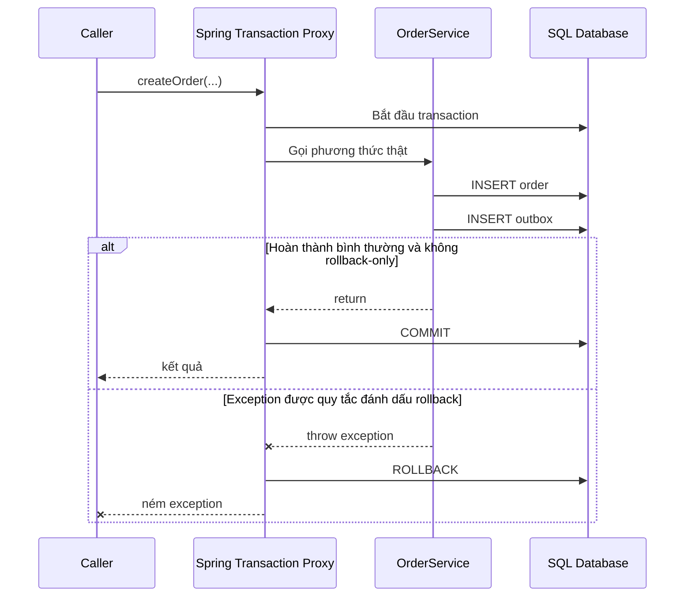
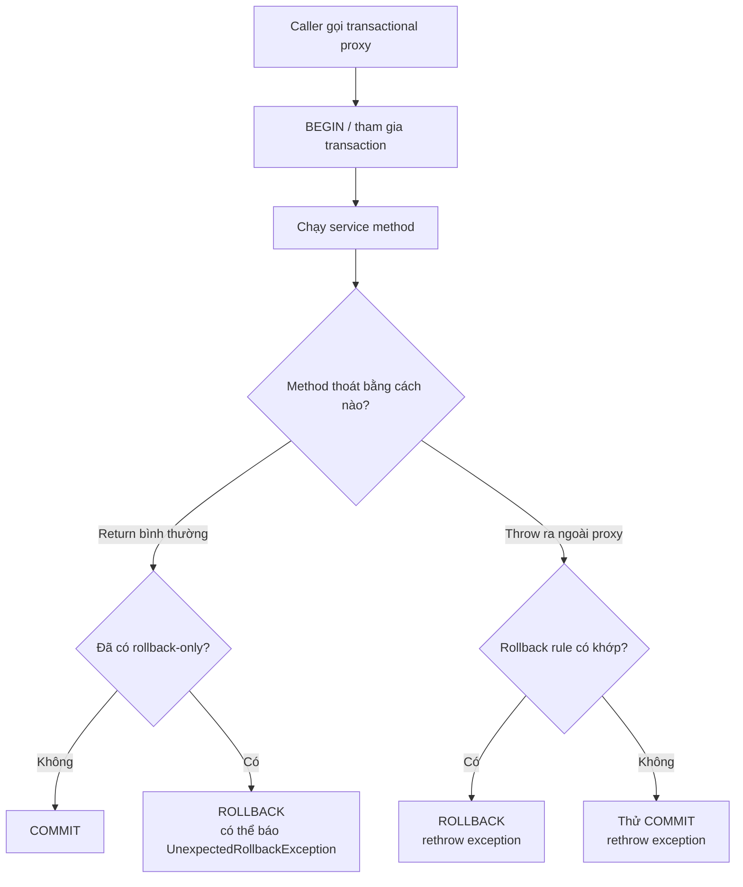
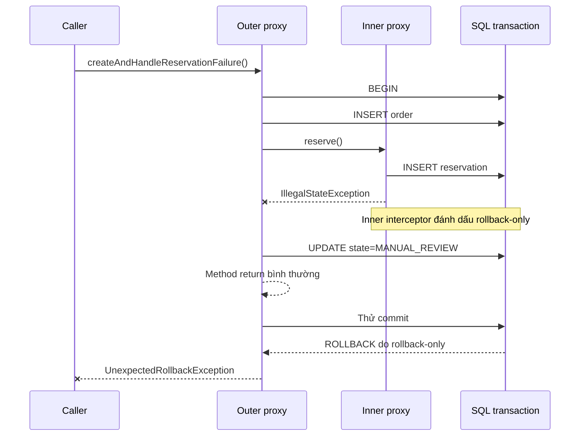
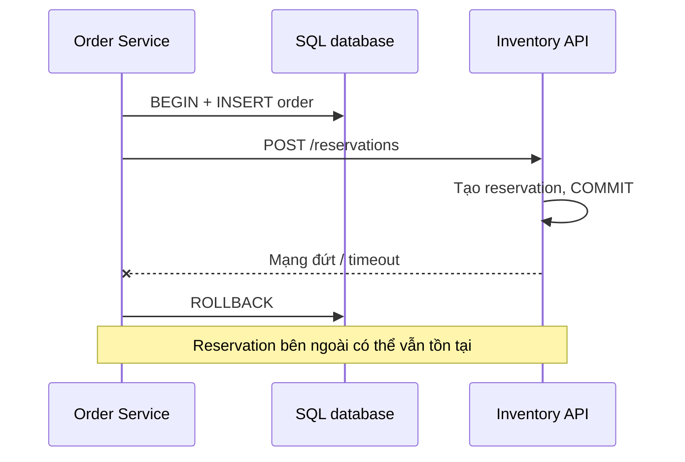
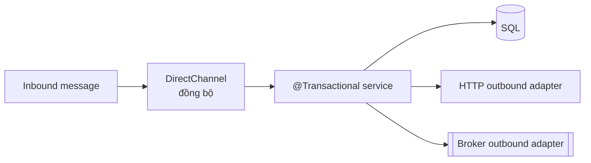
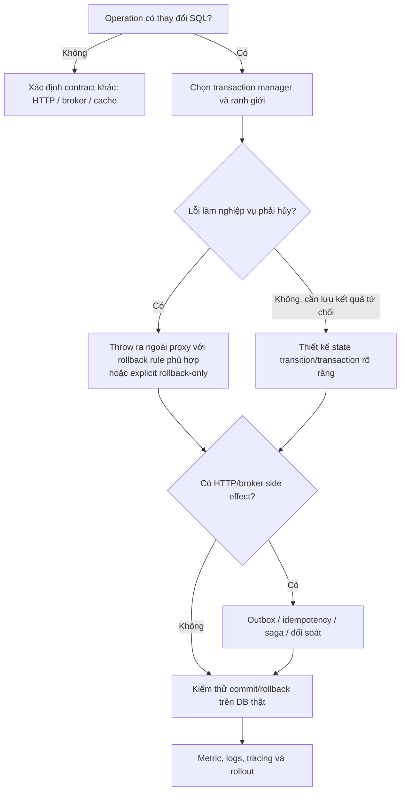

# Rollback theo loại ngoại lệ và hệ quả khi bắt lỗi

Trong Spring Boot, `@Transactional` giúp nhóm các thao tác dữ liệu thành **một giao dịch cục bộ**: hoặc toàn bộ thay đổi thuộc giao dịch được commit, hoặc các thay đổi đó được rollback. Tuy nhiên, một nhầm lẫn phổ biến là nghĩ rằng **hễ có bất kỳ exception nào thì Spring đều rollback**. Trên thực tế, quyết định rollback mặc định phụ thuộc **loại ngoại lệ** và việc ngoại lệ đó có **đi qua ranh giới transactional proxy** hay không.

Một hiểu nhầm khác cũng nguy hiểm: lập trình viên bắt exception trong `try/catch`, ghi log rồi tiếp tục, sau đó cho rằng dữ liệu đã tự rollback. Nếu exception bị nuốt trước khi ra khỏi phương thức `@Transactional`, Spring có thể thấy phương thức hoàn thành bình thường và **commit cả những thay đổi không mong muốn**.

Bài thuộc chương **Giao dịch tích hợp** của module **SPRING_BOOT_INTEGRATION**. Trong hệ thống tích hợp qua HTTP client, SQL, cache, broker thông điệp và các adapter Spring Integration, cần hiểu ranh giới rollback để không tạo đơn hàng sai, phát sự kiện không khớp dữ liệu SQL hoặc xử lý trùng lặp sau retry.

> **Phạm vi:** Các quy tắc mặc định mô tả cơ chế transaction interceptor/proxy của Spring thường gặp với Spring Framework 6.x và Spring Boot 3.x. Hệ thống có thể thay đổi chính sách rollback qua cấu hình toàn cục, transaction manager riêng hoặc lựa chọn `rollbackFor`/`noRollbackFor`. Quan trọng hơn, `@Transactional` **không tự tạo giao dịch phân tán** bao phủ HTTP API, Redis và broker.

## 1. Mục tiêu học tập

Sau bài này, bạn có thể:

1. Giải thích quy tắc rollback mặc định với `RuntimeException`, `Error` và checked exception.
2. Sử dụng `rollbackFor`, `noRollbackFor` và phân biệt cấu hình theo **class** với theo **tên exception**.
3. Dự đoán điều gì xảy ra khi exception bị bắt **bên trong** hoặc **bên ngoài** ranh giới `@Transactional`.
4. Hiểu rollback-only và vì sao có thể xuất hiện `UnexpectedRollbackException` dù code bên ngoài đã bắt lỗi.
5. Nhận diện lỗi self-invocation, propagation và transactional context không chạy qua proxy.
6. Thiết kế ranh giới giao dịch SQL rõ ràng khi tích hợp HTTP, cache, Kafka/RabbitMQ hoặc Spring Integration.
7. Viết integration test xác minh **dữ liệu thật sau commit/rollback**, không chỉ kiểm tra loại exception.
8. Phân loại exception đúng để retry, idempotency, outbox và observability không che giấu thất bại.

## 2. Transaction có những giai đoạn nào?

Một giao dịch cơ sở dữ liệu có thể được xem như:



**Spring transaction interceptor** mở hoặc tham gia giao dịch, gọi phương thức nghiệp vụ, rồi quyết định commit/rollback dựa trên kết quả và rollback rules. Ứng dụng không nhất thiết thực hiện câu SQL `BEGIN` hoặc `ROLLBACK` trực tiếp; `PlatformTransactionManager` phối hợp với kết nối/tài nguyên tương ứng.

Một số giới hạn căn bản:

- **Ranh giới nguồn tài nguyên:** `DataSourceTransactionManager` hoặc `JdbcTransactionManager` quản lý giao dịch JDBC của một `DataSource` được cấu hình. Transaction manager khác có thể quản lý tài nguyên khác.
- **Giao dịch là cục bộ nếu không có cơ chế phân tán riêng:** commit SQL không đồng nghĩa commit HTTP, cache hay broker.
- **Phương thức bình thường kết thúc** là điều kiện để commit, nhưng **không bảo đảm commit thành công**: lỗi kết nối, constraint ở commit hoặc rollback-only vẫn có thể làm commit thất bại.
- **Bắt exception** có thể thay đổi tín hiệu mà transaction interceptor nhìn thấy.

### 2.1. Spring kiểm tra ngoại lệ ở đâu?

Điểm cốt lõi là **exception có thoát ra qua proxy được gắn `@Transactional` hay không**. Nếu một lỗi được bắt và xử lý trước khi phương thức trả về, interceptor có thể không thấy nó.



Sơ đồ nêu quy tắc thông thường; **transaction propagation**, transaction manager và rollback-only từ một tầng bên trong có thể khiến kết quả thực tế khác việc chỉ nhìn exception cuối cùng.

## 3. Quy tắc rollback mặc định của Spring

### 3.1. RuntimeException, Error và checked exception

Theo quy tắc mặc định thông dụng của Spring transaction:

- **`RuntimeException` và subclass**: đánh dấu rollback.
- **`Error` và subclass**: đánh dấu rollback.
- **Checked exception** là `Exception` không kế thừa `RuntimeException`, ví dụ `IOException`: **mặc định không đánh dấu rollback**.
- Khi checked exception thoát khỏi phương thức, transaction manager có thể **commit** nếu không bị đánh dấu rollback-only và không có lỗi khác.

| Tình huống thoát khỏi phương thức transactional | Mặc định | Nhận xét |
| --- | --- | --- |
| Không ném exception, transaction hợp lệ | Commit | Vẫn có thể lỗi tại commit |
| Ném `IllegalArgumentException` | Rollback | Runtime exception |
| Ném `IllegalStateException` | Rollback | Runtime exception |
| Ném `DataAccessException` | Rollback | Spring data access exception là runtime |
| Ném `NullPointerException` | Rollback | Runtime exception, nhưng phải sửa bug |
| Ném `AssertionError` hoặc `OutOfMemoryError` | Rollback theo rule | Không dùng `Error` làm nhánh nghiệp vụ |
| Ném `IOException` | **Không tự rollback** | Checked exception |
| Ném checked `BusinessCheckedException` | **Không tự rollback** | Trừ khi cấu hình rollback rule |
| Lỗi được bắt/nuốt trong method rồi return | Có thể commit | Interceptor không thấy lỗi đã bị bắt |
| Method return nhưng transaction đã rollback-only | Rollback | Có thể báo `UnexpectedRollbackException` |

**Không nên hiểu “checked exception thì chắc chắn commit”**: commit vẫn có thể không thành công vì transaction đã rollback-only, lỗi database, propagation hoặc transaction manager. Kết luận chính xác là **Spring mặc định không yêu cầu rollback chỉ vì một checked exception đã được ném ra**.

### 3.2. Ví dụ RuntimeException và IOException

Giả sử bảng SQL:

```sql
CREATE TABLE purchase_order (
    order_id VARCHAR(64) PRIMARY KEY,
    state VARCHAR(32) NOT NULL
);
```

Một service dùng JDBC:

```java
package com.example.integration.tx;

import java.io.IOException;
import org.springframework.jdbc.core.JdbcTemplate;
import org.springframework.stereotype.Service;
import org.springframework.transaction.annotation.Transactional;

@Service
public class OrderTransactionExamples {

    private final JdbcTemplate jdbc;

    public OrderTransactionExamples(JdbcTemplate jdbc) {
        this.jdbc = jdbc;
    }

    @Transactional
    public void runtimeFailure(String orderId) {
        jdbc.update(
                "INSERT INTO purchase_order (order_id, state) VALUES (?, ?)",
                orderId, "CREATED");
        throw new IllegalStateException("Lỗi khi tạo đơn");
    }

    @Transactional
    public void checkedFailure(String orderId) throws IOException {
        jdbc.update(
                "INSERT INTO purchase_order (order_id, state) VALUES (?, ?)",
                orderId, "CREATED");
        throw new IOException("Không đọc được file bổ sung");
    }
}
```

Với transaction JDBC thông thường và hai lời gọi **qua Spring proxy**:

- `runtimeFailure("ORD-1")`: exception runtime thoát qua proxy; Spring rollback, nên `ORD-1` không được lưu.
- `checkedFailure("ORD-2")`: `IOException` thoát qua proxy; **mặc định Spring có thể commit** `ORD-2` rồi ném lại exception cho caller.

Điều này nghe có vẻ bất ngờ nhưng phản ánh chính sách rollback mặc định, không phải JDBC bị lỗi.

## 4. Điều chỉnh bằng rollbackFor và noRollbackFor

### 4.1. rollbackFor cho checked exception

Nếu `IOException` khiến toàn bộ nghiệp vụ không hợp lệ, khai báo:

```java
@Transactional(rollbackFor = IOException.class)
public void checkedFailureMustRollback(String orderId)
        throws IOException {

    jdbc.update(
            "INSERT INTO purchase_order (order_id, state) VALUES (?, ?)",
            orderId, "CREATED");

    throw new IOException("Không hoàn tất khâu xác minh");
}
```

Khi exception thoát qua transactional proxy, rule `rollbackFor = IOException.class` yêu cầu rollback.

Có thể khai báo một base checked exception nghiệp vụ riêng:

```java
public class OrderWorkflowException extends Exception {
    public OrderWorkflowException(String message) {
        super(message);
    }
}
```

```java
@Transactional(rollbackFor = OrderWorkflowException.class)
public void createOrder(String orderId) throws OrderWorkflowException {
    // Ghi SQL ...
    throw new OrderWorkflowException("Không hoàn thành quy trình");
}
```

Rollback rule theo subclass có thể bao phủ nhiều exception nghiệp vụ nếu chúng kế thừa type đó.

**Cân nhắc:** Không đặt `rollbackFor = Exception.class` cho tất cả service một cách máy móc. Nó có thể hợp lý theo quy ước toàn hệ thống, nhưng một số checked exception là tín hiệu nghiệp vụ được phép commit dữ liệu trước khi trả lỗi (ví dụ ghi nhận một trạng thái bị từ chối có chủ đích). Phải xác định bất biến và chính sách commit/rollback trước.

### 4.2. noRollbackFor với một RuntimeException được cho phép

Một số tình huống cần giữ thay đổi SQL ngay cả khi trả lỗi nghiệp vụ. Ví dụ ghi trạng thái đơn bị từ chối và thông báo rõ cho caller:

```java
public class BusinessDeclinedException extends RuntimeException {
    public BusinessDeclinedException(String message) {
        super(message);
    }
}
```

```java
@Transactional(noRollbackFor = BusinessDeclinedException.class)
public void recordDeclinedOrder(String orderId) {
    jdbc.update(
            "INSERT INTO purchase_order (order_id, state) VALUES (?, ?)",
            orderId, "DECLINED");

    throw new BusinessDeclinedException(
            "Đơn hàng bị từ chối theo chính sách");
}
```

Nếu exception này thoát qua proxy và transaction không rollback-only vì nguyên nhân khác, Spring cố **commit** trạng thái `DECLINED` rồi ném lại ngoại lệ.

**Cảnh báo:** Đây là lựa chọn cần có lý do nghiệp vụ rõ ràng. Dùng `noRollbackFor` để “đỡ phải sửa exception” có thể khiến dữ liệu một phần bị commit. Nó cũng **không thể xóa trạng thái rollback-only** đã được thiết lập bởi transaction resource hoặc phương thức transactional lồng bên trong.

### 4.3. Kết hợp nhiều rule

```java
@Transactional(
    rollbackFor = { IOException.class, OrderWorkflowException.class },
    noRollbackFor = BusinessDeclinedException.class
)
public void process(String orderId) throws IOException,
        OrderWorkflowException {
    // ...
}
```

Spring chọn rule khớp phù hợp nhất với loại exception thực tế (theo độ đặc hiệu của rule). Các rule type-safe dùng `Class` thường dễ bảo trì hơn rule dựa trên chuỗi tên.

| Thuộc tính | Cách khai báo | Lưu ý |
| --- | --- | --- |
| `rollbackFor` | `rollbackFor = IOException.class` | Type-safe, bao gồm subclass |
| `noRollbackFor` | `noRollbackFor = BusinessDeclinedException.class` | Ghi đè mặc định rollback cho loại phù hợp |
| `rollbackForClassName` | `rollbackForClassName = "com.example.OrderWorkflowException"` | So khớp theo tên/pattern, dễ tạo false positive nếu đặt không cẩn thận |
| `noRollbackForClassName` | `noRollbackForClassName = "com.example.BusinessDeclinedException"` | Tương tự, chỉ dùng khi có lý do cụ thể |

Rule dạng tên class của Spring dùng cách khớp pattern, không nên coi là cách so chính xác tuyệt đối mọi trường hợp. Một tên ngắn như `"Exception"` có thể khớp rất rộng. Ưu tiên truyền class thật trong code.

### 4.4. Có thể đổi chính sách mặc định ở cấp ứng dụng?

Một số phiên bản Spring Framework hiện đại có tùy chọn cấu hình rollback policy rộng hơn, ví dụ đặt mặc định rollback cho **mọi exception** trong hệ thống (thay vì chỉ runtime). Khi dùng cơ chế này, bảng mặc định ở trên **không còn đủ để dự đoán kết quả**.

Vì thế, trước khi áp dụng bài vào codebase thật, hãy kiểm tra:

1. Phiên bản Spring Framework/Spring Boot và các tính năng transaction management tương ứng.
2. Cấu hình `@EnableTransactionManagement` hoặc custom transaction attribute source.
3. Transaction manager cụ thể, policy rollback và các annotation trên class/method.
4. Test hồi quy cho checked exception quan trọng.

Không nên suy luận chính sách từ tên annotation `@Transactional` mà không biết cấu hình runtime.

## 5. Catch exception **bên trong** @Transactional: dễ commit ngoài ý muốn

### 5.1. Bắt lỗi rồi return như thành công

Xem đoạn sau:

```java
@Transactional
public void createOrderAndSwallowError(String orderId) {
    jdbc.update(
            "INSERT INTO purchase_order (order_id, state) VALUES (?, ?)",
            orderId, "PENDING");

    try {
        callValidationThatThrows();
    } catch (IllegalStateException ex) {
        // Sai: chỉ log và coi như đã xử lý xong.
        log.warn("Validation error for order {}", orderId, ex);
    }

    // Phương thức kết thúc bình thường => interceptor có thể commit.
}

private void callValidationThatThrows() {
    throw new IllegalStateException("Invalid state");
}
```

Nếu `callValidationThatThrows()` chỉ là một hàm bình thường và không có thành phần nào đánh dấu transaction rollback-only, khi method kết thúc, Spring **thấy return bình thường** và có thể commit `PENDING`.

Đây là một lỗi thiết kế vì lệnh ghi SQL được thực hiện **trước** kiểm tra nghiệp vụ mà lẽ ra thất bại phải hủy dữ liệu.

**Cách sửa thường tốt nhất:** validate đầu vào và điều kiện nghiệp vụ trước khi ghi; nếu lỗi ngăn việc tạo đơn, ném exception có rollback rule phù hợp ra ngoài transaction.

```java
@Transactional
public void createOrderAfterValidation(String orderId) {
    validateBusinessRules(orderId); // Ném runtime nếu vi phạm.

    jdbc.update(
            "INSERT INTO purchase_order (order_id, state) VALUES (?, ?)",
            orderId, "CREATED");
}
```

### 5.2. Catch bên ngoài proxy thì khác

```java
try {
    orderService.runtimeFailure("ORD-10");
} catch (IllegalStateException ex) {
    log.warn("Tạo đơn thất bại", ex);
}
```

Ở đây `orderService` là Spring bean được inject, lời gọi đi qua transactional proxy. Exception **đã thoát khỏi method transactional**, nên interceptor có cơ hội rollback **trước khi caller bắt lỗi**.

Điểm cần phân biệt:

- **Catch bên trong** phương thức transactional → có thể che exception khỏi interceptor.
- **Catch bên ngoài** sau khi proxy đã xử lý method → thường không làm mất rollback đã xảy ra.
- **Catch bên ngoài nhưng transaction khác đang bao quanh** → phải xét propagation; lời gọi bên trong có thể đánh dấu transaction chung rollback-only và caller nhận `UnexpectedRollbackException` sau đó.

Không thể quyết định chỉ bằng việc thấy từ khóa `catch`; cần vẽ ranh giới các bean proxy và transaction thực tế.

## 6. Muốn bắt lỗi nhưng vẫn rollback: các lựa chọn

### 6.1. Ghi log rồi ném lại

Khi lỗi nghĩa là operation phải thất bại, lựa chọn đơn giản nhất:

```java
@Transactional
public void createWithRethrow(String orderId) {
    try {
        insertOrder(orderId);
        callInternalStep();
    } catch (RuntimeException ex) {
        log.warn("Không hoàn tất tạo đơn {}", orderId, ex);
        throw ex;
    }
}
```

`throw ex` giữ nguyên exception runtime, nên quy tắc rollback mặc định vẫn áp dụng. Hãy tránh log cùng một exception ở quá nhiều tầng, vì một lỗi duy nhất có thể tạo hàng chục dòng log trùng.

Nếu bắt lỗi checked `IOException` và muốn rollback, cần **ném ra ngoài đồng thời khai báo `rollbackFor`**, hoặc chuyển sang một runtime exception có ngữ nghĩa phù hợp:

```java
@Transactional(rollbackFor = IOException.class)
public void importOrder(String orderId) throws IOException {
    insertOrder(orderId);
    readExternalDocument(); // Có thể ném IOException.
}
```

Đừng bọc tất cả lỗi vào `IllegalStateException` chỉ để kích hoạt rollback nếu điều đó phá vỡ contract xử lý lỗi ở tầng trên.

### 6.2. Bắt và đánh dấu rollbackOnly

Đôi khi yêu cầu phải trả một kết quả miền nghiệp vụ thay vì ném exception, nhưng mọi thay đổi SQL hiện tại vẫn phải rollback:

```java
import org.springframework.transaction.interceptor.TransactionAspectSupport;

@Transactional
public ProcessResult tryCreate(String orderId) {
    jdbc.update(
            "INSERT INTO purchase_order (order_id, state) VALUES (?, ?)",
            orderId, "PENDING");

    try {
        performBusinessStep();
        return ProcessResult.success();
    } catch (BusinessRuleException ex) {
        TransactionAspectSupport.currentTransactionStatus()
                .setRollbackOnly();

        return ProcessResult.rejected(ex.getMessage());
    }
}
```

**`setRollbackOnly()`** đánh dấu transaction hiện tại phải rollback dù method sau đó return bình thường.

Cần hiểu chính xác:

- Phải đang ở trong transaction context do Spring quản lý; nếu không, truy cập current transaction status có thể thất bại.
- `setRollbackOnly()` không tạo giao dịch mới và không hủy side effect HTTP/broker đã xảy ra.
- Nếu method nằm trong **logical transaction scope** lồng nhau cùng physical transaction, việc đánh dấu rollback-only có thể làm transaction ngoài không thể commit và dẫn tới `UnexpectedRollbackException`.
- Việc return một object `rejected` không đồng nghĩa caller chắc chắn nhận được object đó: nếu commit transaction ngoài thất bại, caller có thể nhận exception khác.

`ProcessResult`/`BusinessRuleException` ở đoạn trên là các type miền nghiệp vụ minh họa. Trong hệ thống thật, nên thiết kế API kết quả rõ và tránh dependency service code quá sâu vào `TransactionAspectSupport` nếu có cách kiến trúc đơn giản hơn.

### 6.3. Dùng TransactionTemplate cho quyết định tường minh

Khi quy trình cần nhiều nhánh commit/rollback có điều kiện, `TransactionTemplate` có thể giúp code rõ hơn:

```java
import org.springframework.stereotype.Service;
import org.springframework.transaction.PlatformTransactionManager;
import org.springframework.transaction.support.TransactionTemplate;

@Service
public class ExplicitOrderTransaction {

    private final TransactionTemplate tx;
    private final OrderWriter writer;

    public ExplicitOrderTransaction(
            PlatformTransactionManager transactionManager,
            OrderWriter writer) {
        this.tx = new TransactionTemplate(transactionManager);
        this.writer = writer;
    }

    public ProcessResult tryProcess(String orderId) {
        return tx.execute(status -> {
            writer.insert(orderId);
            if (!writer.isAllowed(orderId)) {
                status.setRollbackOnly();
                return ProcessResult.rejected("Điều kiện không hợp lệ");
            }
            return ProcessResult.success();
        });
    }
}
```

`OrderWriter` là service/repository do ứng dụng triển khai; các method `insert`/`isAllowed` trong ví dụ phải dùng tài nguyên transaction tương ứng để rollback có hiệu lực. Với `TransactionTemplate`, việc ra quyết định nằm ngay trong callback và không phụ thuộc lời gọi đi qua AOP proxy của method đó.

Nên chọn **declarative `@Transactional`** cho luồng đơn giản, **programmatic transaction** khi thật sự cần kiểm soát nhiều nhánh giao dịch rõ ràng. Không trộn cả hai vào một logic mà không hiểu propagation.

## 7. UnexpectedRollbackException: đã bắt lỗi sao vẫn rollback?

### 7.1. Hai logical transaction cùng một physical transaction

Mặc định, `@Transactional` dùng propagation `REQUIRED`. Khi một phương thức transactional gọi một phương thức transactional khác **qua proxy** và đã có giao dịch, phương thức thứ hai thường **tham gia cùng giao dịch vật lý**.

Ví dụ:

```java
@Service
public class InventoryReservationService {

    private final JdbcTemplate jdbc;

    public InventoryReservationService(JdbcTemplate jdbc) {
        this.jdbc = jdbc;
    }

    @Transactional
    public void reserve(String orderId) {
        jdbc.update(
                "INSERT INTO reservation (order_id, state) VALUES (?, ?)",
                orderId, "RESERVING");

        throw new IllegalStateException("Không đủ tồn kho");
    }
}
```

Caller:

```java
@Service
public class OrderWorkflowService {

    private final JdbcTemplate jdbc;
    private final InventoryReservationService reservationService;

    public OrderWorkflowService(
            JdbcTemplate jdbc,
            InventoryReservationService reservationService) {
        this.jdbc = jdbc;
        this.reservationService = reservationService;
    }

    @Transactional
    public void createAndHandleReservationFailure(String orderId) {
        jdbc.update(
                "INSERT INTO purchase_order (order_id, state) VALUES (?, ?)",
                orderId, "PENDING");

        try {
            reservationService.reserve(orderId);
        } catch (IllegalStateException ex) {
            // Caller "đã xử lý" ngoại lệ nghiệp vụ.
            jdbc.update(
                    "UPDATE purchase_order SET state = ? WHERE order_id = ?",
                    "MANUAL_REVIEW", orderId);
        }
    }
}
```

Giả sử hai method đều dùng cùng transaction manager và `reserve` thực sự được gọi **qua proxy**:

1. `createAndHandleReservationFailure` mở transaction.
2. `reserve` tham gia transaction hiện tại (`REQUIRED`).
3. `reserve` ném `IllegalStateException` ra khỏi **proxy của nó**.
4. Transaction interceptor của `reserve` đánh dấu **transaction đang chia sẻ** là rollback-only.
5. Outer method bắt exception, update trạng thái `MANUAL_REVIEW` rồi return.
6. Khi outer muốn commit, Spring phát hiện transaction đã rollback-only, rollback và có thể ném **`UnexpectedRollbackException`**.

Không có bản ghi `MANUAL_REVIEW` được commit trong transaction đó. Đây là cơ chế bảo vệ caller khỏi việc tưởng commit thành công khi transaction đã bị một scope bên trong đánh dấu rollback.

### 7.2. Sơ đồ diễn biến



**Điểm khác biệt với mục 5:** Nếu ngoại lệ runtime được ném và bắt hoàn toàn **bên trong cùng một method**, không qua proxy transactional khác và database không tự đánh dấu transaction lỗi, Spring có thể commit. Nhưng khi exception thoát ra khỏi một **transactional scope** bên trong đã tham gia cùng transaction, rollback-only có thể được đánh dấu dù outer bắt được exception.

### 7.3. Không “chữa” bằng cách nuốt UnexpectedRollbackException

`UnexpectedRollbackException` báo một tình huống đáng điều tra:

- Có inner transactional method đặt rollback-only không?
- Có lỗi database khiến giao dịch không còn dùng được không?
- Có `setRollbackOnly()` được gọi không?
- Propagation nào đang dùng (`REQUIRED`, `REQUIRES_NEW`, `NESTED`)?
- Transaction manager cụ thể và cấu hình global rollback rules là gì?

Đừng catch `UnexpectedRollbackException` rồi trả HTTP 200 như đã tạo đơn thành công. Cần xác minh trạng thái dữ liệu và phản hồi lỗi/khởi động quy trình khôi phục tương ứng.

## 8. Propagation ảnh hưởng thế nào đến rollback?

### 8.1. REQUIRED, REQUIRES_NEW và NESTED

| Propagation | Bản chất | Tác động khi lỗi/rollback |
| --- | --- | --- |
| `REQUIRED` (mặc định) | Tham gia transaction hiện có, hoặc mở mới | Một inner scope có thể đánh dấu transaction chung rollback-only |
| `REQUIRES_NEW` | Tạm treo transaction hiện có và mở transaction vật lý mới | Inner có thể commit/rollback độc lập với outer |
| `NESTED` | Một transaction vật lý có savepoint lồng nhau khi manager hỗ trợ | Có thể rollback về savepoint mà outer vẫn tiếp tục |
| `SUPPORTS` | Tham gia nếu transaction đang có, nếu không chạy không có transaction | Không bảo đảm luôn rollback được |
| `NOT_SUPPORTED` | Chạy không có transaction, tạm treo transaction hiện có | Các thao tác thực hiện ngoài transaction sẽ không rollback cùng outer |
| `MANDATORY` | Bắt buộc đã có transaction | Thiếu transaction sẽ báo lỗi |
| `NEVER` | Không được có transaction | Có transaction hiện hữu sẽ báo lỗi |

### 8.2. REQUIRES_NEW không phải giải pháp mặc định

Giả sử muốn lưu **audit event thất bại** dù nghiệp vụ chính rollback:

```java
@Service
public class AuditTrailService {

    private final JdbcTemplate jdbc;

    public AuditTrailService(JdbcTemplate jdbc) {
        this.jdbc = jdbc;
    }

    @Transactional(propagation = Propagation.REQUIRES_NEW)
    public void recordFailure(String orderId, String reason) {
        jdbc.update(
                "INSERT INTO audit_event (order_id, reason) VALUES (?, ?)",
                orderId, reason);
    }
}
```

Outer service:

```java
@Transactional
public void placeOrder(String orderId) {
    try {
        doBusinessWork(orderId);
    } catch (RuntimeException ex) {
        auditTrailService.recordFailure(orderId, "ORDER_FAILED");
        throw ex;
    }
}
```

Nếu `auditTrailService` là **Spring proxy khác** và transaction manager/tài nguyên hỗ trợ, audit được commit trong transaction mới, sau đó outer rollback. Nhưng cần lưu ý:

- `REQUIRES_NEW` thường cần thêm connection cho transaction riêng khi outer vẫn giữ tài nguyên, làm tăng áp lực lên pool.
- Inner transaction **không tự nhiên tham gia** consistency boundary của outer. Audit có thể tồn tại dù outer chưa từng commit.
- Nếu muốn audit lưu cả khi exception đã bị đánh dấu rollback-only ở outer, thiết kế rõ quyền sở hữu và thời điểm ghi.
- Với cùng một bean tự gọi `this.recordFailure(...)`, proxy có thể bị bỏ qua; `REQUIRES_NEW` không áp dụng như kỳ vọng.

### 8.3. NESTED và savepoint

`NESTED` có thể dùng savepoint trên JDBC khi transaction manager/driver hỗ trợ, nhưng **không giống REQUIRES_NEW**:

- Nested scope vẫn ở trong **một physical transaction**.
- Inner rollback về savepoint có thể không hủy thay đổi trước savepoint.
- Outer rollback sẽ hủy cả những thay đổi của nested scope dù nested đã “hoàn tất”.
- Không mặc định mọi `PlatformTransactionManager`, JPA provider hoặc transaction stack đều hỗ trợ nested transactions.

Đừng thêm `Propagation.NESTED` chỉ vì muốn “bắt lỗi và tiếp tục”: cần test đúng manager, database và điều kiện lỗi.

## 9. Lỗi self-invocation và @Transactional không được kích hoạt

### 9.1. Gọi nội bộ bỏ qua proxy

Spring transaction theo proxy-based AOP thường áp dụng advice khi lời gọi **đi qua proxy**. Nếu một method trong cùng bean gọi method khác qua `this`, lời gọi có thể không qua interceptor:

```java
@Service
public class WrongSelfInvocationService {

    public void run(String orderId) {
        // Đây là lời gọi nội bộ, bỏ qua @Transactional proxy ở method bên dưới.
        saveAndFail(orderId);
    }

    @Transactional
    public void saveAndFail(String orderId) {
        // Ghi SQL...
        throw new IllegalStateException("Rollback được không?");
    }
}
```

Nếu caller inject bean và gọi `run(...)` nhưng `run` không có transaction, thì `saveAndFail` được gọi trực tiếp trên target object, `@Transactional` ở `saveAndFail` có thể **không được áp dụng**. Nếu SQL kết nối ở chế độ auto-commit, một số lệnh ghi có thể được commit ngay trước khi exception xảy ra.

Không thể suy ra kết quả chỉ từ annotation; phải kiểm tra đường gọi thực tế và transaction đang hoạt động.

### 9.2. Cách tổ chức đúng

Tách transactional operation thành **bean được inject riêng**:

```java
@Service
public class OrderWriter {

    private final JdbcTemplate jdbc;

    public OrderWriter(JdbcTemplate jdbc) {
        this.jdbc = jdbc;
    }

    @Transactional
    public void insertAndFail(String orderId) {
        jdbc.update(
                "INSERT INTO purchase_order (order_id, state) VALUES (?, ?)",
                orderId, "CREATED");

        throw new IllegalStateException("Lỗi thử nghiệm");
    }
}
```

```java
@Service
public class OrderUseCase {

    private final OrderWriter writer;

    public OrderUseCase(OrderWriter writer) {
        this.writer = writer;
    }

    public void execute(String orderId) {
        writer.insertAndFail(orderId); // Gọi qua bean proxy.
    }
}
```

Với code thật, một trường hợp khác là đặt `@Transactional` trên method không được proxy intercept theo cơ chế được cấu hình (ví dụ một số private/final method hoặc proxy/interface setup). Khả năng intercept thay đổi theo proxy type và phiên bản Spring. Nguyên tắc an toàn: **tổ chức transaction ở một public service method được gọi qua Spring bean proxy**, hoặc dùng `TransactionTemplate` khi cần kiểm soát programmatic rõ ràng.

## 10. Bắt lỗi database cũng có hệ quả riêng

### 10.1. Database đã đánh dấu transaction lỗi

Không phải mọi exception SQL đều có thể được xử lý bằng cách catch rồi tiếp tục thực hiện query.

Ví dụ PostgreSQL, khi một câu SQL thất bại bên trong transaction, connection có thể ở trạng thái **current transaction is aborted** cho tới khi rollback (hoặc rollback về savepoint đã thiết lập phù hợp). Dù Java catch exception, câu lệnh SQL tiếp theo vẫn có thể thất bại.

```java
@Transactional
public void unsafeContinueAfterConstraintViolation(String orderId) {
    try {
        jdbc.update(
                "INSERT INTO purchase_order (order_id, state) VALUES (?, ?)",
                orderId, "NEW");
    } catch (DuplicateKeyException ex) {
        // PostgreSQL transaction có thể đã ở trạng thái lỗi.
        log.info("Đơn trùng {}", orderId);
    }

    jdbc.update(
            "UPDATE purchase_order SET state = ? WHERE order_id = ?",
            "CHECKED", orderId);
}
```

Đoạn code này minh họa **một anti-pattern**, không phải cách chuẩn để xử lý insert trùng. Ngay cả khi `DuplicateKeyException` bị catch, trạng thái physical transaction của database có thể không còn cho phép chạy query tiếp.

Giải pháp cho nghiệp vụ idempotent nên được thiết kế ở mức SQL, ví dụ PostgreSQL:

```sql
INSERT INTO processed_event (source_system, event_id)
VALUES (:sourceSystem, :eventId)
ON CONFLICT (source_system, event_id) DO NOTHING;
```

Kiểm tra số dòng thực sự được insert để biết event mới hay trùng. Nếu bắt buộc phải hồi phục từ một lỗi SQL trong cùng transaction, cần thiết kế savepoint/nested transaction và test bằng **đúng DB/driver**; không mặc định catch là đủ.

### 10.2. Spring DataAccessException là runtime

Spring JDBC thường chuyển các lỗi SQL thành subclass của `DataAccessException` (runtime exception), ví dụ `DuplicateKeyException` hoặc `DataIntegrityViolationException`. Điều đó thuận tiện cho rollback mặc định **khi lỗi thoát ra qua proxy**.

Tuy nhiên, chuyển exception sang runtime không sửa được vấn đề giao dịch không còn hợp lệ, và không thay thế constraint, idempotency hay chính sách retry.

## 11. HTTP và broker: tại sao catch + rollback SQL vẫn không đủ?

### 11.1. Một giao dịch SQL không bao phủ HTTP

Giả sử:

```java
@Transactional
public void createOrderThenReserve(String orderId) {
    jdbc.update(
            "INSERT INTO purchase_order (order_id, state) VALUES (?, ?)",
            orderId, "CREATED");

    inventoryHttpClient.reserve(orderId);  // HTTP tới hệ thống ngoài.

    jdbc.update(
            "UPDATE purchase_order SET state = ? WHERE order_id = ?",
            "RESERVED", orderId);
}
```

Nếu HTTP reserve thành công nhưng câu SQL cuối thất bại:

- SQL transaction có thể rollback.
- HTTP side effect ở hệ thống inventory **không được rollback theo**.
- Caller thấy exception nhưng kho bên ngoài đã giữ hàng.

Nếu HTTP call timeout, còn nguy hiểm hơn: đối tác có thể đã commit reservation dù client chưa nhận response.



Vì vậy:

1. Đặt transaction SQL **ngắn** nếu có thể, tránh giữ khóa/connection trong lúc chờ HTTP dài.
2. Phân biệt lỗi trước khi gửi request và **unknown outcome** khi timeout.
3. Dùng operation ID/idempotency key ổn định khi API bên ngoài hỗ trợ.
4. Có quy trình tra cứu trạng thái, đối soát hoặc hành động bù.
5. Nếu nghiệp vụ gồm nhiều bước cần phối hợp, cân nhắc **saga** hoặc kiến trúc command/event với trạng thái bền vững.

### 11.2. Transactional outbox

Một cách giảm rủi ro mất message khi SQL đã commit là lưu dữ liệu nghiệp vụ và **outbox event** trong **cùng transaction SQL**:

```sql
CREATE TABLE order_outbox (
    event_id VARCHAR(128) PRIMARY KEY,
    order_id VARCHAR(64) NOT NULL,
    event_type VARCHAR(64) NOT NULL,
    payload_json TEXT NOT NULL,
    state VARCHAR(24) NOT NULL DEFAULT 'PENDING'
);
```

Service:

```java
@Service
public class OrderCommandService {

    private final JdbcTemplate jdbc;

    public OrderCommandService(JdbcTemplate jdbc) {
        this.jdbc = jdbc;
    }

    @Transactional
    public void createOrderAndOutbox(String orderId, String eventId) {
        jdbc.update(
                "INSERT INTO purchase_order (order_id, state) VALUES (?, ?)",
                orderId, "CREATED");

        jdbc.update(
                """
                INSERT INTO order_outbox
                    (event_id, order_id, event_type, payload_json)
                VALUES (?, ?, ?, ?)
                """,
                eventId, orderId, "OrderCreated",
                "{\"orderId\":\"" + orderId + "\"}");
    }
}
```

**Giới hạn của snippet:** Chuỗi JSON bằng cách nối `orderId` chỉ nhằm minh họa cấu trúc thao tác; code production nên serialize qua Jackson hoặc mapper có validation để tránh JSON sai định dạng và injection ở tầng dữ liệu. `orderId`/`eventId` phải được xác thực và có unique constraint/contract.

Khi giao dịch SQL commit, cả order và outbox entry được ghi. Nếu rollback, cả hai biến mất. Một worker sau đó phát outbox tới broker hoặc gọi HTTP. Nếu worker chết sau khi phát mà trước khi đánh dấu đã xử lý, event có thể bị phát lại; cần **idempotent consumer**.

**Outbox không tạo exactly-once delivery end-to-end.** Nó giúp lưu bền vững ý định phát; delivery/acknowledgment/retry và xử lý trùng vẫn phải được thiết kế.

### 11.3. Kafka/RabbitMQ và transaction manager riêng

Spring Kafka và Spring AMQP có các cơ chế transaction, acknowledgment và retry riêng theo từng broker/client. Một annotation `@Transactional` trên JDBC service **không mặc nhiên biến việc publish broker thành cùng một physical transaction**.

Khi phối hợp SQL và broker:

- Xác định transaction manager nào thực sự được chọn và được áp dụng vào tài nguyên nào.
- Nếu dùng transaction synchronization hoặc cơ chế phối hợp của framework, hiểu rõ thứ tự commit, khả năng partial commit và lỗi giữa hai hệ thống.
- Với message redelivery, giữ event ID/idempotency key ổn định.
- Phân loại transient error (có thể retry) và permanent error (đưa quarantine/DLQ hoặc báo hợp đồng).
- Test các vị trí crash trước/sau commit, publish, ack và update trạng thái.

### 11.4. Spring Integration flow đồng bộ và bất đồng bộ

Một integration flow có thể chứa gateway, transformer, router, service activator, HTTP outbound gateway và broker adapter.



Nếu dùng `DirectChannel` và service được gọi đồng bộ, exception có thể truyền ngược về caller và ảnh hưởng transaction **khi nó vượt qua boundary đúng cách**.

Nếu chuyển sang `ExecutorChannel`, queue, poller hoặc broker consumer, xử lý có thể sang thread/transaction khác:

- Transaction context dựa vào thread không tự truyền xuyên mọi ranh giới bất đồng bộ.
- Lỗi có thể đi vào `errorChannel`, listener error handler hoặc cơ chế retry của adapter, không còn là exception trên call stack ban đầu.
- Ack/requeue/DLQ phụ thuộc endpoint, binder/adapter và cấu hình.
- Catch exception trong handler rồi trả thành công có thể khiến broker **ack message** dù dữ liệu chưa được lưu đúng.

Không suy luận rằng “đã có `@Transactional` ở inbound” thì mọi hoạt động bất đồng bộ phía sau đều thuộc cùng transaction.

## 12. Mô hình hóa lỗi nghiệp vụ thay vì catch tùy tiện

### 12.1. Phân loại lỗi theo khả năng phục hồi

| Nhóm lỗi | Ví dụ | Quyết định điển hình |
| --- | --- | --- |
| **Input/contract không hợp lệ** | Thiếu event ID, enum lạ, schema sai | Từ chối/quarantine, thường không retry nguyên payload |
| **Business rejection có chủ đích** | Đơn bị từ chối nhưng cần ghi audit | Commit trạng thái từ chối theo contract riêng hoặc transaction riêng |
| **SQL integrity** | Unique constraint, FK violation | Rollback; dùng idempotent SQL cho duplicate hợp lệ |
| **SQL tạm thời** | Deadlock/serialization failure | Retry **toàn đơn vị công việc** khi an toàn; giới hạn attempt |
| **HTTP 401/403** | Credential sai hoặc thiếu quyền | Điều tra cấu hình; không retry vô hạn |
| **HTTP 429/503/timeout** | Đối tác quá tải, network lỗi | Retry có backoff/idempotency hoặc reconciliation |
| **Broker consumer error** | Deserialization, dependency tạm lỗi | Error handling, nack/retry/DLQ theo contract |
| **Lỗi lập trình** | Null pointer do bug | Rollback, sửa bug và quan sát |

Không phải tất cả lỗi nghiệp vụ nên là exception runtime. Nếu một yêu cầu hợp lệ về kỹ thuật nhưng bị từ chối theo quy tắc sản phẩm, có thể trả **domain result** (`Rejected`, `Pending`, `Accepted`) và đặt ranh giới transaction rõ ràng. Tuy nhiên, nếu hệ thống đã quyết định transaction phải rollback, cần đảm bảo không bắt lỗi để “trả về thành công” trái thực tế.

### 12.2. Điểm đặt try/catch

Một mô hình dễ đọc:

```text
HTTP controller / listener (boundary)
    |
    |  Chuyển input + validation
    v
@Transactional application service
    |
    |  SQL business state + outbox
    v
Return / throw theo hợp đồng
    |
    v
Controller advice hoặc listener error handler
    |
    |  Chuyển exception thành HTTP status / retry / DLQ
    v
Caller
```

Khuyến nghị:

- **Controller advice/error handler** thường là nơi đổi exception đã qua transaction thành response API/retry decision.
- **Application service** nên biểu đạt rõ bất biến và thao tác SQL nằm trong transaction.
- **Infrastructure adapter** nên chuyển lỗi HTTP/SQL/broker thành loại lỗi có ý nghĩa, giữ nguyên cause và correlation ID.
- **Không đặt broad catch `Exception`** rồi return success/null ở tầng service khi chưa xử lý transaction status.
- Nếu muốn lưu failure state riêng dù transaction chính rollback, dùng workflow/transaction riêng có contract rõ.

## 13. Kiểm thử thực sự commit hay rollback

Chỉ assert `assertThrows(...)` là **chưa đủ**. Test cần xác minh dữ liệu sau khi transactional proxy hoàn tất và sau rollback/commit.

### 13.1. Chọn database và cách setup test

Ví dụ cấu hình Gradle (Spring Boot 3.x):

```groovy
dependencies {
    implementation 'org.springframework.boot:spring-boot-starter-jdbc'
    runtimeOnly 'org.postgresql:postgresql'

    testImplementation 'org.springframework.boot:spring-boot-starter-test'
    testImplementation 'org.springframework.boot:spring-boot-testcontainers'
    testImplementation 'org.testcontainers:junit-jupiter'
    testImplementation 'org.testcontainers:postgresql'
}
```

Khi viết integration test với PostgreSQL thật, Testcontainers có thể cấp datasource động. Spring Boot hỗ trợ `@ServiceConnection` trong các phiên bản tương ứng để kết nối tự động theo container.

Bảng SQL tối thiểu cho test:

```sql
CREATE TABLE purchase_order (
    order_id VARCHAR(64) PRIMARY KEY,
    state VARCHAR(32) NOT NULL
);
```

Với bài test thực tế, quản lý schema bằng Flyway/Liquibase hoặc script được test context chạy theo quy ước của project. Không để test tự dựa vào bảng còn sót trên máy lập trình viên.

### 13.2. Ví dụ JUnit xác minh rollbackRuntime vs commitChecked

```java
package com.example.integration.tx;

import static org.junit.jupiter.api.Assertions.*;

import java.io.IOException;

import org.junit.jupiter.api.BeforeEach;
import org.junit.jupiter.api.Test;
import org.springframework.beans.factory.annotation.Autowired;
import org.springframework.boot.test.context.SpringBootTest;
import org.springframework.boot.testcontainers.service.connection.ServiceConnection;
import org.springframework.jdbc.core.JdbcTemplate;

import org.testcontainers.containers.PostgreSQLContainer;
import org.testcontainers.junit.jupiter.Container;
import org.testcontainers.junit.jupiter.Testcontainers;

@SpringBootTest
@Testcontainers
class OrderTransactionExamplesIT {

    @Container
    @ServiceConnection
    static PostgreSQLContainer<?> postgres =
            new PostgreSQLContainer<>("postgres:16-alpine");

    @Autowired OrderTransactionExamples service;
    @Autowired JdbcTemplate jdbc;

    @BeforeEach
    void clean() {
        jdbc.update("DELETE FROM purchase_order");
    }

    private long count(String id) {
        Long result = jdbc.queryForObject(
                "SELECT COUNT(*) FROM purchase_order WHERE order_id = ?",
                Long.class, id);
        return result;
    }

    @Test
    void runtimeExceptionRollsBackByDefault() {
        assertThrows(IllegalStateException.class,
                () -> service.runtimeFailure("ORD-1"));

        assertEquals(0L, count("ORD-1"));
    }

    @Test
    void checkedExceptionDoesNotTriggerRollbackByDefault() {
        assertThrows(IOException.class,
                () -> service.checkedFailure("ORD-2"));

        assertEquals(1L, count("ORD-2"));
    }
}
```

**Giả định của test:**

- `purchase_order` đã tồn tại trước khi method test chạy, ví dụ qua migration đã cấu hình.
- `OrderTransactionExamples` được Spring tạo thành bean và được gọi qua proxy.
- Không có rollback policy toàn cục thay đổi checked exception.
- Không có outer transaction bao quanh test; test method **không** được đánh dấu `@Transactional`.
- Dữ liệu test được cô lập và `PostgreSQLContainer` dùng cùng datasource với service.

Nếu dùng `@Transactional` ở chính test class/method, Spring Test có thể rollback toàn bộ transaction của test khi test kết thúc. Điều này **dễ làm sai kết luận**: test có thể chưa quan sát được commit độc lập ở ranh giới service. Muốn xác minh kết quả sau commit, ưu tiên test không có enclosing transaction hoặc dùng `TestTransaction` có chủ đích.

### 13.3. Kiểm thử bắt lỗi rồi commit

Bài test bổ sung (giả định đã triển khai method mục 5):

```java
@Test
void swallowedRuntimeExceptionCanStillCommit() {
    service.createOrderAndSwallowError("ORD-3");

    assertEquals(1L, count("ORD-3"));
}
```

Nếu method này return bình thường và không có rollback-only, test cho thấy **dữ liệu PENDING đã commit**. Đây là regression test hữu ích để nhận diện anti-pattern trước khi sửa nghiệp vụ.

### 13.4. Kiểm thử rollbackFor

```java
@Test
void checkedExceptionWithRollbackRuleRollsBack() {
    assertThrows(IOException.class,
            () -> service.checkedFailureMustRollback("ORD-4"));

    assertEquals(0L, count("ORD-4"));
}
```

Code service cần có method `checkedFailureMustRollback(...)` như ở mục 4 và được gọi qua bean proxy.

### 13.5. Kiểm thử UnexpectedRollbackException

Với `OrderWorkflowService` và `InventoryReservationService` ở mục 7, hãy kiểm tra:

```java
assertThrows(UnexpectedRollbackException.class,
        () -> workflowService
                .createAndHandleReservationFailure("ORD-5"));

assertEquals(0L, count("ORD-5"));
```

Đây là assertion **theo cấu hình thường gặp** khi inner `REQUIRED` mark rollback-only và outer cố commit; để test chạy thật, phải tạo bảng `reservation` và khởi tạo beans. Ngoài ra, một số thay đổi transaction manager/rollback configuration có thể làm loại exception hoặc thời điểm ném khác đi; test cần bám contract runtime của dự án.

### 13.6. Test không chỉ có một thread hoặc một nguồn tài nguyên

Đối với tích hợp thật, thêm test cho:

- Hai request tạo cùng event ID để xác nhận unique constraint/idempotent SQL.
- Inner `REQUIRES_NEW` có thể commit độc lập và ảnh hưởng dữ liệu ra sao khi outer rollback.
- SQLException trên PostgreSQL khiến transaction không thể tiếp tục sau catch.
- Event broker redelivery sau khi consumer đã commit SQL nhưng chưa acknowledge.
- HTTP timeout sau khi đối tác commit: reconciliation/idempotency.
- SQL và outbox cùng rollback khi lỗi.
- Việc thay `DirectChannel` bằng executor/queue làm thay đổi transaction boundary và error channel.

Một unit test dùng mock repository **không thay thế được** test JDBC/transaction manager thật, nhất là với propagation, constraint và rollback-only.

## 14. Logging, metric và tracing cho transaction

Một số lỗi transaction chỉ bộc lộ qua log cuối cùng hoặc dữ liệu lệch sau nhiều lần retry. Cần quan sát theo các ranh giới quan trọng.

### 14.1. Những tín hiệu nên theo dõi

| Tín hiệu | Mục đích |
| --- | --- |
| Số transaction commit/rollback | Phát hiện thay đổi hành vi sau deploy |
| `UnexpectedRollbackException` | Tìm scope lồng nhau đã mark rollback-only |
| SQL constraint/deadlock/serialization errors | Nhận diện lỗi dữ liệu và lỗi có thể retry |
| Transaction duration và connection pool saturation | Phát hiện transaction giữ kết nối quá lâu |
| HTTP outbound timeout/429/5xx | Phân biệt lỗi đối tác với lỗi SQL |
| Outbox oldest-event age và retry attempts | Phát hiện dữ liệu đã commit nhưng chưa được phát đi |
| Consumer redelivery/DLQ count | Phát hiện lỗi xử lý message lặp lại |
| Correlation ID/event ID | Kết nối inbound → SQL → broker → outbound |

Spring Boot Actuator/Micrometer có thể giúp thu metric và trace khi hạ tầng instrumentation tương ứng được cấu hình. Tuy nhiên, **không nên giả định tất cả metric transaction đều có sẵn ở mọi version**; nếu cần metric nghiệp vụ, instrument ở service/adapter bằng cách có chủ đích.

### 14.2. Logging an toàn

Khi log exception:

- Giữ `correlationId`, `eventId` hoặc `orderId` ở log/traces có kiểm soát.
- Không log password, bearer token, nội dung thanh toán hoặc full payload nhạy cảm.
- Phân biệt `rollback requested`, `commit succeeded`, `commit failed` và `unknown outcome`.
- Không báo **“đã rollback thành công”** chỉ vì catch exception xảy ra trước khi transaction interceptor hoàn tất.
- Không đưa ID có số lượng giá trị lớn vào metric labels; dùng error category hoặc operation name có cardinality thấp.

Một message tương quan:

```text
operation=createOrder
orderId=ORD-51
correlationId=trace-29c5
sqlTransaction=ROLLED_BACK
reason=BUSINESS_VALIDATION
outboxWrite=ROLLED_BACK
httpReservation=NOT_ATTEMPTED
```

Đây là **mẫu log khái niệm**; ứng dụng thật chỉ được log trạng thái sau khi có bằng chứng từ transaction completion hoặc kết quả operation, không suy luận từ exception đầu tiên.

## 15. Những sai lầm thường gặp

1. **“Checked exception cũng rollback”**: mặc định không phải như vậy nếu không có cấu hình riêng.
2. **Catch exception rồi trả HTTP 200** trong service transactional, khiến transaction có thể commit dữ liệu không hợp lệ.
3. **Catch lỗi ở outer rồi nghĩ inner rollback-only được bỏ qua**: có thể gặp `UnexpectedRollbackException`.
4. **Gọi method `@Transactional` qua `this`** trong cùng bean và cho rằng proxy advice chắc chắn hoạt động.
5. **Đặt `rollbackFor = Exception.class` khắp nơi** mà không xác định dữ liệu nào được phép commit khi business rejection.
6. **Dùng `noRollbackFor` để che lỗi SQL** đã khiến transaction/resource không còn hợp lệ.
7. **Dùng REQUIRES_NEW vô tội vạ** gây giữ nhiều connection hoặc commit audit/trạng thái một cách thiếu kiểm soát.
8. **Giữ transaction SQL trong lúc chờ HTTP chậm**, làm cạn pool và tăng lock contention.
9. **Cho rằng rollback SQL cũng rollback broker/HTTP/cache** dù tài nguyên nằm ở hệ thống khác.
10. **Nghĩ đã có outbox là exactly-once**: publisher/consumer vẫn có thể retry và phát lại.
11. **Dùng test `@Transactional` rollback mặc định** rồi kết luận sai về commit ở service layer.
12. **Log “rollback thành công” ngay trong catch**, trước khi transaction thực sự kết thúc.
13. **Retry nguyên method chứa side effect không idempotent** mà không kiểm soát khóa nghiệp vụ và unknown outcome.
14. **Bỏ qua transaction manager được chọn** khi ứng dụng có nhiều `DataSource` hoặc vừa có SQL vừa có broker.

## 16. Quy trình ra quyết định khi thiết kế rollback

Với mỗi operation tích hợp, nên trả lời lần lượt:

1. **Bất biến nghiệp vụ là gì?** Ví dụ order và outbox phải cùng được commit hoặc cùng rollback.
2. **Tài nguyên nào cùng một transaction manager?** JDBC datasource nào, JPA persistence unit nào; có hệ thống ngoài không?
3. **Lỗi nào nghĩa là hủy toàn bộ thao tác?** Lỗi validation, kiểm tra trạng thái, exception SQL hay lỗi mạng.
4. **Lỗi nào cần lưu trạng thái từ chối?** Nếu cần commit `DECLINED`, có thể dùng một operation/transaction riêng.
5. **Exception có đi qua proxy không?** Xem public method, self-invocation, AOP và propagation.
6. **Nếu catch, transaction đã rollback-only chưa?** Có inner `REQUIRED` ném lỗi hoặc database abort không?
7. **Có side effect ngoài SQL không?** HTTP, cache, broker, email hoặc file; dùng idempotency/outbox/saga/reconciliation tương ứng.
8. **Khả năng retry là gì?** Retry lỗi tạm thời có an toàn không? Event ID và operation ID có giữ ổn định?
9. **Có kiểm thử thật không?** Assert trạng thái SQL sau commit/rollback, lỗi broker và thời điểm mất kết nối.
10. **Có quan sát được không?** Log/metric/trace phân biệt lỗi nghiệp vụ, rollback, commit thất bại và unknown outcome.



## 17. Câu hỏi tự kiểm tra

1. Khi `@Transactional` dùng mặc định, `IOException` thoát khỏi phương thức có chắc làm rollback không? Vì sao?
2. Vì sao `IllegalStateException` thường dẫn tới rollback, còn checked `OrderWorkflowException` có thể không?
3. `rollbackFor` và `noRollbackFor` có thể làm thay đổi quyết định commit như thế nào?
4. Nếu method transactional ghi một dòng, bắt `IllegalArgumentException` bên trong rồi return bình thường, điều gì có thể xảy ra?
5. Catch ở controller sau khi service proxy đã ném runtime exception khác gì catch bên trong transactional method?
6. Inner `@Transactional(REQUIRED)` ném exception được outer bắt; tại sao outer có thể nhận `UnexpectedRollbackException` lúc commit?
7. `setRollbackOnly()` có rollback được một HTTP reservation đã commit ở hệ thống ngoài không?
8. `REQUIRES_NEW` và `NESTED` khác nhau ở physical transaction và savepoint như thế nào?
9. Vì sao gọi `this.saveAndFail()` có thể làm `@Transactional` ở method bên trong không hoạt động?
10. Tại sao catch `DuplicateKeyException` ở PostgreSQL transaction rồi tiếp tục query có thể thất bại?
11. Khi cần ghi audit lỗi dù nghiệp vụ chính rollback, nên cân nhắc điều gì về transaction và connection pool?
12. Vì sao transactional outbox giảm rủi ro mất event nhưng consumer vẫn cần idempotency?
13. Nếu consumer bắt mọi exception rồi ack message, dữ liệu có nguy cơ gì?
14. Vì sao test đánh dấu `@Transactional` đôi khi làm sai kết luận về commit service layer?
15. Cần những test nào để chứng minh cả order và outbox rollback khi validation thất bại?

### Bài tập thực hành

Thiết kế một use case `placeOrder`:

- Dùng PostgreSQL với bảng `purchase_order`, `reservation` và `order_outbox`.
- Viết service `@Transactional` ghi order và outbox cùng transaction.
- Tạo ba phương thức thử nghiệm ném: `IllegalStateException`, `IOException` và custom `BusinessDeclinedException`.
- Cấu hình `rollbackFor = IOException.class` ở phương thức cần rollback, và chỉ dùng `noRollbackFor` nếu thật sự muốn lưu trạng thái bị từ chối.
- Viết một nhánh bắt lỗi trong cùng method để quan sát trường hợp **commit ngoài ý muốn**, rồi sửa bằng cách rethrow/rollback-only.
- Tạo hai bean khác nhau với inner `REQUIRED` và outer bắt exception để kiểm tra `UnexpectedRollbackException`.
- Tạo test không có enclosing transaction; assert trạng thái database **sau** service call.
- Thêm outbox publisher giả lập crash sau khi broker nhận message nhưng trước khi đánh dấu phát; xác minh consumer có thể xử lý lại an toàn.

**Tiêu chí hoàn thành:** Tất cả nhánh commit/rollback đều có assertion ở database; không có HTTP/broker side effect bị coi là đã rollback chỉ vì SQL rollback; mỗi retry có ID ổn định và có cách quan sát khi kết quả không chắc chắn.

## 18. Ghi nhớ

- `@Transactional` mặc định thường **rollback với `RuntimeException`/`Error`**, không tự rollback chỉ vì checked exception thoát khỏi method.
- **Exception phải được transaction interceptor nhìn thấy** (hoặc transaction được đánh dấu rollback-only) mới có quyết định rollback theo rule tương ứng.
- **Catch bên trong** có thể khiến method return và commit; **catch bên ngoài proxy** thường không xóa rollback đã xảy ra; inner `REQUIRED` đánh dấu rollback-only có thể gây `UnexpectedRollbackException`.
- `rollbackFor`, `noRollbackFor`, propagation và `setRollbackOnly()` là các công cụ có tác dụng rõ nhưng cần dựa trên bất biến nghiệp vụ, không dùng để che lỗi.
- **Self-invocation qua `this`** có thể bỏ qua transaction proxy; hãy kiểm tra ranh giới bean và dùng `TransactionTemplate` khi cần kiểm soát tường minh.
- Giao dịch SQL **không rollback HTTP, cache, broker**; cần outbox, idempotency, retry có giới hạn, reconciliation hoặc saga tùy tình huống.
- **Test phải đo dữ liệu sau commit/rollback**, đồng thời xác minh các kịch bản exception, rollback-only, retry và consumer redelivery.

### Tài liệu tham khảo chính thức

1. [Spring Framework — Rolling Back a Declarative Transaction](https://docs.spring.io/spring-framework/reference/data-access/transaction/declarative/rolling-back.html)
2. [Spring Framework — Transaction Propagation](https://docs.spring.io/spring-framework/reference/data-access/transaction/declarative/tx-propagation.html)
3. [Spring Framework — Annotation-driven Transaction Management](https://docs.spring.io/spring-framework/reference/data-access/transaction/declarative/annotations.html)
4. [Spring Framework — TransactionTemplate](https://docs.spring.io/spring-framework/reference/data-access/transaction/programmatic.html)
5. [Spring Framework — Test-managed Transactions](https://docs.spring.io/spring-framework/reference/testing/testcontext-framework/tx.html)

**Kết luận:** Trong tích hợp Spring Boot, **rollback không phụ thuộc đơn thuần vào việc “có exception”**, mà phụ thuộc loại ngoại lệ, rollback rules, đường đi qua proxy, propagation và trạng thái giao dịch thực. Hiểu rõ hệ quả của `try/catch` giúp bảo vệ bất biến SQL và chọn đúng cơ chế phục hồi khi luồng nghiệp vụ còn liên quan HTTP, cache, broker hoặc Spring Integration.
