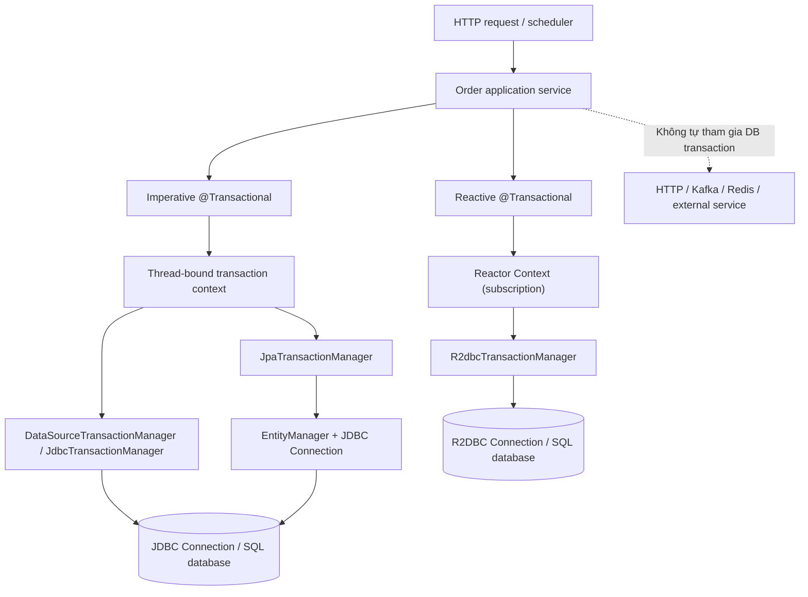
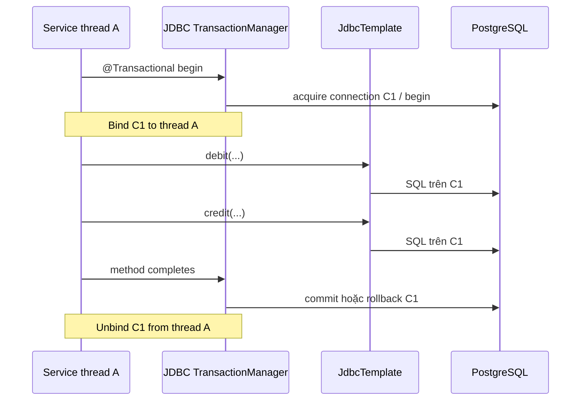
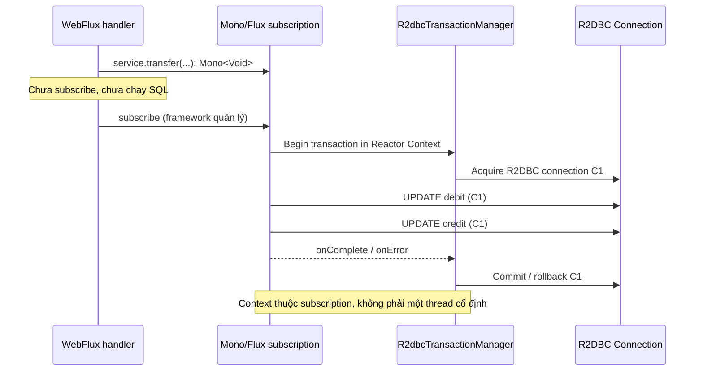
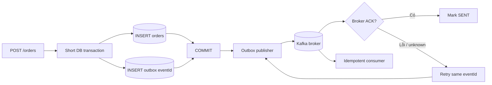
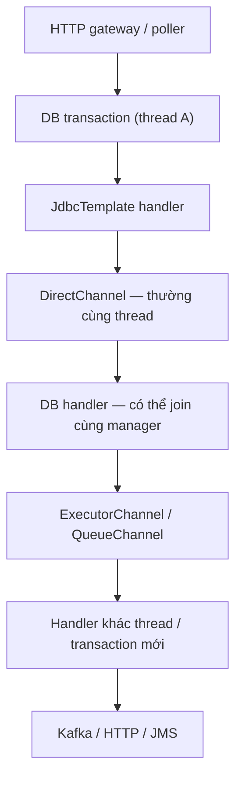
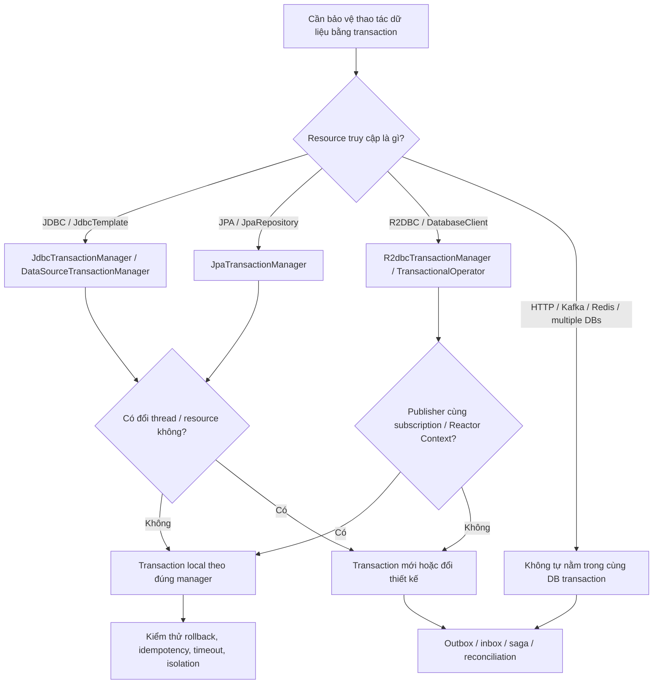

# Giao dịch JDBC, JPA và reactive có phạm vi ngữ cảnh khác nhau

> **Chương:** Giao dịch tích hợp  
> **Module:** SPRING_BOOT_INTEGRATION — tổ chức kết nối hệ thống Spring Boot qua HTTP client, cơ sở dữ liệu, cache, broker thông điệp và Spring Integration; trọng tâm là cấu hình, hợp đồng dữ liệu, ranh giới giao dịch, lỗi, chống trùng lặp, kiểm thử và quan sát các luồng tích hợp thực tế.

## 1. Bài toán: cùng @Transactional nhưng không phải cùng giao dịch

Một dịch vụ xử lý đơn hàng có ba cách lưu dữ liệu:

1. `JdbcTemplate` ghi trực tiếp vào PostgreSQL.
2. `JpaRepository` lưu entity thông qua Hibernate/`EntityManager`.
3. `DatabaseClient`/`R2dbcEntityTemplate` ghi bất đồng bộ qua R2DBC và trả `Mono`.

Cả ba đều có thể kết hợp với `@Transactional`, nhưng **không sử dụng cùng một cơ chế lưu ngữ cảnh giao dịch**. Với JDBC và JPA imperative, Spring thường liên kết transaction với **thread đang thực thi**. Với reactive, Spring liên kết transaction với **Reactor subscriber context** xuyên suốt một reactive sequence được subscribe, không dựa vào một thread cố định.

Hệ quả: đặt `@Transactional` lên method **không** tự khiến truy vấn chạy trong một `CompletableFuture`, một `@Async` method, một `Mono` được subscribe muộn hoặc lệnh HTTP/Kafka cùng thuộc một giao dịch.



**Giao dịch là cơ chế của một resource và một phạm vi thực thi cụ thể**, không phải annotation bảo đảm mọi side effect trong toàn hệ thống cùng commit/rollback.

### 1.1. Mục tiêu học tập

Sau bài này, bạn có thể:

1. Phân biệt `PlatformTransactionManager` (imperative) với `ReactiveTransactionManager`.
2. Giải thích cách `TransactionSynchronizationManager` liên kết connection/`EntityManager` với thread, còn R2DBC dùng Reactor Context.
3. Cấu hình và sử dụng giao dịch `JdbcTemplate`, JPA/Hibernate và R2DBC đúng kiến trúc.
4. Nhận biết vì sao `@Async`, `CompletableFuture`, `subscribe()`, self-invocation và `ThreadLocal` có thể phá kỳ vọng về transaction.
5. Đánh giá propagation, isolation, readOnly, flush, rollback và transaction-manager selection.
6. Thiết kế an toàn khi HTTP/Kafka/Redis và nhiều database tham gia cùng một business workflow.
7. Kiểm thử rollback, transaction boundary, idempotency và quan sát lỗi giao dịch trong Spring Boot.

## 2. Ba mô hình giao dịch — cùng API nhìn ngoài, khác ngữ cảnh bên trong

| Đặc điểm | JDBC imperative | JPA/Hibernate imperative | R2DBC reactive |
| --- | --- | --- | --- |
| API dữ liệu | `JdbcTemplate` / JDBC `Connection` | `EntityManager` / `JpaRepository` | `DatabaseClient` / `R2dbcEntityTemplate` |
| Transaction manager | `JdbcTransactionManager` hoặc `DataSourceTransactionManager` | `JpaTransactionManager` | `R2dbcTransactionManager` |
| Giao diện Spring | `PlatformTransactionManager` | `PlatformTransactionManager` | `ReactiveTransactionManager` |
| Ngữ cảnh runtime | **Thread-bound** | **Thread-bound** `EntityManager`, thường kèm JDBC resource | **Reactor Context**, gắn với subscription |
| Kết nối | JDBC blocking connection | JDBC connection qua JPA provider | R2DBC non-blocking connection |
| Thời điểm thao tác | Gọi method SQL đồng bộ | Persistence context, có thể trì hoãn SQL tới flush | Thao tác được thực hiện khi publisher được subscribe |
| Phạm vi cần duy trì | Cùng thread và resource binding phù hợp | Cùng thread, persistence context và transaction manager | Cùng reactive pipeline/context subscription |
| Khi đổi thread | Không tự mang theo transaction | Không tự mang theo `EntityManager` | Có thể tiếp tục trong Reactor pipeline vì context đi theo subscriber |
| Khi HTTP/Kafka có side effect | Không tự thuộc JDBC transaction | Không tự thuộc JPA transaction | Không tự thuộc R2DBC transaction |

**Spring WebFlux không đồng nghĩa R2DBC** và **Spring MVC không cấm R2DBC**. Lựa chọn transaction manager phụ thuộc stack truy cập dữ liệu và kiểu method; tuy nhiên phối hợp mô hình blocking/reactive trong cùng flow phải làm rõ ngữ cảnh và không gọi blocking API trên Netty event loop.

### 2.1. Một transaction khác một request HTTP

Một HTTP request có thể mở nhiều DB transactions: đọc dữ liệu trong một transaction ngắn, gọi đối tác bên ngoài, rồi ghi kết quả ở transaction khác. Ngược lại, cùng một transaction có thể bao gồm nhiều lời gọi repository thuộc cùng datasource và thread.

Không nên giữ transaction DB mở suốt quá trình gọi HTTP chậm chỉ vì method service có `@Transactional`: connection bị giữ, lock tồn tại lâu và có thể gây nghẽn pool khi partner timeout.

### 2.2. Cấu hình Spring Boot cần hiểu

Các ví dụ Java dưới đây nhắm **Spring Boot 3.2–3.5, Spring Framework 6.1+, Java 17+**. Trong project có cả JDBC và R2DBC, auto-configuration DataSource của Boot có những điều kiện phụ thuộc classpath/`ConnectionFactory`: **không mặc định cả hai stack đều được tự cấu hình chỉ vì có đủ hai starter**. Nếu cần đồng thời, xác nhận rõ beans `DataSource`, `ConnectionFactory`, transaction managers và qualifiers.

Để Spring Boot BOM chọn version của driver, Spring Data và Hibernate; khi chuyển Boot/Spring major, đối chiếu semantics transaction và API với tài liệu đúng dòng, không sao chép cấu hình từ phiên bản khác.

## 3. Giao dịch JDBC: Connection được giữ theo thread

Với Spring JDBC, `DataSourceTransactionManager`/`JdbcTransactionManager` lấy JDBC `Connection` từ `DataSource`, cấu hình auto-commit/isolation/read-only theo policy và bind resource vào thread trong thời gian transaction còn active.

`JdbcTemplate` gọi `DataSourceUtils` để sử dụng connection đang tham gia transaction. Nhờ đó nhiều lệnh SQL có thể nằm trong **cùng DB transaction** mà service không phải truyền `Connection` vào từng method.

### 3.1. Dependency và cấu hình JDBC

```groovy
// build.gradle — project đã áp dụng Spring Boot BOM
dependencies {
    implementation 'org.springframework.boot:spring-boot-starter-jdbc'
    runtimeOnly 'org.postgresql:postgresql'
    testImplementation 'org.springframework.boot:spring-boot-starter-test'
}
```

```yaml
# application.yml — không commit password thật
spring:
  datasource:
    url: ${ORDERS_DB_URL}
    username: ${ORDERS_DB_USERNAME}
    password: ${ORDERS_DB_PASSWORD}
    hikari:
      maximum-pool-size: 12
      connection-timeout: 3000
```

Để `DataSource` và manager được Boot cấu hình khi điều kiện phù hợp. `connection-timeout` của Hikari ở ví dụ là thời gian tối đa chờ connection từ pool (millisecond), **khác** deadline toàn bộ JDBC transaction và query timeout. Các giá trị chỉ dùng làm điểm khởi đầu, phải đo theo khả năng PostgreSQL/connection pool thực.

### 3.2. Ví dụ hai thao tác SQL cùng commit/rollback

Giả sử có bảng `account_balance(account_id, balance)` và bảng `transfer_audit(transfer_id, from_id, to_id, amount)` cùng ở **một PostgreSQL datasource**. Code minh họa chuyển tiền đồng bộ bằng JDBC:

```java
import java.math.BigDecimal;
import org.springframework.jdbc.core.JdbcTemplate;
import org.springframework.stereotype.Service;
import org.springframework.transaction.annotation.Transactional;

@Service
public class JdbcTransferService {
    private final JdbcTemplate jdbc;

    public JdbcTransferService(JdbcTemplate jdbc) {
        this.jdbc = jdbc;
    }

    @Transactional
    public void transfer(String transferId, String fromId,
                         String toId, BigDecimal amount) {
        if (amount == null || amount.signum() <= 0) {
            throw new IllegalArgumentException("amount must be positive");
        }

        int debited = jdbc.update(
                """
                UPDATE account_balance
                   SET balance = balance - ?
                 WHERE account_id = ? AND balance >= ?
                """, amount, fromId, amount);
        if (debited != 1) {
            throw new IllegalStateException("Insufficient balance");
        }

        int credited = jdbc.update(
                """
                UPDATE account_balance
                   SET balance = balance + ?
                 WHERE account_id = ?
                """, amount, toId);
        if (credited != 1) {
            throw new IllegalStateException("Destination not found");
        }

        jdbc.update(
                """
                INSERT INTO transfer_audit
                    (transfer_id, from_id, to_id, amount)
                VALUES (?, ?, ?, ?)
                """, transferId, fromId, toId, amount);
    }
}
```

**Giải thích:** nếu method được gọi qua Spring proxy, manager đúng datasource đang active và `IllegalStateException` không bị bắt nuốt, cả ba lệnh JDBC cùng transaction: khi lỗi, debit và credit được rollback cùng audit. Trong triển khai thực tế, đặt **unique constraint trên `transfer_id`** và xử lý concurrent transfer để chống ghi lặp do retry/request timeout. Code chưa xử lý kiểm tra `fromId != toId` và định tuyến transaction isolation cho mọi bài toán thanh toán; đây là ví dụ về ranh giới transaction, không phải hệ thống ngân hàng hoàn chỉnh.

### 3.3. Vì sao cùng thread quan trọng?



Nếu trong method tạo một thread mới để gọi `jdbc.update(...)`, thread đó **không tự nhận connection C1**; nó có thể lấy connection khác và commit độc lập nếu không có transaction thích hợp. Spring JDBC và Spring-managed transactions cần dùng các API được quản lý: nếu bạn tự gọi `dataSource.getConnection()` rồi thao tác/đóng tùy tiện, có thể bỏ qua transaction resource binding mà Spring đang quản lý. Trong code dùng Spring, ưu tiên `JdbcTemplate`/`DataSourceUtils` hoặc `TransactionTemplate`.

### 3.4. JdbcTransactionManager và DataSourceTransactionManager

`JdbcTransactionManager` mở rộng `DataSourceTransactionManager` với cơ chế translation cho exception commit/rollback nhất quán hơn với Spring JDBC. Ở Boot 3.x, manager mặc định phụ thuộc auto-configuration và các bean đã có; khi cần chọn manager cụ thể, cấu hình dựa trên **DataSource thực** thay vì suy rằng `@Transactional` luôn chọn JDBC.

```java
import javax.sql.DataSource;
import org.springframework.context.annotation.Bean;
import org.springframework.context.annotation.Configuration;
import org.springframework.jdbc.support.JdbcTransactionManager;

@Configuration(proxyBeanMethods = false)
class JdbcTxConfiguration {
    @Bean("ordersJdbcTransactionManager")
    JdbcTransactionManager ordersJdbcTransactionManager(
            DataSource ordersDataSource) {
        return new JdbcTransactionManager(ordersDataSource);
    }
}
```

Đây là **mẫu cấu hình khi chủ động cần bean riêng**; tên `ordersDataSource` chỉ biểu diễn một datasource được inject đúng (nếu có nhiều datasource thì sử dụng `@Qualifier`). Không tạo thêm manager vô điều kiện vào application Boot đã có JDBC/JPA manager mặc định: làm như vậy có thể khiến `@Transactional` trở nên ambiguous. Với production, cần quyết định rõ **ai sở hữu transaction manager** và tên qualifier nào áp dụng.

## 4. Giao dịch JPA: EntityManager và persistence context

JPA dùng `JpaTransactionManager` và `EntityManager` (thường do Hibernate triển khai). Spring bind `EntityManager` phục vụ transaction vào thread qua hạ tầng persistence. Khác JDBC thuần, JPA còn có **persistence context** chứa entity được quản lý, dirty checking, flush và lazy loading.

### 4.1. Dependency và entity mẫu

```groovy
dependencies {
    implementation 'org.springframework.boot:spring-boot-starter-data-jpa'
    runtimeOnly 'org.postgresql:postgresql'
}
```

```java
import jakarta.persistence.Column;
import jakarta.persistence.Entity;
import jakarta.persistence.Id;
import jakarta.persistence.Table;
import jakarta.persistence.Version;
import java.math.BigDecimal;

@Entity
@Table(name = "purchase_orders")
public class PurchaseOrder {
    @Id
    private String id;

    @Column(nullable = false)
    private String status;

    @Column(nullable = false)
    private BigDecimal amount;

    @Version
    private Long version;

    protected PurchaseOrder() {}

    public PurchaseOrder(String id, String status, BigDecimal amount) {
        this.id = id;
        this.status = status;
        this.amount = amount;
    }

    public String getId() { return id; }
    public String getStatus() { return status; }
    public void setStatus(String status) { this.status = status; }
}
```

`@Version` hỗ trợ optimistic locking khi nhiều transaction cùng cập nhật cùng entity. Schema ở database phải có column/index/constraint phù hợp; không dùng `hibernate.hbm2ddl.auto=create` trong production thay cho migration đã kiểm soát.

### 4.2. Dirty checking và thời điểm flush

```java
import org.springframework.data.jpa.repository.JpaRepository;

public interface PurchaseOrderRepository
        extends JpaRepository<PurchaseOrder, String> {
}
```

```java
import org.springframework.stereotype.Service;
import org.springframework.transaction.annotation.Transactional;

@Service
public class JpaOrderService {
    private final PurchaseOrderRepository repository;

    public JpaOrderService(PurchaseOrderRepository repository) {
        this.repository = repository;
    }

    @Transactional
    public void confirm(String id) {
        PurchaseOrder order = repository.findById(id).orElseThrow();
        if (!"NEW".equals(order.getStatus())) {
            throw new IllegalStateException("Only NEW orders can be confirmed");
        }
        order.setStatus("CONFIRMED");
        // Entity được quản lý; Hibernate có thể flush UPDATE ở commit.
    }
}
```

Trong transaction JPA, entity lấy ra được **quản lý bởi persistence context**. Thay đổi `status` có thể được phát hiện bằng dirty checking và SQL UPDATE được phát khi flush (có thể sớm hơn commit tùy query và flush mode). **`save()` hoặc `flush()` không đồng nghĩa transaction đã commit**: nếu exception xảy ra sau flush nhưng trước commit, SQL có thể bị rollback.

### 4.3. JpaTransactionManager và JDBC cùng một database

`JpaTransactionManager` có thể quản lý JPA và, khi cấu hình thích hợp, cho phép Spring JDBC truy cập **cùng DataSource** tham gia transaction JPA. Điều này không đồng nghĩa mọi `JdbcTemplate` và `EntityManager` đều tự tham gia cùng transaction bất kể factory/manager; cần:

1. JPA `EntityManagerFactory` và `JdbcTemplate` thực sự dùng cùng underlying `DataSource`.
2. Giao dịch được quản lý bởi transaction manager có khả năng expose JDBC connection, thường `JpaTransactionManager`.
3. Truy cập JDBC qua `JdbcTemplate`/`DataSourceUtils`, không tự tạo connection ngoài cơ chế Spring.
4. Flush JPA trước raw JDBC query nếu logic cần JDBC nhìn thấy các thay đổi entity **chưa được flush**, và kiểm chứng ordering/visibility.

Nếu hai datasource khác nhau (kể cả cùng PostgreSQL server nhưng connection/DB khác), transaction manager local **không tự tạo phân tán atomic commit**.

### 4.4. Các bẫy JPA khác JDBC

- **Lazy loading:** truy cập association ngoài transaction/persistence context có thể gây `LazyInitializationException`; không mở transaction dài xuyên HTTP chỉ để tránh lỗi này. Dùng query/projection/fetch strategy đúng.
- **Open Session in View:** trong ứng dụng web có thể giữ EntityManager tới view serialization khi bật; đừng dựa vào đó như transaction service được kiểm soát. Nên cân nhắc `spring.jpa.open-in-view=false` cho service API khi phù hợp.
- **Flush timing:** query được thực hiện trước commit có thể khiến Hibernate flush; không giả định một UPDATE chỉ xuất hiện duy nhất ở cuối method.
- **Read-only:** `@Transactional(readOnly=true)` là hint tối ưu hóa và có thể ảnh hưởng flush mode; không phải ACL cấm ghi chắc chắn ở DB.
- **Optimistic locking:** `@Version` cần version column và exception handling; khi conflict, đọc lại state và xét lại business transition thay vì retry mù.
- **Exception:** nhiều lỗi SQL/JPA được Spring dịch thành `DataAccessException`; phải phân biệt constraint vi phạm, lock conflict, timeout và lỗi schema.

## 5. Giao dịch reactive: Reactor Context thay cho thread binding

R2DBC cung cấp API truy cập cơ sở dữ liệu bất đồng bộ/non-blocking với `ConnectionFactory`. `R2dbcTransactionManager` gắn connection và trạng thái transaction vào **Reactor Context** của một subscription. Điều này cho phép cùng pipeline tiếp tục trên thread khác sau `publishOn(...)` mà vẫn nhìn thấy transaction context theo semantics của Reactor/Spring, **nếu** các lời gọi DB thuộc cùng reactive pipeline đã được transaction-wrapped.



### 5.1. Dependency và cấu hình R2DBC

```groovy
dependencies {
    implementation 'org.springframework.boot:spring-boot-starter-data-r2dbc'
    runtimeOnly 'org.postgresql:r2dbc-postgresql'
    testImplementation 'io.projectreactor:reactor-test'
    testImplementation 'org.springframework.boot:spring-boot-starter-test'
}
```

```yaml
spring:
  r2dbc:
    url: ${ORDERS_R2DBC_URL}
    username: ${ORDERS_R2DBC_USERNAME}
    password: ${ORDERS_R2DBC_PASSWORD}
```

Ví dụ `ORDERS_R2DBC_URL=r2dbc:postgresql://postgres:5432/orders`, **khác cú pháp** `jdbc:postgresql://...`. `R2dbcTransactionManager` cần một `ConnectionFactory` R2DBC; không thể thay nó bằng `DataSourceTransactionManager` quản lý JDBC. Trong project có nhiều managers, phải dùng đúng qualifier và xác nhận autoconfiguration.

### 5.2. Ví dụ transfer với DatabaseClient và Mono

```java
import java.math.BigDecimal;
import org.springframework.r2dbc.core.DatabaseClient;
import org.springframework.stereotype.Service;
import org.springframework.transaction.annotation.Transactional;
import reactor.core.publisher.Mono;

@Service
public class ReactiveTransferService {
    private final DatabaseClient db;

    public ReactiveTransferService(DatabaseClient db) {
        this.db = db;
    }

    @Transactional(transactionManager = "r2dbcTransactionManager")
    public Mono<Void> transfer(String fromId, String toId,
                               BigDecimal amount) {
        if (amount == null || amount.signum() <= 0) {
            return Mono.error(new IllegalArgumentException(
                    "amount must be positive"));
        }

        Mono<Long> debit = db.sql("""
                UPDATE account_balance
                   SET balance = balance - :amount
                 WHERE account_id = :fromId AND balance >= :amount
                """)
                .bind("amount", amount)
                .bind("fromId", fromId)
                .fetch()
                .rowsUpdated();

        Mono<Long> credit = db.sql("""
                UPDATE account_balance
                   SET balance = balance + :amount
                 WHERE account_id = :toId
                """)
                .bind("amount", amount)
                .bind("toId", toId)
                .fetch()
                .rowsUpdated();

        return debit
                .flatMap(count -> count == 1
                        ? Mono.empty()
                        : Mono.error(new IllegalStateException(
                                "Insufficient balance or source missing")))
                .then(credit)
                .flatMap(count -> count == 1
                        ? Mono.empty()
                        : Mono.error(new IllegalStateException(
                                "Destination missing")))
                .then();
    }
}
```

Đây là ví dụ **một R2DBC database**, không bao gồm audit/idempotency nên chưa phải nghiệp vụ chuyển tiền production. Hai updates được nối **tuần tự bằng `then(...)`**, không chạy song song một cách tùy tiện trên cùng connection transaction. Khi bất kỳ stage nào phát `onError` và reactive transaction advice đang hoạt động, transaction được rollback theo policy mặc định.

**Điểm cốt lõi:** lời gọi `transfer(...)` tạo/nhận một `Mono<Void>`. SQL không được thực thi cho đến khi publisher được subscribe. Spring reactive transaction advice bao bọc publisher để mở transaction ở thời điểm subscribe, duy trì transaction context tới terminal signal.

### 5.3. TransactionalOperator cho phạm vi giao dịch tường minh

Khi chỉ một phần pipeline phải nằm trong DB transaction, `TransactionalOperator` giúp bao phạm vi trực tiếp:

```java
import org.springframework.context.annotation.Bean;
import org.springframework.context.annotation.Configuration;
import org.springframework.r2dbc.connection.R2dbcTransactionManager;
import org.springframework.transaction.reactive.TransactionalOperator;
import io.r2dbc.spi.ConnectionFactory;

@Configuration(proxyBeanMethods = false)
class ReactiveTransactionConfiguration {
    @Bean("r2dbcTransactionManager")
    R2dbcTransactionManager r2dbcTransactionManager(
            ConnectionFactory connectionFactory) {
        return new R2dbcTransactionManager(connectionFactory);
    }

    @Bean
    TransactionalOperator r2dbcTransactionalOperator(
            R2dbcTransactionManager r2dbcTransactionManager) {
        return TransactionalOperator.create(r2dbcTransactionManager);
    }
}
```

Ví dụ áp dụng:

```java
import org.springframework.transaction.reactive.TransactionalOperator;
import reactor.core.publisher.Mono;

public Mono<Void> updateTwoRows(
        Mono<Long> debit,
        Mono<Long> credit,
        TransactionalOperator operator) {
    return debit.then(credit).then()
            .as(operator::transactional);
}
```

Đoạn này minh họa cú pháp, giả định `debit`/`credit` đã được xây dựng bằng R2DBC publisher cùng connection factory và có kiểm tra `rowsUpdated` theo nghiệp vụ. Với pipeline cần domain validation, không bỏ qua kết quả updates như ví dụ rút gọn.

**Chỉ tạo bean transaction manager thủ công nếu cần**. Trong Boot đã auto-configure một manager R2DBC đủ điều kiện, khai báo bean mới không chính xác có thể thay hoặc gây ambiguity. `TransactionalOperator` được tạo từ đúng manager; trong ứng dụng có nhiều connection factories, đặt tên rõ và chọn manager tương ứng.

### 5.4. Reactor Context không phải ThreadLocal

```java
import reactor.core.publisher.Mono;
import reactor.core.scheduler.Schedulers;

Mono<Void> pipeline = reactiveService.transfer(
        "account-A", "account-B", amount)
        .publishOn(Schedulers.parallel())
        .then();
```

Trong một **subscription duy nhất** được quản lý đúng, Reactor Context có thể được truyền xuyên các operator dù thread thực thi thay đổi. Điều này **không cho phép** gọi JDBC/JPA blocking trong reactive transaction rồi giả định chúng dùng R2DBC connection — chúng có cơ chế transaction và resource khác nhau.

Một số trường hợp dễ mất hoặc tách transaction:

- Gọi `.subscribe()` thủ công bên trong một method đã được transaction-wrapped: có thể tạo một subscription **khác**, không thuộc phạm vi mà caller chờ/rollback.
- Trả `Mono` nhưng lại gọi `.block()` trên Netty event loop: chặn event loop, thường trái kiến trúc.
- Tạo `CompletableFuture`/`@Async` rồi thao tác DB với API imperative mà mong Reactor Context tự biến thành JDBC thread transaction.
- Lấy publisher từ nguồn bên ngoài không tương thích context, hoặc code tự subscribe/trở về trước khi publisher hoàn tất.

**Cancellation cần chính sách rõ:** Spring reactive transaction infrastructure xử lý terminal signals, bao gồm cancellation theo semantics của phiên bản; nhưng việc HTTP caller hủy subscription không đồng nghĩa side effect đã thực hiện ở HTTP/Kafka bên ngoài bị thu hồi. Các thao tác external cần idempotency và reconciliation.

## 6. @Transactional không phải lời gọi “magic”: proxy và thời điểm thực thi

Spring thường áp dụng `@Transactional` bằng **AOP proxy**. Advice chỉ chạy khi một method được gọi qua proxy phù hợp và transaction manager tương ứng được chọn. Một method gọi method khác **trong cùng object** thường không đi qua proxy và không tự kích hoạt transaction mới.

### 6.1. Self-invocation bỏ qua transactional advice

```java
import org.springframework.stereotype.Service;
import org.springframework.transaction.annotation.Propagation;
import org.springframework.transaction.annotation.Transactional;

@Service
public class InvoiceService {
    public void runImport() {
        saveInvoice(); // this.saveInvoice(): KHÔNG đi qua Spring proxy.
    }

    @Transactional(propagation = Propagation.REQUIRES_NEW)
    public void saveInvoice() {
        // Ví dụ: repository.save(...).
    }
}
```

**Không giả định** `saveInvoice()` mở `REQUIRES_NEW` transaction ở đây. Khi gọi `runImport()` từ ngoài, lời gọi nội bộ đi thẳng trên `this`, không được proxy intercept; annotation trên method được gọi có thể không có hiệu lực. Giải pháp rõ nhất là đưa transactional method vào **một Spring bean riêng**, inject bean đó và gọi qua proxy; hoặc dùng `TransactionTemplate` cho boundary imperative tường minh.

Các trường hợp khác: method không được Spring quản lý, khởi tạo service bằng `new`, scope/visibility không được proxy xử lý theo config, final class/method với proxy phù hợp và sự khác biệt giữa proxy interface/class đều có thể khiến annotation không hoạt động như dự kiến.

### 6.2. @Transactional trên controller và transaction scope quá dài

Không nên bọc cả controller:

```java
// Anti-pattern: gọi HTTP partner trong DB transaction dài.
@Transactional
public OrderReceipt createOrder(CreateOrderRequest request) {
    OrderEntity entity = repository.save(mapToEntity(request));
    PaymentReceipt payment = paymentClient.charge(request); // network I/O
    kafkaTemplate.send("orders.created", toEvent(entity)); // async
    return toReceipt(entity, payment);
}
```

Đoạn trên **không** có atomic commit giữa database, HTTP payment và Kafka. Trong khi gọi HTTP, transaction DB có thể giữ connection/locks; `KafkaTemplate.send(...)` trả future chưa chắc đã được broker ACK khi method return. Nếu commit DB sau khi Kafka đã ghi, consumer có thể thấy sự kiện cho entity chưa được commit.

Ưu tiên tách:

1. Transaction DB ngắn để ghi business state + outbox trong cùng database.
2. Commit DB, trả response/receipt theo hợp đồng.
3. Worker độc lập gửi outbox tới broker, đợi ACK, cập nhật trạng thái để retry.
4. Consumer xử lý idempotent; HTTP side effect có idempotency key và cơ chế đối soát.

### 6.3. @Async, CompletableFuture và transaction thread-bound

```java
import java.util.concurrent.CompletableFuture;
import org.springframework.scheduling.annotation.Async;
import org.springframework.stereotype.Service;
import org.springframework.transaction.annotation.Transactional;

@Service
public class AsyncAuditWriter {
    @Async
    @Transactional
    public CompletableFuture<Void> writeAudit() {
        // JDBC/JPA writes nếu được proxy quản lý có thể mở
        // một transaction MỚI trên thread thực thi của @Async.
        return CompletableFuture.completedFuture(null);
    }
}
```

Nếu một `@Transactional` service gọi bean này, transaction ở thread caller **không tự truyền** sang thread của `@Async`. Async method có thể tự mở transaction riêng khi advice của nó được kích hoạt đúng. Caller commit hoặc rollback không tự rollback phần DB đã được async worker commit.

Tương tự, `CompletableFuture.supplyAsync(() -> repository.save(...))` chạy trong executor khác có thể tạo transaction độc lập theo repository/advice hoặc chạy ngoài transaction của caller. **Không chuyển tiếp nguyên `Connection`/`EntityManager` thread-bound sang executor khác** để “chia sẻ transaction”: chúng không được thiết kế như một distributed context/thread-safe resource.

Nếu nghiệp vụ bắt buộc job được tạo sau DB commit, dùng outbox hoặc một tác vụ durable đúng kiến trúc; `@TransactionalEventListener(phase=AFTER_COMMIT)` có thể hữu ích cho tác vụ thông báo best-effort nhưng **không bền vững nếu JVM chết ngay sau commit**.

### 6.4. Transaction và Java 21 virtual threads

Virtual thread vẫn là một Java thread mà `ThreadLocal` có ý nghĩa, nhưng **mỗi virtual thread có ngữ cảnh thread riêng**. Việc chuyển sang virtual threads không khiến JDBC transaction của thread A lan sang virtual thread B. Virtual threads có thể giảm chi phí chờ I/O blocking, nhưng không giải quyết transaction propagation, connection pool exhaustion hay cross-system atomicity.

### 6.5. Trả Mono từ method dùng imperative transaction manager

```java
// Không đúng mô hình: imperative @Transactional + publisher tạo rồi chạy sau.
@Transactional(transactionManager = "ordersJdbcTransactionManager")
public Mono<Void> updateLater() {
    return Mono.fromRunnable(() -> jdbcTemplate.update(
            "UPDATE orders SET status = 'DONE' WHERE id = ?", orderId));
}
```

Khi advice dùng **imperative manager**, transaction thread-bound thường bắt đầu và kết thúc quanh **thời gian method tạo và trả publisher**, trước khi publisher được subscribe và SQL chạy. Vì vậy SQL bên trong `Mono.fromRunnable` không được bảo vệ bởi transaction đó. Nếu muốn R2DBC reactive transaction, dùng reactive connection factory/manager và reactive publisher. Nếu muốn JDBC, thực thi JDBC **đồng bộ trong transaction imperative** rồi trả kết quả theo boundary phù hợp; không che JDBC blocking bằng `Mono` và mặc định transaction sẽ kéo dài qua subscription.

## 7. Transaction manager nào được chọn khi có nhiều công nghệ?

Ở ứng dụng chỉ có một `DataSource` JDBC, Boot thường cấu hình một imperative manager. Với JPA, `JpaTransactionManager` thường là lựa chọn cho repository JPA. Với R2DBC, manager reactive khác loại. Khi ứng dụng **có cả** JDBC/JPA/R2DBC hoặc nhiều databases, không nên đoán một `@Transactional` không chỉ định manager sẽ lấy đúng resource.

### 7.1. Chỉ định manager theo nghiệp vụ

```java
@Transactional(transactionManager = "ordersJpaTransactionManager")
public void updateOrderJpa(String id) {
    // JPA repository ...
}

@Transactional(transactionManager = "auditJdbcTransactionManager")
public void insertAuditJdbc(String auditId) {
    // JdbcTemplate dùng Audit DataSource ...
}

@Transactional(transactionManager = "r2dbcTransactionManager")
public Mono<Void> updateReactive(String id) {
    // DatabaseClient dùng R2DBC ConnectionFactory ...
}
```

Các method là **fragment minh họa**; chúng chỉ có ý nghĩa khi beans được định nghĩa/đặt tên đúng, service được Spring quản lý và gọi qua proxy. Nếu có nhiều managers và bạn bỏ tên, Spring có thể chọn một manager mặc định hoặc báo ambiguity; behavior phụ thuộc cấu hình ứng dụng. Đừng để metadata “tên Bean nào được chọn” trở thành điều ngẫu nhiên sau khi thêm một starter mới.

### 7.2. Một ví dụ sai với hai datasource

```text
ordersDataSource ── ordersJdbcTransactionManager ── orders_db
auditDataSource  ── auditJdbcTransactionManager  ── audit_db

@Transactional("ordersJdbcTransactionManager")
  ordersJdbc.update(...)      -> transaction T1 (orders_db)
  auditJdbc.update(...)       -> KHÔNG tự tham gia T1 (audit_db)
```

Vì hai `JdbcTemplate` gắn hai `DataSource` khác nhau, transaction manager A **không thể local-commit nguyên tử** database B. Một `auditJdbc.update` có thể auto-commit hoặc dùng transaction khác. Nếu thao tác sau thất bại, rollback T1 không chắc rollback audit.

Khi cần nhất quán, cân nhắc **outbox/saga/compensation**, hoặc một coordinator phân tán/XA nếu hệ thống thật sự có hạ tầng phù hợp và đã chấp nhận độ phức tạp (không mặc định Spring `@Transactional` là XA).

### 7.3. Khi JDBC và JPA cùng PostgreSQL

Nếu JPA `EntityManagerFactory` và `JdbcTemplate` dùng cùng datasource, một `JpaTransactionManager` có thể cho cả hai tham gia transaction, nhưng phải xác minh bằng integration test:

- JDBC query thấy entity vừa được JPA `persist` **sau khi flush cần thiết**.
- Nếu JDBC update xảy ra sau khi entity JPA đã load, persistence context có thể **giữ bản copy cũ**; cần `refresh`/`clear` thích hợp nếu cùng state bị thay đổi ngoài ORM.
- Rollback một exception sau cả hai thao tác sẽ rollback cả hai ở cùng DB resource.
- Khi có JPA + JDBC operations trên cùng connection, timeout, read-only và isolation cần được hỗ trợ/áp dụng nhất quán.

Không thiết kế persistence layer dựa trên giả định “cùng tên PostgreSQL database” đã đủ; điều kiện về `DataSource`, connection management, transaction manager và session boundary mới quan trọng.

### 7.4. Phân biệt transaction ở Redis, Kafka, JMS và Spring Integration

| Resource | Transaction manager/cơ chế | Không đồng nghĩa với |
| --- | --- | --- |
| PostgreSQL JDBC | `JdbcTransactionManager`/`DataSourceTransactionManager` | Kafka broker ACK |
| PostgreSQL JPA | `JpaTransactionManager` | HTTP payment đã thành công |
| PostgreSQL R2DBC | `R2dbcTransactionManager` | JDBC transaction của thread caller |
| Kafka | Kafka producer transaction/`KafkaTransactionManager` | Atomic commit với PostgreSQL |
| JMS broker | `JmsTransactionManager` hoặc broker-local session transaction | Commit cùng JPA nếu không có coordinator |
| Redis | Redis commands/transaction support tùy client/config | SQL rollback hoặc business exactly-once |
| Spring Integration flow | Message channels, handlers, pollers, gateway, adapters | Tất cả handlers dùng chung một DB transaction tự động |

Với Spring Integration, một synchronous `DirectChannel` thường gọi handler trên **cùng thread**, nên nếu transaction đã active và downstream handler dùng cùng datasource thì có thể tham gia. Nhưng khi có `ExecutorChannel`, `QueueChannel`, poller, JMS/Kafka boundary hoặc xử lý reactive, **thread/transaction boundary thay đổi**. Đừng xem một sơ đồ integration flow liền mạch là một transaction liền mạch.

## 8. Propagation: thay đổi phạm vi giao dịch chứ không thay resource

Spring `@Transactional` có nhiều chế độ `Propagation`. Chúng quyết định cách một method tương tác với transaction **trong cùng transaction manager/resource**, không tự gắn thêm Kafka, HTTP hay database thứ hai.

| Propagation | Khi caller đã có transaction | Khi không có transaction | Điểm cần nhớ |
| --- | --- | --- | --- |
| `REQUIRED` (mặc định) | Tham gia transaction hiện có | Mở transaction mới | Hai method là hai *logical scopes* nhưng có thể chung physical transaction |
| `REQUIRES_NEW` | Suspend transaction hiện có, mở physical transaction độc lập | Mở mới | Có thể giữ nhiều connection cùng lúc, gây cạn pool |
| `NESTED` | Tạo savepoint trong physical transaction nếu manager/resource hỗ trợ | Có thể chạy như REQUIRED | JDBC thường hỗ trợ savepoint; không mặc định JPA hỗ trợ |
| `SUPPORTS` | Tham gia nếu có | Có thể chạy không transaction | Không phải bảo đảm một transaction luôn active |
| `MANDATORY` | Phải tham gia | Ném lỗi | Hữu ích để ép boundary do caller sở hữu |
| `NOT_SUPPORTED` | Suspend transaction hiện có | Chạy không transaction | Có thể dùng cho tác vụ không nên giữ transaction |
| `NEVER` | Ném lỗi | Chạy không transaction | Bảo vệ operation không được nằm trong transaction |

### 8.1. REQUIRED và UnexpectedRollbackException

```java
@Service
public class OrderFacade {
    private final InventoryService inventory;

    @Transactional
    public void placeOrder() {
        try {
            inventory.reserve(); // @Transactional REQUIRED
        } catch (IllegalStateException ignored) {
            // Caller quyết định "tiếp tục".
        }
        // Có thể bị UnexpectedRollbackException khi commit.
    }
}
```

Nếu `InventoryService.reserve()` được gọi **qua proxy** và một exception thuộc rollback rule đi qua scope `REQUIRED` bên trong, Spring có thể đánh dấu transaction chung là **rollback-only**. Dù outer method bắt exception và return bình thường, ở commit Spring có thể ném `UnexpectedRollbackException` vì transaction không thể commit như caller tưởng.

Ngược lại, nếu code nội bộ **tự catch exception trước khi nó đi qua transactional advice**, hoặc có custom rollback rules, không thể khẳng định rollback-only sẽ luôn được đặt. Cần kiểm tra đúng đường đi của exception và transaction status.

### 8.2. REQUIRES_NEW dùng connection riêng

```java
@Service
public class AuditService {
    @Transactional(propagation = Propagation.REQUIRES_NEW)
    public void recordAttempt(String orderId) {
        // Ghi audit trong transaction riêng.
    }
}
```

Nếu outer transaction vẫn giữ JDBC connection, `REQUIRES_NEW` thường cần một connection khác. Khi 100 request cùng chạy outer + inner, connection pool phải đủ dung lượng để không deadlock do mọi thread giữ outer connection chờ inner. Spring Framework khuyến cáo pool phải đủ lớn khi sử dụng pattern này; không áp dụng vô hạn trong batch.

**Không dùng REQUIRES_NEW để cứu giao dịch phân tán:** một audit commit riêng vẫn có thể thành công dù outer order rollback. Đó có thể là chủ đích (audit attempt) nhưng phải được ghi trong hợp đồng.

### 8.3. NESTED không tương đương REQUIRES_NEW

Với `DataSourceTransactionManager`/JDBC driver hỗ trợ savepoints, `NESTED` có thể rollback phần thao tác sau savepoint mà không rollback tất cả transaction cha. Nó **không mở một transaction độc lập có commit bền vững trước cha**. Nếu transaction cha rollback, cả nested work cũng rollback.

Với JPA, cách quản lý persistence context và savepoints khác JDBC, `JpaTransactionManager` không mặc định cung cấp transaction nested cho JPA entity operations; đừng bật `NESTED` trên JPA method mà mong behavior giống savepoint của `JdbcTemplate`. Reactive manager cũng có semantics riêng theo driver và không bảo đảm mọi propagation mode được hỗ trợ giống JDBC.

### 8.4. Timeout, isolation, readOnly và rollback rules

```java
import org.springframework.transaction.annotation.Isolation;
import org.springframework.transaction.annotation.Transactional;

@Transactional(
        isolation = Isolation.READ_COMMITTED,
        timeout = 5,
        readOnly = true)
public OrderSummary loadOrder(String id) {
    // Query DB; method minh họa.
}
```

- **Isolation:** chỉ có ý nghĩa khi manager/driver/database hỗ trợ và transaction tương ứng được tạo. Một method tham gia transaction có sẵn thường **không tự đổi isolation** của physical transaction đó.
- **Timeout:** không phải tổng deadline của toàn bộ HTTP+Kafka flow. Hệ thống còn cần HTTP client timeout, JDBC query timeout, connection acquisition timeout và deadline nghiệp vụ.
- **readOnly:** thường là hint để tối ưu hoặc đánh dấu; không thay quyền DB, không bảo đảm lệnh UPDATE bất khả thi ở mọi driver.
- **Rollback:** mặc định Spring rollback với `RuntimeException` và `Error`, không rollback checked exception nếu không cấu hình (trừ khi policy phiên bản/ứng dụng đã tùy biến). Với exception cần rollback, có thể dùng `rollbackFor=...`.
- **Exception translation:** rollback của transaction và cách Spring báo lỗi từ JDBC/JPA/R2DBC là hai khái niệm liên quan nhưng khác nhau.

```java
@Transactional(rollbackFor = java.io.IOException.class)
public void importFile() throws java.io.IOException {
    // IOException đi qua proxy sẽ dẫn tới rollback theo rule.
}
```

**Lưu ý:** thay vì dùng checked exception để quyết định tất cả lỗi hạ tầng, nên định nghĩa rõ business failure, permanent integration failure, transient failure và transaction retry policy; không cấu hình `noRollbackFor` để che lỗi ghi dữ liệu không nhất quán.

## 9. Giao dịch không thay thế idempotency và isolation nghiệp vụ

Ngay cả khi DB transaction rollback đúng, vẫn có những rủi ro:

1. **Lost update:** hai request cùng load rồi ghi lại entity; dùng optimistic locking `@Version` hoặc atomic conditional SQL.
2. **Write skew/phantom:** hai transaction đọc điều kiện rồi cập nhật các bản ghi khác nhau; cần isolation/locking/constraint đúng yêu cầu.
3. **Duplicate request:** client timeout rồi retry POST; cần idempotency key hoặc unique business key.
4. **Ambiguous commit result:** connection mất sau lệnh COMMIT có thể khiến client không biết DB đã commit chưa; đối soát theo khóa nghiệp vụ, không gửi operation mới với ID mới.
5. **Event redelivery:** Kafka/JMS giao lại khi consumer commit/ACK thất bại; cần idempotent consumer và transaction boundary rõ.
6. **Transaction timeout:** một rollback DB không thu hồi HTTP payment đã thành công ở dịch vụ khác.

### 9.1. Unique constraint là điểm chốt chống trùng

```sql
CREATE TABLE orders (
    id VARCHAR(80) PRIMARY KEY,
    request_key VARCHAR(120) NOT NULL UNIQUE,
    customer_id VARCHAR(80) NOT NULL,
    status VARCHAR(40) NOT NULL
);
```

Khi hai HTTP requests cùng `request_key` đến đồng thời, cả hai có thể đọc `existsByRequestKey=false` trước insert. **Unique constraint tại database** mới là hàng rào quyết định. Application xử lý duplicate bằng cách tìm lại kết quả đã ghi và so khớp nội dung request; không coi mọi conflict đều là retry thành công.

### 9.2. Transactional outbox cho DB → broker



Ghi `orders` và `outbox` trong **một transaction JDBC/JPA cùng DB** giúp đảm bảo chúng cùng commit hoặc rollback. Sau commit, worker publish Kafka với **eventId không đổi** rồi đánh dấu `SENT` sau ACK. Nếu worker crash sau broker ACK nhưng trước mark SENT, event có thể bị publish thêm lần nữa; consumer phải deduplicate.

Outbox tạo đường hồi phục **at-least-once** thực dụng, không tuyên bố exactly-once xuyên PostgreSQL và Kafka. Nếu order DB và outbox DB khác datasource/transaction manager, ưu điểm atomic cùng DB **không còn**.

### 9.3. Mã JPA ghi order và outbox trong cùng database transaction

Ví dụ entity outbox tối giản:

```java
import jakarta.persistence.Column;
import jakarta.persistence.Entity;
import jakarta.persistence.Id;
import jakarta.persistence.Table;
import java.time.Instant;

@Entity
@Table(name = "order_outbox")
public class OutboxEvent {
    @Id
    private String eventId;

    @Column(nullable = false)
    private String aggregateId;

    @Column(nullable = false)
    private String eventType;

    @Column(nullable = false)
    private String payloadJson;

    @Column(nullable = false)
    private String status;

    @Column(nullable = false)
    private Instant createdAt;

    protected OutboxEvent() {}

    public OutboxEvent(String eventId, String aggregateId,
                       String eventType, String payloadJson,
                       Instant createdAt) {
        this.eventId = eventId;
        this.aggregateId = aggregateId;
        this.eventType = eventType;
        this.payloadJson = payloadJson;
        this.status = "PENDING";
        this.createdAt = createdAt;
    }
}
```

Repository:

```java
import org.springframework.data.jpa.repository.JpaRepository;

public interface OutboxEventRepository
        extends JpaRepository<OutboxEvent, String> {
}
```

Service ghi business state và event trong một transaction JPA:

```java
import java.math.BigDecimal;
import java.time.Instant;
import java.util.UUID;
import org.springframework.stereotype.Service;
import org.springframework.transaction.annotation.Transactional;

@Service
public class CreateOrderWithOutboxService {
    private final PurchaseOrderRepository orders;
    private final OutboxEventRepository outbox;

    public CreateOrderWithOutboxService(
            PurchaseOrderRepository orders,
            OutboxEventRepository outbox) {
        this.orders = orders;
        this.outbox = outbox;
    }

    @Transactional(transactionManager = "transactionManager")
    public String create(String orderId, BigDecimal amount) {
        PurchaseOrder order = orders.save(
                new PurchaseOrder(orderId, "NEW", amount));

        String eventId = UUID.randomUUID().toString();
        String payload = """
                {"eventId":"%s","orderId":"%s"}
                """.formatted(eventId, orderId);

        outbox.save(new OutboxEvent(
                eventId,
                orderId,
                "OrderCreated",
                payload,
                Instant.now()));
        return order.getId();
    }
}
```

**Giả định bắt buộc:** bean `transactionManager` thực sự là `JpaTransactionManager` dành cho **cùng datasource** mà cả repositories sử dụng, các bảng đã migration, và input được validate. Ví dụ `String.formatted(...)` chỉ phù hợp với ID nội bộ đã được giới hạn cú pháp; code production nên dùng serializer JSON đúng hợp đồng thay vì nối chuỗi chứa input tùy ý. Unique `orderId` và quy tắc idempotency của request phải được xử lý riêng, vì `UUID.randomUUID()` không nên được tạo lại cho một **event logic đã được commit** khi client retry.

**Tính nguyên tử trong SQL:** nếu insert outbox thất bại, transaction JPA rollback đơn; nếu order insert thất bại, outbox cũng rollback. Nhưng publisher Kafka nằm ở **worker sau commit**, nên transaction DB không bị giữ trong thời gian broker chậm.

### 9.4. Worker gửi outbox và xử lý kết quả chưa rõ

Một worker production cần có các bước:

1. Chọn outbox records chưa được gửi bằng cơ chế lease/claim an toàn khi nhiều replicas chạy.
2. Gửi record giữ nguyên `eventId` và aggregate key; đợi future từ `KafkaTemplate.send(...)` hoàn tất.
3. Chỉ sau broker ACK mới cập nhật trạng thái `SENT`.
4. Nếu lỗi có thể tạm thời, ghi số attempts và lịch retry có backoff/jitter; không retry vô hạn lỗi schema/auth.
5. Nếu timeout sau khi broker đã ghi, trạng thái **chưa rõ**, có thể publish lại cùng eventId; consumer deduplicate.
6. Giám sát backlog, tuổi event lớn nhất và dead-letter/repair workflow cho bản ghi không thể publish.

```text
DB commit order + outbox               OK
worker publish event to Kafka          ACK success
worker crashes before mark SENT        CRASH
worker restarts and re-publishes        DUPLICATE POSSIBLE
consumer checks processed_event_id     SIDE EFFECT ONCE
```

Đây là lý do **transaction DB đúng chưa đủ để bảo đảm event không trùng**. Chính sách retry và idempotency cần được thiết kế theo toàn luồng, từ HTTP request ID tới message event ID.

## 10. Tình huống khó: thay đổi thread, đổi datasource và external I/O

### 10.1. Biên giao dịch trong Spring Integration message flow



Spring Integration có thể dùng transaction advice quanh poller/endpoint theo cấu hình. Tuy nhiên:

- `DirectChannel` có thể chuyển invocation trực tiếp trên caller thread, nhưng **đừng mặc định** mọi handler đều có transaction nếu ngoài scope advice.
- `ExecutorChannel` chuyển xử lý sang thread trong executor, vì vậy transaction imperative của caller **không được truyền tự động**.
- `QueueChannel` tạo ranh giới lưu/nhận message; poller lấy lại message ở thời điểm khác, có transaction scope riêng.
- Kafka/JMS adapter có acknowledgment/transaction semantics riêng; không tự thuộc transaction JDBC chỉ vì cùng flow.
- Nếu flow có side effect external, chọn điểm commit và retry owner rõ; đừng gửi thông báo “success” trước khi data commit theo contract.

### 10.2. Ranh giới WebFlux → JPA blocking

```java
// Không chạy repository JPA blocking trực tiếp trên Netty event loop.
public Mono<OrderDto> wrong(String id) {
    return Mono.just(jpaRepository.findById(id).orElseThrow())
            .map(this::toDto);
}
```

`Mono.just(...)` đánh giá argument **ngay khi xây publisher**; ở đây truy vấn JPA thực thi đồng bộ trước khi Reactor có cơ hội chuyển scheduler. Dùng `Mono.fromCallable(...).subscribeOn(Schedulers.boundedElastic())` có thể cách ly I/O blocking khỏi event loop **khi bắt buộc tích hợp code legacy**:

```java
import reactor.core.publisher.Mono;
import reactor.core.scheduler.Schedulers;

public Mono<OrderDto> legacyJpaLookup(String id) {
    return Mono.fromCallable(() -> jpaService.findOrderDto(id))
            .subscribeOn(Schedulers.boundedElastic());
}
```

Điều kiện: `jpaService.findOrderDto(...)` là method của **bean khác có @Transactional imperative đúng** và tự trả về DTO đã materialize. Đừng dùng `@Transactional` ở outer reactive controller rồi kỳ vọng JDBC/JPA transaction truyền vào boundedElastic thread. BoundedElastic chỉ là biện pháp tương thích, không tạo non-blocking JDBC hoặc cùng transaction reactive.

### 10.3. Không “chia sẻ transaction” bằng ThreadLocal thủ công

Các transaction-bound resources được Spring quản lý với cleanup theo lifecycle. Sao chép `ThreadLocal` transaction state, `EntityManager` hoặc JDBC `Connection` sang thread khác có thể:

- Vi phạm thread-safety của connection/session.
- Làm transaction manager commit khi thread khác vẫn đang sử dụng connection.
- Gây leak resources sau exception/cancellation.
- Đẩy dữ liệu transaction của request này vào request khác nếu executor reuse thread.

Nếu cần transaction thực hiện trên thread mới, **mở transaction riêng trên thread đó** bằng manager/bean phù hợp và thiết kế nhất quán của side effects. Với reactive, để Reactor Context đi theo pipeline và không tự tạo subscription tách khỏi scope.

### 10.4. Nhiều database và batch chunk

Spring Batch lưu metadata `JobRepository` trong một SQL database A, nhưng chunk `ItemWriter` có thể ghi PostgreSQL B hoặc MongoDB. Nếu commit ở B thành công còn ghi checkpoint ở A thất bại, job restart sẽ phát lại chunk. Đây là ví dụ điển hình **transaction manager scope khác nhau**:

| Thành phần | Resource | Nếu crash giữa hai commit |
| --- | --- | --- |
| `JobRepository` | SQL metadata database A | Checkpoint chưa cập nhật |
| `ItemWriter` | Business database B | Một phần data có thể đã commit |
| Kafka publisher | Kafka topic | Event có thể đã ghi hoặc ACK chưa rõ |

Giải pháp thực tế là idempotent writer (unique business key/upsert đúng semantics), outbox, inbox, stable checkpoint và reconciliation. Đừng đặt tên một class là `GlobalTransactionService` rồi xem nó đã tạo global ACID transaction.

### 10.5. TransactionSynchronization và afterCommit callback

Spring cho phép đăng ký `TransactionSynchronization` hoặc `@TransactionalEventListener(phase = AFTER_COMMIT)` để gọi logic khi DB transaction thành công. Nhưng callback này:

- Có thể chạy khi resource vẫn đang trong cleanup lifecycle; không nên làm DB write mới mà không xác định manager/propagation rõ.
- Có thể **không chạy** nếu JVM chết ngay sau commit.
- Không biến HTTP POST hoặc Kafka send thành atomic với DB.

Chỉ dùng after-commit event cho tác vụ best-effort hoặc khi mất sự kiện có thể phục hồi qua cơ chế bền vững khác. Đối với thông báo bắt buộc, **ghi outbox trong transaction trước khi commit**.

### 10.6. Reactive pipeline và side effect ngoài DB

```java
// Anti-pattern: subscribe rời rạc, caller có thể trả trước khi side effect xong.
@Transactional(transactionManager = "r2dbcTransactionManager")
public Mono<Void> createAndNotify() {
    return reactiveOrderRepository.save(order)
            .doOnNext(saved -> kafkaPublisher.send(saved).subscribe())
            .then();
}
```

Đoạn trên giả định `kafkaPublisher.send(...)` trả publisher và `order` tồn tại. `subscribe()` trong callback tạo công việc độc lập; R2DBC transaction không chờ nó hoàn tất, và nếu R2DBC transaction rollback thì Kafka send có thể đã xảy ra. Việc thay `subscribe()` bằng `flatMap(...)` để chờ publish vẫn **không** làm DB và Kafka có atomic commit. Hãy ghi outbox cùng R2DBC transaction, rồi cho worker xử lý sau commit.

## 11. Kiểm thử transaction theo đúng resource và ngữ cảnh

Một test chỉ kiểm tra annotation hiện diện trên method **không chứng minh** rollback đang hoạt động. Cần chạy cùng transaction manager và database/driver thực, gây lỗi có chủ đích rồi quan sát trạng thái dữ liệu **sau khi method kết thúc**.

### 11.1. Nhiều mức test

| Mức | Công cụ | Kiểm chứng |
| --- | --- | --- |
| Unit | Fake repository/gateway | Quy tắc nghiệp vụ, phân loại lỗi, retry policy |
| JDBC integration | `@SpringBootTest` + PostgreSQL Testcontainers | Rollback nhiều JDBC updates, unique key, timeout/lock |
| JPA integration | PostgreSQL Testcontainers + JpaRepository | Flush, dirty checking, `@Version`, transaction manager |
| R2DBC integration | R2DBC PostgreSQL hoặc H2 R2DBC test | Publisher subscription, rollback on error, Reactor Context |
| End-to-end | DB + Kafka + HTTP partner stub | Outbox, crash window, replay, idempotent consumer |

Không dùng H2 để tuyên bố transaction isolation hoặc locking behavior giống PostgreSQL production. Test thường chạy trong `@Transactional` test method có **test-managed transaction** tự rollback ở cuối; điều đó có thể che việc service **không** mở/commit transaction theo kỳ vọng. Với bài kiểm tra service boundary, để test method **không @Transactional**, gọi service qua Spring proxy, rồi kiểm tra DB sau khi exception trả về.

### 11.2. JDBC rollback test: debit phải rollback khi credit lỗi

Ví dụ dùng JUnit 5 và PostgreSQL Testcontainers. Trước khi chạy, chuẩn bị schema test bằng migration hoặc đoạn SQL setup trong test:

```java
import java.math.BigDecimal;
import org.junit.jupiter.api.BeforeEach;
import org.junit.jupiter.api.Test;
import org.springframework.beans.factory.annotation.Autowired;
import org.springframework.boot.test.context.SpringBootTest;
import org.springframework.boot.testcontainers.service.connection.ServiceConnection;
import org.springframework.jdbc.core.JdbcTemplate;
import org.testcontainers.containers.PostgreSQLContainer;
import org.testcontainers.junit.jupiter.Container;
import org.testcontainers.junit.jupiter.Testcontainers;

import static org.assertj.core.api.Assertions.assertThat;
import static org.assertj.core.api.Assertions.assertThatThrownBy;

@Testcontainers
@SpringBootTest
class JdbcTransferTransactionIntegrationTest {
    @Container
    @ServiceConnection
    static final PostgreSQLContainer<?> postgres =
            new PostgreSQLContainer<>("postgres:16-alpine");

    @Autowired JdbcTransferService service;
    @Autowired JdbcTemplate jdbc;

    @BeforeEach
    void prepare() {
        jdbc.execute("""
                CREATE TABLE IF NOT EXISTS account_balance (
                  account_id VARCHAR(80) PRIMARY KEY,
                  balance NUMERIC(19, 2) NOT NULL
                )
                """);
        jdbc.execute("""
                CREATE TABLE IF NOT EXISTS transfer_audit (
                  transfer_id VARCHAR(80) PRIMARY KEY,
                  from_id VARCHAR(80) NOT NULL,
                  to_id VARCHAR(80) NOT NULL,
                  amount NUMERIC(19, 2) NOT NULL
                )
                """);
        jdbc.update("DELETE FROM transfer_audit");
        jdbc.update("DELETE FROM account_balance");
        jdbc.update("INSERT INTO account_balance VALUES (?, ?)",
                "A", new BigDecimal("100.00"));
    }

    @Test
    void rollbackDebitWhenDestinationDoesNotExist() {
        assertThatThrownBy(() -> service.transfer(
                "transfer-1", "A", "missing", new BigDecimal("20.00")))
                .isInstanceOf(IllegalStateException.class);

        BigDecimal balance = jdbc.queryForObject(
                "SELECT balance FROM account_balance WHERE account_id = ?",
                BigDecimal.class, "A");
        assertThat(balance).isEqualByComparingTo("100.00");
        assertThat(jdbc.queryForObject(
                "SELECT COUNT(*) FROM transfer_audit", Long.class))
                .isZero();
    }
}
```

Ở đây test method **không có @Transactional**, `JdbcTransferService` là bean được gọi qua proxy và PostgreSQL container là database test. Nếu lỗi ở bước credit mà balance vẫn là `80.00`, cần điều tra transaction manager/datasource/proxy; đừng chỉ sửa assertion. Nếu project đồng thời có JPA manager, phải chỉ định đúng manager cho `JdbcTransferService` hoặc xác minh nó tham gia cùng datasource như mong đợi.

Đoạn code test cần các dependencies `spring-boot-starter-test`, `spring-boot-testcontainers`, `org.testcontainers:junit-jupiter`, `org.testcontainers:postgresql` và driver JDBC; Docker runtime cần có sẵn. Schema setup dùng DDL trực tiếp **chỉ cho bài test**, production phải quản lý migration.

### 11.3. Kiểm thử JPA: flush không phải commit

Một integration test JPA nên kiểm tra ít nhất:

1. Service load entity, thay đổi state và return bình thường → sau commit, entity đọc từ transaction khác có state mới.
2. Service load entity, thay đổi state, gọi `entityManager.flush()` rồi cố tình ném `RuntimeException` → dữ liệu ở transaction khác vẫn ở state cũ.
3. Hai transactions load cùng `@Version`, cùng ghi → một transaction gặp optimistic lock conflict; không ghi đè state mới của đối thủ.
4. JDBC query chạy trong cùng transaction JPA chỉ thấy thay đổi **sau flush thích hợp**; rollback sẽ rollback cả JDBC/JPA nếu chúng thực sự chung resource.
5. Có `JpaTransactionManager` được chọn đúng; không có transaction manager khác mơ hồ.

Ví dụ service nhỏ chứng minh flush không commit:

```java
import jakarta.persistence.EntityManager;
import org.springframework.stereotype.Service;
import org.springframework.transaction.annotation.Transactional;

@Service
public class JpaFlushRollbackDemo {
    private final PurchaseOrderRepository orders;
    private final EntityManager entityManager;

    public JpaFlushRollbackDemo(PurchaseOrderRepository orders,
                                EntityManager entityManager) {
        this.orders = orders;
        this.entityManager = entityManager;
    }

    @Transactional
    public void flushThenFail(String orderId) {
        PurchaseOrder order = orders.findById(orderId).orElseThrow();
        order.setStatus("CONFIRMED");
        entityManager.flush(); // SQL có thể đã gửi; chưa commit.
        throw new IllegalStateException("Simulated failure after flush");
    }
}
```

Gọi method này qua proxy, assert exception rồi đọc lại từ **transaction mới**. Nếu status cũ còn nguyên, test chứng minh DB rollback dù JPA đã flush. Không dùng cùng persistence context cache trong test để kết luận dữ liệu DB đã rollback; chọn fresh transaction/clear context.

### 11.4. Kiểm thử R2DBC: chỉ subscribe mới có transaction

Một test reactive cần verify cả **terminal signal** và **dữ liệu cuối**:

```java
import java.math.BigDecimal;
import org.junit.jupiter.api.Test;
import org.springframework.beans.factory.annotation.Autowired;
import org.springframework.r2dbc.core.DatabaseClient;
import reactor.test.StepVerifier;

import static org.assertj.core.api.Assertions.assertThat;

class ReactiveTransferTransactionTest {
    @Autowired ReactiveTransferService service;
    @Autowired DatabaseClient db;

    @Test
    void rollsBackWhenCreditFails() {
        // Giả định database test đã có account_balance
        // với A=100.00 và KHÔNG có account "missing".
        StepVerifier.create(service.transfer(
                "A", "missing", new BigDecimal("20.00")))
                .expectError(IllegalStateException.class)
                .verify();

        StepVerifier.create(
                db.sql("""
                        SELECT balance FROM account_balance
                         WHERE account_id = :accountId
                        """)
                        .bind("accountId", "A")
                        .map((row, metadata) ->
                                row.get("balance", BigDecimal.class))
                        .one())
                .assertNext(value ->
                        assertThat(value)
                                .isEqualByComparingTo("100.00"))
                .verifyComplete();
    }
}
```

Đây là **phần thân kiểm thử minh họa**: class thật phải có `@SpringBootTest`/slice context phù hợp, một R2DBC database test đã migrate schema, dữ liệu setup độc lập và driver/`reactor-test` trên classpath. Không ghép fragment này vào test không có Spring context rồi xem như chạy được.

Để test subscription semantics, có thể tạo `Mono<Void> pending = service.transfer(...)` rồi assert chưa có side effect trước khi `StepVerifier.create(pending)` subscribe, trong một môi trường kiểm thử cô lập. Test bằng PostgreSQL R2DBC càng quan trọng khi cần đánh giá transaction semantics giống production; H2 R2DBC chỉ phù hợp smoke test cơ bản.

### 11.5. Kiểm thử lỗi ở biên tích hợp

| Trường hợp test | Kỳ vọng đúng |
| --- | --- |
| JDBC debit thành công, credit lỗi | Rollback debit và audit trong cùng DB |
| JPA flush rồi exception | Chưa commit; state DB cũ được giữ |
| R2DBC publisher chưa subscribe | SQL chưa thực thi; transaction chưa bắt đầu |
| R2DBC pipeline onError giữa hai updates | Reactive transaction rollback hai updates |
| Self-invocation `@Transactional` | Chứng minh advice không được kích hoạt như kỳ vọng, refactor bean boundary |
| `@Async` writer được gọi từ transaction cha | Worker dùng transaction riêng, rollback cha không tự rollback worker |
| `REQUIRES_NEW` audit commit, outer rollback | Audit tồn tại dù order rollback — nếu đó là chủ đích |
| Hai concurrent requests cùng idempotency key | DB unique constraint ngăn hai side effects logic |
| DB commit nhưng Kafka chưa ACK | Outbox còn pending; worker retry |
| Kafka ACK thành công nhưng mark SENT thất bại | Replay cùng eventId, consumer dedup |
| Transaction manager sai datasource | Test fail, không giả định mọi repository trong cùng transaction |

## 12. Quan sát transaction: metric, log và cảnh báo

Một transaction có thể hoạt động đúng về mặt JDBC/JPA nhưng gây nghẽn pool hoặc timeout kéo dài. Một hệ thống tích hợp đáng tin cậy cần quan sát **độ dài transaction**, **connection pool**, **rollback reasons** và **cửa sổ side effect ngoài DB**.

### 12.1. Nên đo những gì?

| Metric / sự kiện | Vì sao quan trọng? | Cảnh báo |
| --- | --- | --- |
| Transaction duration p50/p95/p99 | Transaction quá dài giữ connection/locks | Đặc biệt khi code gọi HTTP trong DB transaction |
| Commit/rollback counts | Lỗi domain, constraint, timeout tăng đột biến | Phân loại rollback reason, không chỉ đếm |
| JDBC pool active/idle/pending và acquire wait | Phát hiện pool saturation | `REQUIRES_NEW` có thể giữ thêm connection |
| Lock wait/deadlock/serialization failures | Concurrency/isolation không phù hợp | Không retry vô hạn trong transaction |
| JPA flush/SQL count và optimistic lock failures | Phát hiện N+1, lost update, race | Flush không phải commit |
| R2DBC connection pool busy/acquire timeout | Phát hiện nghẽn non-blocking pool | Reactive không có connection vô hạn |
| Reactor cancellation/timeout | Publisher bị hủy trước terminal signal | Side effects external vẫn có thể tồn tại |
| Outbox pending count/oldest age/retry attempts | DB đã commit nhưng broker còn chậm | Theo dõi backlog và eventId replay |
| Consumer duplicate count/inbox constraint | Xác minh chống trùng hoạt động | Không dùng eventId làm metric label |
| End-to-end trace HTTP → DB → outbox → broker | Điều tra kết quả chưa rõ | Có thể qua nhiều transactions độc lập |

Spring Boot Actuator/Micrometer có metric pool, DB và tracing tùy dependencies/instrumentation. **Không mặc định toàn bộ transaction metric tự xuất hiện chỉ vì dùng `@Transactional`**; cần instrument tại service/adapter và kiểm tra nguồn dữ liệu thật. Log có correlation ID và mã lỗi chuẩn hóa, không log password, token, SQL parameter nhạy cảm hoặc full payload chứa PII.

### 12.2. Một trace minh họa qua hai transaction

```text
traceId = req-7c91
span = order-db-tx
  resource = PostgreSQL/orders
  status = COMMITTED
  durationMs = 21
  outboxEventId = evt-45

span = outbox-publish (async worker, liên kết eventId)
  broker = Kafka
  status = ACKED
  retryAttempts = 1

span = consumer-process
  resource = PostgreSQL/shipping
  duplicateDetected = false
```

Trace qua các spans giúp thấy luồng nghiệp vụ, **không chứng minh chúng thuộc cùng một ACID transaction**. Transaction kết thúc tại mỗi resource boundary; trace context chỉ là metadata phục vụ quan sát.

### 12.3. Khi startup thành công nhưng transaction sai

Spring context chứa `JdbcTemplate`, `JpaRepository` hoặc `DatabaseClient` chưa đủ để chứng minh giao dịch:

- Bean manager có được tạo không, và tên mặc định của nó là gì?
- Method có được gọi qua proxy hay self-invocation?
- Có phải JDBC/JPA/R2DBC đúng manager và resource không?
- Thao tác reactive đã được subscribe và advice bao đúng publisher chưa?
- Test có kiểm tra data sau rollback từ transaction **khác** không?
- Query hoặc writer có side effect ngoài DB làm kết quả không thể rollback không?

Trong môi trường dev, `--debug` và Spring Boot Conditions Evaluation Report hỗ trợ tìm auto-config nào có hiệu lực. Có thể bật log của Spring transaction ở mức phù hợp để phân tích begin/commit/rollback, nhưng tránh log toàn bộ SQL bind values hoặc secrets trong production.

## 13. Runbook khi transaction không hoạt động như mong đợi

| Triệu chứng | Nguyên nhân có thể | Việc nên kiểm tra |
| --- | --- | --- |
| Method có `@Transactional` nhưng hai SQL không rollback cùng | Self-invocation, sai manager/datasource, tự lấy raw connection | Proxy, DataSourceUtils, bean definitions, test PostgreSQL |
| Transaction rollback nhưng HTTP payment vẫn thành công | HTTP nằm ngoài transaction DB | Idempotency key, đối soát, saga/compensation |
| Kafka có event khi DB rollback | Gửi Kafka trước commit hoặc async send không đợi | Outbox, move publish after commit qua worker |
| `UnexpectedRollbackException` | Inner REQUIRED scope đã đánh dấu rollback-only | Xem exception đi qua advice và propagation |
| Pool cạn khi dùng `REQUIRES_NEW` | Outer giữ connection chờ inner lấy connection khác | Pool sizing, concurrent load, giảm nested transactions |
| JPA `save/flush` rồi lỗi vẫn có rollback | Flush không phải commit | Kiểm tra data từ transaction mới |
| JPA không thấy JDBC update mới | Persistence context đang cache entity cũ | Flush/clear/refresh, cùng datasource? |
| `@Async` ghi audit dù outer rollback | Async method chạy transaction riêng | Ranh giới async, outbox nếu cần atomic intent |
| R2DBC method trả Mono nhưng không ghi DB | Publisher không được subscribe | WebFlux/framework subscription, StepVerifier |
| R2DBC writes không rollback theo kỳ vọng | Manager sai, tự subscribe rời rạc, dùng multiple connection factories | Reactor Context, transactional operator, connection routing |
| WebFlux latency tăng khi dùng JPA | Blocking call chạy trên event loop | Chọn R2DBC hoặc boundedElastic legacy boundary |
| DB rollback nhưng JobRepository/metadata vẫn cập nhật | Hai transaction managers hoặc hai data stores | Spring Batch chunk/repository resource boundary |
| Retry sau timeout tạo duplicate | Không có stable request key, unique index hoặc dedup | Idempotency + reconciliation + retry budget |
| Sau commit chưa gửi event | Process chết giữa commit và Kafka send | Transactional outbox và worker recovery |
| Transaction timeout nhưng query vẫn chạy lâu | Deadline khác giữa manager, driver, HTTP client | Query timeout, pool wait, external call budget |

### 13.1. Đừng dùng @Transactional để sửa mọi lỗi consistency

Khi thấy “mất message” hoặc “lệnh HTTP đã thực hiện dù DB rollback”, việc bọc thêm một `@Transactional` bao ngoài thường:

- Không giúp vì resource không tham gia cùng manager.
- Kéo dài thời gian giữ connection/locks.
- Làm retry phức tạp hơn khi operation đã có side effect.
- Tạo kỳ vọng sai rằng Spring sẽ rollback hệ thống bên ngoài.

Thay vào đó, xác định **điểm commit của từng resource**, điều kiện idempotency và cơ chế phục hồi sau crash. Phân tích một business operation như state machine có các trạng thái `PENDING`, `COMMITTED`, `PUBLISHED`, `FAILED_RETRYABLE`, `RECONCILE_REQUIRED` thay vì một boolean `success`.

## 14. Cây quyết định, checklist và bài tập thực hành

### 14.1. Chọn manager theo phạm vi dữ liệu



Tư duy lựa chọn:

| Bài toán cụ thể | Giải pháp nên bắt đầu | Không nên giả định |
| --- | --- | --- |
| Hai `JdbcTemplate` writes cùng datasource | `@Transactional` với JDBC manager đúng | Thread mới tự tham gia |
| Nhiều updates qua một JPA persistence context | `JpaTransactionManager`, `@Version` khi cần | `flush()` chính là commit |
| Một transaction SQL qua Reactor publishers | `R2dbcTransactionManager` và publisher cùng subscription | `Mono` tự tạo transaction dù không subscribe |
| JPA trong WebFlux legacy | Bean imperative riêng, bounded scheduler hợp lý | Outer reactive transaction bảo vệ JDBC |
| JDBC cùng một datasource với JPA | Kiểm tra dùng `JpaTransactionManager`, resource binding/flush | Cứ là PostgreSQL thì luôn cùng transaction |
| Hai datasource độc lập | Outbox/saga/reconciliation hoặc distributed coordinator có chủ đích | Một annotation tự commit nguyên tử hai DB |
| SQL order → Kafka event | Transactional outbox + idempotent consumer | Kafka ACK và SQL commit là một transaction |
| SQL order → HTTP payment | Idempotency key, business state machine, compensation | Rollback SQL thu hồi payment |
| Spring Batch metadata DB khác business DB | Restartable reader, idempotent writer/checkpoints | Checkpoint commit đồng thời với writer |
| Async task được gọi trong DB transaction | Durable task/outbox hoặc transaction riêng | Thread-bound resources được tự lan qua executor |

### 14.2. Checklist code review

- [ ] Đã xác định datasource, entity manager factory, R2DBC connection factory và transaction manager sở hữu mỗi thao tác?
- [ ] Method `@Transactional` có được gọi qua Spring proxy, không phải self-invocation hoặc instance tạo bằng `new`?
- [ ] Nếu nhiều transaction managers, đã dùng tên/qualifier rõ và integration test manager được chọn?
- [ ] Với JDBC/JPA, tài nguyên tham gia cùng thread và đúng datasource; không chia sẻ `Connection`/`EntityManager` giữa threads?
- [ ] Với R2DBC, method trả `Mono/Flux`, transaction bắt đầu khi subscribe và toàn bộ query nằm trong cùng Reactor Context?
- [ ] Không gọi blocking JPA/JDBC trực tiếp trên Reactor Netty event loop?
- [ ] Không `subscribe()` thủ công bên trong method transactional và giả định cùng transaction?
- [ ] Đã hiểu semantics `REQUIRED/REQUIRES_NEW/NESTED`, rollback-only, isolation, readOnly, timeout và checked exceptions?
- [ ] Transaction DB đủ ngắn, không chờ HTTP partner/Kafka ACK trong critical section không cần thiết?
- [ ] Có unique business key/optimistic locking cho concurrent writes và duplicate requests?
- [ ] Với side effects bên ngoài, có idempotency key, outbox/inbox và chính sách reconciliation?
- [ ] Retry được sở hữu bởi một tầng, có backoff/jitter, budget và phân biệt outcome unknown?
- [ ] Có test rollback **từ transaction khác**, không chỉ dùng `@Transactional` test method auto-rollback?
- [ ] Có test reactive dùng StepVerifier và database tương ứng để kiểm tra data sau error/cancellation?
- [ ] Có metric transaction duration, pool wait, rollback, outbox age và trace/correlation ID không rò rỉ secrets?

### 14.3. Bài tập thực hành: xử lý đơn hàng qua hai mô hình

**Bối cảnh:** service nhận `POST /orders`, ghi trạng thái vào PostgreSQL, cần trừ tồn kho, gửi sự kiện `OrderCreated` lên Kafka và gọi API vận chuyển nếu đơn đã xác nhận. Mục tiêu: khi DB error, HTTP timeout hoặc Kafka broker unavailable, hệ thống phục hồi mà không tạo đơn/sự kiện trùng.

Thực hiện:

1. Dựng version JDBC bằng `JdbcTemplate`, `JdbcTransactionManager` và unique `request_key` trong PostgreSQL.
2. Dựng version JPA với `PurchaseOrder`, `JpaRepository`, `JpaTransactionManager` và `@Version`. Giải thích sự khác biệt giữa dirty checking/flush và JDBC update.
3. Dựng version R2DBC với `DatabaseClient`, `Mono`, `R2dbcTransactionManager`; chứng minh SQL chưa chạy khi chưa subscribe.
4. Cố tình ném exception sau khi trừ tồn kho, trước khi tạo order; kiểm tra rollback thật với JDBC/JPA/R2DBC.
5. Thử gọi transactional method qua `this` rồi refactor thành hai beans; giải thích vì sao behavior đổi.
6. Chạy một `@Async` audit writer từ transaction cha; quan sát một transaction riêng và quyết định có đúng nghiệp vụ không.
7. Thêm outbox trong cùng database transaction ghi order; worker gửi Kafka với `eventId` ổn định và xử lý broker ACK.
8. Mô phỏng crash sau Kafka ACK nhưng trước update `SENT`; consumer chỉ thực thi business side effect một lần theo inbox unique event ID.
9. Mô phỏng HTTP shipment timeout sau khi đối tác đã tạo shipment; dùng idempotency key và reconciliation thay vì POST mới vô hạn.
10. Đo lock wait, DB pool active/pending, transaction duration, outbox backlog và retry counts.

### 14.4. Câu hỏi tự kiểm tra

1. Vì sao cùng annotation `@Transactional` nhưng JDBC và R2DBC không dùng chung ngữ cảnh transaction?
2. `PlatformTransactionManager` và `ReactiveTransactionManager` khác nhau thế nào về thời điểm bắt đầu và cách gắn resource?
3. Nếu `JdbcTemplate` dùng connection bound vào thread A, một `CompletableFuture.supplyAsync(...)` có tự dùng transaction đó không?
4. Trong JPA, `entityManager.flush()` có nghĩa dữ liệu đã commit hay chưa?
5. Tại sao một JDBC query có thể không thấy field JPA vừa thay đổi trong cùng transaction nếu chưa flush?
6. Điều gì xảy ra nếu method `public foo()` gọi `this.bar()` còn `bar()` có `@Transactional(REQUIRES_NEW)`?
7. `REQUIRES_NEW` và `NESTED` khác nhau thế nào về physical transaction và rollback của transaction cha?
8. Tại sao bắt exception của một `REQUIRED` method vẫn có thể dẫn tới `UnexpectedRollbackException` ở commit?
9. Khi có JDBC và R2DBC managers trong context, vì sao nên chỉ định manager bằng tên/qualifier?
10. Một `Mono` được trả về nhưng không subscribe có làm SQL thực thi và mở transaction không?
11. Tại sao `.subscribe()` bên trong một method reactive transactional làm việc đánh giá commit khó tin cậy?
12. Spring `@Transactional` có thể rollback Kafka record hoặc HTTP payment đã được partner ghi không?
13. Một transaction local có thể bảo đảm atomicity giữa hai PostgreSQL databases dùng hai `DataSource` độc lập không?
14. Khi DB commit thành công nhưng Kafka ACK thất lạc, vai trò của transactional outbox và event ID là gì?
15. Tại sao test service rollback không nên chỉ dựa vào `@Transactional` trên method test?

**Ghi nhớ:** JDBC và JPA thường duy trì transaction theo **thread-bound resources**; reactive R2DBC duy trì transaction trong **Reactor Context của subscription**. Cùng một `@Transactional` không đồng nghĩa cùng connection, cùng manager hay cùng phạm vi. Trong tích hợp Spring Boot, độ tin cậy được tạo bởi **transaction manager đúng resource, ranh giới commit ngắn và rõ, idempotency, outbox/inbox, retry có ngân sách, kiểm thử rollback thật và observability** — không phải chỉ bằng annotation.

### Tài liệu tham khảo

- [Spring Framework — Declarative Transaction Management](https://docs.spring.io/spring-framework/reference/data-access/transaction/declarative.html)
- [Spring Framework — Transaction Propagation](https://docs.spring.io/spring-framework/reference/data-access/transaction/declarative/tx-propagation.html)
- [Spring Framework — Transaction-bound Events](https://docs.spring.io/spring-framework/reference/data-access/transaction/event.html)
- [Spring Framework — Programmatic Transaction Management](https://docs.spring.io/spring-framework/reference/data-access/transaction/programmatic.html)
- [Spring Framework — R2DBC Support](https://docs.spring.io/spring-framework/reference/data-access/r2dbc.html)
- [Spring Framework — JpaTransactionManager Javadoc](https://docs.spring.io/spring-framework/docs/6.2.x/javadoc-api/org/springframework/orm/jpa/JpaTransactionManager.html)
- [Spring Framework — R2dbcTransactionManager Javadoc](https://docs.spring.io/spring-framework/docs/6.2.x/javadoc-api/org/springframework/r2dbc/connection/R2dbcTransactionManager.html)
- [Spring Boot — Working with SQL Databases](https://docs.spring.io/spring-boot/3.5/reference/data/sql.html)
- [Spring Data R2DBC — Transactions](https://docs.spring.io/spring-data/relational/reference/r2dbc/transactions.html)
- [Project Reactor — Context](https://projectreactor.io/docs/core/release/reference/advancedFeatures/context.html)
