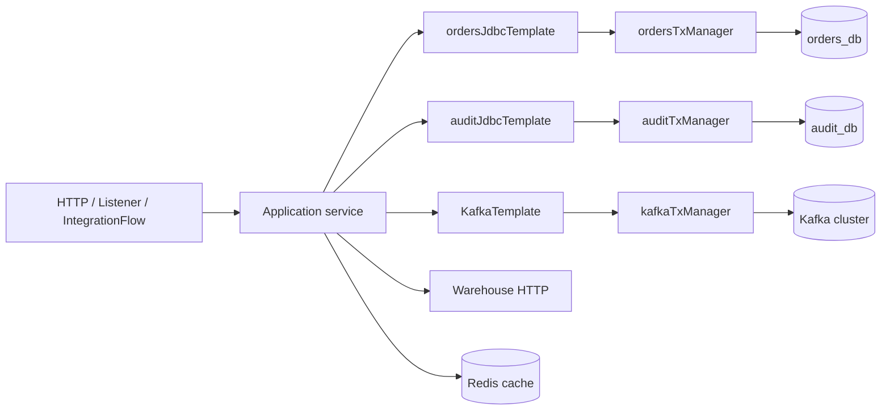
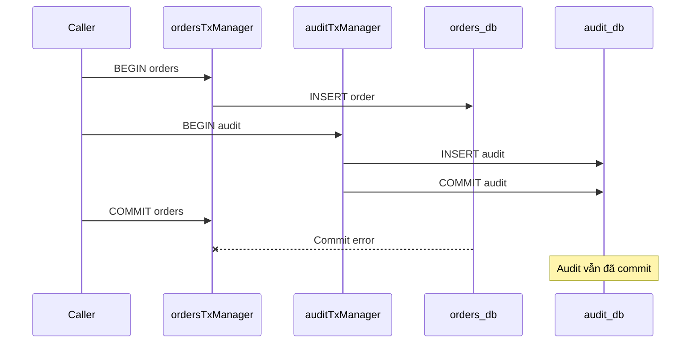
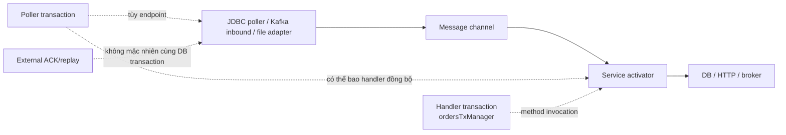
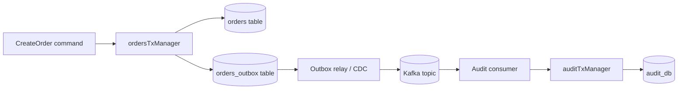
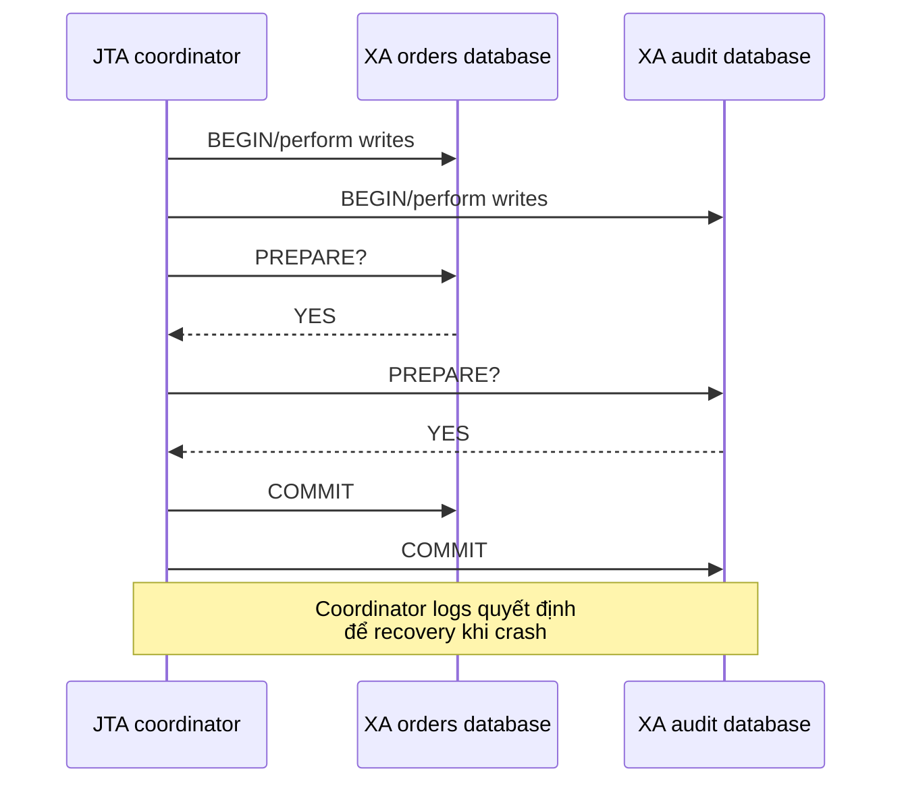
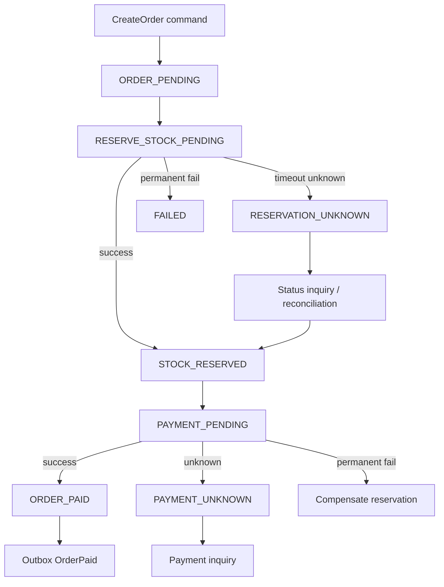

# Nhiều transaction manager và chỉ định đúng tài nguyên

## 1. Bài toán: một Spring Boot service nhưng nhiều loại giao dịch

Giả sử `order-service` phải:

1. Ghi đơn hàng vào PostgreSQL database `orders_db`.
2. Ghi nhật ký truy vết vào database `audit_db`.
3. Phát sự kiện `OrderCreated` sang Kafka.
4. Gọi HTTP `warehouse-service` để đặt giữ tồn kho.
5. Làm mới hoặc vô hiệu hóa dữ liệu Redis cache.

Một method:

```java
@Transactional
public void createOrder(CreateOrderCommand command) {
    orders.insert(command);
    audit.insert(command);
    kafkaPublisher.publish(command);
    warehouseClient.reserve(command);
    cache.evict(command.orderId());
}
```

**không** mặc nhiên tạo được một transaction ACID bao trùm PostgreSQL thứ nhất, PostgreSQL thứ hai, Kafka, HTTP và Redis. Annotation `@Transactional` được thực thi thông qua **một transaction manager được chọn** cho invocation đó. Nếu chọn sai manager, ứng dụng có thể ghi một tài nguyên ngoài transaction, rollback một nơi nhưng vẫn commit nơi khác, hoặc báo thành công trước khi broker thực sự xác nhận.

Đây là bài thuộc chương **Giao dịch tích hợp** của module **SPRING_BOOT_INTEGRATION**. Trọng tâm là cấu hình, hợp đồng giao dịch, lỗi, xử lý trùng lặp, kiểm thử và quan sát khi Spring Boot phối hợp HTTP client, cơ sở dữ liệu, cache, broker và các adapter Spring Integration.

**Sau bài học, bạn có thể:**

1. Phân biệt **local transaction**, nhiều local transaction và **distributed transaction/XA**.
2. Nhận diện `PlatformTransactionManager`, `ReactiveTransactionManager`, `TransactionManager` và loại resource mà mỗi manager thực sự quản lý.
3. Tạo hai `DataSource`, hai `JdbcTemplate` và hai `JdbcTransactionManager` độc lập trong Spring Boot.
4. Chỉ định manager bằng `@Transactional(transactionManager = "...")`, `@Qualifier` và `TransactionTemplate`.
5. Hiểu `@Primary`, default manager, AOP proxy, propagation, isolation và transaction synchronization khi có nhiều manager.
6. Chọn đúng boundary cho JPA, JDBC, R2DBC, Kafka, RabbitMQ, Redis cache và Spring Integration handlers.
7. Chọn outbox/inbox, saga/reconciliation hoặc XA/JTA theo các guarantee thực sự cần thiết.
8. Kiểm thử rollback/cross-resource partial commit, log transaction identity và vận hành các tình huống lỗi.

> **Phiên bản:** Ví dụ chính dùng Java 17+, Spring Boot 3.x, Spring Framework 6.x, Spring JDBC, PostgreSQL và Spring Kafka tương thích với dependency management của dự án. Ở Spring Boot 4.x/Spring Framework 7.x, cần kiểm tra lại tên API, BOM, autoconfiguration và semantics hiện hành. Ví dụ về JMS, RabbitMQ, R2DBC và Kafka nhằm chỉ rõ transaction boundary, không giả định mọi dependency đều có sẵn trong một ứng dụng.

## 2. Một transaction manager chỉ quản lý tài nguyên nó sở hữu

Một local transaction gắn với **một tài nguyên hoặc một nhóm tài nguyên mà manager biết phối hợp**. Nó quản lý điểm bắt đầu, commit, rollback, isolation, connection/session và transaction synchronization theo capability của tài nguyên đó.



Trong sơ đồ này có **ba transaction managers độc lập**, trong khi HTTP endpoint và cache không tự tham gia một transaction chung với chúng.

| Tài nguyên / stack | Manager thường gặp | Phạm vi bảo đảm |
| --- | --- | --- |
| JDBC với một `DataSource` | `DataSourceTransactionManager` hoặc `JdbcTransactionManager` | Một local database transaction trên connection thuộc datasource đó. |
| JPA/Hibernate | `JpaTransactionManager` | Một `EntityManagerFactory`/persistence unit; có thể phối hợp JDBC cùng datasource đúng cấu hình. |
| R2DBC | `R2dbcTransactionManager` | Reactive transaction qua một `ConnectionFactory`, gắn context vào Reactor. |
| Kafka producer | `KafkaTransactionManager` | Kafka producer transaction, các record/offset được hỗ trợ trong phạm vi Kafka. |
| RabbitMQ | `RabbitTransactionManager` | Local Rabbit channel transaction; **không** XA giữa Rabbit và DB. |
| JMS | `JmsTransactionManager` hoặc `JtaTransactionManager` | Local JMS session hoặc JTA/XA nếu tài nguyên và infrastructure cùng hỗ trợ. |
| JTA/XA | `JtaTransactionManager` | Có thể phối hợp nhiều XA participants theo giao thức 2-phase commit, có giới hạn vận hành. |
| Redis cache | `RedisCacheManager` + transaction synchronization | Có thể hoãn cache put/evict đến after commit; **không** là distributed ACID transaction. |
| HTTP/REST API bên ngoài | Không có transaction manager Spring local bảo đảm rollback phía provider | Cần idempotency key, inquiry, compensation và durable workflow state. |

### 2.1. Các interface cần phân biệt

- `TransactionManager` trong Spring là kiểu nền tảng.
- `PlatformTransactionManager` phục vụ transaction imperative, thường liên quan JDBC/JPA và đồng bộ theo thread.
- `ReactiveTransactionManager` phục vụ transaction của reactive publishers, thường với R2DBC và Reactor Context.
- `TransactionTemplate` giúp điều khiển transaction imperative bằng code, nhận một `PlatformTransactionManager` cụ thể.
- `TransactionalOperator` giúp điều khiển reactive transaction bằng Publisher, nhận một `ReactiveTransactionManager`.

**Không truyền `R2dbcTransactionManager` vào `TransactionTemplate` để mong nó quản lý JDBC**. Và một `JpaTransactionManager` không quản lý R2DBC connections chỉ vì chúng trỏ tới cùng hostname/database.

### 2.2. Resource binding: lý do manager phải chọn đúng

Khi bắt đầu transaction imperative, manager có thể lấy connection/session, đặt `autoCommit=false` hoặc mở transaction tương ứng, rồi bind resource vào transaction synchronization của Spring. Các template/repository sử dụng **đúng DataSource/EntityManagerFactory** sẽ truy cập resource thuộc transaction đó.

```text
Thread đang chạy OrderWriteService
  Transaction context:
    DataSource ordersDataSource -> Connection A (transaction active)

ordersJdbcTemplate -> ordersDataSource -> dùng Connection A
auditJdbcTemplate  -> auditDataSource  -> Connection B riêng
                                           (không thuộc orders transaction)
```

Nếu chỉ có `ordersTxManager` đang hoạt động, `auditJdbcTemplate` **không** tự tham gia transaction của `orders_db`. Connection B có thể autocommit, hoặc nằm trong một audit transaction khác nếu được mở một cách tường minh.

**Một quan hệ quan trọng:** `@Transactional` đánh dấu **transaction scope của một lời gọi qua proxy**, không đánh dấu “mọi câu SQL trong method đều thuộc một transaction duy nhất”.

## 3. Ma trận chọn manager trước khi viết code

| Việc cần làm | Manager nên chọn | Tránh nhầm |
| --- | --- | --- |
| Ghi/đọc `orders_db` qua `ordersJdbcTemplate` | `ordersTxManager` | `auditTxManager` không có quyền rollback đơn hàng. |
| Ghi `audit_db` qua `auditJdbcTemplate` | `auditTxManager` | `ordersTxManager` không tạo atomicity cho audit. |
| Ghi JPA qua `ordersEntityManagerFactory` | `ordersJpaTxManager` | Không chọn một JDBC manager trỏ datasource khác. |
| Reactive repository R2DBC | `ordersR2dbcTxManager` | Context reactive khác imperative transaction. |
| Gửi nhiều Kafka records như một Kafka transaction | `kafkaTxManager` hoặc API Kafka transactional | Không bảo đảm DB commit cùng Kafka. |
| Xử lý Rabbit message với local broker transaction | `rabbitTxManager` theo scope của Rabbit | Broker ack không phải commit JDBC. |
| Poll Spring Integration JDBC và cập nhật cùng DB | Manager của datasource JDBC liên quan | Handler advice manager khác không tự cover source poll/ack. |
| UPDATE DB rồi invalidation Redis | DB transaction + after-commit synchronization/outbox | Redis DEL không thể rollback DB đã commit. |

Trước mỗi annotation `@Transactional`, nên viết được một câu rõ ràng: **“Manager này sở hữu connection/session nào, và điều gì sẽ bị rollback nếu method thất bại?”**

## 4. Bài thực hành: hai PostgreSQL database, hai local transaction

Ta chọn một ví dụ đơn giản nhưng chính xác về nhiều transaction manager: `orders_db` và `audit_db` là hai database khác nhau. Có thể là hai PostgreSQL instances, hoặc cùng server nhưng khác database; ví dụ vẫn **không giả định** một local JDBC transaction bao trùm cả hai.

### 4.1. Dependencies Maven

```xml
<!-- Với Spring Boot parent/BOM quản lý version -->
<dependency>
    <groupId>org.springframework.boot</groupId>
    <artifactId>spring-boot-starter-jdbc</artifactId>
</dependency>
<dependency>
    <groupId>org.postgresql</groupId>
    <artifactId>postgresql</artifactId>
    <scope>runtime</scope>
</dependency>
<dependency>
    <groupId>org.springframework.boot</groupId>
    <artifactId>spring-boot-starter-test</artifactId>
    <scope>test</scope>
</dependency>
```

`spring-boot-starter-jdbc` mang các thành phần Spring JDBC, HikariCP và transaction management phù hợp; không cần thêm JPA khi ví dụ chỉ dùng JDBC. Nếu sau này thêm `spring-boot-starter-data-jpa` thì phải thiết kế rõ manager và datasource của JPA, không để auto-configuration “đoán” sai.

### 4.2. Schema ở hai database

Chạy migration này ở **orders_db**:

```sql
CREATE TABLE orders (
    command_id  VARCHAR(100) PRIMARY KEY,
    tenant_id   VARCHAR(80) NOT NULL,
    status      VARCHAR(30) NOT NULL,
    total_cents BIGINT NOT NULL CHECK (total_cents >= 0),
    created_at  TIMESTAMPTZ NOT NULL DEFAULT CURRENT_TIMESTAMP
);
```

Chạy migration **riêng** ở `audit_db`:

```sql
CREATE TABLE audit_entries (
    event_id     VARCHAR(160) PRIMARY KEY,
    command_id   VARCHAR(100) NOT NULL,
    event_type   VARCHAR(80) NOT NULL,
    created_at   TIMESTAMPTZ NOT NULL DEFAULT CURRENT_TIMESTAMP
);
```

Không có foreign key xuyên hai database theo giả định này; audit chỉ chứa business identifier. Trong production, cần chính sách giữ dữ liệu, quyền truy cập riêng, migration và backup cho từng database.

### 4.3. Cấu hình custom datasource properties

```yaml
# application.yml
app:
  datasource:
    orders:
      url: ${ORDERS_JDBC_URL:jdbc:postgresql://localhost:5432/orders_db}
      username: ${ORDERS_DB_USER:orders_app}
      password: ${ORDERS_DB_PASSWORD}
      hikari:
        maximum-pool-size: 10
        minimum-idle: 2
    audit:
      url: ${AUDIT_JDBC_URL:jdbc:postgresql://localhost:5432/audit_db}
      username: ${AUDIT_DB_USER:audit_app}
      password: ${AUDIT_DB_PASSWORD}
      hikari:
        maximum-pool-size: 5
        minimum-idle: 1
```

Các prefix `app.datasource.orders.*` và `app.datasource.audit.*` là **cấu hình tự định nghĩa** chứ không phải hai `spring.datasource.*` tự động được Spring Boot tạo. Ta sẽ bind rõ `DataSourceProperties` cho từng prefix. Không lưu password thật trong repository.

### 4.4. Khai báo hai `DataSource` và hai manager

```java
// MultiDatabaseConfig.java
package com.example.integration.tx;

import javax.sql.DataSource;
import com.zaxxer.hikari.HikariDataSource;
import org.springframework.beans.factory.annotation.Qualifier;
import org.springframework.boot.autoconfigure.jdbc.DataSourceProperties;
import org.springframework.boot.context.properties.ConfigurationProperties;
import org.springframework.context.annotation.Bean;
import org.springframework.context.annotation.Configuration;
import org.springframework.context.annotation.Primary;
import org.springframework.jdbc.core.JdbcTemplate;
import org.springframework.jdbc.support.JdbcTransactionManager;
import org.springframework.transaction.annotation.EnableTransactionManagement;

@Configuration(proxyBeanMethods = false)
@EnableTransactionManagement
public class MultiDatabaseConfig {

    @Bean("ordersDataSourceProperties")
    @Primary
    @ConfigurationProperties("app.datasource.orders")
    DataSourceProperties ordersProps() {
        return new DataSourceProperties();
    }

    @Bean("auditDataSourceProperties")
    @ConfigurationProperties("app.datasource.audit")
    DataSourceProperties auditProps() {
        return new DataSourceProperties();
    }

    @Bean("ordersDataSource")
    @Primary
    @ConfigurationProperties("app.datasource.orders.hikari")
    HikariDataSource ordersDataSource(
        @Qualifier("ordersDataSourceProperties")
        DataSourceProperties properties
    ) {
        return properties.initializeDataSourceBuilder()
            .type(HikariDataSource.class)
            .build();
    }

    @Bean("auditDataSource")
    @ConfigurationProperties("app.datasource.audit.hikari")
    HikariDataSource auditDataSource(
        @Qualifier("auditDataSourceProperties")
        DataSourceProperties properties
    ) {
        return properties.initializeDataSourceBuilder()
            .type(HikariDataSource.class)
            .build();
    }

    @Bean("ordersJdbc")
    @Primary
    JdbcTemplate ordersJdbc(
        @Qualifier("ordersDataSource") DataSource dataSource
    ) {
        return new JdbcTemplate(dataSource);
    }

    @Bean("auditJdbc")
    JdbcTemplate auditJdbc(
        @Qualifier("auditDataSource") DataSource dataSource
    ) {
        return new JdbcTemplate(dataSource);
    }

    @Bean("ordersTxManager")
    @Primary
    JdbcTransactionManager ordersTxManager(
        @Qualifier("ordersDataSource") DataSource dataSource
    ) {
        return new JdbcTransactionManager(dataSource);
    }

    @Bean("auditTxManager")
    JdbcTransactionManager auditTxManager(
        @Qualifier("auditDataSource") DataSource dataSource
    ) {
        return new JdbcTransactionManager(dataSource);
    }
}
```

**Vì sao cấu hình này đúng?**

1. Hai `DataSourceProperties` lấy URL, username/password từ hai prefix khác nhau; builders tạo hai `HikariDataSource` độc lập.
2. `ordersJdbc` **chỉ** dùng `ordersDataSource`; `auditJdbc` **chỉ** dùng `auditDataSource`.
3. `ordersTxManager` được tạo bằng **chính instance `ordersDataSource`** mà `ordersJdbc` dùng. `auditTxManager` tương tự.
4. `@Qualifier` tránh nhầm bean trong injection khi có nhiều bean cùng type.
5. `@Primary` đặt cho orders như fallback để một số auto-config/injection không bị ambiguous; **các method nghiệp vụ vẫn phải chỉ định manager tường minh**.
6. `@EnableTransactionManagement` kích hoạt transaction interceptor cho imperative methods qua proxy. Spring Boot có thể tự bật cơ chế tương ứng trong nhiều trường hợp, nhưng ví dụ khai báo để ý định rõ ràng.

Đừng vừa tạo các bean thủ công này vừa giả định Spring Boot sẽ tự động tạo đủ hai datasource chỉ từ hai nhóm properties. Một số auto-configuration sẽ **back off** khi đã thấy bean tự tạo; JDBC/JPA migration, health checks và metrics phải được cấu hình/đánh giá cho **cả hai**.

### 4.5. Các dependency injection phải nhất quán

Tránh cấu hình như:

```java
// SAI nếu JdbcTemplate lấy auditDataSource nhưng manager quản lý orders.
@Transactional(transactionManager = "ordersTxManager")
public void addAudit(String eventId) {
    auditJdbc.update("INSERT INTO audit_entries ...");
}
```

Annotation trên không giúp rollback audit theo transaction của `orders_db`. Lỗi thường rất khó phát hiện nếu chỉ test happy path; một INSERT autocommit vẫn trông có vẻ “chạy đúng”.

### 4.6. Repository dùng đúng `JdbcTemplate`

```java
// OrdersDao.java
package com.example.integration.tx;

import org.springframework.beans.factory.annotation.Qualifier;
import org.springframework.jdbc.core.JdbcTemplate;
import org.springframework.stereotype.Repository;

@Repository
public class OrdersDao {
    private final JdbcTemplate jdbc;

    public OrdersDao(
        @Qualifier("ordersJdbc") JdbcTemplate jdbc
    ) {
        this.jdbc = jdbc;
    }

    public void insert(
        String commandId, String tenantId, long totalCents
    ) {
        jdbc.update("""
            INSERT INTO orders
                (command_id, tenant_id, status, total_cents)
            VALUES (?, ?, 'PENDING', ?)
            """, commandId, tenantId, totalCents);
    }

    public long countByCommandId(String commandId) {
        return jdbc.queryForObject("""
            SELECT COUNT(*) FROM orders WHERE command_id = ?
            """, Long.class, commandId);
    }
}
```

```java
// AuditDao.java
package com.example.integration.tx;

import org.springframework.beans.factory.annotation.Qualifier;
import org.springframework.jdbc.core.JdbcTemplate;
import org.springframework.stereotype.Repository;

@Repository
public class AuditDao {
    private final JdbcTemplate jdbc;

    public AuditDao(
        @Qualifier("auditJdbc") JdbcTemplate jdbc
    ) {
        this.jdbc = jdbc;
    }

    public void insertAccepted(String commandId) {
        jdbc.update("""
            INSERT INTO audit_entries
                (event_id, command_id, event_type)
            VALUES (?, ?, 'ORDER_ACCEPTED')
            """, "accepted:" + commandId, commandId);
    }

    public long countByCommandId(String commandId) {
        return jdbc.queryForObject("""
            SELECT COUNT(*) FROM audit_entries WHERE command_id = ?
            """, Long.class, commandId);
    }
}
```

Sử dụng parameter binding, không ghép trực tiếp input thành SQL. Unique keys giúp hạn chế ghi trùng khi command được retry; tuy nhiên một duplicate key exception cần được phân loại thành idempotent replay hoặc conflict theo hợp đồng, không tự coi mọi duplicate là success.

## 5. `@Transactional(transactionManager = "...")`: chỉ rõ ranh giới

### 5.1. Giao dịch audit độc lập

```java
// AuditWriteService.java
package com.example.integration.tx;

import org.springframework.stereotype.Service;
import org.springframework.transaction.annotation.Transactional;

@Service
public class AuditWriteService {
    private final AuditDao audit;

    public AuditWriteService(AuditDao audit) {
        this.audit = audit;
    }

    @Transactional(transactionManager = "auditTxManager")
    public void recordAccepted(String commandId) {
        audit.insertAccepted(commandId);
    }
}
```

### 5.2. Giao dịch orders độc lập

```java
// OrderWriteService.java
package com.example.integration.tx;

import org.springframework.stereotype.Service;
import org.springframework.transaction.annotation.Transactional;

@Service
public class OrderWriteService {
    private final OrdersDao orders;
    private final AuditWriteService audit;

    public OrderWriteService(
        OrdersDao orders, AuditWriteService audit
    ) {
        this.orders = orders;
        this.audit = audit;
    }

    @Transactional(transactionManager = "ordersTxManager")
    public void create(
        String commandId,
        String tenantId,
        long totalCents,
        boolean simulateFailureAfterAudit
    ) {
        if (commandId == null || commandId.isBlank()
            || tenantId == null || tenantId.isBlank()
            || totalCents < 0) {
            throw new IllegalArgumentException("Invalid order command");
        }

        orders.insert(commandId, tenantId, totalCents);
        audit.recordAccepted(commandId);

        if (simulateFailureAfterAudit) {
            throw new IllegalStateException(
                "Simulated failure before orders commit"
            );
        }
    }
}
```

**Điều xảy ra:**

1. Caller gọi `OrderWriteService.create(...)` **qua Spring proxy**, `ordersTxManager` bắt đầu transaction trên orders datasource.
2. `orders.insert(...)` chạy trong orders transaction đó.
3. `audit.recordAccepted(...)` gọi **một bean khác qua proxy**, `auditTxManager` bắt đầu transaction trên audit datasource và commit khi method return.
4. Nếu `simulateFailureAfterAudit=true`, method orders ném runtime exception trước commit; `ordersTxManager` rollback **orders transaction**.
5. **Audit đã commit không tự rollback.** Hai managers không tạo distributed atomicity; `@Transactional` trên method ngoài không làm một audit transaction trở thành child của orders transaction.

```text
orders_db transaction:
  BEGIN -> INSERT order -> ... -> ROLLBACK

audit_db transaction:
                      BEGIN -> INSERT audit -> COMMIT

Kết quả:
  orders_db: 0 order
  audit_db : 1 audit event
```

Đoạn `simulateFailureAfterAudit` là **fault injection cho bài học**, tuyệt đối không phải tham số API nghiệp vụ nên xuất hiện trong production. Ở hệ thống thật, audit của một hành động **không thành công** có thể vẫn có ý nghĩa, nhưng tên event `ORDER_ACCEPTED` sẽ dễ gây hiểu sai. Nếu audit phải mô tả **order đã commit**, cần thiết kế outbox hoặc workflow cập nhật audit sau khi có sự kiện commit thay vì lệnh trực tiếp như ví dụ.

### 5.3. Exception lan ngược có làm rollback cả hai không?

Nếu `audit.recordAccepted(...)` ném runtime exception và exception đó lan ra ngoài `create(...)`, **orders transaction** thường cũng rollback theo default Spring rollback rules. Nhưng đây là **hai rollback được kích hoạt bởi exception**, không phải bằng chứng atomic commit. Một audit transaction có thể đã commit trước khi orders commit fail; và một nơi có thể commit rồi nơi khác fail lúc commit.

**Kết luận:** “Cả hai rollback trong một test” không chứng minh chúng luôn commit hoặc rollback cùng nhau trong mọi failure window.

## 6. Chọn manager bằng annotation, bean name và qualifier

### 6.1. Tên bean là hợp đồng cấu hình

Trong ví dụ, Spring container có:

```text
DataSource:
  ordersDataSource -> orders_db
  auditDataSource  -> audit_db

JdbcTemplate:
  ordersJdbc -> ordersDataSource
  auditJdbc  -> auditDataSource

PlatformTransactionManager:
  ordersTxManager -> ordersDataSource
  auditTxManager  -> auditDataSource
```

Tên ở `@Transactional(transactionManager = "ordersTxManager")` là **bean name hoặc qualifier** dùng để chọn transaction manager. Thuộc tính `value` là alias:

```java
@Transactional("ordersTxManager")
public void placeOrder() { /* ... */ }

// Tương đương:
@Transactional(transactionManager = "ordersTxManager")
public void placeOrderSame() { /* ... */ }
```

Ở ví dụ này, `ordersTxManager` là bean tên chính xác; nếu đổi tên bean phải đổi nơi tham chiếu hoặc cung cấp alias/qualifier phù hợp. Một typo có thể làm method thất bại lúc runtime chứ không được compiler phát hiện như lỗi type Java.

### 6.2. `@Primary` giải quyết ambiguity nhưng không chứng minh “đúng”

Khi có hai bean cùng `PlatformTransactionManager`, annotation:

```java
@Transactional
public void writeAuditOnly() {
    auditDao.insertAccepted("cmd-42");
}
```

**không nói rõ** manager nào cần được dùng. Tùy cấu hình transaction infrastructure, bean name, `@Primary`, `TransactionManagementConfigurer` và phiên bản Spring, container có thể chọn mặc định hoặc báo ambiguity. Trong mẫu config, `ordersTxManager` là `@Primary`, nên method trên có nguy cơ chạy dưới orders transaction dù nó ghi audit.

**Quy tắc production:** khi có nhiều manager khác nhau về tài nguyên, gắn `transactionManager = "..."` rõ ràng ở entrypoint nghiệp vụ hoặc đặt class-level default rõ ràng rồi override cho method khác. Không tin một manager được chọn “vì nó tình cờ là bean Primary”.

### 6.3. `TransactionManagementConfigurer` nếu thực sự cần default

Spring hỗ trợ `TransactionManagementConfigurer` để khai báo manager dùng cho annotation-driven transaction khi không có qualifier:

```java
// Ví dụ cấu hình thay thế, không cần thêm nếu mọi @Transactional
// đã chỉ định manager rõ ràng.
import org.springframework.beans.factory.annotation.Qualifier;
import org.springframework.context.annotation.Configuration;
import org.springframework.transaction.PlatformTransactionManager;
import org.springframework.transaction.annotation.TransactionManagementConfigurer;

@Configuration(proxyBeanMethods = false)
public class TransactionDefaults
    implements TransactionManagementConfigurer {

    private final PlatformTransactionManager orders;

    public TransactionDefaults(
        @Qualifier("ordersTxManager")
        PlatformTransactionManager orders
    ) {
        this.orders = orders;
    }

    @Override
    public PlatformTransactionManager
        annotationDrivenTransactionManager() {
        return orders;
    }
}
```

Khi dùng interface này, cần kiểm tra phiên bản Spring và cách kết hợp với `@EnableTransactionManagement`; **không** lắp nhiều configurers gây xung đột. Mục đích của default chỉ là dành cho những nơi có chính sách rõ, không làm một `auditDao` tự gắn với audit transaction.

### 6.4. `@Qualifier` trên constructor khác với chọn transaction manager

```java
public OrderService(
    @Qualifier("auditJdbc") JdbcTemplate auditJdbc
) { /* ... */ }
```

Injection qualifier này chọn **JdbcTemplate**, không chỉ định manager cho `@Transactional` trên method. Bạn vẫn cần chỉ rõ `@Transactional("auditTxManager")` hoặc khởi tạo `TransactionTemplate` bằng audit manager.

### 6.5. Quy ước tên giúp phát hiện sai scope

Một quy ước nhóm tài nguyên dễ review:

| Role | Orders | Audit |
| --- | --- | --- |
| Properties | `ordersDataSourceProperties` | `auditDataSourceProperties` |
| Connection source | `ordersDataSource` | `auditDataSource` |
| JDBC access | `ordersJdbc` | `auditJdbc` |
| Transaction manager | `ordersTxManager` | `auditTxManager` |
| Repository | `OrdersDao` | `AuditDao` |
| Service boundary | `@Transactional("ordersTxManager")` | `@Transactional("auditTxManager")` |
| Migration | Orders migration context | Audit migration context |
| Metrics | `db=orders` | `db=audit` |

Ghi rõ resource owner trong bean name giúp đội vận hành liên hệ lỗi rollback/connection pool với database thích hợp.

## 7. Điều khiển local transaction bằng `TransactionTemplate`

Với các workflow có điều kiện hoặc cần ranh giới commit chính xác trong code, `TransactionTemplate` hữu ích hơn việc đặt nhiều annotation mơ hồ.

### 7.1. Hai template với hai managers

```java
// TransactionTemplatesConfig.java
package com.example.integration.tx;

import org.springframework.beans.factory.annotation.Qualifier;
import org.springframework.context.annotation.Bean;
import org.springframework.context.annotation.Configuration;
import org.springframework.transaction.PlatformTransactionManager;
import org.springframework.transaction.support.TransactionTemplate;

@Configuration(proxyBeanMethods = false)
public class TransactionTemplatesConfig {

    @Bean("ordersTxTemplate")
    TransactionTemplate ordersTxTemplate(
        @Qualifier("ordersTxManager")
        PlatformTransactionManager manager
    ) {
        return new TransactionTemplate(manager);
    }

    @Bean("auditTxTemplate")
    TransactionTemplate auditTxTemplate(
        @Qualifier("auditTxManager")
        PlatformTransactionManager manager
    ) {
        return new TransactionTemplate(manager);
    }
}
```

### 7.2. Hai local transactions tuần tự

```java
// IndependentTransactionWorkflow.java
package com.example.integration.tx;

import org.springframework.beans.factory.annotation.Qualifier;
import org.springframework.stereotype.Service;
import org.springframework.transaction.support.TransactionTemplate;

@Service
public class IndependentTransactionWorkflow {
    private final TransactionTemplate ordersTx;
    private final TransactionTemplate auditTx;
    private final OrdersDao orders;
    private final AuditDao audit;

    public IndependentTransactionWorkflow(
        @Qualifier("ordersTxTemplate") TransactionTemplate ordersTx,
        @Qualifier("auditTxTemplate") TransactionTemplate auditTx,
        OrdersDao orders, AuditDao audit
    ) {
        this.ordersTx = ordersTx;
        this.auditTx = auditTx;
        this.orders = orders;
        this.audit = audit;
    }

    public void execute(
        String commandId, String tenantId, long totalCents
    ) {
        ordersTx.executeWithoutResult(status ->
            orders.insert(commandId, tenantId, totalCents)
        ); // orders COMMIT trước khi tiếp tục

        auditTx.executeWithoutResult(status ->
            audit.insertAccepted(commandId)
        ); // audit COMMIT độc lập
    }
}
```

Code làm ranh giới commit **dễ đọc**, nhưng vẫn có cửa sổ:

```text
ordersTx: BEGIN -> INSERT -> COMMIT OK
                               |
                               +-> process crash
                                      |
auditTx :                          chưa BEGIN
```

Không có cách ghép hai lời gọi `TransactionTemplate` tuần tự thành một atomic distributed transaction chỉ bằng việc bọc chúng trong một `try/catch`. Nếu audit fail sau orders commit, caller cần **workflow recovery**; không thể `rollback()` một orders transaction đã commit.

### 7.3. Cẩn trọng khi lồng template

```java
ordersTx.execute(status -> {
    orders.insert(commandId, tenantId, totalCents);
    auditTx.executeWithoutResult(s ->
        audit.insertAccepted(commandId)
    );
    return null;
});
```

Một orders transaction ở bên ngoài vẫn **không** mở rộng atomicity sang audit. Hai managers có resource contexts riêng. Audit có thể commit trước khi orders commit, và lỗi ở orders commit vẫn để lại audit row.

## 8. Propagation, isolation, rollback rules và proxy

### 8.1. `REQUIRED` và `REQUIRES_NEW` có nghĩa trong phạm vi manager

| Attribute | Khi gọi với cùng transaction manager | Khi hai managers khác nhau |
| --- | --- | --- |
| `REQUIRED` | Join transaction đang có hoặc bắt đầu một transaction mới. | Không “join” transaction của datasource kia. |
| `REQUIRES_NEW` | Suspend transaction của **manager này** đang có (nếu hỗ trợ), bắt đầu transaction độc lập mới. | Không tạo XA; manager khác vẫn quản lý resource riêng. |
| `NESTED` | Có thể dùng JDBC savepoint nếu manager/driver hỗ trợ. | Không tạo nested distributed transaction. |
| `SUPPORTS` | Dùng transaction hiện có nếu có. | Không tự tạo transaction cho resource khác. |
| `MANDATORY` | Yêu cầu transaction hiện hữu mà manager nhìn thấy. | Một transaction của manager khác không tự đáp ứng yêu cầu đó. |
| `NOT_SUPPORTED` | Có thể suspend transaction đang có của manager được chọn. | Không bảo đảm suspend mọi resource của manager khác. |

Ví dụ:

```java
@Transactional(
    transactionManager = "auditTxManager",
    propagation = Propagation.REQUIRES_NEW
)
public void recordAuditInNewAuditTransaction(...) { /* ... */ }
```

`Propagation` là chính sách khi manager được chọn nhìn thấy transaction của **chính tài nguyên nó quản lý**. Đừng dùng `REQUIRES_NEW` như công cụ “tách và rollback mọi database”. Khi lồng `REQUIRES_NEW` trong **cùng datasource**, thường cần thêm connection cho transaction mới, nên kiểm tra pool capacity/tránh deadlock do cạn connections.

### 8.2. Một manager không thể rollback transaction đã commit



Ngay cả nếu outer method nhìn thấy exception, một manager không được quyền “undo” một commit đã hoàn tất tại tài nguyên do manager khác sở hữu.

### 8.3. Rollback mặc định và checked exceptions

Với Spring transaction annotation thông thường, mặc định:

- `RuntimeException` và `Error` dẫn đến rollback.
- Checked exception thường **không** tự gây rollback nếu không cấu hình rule khác.

Ví dụ:

```java
@Transactional(
    transactionManager = "ordersTxManager",
    rollbackFor = java.io.IOException.class
)
public void importOrderFile() throws java.io.IOException {
    // Thao tác orders JDBC trong local transaction.
}
```

Đừng vô tình `catch(Exception)` rồi trả bình thường nếu transaction cần rollback. Khi bắt lỗi để map domain error, phải quyết định rõ rollback-only hoặc ném exception phù hợp. Có thể dùng `noRollbackFor` theo contract nhưng phải hiểu hậu quả lên transaction state và các side effect khác.

### 8.4. Isolation và read-only không thay transaction manager

```java
@Transactional(
    transactionManager = "ordersTxManager",
    isolation = Isolation.READ_COMMITTED,
    readOnly = true
)
public OrderView readOrder(...) { /* ... */ }
```

Isolation mức nào được hỗ trợ phụ thuộc database/driver; `readOnly=true` thường là **hint/optimization**, không phải bảo đảm chống mọi write trong mọi môi trường. Một transaction manager audit không thể điều khiển isolation của orders connection dù annotation đặt isolation đúng tên.

### 8.5. Spring AOP và self-invocation

```java
@Service
class BadService {
    public void run() {
        this.saveInAudit(); // Gọi nội bộ, không qua transaction proxy.
    }

    @Transactional(transactionManager = "auditTxManager")
    public void saveInAudit() { /* ... */ }
}
```

Với proxy-based transaction management mặc định, `this.saveInAudit()` có thể **bỏ qua** interceptor, dẫn đến audit INSERT autocommit. Chuyển method vào một Spring bean khác, gọi qua proxy, hoặc dùng `TransactionTemplate` tường minh.

Các trường hợp khác cần đánh giá:

- Method không đi qua Spring-managed proxy.
- Method `private`/không thể được proxy intercept theo cấu hình.
- `new Thread(...)`, `@Async`, executor và callback chạy trên thread khác: imperative ThreadLocal transaction **không tự lan truyền**.
- Lỗi phát sinh sau khi một async task đã được submit nhưng caller đã trả về: transaction phía caller có thể đã commit.
- Trong Spring Integration, endpoint/poller dùng thread khác có thể mở transaction khác; không suy luận chỉ từ method signature.

### 8.6. Timeout và duration của transaction

Đừng giữ transaction DB mở trong khi:

```text
BEGIN orders transaction
  SELECT / UPDATE
  HTTP call tới Warehouse, timeout 10 giây
  Kafka publish retry 3 lần
  Thread.sleep(backoff)
COMMIT
```

Điều này giữ connection, lock và tài nguyên trong lúc chờ dịch vụ khác. Dùng local transaction ngắn cho business data/outbox, rồi worker độc lập thực hiện HTTP/Kafka với idempotency. Transaction timeout không phải global deadline cho HTTP bên ngoài; phải đặt timeout/budget ở từng integration boundary.

## 9. JPA/Hibernate khi ứng dụng có nhiều datasource

Một ứng dụng có thể dùng JPA cho orders và JDBC cho audit. Khi đó cần **đúng `EntityManagerFactory` và `JpaTransactionManager`**:

```java
// Ví dụ cấu trúc khi EntityManagerFactory đã được cấu hình riêng.
import jakarta.persistence.EntityManagerFactory;
import org.springframework.beans.factory.annotation.Qualifier;
import org.springframework.context.annotation.Bean;
import org.springframework.orm.jpa.JpaTransactionManager;

@Bean("ordersJpaTxManager")
JpaTransactionManager ordersJpaTxManager(
    @Qualifier("ordersEntityManagerFactory")
    EntityManagerFactory entityManagerFactory
) {
    return new JpaTransactionManager(entityManagerFactory);
}
```

Nếu có hai JPA persistence units, mỗi unit cần:

1. Một `DataSource` phù hợp.
2. Một `EntityManagerFactory`.
3. Một `JpaTransactionManager` dành cho factory đó.
4. `@EnableJpaRepositories`/repository scanning trỏ đúng `entityManagerFactoryRef` và `transactionManagerRef`.
5. Migration schema và entity package không lẫn nhau.

Một cấu hình minh họa repository scanning:

```java
@EnableJpaRepositories(
    basePackages = "com.example.orders.jpa",
    entityManagerFactoryRef = "ordersEntityManagerFactory",
    transactionManagerRef = "ordersJpaTxManager"
)
class OrdersJpaRepositoriesConfig {
    // Cấu hình EntityManagerFactory tương ứng được tạo riêng.
}
```

Đoạn này là **phác thảo** cho phần JPA tùy chọn, không phải class hoàn chỉnh thay thế `MultiDatabaseConfig`. Khi dùng JPA cùng JDBC **trên chính datasource và cùng persistence unit**, `JpaTransactionManager` có thể phối hợp access JDBC phù hợp thông qua Spring transaction infrastructure nếu cấu hình nhất quán; không đặt thêm một `JdbcTransactionManager` riêng rồi giả định cả hai luôn thấy cùng transaction/connection.

**Không nhầm:** Hibernate `Session`, Spring Data JPA repositories và JDBC statements có các tầng flush/connection semantics khác nhau. Một query JDBC thực hiện trước khi JPA flush có thể không thấy thay đổi trong persistence context; cần hiểu điểm flush và test behavior thật.

## 10. R2DBC: transaction context khác với JDBC/JPA

Reactive database access dùng `R2dbcTransactionManager`, không phải `JdbcTransactionManager`:

```java
// ReactiveTransactionsConfig.java
import org.springframework.beans.factory.annotation.Qualifier;
import org.springframework.context.annotation.Bean;
import org.springframework.r2dbc.connection.R2dbcTransactionManager;
import io.r2dbc.spi.ConnectionFactory;
import org.springframework.transaction.reactive.TransactionalOperator;

@Bean("ordersR2dbcTxManager")
R2dbcTransactionManager ordersR2dbcTxManager(
    @Qualifier("ordersConnectionFactory")
    ConnectionFactory connectionFactory
) {
    return new R2dbcTransactionManager(connectionFactory);
}

@Bean("ordersReactiveTx")
TransactionalOperator ordersReactiveTx(
    @Qualifier("ordersR2dbcTxManager")
    R2dbcTransactionManager manager
) {
    return TransactionalOperator.create(manager);
}
```

Trên đây là **mẫu bổ sung khi đã cấu hình `ordersConnectionFactory`**, không được đặt vào project chỉ có JDBC mà chưa thêm R2DBC driver/dependency. Với reactive service:

```java
public Mono<OrderView> createReactive(CreateOrder cmd) {
    return ordersR2dbcRepository.save(toEntity(cmd))
        .flatMap(saved -> r2dbcOutbox.insert(saved)
            .thenReturn(toView(saved)))
        .as(ordersReactiveTx::transactional);
}
```

`Mono`/`TransactionalOperator` được nối trong một Publisher, transaction state thường đi qua **Reactor Context** thay vì chỉ ThreadLocal. Đoạn code giả định `ordersR2dbcRepository`, `r2dbcOutbox` và các DTO/converter do ứng dụng cung cấp; mục tiêu là minh họa boundary.

**Những việc không an toàn:**

- Bọc một `JpaRepository.save(...)` blocking trong `Mono.just(...)` rồi coi nó chạy dưới R2DBC transaction.
- Gọi `subscribe()` bên trong service và trả ngay, khiến caller tưởng transaction đã commit.
- Gọi `block()` ở WebFlux event loop.
- Dùng một annotation `@Transactional` không chỉ định manager trong context có cả imperative và reactive managers rồi mong Spring tự hiểu ý nghiệp vụ.
- Trộn JDBC write và R2DBC write để tạo một ACID transaction xuyên hai connection factories mà không có giao thức transaction thích hợp.

Trong ứng dụng mixed stack, tách orchestration thành bước rõ: local DB transactions, outbox/inbox và eventual consistency khi phải trao đổi giữa các tài nguyên không cùng một transaction.

## 11. Kafka transaction manager: atomic trong Kafka, không atomic với PostgreSQL

Spring Kafka có `KafkaTransactionManager` cho producer transactions khi producer factory được cấu hình transactional. Với Spring Boot, một cấu hình phổ biến:

```yaml
spring:
  kafka:
    bootstrap-servers: ${KAFKA_BOOTSTRAP_SERVERS:localhost:9092}
    producer:
      transaction-id-prefix: order-service-tx-
      key-serializer: org.apache.kafka.common.serialization.StringSerializer
      value-serializer: org.apache.kafka.common.serialization.StringSerializer
      acks: all
      properties:
        enable.idempotence: true
```

`transaction-id-prefix` giúp Spring Kafka tạo producer transaction IDs; giá trị prefix trong deployment nhiều instances phải được tổ chức để tránh **fencing** do transaction IDs trùng giữa các instance. Kiểm tra cách Spring Boot tự tạo `KafkaTransactionManager` ở phiên bản cụ thể; không khai báo hai Kafka managers cùng dùng một producer factory mà không xác định rõ mục đích.

### 11.1. Gửi nhiều records trong một Kafka transaction

```java
// KafkaTemplate đã được cấu hình với transactional ProducerFactory.
// Đây là Kafka-local transaction, KHÔNG phải transaction orders_db.
KafkaTemplate<String, String> template = /* injected bean */;
template.executeInTransaction(operations -> {
    operations.send(
        "orders.events.v1", "ORD-42",
        "{\"eventId\":\"evt-42-1\",\"type\":\"OrderCreated\"}"
    );
    operations.send(
        "orders.events.v1", "ORD-42",
        "{\"eventId\":\"evt-42-2\",\"type\":\"OrderValidated\"}"
    );
    return null;
});
```

Nếu Kafka transaction abort, các record trong transaction không được hiển thị như records đã commit đối với consumers dùng `isolation.level=read_committed`. Điều đó không rollback một `INSERT` PostgreSQL đã commit.

### 11.2. Kafka EOS có phạm vi

Kafka transactions có thể bao trùm **records sản xuất** và **consumer offsets** trong kiểu xử lý read–process–write của Kafka khi framework được cấu hình đúng. Đó là một bảo đảm mạnh **trong phạm vi Kafka**, không phải exactly-once business effect cho database/email/HTTP.

Nếu service làm:

```text
1. BEGIN orders_db
2. INSERT order
3. COMMIT orders_db
4. BEGIN Kafka transaction
5. SEND OrderCreated
6. COMMIT Kafka transaction
```

process có thể crash giữa bước 3 và 4; order có rồi nhưng event chưa tới Kafka. Đảo thứ tự lại khiến event có thể xuất hiện cho order chưa commit. Một số integration hỗ trợ **transaction synchronization** cho thứ tự commits, nhưng nó vẫn có **cửa sổ partial commit**; không gọi đó là 2PC/XA.

### 11.3. Có nên dùng `@Transactional("kafkaTxManager")`?

Có thể, nếu bạn có một `KafkaTransactionManager` bean mang đúng tên đó và handler cần một Kafka-local transaction. Ví dụ dạng ý tưởng:

```java
@Transactional(transactionManager = "kafkaTxManager")
public void publishPair() {
    kafkaTemplate.send("orders.events.v1", "ORD-42", event1);
    kafkaTemplate.send("orders.events.v1", "ORD-42", event2);
}
```

Ở đây `kafkaTemplate` được tạo từ transactional producer factory; phải xác minh cả hai sends thuộc đúng transaction. Nếu đang dùng Spring Kafka's `executeInTransaction(...)`, đó là một cách biểu đạt khác; không xếp chồng các transaction boundaries tùy tiện.

**Nếu cần chắc chắn không mất event sau DB commit**, chọn **transactional outbox** thay vì dựa vào thứ tự commit hai local transaction.

## 12. RabbitMQ/JMS và Redis: các tài nguyên ngoài JDBC

### 12.1. RabbitMQ

`RabbitTransactionManager` quản lý local Rabbit channel transaction khi được cấu hình phù hợp; một consumer có thể sử dụng transaction/ack behavior của listener container, nhưng transaction Rabbit **không** tự mở rộng sang PostgreSQL.

| Chuyện xảy ra | Kết quả có thể có |
| --- | --- |
| DB commit xong, Rabbit ack/channels fail | Message có thể redeliver. |
| Rabbit publish thành công, DB rollback | Consumer có thể thấy event cho dữ liệu chưa commit. |
| Listener gọi handler rồi async dispatch | Ack có thể xảy ra trước xử lý nếu code sai. |
| Handler retry mà không có inbox | DB side effect có thể chạy lặp. |

Chọn durable queue, publisher confirms, acknowledgment, DLX/DLT và business inbox/idempotency theo yêu cầu. Một Rabbit local channel transaction không thay thế distributed consistency với DB.

### 12.2. JMS

`JmsTransactionManager` dùng local JMS session transaction; khi JMS provider và database hỗ trợ XA, `JtaTransactionManager` cùng một transaction coordinator có thể phối hợp những XA resources đó. Điều kiện hạ tầng/driver/container là bắt buộc; **không** có nghĩa mọi JMS setup mặc định là XA hoặc Spring sẽ tự cấu hình toàn bộ 2PC.

### 12.3. Redis và cache

Redis `MULTI/EXEC` có semantics riêng trong Redis, nhưng không phải transaction ACID chung với JDBC. Spring Cache transaction-aware có thể trì hoãn `put/evict` sau DB commit:

```text
BEGIN orders DB transaction
  UPDATE order
COMMIT orders DB
AFTER_COMMIT -> evict Redis cache key
```

Nếu process crash sau commit nhưng trước `evict`, key cũ còn tới TTL hoặc tới khi durable invalidation/outbox xử lý. Không chọn `ordersTxManager` rồi kỳ vọng nó rollback một Redis `INCR` hoặc `PUBLISH` đã chạy.

### 12.4. HTTP partner

Một HTTP call ra Warehouse/Payment có thể commit ở provider rồi response bị mất. Transaction manager local không thể rollback remote effect. Retry an toàn phải dựa vào ổn định `Idempotency-Key`, provider contract/status inquiry, durable workflow state và compensation khi cần; không chỉ dựa vào HTTP `503` hay exception timeout.

## 13. Transaction boundary trong Spring Integration

Spring Integration tách nguồn nhận message, message channels, pollers, handlers và outbound adapters. Transaction boundary có thể bắt đầu ở **poller**, **inbound adapter/listener container** hoặc **handler**, tùy cấu hình. Một annotation `@Transactional` ở handler **không** mặc định bao trùm toàn bộ thao tác poll, acknowledgment, gửi qua executor hay lời gọi đến bên thứ ba.



### 13.1. Handler ghi orders database

```java
// OrderCommandHandler.java
package com.example.integration.tx;

import org.springframework.integration.annotation.ServiceActivator;
import org.springframework.messaging.Message;
import org.springframework.stereotype.Component;
import org.springframework.transaction.annotation.Transactional;

@Component
public class OrderCommandHandler {
    private final OrdersDao orders;

    public OrderCommandHandler(OrdersDao orders) {
        this.orders = orders;
    }

    @ServiceActivator(inputChannel = "orderCommands")
    @Transactional(transactionManager = "ordersTxManager")
    public void handle(Message<CreateOrderCommand> message) {
        CreateOrderCommand cmd = message.getPayload();
        orders.insert(cmd.commandId(), cmd.tenantId(),
            cmd.totalCents());
    }
}
```

```java
// CreateOrderCommand.java
package com.example.integration.tx;

public record CreateOrderCommand(
    String commandId, String tenantId, long totalCents
) {}
```

Ví dụ cần `spring-integration-core` (thường qua `spring-boot-starter-integration`) và một channel `orderCommands` được định nghĩa/đăng ký trong IntegrationFlow. Đường gọi endpoint thực tế phải đi qua Spring transaction proxy để annotation có hiệu lực; kiểm thử bằng rollback và DB query, không suy đoán từ việc method có annotation.

Những điều cần xác minh:

- Inbound adapter dùng `DirectChannel` hay `ExecutorChannel`? Nếu chuyển thread, transaction state kiểu imperative không tự đi theo.
- Poller có mở một transaction riêng không? Nó dùng manager của datasource nào?
- Source adapter có claim/xóa message trước khi handler commit không?
- Khi handler throw, exception quay về adapter/listener hay bị error channel/recovery callback hấp thụ?
- Broker offset/ack được commit lúc nào so với orders transaction?

### 13.2. Transactional poller khác transactional handler

Giả sử một JDBC inbound adapter đọc một hàng pending rồi đánh dấu nó đã claim. Muốn **receive/claim** và các database updates khác thuộc cùng transaction, cần đặt manager của **đúng datasource** tại boundary thích hợp (thường poller hoặc một application transaction bao trùm nguồn xử lý đồng bộ).

```text
Poller ordersTxManager:
  BEGIN orders_db transaction
    SELECT/CLAIM pending work
    send via DirectChannel
    synchronous handler updates orders_db
  COMMIT orders_db transaction
```

Trong sơ đồ này, sự tham gia cùng transaction phụ thuộc cách source thực hiện SQL, channel dispatch đồng bộ và cùng `DataSource`/manager. Nếu message đi qua executor hoặc poller chỉ enqueue vào queue khác, transaction poller có thể commit **trước khi handler xử lý**. Nếu poller dùng `auditTxManager` nhưng inbound source/query thao tác `ordersDataSource`, kết quả có thể chạy autocommit ngoài transaction mong đợi.

Không đặt transaction advice lên poller và handler ở những vị trí khác nhau rồi mặc định chúng là cùng một transaction. Khi dùng `RequestHandlerRetryAdvice`, phải kiểm tra thứ tự advice:

```text
Đúng mục tiêu retry local DB transaction:
  Retry advice
    -> BEGIN một orders transaction mới
       -> handler SQL
       -> COMMIT / ROLLBACK
    -> retry nếu transient, bắt đầu transaction mới

Rủi ro:
  BEGIN orders transaction
    -> Retry handler SQL bên trong transaction đã rollback-only
    -> COMMIT lỗi hoặc trạng thái không còn hợp lệ
```

Một deadlock cần rollback transaction cũ rồi chạy **một unit of work mới**. Lỗi local DB khác với HTTP write timeout: nếu remote call đã commit nhưng response mất, retry cả handler có thể nhân đôi side effect ngoại vi.

### 13.3. Kafka/Rabbit listener acknowledgment

Với consumer:

```text
Kafka/Rabbit delivers event
  -> BEGIN orders_db
  -> business update + inbox marker
  -> COMMIT orders_db
  -> acknowledge/commit offset
```

Nếu process crash **sau DB commit nhưng trước acknowledgment**, message có thể được giao lại. Ghi `eventId` vào inbox cùng transaction với business update giúp lần xử lý sau nhận ra duplicate. Transaction manager của DB **không** tự commit Kafka offset/Rabbit ack atomically.

Nếu listener gửi vào in-memory executor rồi ack ngay, DB work có thể mất khi pod crash. Cần xác định durable handoff, retry/error handler và acknowledgment của từng adapter/container.

### 13.4. Các channel không mặc định có transaction

`DirectChannel` thường dispatch đồng bộ trên thread của sender. `QueueChannel` và `ExecutorChannel` thêm ranh giới chờ/thread; riêng queue trong JVM không bền qua restart. Polling source, message store và broker có transaction/ack khác nhau. Transaction manager **không thay thế** cơ chế durability của channel, message store hoặc broker.

## 14. Thời điểm commit của mỗi manager phải được kiểm soát

### 14.1. Transaction synchronization

Spring có transaction synchronizations như callbacks sau commit/hoàn tất. Chúng hữu ích cho các side effect không cần đồng bộ trong local transaction:

```text
orders DB transaction:
  BEGIN
  UPDATE order
  COMMIT
  afterCommit callback -> evict Redis key
```

Nhưng:

- Callback **không phải durable queue**; process crash trước callback làm mất hành động.
- Callback fail **không rollback được** DB transaction đã commit.
- Nếu có nhiều transaction managers active trên cùng thread, cần hiểu synchronization được đăng ký ở scope nào và callback tương ứng với commit nào; **không** coi mọi `afterCommit` là thông báo mọi tài nguyên đã commit.
- Với reactive stack, transaction state nằm ở Reactor Context và synchronization API/semantics khác imperative; không sao chép ThreadLocal callback một cách máy móc.

### 14.2. “Last resource” và commit order không tạo 2PC

Giả sử một chuỗi Spring transaction synchronization commit database rồi commit Kafka. Nếu DB commit thành công và Kafka commit fail, hệ thống ở trạng thái partial commit. Đảo thứ tự commit làm xuất hiện trường hợp Kafka commit xong nhưng DB fail. Đặt tên manager, chỉnh thứ tự advice hoặc dùng `REQUIRES_NEW` không loại bỏ hai failure windows đó.

### 14.3. `ChainedTransactionManager`: cảnh báo lịch sử

Trong hệ sinh thái Spring Data/Kafka từng có các lớp kiểu `ChainedTransactionManager` dùng để bắt đầu nhiều local transactions và commit theo thứ tự. Những kiểu này đã bị deprecated trong các nhánh thư viện liên quan hoặc không nên dùng như một lời hứa atomic 2PC.

**Vấn đề bản chất:** khi transaction thứ nhất đã commit và transaction thứ hai fail lúc commit, chain chỉ có thể báo partial commit; nó **không rollback được commit trước đó**. Không chọn chain manager như giải pháp “dễ hơn XA nhưng vẫn atomic”. Với nhu cầu consistency nghiêm ngặt, chọn outbox/saga hoặc XA/JTA khi thực sự đủ điều kiện.

## 15. Thiết kế đáng tin cậy hơn: transactional outbox

Ví dụ orders database là nguồn chân lý và audit/Kafka là hệ thống theo sau:



Tác vụ chính chỉ cần **một** local orders transaction để:

1. Insert/update order có business command ID ổn định.
2. Insert outbox event cùng transaction.
3. Commit cả hai hoặc rollback cả hai.

Relay sẽ publish event sau commit. Audit service consume event, dùng audit transaction riêng và inbox marker/unique event ID để chống trùng. Đây là **eventual consistency có khả năng phục hồi**, không phải atomic commit tức thì giữa hai database.

### 15.1. Bảng outbox nằm trong orders database

```sql
-- Migration ở orders_db, cùng nơi với bảng orders.
CREATE TABLE orders_outbox (
    event_id       VARCHAR(160) PRIMARY KEY,
    command_id     VARCHAR(100) NOT NULL,
    event_type     VARCHAR(80)  NOT NULL,
    payload_json   TEXT NOT NULL,
    published      BOOLEAN NOT NULL DEFAULT FALSE,
    created_at     TIMESTAMPTZ NOT NULL DEFAULT CURRENT_TIMESTAMP
);

CREATE INDEX idx_orders_outbox_pending
    ON orders_outbox(published, created_at);
```

### 15.2. Outbox DAO sử dụng **ordersJdbc**

```java
// OrdersOutboxDao.java
package com.example.integration.tx;

import org.springframework.beans.factory.annotation.Qualifier;
import org.springframework.jdbc.core.JdbcTemplate;
import org.springframework.stereotype.Repository;

@Repository
public class OrdersOutboxDao {
    private final JdbcTemplate jdbc;

    public OrdersOutboxDao(
        @Qualifier("ordersJdbc") JdbcTemplate jdbc
    ) {
        this.jdbc = jdbc;
    }

    public void recordCreated(
        String commandId, String payloadJson
    ) {
        jdbc.update("""
            INSERT INTO orders_outbox
                (event_id, command_id, event_type, payload_json)
            VALUES (?, ?, 'OrderCreated', ?)
            """,
            "order-created:" + commandId,
            commandId,
            payloadJson
        );
    }
}
```

### 15.3. Lưu order + outbox cùng một transaction

```java
// OrderCommandService.java
package com.example.integration.tx;

import org.springframework.stereotype.Service;
import org.springframework.transaction.annotation.Transactional;

@Service
public class OrderCommandService {
    private final OrdersDao orders;
    private final OrdersOutboxDao outbox;
    private final OrderEventSerializer eventSerializer;

    public OrderCommandService(
        OrdersDao orders,
        OrdersOutboxDao outbox,
        OrderEventSerializer eventSerializer
    ) {
        this.orders = orders;
        this.outbox = outbox;
        this.eventSerializer = eventSerializer;
    }

    @Transactional(transactionManager = "ordersTxManager")
    public void create(CreateOrderCommand cmd) {
        orders.insert(
            cmd.commandId(), cmd.tenantId(), cmd.totalCents()
        );
        outbox.recordCreated(
            cmd.commandId(),
            eventSerializer.orderCreatedJson(cmd)
        );
    }
}
```

`OrderEventSerializer` là **interface/application adapter tự định nghĩa** để tạo payload JSON theo event contract, không phải một Spring class có sẵn:

```java
// OrderEventSerializer.java
package com.example.integration.tx;

public interface OrderEventSerializer {
    String orderCreatedJson(CreateOrderCommand command);
}
```

Một implementation có thể dùng Jackson `ObjectMapper` để serialise DTO chứa `eventId`, `commandId`, `tenantId`, thời gian và schema version theo hợp đồng. Không nối chuỗi JSON từ input không được escape.

**Tính chất quan trọng:** cả `OrdersDao` và `OrdersOutboxDao` sử dụng **cùng `ordersJdbc`/`ordersDataSource`**. Vì method service dùng `ordersTxManager`, cả hai INSERT chạy trong **một local transaction**. Đây là cách đơn giản có thể chứng minh bằng rollback test.

### 15.4. Relay và audit consumer

```text
orders_db:
  committed order + committed outbox row

relay:
  poll/claim outbox -> publish Kafka eventId stable
  wait for broker ack -> mark published

audit consumer:
  consume event -> BEGIN auditTxManager
  INSERT audit entry + inbox marker/eventId
  COMMIT audit_db -> ack broker
```

Nếu relay publish thành công rồi crash trước mark-published, event có thể được publish lại. Audit consumer cần **idempotency** (unique `event_id` hoặc inbox ID), không dựa vào Kafka producer idempotence để chống ứng dụng publish lại sau restart.

Để tránh **nhiều relay cùng claim** một outbox row, dùng cơ chế claim/lease/locking phù hợp (ví dụ PostgreSQL `FOR UPDATE SKIP LOCKED` trong một transaction ngắn, hoặc CDC). Không giữ database transaction mở trong suốt một Kafka network timeout dài nếu có thể tránh; thiết kế lease và trạng thái worker riêng.

### 15.5. Khi audit cần “exactly one event”

Một bảng audit có `event_id PRIMARY KEY` giúp ngăn duplicate insert. Nếu còn các side effects khác (gửi email, gọi HTTP), cần một inbox/workflow record để tránh xử lý lặp sau consumer restart. Dấu inbox và audit row phải được ghi **cùng audit transaction**. Nếu chỉ commit inbox trước rồi side effect fail, replay có thể bị bỏ qua sai.

### 15.6. Nếu không thể chấp nhận eventual consistency?

Đặt câu hỏi: nghiệp vụ có thật sự cần atomic commit đồng thời ở hai database hay chỉ cần **không mất lệnh, không nhân đôi side effect và có khả năng đối soát**? Với nhiều hệ thống tích hợp, outbox + retry/reconciliation được chọn vì rõ failure mode và dễ vận hành hơn distributed transaction.

Nếu bắt buộc một commit atomic xuyên hai transactional resources, đánh giá JTA/XA, capability của mỗi resource, hạ tầng và chi phí phục hồi ở mục tiếp theo.

## 16. XA/JTA: khi cần transaction coordinator thật

**Two-phase commit (2PC)** có thể điều phối nhiều XA resources:



Với Spring, `JtaTransactionManager` phối hợp với một JTA provider/transaction coordinator bên ngoài framework (tùy hạ tầng như Narayana hoặc container server) và **XA-capable DataSource/connection factories**. Không đủ chỉ đổi một bean từ `JdbcTransactionManager` sang `JtaTransactionManager`.

### 16.1. Điều kiện bắt buộc

- Cả hai resources cần tham gia XA và hỗ trợ prepare/commit/rollback/recovery tương ứng.
- DataSources phải được cấu hình XA thực sự và enlist vào coordinator.
- Transaction log của coordinator phải bền vững; recovery sau crash cần được kiểm chứng.
- Timeout, prepared transactions, database locks và operational privileges phải được thiết lập có kiểm soát.
- Cần kiểm thử failover ở các thời điểm trước/sau PREPARE/COMMIT, không chỉ test “hai INSERT cùng thành công”.

### 16.2. Giới hạn của XA với Kafka/HTTP/Redis

Kafka transactions **không phải XA participants tiêu chuẩn** cho `JtaTransactionManager`; HTTP API thông thường cũng không XA. Redis cache không tự tham gia 2PC giữa databases. Vì vậy, ngay cả nếu hai PostgreSQL XA resources commit đồng thời, vẫn cần outbox/saga cho những side effects ngoài tập XA đó.

### 16.3. Chi phí vận hành

XA có overhead prepare/commit, distributed locks, coordinator logs, nguy cơ in-doubt transactions và yêu cầu recovery phức tạp. Đừng triển khai XA chỉ vì một method gọi hai repositories; xem xét liệu application boundaries có thể được thiết kế lại để lưu trạng thái cần atomic trong **một database transaction** hay không.

## 17. Saga, compensation và trạng thái kết quả không rõ

Nếu workflow gồm DB orders → Warehouse HTTP → Payment API → Kafka, không có một transaction manager Spring local nào rollback được tất cả. Thay bằng **trạng thái workflow có thể tiếp tục**, idempotency key và compensation.



Những nguyên tắc:

1. Mỗi logical command có ID ổn định qua HTTP retries, message redelivery và restart.
2. Lưu workflow state trong **một local DB transaction phù hợp**, không chỉ trong memory.
3. Khi remote call read timeout, không suy ra remote chưa commit; trạng thái có thể là `UNKNOWN_OUTCOME`.
4. Chỉ retry lệnh có side effect khi có idempotency guarantee hoặc inquiry đáng tin cậy.
5. Compensation (ví dụ `releaseReservation`) là lệnh nghiệp vụ mới, cũng cần idempotency/retry/reconciliation.
6. Không gọi distributed rollback một cách sai nghĩa: compensation không xóa lịch sử đã xảy ra, và có thể thất bại.

**Chọn manager đúng là điều kiện cần để local transactions có nghĩa; consistency xuyên hệ thống cần thêm một workflow protocol.**

## 18. Ma trận failure modes khi có nhiều managers

| Failure window | Orders DB | Audit DB | Kafka/HTTP | Phản ứng đúng |
| --- | --- | --- | --- | --- |
| Validation fail trước transaction | Chưa ghi. | Chưa ghi. | Chưa gọi. | Fail fast, không retry cùng payload. |
| Orders JDBC insert thành công nhưng rollback | Không có row committed. | Chưa ghi. | Chưa gọi. | Retry local transaction nếu lỗi transient. |
| Audit commit xong, orders rollback | Không có order. | Có audit row. | Chưa gọi. | Đối soát; không giả định all-or-nothing. |
| Orders commit, audit unavailable | Có order. | Chưa audit. | Tùy flow. | Outbox/retry audit, không thể rollback orders commit. |
| Orders commit, crash trước Kafka publish | Có order. | Có thể chưa audit. | Thiếu event. | Outbox còn event chờ publish. |
| Kafka publish rồi crash trước mark sent | Có order. | Có thể chưa audit. | Event đã có, sẽ publish lại. | EventId/inbox/idempotent consumer. |
| Consumer commit audit, crash trước offset commit | Có order. | Đã audit. | Kafka redelivery. | Unique eventId, không insert audit trùng. |
| Warehouse commit nhưng HTTP response mất | Có thể có order. | Không liên quan. | Remote side effect chưa rõ. | Stable idempotency key/status inquiry. |
| Redis eviction fail sau DB commit | Đã update. | Không liên quan. | Cache stale. | TTL + outbox invalidation/alert. |
| Kafka listener deserialize lỗi | Không nên cập nhật business. | Không nên ghi audit. | Poison record. | Quarantine/DLT; không retry vô hạn. |

**Một lỗi do manager khác quản lý không phải bằng chứng manager đang dùng đã rollback.** Hãy lấy dữ liệu DB thực tế, committed offset/outbox row và traces để xác minh trạng thái.

## 19. Kiểm thử với hai database thật: chứng minh transaction thuộc resource nào

**Một test quan trọng nhất** của chủ đề này là làm cho một manager rollback trong khi manager kia đã commit rồi đọc trực tiếp trạng thái từ **cả hai database**.

### 19.1. Testcontainers cho hai PostgreSQL instances

Với Maven, thêm test dependencies phù hợp BOM:

```xml
<dependency>
    <groupId>org.testcontainers</groupId>
    <artifactId>postgresql</artifactId>
    <scope>test</scope>
</dependency>
<dependency>
    <groupId>org.testcontainers</groupId>
    <artifactId>junit-jupiter</artifactId>
    <scope>test</scope>
</dependency>
```

Spring Boot test có thể override **hai nhóm custom properties** qua `@DynamicPropertySource`:

```java
// MultiTransactionIntegrationTest.java
package com.example.integration.tx;

import static org.junit.jupiter.api.Assertions.*;

import org.junit.jupiter.api.BeforeEach;
import org.junit.jupiter.api.Test;
import org.springframework.beans.factory.annotation.Autowired;
import org.springframework.beans.factory.annotation.Qualifier;
import org.springframework.boot.test.context.SpringBootTest;
import org.springframework.jdbc.core.JdbcTemplate;
import org.springframework.test.context.DynamicPropertyRegistry;
import org.springframework.test.context.DynamicPropertySource;
import org.testcontainers.containers.PostgreSQLContainer;
import org.testcontainers.junit.jupiter.Container;
import org.testcontainers.junit.jupiter.Testcontainers;

@SpringBootTest
@Testcontainers
class MultiTransactionIntegrationTest {

    @Container
    static final PostgreSQLContainer<?> ordersDb =
        new PostgreSQLContainer<>("postgres:16-alpine");

    @Container
    static final PostgreSQLContainer<?> auditDb =
        new PostgreSQLContainer<>("postgres:16-alpine");

    @DynamicPropertySource
    static void dynamicProperties(DynamicPropertyRegistry registry) {
        registry.add(
            "app.datasource.orders.url",
            ordersDb::getJdbcUrl
        );
        registry.add(
            "app.datasource.orders.username",
            ordersDb::getUsername
        );
        registry.add(
            "app.datasource.orders.password",
            ordersDb::getPassword
        );
        registry.add(
            "app.datasource.audit.url",
            auditDb::getJdbcUrl
        );
        registry.add(
            "app.datasource.audit.username",
            auditDb::getUsername
        );
        registry.add(
            "app.datasource.audit.password",
            auditDb::getPassword
        );
    }

    @Autowired OrderWriteService orderWriter;
    @Autowired OrdersDao orders;
    @Autowired AuditDao audit;

    @Autowired
    @Qualifier("ordersJdbc")
    JdbcTemplate ordersJdbc;

    @Autowired
    @Qualifier("auditJdbc")
    JdbcTemplate auditJdbc;

    @BeforeEach
    void reset() {
        // DDL chỉ để test tự chứa; production dùng migration tool.
        ordersJdbc.execute("""
            CREATE TABLE IF NOT EXISTS orders (
                command_id VARCHAR(100) PRIMARY KEY,
                tenant_id VARCHAR(80) NOT NULL,
                status VARCHAR(30) NOT NULL,
                total_cents BIGINT NOT NULL
            )
            """);
        auditJdbc.execute("""
            CREATE TABLE IF NOT EXISTS audit_entries (
                event_id VARCHAR(160) PRIMARY KEY,
                command_id VARCHAR(100) NOT NULL,
                event_type VARCHAR(80) NOT NULL
            )
            """);
        ordersJdbc.update("DELETE FROM orders");
        auditJdbc.update("DELETE FROM audit_entries");
    }

    @Test
    void ordersRollbackDoesNotUndoCommittedAudit() {
        assertThrows(IllegalStateException.class,
            () -> orderWriter.create(
                "cmd-rollback", "tenant-a", 250_000L, true
            )
        );

        assertEquals(0L,
            orders.countByCommandId("cmd-rollback"));
        assertEquals(1L,
            audit.countByCommandId("cmd-rollback"));
    }

    @Test
    void normalCallCommitsBothLocalTransactions() {
        orderWriter.create(
            "cmd-success", "tenant-a", 250_000L, false
        );

        assertEquals(1L,
            orders.countByCommandId("cmd-success"));
        assertEquals(1L,
            audit.countByCommandId("cmd-success"));
    }
}
```

**Điều kiện của ví dụ:**

- Project có Spring Boot application class nằm trong package scan phù hợp với `MultiDatabaseConfig`, các DAO và services.
- Docker/Testcontainers khả dụng trong môi trường test.
- Mỗi PostgreSQL instance có schema fixture đúng, không thêm ràng buộc ngoài ví dụ khiến test fail vì lý do khác.
- Nếu có Flyway/Liquibase, dùng migration thật hoặc tách test migrations riêng; không bật một auto-migration nhầm lên cả hai DB.
- **Không đặt `@Transactional` trên class/test methods** khi muốn quan sát commit/rollback thực sự trong service. Một transaction test bọc phía ngoài có thể khiến các assertions diễn ra trước commit.
- Những test này chỉ chứng minh semantics của cấu hình và flow này, không chứng minh khả năng chịu mọi crash/failover/partial commit khi database/broker gặp outage.

### 19.2. Test `TransactionTemplate` rollback đúng datasource

```java
// Có thể đặt trong một test với ordersTxTemplate và OrdersDao đã inject.
assertThrows(IllegalStateException.class,
    () -> ordersTxTemplate.executeWithoutResult(status -> {
        orders.insert("cmd-tx", "tenant-a", 1000L);
        throw new IllegalStateException("rollback orders");
    })
);

assertEquals(0L, orders.countByCommandId("cmd-tx"));
```

Với test tương đương cho `auditTxTemplate`, phải kiểm tra `audit_entries` rollback. Nếu một test tương tự lại để lại row, cần điều tra:

1. Transaction template đang dùng manager nào?
2. DAO đang dùng datasource nào?
3. Có tự tạo connection qua `DriverManager` hoặc datasource instance khác khiến SQL chạy ngoài Spring transaction không?
4. Có `@Async`/thread khác làm SQL không?
5. Có `REQUIRES_NEW`/catch exception hoặc manual commit ngoài ý muốn không?

### 19.3. Test có nhiều managers cần những xác nhận riêng

| Test | Kỳ vọng |
| --- | --- |
| Orders write rồi throw runtime exception | Orders row rollback. |
| Audit write rồi throw runtime exception | Audit row rollback. |
| Audit commit rồi orders throw | Audit tồn tại, orders không có; minh họa partial commit. |
| `@Transactional("auditTxManager")` trên DAO orders | Test phải phơi bày việc orders **không** được rollback như mong muốn. |
| Method gọi `this.innerTransactional()` | Phát hiện self-invocation bỏ qua proxy. |
| Một method `@Async` gọi JDBC | Không giả định transaction của thread gọi đã lan sang. |
| Checked exception không có `rollbackFor` | Test xác nhận rollback rule hiện hành của dự án. |
| Hai transaction manager cùng active | Mỗi datasource dùng đúng connection/scope. |
| Outbox INSERT cùng orders transaction | Nếu outbox lỗi, order rollback. |
| Orders DB commit rồi relay crash | Outbox row còn và có thể replay. |
| Kafka publish duplicate sau restart | Audit inbox/unique event ID ngăn side effect trùng. |
| Redis cache evict fail after commit | DB vẫn đã commit; có TTL/alert/recovery. |
| Kafka listener DB commit rồi crash trước offset commit | Event redeliver nhưng không tạo đơn/audit trùng. |

### 19.4. Test transaction manager bằng mock có đủ không?

Mock `PlatformTransactionManager` có thể giúp xác minh method gọi `getTransaction()`/`commit()`/`rollback()`, nhưng **không chứng minh SQL dùng đúng connection trong transaction**. Để kết luận resource routing đúng, cần integration test với hai datasources thật, đọc dữ liệu sau commit/rollback và fault injection.

## 20. Kiểm chứng và quan sát manager đang dùng trong production

### 20.1. Log đúng mức, không làm lộ dữ liệu

Để điều tra local transaction có thể bật DEBUG/TRACE một số logger của Spring transaction framework **trong môi trường test hoặc thời gian giới hạn**. Ví dụ:

```yaml
# Chỉ dùng tạm thời cho test/troubleshooting có kiểm soát.
logging:
  level:
    org.springframework.transaction.interceptor: TRACE
    org.springframework.jdbc.datasource.DataSourceTransactionManager: DEBUG
```

Với Spring version cụ thể, các class log và thông báo có thể thay đổi; đừng dựa vào một dòng log để bảo đảm ACID. Tránh bật SQL parameter/body logging rộng trên production, vì có thể làm lộ PII, credentials hoặc dữ liệu nghiệp vụ.

Một số tín hiệu nên ghi trong structured logs:

```json
{
  "service": "order-service",
  "operation": "createOrder",
  "resource": "orders_db",
  "transactionManager": "ordersTxManager",
  "outcome": "ROLLED_BACK",
  "errorCategory": "SIMULATED_FAILURE",
  "correlationId": "trace-example"
}
```

Đây là **schema log ứng dụng minh họa**, không phải JSON do Spring tự tạo sẵn. Cần ghi riêng resource/manager của audit và outbox; nếu có nhiều transactions cho một logical command, không gộp thành một metric “transaction success”.

### 20.2. TransactionSynchronizationManager chỉ hỗ trợ chẩn đoán

Trong imperative code, `TransactionSynchronizationManager` có API như:

```java
boolean active =
    TransactionSynchronizationManager
        .isActualTransactionActive();
```

Nhưng `active=true` **không nói transaction thuộc datasource nào**. Có thể dùng tooling/test để kiểm tra resource holder của một `DataSource` cụ thể, song không nên đưa introspection nội bộ làm business rule. Với reactive code, ThreadLocal check này không phản ánh toàn bộ Reactor transaction context.

### 20.3. Metrics theo tài nguyên

| Metric/tín hiệu | Vì sao cần |
| --- | --- |
| Orders Hikari active/idle/pending connections | Phát hiện orders pool nghẽn, transaction giữ connection lâu. |
| Audit Hikari active/idle/pending | Phân biệt audit DB outage với orders DB outage. |
| Transaction commit/rollback count và duration | Biết manager nào fail hoặc có transaction quá dài. |
| Database deadlocks/lock waits | Xác định retry có cần mở transaction mới không. |
| Outbox pending count/oldest age | Phát hiện orders commit nhưng Kafka/audit chưa theo kịp. |
| Kafka consumer lag/retries/DLT | Phát hiện event chậm, poison message hoặc replay. |
| Idempotency/inbox duplicate count | Đo delivery trùng và mức bảo vệ side effect. |
| Reconciliation pending/age | Phát hiện trạng thái giữa hai DB/service chưa nhất quán. |
| Cache invalidation failure/latency | Xác định Redis đang trả bản cũ sau commit. |

Boot Actuator/Micrometer có thể cung cấp JVM, datasource/pool, SQL hoặc Kafka metrics tùy cấu hình, nhưng **không tự tạo tất cả business metrics** như oldest-outbox-age, partial commit hay reconciliation. Những metric này cần code/query instrumentation riêng.

Đặt tên pool rõ `orders-pool` và `audit-pool` nếu sử dụng Hikari metrics. Tránh dùng từng `commandId`, email hay order ID làm metric labels vì cardinality cao và có thể làm lộ dữ liệu.

## 21. Runbook khi phát hiện partial commit

**Tình huống:** khách hàng báo đã có order nhưng hệ thống audit hoặc Kafka consumer không thấy sự kiện.

1. Tra `commandId`/event ID từ nguồn chân lý `orders_db`; xác định row đã commit chưa.
2. Kiểm tra transaction manager và datasource của code ghi order; không chỉ xem `@Transactional` có mặt.
3. Tra `orders_outbox` xem event tương ứng tồn tại/published/last attempt thế nào.
4. Kiểm tra Kafka publisher acknowledgment, consumer group lag, retry/DLT.
5. Kiểm tra `audit_db` bằng event ID/command ID để phân biệt **chưa xử lý** và **đã xử lý nhưng response/ack bị mất**.
6. Nếu order tồn tại mà outbox event không tồn tại, điều tra có đường ghi nào bỏ qua service transaction/outbox không.
7. Nếu outbox chưa publish, replay có kiểm soát; giữ event ID không đổi.
8. Nếu audit đã có event, không ghi lần hai; trả về trạng thái idempotent hoặc bỏ duplicate theo contract.
9. Nếu có HTTP Warehouse/Payment, inquiry theo key trước khi gửi lại command có side effect.
10. Sau khi khôi phục, cập nhật test failure window và cảnh báo để phát hiện sớm.

**Không xóa audit rows, reset Kafka offsets hay gọi lại payment chỉ để làm dashboard “xanh”.** Mọi thao tác replay/compensation phải có owner, audit trail và idempotency guard.

## 22. Những sai lầm thường gặp

| Sai lầm | Hậu quả | Cách khắc phục |
| --- | --- | --- |
| Một method `@Transactional` gọi hai datasources rồi mong atomic | Một database có thể commit, database kia rollback. | Chọn local scope rõ; outbox/XA theo yêu cầu. |
| Dùng unqualified `@Transactional` khi có nhiều managers | Manager mặc định có thể quản lý sai resource. | Chỉ định `transactionManager="..."` rõ ràng. |
| `@Primary` datasource được coi là “bao mọi datasource” | Chỉ một datasource được chọn khi injection, không bao các kết nối khác. | Pair DAO/template/manager theo resource. |
| AuditJdbc dùng audit datasource nhưng annotation orders manager | Audit INSERT có thể autocommit. | Cùng datasource instance và đúng manager. |
| Hai `JdbcTransactionManager` riêng cùng một datasource rồi chạy lồng tùy ý | Nhiều transaction boundaries khó kiểm soát, cùng resource bị quản lý chồng. | Thống nhất manager cho resource hoặc thiết kế scope có chủ đích. |
| Chỉ đổi `@Transactional(REQUIRES_NEW)` để “bật XA” | Chỉ tạo/suspend local transaction theo manager. | Cần JTA/XA participants hoặc workflow. |
| Coi `NESTED` là transaction phân tán | Savepoint JDBC không bao database khác. | Hiểu phạm vi savepoint/local manager. |
| Self-invocation `this.save()` | Bỏ qua proxy transaction advice. | Gọi qua bean/proxy hoặc `TransactionTemplate`. |
| Cho `@Async` tự lan JDBC transaction | SQL chạy thread khác ngoài scope. | Mở boundary ở worker thread. |
| Bắt exception rồi trả bình thường khi cần rollback | Manager có thể commit một phần. | Ném lỗi/mark rollback-only theo contract. |
| Tin checked exception luôn rollback | Default rule thường không rollback checked exception. | `rollbackFor` và tests. |
| Dùng R2DBC manager để quản lý JDBC/JPA | Khác context/connection infrastructure. | Phân tách imperative và reactive TMs. |
| JpaTransactionManager trỏ sai EntityManagerFactory | Repositories ghi ngoài persistence unit mong đợi. | Cấu hình đúng EMF/repository scanning. |
| Kafka EOS được coi là DB+Kafka 2PC | DB commit và Kafka publish có thể lệch. | Outbox/inbox cho cross-system consistency. |
| KafkaTemplate send future trả về được coi là broker đã ack | Work có thể chưa publish thành công. | Chờ async completion/relay state, retry đúng. |
| Rabbit acknowledgment được coi là JDBC commit | Message có thể redeliver sau DB commit. | Inbox/idempotent consumer và ack sau commit. |
| Redis evict sau DB update được coi là atomically committed | Crash có thể để cache cũ. | TTL + outbox invalidation nếu cần. |
| ChainedTransactionManager được coi là 2PC | Có thể partial commit. | Không quảng cáo atomicity; chọn XA hoặc eventual consistency. |
| Chỉ unit-test với mock transaction manager | Không biết SQL có thật dùng transactional connection không. | Hai database Testcontainers và rollback test. |
| Không phân biệt transaction timeout và HTTP timeout | Giữ locks lâu, retry storm. | Local transactions ngắn, external budgets riêng. |

## 23. Checklist thiết kế và review

1. **Liệt kê tài nguyên:** JDBC/JPA/R2DBC datasources, Kafka, Rabbit/JMS, Redis và HTTP.
2. **Chỉ định nguồn chân lý:** hệ thống nào quyết định business state và unique ID?
3. **Gắn tên rõ cho mọi manager:** resource → datasource/factory → manager → DAO/repository.
4. **Chỉ định annotation:** `@Transactional(transactionManager = "...")` cho entrypoint nghiệp vụ có nhiều managers.
5. **Kiểm tra propagation và proxy:** `REQUIRED/REQUIRES_NEW/NESTED` chỉ có nghĩa theo manager; self-invocation và async boundaries phải rõ.
6. **Đặt transaction ngắn:** không giữ DB locks khi gọi HTTP, Kafka retry hoặc chờ user.
7. **Chọn mô hình consistency:** một local DB, outbox/inbox, saga/reconciliation hay JTA/XA đúng điều kiện.
8. **Phân biệt ack và commit:** sau DB commit nhưng trước broker ack có thể replay; dùng idempotency marker.
9. **Xây failure matrix:** khi từng resource commit hoặc rollback ở mỗi cửa sổ lỗi, kết quả là gì?
10. **Viết integration tests:** hai DB thật, commit/rollback độc lập, manager sai, outbox crash/replay, consumer duplicate.
11. **Quan sát theo resource:** connection pool, deadlock, transaction duration, outbox age, Kafka lag, DLT và reconciliation.
12. **Chuẩn bị runbook:** ai xử lý partial commit, replay và bù trừ; không xóa dấu vết để che lỗi.

**Câu hỏi tự kiểm tra**

1. `@Transactional` không có qualifier sẽ chọn manager nào khi một context có nhiều `PlatformTransactionManager`?
2. Vì sao `@Qualifier("auditJdbc")` không thay thế được `@Transactional("auditTxManager")`?
3. Nếu orders transaction rollback sau khi audit transaction commit, audit có rollback theo không? Vì sao?
4. `REQUIRES_NEW` có biến hai databases thành một transaction XA không?
5. Trong code JDBC, manager và template phải tham chiếu đến cùng loại/instance tài nguyên theo nguyên tắc nào?
6. Tại sao test với hai PostgreSQL containers chứng minh nhiều hơn mock `PlatformTransactionManager`?
7. `JpaTransactionManager` phải liên kết với thành phần nào, và khi nào JDBC cùng datasource có thể được phối hợp?
8. Khác biệt giữa `PlatformTransactionManager` và `ReactiveTransactionManager` là gì?
9. Kafka producer transaction có tự rollback PostgreSQL khi Kafka commit lỗi không?
10. Nếu orders DB đã commit nhưng Kafka event chưa publish, outbox giúp khôi phục như thế nào?
11. Nếu consumer đã commit audit DB nhưng crash trước Kafka offset commit, vì sao cần inbox/unique event ID?
12. Vì sao `@TransactionalEventListener(AFTER_COMMIT)` không thay thế được durable outbox?
13. Transaction poller và transaction handler trong Spring Integration có luôn là một scope không?
14. Khi nào cần cân nhắc JTA/XA và những hệ thống nào thường không tham gia XA?
15. Vì sao các metrics phải phân biệt orders pool và audit pool thay vì chỉ đo “database latency” chung?

## 24. Tài liệu tham khảo

- [Spring Framework — Declarative Transaction Management](https://docs.spring.io/spring-framework/reference/data-access/transaction/declarative.html): transaction interception, annotations và proxy semantics.
- [Spring Framework — `@Transactional` Settings](https://docs.spring.io/spring-framework/reference/data-access/transaction/declarative/annotations.html): manager selection, propagation, isolation và rollback rules.
- [Spring Framework — Programmatic Transaction Management](https://docs.spring.io/spring-framework/reference/data-access/transaction/programmatic.html): `TransactionTemplate` và `TransactionalOperator`.
- [Spring Framework — Transaction Strategies](https://docs.spring.io/spring-framework/reference/data-access/transaction/strategies.html): platform transaction managers, JDBC, JPA, JTA.
- [Spring Boot — Configure Two DataSources](https://docs.spring.io/spring-boot/how-to/data-access.html#howto.data-access.configure-two-datasources): `DataSourceProperties`, `@Primary` và binding.
- [Spring Boot — SQL Databases](https://docs.spring.io/spring-boot/reference/data/sql.html): JDBC/JPA configuration và quản lý datasource.
- [Spring Framework — R2DBC](https://docs.spring.io/spring-framework/reference/data-access/r2dbc.html): reactive database access và transaction management.
- [Spring Integration — Transaction Support](https://docs.spring.io/spring-integration/reference/transactions.html): polling/handler transaction boundaries.
- [Spring Integration — Poller Support](https://docs.spring.io/spring-integration/reference/endpoint.html#polling-consumer): polling consumer và transaction advice.
- [Spring for Apache Kafka — Transactions](https://docs.spring.io/spring-kafka/reference/kafka/transactions.html): `KafkaTransactionManager` và transactional producer behavior.
- [Spring for Apache Kafka — Exactly Once Semantics](https://docs.spring.io/spring-kafka/reference/kafka/exactly-once.html): phạm vi EOS trong Kafka.
- [Spring AMQP — Transactions](https://docs.spring.io/spring-amqp/reference/amqp/transactions.html): local Rabbit transactions và transaction synchronization.
- [Spring Framework — Transaction-bound Events](https://docs.spring.io/spring-framework/reference/data-access/transaction/event.html): `@TransactionalEventListener` và after-commit.
- [Testcontainers — PostgreSQL Module](https://java.testcontainers.org/modules/databases/postgres/): integration tests với database thật.
