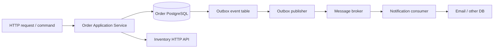
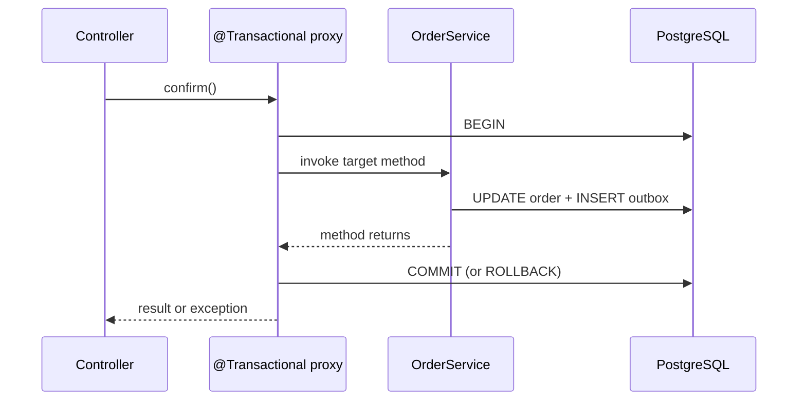
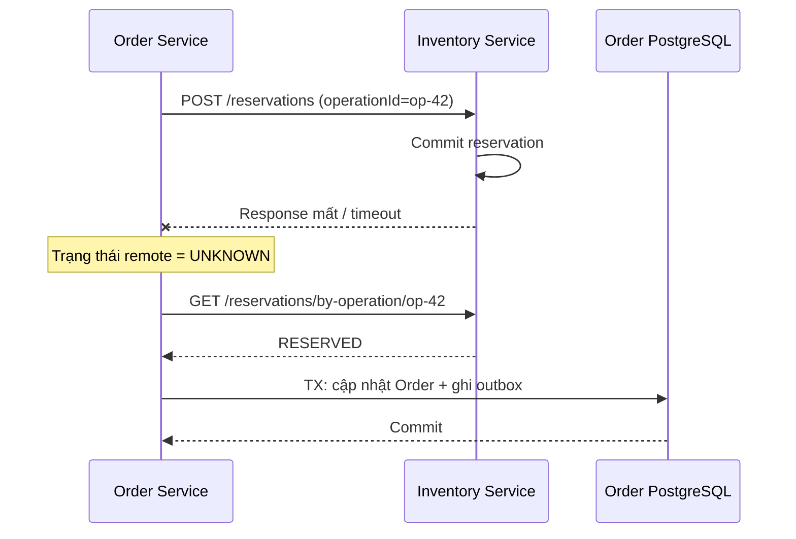
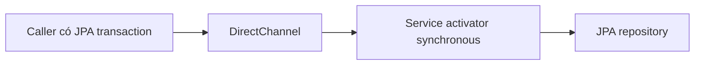
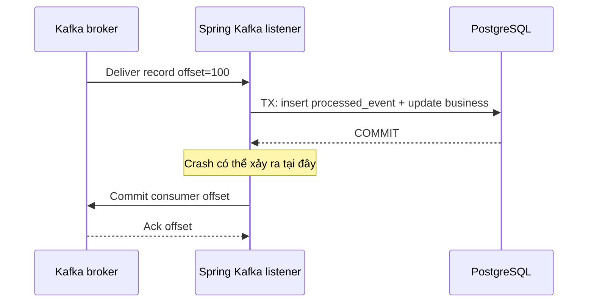
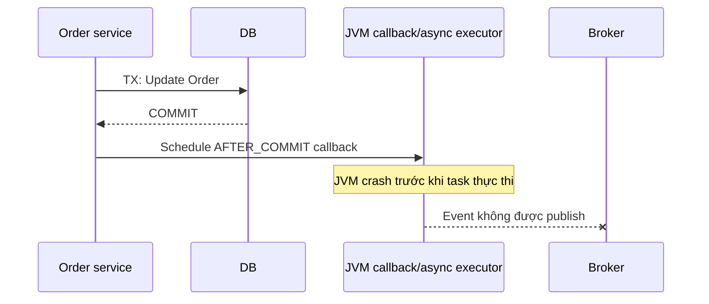
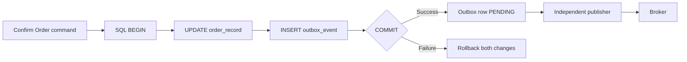
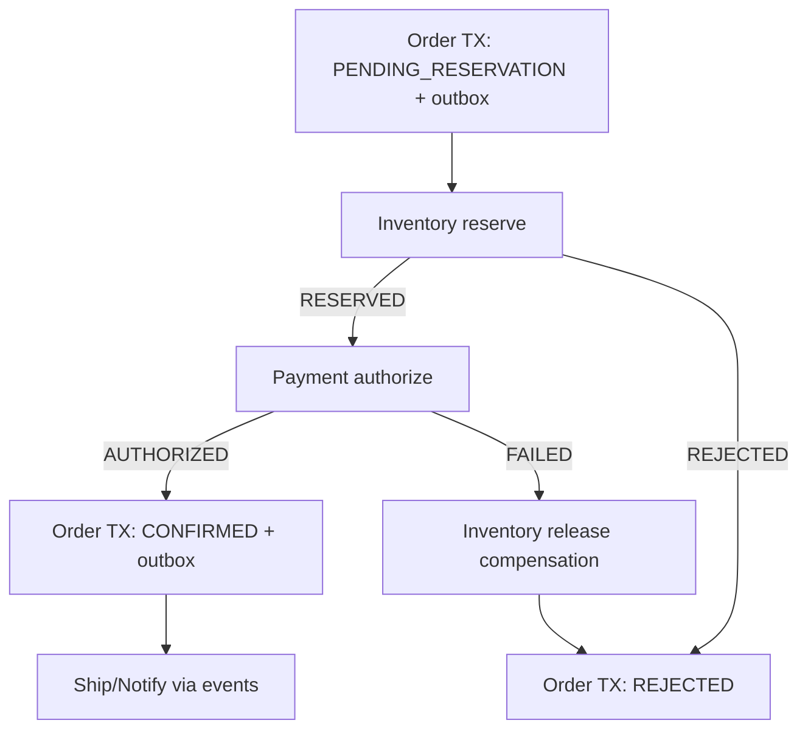

# Giới hạn truyền giao dịch qua HTTP, luồng bất đồng bộ hoặc thông điệp

## 1. Một transaction không tự đi qua mọi ranh giới tích hợp

Trong Spring Boot, một use case xác nhận đơn hàng có thể thực hiện những công việc sau:

1. Cập nhật trạng thái đơn trong PostgreSQL qua JPA.
2. Gọi HTTP sang Inventory Service để giữ hàng.
3. Đăng một sự kiện `OrderConfirmed` lên RabbitMQ hoặc Kafka.
4. Cập nhật cache Redis và gửi email.

Khi method Java chứa tất cả bước ấy được đánh dấu `@Transactional`, **không có nghĩa là tất cả hệ thống cùng tham gia một transaction nguyên tử**. Một transaction manager quản lý các tài nguyên được liên kết với nó: `JpaTransactionManager` thường quản lý một giao dịch JPA/database; `DataSourceTransactionManager` quản lý JDBC connection; các message brokers có cơ chế transaction/ack riêng. HTTP request gửi tới dịch vụ khác **không mang theo transaction SQL của bên gọi**.

Hệ quả: PostgreSQL có thể rollback trong khi Inventory đã giữ hàng; Kafka có thể nhận message khi database chưa commit; hoặc database đã commit nhưng tiến trình chết trước khi ack message nguồn. Những tình huống này không phải “Spring bị lỗi transaction” mà là **ranh giới nhất quán giữa các hệ thống độc lập** cần thiết kế rõ.

Bài học thuộc chương **Giao dịch tích hợp** của module **SPRING_BOOT_INTEGRATION**: tổ chức tích hợp Spring Boot qua HTTP client, cơ sở dữ liệu, cache, broker thông điệp và adapter Spring Integration; trọng tâm là **cấu hình, hợp đồng dữ liệu, giao dịch, lỗi, xử lý trùng lặp, kiểm thử và quan sát**. Ta sẽ phân biệt những bảo đảm thực có của transaction tại từng ranh giới và xây quy trình phục hồi có thể kiểm chứng.

### 1.1. Mục tiêu học tập

Sau bài, bạn có thể:

- Chỉ ra transaction manager đang quản lý tài nguyên nào, thời điểm commit/rollback nằm ở đâu.
- Giải thích vì sao `@Transactional` không truyền tự động qua HTTP, `@Async`, `CompletableFuture`, `ExecutorChannel` hoặc broker.
- Phân biệt thread-bound imperative transaction và Reactor-context reactive transaction.
- Phân tích các cửa sổ lỗi giữa **database commit**, **HTTP response**, **broker publish confirm** và **consumer ack/offset commit**.
- Thiết kế transactional outbox, idempotent inbox/consumer và saga/compensation theo trạng thái nghiệp vụ.
- Áp timeout, retry budget, idempotency key và error handling đúng tầng, không retry mù quáng.
- Kiểm thử rollback, crash, redelivery, late response và concurrent duplicate bằng PostgreSQL/Testcontainers, broker fixture hoặc HTTP mock.

> **Giả định phiên bản:** Ví dụ dùng Java 17+, Spring Boot 3.2+, Spring Framework 6.x, Spring Data JPA và Spring Integration 6.x. Với PostgreSQL, khóa và `ON CONFLICT` mang nghĩa theo database này. Cơ chế ack, transaction manager, advice, connector factory và auto-configuration thay đổi theo starter/phiên bản; cần kiểm tra lại với phiên bản đang chạy. Các đoạn code minh họa lược bỏ imports, package và một số bean/migration.

### 1.2. Luồng xuyên suốt và ranh giới commit

Giả sử endpoint `POST /orders/{id}/confirm` cần giữ hàng trước khi xác nhận:



Có ít nhất **bốn điểm commit hoặc ghi nhận** độc lập: transaction PostgreSQL; transaction/state trong Inventory; broker xác nhận nhận publish; consumer ghi trạng thái và ack/offset. Chúng không trở thành một atomic transaction chỉ vì các lời gọi xuất phát từ cùng application service.

## 2. Bản đồ các ranh giới giao dịch

### 2.1. Phân biệt phạm vi “cùng transaction” và “cùng trace”

| Ranh giới | Transaction JPA phía caller có tự truyền? | Cơ chế cần dùng |
|---|---|---|
| Repository JPA gọi trong cùng thread và transaction manager | Có thể tham gia, nếu cùng `EntityManagerFactory` và context phù hợp | `@Transactional` tại service, đúng manager |
| `JdbcTemplate` cùng datasource với JPA | Có thể cùng transaction JDBC theo cấu hình tương thích | Test connection/manager, không suy từ cùng JDBC URL |
| HTTP `RestClient`/`WebClient` tới microservice khác | **Không** | Idempotency, status inquiry, saga/compensation |
| `@Async`/`CompletableFuture.supplyAsync` | **Không tự truyền** transaction imperative | Transaction riêng trong worker bean |
| Spring Integration `DirectChannel` | Cùng thread mặc định; có thể tham gia transaction hiện tại | Xác nhận proxy/advice/manager |
| Spring Integration `ExecutorChannel` | **Không tự truyền** thread-bound transaction | Mở transaction tại handler/consumer |
| Spring Integration `QueueChannel` với polling thread | Không tự truyền qua enqueue/dequeue | Transaction riêng ở poller/handler; durable store nếu cần |
| Kafka/RabbitMQ/JMS delivery | Không tự có transaction PostgreSQL chung | Ack/offset, idempotency, outbox |
| Redis, SMTP, object storage, remote RPC | **Không** | Contract, retry/compensation, outbox khi cần |
| Reactor R2DBC chain dùng `ReactiveTransactionManager` | Có thể truyền bằng **Reactor Context** trong cùng reactive execution | `TransactionalOperator` hoặc reactive `@Transactional` đúng manager |

**Cùng trace ID, correlation ID hoặc HTTP header không có nghĩa là cùng database transaction.** Trace giúp quan sát các bước, còn transaction manager điều khiển tài nguyên/commit riêng.

### 2.2. Transaction manager thực sự quyết định phạm vi

Spring cung cấp các transaction manager với phạm vi khác nhau:

```text
Imperative:
  PlatformTransactionManager
    - JpaTransactionManager
    - DataSourceTransactionManager / JdbcTransactionManager
    - JtaTransactionManager khi có JTA infrastructure

Reactive:
  ReactiveTransactionManager
    - R2dbcTransactionManager
    - các reactive manager tương ứng nếu có
```

`JpaTransactionManager` tạo và kết thúc một JPA transaction cho một `EntityManagerFactory`; Hibernate có thể flush SQL trước commit, nhưng **flush không phải commit**. `JtaTransactionManager` chỉ có thể điều phối tài nguyên đã được enlist trong hạ tầng JTA/XA tương thích; nó không biến một HTTP REST API bình thường thành XA participant. Kafka/RabbitMQ cũng không mặc nhiên tham gia transaction PostgreSQL theo kiểu 2PC.

### 2.3. Ba trạng thái cần phân biệt sau một request

Mỗi integration call có thể rơi vào một trong ba loại kết quả:

| Kết quả | Diễn giải | Quyết định của caller |
|---|---|---|
| `SUCCESS` có response/ack hợp lệ | Có tín hiệu xác nhận theo contract | Chuyển state theo nghiệp vụ; chưa chắc downstream cuối đã xong |
| `FAILED` được xác nhận | Downstream xác nhận từ chối/rollback | Xử lý lỗi hoặc chuyển state từ chối |
| `UNKNOWN` do timeout/mất kết nối | Không biết server đã commit hay chưa | Tra cứu trạng thái theo operation ID; không gửi lại như operation mới |

Lỗi nguy hiểm nhất trong distributed integration là gộp `UNKNOWN` vào `FAILED`. Một HTTP `SocketTimeoutException` thường chỉ chứng minh **client không nhận được kết quả đúng hạn**, không chứng minh remote database đã rollback.

### 2.4. Hợp đồng nhất quán theo use case

Trước khi chọn kỹ thuật, hãy viết invariant cần bảo vệ:

- **Trong một database:** “Order đã chuyển `CONFIRMED` thì bản ghi outbox tương ứng cũng phải tồn tại.”
- **Giữa Order và Inventory:** “Đơn chỉ được xác nhận nếu có reservation hợp lệ; reservation bị hủy khi workflow thất bại theo chính sách.”
- **Giữa database và broker:** “Một OrderConfirmed event đã commit phải có đường phát lại sau broker outage.”
- **Bên consumer:** “Một event được giao hai lần chỉ gây một tác động nghiệp vụ.”

Một số bất biến có thể bảo đảm bằng transaction SQL và unique constraint. Bất biến xuyên HTTP/broker cần mô hình **eventual consistency**, idempotency và tiến trình bù trừ/đối soát.

## 3. Tại sao giao dịch imperative không tự đi qua thread khác?

### 3.1. Thread-bound transaction context trong Spring

Với JPA/JDBC imperative, Spring thường ràng buộc transaction resources vào **thread đang thực thi** thông qua `TransactionSynchronizationManager`. Khi một caller đi qua Spring AOP proxy:



Khi code tạo một thread mới, executor task hoặc callback bất đồng bộ, **thread mới không được gắn tự động với cùng JPA transaction**.

```java
@Service
public class IncorrectOrderService {
    private final OrderRepository orders;
    private final OutboxRepository outbox;

    @Transactional
    public void confirm(String orderId) {
        orders.confirm(orderId);
        CompletableFuture.runAsync(() ->
                outbox.save(new OutboxEvent(orderId)));
        // Không chờ, không phối hợp rollback.
    }
}
```

Trong ví dụ, `orders.confirm` và `outbox.save` có thể chạy ở **hai transaction khác nhau**, hoặc task của executor fail sau khi method đã return. Ném exception trong `CompletableFuture` không tự rollback transaction của caller. Task có thể chưa kịp chạy khi caller commit.

**Hướng đúng:** nếu `Order` và `Outbox` cần atomic trong cùng database, ghi cả hai **đồng bộ trong một transaction**. Nếu một tác vụ không cần atomic, để task sở hữu transaction riêng và có trạng thái/retry phù hợp.

### 3.2. @Async không chia sẻ transaction của caller

```java
@Service
class OrderService {
    private final EmailJobService emailJobs;

    @Transactional
    public void confirm(String orderId) {
        // Database changes...
        emailJobs.enqueueAsync(orderId);
    }
}

@Service
class EmailJobService {
    @Async
    @Transactional
    public void enqueueAsync(String orderId) {
        // Đây là một transaction riêng trong async thread,
        // nếu lời gọi đi qua Spring proxy và transaction manager đúng.
    }
}
```

Các ràng buộc:

1. `@Async` phải được bật/configured và gọi qua Spring proxy/bean boundary tương ứng.
2. `@Transactional` trên worker có thể tạo **transaction mới**, không “nối dài” transaction của caller.
3. Worker có thể chạy trước khi caller commit và không thấy dữ liệu chưa commit, hoặc caller rollback sau khi worker làm việc.
4. Executor queue không mặc nhiên bền qua crash; scheduling một task không bảo đảm nó sẽ chạy.
5. Lỗi async cần được capture bằng `Future/CompletableFuture`, handler hoặc durable work queue; không thể trông chờ controller nhận mọi exception xảy ra sau response.

Đừng dùng `@Async` để “gửi mail sau commit” khi yêu cầu nghiệp vụ là **không được mất thông báo sau JVM crash**. Outbox/email job table bền là giải pháp đáng tin hơn.

### 3.3. Proxy/self-invocation vẫn là điều kiện cần

`@Transactional` và `@Async` trong cấu hình Spring AOP proxy thông thường chỉ được intercept khi caller đi qua proxy. Một method gọi `this.persist()` trong cùng object sẽ không tự kích hoạt transaction metadata của `persist()`. Một object khởi tạo bằng `new` ngoài Spring cũng không tự có transaction interceptor.

Tách application service có public method transactional được gọi từ controller/listener/worker bean khác. Đừng tự inject self proxy hoặc mở rộng phạm vi transaction tới controller chỉ để chữa self-invocation.

### 3.4. Callback transaction và các tài nguyên chưa dọn

Spring có `TransactionSynchronization`/`@TransactionalEventListener` để thực hiện callback theo phase, ví dụ `AFTER_COMMIT`. Đây là **event trong JVM**, không phải durable broker event. Callback chạy sau khi transaction commit trong process còn sống; nếu JVM crash sau commit nhưng trước callback, công việc có thể mất.

Một lưu ý: tại phase `AFTER_COMMIT`, một số transaction resources có thể còn được gắn trước cleanup. Nếu callback **ghi database mới**, cần transaction mới được tạo rõ (ví dụ `REQUIRES_NEW` ở bean khác) hoặc tốt hơn là đã ghi công việc cần bảo đảm vào outbox trong transaction trước. Đừng tin một `repository.save` trong after-commit callback tự commit một đơn vị độc lập.

## 4. HTTP là ranh giới mạng, không phải đường truyền transaction

### 4.1. Anti-pattern: gọi HTTP có side effect bên trong @Transactional

```java
@Service
public class UnsafeConfirmationService {
    private final OrderRepository orders;
    private final InventoryHttpGateway inventory;

    @Transactional
    public void confirm(String orderId, String operationId) {
        OrderEntity order = orders.findById(orderId)
                .orElseThrow();
        inventory.reserve(orderId, operationId); // HTTP POST
        order.confirm();
        // Nếu flush/commit sau đó lỗi, reservation không tự hủy.
    }
}
```

Giả sử HTTP POST thành công, Inventory đã commit một reservation trong database của nó, nhưng PostgreSQL của Order Service ném lỗi unique constraint khi flush. Spring rollback transaction Order; **Inventory không nhận một lệnh rollback tự động**.

Ngược lại, nếu Order Service giữ transaction database trong lúc chờ HTTP 5 giây, nó có thể giữ connection/row locks và làm tăng pool contention. Vì vậy, vừa **không tăng atomicity**, vừa kéo dài transaction local.

### 4.2. Bốn tình huống sau lời gọi Inventory

| Thời điểm lỗi | Local Order DB | Inventory service | Hành vi đúng |
|---|---|---|---|
| Trước khi gửi HTTP | Chưa commit | Chưa biết có thao tác | Trả lỗi, có thể retry operation |
| Inventory commit nhưng response mất | Có thể chưa commit | Có thể `RESERVED` | Truy vấn trạng thái theo operation ID |
| Inventory trả success, Order DB rollback | `PENDING`/không xác nhận | `RESERVED` | Compensation/cancel reservation hoặc reconcile |
| Order DB commit, HTTP response cho caller bị mất | `CONFIRMED` | `RESERVED` | Caller retry với **cùng operation ID**, trả kết quả đã có |



**Không** suy luận “timeout = remote failed”. TCP connection reset, gateway timeout hay `ReadTimeoutException` chỉ nói rằng caller không nhận được một response đáng tin, có thể là trước hoặc sau commit của server.

### 4.3. Idempotency key cần ổn định theo logical operation

Một request có side effect nên có ID không đổi qua các attempt:

```http
POST /api/v1/reservations HTTP/1.1
Idempotency-Key: reserve:TENANT-A:O-1001:v1
Content-Type: application/json

{"orderId":"O-1001","sku":"SKU-42","quantity":2}
```

HTTP block là ví dụ hợp đồng wire; API thực phải định nghĩa và xác thực key, tenant, payload. Một chính sách server an toàn:

- Unique constraint trên `(tenant_id, operation_id)`.
- Nếu cùng key và cùng payload đã xử lý, trả kết quả/operation status đã lưu.
- Nếu cùng key nhưng payload khác, trả conflict, không thực hiện operation mới.
- Nếu đang xử lý, trả trạng thái rõ như `PROCESSING` và retry-after hoặc endpoint truy vấn trạng thái.
- Lưu retention/tombstone đủ dài để xử lý redelivery và retries muộn.

Không tạo `UUID.randomUUID()` mới **trong một HTTP interceptor cho mỗi lần retry**. Idempotency phải được thiết kế tại application command boundary và được gửi nhất quán qua network.

### 4.4. Timeout và retry chỉ quyết định khi nào dừng chờ

Với `RestClient`/`WebClient`, nên đặt:

1. Connect/TLS/read/response timeout phù hợp.
2. **Overall deadline** của operation qua nhiều attempts.
3. Retry condition theo HTTP method và contract (ví dụ GET safe; POST chỉ khi downstream có idempotency).
4. Backoff, jitter, rate limit và circuit breaker.
5. Trạng thái `UNKNOWN` cùng reconciliation cho timeout có side effect.

Một retry policy không thể biến các tài nguyên remote thành cùng transaction. `@Transactional(rollbackFor = Exception.class)` ở caller chỉ thay rollback rule của **local manager**, không biến POST thành thao tác có thể được JPA rollback.

### 4.5. Hai kiểu điều phối HTTP hợp lệ

**Tách HTTP trước transaction ghi:**

```text
Read/validate basic command
  -> HTTP reserve with stable idempotency key
  -> reconcile if result unknown
  -> short @Transactional Order update + outbox
```

Hướng này tránh giữ DB transaction qua network, nhưng vẫn phải có compensation nếu HTTP reserve đã thành công mà database commit thất bại.

**State machine và asynchronous command:**

```text
TX 1: create ReservationAttempt(PENDING) + outbox ReserveStock
Commit
  -> worker sends ReserveStock command to Inventory
  -> Inventory replies RESERVED / REJECTED
TX 2: apply reply idempotently + order/outbox update
Commit
```

Hướng thứ hai phù hợp workflow dài, cần phục hồi sau crash và event redelivery. Cả hai đều phải xác định timeout/expiry của reservation, cách hủy có idempotency, và điều gì xảy ra khi reply đến sau khi attempt đã đóng.

### 4.6. HTTP tracing header không phải transaction context

Có thể propagate `traceparent`/correlation ID để quan sát, nhưng tuyệt đối không xem nó là bằng chứng downstream đang tham gia transaction PostgreSQL phía caller. Không gửi connection/transaction ID nội bộ tới remote service rồi mong nó tự enlist. Nếu một API cần consistency mạnh xuyên service, thiết kế distributed workflow hoặc cân nhắc thay ranh giới ownership, không che giấu bằng header.

## 5. Spring Integration: transaction theo channel, handler và poller

### 5.1. DirectChannel có thể giữ cùng thread, nhưng chỉ khi call path phù hợp

`DirectChannel` thường gọi subscriber handler **đồng bộ trên thread gửi**. Nếu một application service đã mở imperative JPA transaction rồi gửi message qua `DirectChannel`, handler synchronous có thể nhìn thấy thread-bound transaction context **miễn là** nó sử dụng đúng transaction manager/resource.



Điều này **không** có nghĩa mọi Spring Integration endpoint tự tham gia transaction: nếu caller không mở transaction, handler không có transaction hiện tại; nếu handler gọi sang JDBC datasource khác hoặc mở `REQUIRES_NEW`, phạm vi khác; nếu handler/flow chuyển sang executor hoặc queue thì transaction context bị ngắt.

### 5.2. ExecutorChannel thay đổi thread-boundary

```text
Caller thread:
  @Transactional OrderService
      -> ExecutorChannel.send(message)
      -> enqueue task vào executor
      -> caller tiếp tục / commit / rollback

Worker thread:
  MessageHandler.handleMessage(...)
      -> một transaction riêng nếu có proxy/advice
```

Nếu caller rollback sau khi `ExecutorChannel` đã chấp nhận task, worker có thể vẫn gửi HTTP hoặc publish broker. Ngược lại, executor bị quá tải hoặc JVM crash có thể làm task biến mất dù caller đã commit.

Executor queue và rejection policy là **backpressure/lifecycle concern**, không tự bảo đảm durability. Để phát event sau commit mà không mất khi restart, ghi outbox trong transaction và worker đọc lại từ durable store.

### 5.3. QueueChannel tách send khỏi poll

`QueueChannel` có thể giữ message trong bộ nhớ hoặc dựa vào một `ChannelMessageStore` khi cấu hình; chỉ vì tên là QueueChannel **không có nghĩa đó là RabbitMQ/JMS queue có durability**. Gửi vào channel thành công không đồng nghĩa downstream đã xử lý hoặc database đã commit.

```text
Inbound HTTP / JPA transaction
    -> QueueChannel.send()
    -> return / commit

Poller later:
    -> receive()
    -> handler
    -> own local transaction / failure handling
```

Với durable `ChannelMessageStore`, cần cấu hình store, serialization, transaction và recovery đúng; một local JPA commit và một queue store ghi trên resource khác vẫn không tự atomic.

### 5.4. Poller transaction advice quản lý scope được advice bọc

Một Spring Integration poller có thể được advice bởi transaction interceptor. Khi poller lấy message từ JDBC/JMS source và xử lý đồng bộ trong cùng thread, transaction advice có thể bao một đoạn công việc nhất định.

Nhưng:

- Advice phải chọn đúng `PlatformTransactionManager` của nguồn và logic cần transaction.
- Poller có thể chỉ kiểm soát receive/handler synchronous trong scope đã cấu hình, **không** bao tác vụ đã chuyển sang executor/queue khác.
- Nếu source là broker, message acknowledgment/rollback có semantics của broker, không tự là rollback JDBC.
- Nếu channel/handler ghi vào một datasource khác, không bảo đảm distributed transaction nếu không enlist đúng hạ tầng.
- Lỗi bị handler/`errorChannel` nuốt có thể khiến upstream coi việc xử lý thành công; cần cấu hình error propagation/ack theo contract.

Để test chính xác, cần mô phỏng exception ở handler và quan sát **cả trạng thái source message lẫn local DB** sau rollback/redelivery.

### 5.5. Adapter outbound không biến flow thành transaction phân tán

```text
JDBC inbound -> transformer -> HTTP outbound -> RabbitMQ outbound
```

Một flow gồm nhiều bước không có “một commit xuyên tất cả”, trừ khi các resource managers thực sự có khả năng enlist vào một transaction chung được cấu hình. HTTP không có participant XA chuẩn cho lời gọi REST bất kỳ. Nếu HTTP side effect xong rồi RabbitMQ publish fail, rollback JDBC không làm HTTP tự hoàn tác.

Đối với integration flow cần độ tin cậy:

- Tách **tầng chuẩn hóa/định tuyến message** khỏi **tầng commit business state**.
- Lưu **outbox/processing status** trong cùng local DB transaction.
- Chọn broker ack policy dựa trên kết quả của handler và idempotency.
- Thiết kế retries/DLQ/reconciliation cho từng adapter, không chỉ đặt một `@Transactional` ở gateway.

### 5.6. Error channel, exceptions và ack

Ở một flow synchronous, exception có thể truyền ngược về caller và làm transaction interceptor rollback theo quy tắc. Khi message được handoff bất đồng bộ, exception xảy ra trên worker khác, có thể chuyển tới `errorChannel` hoặc error handler riêng thay vì truyền về thread đã gửi.

Vì vậy:

1. Xác định adapter/container nào sở hữu **ack/offset**.
2. Khi error channel nhận lỗi, ai chuyển message sang retry/DLQ?
3. Việc chuyển lỗi thành một `ErrorMessage` có khiến producer nhìn như “đã thành công” không?
4. Nếu handler DB đã commit nhưng xử lý output lỗi, có durable replay không?
5. Nếu message bị redeliver, unique operation ID có chặn side effect lặp không?

Không coi việc framework “đã route lỗi tới errorChannel” là đã tự khôi phục tính nhất quán nghiệp vụ.

## 6. Broker message: ack, offset và transaction không đồng nghĩa database commit

### 6.1. Ba sự kiện quan trọng trong message-driven processing

Với consumer xử lý `OrderConfirmed`:

```text
Event delivered to consumer
    -> Business database transaction starts
    -> INSERT processed_event + UPDATE notification_task
    -> Business database COMMIT
    -> Broker ACK / Kafka offset commit
```

Lựa chọn này thường tốt hơn ack **trước** database commit. Nhưng dù commit trước ack:

- DB commit xong, process crash trước ack → broker có thể **redeliver** cùng message.
- DB rollback, handler throw → broker có thể redeliver theo retry policy.
- Broker ack thành công sau handler → chưa chắc email SMTP đã được người dùng nhận.
- Nếu handler catch exception và trả bình thường, container có thể ack một message **chưa được xử lý thành công**.

Giải pháp phổ biến là **at-least-once delivery + idempotent consumer**. Không nhầm “message được giao ít nhất một lần” với “side effect xảy ra chính xác một lần”; điều thứ hai cần unique constraints, state machine và contract nghiệp vụ.

### 6.2. RabbitMQ: publisher confirm khác consumer ack

| Cơ chế RabbitMQ | Xác nhận điều gì? | Không xác nhận điều gì? |
|---|---|---|
| `RabbitTemplate.convertAndSend` return | Client đã hoàn tất lời gọi gửi theo API, có thể còn ở local/network buffer tùy mode | Không tự chứng minh broker đã persist/route/deliver |
| Publisher confirm | Broker xác nhận publish theo cấu hình confirm | Consumer đã xử lý và commit database |
| Publisher return | Message không route tới queue trong điều kiện bắt buộc phù hợp và có callback | Không thay thế confirm hoặc business ack |
| Consumer ack | Broker có thể loại message khỏi hàng chờ | Side effect database/email đã commit trừ khi handler tự bảo đảm |
| Channel transaction (AMQP) | Commit/rollback thao tác AMQP trên channel tương ứng | Không tự atomic với PostgreSQL transaction |

**Spring AMQP** có `RabbitTransactionManager` cho transaction AMQP local và các tùy chọn synchronization với transaction khác theo cấu hình. Điều đó không biến hai resource thành một XA/2PC database+RabbitMQ transaction; trong failure window commit thứ hai vẫn có thể fail sau commit thứ nhất. Đừng thay outbox bằng suy đoán “cả `JpaTransactionManager` và `RabbitTransactionManager` đều hiện diện nên giao dịch là một”.

### 6.3. Rabbit listener gọi service transactional

```java
// Lược bớt imports và bean/queue setup.
@Component
public class OrderEventListener {
    private final OrderEventApplicationService service;

    public OrderEventListener(
            OrderEventApplicationService service) {
        this.service = service;
    }

    @RabbitListener(queues = "orders.events.v1")
    public void onMessage(OrderConfirmedEvent event) {
        service.apply(event); // Method transactional trên bean khác.
        // Trong AUTO ack mode phù hợp, container ack
        // sau khi listener hoàn tất thành công.
    }
}
```

Đoạn này giả định queue, converter, container factory, ack mode và retry/DLQ được cấu hình. `@RabbitListener` **không tự tạo** queue/binding/JSON mapping đầy đủ. Khi đặt ack mode `MANUAL`, listener phải ack/nack theo API và thứ tự do ứng dụng chủ động quản lý; không áp kết luận AUTO ack cho MANUAL mode.

### 6.4. Kafka: offset commit là consumer progress, không phải SQL commit

Một Kafka consumer có thể đọc event tại offset 100, ghi database rồi container commit offset 101. Nếu database commit xong và process crash trước offset commit, event offset 100 được đọc lại. Nếu offset commit **trước** database commit và database sau đó fail, event có thể bị bỏ qua mất tác động.



Trong Spring Kafka, `AckMode`, listener container transaction configuration và error handler quyết định chính xác lúc nào offset được commit. Khi sử dụng các Kafka transactions, cơ chế read-process-write **trong Kafka** có thể bảo đảm atomicity của Kafka records và consumed offsets theo cấu hình compatible; **database PostgreSQL ngoài Kafka vẫn là một resource khác**.

Không khẳng định `@Transactional("kafkaTransactionManager")` và `@Transactional("jpaTransactionManager")` lồng nhau là atomic distributed commit. Các cơ chế transaction synchronization/chained managers có giới hạn best-effort và failure windows; nếu cần bảo đảm phát event từ database, dùng transactional outbox/CDC với consumer idempotent.

### 6.5. JMS: local transacted session, XA và JTA

JMS có `Session.SESSION_TRANSACTED` và cơ chế acknowledgment/transaction trong broker. Một JMS transacted session có thể rollback nhận/gửi message **trong scope JMS**, nhưng không tự rollback transaction JPA ở database khác.

Khi JMS provider và datasource thực sự hỗ trợ XA, JTA/2PC có thể điều phối những tài nguyên được enlist qua transaction coordinator. Tuy nhiên cần:

- Resource adapters/XADataSource/XAConnectionFactory và transaction manager phù hợp.
- Recovery logs, transaction identifiers, crash recovery và operational monitoring.
- Xác minh broker/provider support, lock/timeouts và ảnh hưởng throughput.
- Kiểm tra tình huống heuristic outcomes/recovery.

**HTTP REST call không biến thành XA participant** vì bạn bật JTA. Đối với hệ thống microservices phổ biến, XA có chi phí/độ phức tạp đáng kể; outbox, saga và idempotency thường dễ triển khai/quan sát hơn.

### 6.6. Broker transaction chỉ thuộc broker transaction domain

| Use case | Có thể dùng local transaction nào? | Cần thêm gì? |
|---|---|---|
| Kafka consumer đọc record và producer ghi record khác | Kafka transaction nếu cấu hình đầy đủ | Read-committed/producer settings, xử lý các database khác |
| RabbitMQ producer gửi nhiều AMQP messages | Channel transaction hoặc confirms theo yêu cầu | Routing/return, outbox nếu nguồn dữ liệu nằm trong DB |
| JMS nhận và gửi trong cùng session transacted | JMS local transaction | DB integration hoặc XA nếu thật sự có |
| PostgreSQL update Order + outbox row | JPA/JDBC transaction trên cùng DB | Publisher, confirm/retry, idempotent consumer |
| PostgreSQL update + HTTP POST remote | Chỉ SQL transaction local | Saga/compensation/idempotency/query status |

Mỗi dòng có thể đúng riêng, nhưng **không cộng các transaction managers để suy ra một commit duy nhất**.

## 7. Reactive flow: transaction ở Reactor Context, không nằm trong mọi thread

### 7.1. ReactiveTransactionManager khác PlatformTransactionManager

Trong R2DBC, `ReactiveTransactionManager`/`R2dbcTransactionManager` thường truyền transaction context qua **Reactor Context** trên quá trình subscribe của publisher. Đây không phải cùng mô hình thread-local của `JpaTransactionManager`.

```java
// Reactive repository/domain types cần triển khai.
@Service
public class ReactiveOrderService {
    private final DatabaseClient database;

    public ReactiveOrderService(DatabaseClient database) {
        this.database = database;
    }

    @Transactional(transactionManager = "r2dbcTransactionManager")
    public Mono<Long> updateStatus(String orderId) {
        return database.sql("""
                    UPDATE customer_order
                       SET status = 'CONFIRMED'
                     WHERE id = :orderId
                       AND status = 'PENDING'
                    """)
                .bind("orderId", orderId)
                .fetch()
                .rowsUpdated();
    }
}
```

Ở đây `Mono` được thực thi khi có **subscription** và transaction interceptor reactive quản lý lifecycle publisher phù hợp. Đừng gắn một JPA `PlatformTransactionManager` cho method trả `Mono` rồi mong transaction imperative kéo dài tới lúc subscribe.

### 7.2. Subscription boundary quyết định một reactive transaction

`TransactionalOperator` có thể tạo explicit scope:

```java
@Component
public class ReactiveOrderWorkflow {
    private final ReactiveOrderRepository orders;
    private final ReactiveOutboxRepository outbox;
    private final TransactionalOperator tx;

    public ReactiveOrderWorkflow(
            ReactiveOrderRepository orders,
            ReactiveOutboxRepository outbox,
            ReactiveTransactionManager manager) {
        this.orders = orders;
        this.outbox = outbox;
        this.tx = TransactionalOperator.create(manager);
    }

    public Mono<Void> confirm(String orderId) {
        return orders.confirm(orderId)
                .then(outbox.insertOrderConfirmed(orderId))
                .as(tx::transactional)
                .then();
    }
}
```

`ReactiveOrderRepository`/`ReactiveOutboxRepository` ở đây là abstractions minh họa phải được triển khai dùng **cùng reactive connection factory/transaction manager**. Toàn bộ publisher chain cần được subscribe qua operator. Nếu gọi `subscribe()` lẻ bên trong map/flatMap, bạn có thể tách một tác vụ ra khỏi transaction context và tạo một flow side effect không được chờ/quan sát đầy đủ.

### 7.3. Reactive không truyền transaction qua HTTP hoặc broker

Một `Mono.zip(httpA, httpB)` có thể chờ hai HTTP calls trong cùng reactive flow, nhưng **hai remote services không tham gia R2DBC transaction của caller**. Cũng vậy, Reactor Context có thể propagate tracing hoặc transaction context qua scheduler hops được Reactor hỗ trợ trong chain phù hợp, nhưng không xuyên một network hop sang PostgreSQL của service khác.

Đặt WebClient HTTP call **bên ngoài** reactive DB transaction khi có thể để không giữ connection reactive trong khi chờ remote network. Nếu kết quả HTTP quyết định update, mở transaction reactive ngắn và **kiểm tra lại invariant/version** trước ghi.

### 7.4. Cẩn thận khi trộn JPA và R2DBC

```java
@Transactional("jpaTransactionManager")
public Mono<Void> unsafeMix() {
    jpaRepository.save(...);
    return r2dbcRepository.save(...).then();
}
```

Đây là kỳ vọng sai: JPA method có thể return trước khi `Mono` được subscribe; transaction JPA imperative có thể đã commit/rollback xong. R2DBC chạy sau trên reactive context riêng. Ngay cả `block()` trong một method JPA cũng không tự enlist R2DBC connection vào cùng transaction, lại có nguy cơ chặn event-loop hoặc làm dài transaction.

Khi cần kết hợp JPA và R2DBC, thiết kế những **bước transaction riêng**, event/outbox và idempotency thay vì kỳ vọng hai transaction managers có chung scope.

### 7.5. Reactor retry không đồng nghĩa rollback remote side effect

`retryWhen(...)` resubscribe upstream publisher. Nếu upstream gồm một POST/side-effect hoặc đã commit transaction trước đó, retry có thể gây tác động lặp. Phải phân biệt operator retry cho một **read-only call** với retry **toàn use case** có operation ID, state check và compensation. Một reactive pipeline có thể bảo vệ một R2DBC transaction local, nhưng không tự biến HTTP POST/Kafka publish thành idempotent operation.

## 8. Ma trận cửa sổ lỗi: cùng lỗi quan sát nhưng kết quả khác nhau

### 8.1. Order database và broker publish

Một anti-pattern phổ biến:

```java
@Transactional
public void confirmBad(String orderId) {
    orderRepository.confirm(orderId);
    rabbitTemplate.convertAndSend(
            "orders.exchange", "confirmed",
            new OrderConfirmedEvent(orderId));
}
```

Thứ tự thực thi ở đây có thể là **send trước database commit**. Dù `convertAndSend` trả về thành công, Hibernate vẫn có thể fail ở flush/commit. Khi ấy broker đã thấy `OrderConfirmed` cho một Order chưa từng được commit. Nếu gọi broker **sau khi** commit bằng một đoạn code không có outbox, JVM có thể crash giữa commit và send, làm event biến mất.

| Thiết kế | Cửa sổ lỗi | Hậu quả |
|---|---|---|
| Publish trong `@Transactional` trước DB commit | Publish thành công, DB rollback | Ghost event: consumer thấy sự kiện không có state |
| DB commit rồi publish trực tiếp | Process crash trước publish | Lost event: DB thay đổi nhưng không có event |
| DB commit rồi `@TransactionalEventListener(AFTER_COMMIT)` publish | Process crash trước callback | Lost event nếu không có cơ chế phục hồi |
| DB + outbox trong một SQL transaction | DB rollback | Không có state/outbox không nhất quán |
| Outbox worker publish rồi mark SENT | Crash sau broker confirm, trước mark SENT | Duplicate publish có thể xảy ra |

**Kết luận:** để bảo vệ đồng thời business row và ý định phát event, giao dịch SQL nên ghi **cả business state và outbox record**. Đường phát broker dùng retry/confirm và consumer deduplication.

### 8.2. Database commit và consumer ack

| Thứ tự | Cửa sổ crash | Phân tích |
|---|---|---|
| Ack trước database commit | DB rollback sau ack | Có thể mất tác động nghiệp vụ |
| Database commit trước ack | Crash trước ack | Có thể redeliver và xử lý trùng |
| DB commit + inbox unique event ID, rồi ack | Crash trước ack | Redelivery an toàn nếu inbox đúng và commit atomic |
| Xử lý ngoại vi rồi ghi inbox | External side effect thành công, inbox commit fail | Side effect có thể lặp; cần idempotency downstream |

Không cố “giải quyết” duplicate bằng cách ack sớm. Thay vào đó, **chấp nhận redelivery có kiểm soát** và ngăn duplicate effect bằng dữ liệu bền vững.

### 8.3. @Async và after-commit event



`@TransactionalEventListener(AFTER_COMMIT)` là công cụ tốt khi hành vi **best-effort** hoặc có durable replay khác, ví dụ xóa cache có TTL. Nó không thay thế outbox cho notification/event quan trọng. Còn `@Async` chỉ chuyển thời điểm/thread thực thi; tự nó không làm callback bền qua crash.

### 8.4. Trạng thái business terminal là nguồn bảo vệ cuối

Một message đến muộn sau timeout có thể kích hoạt handler lại dù broker và outbox đều hoạt động đúng. Nên lưu state machine như:

```text
PENDING_RESERVATION
  | reserved -> CONFIRMED
  | refused  -> REJECTED
  | timeout  -> TIMED_OUT
  | cancel   -> CANCELLED

Terminal states:
  CONFIRMED, REJECTED, TIMED_OUT, CANCELLED
```

Khi xử lý retry/duplicate, application service phải xác định:

- Cùng `operationId` với cùng payload đã được xử lý → trả kết quả đã lưu.
- Cùng `operationId` với payload khác → conflict, không áp dụng lệnh mới.
- Reply cho attempt đã `CANCELLED/TIMED_OUT` → bỏ qua hoặc chạy compensation có hợp đồng.
- Một attempt mới có ID khác → không trộn với reply/compensation của attempt cũ.

Không dùng `broker messageId` ngẫu nhiên như business operation ID nếu message được rebuild/redeliver và ID có thể thay đổi.

## 9. Transactional outbox: một SQL commit cho Order và ý định phát event

### 9.1. Vì sao outbox là local transaction bình thường?

Ta tạo hai bảng trong **cùng PostgreSQL datasource**: `order_record` và `outbox_event`. Khi xác nhận đơn, application service sửa Order và insert một bản ghi outbox trong cùng transaction JDBC/JPA. PostgreSQL bảo đảm chúng **cùng commit hoặc cùng rollback**.



Outbox không yêu cầu database transaction bao trùm message broker. Nó chỉ bảo đảm **ý định gửi** được commit cùng business state để worker có thể retry sau failure.

### 9.2. Schema PostgreSQL tối giản

```sql
CREATE TABLE order_record (
    id            VARCHAR(80) PRIMARY KEY,
    status        VARCHAR(32) NOT NULL,
    version       BIGINT NOT NULL DEFAULT 0
);

CREATE TABLE processed_command (
    operation_id  UUID PRIMARY KEY,
    order_id      VARCHAR(80) NOT NULL,
    processed_at  TIMESTAMPTZ NOT NULL DEFAULT CURRENT_TIMESTAMP
);

CREATE TABLE outbox_event (
    event_id       UUID PRIMARY KEY,
    aggregate_id   VARCHAR(80) NOT NULL,
    event_type     VARCHAR(60) NOT NULL,
    schema_version INT NOT NULL,
    payload_json   JSONB NOT NULL,
    status         VARCHAR(20) NOT NULL DEFAULT 'PENDING',
    claim_token    UUID,
    claimed_until  TIMESTAMPTZ,
    attempt_count  INT NOT NULL DEFAULT 0,
    created_at     TIMESTAMPTZ NOT NULL DEFAULT CURRENT_TIMESTAMP,
    sent_at        TIMESTAMPTZ,
    CONSTRAINT ck_outbox_status
        CHECK (status IN ('PENDING', 'CLAIMED', 'SENT'))
);

CREATE INDEX idx_outbox_claim
    ON outbox_event (status, claimed_until, created_at);
```

Sử dụng Flyway/Liquibase (hoặc công cụ migration có version) trong dự án thay vì chạy DDL thủ công khi application khởi động production. `processed_command.operation_id` và `outbox_event.event_id` cần unique constraint thực trong database; nếu chỉ `existsById` trước rồi insert thì race vẫn xảy ra.

Trong hệ thống đa tenant, thêm `tenant_id` vào schema và định nghĩa unique/authorization theo tenant. Với outbox volume lớn, cần partition/retention, index phù hợp, cleanup row `SENT` và bảo vệ payload dữ liệu nhạy cảm.

### 9.3. Command/event contract có ID ổn định

```java
// Dữ liệu cần đi xuyên HTTP/broker một cách có version.
public record ConfirmOrderCommand(
        String orderId,
        UUID operationId
) {}

public record OrderConfirmedEvent(
        int schemaVersion,
        UUID eventId,
        String orderId
) {}
```

Ví dụ chọn `eventId = operationId` **chỉ vì một command xác nhận tạo đúng một event**. Khi một operation có nhiều events, cần event IDs riêng nhưng **ổn định**, có mapping tới operation ID. Không cho consumer tự tạo `eventId` mới mỗi lần nhận.

### 9.4. Ứng dụng JDBC transactional với PostgreSQL

```java
// OrderConfirmationService.java — imports rút gọn
@Service
public class OrderConfirmationService {
    private final JdbcTemplate jdbc;
    private final ObjectMapper mapper;

    public OrderConfirmationService(
            JdbcTemplate jdbc,
            ObjectMapper mapper) {
        this.jdbc = jdbc;
        this.mapper = mapper;
    }

    @Transactional
    public void confirm(ConfirmOrderCommand cmd) {
        if (cmd == null || cmd.orderId() == null
                || !cmd.orderId().matches("[A-Za-z0-9_-]{1,80}")
                || cmd.operationId() == null) {
            throw new IllegalArgumentException(
                    "ConfirmOrderCommand không hợp lệ");
        }

        int firstTime = jdbc.update("""
            INSERT INTO processed_command(operation_id, order_id)
            VALUES (?, ?)
            ON CONFLICT (operation_id) DO NOTHING
            """, cmd.operationId(), cmd.orderId());

        if (firstTime == 0) {
            String previousOrderId = jdbc.queryForObject("""
                SELECT order_id
                FROM processed_command
                WHERE operation_id = ?
                """, String.class, cmd.operationId());

            if (!cmd.orderId().equals(previousOrderId)) {
                throw new IllegalArgumentException(
                        "operationId đã dùng cho đơn khác");
            }
            return; // Đã xử lý cùng logical command.
        }

        int updated = jdbc.update("""
            UPDATE order_record
               SET status = 'CONFIRMED',
                   version = version + 1
             WHERE id = ?
               AND status = 'PENDING_RESERVATION'
            """, cmd.orderId());

        if (updated != 1) {
            throw new IllegalStateException(
                    "Order không ở trạng thái xác nhận được");
        }

        OrderConfirmedEvent event = new OrderConfirmedEvent(
                1, cmd.operationId(), cmd.orderId());

        String payload;
        try {
            payload = mapper.writeValueAsString(event);
        } catch (JsonProcessingException ex) {
            throw new IllegalStateException(
                    "Không serialize được outbox event", ex);
        }

        jdbc.update("""
            INSERT INTO outbox_event(
                event_id, aggregate_id, event_type,
                schema_version, payload_json
            )
            VALUES (?, ?, 'ORDER_CONFIRMED', 1, ?::jsonb)
            """, event.eventId(), event.orderId(), payload);
    }
}
```

**Ranh giới được bảo đảm:** nếu method được gọi **qua Spring transaction proxy**, `JdbcTemplate` dùng cùng `DataSource`/`PlatformTransactionManager` và PostgreSQL commit thành công, ba thay đổi `processed_command`, `order_record`, `outbox_event` cùng commit. Nếu `UPDATE` hoặc outbox insert lỗi, transaction rollback toàn bộ.

`INSERT ... ON CONFLICT DO NOTHING` là kỹ thuật PostgreSQL cụ thể: hai request đồng thời cùng `operationId` không tự cùng được chấp nhận. Nếu một transaction đang insert nhưng chưa commit, transaction thứ hai có thể phải chờ giải quyết uniqueness trước khi nhận kết quả. Với nhiều manager/datasources, phải chọn đúng manager; ví dụ giả định ứng dụng chỉ dùng **một** JDBC datasource được Boot cấu hình.

**Giới hạn cần chủ động xử lý:**

- Lần xử lý đã thành công, sau đó cùng operation ID nhưng **payload business khác** cũng phải bị từ chối. Ví dụ chỉ lưu `orderId`; nếu command có SKU, quantity, price hoặc tenant thì cần lưu/so sánh hash của **toàn bộ những field quyết định kết quả**.
- Unique event ID không tự bảo đảm event ordering giữa nhiều operations của cùng order. Nếu downstream cần thứ tự, có aggregate sequence/partition key và state version rõ.
- Nếu Order đã `CONFIRMED` bởi một operation khác, method ném exception cho operation mới; caller phân loại conflict và đối soát trạng thái, không ép update lại.
- Exceptions phát sinh khi commit vẫn có thể xuất hiện **sau khi body method return**; controller chỉ nên coi success khi lời gọi qua proxy hoàn tất mà không lỗi.
- Nếu schema sử dụng JPA thay JDBC, có thể ghi Order entity và Outbox entity qua repositories cùng `JpaTransactionManager`; phải kiểm tra chúng cùng persistence unit và transaction.

### 9.5. Cùng DB được atomic, không cần gửi message ngay trong method

Không thêm:

```java
@Transactional
public void confirmBad(ConfirmOrderCommand cmd) {
    // Update Order + INSERT outbox ...
    rabbitTemplate.convertAndSend("orders", event);
}
```

vì nó vẫn mở cửa sổ broker publish trước commit. Outbox worker sẽ gửi **sau** khi row PENDING đã commit và có thể phát lại khi broker outage.

## 10. Outbox publisher: claim, publish, confirm, mark SENT

### 10.1. Không giữ database transaction trong khi chờ broker

Worker không nên:

```text
BEGIN SQL transaction
SELECT outbox FOR UPDATE
PUBLISH to broker (chờ network nhiều giây)
UPDATE outbox SET SENT
COMMIT SQL
```

Thiết kế này giữ row lock và connection SQL qua network I/O. Khi broker chậm, pool/locks có thể bị nghẽn. Nó **cũng không tạo atomic commit** broker+PostgreSQL, vì broker có thể nhận trước khi SQL commit.

Một lựa chọn có thể phục hồi:

```text
TX A (ngắn):
  Claim một batch PENDING hoặc claim hết hạn
  Gắn claim_token và claimed_until
  COMMIT

Outside SQL TX:
  Publish từng event tới broker
  Đợi/kiểm tra broker confirm theo contract

TX B (ngắn):
  UPDATE outbox SENT chỉ khi claim_token còn khớp
  COMMIT
```

Nếu crash sau TX A nhưng trước publish, lease hết hạn rồi worker khác claim lại. Nếu crash sau publish confirm nhưng trước TX B, worker khác có thể publish lại: đó là lý do consumer cần idempotency.

### 10.2. Claim batch an toàn với PostgreSQL

Một ví dụ SQL dùng PostgreSQL `FOR UPDATE SKIP LOCKED`:

```sql
-- Chạy trong một transaction ngắn.
WITH candidates AS (
    SELECT event_id
      FROM outbox_event
     WHERE status = 'PENDING'
        OR (status = 'CLAIMED'
            AND claimed_until <= CURRENT_TIMESTAMP)
     ORDER BY created_at, event_id
     LIMIT :batch_size
     FOR UPDATE SKIP LOCKED
)
UPDATE outbox_event AS outbox
   SET status = 'CLAIMED',
       claim_token = :claim_token,
       claimed_until = CURRENT_TIMESTAMP + INTERVAL '30 seconds',
       attempt_count = attempt_count + 1
  FROM candidates
 WHERE outbox.event_id = candidates.event_id
RETURNING outbox.event_id,
          outbox.aggregate_id,
          outbox.event_type,
          outbox.schema_version,
          outbox.payload_json;
```

Các `:batch_size`/`:claim_token` là named parameters do worker bind; trên một call, token có thể dùng chung cho một batch, nhưng phải đủ ngẫu nhiên/duy nhất cho mỗi claim batch. Khi nhiều workers chạy đồng thời, row lock và `SKIP LOCKED` giảm tranh chấp claim cùng row. `claimed_until` là lease để phục hồi khi worker crash.

**Điểm cần thiết kế thêm:** claim timeout dựa trên DB time; độ dài lease phải phù hợp latency publisher, số attempts và chế độ gia hạn/heartbeat. Một worker cũ có thể tiếp tục publish sau khi lease đã hết và worker mới claim; **fencing token không chặn được broker nhận duplicate**, chỉ bảo vệ việc worker cũ sửa trạng thái outbox sai. Consumer vẫn cần deduplicate.

### 10.3. Mark SENT sau broker confirm

```sql
UPDATE outbox_event
   SET status = 'SENT',
       sent_at = CURRENT_TIMESTAMP,
       claim_token = NULL,
       claimed_until = NULL
 WHERE event_id = :event_id
   AND status = 'CLAIMED'
   AND claim_token = :claim_token;
```

Kiểm tra số row đã update:

- `1`: worker vẫn sở hữu claim và đánh dấu gửi thành công.
- `0`: claim có thể đã chuyển owner hoặc status đã đổi; không được coi là mark thành công âm thầm. Đối soát và để worker mới xử lý theo state.

Khi broker publish fail/timed out, **không mark SENT**. Có thể giữ row `CLAIMED` đến lease expiry hoặc chuyển lại `PENDING` với backoff/`next_attempt_at` qua một transaction theo owner token; cần giới hạn attempts, dead-letter policy và alert cho poison event.

### 10.4. Publisher confirm có nghĩa gì?

Với RabbitMQ, cần bật và xử lý **publisher confirms**, và nếu yêu cầu biết message có route tới queue thì xử lý **returns/mandatory** theo semantics phù hợp. Chỉ gọi `convertAndSend` rồi return không đủ để chứng minh broker đã chấp nhận và route. Với Kafka, kiểm tra future/result của send và cấu hình `acks`, retries, idempotent producer theo nhu cầu; một broker acknowledgment vẫn không chứng minh consumer business commit.

```text
Outbox row PENDING
    -> claim
    -> broker publish attempt
    -> broker acceptance/confirm
    -> mark SENT in PostgreSQL
    -> consumer delivery
    -> consumer business COMMIT
    -> consumer ack/offset
```

Trạng thái `SENT` nghĩa là **publisher đã có xác nhận theo publish contract**, không phải email đã gửi hay consumer đã xử lý. Nếu cần end-to-end completion, xây thêm `consumer_processed`/business acknowledgment event với correlation ID và timeout/compensation riêng.

### 10.5. Lựa chọn CDC thay vì worker tự poll

Một số hệ thống dùng change data capture (CDC) đọc commit log của database để phát outbox event. Điều này giảm polling workload và có thể giữ ordering theo log, nhưng vẫn cần:

- Quy tắc event envelope và version.
- Offset/connector recovery khi restart.
- Idempotent consumer vì CDC connector/broker có thể replay.
- Điều kiện khi connector lag và retention WAL/binlog.
- Quản lý schema migration và record deletion/compaction.

CDC không làm consumer side effect exactly-once theo nghĩa nghiệp vụ nếu DB đích hoặc HTTP tiếp nhận message lại hai lần.

## 11. Idempotent inbox: commit xử lý message và dấu dedup cùng nhau

### 11.1. Bảng xử lý theo consumer

Một event `OrderConfirmed` có thể được nhiều consumer xử lý: email worker, analytics worker và loyalty worker. Không nên dùng một bảng dedup global rồi chặn consumer khác vì một consumer đã xử lý event trước đó. Chọn khóa **`(consumer_name, event_id)`** hoặc một định danh xử lý tương đương.

```sql
CREATE TABLE processed_message (
    consumer_name VARCHAR(120) NOT NULL,
    event_id      UUID NOT NULL,
    processed_at  TIMESTAMPTZ NOT NULL DEFAULT CURRENT_TIMESTAMP,
    PRIMARY KEY (consumer_name, event_id)
);

CREATE TABLE notification_job (
    job_id        UUID PRIMARY KEY,
    order_id      VARCHAR(80) NOT NULL,
    status        VARCHAR(20) NOT NULL DEFAULT 'PENDING',
    created_at    TIMESTAMPTZ NOT NULL DEFAULT CURRENT_TIMESTAMP
);
```

Consumer transaction phải ghi `processed_message` **cùng transaction** với tác động business SQL. Nếu insert dedup marker commit trước rồi business SQL fail sau ở transaction khác, redelivery sẽ thấy “đã xử lý” và bỏ qua một tác động chưa xảy ra.

### 11.2. Handler SQL có idempotency

```java
// NotificationInboxService.java — imports rút gọn
@Service
public class NotificationInboxService {
    private final JdbcTemplate jdbc;

    public NotificationInboxService(JdbcTemplate jdbc) {
        this.jdbc = jdbc;
    }

    @Transactional
    public void accept(OrderConfirmedEvent event) {
        if (event == null || event.schemaVersion() != 1
                || event.eventId() == null
                || event.orderId() == null) {
            throw new IllegalArgumentException(
                    "OrderConfirmedEvent không hợp lệ");
        }

        int inserted = jdbc.update("""
            INSERT INTO processed_message(
                consumer_name, event_id)
            VALUES ('email-worker', ?)
            ON CONFLICT DO NOTHING
            """, event.eventId());

        if (inserted == 0) {
            return; // Đã có cùng consumer/event trong DB.
        }

        jdbc.update("""
            INSERT INTO notification_job(job_id, order_id)
            VALUES (?, ?)
            """, event.eventId(), event.orderId());
    }
}
```

Ví dụ dùng `notification_job.job_id = eventId` vì một event chỉ tạo đúng một notification job trong consumer này. Transaction SQL bảo đảm marker và job cùng commit. Nếu notification insert lỗi, marker cũng rollback; broker có thể redeliver an toàn.

**Ranh giới còn lại:** việc tạo notification job không đồng nghĩa gửi email. Email worker cần gửi SMTP sau commit theo cơ chế riêng, xử lý retry/duplicate và trạng thái UNKNOWN nếu provider đã nhận thư nhưng response mất. Không gắn `JavaMailSender.send(...)` trực tiếp giữa hai câu SQL rồi nghĩ JDBC rollback thu hồi được email.

### 11.3. Listener và ack sau service transaction

```java
@Component
public class NotificationEventListener {
    private final NotificationInboxService inbox;

    public NotificationEventListener(
            NotificationInboxService inbox) {
        this.inbox = inbox;
    }

    @RabbitListener(queues = "orders.notification.events")
    public void on(OrderConfirmedEvent event) {
        inbox.accept(event);
    }
}
```

Giả định listener container dùng policy AUTO acknowledgment phù hợp và error handler **không nuốt lỗi database**. Khi `inbox.accept` thành công, proxy transaction đã commit trước khi trả về listener. Nếu process crash sau commit và trước broker ack, message redeliver; `processed_message` ngăn duplicate notification job.

Với Kafka, áp dụng cùng pattern khi listener ghi DB: để transaction DB commit thành công trước khi container/consumer commit offset theo ack policy được chọn; trên restart/partition rebalance record có thể được đọc lại. Không chuyển offset commit vào DB transaction bằng cách tưởng chúng thuộc cùng resource.

### 11.4. Không catch lỗi SQL rồi “bỏ qua duplicate” trong transaction đã lỗi

Anti-pattern:

```java
@Transactional
public void unsafeHandle(OrderConfirmedEvent event) {
    try {
        jdbc.update(
                "INSERT INTO processed_message VALUES (?, ?, now())",
                "email-worker", event.eventId());
    } catch (DataIntegrityViolationException duplicate) {
        // Không chắc mọi constraint violation là duplicate mong muốn;
        // PostgreSQL transaction có thể đã bị abort.
    }
    jdbc.update("INSERT INTO notification_job ...");
}
```

Trong PostgreSQL, nhiều loại SQL error làm transaction không thể tiếp tục bình thường đến khi rollback, trừ khi xử lý bằng savepoint đúng cách. Dùng `INSERT ... ON CONFLICT DO NOTHING` với **constraint mục tiêu rõ** là cách có chủ đích hơn; nếu phát hiện lỗi không mong đợi thì rollback và để retry/error handling phân loại.

### 11.5. Inbox không tự loại duplicate từ external side effect

Nếu consumer gọi HTTP Payment/Inventory rồi mới ghi `processed_message`:

```text
HTTP remote commit thành công
  -> local INSERT processed_message fail
  -> broker redeliver
  -> HTTP side effect thực hiện lại
```

Inbox local không bảo vệ remote side effect xảy ra **trước** marker commit. Khi consumer phải gửi HTTP command có side effect, dùng operation ID idempotent của downstream, workflow/outbox và reconciliation. Nếu cần nhiều bước remote, thiết kế saga thay vì một handler transaction “toàn năng”.

## 12. Saga và compensation: nhiều local transactions thay cho một transaction ảo

### 12.1. Saga xử lý điều gì?

Khi nghiệp vụ trải qua nhiều dịch vụ sở hữu dữ liệu riêng, một **saga** gồm nhiều bước local transaction và các bước bù trừ tương ứng. Nó **không** biến toàn bộ workflow thành atomic isolation như một transaction SQL. Trong thời gian saga chạy, một số bước đã commit và hệ thống ở trạng thái trung gian cần được công khai/quan sát.

Ví dụ xác nhận đơn:



**Quan trọng:** `release reservation` là **lệnh nghiệp vụ bù trừ**, không phải rollback tại database Inventory từ xa. Nó có thể fail, timeout, đến muộn hoặc bị gọi lại. Saga cần trạng thái và cơ chế retry/đối soát riêng.

### 12.2. State machine và invariant của từng bước

Một cấu trúc lưu bền:

| Trạng thái | Mốc | Hành động tiếp theo |
|---|---|---|
| `PENDING_RESERVATION` | Tạo attempt + outbox reserve command | Chờ Inventory reply |
| `RESERVED` | Inventory giữ hàng thành công | Gửi payment authorization |
| `PAYMENT_AUTHORIZED` | Payment auth thành công | Confirm order local transaction |
| `COMPENSATING` | Một bước sau reserve thất bại | Gửi release/cancel lệnh |
| `CONFIRMED` | Order đã commit thành công | Publish event/notify |
| `REJECTED` | Inventory/payment từ chối có xác nhận | Trả kết quả từ chối |
| `TIMED_OUT` | Hết deadline mà trạng thái vẫn chưa rõ | Reconcile/compensate theo policy |
| `MANUAL_REVIEW` | Không thể tự đối soát an toàn | Chuyển đội vận hành xử lý |

**Không thiết kế mọi exception thành `REJECTED`:** với timeout sau một side effect, hệ thống không có đủ thông tin để khẳng định remote từ chối; trạng thái `UNKNOWN/RECONCILING` có thể cần trước khi chuyển terminal.

### 12.3. Orchestration và choreography

- **Orchestration:** một process manager/saga coordinator giữ state, quyết định gửi bước nào, timeout và compensation. Phù hợp workflow nhiều nhánh, cần audit và quy tắc phức tạp.
- **Choreography:** dịch vụ phản ứng với events và phát events tiếp theo. Ít trung tâm hơn nhưng correlation, ordering, timeout và khả năng nhìn toàn bộ saga có thể khó hơn.

Dù chọn cách nào, cần `correlationId/operationId` xuyên các message, có version, không lấy trace ID làm business key. Chỉ cần một hệ thống bỏ qua idempotency thì duplicate event vẫn có thể gây tác động lặp.

### 12.4. Compensation không hoàn toàn đảo ngược lịch sử

Nếu Inventory đã giữ hàng, Payment đã authorize, rồi user hủy, việc release reservation và void authorization có thể làm trạng thái cuối giống “chưa xác nhận”, nhưng:

- Có thể đã phát sinh phí xử lý/thu hồi không đồng bộ.
- Email/SMS đã gửi không thể “rollback”.
- Analytics/audit trail phải giữ lịch sử hợp lệ thay vì xóa mọi record.
- Các bước bù trừ có thể thất bại tạm thời, cần durable command và retry.

Saga thường đem lại **eventual consistency có kiểm soát**, không phải ACID giữa toàn bộ services. Thiết kế chính sách timeout/compensation và quyền vận hành trước khi nhận workload thật.

### 12.5. Compensation cũng phải idempotent

Một lệnh `ReleaseReservation(operationId)` có thể được phát hai lần do worker crash. Inventory cần nhận diện operationId của release riêng hoặc hợp đồng “release nếu đang reserved, return already released nếu đã hoàn tất”.

```text
Reserve operation: reserve:TENANT-A:O-1001
Release operation: release:TENANT-A:O-1001
```

Chúng là **hai logical operations khác nhau**, mỗi operation có idempotency key ổn định qua retries. Không sử dụng một key mới cho từng delivery attempt. Nếu reservation đã được Inventory tự giải phóng do TTL, release command nên có semantics rõ, tránh coi “không tìm thấy reservation” là lỗi phải retry vĩnh viễn.

## 13. Các cơ chế “sau commit” và giới hạn durability

### 13.1. @TransactionalEventListener AFTER_COMMIT

Spring có thể gọi listener khi một event nội bộ được phát trong transaction và transaction commit thành công:

```java
public record OrderChanged(String orderId) {}

@Service
public class LocalOrderApplicationService {
    private final ApplicationEventPublisher events;
    private final OrderRepository orders;

    @Transactional
    public void change(String orderId) {
        OrderEntity order = orders.findById(orderId)
                .orElseThrow();
        order.changeState();
        events.publishEvent(new OrderChanged(orderId));
    }
}

@Component
public class CacheInvalidationListener {
    private final StringRedisTemplate redis;

    @TransactionalEventListener(
            phase = TransactionPhase.AFTER_COMMIT)
    public void onOrderChanged(OrderChanged event) {
        redis.delete("orders:v1:" + event.orderId());
    }
}
```

Giới hạn: callback tồn tại trong JVM, không có persistent queue mặc định; nếu crash giữa SQL commit và callback, Redis cache có thể chưa invalidate. Với cache có TTL và read-through version check, rủi ro có thể chấp nhận tùy dữ liệu. Với sự kiện tài chính hoặc yêu cầu không mất notification, ghi durable outbox.

`@TransactionalEventListener` có thể không được gọi nếu event phát **ngoài transaction** và `fallbackExecution` đang false (mặc định). Đừng bật fallback chung để che lỗi thiếu transaction, vì semantics “chạy sau commit” sẽ không còn đúng trong trường hợp không có transaction.

### 13.2. @Async + AFTER_COMMIT

```java
@Async
@TransactionalEventListener(
        phase = TransactionPhase.AFTER_COMMIT)
public void notifyAsync(OrderChanged event) {
    // chạy ở executor sau commit, nếu process còn sống
}
```

Đây là convenience cho tác vụ best-effort, **không tạo durable handoff**. Khi job thất bại, callback không tự quay lại lần nữa sau restart. Nếu callback cần ghi database, nó phải có transaction riêng được tạo qua đúng manager và bean boundary; không dựa vào JPA transaction đã commit.

### 13.3. TransactionSynchronization và afterCompletion

API thấp hơn có thể đăng ký `TransactionSynchronization` để nhận callback phase `beforeCommit`, `afterCommit`, `afterCompletion`. Dùng khi thực sự cần phối hợp với transaction lifecycle ở cùng JVM và hiểu rõ resource cleanup.

**Không** dùng callback này để thực hiện irreversible HTTP POST rồi giả định nó luôn có exactly-once behavior. `afterCommit` chỉ hạn chế gửi trước commit; nó không loại bỏ crash giữa commit và send, không tự retry durable và không ngăn duplicate nếu caller/worker replay.

### 13.4. Redis cache invalidation và race dữ liệu cũ

Một worker có thể:

1. Đọc Order phiên bản 3 trước khi transaction writer commit phiên bản 4.
2. Writer commit và xóa cache.
3. Worker cũ hoàn tất read, ghi lại phiên bản 3 vào cache sau invalidation.

Vì vậy, “delete cache after commit” **không tự bảo đảm strong consistency**. Với dữ liệu quan trọng, có thể dùng version-aware cache key/write, TTL ngắn, read-side validation hoặc bỏ cache khi quyết định transaction. Redis transaction/`MULTI/EXEC` nếu có cũng không tự commit cùng PostgreSQL.

### 13.5. Outbox và after-commit callback có thể phối hợp

Một hướng phù hợp:

```text
TX SQL:
  Update Order
  Insert outbox OrderChanged
COMMIT
  -> AFTER_COMMIT callback chỉ đánh thức publisher (best-effort)
  -> Periodic scanner/CDC vẫn đọc outbox PENDING
```

Callback làm giảm latency trong đường khỏe, còn **outbox scan/replay** mới đảm bảo work vẫn còn sau crash hoặc callback thất bại. Không nên để callback là đường duy nhất đến broker.

### 13.6. Giao dịch với object storage và file

Một hệ thống có thể upload hóa đơn lên S3-compatible object storage rồi lưu metadata vào PostgreSQL. Hai hành động không atomic theo JPA transaction:

- Upload thành công, metadata insert rollback → object “mồ côi”.
- Metadata commit trước upload, upload fail → DB trỏ tới object chưa tồn tại.

Có thể dùng state `UPLOADING/READY/FAILED`, object key dự đoán được/immutable, outbox worker upload, idempotency và garbage collection cho orphan objects. Không dùng `@Transactional` để giả định object storage sẽ rollback cùng SQL.

## 14. Kiểm thử transaction boundary bằng dữ liệu và lỗi thực

### 14.1. Unit test không chứng minh commit giữa tài nguyên

Mockito verify `rabbitTemplate.convertAndSend` được gọi hoặc `outboxRepository.save` được gọi không chứng minh PostgreSQL commit, Kafka offset hay Rabbit ack đúng thứ tự. Kiểm thử cần tách mục tiêu:

| Loại test | Điều chứng minh | Điều chưa chứng minh |
|---|---|---|
| Pure unit test | State transition, idempotency rules, error classification | JPA/JDBC transaction thật |
| `@DataJpaTest` | Mappings, repository queries, constraints trên test DB | Commit thật nếu test được rollback mặc định |
| `@SpringBootTest` + PostgreSQL Testcontainers | Local SQL transaction/unique constraint/locking | Broker ack hoặc HTTP side effect |
| HTTP mock server qua socket | Timeout, HTTP status, response decoding | Remote database rollback có xảy ra hay không |
| RabbitMQ/Kafka Testcontainers | Publish/consume/ack/redelivery ở broker thực | Exactly-once effect trên DB khác |
| Crash/restart integration test | Khôi phục work từ outbox/inbox/durable store | Mọi production failure mode |
| Multi-instance contention test | Race, lease, unique constraint | Hạ tầng production có đủ throughput/HA |

**Lưu ý về `@DataJpaTest`:** kiểu test này thường mở transaction và rollback sau test. Một service `@Transactional(REQUIRED)` được gọi trong test transaction có thể chỉ tham gia transaction test, nên assertion `saveAndFlush` không chứng minh outer commit thật. Với commit/after-commit behavior, dùng `@SpringBootTest` **không `@Transactional` trên test method** hoặc điều khiển `TestTransaction` theo mục tiêu.

### 14.2. Maven dependencies cho bài kiểm thử PostgreSQL

```xml
<dependencies>
  <dependency>
    <groupId>org.springframework.boot</groupId>
    <artifactId>spring-boot-starter-jdbc</artifactId>
  </dependency>
  <dependency>
    <groupId>org.postgresql</groupId>
    <artifactId>postgresql</artifactId>
    <scope>runtime</scope>
  </dependency>
  <dependency>
    <groupId>org.springframework.boot</groupId>
    <artifactId>spring-boot-starter-test</artifactId>
    <scope>test</scope>
  </dependency>
  <dependency>
    <groupId>org.springframework.boot</groupId>
    <artifactId>spring-boot-testcontainers</artifactId>
    <scope>test</scope>
  </dependency>
  <dependency>
    <groupId>org.testcontainers</groupId>
    <artifactId>junit-jupiter</artifactId>
    <scope>test</scope>
  </dependency>
  <dependency>
    <groupId>org.testcontainers</groupId>
    <artifactId>postgresql</artifactId>
    <scope>test</scope>
  </dependency>
</dependencies>
```

Dự án có thể thêm Flyway/Liquibase test dependency và migration schema đã nêu. `@ServiceConnection` trong các bản Spring Boot hỗ trợ sẽ cấp PostgreSQL endpoint cho auto-configuration khi có module/driver phù hợp; container cần Docker runtime trong CI. Không đặt test fallback sang production database nếu Docker unavailable.

### 14.3. Test happy path: Order và Outbox cùng commit

```java
// OrderOutboxIT.java — imports/static imports rút gọn
@SpringBootTest(
        webEnvironment = SpringBootTest.WebEnvironment.NONE)
@Testcontainers
class OrderOutboxIT {

    @Container
    @ServiceConnection
    static PostgreSQLContainer<?> postgres =
            new PostgreSQLContainer<>("postgres:16-alpine");

    @Autowired
    OrderConfirmationService service;

    @Autowired
    JdbcTemplate jdbc;

    @Test
    void commitsOrderAndOutboxTogether() {
        String orderId = "O-" + UUID.randomUUID();
        UUID operationId = UUID.randomUUID();
        jdbc.update("""
            INSERT INTO order_record(id, status, version)
            VALUES (?, 'PENDING_RESERVATION', 0)
            """, orderId);

        service.confirm(
                new ConfirmOrderCommand(orderId, operationId));

        assertEquals("CONFIRMED", jdbc.queryForObject(
                "SELECT status FROM order_record WHERE id=?",
                String.class, orderId));

        assertEquals(1, jdbc.queryForObject(
                "SELECT count(*) FROM outbox_event "
                + "WHERE event_id=? AND status='PENDING'",
                Integer.class, operationId));

        assertEquals(1, jdbc.queryForObject(
                "SELECT count(*) FROM processed_command "
                + "WHERE operation_id=?",
                Integer.class, operationId));
    }
}
```

Để chạy ví dụ cần schema migration tương ứng, Spring Boot application class và Jackson `ObjectMapper` bean, database data source/transaction manager hợp lệ. Test method không annotated `@Transactional`, nên service invocation qua Spring proxy đã commit **trước khi assertion JDBC đọc**.

### 14.4. Test rollback khi lỗi sau SQL đã thực hiện

Chỉ ném exception **trước khi JDBC update chạy** không chứng minh rollback. Ta tạo một test-only fixture bean:

```java
@TestConfiguration(proxyBeanMethods = false)
class RollbackFixtureConfiguration {
    @Bean
    RollbackFixture rollbackFixture(JdbcTemplate jdbc) {
        return new RollbackFixture(jdbc);
    }
}

class RollbackFixture {
    private final JdbcTemplate jdbc;

    RollbackFixture(JdbcTemplate jdbc) {
        this.jdbc = jdbc;
    }

    @Transactional
    public void changeThenFail(String orderId, UUID eventId) {
        jdbc.update("""
            UPDATE order_record
               SET status='CONFIRMED', version=version+1
             WHERE id=?
            """, orderId);

        jdbc.update("""
            INSERT INTO outbox_event(
                event_id, aggregate_id, event_type,
                schema_version, payload_json)
            VALUES (?, ?, 'ORDER_CONFIRMED', 1, ?::jsonb)
            """, eventId, orderId, "{}");

        throw new IllegalStateException("failure after SQL");
    }
}
```

Test import `RollbackFixtureConfiguration`, tạo fixture order trước, gọi `rollbackFixture.changeThenFail(...)` qua injected Spring bean/proxy, assert `IllegalStateException` và query từ JDBC connection/transaction mới:

```java
assertThrows(IllegalStateException.class,
        () -> rollbackFixture.changeThenFail(orderId, eventId));

assertEquals("PENDING_RESERVATION", jdbc.queryForObject(
        "SELECT status FROM order_record WHERE id=?",
        String.class, orderId));
assertEquals(0, jdbc.queryForObject(
        "SELECT count(*) FROM outbox_event WHERE event_id=?",
        Integer.class, eventId));
```

Giả định test method không ở trong transaction rollback mặc định. Các câu SQL `UPDATE`/`INSERT` đã chạy trong JDBC transaction rồi bị rollback do unchecked exception. Đây là bằng chứng mạnh hơn chỉ mock repository call.

### 14.5. Test same operation ID bị gửi lại

Gửi `ConfirmOrderCommand(orderId, operationId)` hai lần tuần tự qua service:

```java
service.confirm(command);
service.confirm(command);

assertEquals(1, jdbc.queryForObject(
        "SELECT count(*) FROM processed_command "
        + "WHERE operation_id=?",
        Integer.class, operationId));
assertEquals(1, jdbc.queryForObject(
        "SELECT count(*) FROM outbox_event "
        + "WHERE event_id=?",
        Integer.class, operationId));
```

Nếu dùng same operationId với orderId khác, service phải báo conflict. Đây là test sequential idempotency; để kiểm tra race, chạy hai independent transactions/threads cùng operationId, dùng latch/barrier và assert chỉ một outbox row thành công. Không giữ một JPA `EntityManager`/JDBC connection chia sẻ giữa threads.

### 14.6. Test redelivery sau DB commit, trước broker ack

Với broker test fixture:

1. Publish một `OrderConfirmedEvent(eventId=E)` tới queue test.
2. Consumer gọi `NotificationInboxService.accept(E)` và DB commit marker + notification job.
3. Mô phỏng crash/đứt channel **trước ack**, hoặc cố ý không ack trong MANUAL mode test.
4. Broker redeliver `E` cho consumer khác/lần khác.
5. Assert `processed_message` chỉ có một row cho `email-worker, E` và `notification_job` chỉ có một row.
6. Ack an toàn sau lần duplicate được nhận diện.

Đừng bắt buộc “listener method được gọi đúng một lần”: trong at-least-once broker, gọi nhiều lần là hợp lệ; invariant là **business effect chỉ áp dụng một lần**.

### 14.7. Test outbox crash window sau publish confirm

Kiểm tra thứ tự:

```text
Given  outbox event E đang PENDING
When   worker A claim E
And    broker nhận E, trả publisher confirm
And    worker A crash trước mark SENT
Then   outbox E vẫn CLAIMED hoặc trở lại PENDING sau lease
When   worker B claim lại và publish E
Then   broker có thể có hai E
And    consumer inbox chỉ tạo một business effect
```

Một test giả lập chỉ gọi hàm `publish` rồi throw exception có thể chứng minh logic lease/pending, nhưng để chứng minh broker redelivery/publish duplicate thật, cần RabbitMQ/Kafka test infrastructure và bộ điều khiển failure point. Khi broker confirm timeout, kết quả cũng có thể UNKNOWN: không mark SENT khi chưa có bằng chứng confirm phù hợp.

### 14.8. Test HTTP “server commit nhưng client timeout”

Dựng HTTP mock có state:

- `POST /reservations` với `Idempotency-Key=R-42` ghi reservation vào store test.
- Server cố ý trì hoãn/đóng connection trước khi client nhận response.
- Client quan sát timeout nhưng không biết reservation đã được commit.
- Client gọi `GET /reservations/by-operation/R-42` và nhận `RESERVED`.
- Retry POST (nếu contract cho phép) với **cùng ID** không tạo reservation thứ hai.

Test phải kiểm tra state của server fixture, không chỉ assert client ném `ResourceAccessException`. Nếu server mock không hỗ trợ persistence, dùng một in-memory map thread-safe với unique ID để mô phỏng kết quả hoặc Testcontainers của service thật.

### 14.9. Test @Async và Reactor boundary

Với `@Async`:

- Dùng một test executor có điều khiển để cho worker chạy **trước khi caller commit**; worker không được dựa trên việc thấy uncommitted data.
- Cho caller rollback sau khi đã enqueue task; task không tự rollback.
- Tắt process hoặc reject executor task sau caller commit; nếu công việc không được lưu bền, có thể mất.

Với Reactor R2DBC:

- Dùng `StepVerifier` subscribe chain thực để test commit/rollback.
- Một publisher không được subscribe không tạo side effect; test chỉ assert `Mono` được return là chưa đủ.
- Tạo test chứng minh reactive DB operator không rollback HTTP side effect đã thành công bên ngoài.
- Không dùng `ThreadLocal` của JPA để suy transaction reactive đang active.

### 14.10. Ma trận các kịch bản tối thiểu

| Fault injection | Kỳ vọng |
|---|---|
| Outbox insert SQL fail | Order rollback; không event được commit |
| Domain exception sau JDBC update | Order/outbox cùng rollback |
| Broker unavailable | Outbox vẫn pending/claimed để retry |
| Crash sau broker accept trước mark SENT | Publish có thể trùng; consumer vẫn idempotent |
| Consumer DB fail trước ack | Redelivery và rollback marker/effect |
| Consumer DB commit, crash trước ack | Duplicate delivery nhưng không duplicate effect |
| Hai messages cùng operationId đến đồng thời | Unique constraint chặn duplicate commit |
| HTTP POST timeout sau server commit | `UNKNOWN` rồi reconcile bằng stable key |
| Saga compensation fail | Trạng thái `COMPENSATING` có retry/alert, không giả success |
| `@Async` task fail | Không tự rollback transaction caller |
| `ExecutorChannel` handoff fail | Error/backpressure theo executor, không có “rollback end-to-end” |
| `QueueChannel` JVM restart | Memory queue có thể mất, durable store/replay được test riêng |
| Reactive resubscription | Không áp side effect hai lần nếu hợp đồng yêu cầu idempotency |

## 15. Quan sát transaction xuyên các thành phần

### 15.1. Một trace không thay thế transaction log hoặc outbox state

Một distributed trace có thể mô tả:

```text
trace_id = 1234
  order.confirm        68 ms
    jdbc.update        12 ms
    jdbc.outbox.insert  8 ms
  outbox.publish      210 ms
    rabbit.publish    180 ms
  consumer.handle      45 ms
    jdbc.inbox.insert   8 ms
    jdbc.job.insert    10 ms
```

Trace giúp tìm latency và correlation, nhưng span `rabbit.publish` thành công **không** chứng minh consumer SQL đã commit. Đo business commit/ack/offset và trạng thái outbox/inbox riêng; nếu workflow qua nhiều minutes hoặc process restarts, một trace duy nhất có thể không bao trọn mọi lần thử.

### 15.2. Những metric quan trọng

| Metric hoặc sự kiện | Dùng để làm gì | Lưu ý |
|---|---|---|
| `order_transaction_committed_total` | Số local business commits thành công | Đếm sau commit thực, không đếm ngay khi save |
| `order_transaction_rollback_total` | Theo dõi SQL rollback/constraint/conflict | Tách business rejection và system failure |
| `outbox_pending_count` | Công việc chưa được publish | Theo dõi cả oldest pending age |
| `outbox_claimed_expired_total` | Lease bị bỏ và worker crash/timeout | Có thể nhiều trong outage |
| `outbox_publish_attempt_total` | Tổng broker publish attempts | Có thể lớn hơn số events |
| `outbox_publish_confirm_total` | Số attempts broker xác nhận | Không phải consumer commits |
| `consumer_redelivery_total` | Đo retry/duplicate broker delivery | Không dùng để khẳng định tác động trùng |
| `consumer_duplicate_suppressed_total` | Inbox ngăn duplicate effect | Cần đo theo consumer |
| `consumer_db_commit_failures_total` | Xác định DB outage phía consumer | Tách poison event/validation |
| `saga_pending_age_seconds` | Workflow sắp/quá hạn | Theo tenant/type ở mức cardinality được kiểm soát |
| `saga_compensation_failures_total` | Bước bù trừ không hoàn tất | Cần alert/manual review |
| `http_unknown_outcome_total` | POST timeout mất kết quả | Tăng mạnh cần reconcile/downstream fix |
| `jdbc_pool_pending_connections` | Phát hiện transaction giữ connection lâu | Phân tích cùng HTTP/broker latency |

Không mặc định Spring Boot Actuator hoặc Micrometer **tự sinh toàn bộ metric domain này**. Cần instrument ở application service, outbox worker, broker consumer và saga coordinator. Nên đo outcome sau bước đã được xác nhận, không dùng lệnh `repository.save` return như bằng chứng commit.

### 15.3. Low-cardinality labels, log correlation an toàn

Nhãn metric nên hữu hạn:

```text
flow=order_confirmation
component=outbox|consumer|inventory_http
outcome=success|retry|timeout|rollback|duplicate
error_category=network|constraint|schema|authorization
```

Không dùng `orderId`, `operationId`, `eventId`, email, tenant ID không giới hạn, raw URI hoặc broker offset làm metric tag: mỗi giá trị mới có thể sinh time series mới và lộ dữ liệu. Correlation/event IDs có thể xuất hiện trong structured logs/traces **theo chính sách truy cập và retention**, nhưng cần redact PII, credentials và payload nhạy cảm.

### 15.4. Alerts cần theo business deadline, không chỉ độ sâu hàng đợi

Một queue có 100 events nhưng publisher tiêu thụ trong vài giây có thể là bình thường; một event pending 60 phút dù queue chỉ còn một item lại rất đáng lo.

Các cảnh báo hữu ích:

- `oldest_outbox_pending_age` vượt SLO.
- Tỷ lệ `claim_expired` hoặc `publish_confirms_missing` tăng.
- `consumer_DB_commit_failures` hoặc DLQ depth tăng.
- Có `CONFIRMED` Order nhưng outbox tương ứng không tồn tại (invariant breach).
- Saga tồn tại ở `UNKNOWN/COMPENSATING` quá deadline.
- HTTP downstream có spike `429/5xx/timeout` và reconcile backlog tăng.
- JDBC pool pending/long-running transactions tăng trong thời gian HTTP outage.

Kèm **runbook replay an toàn** cho mỗi alert; không để người vận hành bấm “replay all messages” mà không có idempotency và scope.

### 15.5. Log transaction ở môi trường debug/test

Trong môi trường được bảo vệ, có thể bật mức log chi tiết:

```yaml
logging:
  level:
    org.springframework.transaction: DEBUG
    org.springframework.jdbc: DEBUG
    org.springframework.orm.jpa: DEBUG
```

Không bật SQL parameter logging/raw payload trên production một cách bừa bãi: có thể làm lộ tokens, email, thông tin thanh toán và làm chậm hệ thống. Một log `INSERT` xuất hiện không chứng minh transaction đã commit; xác minh bằng transaction outcome và row nhìn thấy từ transaction khác.

### 15.6. Readiness, liveness và backpressure

Một HTTP health endpoint báo application “UP” không chứng minh broker publisher, outbox scanner và saga reconciler đang tiến triển. Cần health/metrics theo dependency thiết yếu, nhưng không để liveness probe giết container mỗi khi broker outage ngắn (khiến backlog/retry tệ hơn). Phân biệt:

- **Liveness:** process còn vận hành.
- **Readiness:** process sẵn sàng nhận workload mới theo chính sách.
- **Business progress:** outbox age, consumer lag, saga completion và DLQ.

Nếu broker down, có thể tiếp tục nhận những business commands mà outbox còn capacity; nhưng phải có quota/backpressure khi outbox DB tăng quá lớn. Ngược lại, nếu PostgreSQL không thể ghi Order+outbox, nên fail request sớm và không gửi HTTP side effect trước một bước cần lưu bền nếu không có khả năng khôi phục.

## 16. Troubleshooting: chứng minh transaction kết thúc ở đâu

### 16.1. Bảng lỗi thường gặp

| Triệu chứng | Giả thuyết đầu tiên | Bằng chứng cần lấy |
|---|---|---|
| JPA rollback nhưng Inventory vẫn giữ hàng | HTTP không tham gia JPA transaction | Reservation status theo operationId |
| Order commit nhưng RabbitMQ không có event | Publish sau commit bị mất/crash, không có outbox | Outbox row/worker logs/confirm |
| Broker nhận event cho Order chưa commit | Publish trước flush/commit | Transaction timeline và event timestamp |
| Message được xử lý hai lần | Crash sau SQL commit trước broker ack | Inbox unique key và redelivery records |
| `@Async` chạy dù caller rollback | Task chạy trên thread/transaction riêng | Executor trace, transaction manager và DB state |
| `ExecutorChannel` handler không thấy dữ liệu mới | Handoff trước caller commit | Thread names, commit timeline, query isolation |
| `QueueChannel` restart mất message | In-memory queue/store | Channel store configuration và replay source |
| Poller exception nhưng source vẫn ack | Error handler nuốt lỗi hoặc ack policy sai | Source container ack/advice/error channel |
| Kafka offset đã commit, DB row vắng | Ack/offset trước DB commit, error swallowed | Listener config + SQL logs |
| `UnexpectedRollbackException` ở service | Inner transaction đánh dấu rollback-only | Exception gốc, propagation và proxy |
| HTTP POST timeout rồi duplicate reservation | Retry dùng ID mới hoặc không có dedup | Operation IDs phía client/server |
| Outbox row bị CLAIMED rất lâu | Worker crash, lease không expire, broker outage | Claim token/lease expiry/publisher metrics |
| Outbox row SENT nhưng consumer chưa xử lý | SENT chỉ xác nhận broker publish | Consumer lag, DLQ, inbox, business state |
| Saga TIMED_OUT rồi reply RESERVED đến | Late reply/out-of-order và thiếu state guard | Attempt version và compensation |
| Reactive method return Mono nhưng SQL không chạy | Chưa subscribe hoặc transaction manager sai | `StepVerifier`, reactive logs/DB state |
| JPA method return Mono và DB update sai thời điểm | Imperative/reactive transaction scope mismatch | Manager, subscription time, call graph |
| Double metric count nhưng business row chỉ một | HTTP retry/duplicate delivery hoặc instrumentation trùng | HTTP attempts vs operation commits |

### 16.2. Runbook xác định root cause

**Bước 1 — Xác định một logical operation.** Thu thập `operationId`, `eventId`, `orderId` và workflow attempt từ nguồn đáng tin; kiểm tra tenant ownership, không dựa vào một trace ID duy nhất.

**Bước 2 — Lập timeline của từng hệ thống.** Ghi thời điểm local SQL begin/commit/rollback, HTTP request/response/timeout, broker publish confirm, consumer delivery, consumer DB commit, ack/offset commit, compensation. Nếu chưa có timestamps tin cậy, thêm instrumentation trước khi sửa.

**Bước 3 — Kiểm tra transaction manager và call boundary.** `@Transactional` có được gọi qua proxy không, có nhiều datasource/managers không, có `@Async`/ExecutorChannel/QueueChannel/Reactor subscription làm đổi scope không?

**Bước 4 — Kiểm tra local invariants.** Order và outbox có commit cùng nhau không? Marker `processed_command`/`processed_message` có unique constraint không? Có transaction riêng vô ý do `REQUIRES_NEW` hoặc self-invocation không?

**Bước 5 — Kiểm tra network/broker contract.** HTTP side effect có operation ID và status endpoint không? Rabbit publisher confirm/return có bật đúng không? Kafka ack/offset và error handler có đúng mode không? Message có thể bị redeliver không?

**Bước 6 — Kiểm tra restart/retry.** Outbox `CLAIMED` có lease expiry và fencing không? Nếu worker publish trước crash, consumer có thể dedup? Saga attempt đã terminal có chặn reply đến muộn?

**Bước 7 — Tạo test tái hiện lỗi.** Không kết luận từ log `@Transactional` hoặc `200 OK`; làm fault injection tại đúng cửa sổ crash/commit.

**Bước 8 — Sửa đúng tầng và chạy regression.** Sửa transaction boundary, unique constraints, idempotency, ack/offset mode, durable outbox/inbox hoặc compensation theo nguyên nhân; tránh chỉ tăng timeout.

### 16.3. Khi một exception bị catch nhưng transaction vẫn rollback

Nếu một inner method `@Transactional(propagation=REQUIRED)` throw unchecked exception qua proxy, interceptor có thể đánh dấu shared transaction rollback-only. Outer method catch lỗi rồi return bình thường, nhưng lúc commit outer, Spring có thể ném `UnexpectedRollbackException`.

Điều này **không** phải transaction bất đồng bộ được “truyền” sai; nó xảy ra trong cùng thread/physical transaction. Hướng sửa: định nghĩa rõ lỗi nào làm toàn use case fail, không nuốt lỗi, và không dùng `REQUIRES_NEW` bừa bãi để che rollback-only.

### 16.4. Khi worker mất result nhưng broker đã xử lý

Nếu publisher call timeout sau broker thực sự nhận message, không có cách chung nào suy chắc kết quả chỉ từ exception client. Giữ outbox pending/claimed để retry và áp idempotency ở consumer; nếu broker support query/confirm semantics, dùng chúng theo contract. Không mark SENT khi không có xác nhận đáng tin, cũng không “xóa outbox vì caller đã thử gửi”.

### 16.5. Khi có nhiều replicas

Hai outbox workers có thể cùng claim một row nếu không có DB lock/atomic update phù hợp; hai consumers có thể đồng thời nhận duplicate/parallel partitions. Dùng unique constraints, lease/fencing token và transaction isolation đúng mức.

**Đừng dựa vào in-memory `synchronized`/`ConcurrentHashMap` để bảo vệ side effect khi chạy nhiều pods.** Nếu cần ordering per aggregate, chọn partition key như `orderId`, event sequence/version và optimistic/row locking ở business DB; chỉ theo thứ tự broker partition chưa chắc đủ khi có retries, redrive và multiple topics.

### 16.6. Bảo mật và quyền replay

Outbox/inbox chứa payload event và key liên quan giao dịch. Cần:

- Kiểm soát quyền đọc/sửa/replay theo service/tenant.
- Validate schema version và source signature/authorization trước khi xử lý message.
- Không cho phép event giả đánh dấu `CONFIRMED` chỉ vì biết một `orderId`.
- Giới hạn kích thước payload và retention; không log raw payment credentials.
- Audit thao tác manual replay/compensation và bắt buộc idempotency.
- Phân biệt poison messages (schema invalid/không được phép) với lỗi tạm thời; poison cần quarantine/DLQ, không retry vô hạn.

Một developer có quyền bấm “retry tất cả” trong staging không mặc nhiên được phép làm vậy ở production, vì replay có thể tạo HTTP calls và chuyển trạng thái dữ liệu thật.

## 17. Bài thực hành, quyết định kiến trúc và checklist

### 17.1. Chọn pattern đúng theo yêu cầu

| Yêu cầu | Pattern ưu tiên | Bảo đảm chính |
|---|---|---|
| Đổi Order và ghi event intent cùng PostgreSQL | `@Transactional` + outbox table | Atomic local SQL commit |
| Gửi event sang Kafka/RabbitMQ sau DB commit | Outbox publisher/CDC + broker confirm | Có thể replay sau outage/crash |
| Consumer nhận cùng event nhiều lần | Inbox marker + unique constraint cùng DB transaction | Idempotent local business effect |
| HTTP POST có thể timeout sau remote commit | Stable operationId + status inquiry | Phát hiện/tránh side effect trùng |
| Workflow nhiều services và compensation | Saga/state machine + outbox | Eventual consistency có kiểm soát |
| Xóa Redis cache best-effort | AFTER_COMMIT listener + TTL/version | Tránh invalidation trước rollback; không durable |
| Gửi email phải không mất | Durable notification job/outbox worker | Có đường retry; vẫn cần xử lý duplicate |
| Polling JDBC cùng local DB update | Transaction advice đúng datasource/handler scope | Atomic trong resource được manage |
| Reactive DB pipeline R2DBC | `ReactiveTransactionManager`/`TransactionalOperator` | Commit/rollback trong reactive connection scope |
| Đồng bộ HTTP GET ngắn không side effect | RestClient/WebClient với timeout/bulkhead | Có response/timeout rõ, không cần XA |

### 17.2. Bài tập A — Tìm transaction boundary trong code

Cho:

```java
@Transactional
public void checkout(String orderId) {
    orderRepository.confirm(orderId);
    inventoryHttpClient.reserve(orderId);
    rabbitTemplate.convertAndSend("orders", orderId);
    CompletableFuture.runAsync(
            () -> notificationRepository.save(...));
}
```

Yêu cầu: đánh dấu mỗi thao tác nằm trong transaction JPA nào, bước nào có thể xảy ra sau/ngoài commit, và tạo bảng ít nhất năm fault windows. Thiết kế lại thành application service ghi Order + outbox cùng SQL transaction và các workers có idempotency/compensation.

**Tiêu chí đạt:** nêu được HTTP không rollback cùng JPA, broker có thể publish trước DB commit, async worker không tự dùng caller transaction, email/notification không durable nếu chỉ enqueue task trong JVM.

### 17.3. Bài tập B — ACK trước và sau database commit

Một Rabbit listener ở MANUAL mode nhận `OrderConfirmed(E)` và:

```text
Variant 1: basicAck(E) -> database.commit(E)
Variant 2: database.commit(E) -> basicAck(E)
```

Giả lập JVM crash giữa hai bước; với mỗi variant, giải thích **lost effect** hoặc **duplicate delivery**. Thêm `processed_message(consumer_name,event_id)` unique constraint và integration test hai lần giao `E` chỉ tạo một notification job.

**Tiêu chí đạt:** không tuyên bố ack+SQL là cùng transaction, không chặn redelivery bằng ack trước khi local effect commit.

### 17.4. Bài tập C — HTTP timeout sau remote success

Thiết kế server test có endpoint:

```text
POST /reservations  Idempotency-Key: R-1001
GET  /reservations/by-operation/R-1001
```

Cho server commit reservation rồi trì hoãn response quá read timeout của client. Client phải phân loại `UNKNOWN`, tra cứu và không tạo reservation thứ hai. Lặp test với payload khác nhưng cùng key: downstream trả conflict.

**Tiêu chí đạt:** giữ stable key, có state inquiry, không biến timeout thành `REJECTED` không có bằng chứng.

### 17.5. Bài tập D — Outbox lease và crash

Dùng PostgreSQL Testcontainers tạo hai workers A và B:

1. A claim event E với token A và lease ngắn.
2. A publish E rồi “crash” trước mark SENT.
3. Lease hết hạn; B claim E với token B và publish lại.
4. B mark SENT với token B.
5. A giả lập hồi phục cố mark SENT với token A; update count phải bằng 0.
6. Consumer inbox phải loại tác động trùng khi nhận cả hai E.

**Tiêu chí đạt:** duplicate publication được thừa nhận nhưng business effect không lặp; worker cũ không overwrite claim mới.

### 17.6. Bài tập E — Spring Integration thread boundary

Tạo ba flow tests nhận command và gọi service:

- Flow 1: `DirectChannel` từ transactional service sang synchronous handler.
- Flow 2: `ExecutorChannel` sang worker có `@Transactional` riêng.
- Flow 3: `QueueChannel` + poller.

Ở từng flow, cố ý throw exception tại handler và kiểm tra caller transaction rollback/commit và message state. Đo thread name/transaction context bằng diagnostics trong test; không dùng một kết quả `TransactionSynchronizationManager.isActualTransactionActive()` để thay cho SQL commit assertion.

**Tiêu chí đạt:** phân biệt synchronous exception propagation và asynchronous failure handling; xác định errorChannel/ack/transaction advice của poller.

### 17.7. Bài tập F — Saga compensation

Tạo workflow `PENDING_RESERVATION → RESERVED → PAYMENT_AUTHORIZED → CONFIRMED`. Payment fail sau Inventory reserve; coordinator phát `ReleaseReservation` với operation ID cố định, retry khi timeout và chỉ chuyển trạng thái terminal sau khi xác minh compensation theo policy.

Thử tình huống Inventory trả `RESERVED` **sau khi** attempt đã `TIMED_OUT`. Coordinator không được tự chuyển Order đã terminal thành CONFIRMED; phải chạy reconciliation hoặc release theo state/version.

### 17.8. Bài tập G — Reactive transaction và resubscribe

Dùng R2DBC Postgres/Testcontainers:

- Dùng `TransactionalOperator` bao hai SQL writes trong cùng DB, force exception và verify rollback sau subscription.
- Cố ý return `Mono` nhưng không subscribe; chứng minh không có SQL effect.
- Dùng một external HTTP mock POST trong chain, cho remote commit rồi lỗi R2DBC; xác định lý do HTTP không rollback.
- Thêm retryWhen và quan sát upstream POST có thể chạy lại; sửa bằng idempotency key/trạng thái.

### 17.9. Câu hỏi tự kiểm tra

1. Vì sao `@Transactional` ở Order Service không rollback được HTTP POST ở Inventory?
2. `JpaTransactionManager` quản lý gì và tại sao `@Async` không tự tham gia transaction của caller?
3. Một `DirectChannel` có thể giữ cùng thread; điều đó có đồng nghĩa mọi handler cùng transaction DB không?
4. `ExecutorChannel` và `QueueChannel` thay đổi phạm vi transaction/error propagation thế nào?
5. Poller transaction advice có thể bao được HTTP outbound call với atomic commit từ xa không?
6. `RabbitTransactionManager`/AMQP channel transaction có bảo đảm commit cùng PostgreSQL không?
7. Kafka exactly-once read-process-write trong Kafka khác với update PostgreSQL ở điểm nào?
8. JMS `SESSION_TRANSACTED` và JTA/XA khác nhau thế nào, và vì sao HTTP REST không tự tham gia XA?
9. `ReactiveTransactionManager` và `PlatformTransactionManager` khác nhau ở cách mang transaction context?
10. Vì sao `Mono.zip`/`retryWhen` không khiến remote side effects transactional/idempotent?
11. Điều gì xảy ra nếu publish broker trước DB commit và DB rollback?
12. Điều gì xảy ra nếu DB commit trước nhưng JVM crash trước publish?
13. Outbox bảo đảm điều gì và vì sao vẫn có duplicate publish?
14. Vì sao publisher confirm không đồng nghĩa consumer đã xử lý thành công?
15. Vì sao inbox marker phải được commit cùng business effect trong cùng local SQL transaction?
16. Khi redelivery xảy ra sau DB commit nhưng trước ack, ứng dụng nên bảo vệ invariant nào?
17. Một timeout HTTP sau POST có thể phản ánh trạng thái nào? Phải đối soát ra sao?
18. Compensation có phải rollback database đã commit ở dịch vụ khác không?
19. `@TransactionalEventListener(AFTER_COMMIT)` có bền qua JVM crash không? Có thể dùng nó để đánh thức outbox worker không?
20. Vì sao `@DataJpaTest` thông thường chưa đủ chứng minh commit thật?
21. Vì sao không đưa `operationId` hoặc `orderId` thành tag metric cho mọi request?
22. Khi outbox pending age tăng nhưng queue broker vẫn trống, cần kiểm tra những bước nào?

### 17.10. Checklist trước production

- [ ] Có tài liệu xác định **resource/transaction manager** của mỗi bước, không gọi mọi thứ là “cùng transaction”.
- [ ] Local SQL transaction chứa các thay đổi cần atomic trên cùng datasource, ví dụ Order + outbox.
- [ ] `@Transactional` đi qua Spring proxy và method/bean phù hợp; không trông chờ self-invocation mở transaction mới.
- [ ] Không giữ JPA/JDBC transaction và row locks trong lúc chờ HTTP/broker/email nếu có thể tránh.
- [ ] `@Async`/ExecutorChannel/QueueChannel có transaction, error handling và durability riêng cho consumer.
- [ ] Poller/advice của Spring Integration chọn đúng transaction manager và chỉ bao scope thực sự.
- [ ] Với Reactor/R2DBC, transaction reactive được tạo/subscribed đúng; không dùng JPA transaction cho publisher async.
- [ ] HTTP POST/PUT có side effect có stable operation ID, idempotency contract, timeout và reconciliation cho UNKNOWN.
- [ ] Broker publisher có confirms/returns hoặc Kafka send result theo contract, không mark SENT vô điều kiện.
- [ ] Outbox row có unique event ID, schema version, claim lease/token, retry và cleanup/retention.
- [ ] Inbox có unique consumer/event marker **trong cùng SQL transaction** với local business effect.
- [ ] Consumer ack/offset policy không cho phép bỏ qua DB failure; redelivery là đường vận hành được kiểm thử.
- [ ] Không tuyên bố XA/2PC từ nhiều local transaction managers; nếu dùng JTA/XA thật phải có recovery tests.
- [ ] Saga có state machine, deadline, compensation idempotent, xử lý late reply và manual review.
- [ ] `@TransactionalEventListener(AFTER_COMMIT)` chỉ làm best-effort hoặc hỗ trợ đường durable khác.
- [ ] Có kiểm thử crash trước/sau SQL commit, broker publish confirm, mark SENT và consumer ack.
- [ ] Test SQL commit thật không bị che bởi test transaction rollback mặc định.
- [ ] Metrics/tracing phân biệt publish attempt, confirm, consumer delivery, business commit và saga completion.
- [ ] Secrets, tenant ID, event payload và manual replay có authentication/authorization/retention đúng.
- [ ] Runbook xác định ai được phép redrive DLQ, expire lease và bù trừ mà không tạo duplicate effect.

**Ghi nhớ:** Transaction manager của Spring chỉ quản lý **những tài nguyên được gắn với transaction của nó**. **HTTP, thread bất đồng bộ, Reactor publisher, Spring Integration channel và message broker đều tạo ranh giới thực thi/commit riêng**, không có phép “truyền `@Transactional`” đơn giản bảo đảm ACID xuyên các ranh giới ấy. Để tích hợp an toàn, hãy đặt **local transaction ngắn tại application service**, lưu outbox với business state, dùng broker confirm và inbox idempotent, định nghĩa trạng thái `UNKNOWN`/compensation cho HTTP hoặc saga, và kiểm thử **crash, redelivery, timeout, concurrency** bằng các tài nguyên thật.
