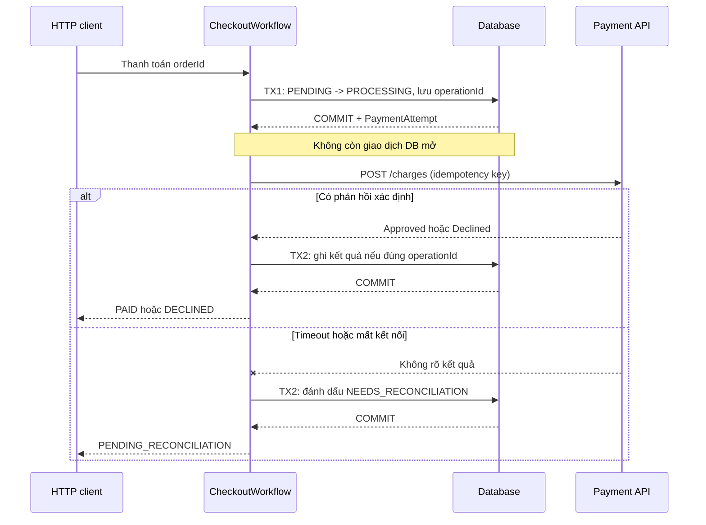
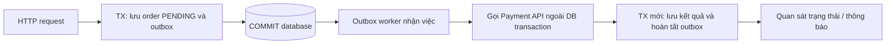
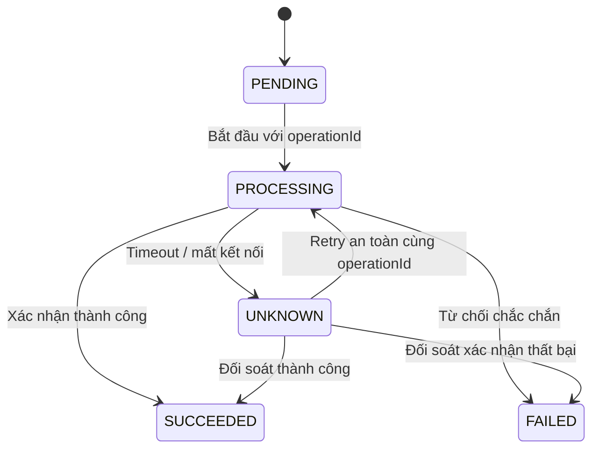

# Không giữ giao dịch cơ sở dữ liệu trong lúc chờ dịch vụ bên ngoài

## 1. Vấn đề nằm ở ranh giới giữa cơ sở dữ liệu và mạng

Trong một ứng dụng **Spring Boot Integration**, một luồng nghiệp vụ thường vừa thao tác dữ liệu nội bộ, vừa gọi HTTP API, gửi thông điệp hoặc kết nối với hệ thống bên ngoài. Ví dụ: khi khách hàng thanh toán đơn hàng, ứng dụng cập nhật bảng `orders` trong PostgreSQL và gửi yêu cầu thu tiền tới cổng thanh toán.

Điều cần tránh là mở **giao dịch cơ sở dữ liệu (database transaction)** trước lời gọi qua mạng rồi chỉ `COMMIT` hoặc `ROLLBACK` sau khi nhận phản hồi. Thời gian đáp ứng của hệ thống ngoài không nằm trong sự kiểm soát của cơ sở dữ liệu: nó có thể mất vài chục mili giây, vài giây, hết thời gian chờ, hoặc không phản hồi.

Xét cách viết sau:

```java
@Service
public class CheckoutService {
    private final OrderRepository orders;
    private final PaymentGateway payments;

    public CheckoutService(OrderRepository orders, PaymentGateway payments) {
        this.orders = orders;
        this.payments = payments;
    }

    @Transactional
    public void pay(UUID orderId) {
        Order order = orders.findByIdForUpdate(orderId).orElseThrow();

        // HTTP có thể chậm hoặc timeout, nhưng giao dịch DB vẫn đang mở.
        PaymentResult result = payments.charge(
            order.getPaymentOperationId(), order.getAmount());

        order.applyPaymentResult(result);
    }
}
```

`findByIdForUpdate` ở đây tượng trưng cho truy vấn khóa dòng (`SELECT ... FOR UPDATE`). Khi `payments.charge(...)` đang chờ HTTP, khóa dòng và giao dịch vẫn còn hiệu lực. Với JPA, kết nối JDBC có thể được lấy theo cơ chế lazy acquisition, nhưng **sau khi đã truy vấn cơ sở dữ liệu**, kết nối thường bị giữ cho đến khi giao dịch kết thúc. Thực tế giữ kết nối và thời điểm phát câu SQL phụ thuộc JPA provider, JDBC driver, transaction manager và cấu hình; không nên suy diễn rằng mọi `@Transactional` đều chiếm một connection ngay khi bắt đầu.

```mermaid
sequenceDiagram
    participant C as HTTP client
    participant S as CheckoutService
    participant DB as Cơ sở dữ liệu
    participant P as Payment API
    C->>S: POST /orders/{id}/pay
    S->>DB: BEGIN; SELECT ... FOR UPDATE
    DB-->>S: Đơn hàng, khóa dòng còn giữ
    S->>P: POST /charges
    Note over S,DB: DB transaction vẫn mở trong khi chờ mạng
    P-->>S: 200 OK (sau 3 giây)
    S->>DB: UPDATE orders; COMMIT
    S-->>C: Kết quả
```

### Hệ quả thực tế

| Hệ quả | Vì sao xảy ra | Biểu hiện thường gặp |
| --- | --- | --- |
| Khóa dữ liệu kéo dài | Dòng đã khóa không được giải phóng trong lúc chờ HTTP | Cập nhật cùng đơn hàng bị chặn; tăng lock wait hoặc deadlock |
| Cạn kết nối pool | Giao dịch đã dùng JDBC connection còn chờ kết thúc | `HikariPool` hết connection; request khác timeout khi lấy connection |
| Giảm thông lượng | Mỗi request chậm làm tăng số giao dịch đang mở đồng thời | P95/P99 tăng, throughput giảm dù truy vấn SQL đơn giản |
| Khó phục hồi | HTTP có thể thành công dù ứng dụng gặp lỗi sau đó | Cổng thanh toán đã trừ tiền nhưng DB ghi nhận thất bại |
| Hiệu ứng dây chuyền | Tài nguyên DB bị giữ trong lúc upstream/downstream trục trặc | Một API ngoài lỗi làm ảnh hưởng các chức năng không liên quan |

Ví dụ minh họa: nếu một luồng cần 20 ms thao tác DB nhưng thêm 3 giây chờ API bên ngoài **trong cùng giao dịch**, thời gian giữ tài nguyên giao dịch có thể lớn hơn rất nhiều so với lượng công việc SQL thực tế. Khi lượng yêu cầu đồng thời tăng, áp lực lên pool và khóa tăng theo. Đây là vấn đề thiết kế ranh giới giao dịch, không chỉ là vấn đề tối ưu truy vấn.

## 2. `@Transactional` không làm HTTP trở thành một phần của giao dịch ACID

`@Transactional` của Spring thường quản lý giao dịch thông qua một `PlatformTransactionManager`, chẳng hạn `JpaTransactionManager` hay `DataSourceTransactionManager`. Nó điều phối tài nguyên mà transaction manager đó quản lý: lệnh SQL và trạng thái dữ liệu trong cơ sở dữ liệu tương ứng. Một HTTP API thông thường **không tham gia giao dịch này**.

Giả sử hệ thống làm theo thứ tự:

1. `BEGIN` và cập nhật `orders`.
2. Gọi `POST /charges`, cổng thanh toán đã thu tiền.
3. `orders.save(...)` hoặc `COMMIT` gặp lỗi do database unavailable, unique constraint hay deadlock.
4. Giao dịch DB rollback; **yêu cầu thu tiền không tự rollback**.

Ngay cả khi HTTP call diễn ra bên trong một phương thức `@Transactional`, annotation đó không biến lời gọi HTTP thành một giao dịch phân tán. Với giao thức và hệ thống đặc thù có cơ chế transaction coordinator riêng thì thiết kế có thể khác, nhưng không được mặc định HTTP thông thường có khả năng commit/rollback chung với DB.

Hai loại timeout cũng khác nhau:

- `@Transactional(timeout = ...)` là giới hạn liên quan đến transaction do Spring quản lý; mức độ áp dụng và thời điểm hủy phụ thuộc transaction manager và thao tác đang thực hiện. **Nó không thay thế** connect timeout/response timeout của HTTP client.
- Connect timeout, read/response timeout và giới hạn retry của HTTP client bảo vệ lời gọi mạng, nhưng **không tự kết thúc** giao dịch DB một cách an toàn nếu ta thiết kế ranh giới sai.

Một lưu ý quan trọng: **HTTP timeout không có nghĩa là hệ thống ngoài chưa thực hiện thao tác**. Yêu cầu có thể đã đến nơi và thành công, nhưng phản hồi bị mất. Đặc biệt với thanh toán, tạo vận đơn hay phát hành tài liệu, phải coi kết quả kiểu này là *chưa xác định* cho đến khi đối soát được.

## 3. Nguyên tắc chia ranh giới giao dịch

Thực hiện các bước liên quan đến database trong những giao dịch **ngắn, rõ phạm vi**, và thực hiện lời gọi tới hệ thống ngoài **sau khi giao dịch trước đã hoàn tất** hoặc trước khi bắt đầu giao dịch tiếp theo.

```text
Không nên:
  BEGIN DB -> đọc/khóa -> gọi HTTP (chờ mạng) -> cập nhật -> COMMIT

Nên:
  BEGIN DB -> ghi trạng thái PENDING + operationId -> COMMIT
  gọi HTTP với operationId (không mở DB transaction)
  BEGIN DB -> ghi kết quả có kiểm tra trạng thái -> COMMIT
```

Các lựa chọn phụ thuộc vào yêu cầu nghiệp vụ:

| Tình huống | Cách tổ chức | Điều bắt buộc cân nhắc |
| --- | --- | --- |
| Chỉ gọi API đọc dữ liệu để bổ sung thông tin | Gọi API ngoài trước; sau đó mở giao dịch DB ngắn để ghi | Dữ liệu đọc có thể đổi trong khoảng giữa; kiểm tra phiên bản/điều kiện khi ghi |
| Người dùng cần phản hồi trong cùng HTTP request | Tách phương thức điều phối (không `@Transactional`) và các phương thức DB ngắn | Idempotency, trạng thái trung gian, timeout và đối soát |
| Công việc ngoài có thể xử lý bất đồng bộ và cần bền vững khi crash | Ghi nghiệp vụ + **transactional outbox** trong cùng transaction; worker xử lý sau | At-least-once, idempotent consumer, retry, dead-letter, quan sát tiến độ |
| Quy trình đi qua nhiều dịch vụ và phải hoàn tác bước nghiệp vụ | **Saga** với trạng thái và hành động bù trừ | Compensation là hành động mới; có thể thất bại và phải retry |

Tách giao dịch không xóa bỏ mọi lỗi nhất quán. Nó giúp DB không phải chờ hệ thống ngoài và **buộc thiết kế phải biểu diễn rõ** trường hợp mỗi bước thành công/thất bại độc lập.

## 4. Ví dụ đồng bộ: hai giao dịch DB ngắn quanh lời gọi thanh toán

Trong ví dụ dưới đây, cổng thanh toán hỗ trợ **idempotency key**: nhiều request có cùng khóa nghiệp vụ được xử lý như một thao tác thanh toán, theo hợp đồng cụ thể của nhà cung cấp. Một đơn hàng có `paymentOperationId` được lưu cố định cho lần thanh toán đó; không tạo khóa mới trong mỗi lần retry.

Phân vai như sau:

- `CheckoutWorkflow` điều phối chuỗi thao tác, **không có `@Transactional` trên phương thức tổng**.
- `OrderTransactions` là **Spring bean khác**, chứa những bước ghi DB ngắn, có `@Transactional`.
- `PaymentGateway` dùng HTTP client, gọi sau khi `startPayment` đã trả về và transaction đầu tiên đã commit.

```java
@Service
public class CheckoutWorkflow {
    private final OrderTransactions orderTransactions;
    private final PaymentGateway paymentGateway;

    public CheckoutWorkflow(OrderTransactions orderTransactions,
                            PaymentGateway paymentGateway) {
        this.orderTransactions = orderTransactions;
        this.paymentGateway = paymentGateway;
    }

    // Không mở DB transaction bao quanh toàn bộ workflow.
    public CheckoutOutcome pay(UUID orderId) {
        PaymentAttempt attempt = orderTransactions.startPayment(orderId);
        // Transaction #1 đã COMMIT trước dòng dưới.

        PaymentResult result;
        try {
            result = paymentGateway.charge(
                attempt.operationId(), attempt.amount());
        } catch (GatewayOutcomeUnknownException ex) {
            // Timeout/mất kết nối: không khẳng định là bị từ chối.
            orderTransactions.markPendingReconciliation(
                attempt.orderId(), attempt.operationId());
            return CheckoutOutcome.PENDING_RECONCILIATION;
        }

        // Transaction #2: áp dụng phản hồi sau khi đã thoát lời gọi mạng.
        orderTransactions.recordPaymentResult(
            attempt.orderId(), attempt.operationId(), result);
        return result.approved()
            ? CheckoutOutcome.PAID
            : CheckoutOutcome.DECLINED;
    }
}
```

```java
@Service
public class OrderTransactions {
    private final OrderRepository orders;

    public OrderTransactions(OrderRepository orders) {
        this.orders = orders;
    }

    @Transactional
    public PaymentAttempt startPayment(UUID orderId) {
        Order order = orders.findById(orderId).orElseThrow();
        order.startPaymentIfAllowed(); // PENDING -> PROCESSING, tạo/giữ operationId
        return new PaymentAttempt(order.getId(),
            order.getPaymentOperationId(), order.getAmount());
    }

    @Transactional
    public void recordPaymentResult(UUID orderId, UUID operationId,
                                    PaymentResult result) {
        Order order = orders.findById(orderId).orElseThrow();
        order.applyPaymentResultIfCurrent(operationId, result);
    }

    @Transactional
    public void markPendingReconciliation(UUID orderId, UUID operationId) {
        Order order = orders.findById(orderId).orElseThrow();
        order.markUnknownIfCurrent(operationId);
    }
}
```

Đoạn mã minh họa ranh giới transaction; `Order`, `PaymentAttempt`, `PaymentResult`, `CheckoutOutcome`, `PaymentGateway` và exception là các kiểu nghiệp vụ của ứng dụng. Các phương thức `...IfCurrent` phải kiểm tra **cùng operationId và trạng thái hiện tại** để tránh cập nhật trễ ghi đè kết quả mới. Với nhiều request đồng thời, `startPaymentIfAllowed` còn cần bảo vệ bằng `@Version` (optimistic locking), một câu `UPDATE ... WHERE status = 'PENDING'` kiểm tra số dòng cập nhật, hoặc khóa DB **chỉ trong giao dịch ngắn**.

### Dòng thời gian đúng



**Các khoảng hở cần giải quyết trước khi đưa vào production:**

1. **Crash sau transaction #1, trước khi gọi HTTP:** đơn hàng ở `PROCESSING` nhưng thực tế chưa gửi thanh toán. Một job phải rà soát những bản ghi quá hạn để khôi phục hoặc xử lý lại cùng `operationId`.
2. **Crash sau khi HTTP thành công, trước transaction #2:** cổng thanh toán đã thu tiền nhưng DB còn `PROCESSING`. Đối soát theo `operationId`, sau đó ghi kết quả trong transaction mới.
3. **Lỗi sau khi transaction #2 commit, trước khi HTTP response tới client:** client có thể retry. Endpoint cần trả kết quả hiện có hoặc tiếp tục theo cùng khóa idempotency; không được tạo lần thu tiền mới vô điều kiện.
4. **Hai request cùng thanh toán một đơn hàng:** đảm bảo chỉ một luồng có quyền khởi động thao tác mới; thao tác đến sau phải nhận trạng thái đang xử lý hoặc kết quả đã có.
5. **Phản hồi đến muộn sau khi đã đối soát:** chỉ áp dụng thay đổi nếu `operationId` tương ứng và chuyển trạng thái hợp lệ. Tránh chuyển `PAID` ngược về `UNKNOWN` do lỗi xử lý đua.

Nếu người dùng không cần biết kết quả ngay, không cần giữ luồng HTTP của họ chờ cổng thanh toán: trả `202 Accepted` cùng mã theo dõi, và để một worker tiếp tục quy trình. Tuy nhiên việc chỉ gọi `@Async` không tự bảo đảm công việc sống sót sau khi tiến trình chết; cần một hàng đợi bền vững hoặc outbox cho yêu cầu tin cậy cao.

## 5. Ví dụ bền vững hơn: transaction ngắn + transactional outbox

**Transactional outbox** giải quyết khoảng hở nguy hiểm giữa việc ghi nghiệp vụ vào DB và việc phát yêu cầu cho hệ thống ngoài. Trong **cùng một giao dịch DB ngắn**, ghi cả trạng thái đơn hàng và một hàng outbox yêu cầu xử lý. Khi `COMMIT` thành công, hai bản ghi cùng tồn tại. Worker đọc outbox sau đó mới gọi API/broker.

```java
@Service
public class OrderApplicationService {
    private final OrderRepository orders;
    private final OutboxRepository outbox;

    public OrderApplicationService(OrderRepository orders,
                                   OutboxRepository outbox) {
        this.orders = orders;
        this.outbox = outbox;
    }

    @Transactional
    public UUID submitOrder(CreateOrderCommand command) {
        Order order = Order.pendingPayment(command);
        orders.save(order);

        // Cùng local DB transaction, tuyệt đối chưa gọi HTTP ở đây.
        outbox.save(OutboxEvent.paymentRequested(
            order.getId(), order.getPaymentOperationId()));

        return order.getId();
    }
}
```

Sơ đồ luồng xử lý:



Trong triển khai thực tế, worker cần:

- **Claim công việc trong transaction ngắn**, có cơ chế lease, `SKIP LOCKED` (nếu DB hỗ trợ) hoặc cách đồng bộ tương đương. Nhả transaction trước khi gọi HTTP; không giữ `SELECT FOR UPDATE` xuyên qua network call.
- Dùng `eventId` để nhận diện bản ghi outbox và `operationId` ổn định để gọi cổng thanh toán. Nếu phát qua Kafka/RabbitMQ, message nên mang các ID này để consumer khử trùng lặp.
- Sau khi nhận kết quả xác định, **mở transaction mới** cập nhật trạng thái đơn hàng và trạng thái xử lý outbox. Với timeout, ghi trạng thái `UNKNOWN`/cần đối soát và lập lịch kiểm tra lại.
- Nếu worker crash sau khi đã gọi bên ngoài nhưng trước khi đánh dấu hoàn tất, sự kiện có thể được xử lý lại. Vì vậy **outbox đảm bảo dữ liệu yêu cầu không bị mất khi transaction commit, không tự đảm bảo exactly-once side effect**. Khóa idempotency ở dịch vụ ngoài và consumer idempotent là phần bắt buộc của thiết kế.
- Có retry có giới hạn và backoff, ngăn công việc lỗi lâu dài kẹt hàng đợi; đưa sang dead-letter/trạng thái cần xử lý thủ công khi cần. Nếu nhà cung cấp không hỗ trợ idempotency, ưu tiên tra cứu trạng thái trước khi thử thao tác lại.

Không nên coi `@TransactionalEventListener(phase = AFTER_COMMIT)` hoặc một callback chạy sau commit trong bộ nhớ là hàng đợi bền vững. Callback có thể không chạy khi ứng dụng crash ngay sau khi DB commit. Nó có thể dùng để **đánh thức worker** nhằm giảm độ trễ; bản ghi outbox trong DB mới là nguồn sự thật để khôi phục công việc.

## 6. Nhất quán dữ liệu khi không thể commit hai hệ thống cùng lúc

Khi DB và API ngoài không cùng một transaction, ta thường chọn **eventual consistency**: hệ thống có thể tạm thời có `PENDING`, `PROCESSING`, `UNKNOWN`, sau đó hội tụ về `SUCCEEDED` hoặc `FAILED` khi nhận được kết quả chắc chắn. Cần thiết kế chuyển trạng thái như một phần của hợp đồng nghiệp vụ.

Ví dụ một máy trạng thái đơn giản:



Không phải mọi `5xx`, `IOException` hay timeout đều được chuyển ngay sang `FAILED`. Một kết quả `DECLINED` có mã lý do rõ ràng từ nhà cung cấp có thể là thất bại xác định; một response mất giữa đường thường là `UNKNOWN`.

Nếu luồng gồm nhiều bước như *giữ hàng → thu tiền → đặt giao vận*, có thể áp dụng **Saga**: mỗi bước commit riêng, ghi tiến độ bền vững, và khi một bước không thành công thì thực hiện hành động bù trừ phù hợp. Chẳng hạn, sau khi thu tiền nhưng không tạo được vận đơn, dịch vụ có thể yêu cầu hoàn tiền. **Hoàn tiền là một thao tác nghiệp vụ mới**, có thể thất bại hoặc diễn ra chậm; nó không giống `ROLLBACK` SQL.

Với dữ liệu có tranh chấp, cần chọn chiến lược kiểm soát đồng thời khi qua ranh giới HTTP:

- **Optimistic locking** (`@Version`) hoặc cập nhật điều kiện `UPDATE ... WHERE id=? AND version=?` để phát hiện dữ liệu đã thay đổi.
- **State transition có điều kiện** để một kết quả cũ không ghi đè kết quả mới; đặt unique constraint cho `(provider, operation_id)` nếu thích hợp.
- **Trạng thái giữ chỗ có thời hạn** nếu tài nguyên cần tạm giữ trước khi gọi dịch vụ; có quy trình giải phóng hoặc gia hạn khi quá hạn.
- **Không truyền JPA entity managed** từ transaction đã kết thúc cho HTTP/worker rồi ngầm giả định nó vẫn được theo dõi; truyền DTO bất biến chứa `id`, version, dữ liệu cần thiết và nạp lại trong transaction mới.

## 7. Những cách sửa tưởng đúng nhưng vẫn giữ giao dịch dài

| Cách làm | Vấn đề |
| --- | --- |
| Thêm `@Transactional(readOnly = true)` vào phương thức có HTTP call | `readOnly` không đóng giao dịch trước lời gọi mạng và không bảo đảm không giữ connection |
| Đặt `@Transactional(propagation = REQUIRES_NEW)` lên helper rồi gọi HTTP khi method cha vẫn có `@Transactional` | Transaction cha có thể vẫn đang mở/treo trong thời gian chờ; thêm transaction con không làm HTTP nằm ngoài vòng đời transaction cha |
| Gọi một phương thức `@Transactional` khác bằng `this.method()` | Với proxy-based transaction mặc định, self-invocation thường bỏ qua interceptor; ranh giới giao dịch mong đợi có thể không được tạo |
| Chỉ tăng kích thước HikariCP pool | Trì hoãn tình trạng cạn pool, nhưng khóa kéo dài, tài nguyên bị chiếm và lỗi nhất quán vẫn tồn tại |
| Retry `POST /charges` bằng operation ID mới sau timeout | Có nguy cơ thu tiền nhiều lần nếu request trước đã thành công |
| Gửi Kafka/publish event giữa lúc transaction DB chưa commit | Consumer có thể thấy sự kiện cho dữ liệu còn chưa commit; DB rollback vẫn không thu hồi được message đã phát |
| Dùng `@Async` để gọi ngoài nhưng không lưu trạng thái bền vững | Crash/restart có thể làm mất tác vụ đang nằm trong bộ nhớ |

Trong mô hình Spring proxy, hãy đặt các bước transaction trong một bean khác như `OrderTransactions`, hoặc dùng `TransactionTemplate` tạo phạm vi transaction tường minh. Đảm bảo transaction **đã kết thúc** trước khi lời gọi HTTP bắt đầu. Nếu cần kiểm chứng, bật log transaction trong môi trường kiểm thử và đối chiếu thời điểm commit với outbound HTTP span.

## 8. Cấu hình, vận hành và kiểm thử

### Giới hạn thời gian và số lần thử ở ranh giới mạng

HTTP client (`RestClient`, `WebClient` hoặc client khác) cần cấu hình connection timeout và response/read timeout theo SLA của dịch vụ ngoài; thiết lập số lần retry, backoff và giới hạn đồng thời phù hợp. Riêng thao tác có side effect, chỉ retry tự động khi có **idempotency key** hoặc quy trình xác minh đã an toàn. Một circuit breaker/bulkhead giúp ngăn downstream quá tải làm nghẽn upstream, nhưng không thay thế chia nhỏ ranh giới transaction.

Không có một giá trị timeout tối ưu chung: nó phụ thuộc P95/P99 thật, thời gian xử lý được nhà cung cấp cam kết và ngân sách thời gian của endpoint. Đặt transaction DB timeout độc lập để chặn các thao tác SQL quá lâu; không dùng timeout DB để kiểm soát việc gọi HTTP.

### Quan sát đúng chỗ

Nên theo dõi cùng một `traceId`, `orderId` và `operationId` (hạn chế đưa dữ liệu nhạy cảm vào log):

| Chỉ số / dấu vết | Diễn giải |
| --- | --- |
| Thời lượng transaction DB, lock wait, deadlock | Phát hiện giao dịch mở lâu hoặc bị cạnh tranh dữ liệu |
| HikariCP active/idle/pending connections và thời gian chờ pool | Phát hiện áp lực kết nối và các request chiếm connection quá lâu |
| HTTP latency, timeout, lỗi 4xx/5xx theo downstream | Phân biệt chậm ở mạng/dịch vụ ngoài với chậm ở SQL |
| Số bản ghi `PROCESSING`/`UNKNOWN` quá hạn, tuổi outbox, số lần retry | Phát hiện việc chưa hoàn tất hoặc bị kẹt giữa các bước |
| Số kết quả trùng lặp được bỏ qua và số lần đối soát | Kiểm tra idempotency và khả năng khôi phục trong thực tế |

### Các ca kiểm thử có giá trị

1. **HTTP chậm:** mock payment API giữ request vài giây. Trong thời gian đó, xác nhận luồng điều phối không còn transaction DB đang mở và một cập nhật DB độc lập không bị chặn bởi khóa của luồng thanh toán.
2. **HTTP thành công, DB cập nhật kết quả thất bại:** giả lập lỗi commit; sau khởi động lại, job đối soát phải ghi nhận chính xác khoản thanh toán đã thực hiện, không gửi khoản thu mới.
3. **HTTP timeout nhưng downstream đã xử lý:** lặp request với cùng idempotency key hoặc tra cứu trạng thái; bảo đảm chỉ có một side effect.
4. **Hai yêu cầu đồng thời cùng orderId:** chỉ một thao tác đi qua bước chuyển `PENDING -> PROCESSING`; kết quả trễ không ghi đè trạng thái cuối.
5. **Worker crash sau publish/gọi API:** xử lý lại outbox/message không tạo side effect trùng và cuối cùng đạt trạng thái nhất quán.

Testcontainers giúp chạy kiểm thử tích hợp trên DB thật để quan sát commit, unique constraint, lock và optimistic locking; WireMock hoặc HTTP test server giúp điều khiển timeout, lỗi mạng và phản hồi muộn. Với JPA, nên chủ động `flush`/commit trong kịch bản thử lỗi, vì `save(...)` không nhất thiết thực thi SQL ngay.

## 9. Checklist khi thiết kế một luồng tích hợp mới

- Xác định những đoạn **bắt buộc cần ACID trong cùng một database** và đóng transaction ngay sau những đoạn đó.
- Không đặt HTTP call, broker publish, email hoặc thao tác I/O có độ trễ không kiểm soát trong transaction DB.
- Xác định trạng thái trung gian và khóa nghiệp vụ cố định (`operationId`/idempotency key) trước khi gọi hệ thống ngoài.
- Phân biệt kết quả thất bại **xác định** với kết quả **chưa biết** do timeout hoặc mất kết nối.
- Dùng outbox/queue bền vững khi tác vụ phải tiếp tục được sau crash; chấp nhận khả năng xử lý lặp và khử trùng lặp ở nơi có side effect.
- Dùng version hoặc chuyển trạng thái có điều kiện để tránh tranh chấp và cập nhật kết quả đến muộn.
- Có cơ chế đối soát, retry an toàn, cảnh báo các thao tác quá hạn và kiểm thử các thời điểm crash quanh từng `COMMIT`.

**Quy tắc thực hành:** hãy để DB transaction bảo vệ một tập thay đổi dữ liệu cục bộ thật ngắn. Mọi lời gọi sang hệ thống ngoài cần được coi là một bước độc lập có thể chậm, thất bại, thành công nhưng mất phản hồi, hoặc bị thực thi lặp. Thiết kế theo các khả năng đó mới giúp Spring Boot Integration ổn định khi tích hợp HTTP, cơ sở dữ liệu, cache, broker thông điệp và các adapter của Spring Integration trong môi trường thực tế.
