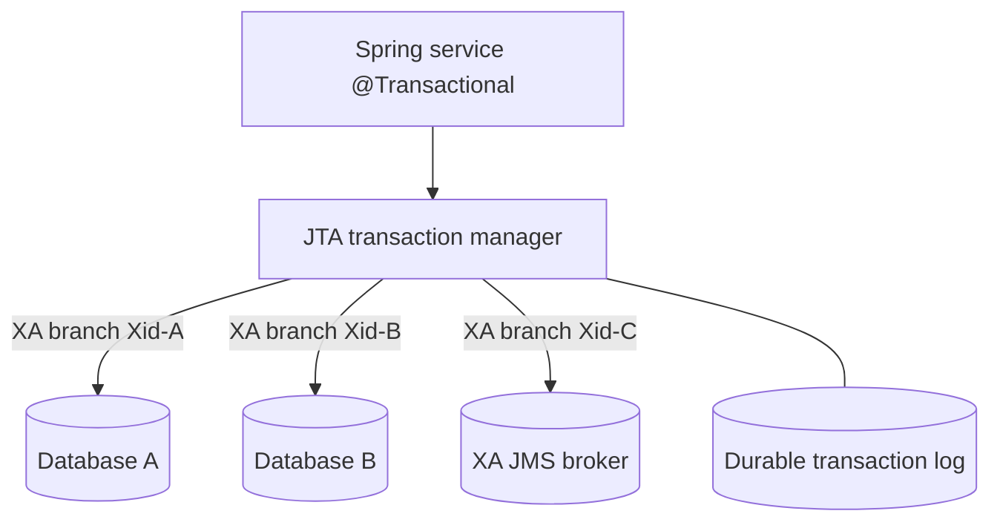
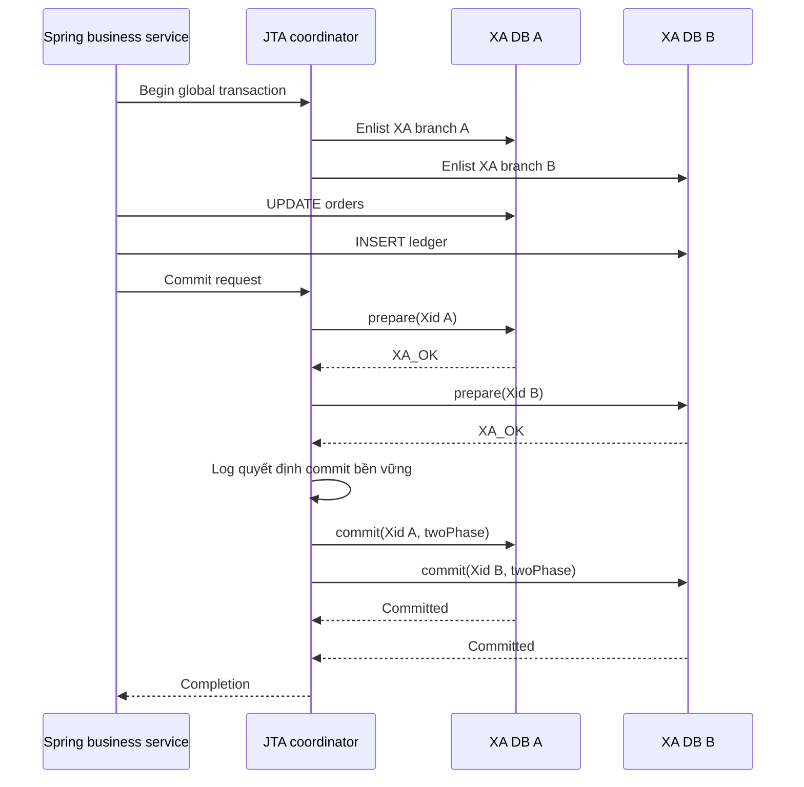
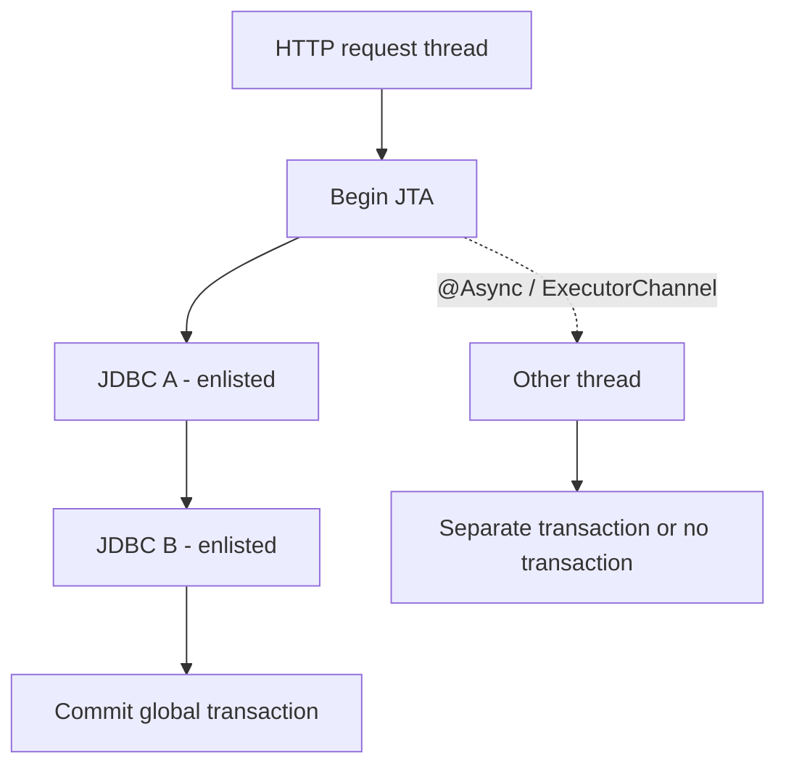
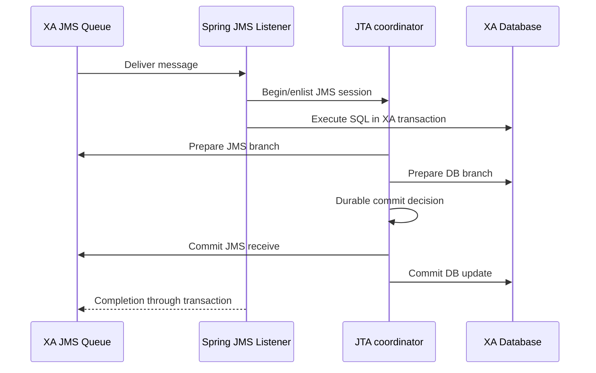
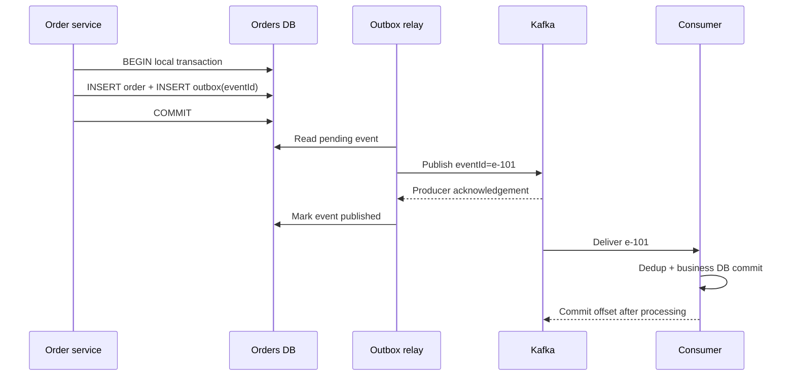
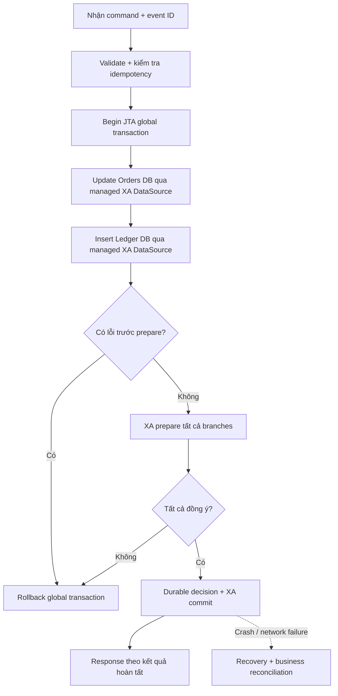

# JTA, XA và điều kiện cần để phối hợp nhiều tài nguyên

Trong một ứng dụng Spring Boot, `@Transactional` có thể giúp một thao tác trên cơ sở dữ liệu được commit hoặc rollback nhất quán. Nhưng điều gì xảy ra nếu **cùng một yêu cầu** phải cập nhật hai cơ sở dữ liệu độc lập, hoặc vừa ghi DB vừa xác nhận nhận một thông điệp JMS? Hai thay đổi ấy không tự trở thành một giao dịch chỉ vì cùng nằm trong một phương thức Java.

**JTA (Jakarta Transactions)** định nghĩa API và ngữ nghĩa điều phối giao dịch; **XA** là giao thức để các *resource manager* (ví dụ DB hoặc JMS broker hỗ trợ XA) tham gia vào một giao dịch phân tán, thường theo quy trình **two-phase commit (2PC)**. Việc dùng JTA/XA đòi hỏi nhiều điều kiện về tài nguyên, trình điều khiển, pool kết nối, transaction manager, luồng thực thi và phục hồi sau sự cố. Đây là chủ đề của chương **Giao dịch tích hợp** trong mô-đun `SPRING_BOOT_INTEGRATION`: phối hợp HTTP client, cơ sở dữ liệu, cache, broker thông điệp và Spring Integration theo mức nhất quán đúng với từng hệ thống.

Bài này giúp trả lời ba câu hỏi thực tế: **khi nào cần giao dịch phân tán**, **điều kiện nào mới cho phép phối hợp bằng JTA/XA**, và **khi nào nên chọn outbox, idempotency hoặc saga thay thế**.

## 1. Từ giao dịch cục bộ đến nhiều tài nguyên

Một transaction cục bộ thường có một resource manager: ví dụ một `DataSource` kết nối PostgreSQL. Spring `DataSourceTransactionManager` (hoặc `JdbcTransactionManager` tùy cấu hình) điều khiển commit/rollback của kết nối JDBC gắn với thread; `JpaTransactionManager` điều khiển giao dịch JPA tương ứng. Chúng **không tự điều phối nhiều hệ thống độc lập**.

Giả sử service chuyển trạng thái đơn hàng ở DB A và tạo bút toán ở DB B:

```java
public void completeOrder(String orderId) {
    orderRepository.markCompleted(orderId); // DB A
    ledgerRepository.insertEntry(orderId);  // DB B
}
```

Nếu DB A đã commit và DB B lỗi, ứng dụng có thể để lại đơn hàng hoàn tất nhưng thiếu bút toán. Ngay cả khi thêm `@Transactional`, kết quả vẫn phụ thuộc **transaction manager nào được chọn** và hai resource có thực sự được enlist vào cùng global transaction hay không.

| Trường hợp | Transaction thường đủ | Vấn đề cần giải quyết |
| --- | --- | --- |
| Nhiều bảng trong cùng một database, cùng transaction manager | Giao dịch DB cục bộ | Chọn isolation, khóa, constraint, rollback |
| Hai database vật lý độc lập, cần cùng commit/rollback | JTA/XA **nếu cả hai hỗ trợ và được cấu hình đúng** | 2PC, recovery, điều phối toàn cục |
| Database và JMS broker đều hỗ trợ XA | Có thể dùng JTA/XA khi enlist được cả hai | Không commit DB nhưng mất ack/gửi JMS |
| Database và HTTP API bên ngoài | Không thể mặc định đưa HTTP request vào XA | Outbox, idempotency, saga/compensation |
| Database và Kafka | Kafka transaction không mặc nhiên là một `XAResource` trong JTA | Outbox/CDC và consumer idempotency hoặc chiến lược tích hợp cụ thể |
| Database và Redis cache | Redis thông thường không tham gia JTA/XA | Cache-aside, invalidation sau commit, retry |
| Nhiều service có database riêng | Thường không có transaction chung xuyên service | Eventual consistency, saga, quy trình đối soát |

Phân biệt **nhiều connection** với **nhiều resource manager**: hai `DataSource` trỏ đến cùng DB chưa chắc cần XA, nhưng nếu cần bảo đảm atomicity trên hai kết nối/transaction độc lập thì phải xét khả năng dùng một transaction cục bộ thực sự hoặc điều phối có hỗ trợ. Đồng thời, XA không giúp loại bỏ các vấn đề về isolation giữa các resource manager hay làm cho mọi dịch vụ bên ngoài cùng khóa dữ liệu.

## 2. Phân biệt JTA, XA và transaction manager

| Thành phần | Vai trò | Ví dụ |
| --- | --- | --- |
| **JTA API** | Hợp đồng bắt đầu, kết thúc, lấy trạng thái và liên kết transaction với luồng xử lý | `jakarta.transaction.UserTransaction`, `TransactionManager`, `TransactionSynchronizationRegistry` |
| **XA protocol** | Hợp đồng để transaction coordinator yêu cầu resource manager start/end, prepare, commit, rollback, recover | `javax.transaction.xa.XAResource`, `Xid` ở tầng Java XA |
| **Transaction coordinator / JTA implementation** | Quản lý global transaction, Xid, 2PC, log và recovery | Narayana, Atomikos hoặc implementation phù hợp môi trường |
| **XA-capable resource manager** | Thực thi transaction branch, chuẩn bị và lưu trạng thái để recovery | DB hỗ trợ XA/2PC, JMS provider hỗ trợ XA |
| **XA-aware connection pool / wrapper** | Cấp kết nối, kết nối `XAResource` vào JTA transaction hiện tại | XA-managed `DataSource` hoặc `XAConnectionFactory` với adapter phù hợp |
| **Spring transaction abstraction** | Chọn transaction manager và áp dụng `@Transactional` vào business method | `PlatformTransactionManager`, `JtaTransactionManager` |

**JTA là API, không phải tự thân một coordinator có recovery.** Thêm dependency `jakarta.transaction-api` không làm Spring Boot có sẵn log giao dịch phân tán, pool XA hoặc cơ chế phục hồi. Phải chọn một implementation được duy trì và cấu hình đúng phiên bản Spring Boot/Jakarta đang sử dụng.

Một điểm dễ nhầm trong tên package: các API **Jakarta Transactions** của ứng dụng nằm trong namespace `jakarta.transaction` ở thế hệ Jakarta mới, còn giao diện **Java XA** của driver được định nghĩa bởi `javax.transaction.xa.XAResource` và `javax.transaction.xa.Xid`. Đừng đổi tên package XA sang `jakarta.transaction.xa` khi viết code chỉ vì các annotation JTA khác đã dùng `jakarta`.

### 2.1. Global transaction, branch và Xid

Một *global transaction* có thể trải trên nhiều nhánh (*branch*) ở từng resource manager. XA định danh transaction bằng `Xid` gồm format ID, global transaction ID và branch qualifier. Coordinator gán/ghi nhận các định danh này để biết nhánh nào thuộc giao dịch nào và phục hồi khi mất kết nối.



Không phải mọi connection tham gia cùng một global transaction đều có branch qualifier giống nhau. Một resource manager có thể tối ưu hoặc ghép nhánh theo cách nó hỗ trợ, nhưng **application không tự tính hay tái sử dụng Xid**; đó là trách nhiệm của transaction manager và các adapter.

### 2.2. `@Transactional` không chỉ có một cách hoạt động

Trong Spring:

- `@Transactional` của Spring (`org.springframework.transaction.annotation.Transactional`) sử dụng transaction manager do Spring chọn. Nó có thể điều khiển local transaction hoặc JTA, tùy bean/config.
- `jakarta.transaction.Transactional` là annotation giao dịch theo JTA; môi trường Spring có thể hỗ trợ diễn giải nhưng cách chọn manager và các thuộc tính khác nhau.
- `@Transactional(transactionManager = "jtaTransactionManager")` của Spring có thể chỉ định bean điều phối JTA; riêng annotation **không biến** một `DataSource` thường thành XA resource.
- Transaction interceptor thông thường dựa vào Spring proxy: gọi nội bộ `this.method()` không đi qua proxy, method không được intercept theo cách mong đợi. Tự tạo thread, `@Async`, reactive/async boundary hoặc gửi message qua queue cũng không tự truyền transaction context.

Spring `JtaTransactionManager` đóng vai trò cầu nối giữa transaction abstraction của Spring và JTA runtime. Coordinator thực sự chịu trách nhiệm enlist/2PC/recovery; Spring chỉ dùng chúng theo cấu hình có hiệu lực.

## 3. Two-phase commit (2PC) hoạt động ra sao?

Với **hai hoặc nhiều XA branch thực sự**, transaction coordinator thường dùng hai giai đoạn: **prepare (vote)** và **commit/rollback (decision)**. Một resource manager phải có khả năng giữ trạng thái giao dịch đã chuẩn bị cho đến khi nhận quyết định cuối cùng, kể cả khi coordinator vừa restart.



Các giai đoạn ở mức ý tưởng:

1. **Begin / enlistment:** mở global transaction; các XA-aware connection được đưa vào transaction và resource manager nhận branch liên quan.
2. **Business work:** SQL hoặc JMS operations diễn ra trong transaction nhưng chưa được commit độc lập.
3. **Prepare:** coordinator hỏi mỗi participant có thể cam kết giữ khả năng commit/rollback không. Participant trả trạng thái đồng ý, read-only hoặc lỗi. Nếu không phải tất cả đều đồng ý, coordinator quyết định rollback các branch liên quan.
4. **Durable decision:** khi đủ điều kiện commit, coordinator lưu thông tin cần thiết để có thể phục hồi quyết định sau crash.
5. **Second phase:** coordinator gửi commit cho các participant đã prepare; ghi nhận kết quả, dọn log khi hoàn tất theo quy tắc implementation.

Nếu chỉ có **một XA resource** thực sự được enlist, coordinator có thể áp dụng *one-phase optimization* (commit một pha). Vì vậy không phải mọi `@Transactional` dùng `JtaTransactionManager` đều thực hiện 2PC.

### 3.1. 2PC xử lý gì và không xử lý gì?

2PC nhằm đạt **atomic commit** giữa các tài nguyên tham gia đúng XA protocol: không chấp nhận một participant âm thầm commit riêng khi toàn bộ global transaction cần rollback. Nó không tự cấp những bảo đảm sau:

- Không bảo đảm mọi API HTTP, Redis, email, Kafka producer, filesystem hoặc client khác có thể tham gia XA.
- Không bảo đảm isolation thống nhất xuyên các DB có mức isolation khác nhau. Mỗi DB vẫn phải chọn isolation và constraint phù hợp.
- Không tự biến retry HTTP từ client thành một command thực hiện đúng một lần. Client có thể mất response sau khi global transaction đã commit.
- Không giữ hệ thống luôn sẵn sàng khi coordinator/participant mất kết nối. Prepared transaction có thể **giữ lock và chặn tiến độ** để chờ quyết định.
- Không loại trừ mọi kết quả bất thường: lỗi quản trị, thiếu recovery log, heuristic completion hoặc resource manager không tuân thủ có thể làm kết quả không nhất quán.

### 3.2. Điều gì xảy ra khi có lỗi giữa hai giai đoạn?

| Thời điểm lỗi | Trạng thái có thể gặp | Cách khôi phục |
| --- | --- | --- |
| Trước prepare | Transaction chưa có quyết định commit toàn cục | Rollback khi coordinator/tài nguyên xác định transaction thất bại |
| Một participant vote rollback | Không thể commit toàn bộ | Coordinator rollback các branch còn lại |
| Sau khi tất cả prepare, trước khi có quyết định bền vững | Một số participant vẫn giữ prepared branch | Recovery phải xác định quyết định hợp lệ; tuyệt đối tránh xóa đoán các branch |
| Coordinator đã ghi commit, chưa liên hệ hết participants | Một số resource đã commit, resource khác đang prepared/in-doubt | Khởi động coordinator cùng durable log và replay quyết định |
| Network ack của `commit` bị mất | Participant có thể đã commit | Dựa vào recovery và trạng thái XA, không tùy tiện tạo giao dịch nghiệp vụ mới |
| Administrator buộc rollback một prepared branch dù coordinator đã quyết định commit | **Heuristic mixed outcome** có thể xảy ra | Can thiệp và đối soát theo quy trình được kiểm soát |

**In-doubt transaction** là giao dịch đã prepare nhưng resource manager chưa biết hoặc chưa hoàn tất quyết định cuối. Prepared branch có thể giữ row lock, transaction ID hoặc tài nguyên khác trong thời gian dài. Những sự cố này đòi hỏi cơ chế recovery và quan sát, không phải retry business method vô hạn.

### 3.3. Heuristic outcome và giới hạn “atomic”

Resource manager có thể tự quyết định commit/rollback trong tình huống bất thường (ví dụ thao tác thủ công hoặc chính sách timeout), dẫn tới heuristic rollback/commit/mixed/hazard. Trong Java XA, các mã lỗi như `XA_HEURRB`, `XA_HEURCOM`, `XA_HEURMIX`, `XA_HEURHAZ` diễn tả trạng thái cần được xử lý; việc `forget` chỉ làm sạch dấu vết heuristic trong điều kiện phù hợp, **không sửa được dữ liệu không nhất quán**.

Vì vậy, không quảng cáo JTA/XA là bảo đảm tuyệt đối trong mọi loại sự cố và mọi vận hành. Các bảo đảm atomicity dựa trên việc tất cả participant tuân thủ giao thức, coordinator lưu được quyết định, recovery hoạt động và không có hành động heuristic ngoài dự kiến.

## 4. Điều kiện bắt buộc để phối hợp nhiều tài nguyên bằng XA

Chỉ bật `@Transactional` và thêm tên coordinator vào `application.yml` là chưa đủ. Cần kiểm tra **toàn bộ chuỗi**:

| Điều kiện | Câu hỏi phải trả lời |
| --- | --- |
| Resource manager hỗ trợ XA | Database/JMS broker có triển khai XA, transaction prepare và recovery không? Có bật tính năng cần thiết trên server không? |
| Driver/connection factory hỗ trợ XA | Dùng `XADataSource` hoặc `XAConnectionFactory` tương thích phiên bản và giao thức chưa? |
| XA-aware pooling/wrapping | Pool có cấp connection tham gia global transaction, quản lý enlistment và không commit cục bộ ngoài ý muốn không? |
| JTA coordinator thực sự hoạt động | Có runtime transaction manager, cấu hình transaction log và recovery sau restart chưa? |
| Stable resource identity | Mỗi resource có tên/ID đủ ổn định và duy nhất để coordinator tìm lại sau crash không? |
| Cùng một global transaction | Mọi thao tác cần atomicity có thực sự chạy trong cùng JTA context và được enlist không? |
| Không có non-XA side effects chen giữa | Có HTTP, Redis, Kafka, file hoặc mail được gọi trong transaction mà không tham gia XA không? |
| Tính bền vững của coordinator | Transaction log nằm ở storage an toàn và còn sau restart/failover không? |
| Rollback semantics | Exception, timeout, propagation và rollback rules có đúng không? |
| Vận hành và phục hồi | Có giám sát prepared transactions, timeout, heuristic outcome và runbook recovery không? |

### 4.1. Driver hỗ trợ XA chưa đủ

Một driver có class implement `javax.sql.XADataSource` chỉ là **đầu vào**. Trong ứng dụng cần một XA-aware pool/connection manager bọc nó, cung cấp `DataSource` cho Spring Data JDBC/JPA/JdbcTemplate và đăng ký `XAResource` với JTA coordinator đúng thời điểm.

Nếu một repository sử dụng `ordersXaManagedDataSource` còn repository thứ hai trỏ vào `DriverManagerDataSource` hoặc pool thường với local transaction, global transaction sẽ chỉ bảo vệ một phần công việc. Có thể nhìn thấy hai câu SQL đều chạy, nhưng khi rollback sau lỗi, DB B vẫn giữ dữ liệu đã commit.

Không dùng `xaDataSource.getXAConnection().getConnection()` tùy tiện trong business service và tự `commit()`: làm vậy dễ bỏ qua enlistment, connection lifecycle và recovery do JTA adapter chịu trách nhiệm.

### 4.2. Resource identity và log khôi phục

Transaction manager cần biết resource nào đang giữ một `Xid` chưa kết thúc. Tên resource (ví dụ `orders-db`, `ledger-db`) phải bền vững qua restart để coordinator tìm đúng participant. Hai **resource manager vật lý khác nhau** không được cấu hình chung một identity chỉ vì chúng cùng là PostgreSQL; đồng thời cách nhận diện “cùng resource manager” phụ thuộc implementation/pool và cần tuân thủ tài liệu của nó.

Với nhiều instance Spring Boot:

- Mỗi node coordinator cần định danh phù hợp mô hình recovery/cluster của implementation; không để các node vô tình sử dụng cùng identity độc lập.
- Transaction log cần được bảo toàn theo kiến trúc được hỗ trợ; volume tạm bị xóa khi pod restart có thể làm mất quyết định 2PC.
- Resource manager phải giữ được prepared transactions cho đến khi hoàn tất quyết định. Ví dụ PostgreSQL cần hỗ trợ/cấu hình prepared transactions thích hợp cho trường hợp XA/2PC; mặc định/tùy triển khai có thể không cho phép.
- Recovery process phải có quyền kết nối lại tới resource manager, với credential/driver còn dùng được sau rotation.

Không tự xóa prepared transaction hoặc transaction log để “gỡ lock nhanh” trước khi hiểu quyết định toàn cục. Can thiệp thủ công sai lúc có thể biến giao dịch recoverable thành dữ liệu lệch giữa các hệ thống.

### 4.3. Đồng bộ thread và thời hạn

Trong Spring truyền thống, transaction context thường gắn với thread. Một call chain qua `DirectChannel` của Spring Integration có thể tiếp tục trên cùng thread, nhưng `ExecutorChannel`, `@Async`, `CompletableFuture.supplyAsync`, các scheduler khác hoặc consumer broker ở tiến trình khác **không tự được enlist vào transaction của caller**.



Muốn một message broker cùng tham gia XA, endpoint/adapter phải dùng **XA-aware connection và listener/session** được enlist trong transaction thích hợp, không chỉ nằm trong cùng một phương thức Java. Ngay cả khi sender và receiver cùng một service, việc nhận message sau khi broker giao lại là một transaction khác với transaction producer đã hoàn thành.

Timeout JTA phải bao phủ thời gian chờ các participant và chuẩn bị/commit. Đừng giữ global transaction mở trong lúc chờ API HTTP chậm hoặc đợi người dùng xác nhận nhiều phút: prepared transaction và connection/lock gây áp lực lên DB/broker, còn HTTP không thể được rollback tự động.

## 5. Cấu hình Spring Boot: chọn coordinator và XA-aware resources

Một triển khai JTA/XA gồm ít nhất bốn phần:

1. Chọn implementation transaction manager hỗ trợ phiên bản Java, Spring Boot và Jakarta Transactions đang chạy.
2. Khai báo từng XA driver/connection factory và để provider XA-aware tạo **managed** `DataSource` hoặc `ConnectionFactory`.
3. Đảm bảo Spring `PlatformTransactionManager` dùng cầu nối JTA phù hợp, không vô tình chọn transaction manager cục bộ cho service cần giao dịch toàn cục.
4. Cấu hình durable log, recovery, resource name, timeout và health/metrics trước khi chạy production.

Mỗi vendor có tập starter, bean, thuộc tính pool và recovery riêng. **Spring Boot không có một YAML XA chung hoạt động với mọi driver và mọi JTA coordinator.** Vì vậy đoạn sau là *thiết kế cấu hình ứng dụng minh họa*, không phải các property Spring Boot tự nhận:

```yaml
# application.yml — namespace TỰ ĐỊNH NGHĨA, cần code/provider để bind.
integration:
  distributed-transaction:
    coordinator: narayana-or-supported-provider
    timeout: 30s
    recovery-log-location: /var/lib/app-jta-log
    resources:
      orders:
        unique-name: orders-db
        xa-datasource-class: vendor.jdbc.OrdersXADataSource
      ledger:
        unique-name: ledger-db
        xa-datasource-class: vendor.jdbc.LedgerXADataSource
```

Các tên driver giả định trong ví dụ **không phải class có thật**. Khi triển khai, thay bằng driver hỗ trợ XA đúng loại DB, tên thuộc tính của provider thực tế, secret credential và cấu hình server tương ứng. Chỉ tạo thư mục log không đủ: coordinator phải được cấu hình để dùng storage bền vững đó, có quyền đọc/ghi và khả năng phục hồi đúng node.

### 5.1. Sơ đồ cấu hình bean

```text
Orders XADataSource ─┐
                     ├─ XA-aware connection pool / provider ─> managed DataSource A
Ledger XADataSource ─┘                                      └─> managed DataSource B
                                   │
                                   ▼
                    JTA coordinator + durable recovery log
                                   │
                                   ▼
                     Spring JtaTransactionManager
                                   │
                                   ▼
                 @Transactional business service
                    ├── JdbcTemplate A
                    └── JdbcTemplate B
```

Đây là sơ đồ trách nhiệm, không phải quy tắc rằng cả hai XA datasource phải cùng một pool. Mỗi resource thường có pool/adapter riêng nhưng cùng được coordinator nhận diện. `JdbcTemplate` có thể làm việc với managed `DataSource` do provider cấp; nếu ứng dụng dùng JPA, persistence unit, JTA integration và connection provider cũng phải tương thích, tránh dùng nhầm `RESOURCE_LOCAL` transaction song song.

**Không tạo hai bean `DataSourceTransactionManager` và tưởng rằng Spring sẽ tự điều phối chúng.** `ChainedTransactionManager` hoặc cách tuần tự commit hai manager cũng không thay thế 2PC: nếu manager thứ nhất đã commit còn manager thứ hai lỗi, rollback không thể hoàn tác commit đầu.

### 5.2. Ví dụ bean `JdbcTemplate` cho hai tài nguyên đã enlist

Giả sử provider XA của ứng dụng đã đăng ký hai bean managed data source:

```java
@Configuration(proxyBeanMethods = false)
public class JdbcIntegrationConfig {

    @Bean("ordersJdbc")
    JdbcTemplate ordersJdbc(
            @Qualifier("ordersManagedXaDataSource") DataSource dataSource) {
        return new JdbcTemplate(dataSource);
    }

    @Bean("ledgerJdbc")
    JdbcTemplate ledgerJdbc(
            @Qualifier("ledgerManagedXaDataSource") DataSource dataSource) {
        return new JdbcTemplate(dataSource);
    }
}
```

Đây là cấu hình Spring hợp lệ **khi hai bean DataSource do provider XA đăng ký thật sự tồn tại**. Đoạn code không tự tạo XA driver, không tự chạy 2PC và không thay thế bước tích hợp JTA ở trên. Các import chính: `javax.sql.DataSource`, `org.springframework.jdbc.core.JdbcTemplate`, `org.springframework.beans.factory.annotation.Qualifier`, `org.springframework.context.annotation.Bean` và `Configuration`.

### 5.3. Transaction manager phải đúng bean và đúng scope

```java
@Service
public class SettlementService {
    private final JdbcTemplate orders;
    private final JdbcTemplate ledger;

    public SettlementService(
            @Qualifier("ordersJdbc") JdbcTemplate orders,
            @Qualifier("ledgerJdbc") JdbcTemplate ledger) {
        this.orders = orders;
        this.ledger = ledger;
    }

    @Transactional(
            transactionManager = "jtaTransactionManager",
            rollbackFor = Exception.class)
    public void settle(UUID eventId, String orderId, BigDecimal amount) {
        int changed = orders.update(
                """
                UPDATE orders
                   SET settlement_status = 'SETTLED',
                       settlement_event_id = ?
                 WHERE order_id = ?
                   AND settlement_status = 'PENDING'
                """,
                eventId, orderId);
        if (changed != 1) {
            throw new IllegalStateException(
                    "Order cannot transition from PENDING");
        }

        ledger.update(
                """
                INSERT INTO ledger_entries (event_id, order_id, amount)
                VALUES (?, ?, ?)
                """,
                eventId, orderId, amount);
    }
}
```

Ví dụ giả định:

- Bean Spring mang tên `jtaTransactionManager` là `PlatformTransactionManager` được nối với một JTA coordinator đang hoạt động.
- Hai `JdbcTemplate` dùng **managed XA DataSource** có khả năng enlist vào global transaction của lời gọi `settle(...)`.
- Bảng `orders` thuộc DB A; `ledger_entries` thuộc DB B; lược đồ có ràng buộc kiểu dữ liệu và `UNIQUE(event_id)` trong ledger.
- `settle(...)` được gọi từ ngoài bean thông qua Spring proxy, trên thread có transaction context; không có side effect HTTP/non-XA xen vào.

Nếu `ledger.update` thất bại **trước prepare**, transaction được đánh dấu rollback và cả update ở DB A lẫn insert ở DB B phải rollback theo global transaction. Nếu lỗi phát sinh ở giai đoạn commit sau prepare, có thể cần **recovery**, chứ không thể kết luận rollback ngay từ một exception ở caller.

Đoạn code chưa xử lý request trùng theo hợp đồng nghiệp vụ. Nếu cùng `eventId` được gửi lại sau khi transaction đã commit nhưng HTTP response bị mất, `changed=0` sẽ báo lỗi. Một API production cần xác định trạng thái kết quả đã commit bằng idempotency key, trả kết quả hiện có nếu request tương đương, và từ chối nếu cùng key nhưng payload khác.

Không bao giờ dựa vào việc đã thêm annotation để suy ra cả hai resource đã enlist. Hãy kiểm tra log của coordinator, active XA branches, SQL ở từng DB và tình huống rollback có chủ đích.

### 5.4. Rollback rules và propagation

Spring `@Transactional` mặc định thường rollback khi ném unchecked exception hoặc `Error`, còn checked exception cần rule phù hợp như `rollbackFor` nếu muốn rollback. Nếu code bắt exception rồi trả thành công, interceptor có thể tiếp tục commit trừ khi transaction đã được mark rollback-only.

`REQUIRES_NEW` tạo transaction độc lập mới theo transaction manager và hoàn cảnh hiện tại; transaction mới có thể commit kể cả khi transaction ngoài rollback. `NOT_SUPPORTED` có thể tạm ngưng transaction. Khi một flow cần atomicity trên cả hai DB, cần chú ý không vô tình gọi một service bên trong với propagation tách giao dịch, hoặc xử lý một phần bằng transaction manager khác.

Khi transaction timeout, các resource và coordinator cần xử lý rollback/recovery theo hợp đồng; **timeout không có nghĩa một lời gọi HTTP đang chạy đã bị hủy hoặc side effect từ xa chưa xảy ra**.

## 6. JMS + database: một trường hợp phù hợp với XA

Một tình huống cần phối hợp nhiều tài nguyên là consumer nhận message từ **JMS provider hỗ trợ XA**, cập nhật database và chỉ xác nhận nhận message khi transaction toàn cục thành công:



Khi đúng XA, việc ghi DB và xác nhận tiêu thụ JMS có thể thuộc cùng global transaction, tránh trường hợp **DB commit rồi JVM chết trước khi ack** dẫn đến redelivery chưa được phối hợp. Tuy nhiên, có các điều kiện cụ thể:

1. Broker triển khai **JMS XA** và đưa ra `XAConnectionFactory`/`XASession` hoặc integration tương đương được container hỗ trợ.
2. Listener container thực sự dùng JTA transaction manager, XA-aware connection/session và enlist JMS branch. Chỉ sử dụng `@JmsListener` hoặc `sessionTransacted=true` với local JMS transaction là chưa đủ.
3. JDBC connection đến DB dùng XA-managed `DataSource`, cùng global JTA transaction; không tự commit connection.
4. Message conversion và service nghiệp vụ chạy trong transaction context đúng; lỗi nghiệp vụ gây rollback như dự kiến.
5. Broker/DB/coordinator có transaction recovery, định danh resource và log bền vững; listener reconnect/restart an toàn.

Mẫu handler:

```java
@Component
public class ShipmentJmsHandler {
    private final ShipmentService shipmentService;

    public ShipmentJmsHandler(ShipmentService shipmentService) {
        this.shipmentService = shipmentService;
    }

    @JmsListener(
            destination = "shipment.commands",
            containerFactory = "xaJmsListenerContainerFactory")
    public void handle(ShipmentCommand command) {
        shipmentService.apply(command);
    }
}
```

`xaJmsListenerContainerFactory` ở đây **phải được người triển khai cấu hình bằng XA-aware JMS connection factory và JTA manager thích hợp**. Spring Boot không tự tạo bean đó chỉ vì tên của nó có chữ `xa`. `ShipmentCommand` và `ShipmentService` là kiểu nghiệp vụ giả định; `shipmentService.apply` cần dùng XA datasource nếu có ghi DB và được enlist trước khi global transaction commit.

Khi dùng Spring Integration JMS inbound/outbound adapter, hãy kiểm tra adapter cụ thể có dùng JMS XA session và giao dịch được khởi tạo tại đâu. Một `DirectChannel` đồng bộ có thể nằm trên đường xử lý của listener, nhưng nếu gửi vào `ExecutorChannel` hoặc `QueueChannel` rồi trả về, công việc phía sau không tự được đồng bộ commit với lần tiêu thụ JMS ban đầu.

**Kafka không phải JMS.** Kafka producer transaction/consumer offset có cơ chế riêng trong Kafka; không xem `KafkaTemplate` hoặc `@KafkaListener` là tài nguyên JTA/XA chỉ nhờ có transaction manager Spring. Với Kafka + database, một thiết kế outbox/idempotent consumer thường minh bạch và dễ vận hành hơn.

## 7. Mixed resource: tài nguyên không-XA khiến bảo đảm thay đổi

Giả sử global transaction chứa:

```text
XA PostgreSQL       -> support prepare/commit/recover
XA JMS broker       -> support prepare/commit/recover
HTTP partner API    -> chỉ có POST/GET, KHÔNG có XAResource
Redis cache         -> lệnh SET/DEL thông thường, KHÔNG có XAResource
Kafka publisher     -> Kafka transaction riêng, KHÔNG tự tham gia JTA XA
```

Coordinator chỉ có thể điều phối thật sự những participant **đã enlist đúng XA protocol**. Gọi HTTP partner hoặc ghi Redis bên trong method `@Transactional` không khiến request có thể rollback theo SQL.

### 7.1. Trường hợp commit một tài nguyên trước, một tài nguyên sau

Một số framework/provider cung cấp kiểu **last resource commit optimization** (LRCO), **last resource gambit** hoặc **last resource commit participant** nhằm phối hợp một resource không-XA với các XA resource theo cách cố gắng giảm cửa sổ lỗi. Phương án này **không có cùng bảo đảm atomicity mạnh của 2PC toàn XA**: resource không-XA có thể commit trước khi coordinator hoàn tất commit các XA branch, và lỗi đúng lúc đó để lại kết quả lệch.

Không chọn LRCO chỉ vì thấy “ít phải đổi driver” mà chưa đánh giá khả năng heuristic mismatch và tác động dữ liệu. Một số transaction manager có kiểm soát nghiêm ngặt việc không được enlist nhiều non-XA resource; việc cho phép một resource đặc biệt không phải giấy phép trộn tùy ý nhiều connection/broker không XA.

### 7.2. Vì sao transaction không bao trùm HTTP, Redis, filesystem?

Các endpoint này thường không cung cấp `XAResource.prepare(Xid)`, durable prepared branch và `recover`. Ví dụ:

```java
@Transactional
public void process() {
    orderRepository.save(order);
    partnerHttpClient.createShipment(order); // Bên ngoài DB transaction
    redis.delete("orders:" + order.id());   // Bên ngoài DB transaction
}
```

Nếu HTTP partner đã tạo vận đơn rồi DB rollback, không có rollback XA cho HTTP. Nếu Redis cache đã bị xóa rồi DB rollback, cache có thể nạp dữ liệu cũ; đôi khi chấp nhận được, nhưng cần thiết kế invalidation sau commit hoặc cache-aside phù hợp. Nếu HTTP timeout, có thể partner đã xử lý, vì vậy retry cần idempotency key và đối soát.

Khi thực sự cần atomicity giữa **hai XA-capable database**, JTA/XA có thể phù hợp. Khi cần phối hợp **những hệ thống không cùng giao thức giao dịch**, bài toán là thiết kế workflow và tính nhất quán cuối cùng, không thể giải quyết chỉ bằng annotation transaction.

## 8. Khi nào chọn XA, outbox hoặc saga?

Không nên mặc định XA là lựa chọn “mạnh nhất nên dùng mọi nơi”. XA thêm độ trễ prepare/commit, phụ thuộc coordinator và recovery, có thể block tài nguyên khi phân vùng mạng, khó vận hành trong môi trường nhiều service. Nếu yêu cầu nghiệp vụ chấp nhận eventual consistency và cần hỗ trợ HTTP/Kafka, outbox hoặc saga thường dễ đưa vào thực tế hơn.

| Cách tiếp cận | Phạm vi bảo đảm | Khi nên cân nhắc | Hạn chế |
| --- | --- | --- | --- |
| **Local DB transaction** | Atomic trong một database transaction | Nhiều bảng/repository cùng DB, chung connection/manager | Không tự bảo vệ DB + hệ thống khác |
| **JTA/XA 2PC** | Atomic commit giữa các XA participants đủ điều kiện | Hai DB XA/JMS XA cần commit/rollback cùng nhau, có năng lực recovery | Blocking, coordinator log, XA pool/driver, heuristic recovery, chi phí vận hành |
| **Transactional outbox** | Local commit dữ liệu nghiệp vụ + bản ghi event; relay phát ít nhất một lần | DB → Kafka/RabbitMQ/HTTP worker | Có thể phát trùng, độ trễ eventual consistency, cần dedup |
| **CDC từ outbox** | Theo dõi thay đổi DB đã commit để phát event | Muốn giảm polling, dùng connector/change stream phù hợp | Vẫn cần giám sát connector, replay, ordering và consumer idempotency |
| **Saga (orchestration/choreography)** | Phối hợp nhiều local transaction cùng hành động bù | Workflow nhiều service, HTTP API, tác vụ dài | Compensating action không luôn hoàn tác hoàn toàn; trạng thái phức tạp |
| **Idempotency + reconciliation** | Ngăn tác dụng lặp và phát hiện kết quả lệch | Retry, timeout, callback, event redelivery | Cần khóa nghiệp vụ, lưu kết quả và công cụ đối soát |

### 8.1. Ví dụ DB + Kafka bằng outbox



Nếu relay chết sau khi Kafka chấp nhận nhưng trước khi DB đánh dấu đã phát, cùng event ID có thể được phát lại. Consumer dùng `processed_events` hoặc unique constraint để tạo hiệu ứng một lần. Outbox **không tự bảo đảm exactly-once end-to-end**, nhưng cung cấp đường khôi phục rõ khi DB commit đã xảy ra mà publish gặp lỗi.

### 8.2. Ví dụ HTTP payment + shipment bằng saga

```text
OrderCreated -> ReserveInventory -> AuthorizePayment -> CreateShipment
                       │                 │                  │
                  nếu thất bại       nếu thất bại      nếu thất bại
                       ▼                 ▼                  ▼
                  MarkFailed        ReleaseInventory     Cancel/Refund
```

Mỗi bước là local transaction/API call. Nếu tạo vận đơn lỗi sau khi thanh toán đã được authorize, workflow có thể hủy authorization hoặc hoàn tiền theo chính sách. Đây là **compensation**, không phải rollback ACID: một email đã gửi hoặc một khoản phí ngân hàng đã phát sinh có thể không đảo ngược được hoàn toàn.

Saga cần operation ID bền vững, idempotency key cho từng bước, retry có giới hạn, trạng thái trung gian, deadline và đối soát khi kết quả không rõ. Không được giữ một global XA transaction mở trong suốt thời gian chờ đối tác hay người dùng.

### 8.3. Quy tắc ra quyết định

- Nếu mọi thay đổi nằm trong **một** resource manager: ưu tiên local transaction và DB constraint.
- Nếu có **nhiều** resource manager, tất cả cung cấp XA thật, yêu cầu commit nguyên tử cao và có năng lực vận hành coordinator: đánh giá JTA/XA dựa trên kiểm thử failure/recovery.
- Nếu có HTTP, Kafka, Redis hoặc service tách biệt không hỗ trợ XA chung: thiết kế outbox, idempotency, saga hoặc compensation theo tính chất nghiệp vụ.
- Nếu các bước độc lập có thể retry được: tách luồng và lưu trạng thái công việc bền vững để giảm thời gian giữ lock/giao dịch.

Ở mọi lựa chọn, vẫn cần chống trùng cho **command từ client**. Một transaction có thể commit hoàn hảo nhưng HTTP response về client bị mất; nếu client retry lệnh tạo đơn không có idempotency key, hệ thống vẫn có thể tạo hai đơn hàng hợp lệ về mặt transaction.

## 9. Thiết kế đầy đủ cho hai database trong Spring Boot

Giả sử hệ thống kế toán có hai database vì yêu cầu tổ chức: DB `orders` lưu đơn và DB `ledger` lưu bút toán. Một lệnh `settle(orderId, amount)` chỉ được báo thành công khi **cả trạng thái đơn lẫn bút toán đều được commit**. Cần xác định rõ invariant trước khi cấu hình XA:

- Một `orderId` chỉ chuyển từ `PENDING` sang `SETTLED` một lần theo nghiệp vụ.
- Mỗi `settlementEventId` chỉ tạo một bút toán trong ledger.
- Số tiền và loại tiền phải khớp với đơn đã xác minh; không lấy `amount` từ request mà bỏ qua kiểm tra.
- Nếu một resource manager không thể prepare, toàn bộ giao dịch phải rollback.
- Khi coordinator không biết kết quả commit, không retry tạo giao dịch mới trước khi tra cứu trạng thái theo event ID.

### 9.1. Lược đồ ràng buộc dữ liệu

Một mô hình SQL tối giản (mỗi khối chạy ở database tương ứng):

```sql
-- Database A: orders
CREATE TABLE orders (
    order_id VARCHAR(100) PRIMARY KEY,
    amount NUMERIC(18, 2) NOT NULL,
    currency CHAR(3) NOT NULL,
    settlement_status VARCHAR(20) NOT NULL,
    settlement_event_id UUID UNIQUE
);

-- Database B: ledger
CREATE TABLE ledger_entries (
    event_id UUID PRIMARY KEY,
    order_id VARCHAR(100) NOT NULL,
    amount NUMERIC(18, 2) NOT NULL,
    currency CHAR(3) NOT NULL,
    recorded_at TIMESTAMP NOT NULL DEFAULT CURRENT_TIMESTAMP
);
```

Ví dụ chỉ thể hiện ràng buộc cơ bản; production cần quy định trạng thái, foreign key ở nơi có thể, ledger double-entry, isolation và index theo tải. **Foreign key không thể mặc nhiên tham chiếu giữa hai database vật lý độc lập**. XA quản lý commit giữa các resource, nhưng không cung cấp một constraint liên DB cho mọi nghiệp vụ.

### 9.2. Thứ tự xử lý và điểm phải xác minh



Điểm dễ sai là thứ tự **kiểm tra duplicate**. Nếu client retry vì không nhận được HTTP response, ứng dụng có thể kiểm tra `settlement_event_id` và ledger `event_id` để trả kết quả đã ghi. Nhưng vì hai bảng ở hai DB, query so sánh trạng thái trước khi global transaction mới bắt đầu cũng chịu cạnh tranh; phải có unique constraint và trạng thái transaction rõ ràng, không chỉ `findByEventId()` rồi tự tin rằng chưa ai đang xử lý.

Khi Spring service gọi repository thông qua proxy, cần đảm bảo:

- Đúng bean `JtaTransactionManager` được chọn; tài nguyên đã enlist vào **cùng** transaction ID.
- Các repository không dùng local `@Transactional(propagation = REQUIRES_NEW)` với transaction manager khác.
- Mọi thao tác SQL giữ connection trong phạm vi transaction; không tách sang scheduler/async thread.
- Nếu có phát sự kiện sau commit, dùng outbox hoặc hook sau commit phù hợp. Callback `afterCommit` trực tiếp gọi broker vẫn có thể thất bại; chỉ dùng callback không tạo cơ chế phát lại bền vững.

### 9.3. Isolation và thời gian khóa

XA có thể cho atomic commit xuyên DB A và B, nhưng hai DB có thể đang dùng `READ COMMITTED` hoặc isolation khác nhau. Ví dụ hai request có thể cùng đọc điều kiện “đủ số dư” rồi tạo các bút toán không hợp lệ nếu không có ràng buộc/lock hoặc isolation thích hợp. **2PC không sửa các race condition nghiệp vụ**.

Hạn chế thời lượng global transaction: truy vấn phải có index phù hợp, lock order nhất quán, timeout rõ ràng, không gọi đối tác HTTP bên trong. Nếu DB A chờ khóa trong khi DB B đã prepare, DB B có thể giữ tài nguyên gây ảnh hưởng request khác.

## 10. Recovery và vận hành XA trong production

Một JTA coordinator production cần thực hiện được **recovery sau crash**, không chỉ chạy thành công khi cả hai DB đều khỏe.

### 10.1. Những thứ cần tồn tại qua restart

| Dữ liệu/trạng thái | Lý do cần giữ | Rủi ro khi mất |
| --- | --- | --- |
| Transaction coordinator log | Biết quyết định commit/rollback và nhánh cần hoàn tất | Prepared branches không được giải quyết đúng |
| Resource manager identity | Tìm lại đúng database/JMS provider khi recover | Coordinator không nhận ra branch đã prepare |
| XA prepared branch ở DB/JMS | Giữ khả năng commit/rollback sau crash | Không thể hoàn tất quyết định đã log |
| Recovery credential và cấu hình driver | Đăng nhập lại để `recover`/`commit`/`rollback` | Giao dịch in-doubt kéo dài |
| Business event/request ID | Đối soát một command sau lỗi phản hồi | Retry có thể tạo lệnh nghiệp vụ thứ hai |
| Metrics và log correlation | Xác định lỗi xảy ra ở prepare, decision hay completion | Khó tìm participant đang giữ lock |

Với container/Kubernetes, cần tìm hiểu coordinator được vận hành theo mô hình node độc lập hay recovery cluster của provider. Đường dẫn log trên một volume tạm có thể biến mất khi pod được thay thế; dùng storage bền đúng hướng dẫn của implementation. Không chia sẻ một transaction log cho nhiều node theo cách provider không hỗ trợ.

### 10.2. Runbook khi gặp giao dịch in-doubt

Một quy trình điều tra an toàn:

1. Ghi nhận `global transaction ID/Xid`, resource name, thời điểm bắt đầu, transaction age và trạng thái coordinator; bảo toàn log hiện có.
2. Kiểm tra DB/JMS resource có prepared/in-doubt branch nào và coordinator có recovery task tương ứng không.
3. Xác minh coordinator có thể kết nối lại bằng driver/credential hiện hành; sửa lỗi hạ tầng hoặc cấu hình trước.
4. Chạy recovery bằng cơ chế chính thức của transaction manager; theo dõi cho đến khi global decision được áp dụng nhất quán ở các participant.
5. Nếu có heuristic outcome, phối hợp chủ sở hữu dữ liệu để đối soát và thực hiện hành động sửa chữa có kiểm soát, lưu audit.
6. Sau khi phục hồi, kiểm tra invariant nghiệp vụ (đơn đã settle, bút toán tương ứng), dọn transaction log/heuristic record theo quy trình của provider.

Không đoán bằng cách kiểm tra “DB A đã có bản ghi nên commit luôn DB B”. Có thể DB A chứa dữ liệu từ một transaction khác hoặc một phần thao tác đang prepared, và quyết định toàn cục cần được đọc từ log coordinator. Tương tự, đừng xóa prepared transaction chỉ để giải phóng khóa mà chưa xác minh ý nghĩa của `Xid`.

### 10.3. Các chỉ số và cảnh báo

Theo dõi ít nhất:

| Nhóm | Chỉ số gợi ý | Điều muốn phát hiện |
| --- | --- | --- |
| Transaction | Số global transaction đang chạy, commit, rollback, timeout | Giao dịch kéo dài hoặc lỗi tăng |
| Two-phase commit | Thời gian prepare, commit, số branch mỗi transaction | Độ trễ/độ phức tạp XA tăng |
| Recovery | Số in-doubt, failed recovery, thời gian branch oldest | Giao dịch bị kẹt sau sự cố |
| Resource health | Pool exhaustion, DB lock waits, JDBC/JMS connection errors | Prepared transaction làm nghẽn hệ thống |
| Heuristic | Số mixed/hazard/heuristic completion | Nguy cơ lệch dữ liệu cần điều tra |
| Business | Số đơn SETTLED không có ledger entry và ngược lại | Phát hiện sai invariant xuyên hệ thống |

Tên metric phụ thuộc transaction manager, JDBC driver, JMS provider và instrumentation. Có thể kết hợp Actuator/Micrometer với log của coordinator và truy vấn quản trị DB; không giả định Spring Boot tự xuất tất cả metric XA qua `/actuator/metrics`.

## 11. Kiểm thử giao dịch nhiều tài nguyên cho đúng ranh giới

Một bài test chỉ gọi hai repository rồi `assert` rằng DB có dữ liệu không chứng minh đã cấu hình XA. Cần test rằng **cả hai resource thực sự tham gia 2PC** và hệ thống có thể recover qua lỗi process/network.

| Kịch bản | Kết quả kỳ vọng |
| --- | --- |
| Hai DB đều khỏe | Hai thay đổi commit cùng global transaction |
| Lệnh update DB A thành công, insert DB B ném lỗi trước prepare | Cả A và B rollback |
| Resource B không thể prepare | Coordinator rollback; A không được commit riêng |
| Coordinator crash sau prepare/trước hoàn tất commit | Recovery từ durable log giải quyết prepared branches |
| Một resource tạm mất kết nối sau quyết định commit đã ghi log | In-doubt branch được commit khi resource trở lại |
| Mất callback hoặc HTTP response sau khi commit | Client retry cùng idempotency key, không tạo giao dịch nghiệp vụ mới |
| Gọi `REQUIRES_NEW`/sử dụng local manager không đúng | Test phát hiện biến động nằm ngoài global transaction |
| Tách xử lý sang `@Async` hoặc `ExecutorChannel` | Test thể hiện transaction context không tự truyền |
| JMS listener XA + DB XA, handler lỗi | JMS message chưa được tiêu thụ vĩnh viễn; DB thay đổi rollback |
| JMS listener XA + DB XA, commit thành công | Delivery được xác nhận cùng transaction DB theo hợp đồng |
| Kill coordinator sau commit decision | Recovery tiếp tục; không cần replay command nghiệp vụ mù quáng |
| Connection pool cạn hoặc transaction timeout | Lỗi được phân loại; không treo hệ thống vô hạn |
| Heuristic outcome do fault injection có kiểm soát | Có log, cảnh báo, runbook và đối soát |

Ví dụ test ý nghĩa với Spring service ở mục 5:

```java
@Test
void secondXaDatabaseFailureRollsBackFirstDatabase() {
    UUID eventId = UUID.randomUUID();
    String orderId = createPendingOrderInOrdersDatabase();

    configureLedgerDatabaseToRejectNextInsert();

    assertThatThrownBy(() ->
            settlementService.settle(eventId, orderId, new BigDecimal("125.00")))
            .isInstanceOf(RuntimeException.class);

    assertThat(ordersDb.statusOf(orderId)).isEqualTo("PENDING");
    assertThat(ledgerDb.exists(eventId)).isFalse();
}
```

Các helper `createPendingOrderInOrdersDatabase`, `configureLedgerDatabaseToRejectNextInsert`, `ordersDb`, `ledgerDb` là test fixture do dự án viết, không phải API Spring. Nên dùng hai database thực có XA support cùng JTA coordinator và XA-aware managed DataSource. Nếu chỉ mock repository hoặc tạo test với một H2 in-memory datasource, không thể kết luận hai database/2PC đã được kiểm chứng.

Đặc biệt, test **crash thật** cần chạy coordinator trong process/container có thể dừng và khởi động lại với *cùng recovery log*; test ném exception bình thường trước commit không kiểm tra được giai đoạn prepared/in-doubt. Với một số DB, cần bật hỗ trợ prepared transaction ở cấu hình server trước khi có thể chạy bài test này.

## 12. Những nhầm lẫn thường gặp

| Nhầm lẫn | Diễn giải chính xác |
| --- | --- |
| “Thêm `@Transactional` sẽ rollback được hai database.” | Chỉ khi resource và transaction manager được cấu hình phù hợp; local manager không tự chuyển thành XA. |
| “Thêm `jakarta.transaction-api` là có JTA coordinator.” | API không cung cấp durable log, recovery hay XA-aware pool. |
| “Driver có `XADataSource` nên ứng dụng tự chạy 2PC.” | Cần managed datasource, enlistment, JTA coordinator, resource identity và recovery. |
| “Hai Spring transaction manager cục bộ có thể commit nguyên tử nếu gọi liên tiếp.” | Thứ tự commit tuần tự có cửa sổ một resource đã commit, resource sau thất bại. |
| “JTA transaction và XA resource là cùng một thứ.” | JTA là API/điều phối; XA là giao thức participant/resource manager. |
| “2PC tương đương serializable giữa mọi DB.” | Atomic commit không quyết định isolation hoặc business invariant trên mọi tài nguyên. |
| “Mọi thứ bên trong `@Transactional` đều rollback được.” | HTTP, file, Redis, Kafka không mặc nhiên là XA participant. |
| “`@Async` vẫn ở transaction của caller.” | Thread khác không tự mang transaction context. |
| “JMS `sessionTransacted=true` đồng nghĩa DB + JMS XA.” | Local JMS transaction không tự enlist cùng transaction DB. |
| “Kafka transactions tự tham gia JTA XA.” | Kafka có transaction riêng; phải thiết kế ranh giới Kafka + DB độc lập. |
| “Nếu commit gặp timeout thì chắc chắn rollback.” | Có thể coordinator đã quyết định commit; cần recovery và business reconciliation. |
| “Có thể xóa prepared transaction khi khóa DB bị giữ lâu.” | Có nguy cơ vi phạm quyết định toàn cục, gây heuristic inconsistency. |
| “XA giải quyết luôn duplicate request.” | Client retry sau mất HTTP response vẫn cần idempotency key và unique constraint. |
| “XA luôn tốt hơn outbox/saga.” | XA có chi phí blocking/recovery và chỉ dùng được với tài nguyên hỗ trợ; chọn theo yêu cầu nghiệp vụ. |

## 13. Checklist trước khi triển khai JTA/XA

Một nhóm phát triển nên trả lời rõ:

1. **Nhu cầu atomicity:** cần commit/rollback ngay cùng lúc giữa những tài nguyên nào? Có thể gom thao tác vào một DB transaction hoặc chấp nhận eventual consistency không?
2. **XA capability:** mỗi database/JMS provider có driver, server configuration, XA interface và recovery phù hợp không?
3. **Enlistment:** các `DataSource`/`ConnectionFactory` có được quản lý qua XA-aware pool đúng loại; service có sử dụng đúng bean không?
4. **Coordinator:** implementation JTA nào đang chạy, Spring dùng `JtaTransactionManager` nào, log và resource identity có ổn định sau restart không?
5. **Transaction context:** mọi thao tác cần atomicity có chạy trong một global transaction, không bị tách bằng `REQUIRES_NEW`, local manager hoặc async boundary không?
6. **Tài nguyên ngoài XA:** HTTP, Redis, Kafka, file, mail được xử lý qua outbox, idempotency, saga, invalidation hoặc đối soát như thế nào?
7. **Rollback và timeout:** exception, propagation, isolation, lock duration và toàn bộ timeout đã được kiểm thử theo đúng semantics chưa?
8. **Recovery:** ai theo dõi prepared/in-doubt branches, thực hiện recovery và xử lý heuristic outcome? Có log/credential/driver sau failover không?
9. **Chống trùng:** mỗi command/event có business ID ổn định, unique constraint và trả kết quả khi retry sau timeout không?
10. **Kiểm thử:** đã thử hai resource thật, prepare failure, process crash, mất kết nối sau decision, restart, concurrent requests và phục hồi chưa?
11. **Giám sát:** có cảnh báo transaction timeout, lock kéo dài, recovery failure, heuristic result và đối soát kết quả nghiệp vụ không?

JTA/XA phù hợp khi **nhiều resource manager thực sự hỗ trợ XA**, cần một quyết định commit chung và hệ thống có khả năng vận hành coordinator/recovery. Nếu luồng Spring Boot nối database với HTTP, Kafka, Redis hoặc các service độc lập, hãy thiết kế ranh giới transaction rõ ràng và dùng outbox, idempotency, saga hoặc đối soát theo nhu cầu. Sự nhất quán đến từ **điều kiện tham gia giao dịch, cơ chế khôi phục và ràng buộc nghiệp vụ thực tế**, không chỉ từ annotation `@Transactional`.
