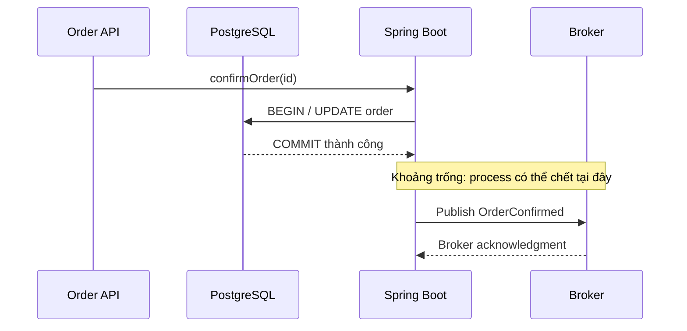
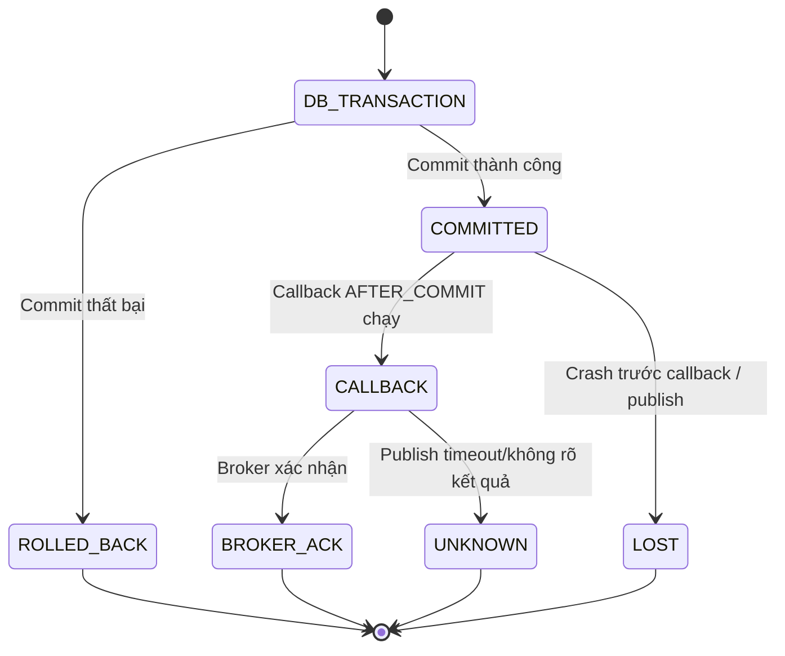
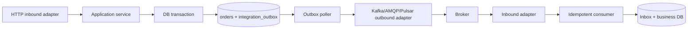

# Sự kiện sau commit và khoảng trống mất thông điệp

Một dịch vụ Spring Boot xác nhận đơn hàng bằng cách cập nhật PostgreSQL rồi gửi sự kiện `OrderConfirmed` sang Kafka, RabbitMQ hoặc Apache Pulsar. Để tránh phát sự kiện về một đơn hàng chưa thực sự được lưu, lập trình viên có thể dùng `@TransactionalEventListener(phase = AFTER_COMMIT)`. Cách này xử lý được **thứ tự thực thi**: callback chỉ chạy sau khi giao dịch cơ sở dữ liệu commit thành công. Nhưng một câu hỏi còn lại: **nếu ứng dụng chết sau commit và trước khi broker nhận được message, ai sẽ gửi lại sự kiện?**

Đây là nội dung của chương **Giao dịch tích hợp** trong module `SPRING_BOOT_INTEGRATION`: tổ chức các luồng kết nối HTTP client, cơ sở dữ liệu, cache, broker và adapter Spring Integration; đồng thời kiểm soát hợp đồng dữ liệu, transaction, retry, trùng lặp, kiểm thử và quan sát. Bài học phân biệt **event sau commit** với **event được lưu bền vững**, thiết kế transactional outbox và kiểm chứng các khoảng lỗi mà một transaction cục bộ không thể tự đóng lại.

Ví dụ sử dụng Java 17+, Spring Boot 3.x, Spring Data JPA, PostgreSQL và Kafka. Ý tưởng áp dụng tương tự cho RabbitMQ/Pulsar, nhưng API publisher confirm, acknowledgment và retry phải được cấu hình theo broker tương ứng.

## 1. Một transaction database không bao trùm broker

Giả sử `confirmOrder(orderId)` cần thực hiện hai hiệu ứng:

1. `UPDATE orders SET status = 'CONFIRMED' ...` trong PostgreSQL.
2. Publish `OrderConfirmedV1` để dịch vụ giao vận và hóa đơn bắt đầu công việc.

Hệ thống mong muốn **không có sự kiện xác nhận nếu đơn hàng chưa được commit**, đồng thời **mọi đơn hàng đã xác nhận cuối cùng đều có sự kiện**. Một transaction JPA thông thường chỉ kiểm soát thao tác database được enlist trong transaction đó; nó không mặc nhiên commit cùng Kafka, RabbitMQ, Pulsar hoặc HTTP API.



Hai cách sắp xếp đơn giản đều có lỗ hổng:

| Thứ tự | Lỗi biên | Hậu quả |
| --- | --- | --- |
| **Publish trước commit** | Broker nhận event nhưng DB rollback | Consumer thấy “đơn đã xác nhận” trong khi dữ liệu vẫn `PENDING`. |
| **Commit trước publish** | DB commit rồi process crash/mất điện trước publish | Đơn đã `CONFIRMED` nhưng không có message nào để consumer xử lý. |
| **Publish sau commit, broker timeout** | Broker có thể đã nhận nhưng callback không nhận xác nhận | Gửi lại có thể tạo **message trùng**. |
| **Publish thành công, consumer crash trước ACK** | Broker redeliver | Consumer có thể thực thi side effect lần thứ hai. |

Vì vậy, những thuộc tính cần chứng minh là **không phát event chưa được commit**, **không mất ý định phát event khi process chết**, và **nhận lặp vẫn an toàn**. Một annotation chỉ quyết định thời điểm gọi callback chưa đủ bảo đảm cả ba.

## 2. Spring application event khác message broker

`ApplicationEventPublisher.publishEvent(...)` của Spring phát một **application event trong tiến trình ứng dụng**. Mặc định event được dispatch cho listener phù hợp trong cùng JVM; bản thân lệnh này không ghi message xuống broker và không tạo một hàng đợi bền vững.

Ví dụ một service:

```java
public record OrderConfirmedEvent(
        UUID eventId, UUID orderId, long orderVersion) {
}

@Service
public class OrderApplicationService {
    private final OrderRepository repository;
    private final ApplicationEventPublisher events;

    public OrderApplicationService(
            OrderRepository repository,
            ApplicationEventPublisher events) {
        this.repository = repository;
        this.events = events;
    }

    @Transactional
    public void confirm(UUID orderId) {
        Order order = repository.findById(orderId).orElseThrow();
        order.confirm();
        repository.flush(); // Nếu cần lấy @Version đã được tăng.
        events.publishEvent(new OrderConfirmedEvent(
                UUID.randomUUID(), orderId, order.getVersion()));
    }
}
```

Các kiểu `Order`, `OrderRepository` là thành phần nghiệp vụ minh họa; mỗi `public` top-level Java type được đặt trong tệp riêng. `confirm()` phải kiểm tra state transition và idempotency. `UUID.randomUUID()` ở ví dụ chỉ được tạo **một lần cho sự kiện logic**; nếu HTTP request có thể được thực thi lại sau timeout, producer phải có operation ID/idempotency rule để tránh tạo thêm event khác cho cùng chuyển trạng thái.

Nếu đăng ký listener thông thường:

```java
@Component
class ImmediateListener {
    @EventListener
    void on(OrderConfirmedEvent event) {
        // Callback thông thường chạy khi event được dispatch.
        // Trong cấu hình đồng bộ mặc định, thời điểm này có thể
        // vẫn đang ở BÊN TRONG transaction của confirm().
    }
}
```

Listener này không được chờ commit chỉ vì có `@EventListener`. Một listener đồng bộ có thể gọi broker **trước** khi `confirm()` commit; sau đó transaction có thể rollback. Nếu application event multicaster được cấu hình bất đồng bộ, còn phải xét ngữ cảnh thread và transaction riêng. Không dựa vào giả định “Spring event = broker message đã publish”.

## 3. `@TransactionalEventListener(AFTER_COMMIT)` giải quyết được gì?

Spring hỗ trợ listener gắn với một pha của transaction:

```java
import org.springframework.context.event.EventListener;
import org.springframework.stereotype.Component;
import org.springframework.transaction.event.TransactionPhase;
import org.springframework.transaction.event.TransactionalEventListener;

@Component
public class OrderCommittedListener {
    private final OrderEventGateway gateway;

    public OrderCommittedListener(OrderEventGateway gateway) {
        this.gateway = gateway;
    }

    @TransactionalEventListener(phase = TransactionPhase.AFTER_COMMIT)
    public void afterCommit(OrderConfirmedEvent event) {
        gateway.publish(event);
    }
}
```

`OrderEventGateway` là adapter gửi message tới broker. Với một Spring transaction được quản lý đúng, callback `AFTER_COMMIT` chỉ được gọi sau commit thành công. Nếu transaction rollback, callback trên **không được gọi**.

| Pha `TransactionPhase` | Khi chạy | Dùng cho | Cần lưu ý |
| --- | --- | --- | --- |
| `BEFORE_COMMIT` | Trước khi hoàn tất commit | Kiểm tra/hành động cần thực hiện trước commit | Transaction vẫn có thể rollback sau đó. |
| `AFTER_COMMIT` | Sau khi commit thành công | Invalidating cache best-effort, thông báo không bắt buộc tuyệt đối | Process crash sau commit có thể bỏ lỡ callback hoặc publish. |
| `AFTER_ROLLBACK` | Sau rollback | Ghi metric, cleanup best-effort, phản ứng với rollback | Không biến rollback thành một transaction mới. |
| `AFTER_COMPLETION` | Sau commit **hoặc** rollback | Cleanup/telemetry cho mọi kết quả | Muốn phân biệt kết quả phải dùng ngữ cảnh phù hợp. |

`@TransactionalEventListener` mặc định dùng `AFTER_COMMIT`, nhưng viết rõ `phase` giúp người đọc kiểm tra hợp đồng. `fallbackExecution` mặc định là `false`: nếu event được phát khi **không có transaction tương thích**, listener transactional thường **không chạy**. Đặt `fallbackExecution = true` khiến callback cũng chạy trong trường hợp không có transaction, có thể phá giả định “chỉ phát sau commit”. Cần quyết định điều này tường minh.

### Ghi nhớ về proxy và transaction boundary

`@Transactional` thường được áp dụng qua Spring AOP proxy cho lời gọi đi qua bean. Tự gọi `this.confirm()` trong cùng class không tạo transaction theo cách mà lời gọi qua proxy tạo ra. Một event được publish khi không thực sự có transaction có thể bị bỏ qua bởi transactional listener. Kiểm thử phải gọi application service như production, thông qua Spring bean thực.

Với reactive transaction, Spring hỗ trợ ngữ cảnh transaction dựa trên Reactor từ các phiên bản phù hợp; event và cách truyền transaction context cần được thiết kế riêng. Ví dụ trong bài này dùng transaction imperative/JPA gắn với thread, không thể áp nguyên xi cho R2DBC và một luồng `Mono` bất đồng bộ.

## 4. Hai cạm bẫy ngay trong callback sau commit

### 4.1. Ghi database trong `AFTER_COMMIT` không tự tạo commit tiếp theo

Sau khi commit xong, Spring có thể vẫn giữ tài nguyên transaction (ví dụ connection/EntityManager) trong một phần vòng đời callback. Nếu callback gọi một repository/JPA method với propagation mặc định `REQUIRED`, code có thể tham gia ngữ cảnh tài nguyên cũ dù **không còn một commit mới** cho phần ghi vừa thực hiện. Không nên suy từ việc `save()` không ném exception rằng dữ liệu callback đã được commit.

Nếu cần ghi một bản ghi audit độc lập **sau khi** transaction chính hoàn tất, dùng một **Spring bean khác** với transaction mới:

```java
@Service
public class AuditAfterCommitService {
    private final AuditRepository auditRepository;

    public AuditAfterCommitService(AuditRepository auditRepository) {
        this.auditRepository = auditRepository;
    }

    @Transactional(propagation = Propagation.REQUIRES_NEW)
    public void writeAudit(OrderConfirmedEvent event) {
        auditRepository.save(new AuditRecord(
                event.eventId(), event.orderId()));
    }
}
```

Listener gọi `auditAfterCommitService.writeAudit(event)` qua bean proxy; `REQUIRES_NEW` mở transaction mới. Tuy nhiên, **audit ghi sau commit vẫn có crash gap**: nếu process chết trước khi callback chạy, bản ghi audit không có. Nếu audit là dữ liệu nghiệp vụ bắt buộc, hãy ghi nó trong **transaction chính** hoặc một outbox bền vững.

### 4.2. `@Async` thay đổi thread, không cung cấp độ bền

Kết hợp `@Async` với `@TransactionalEventListener(AFTER_COMMIT)` có thể tách việc publish khỏi thread request. Điều này giúp giảm thời gian chờ của caller trong vài tình huống nhưng **nhiệm vụ đang nằm trong bộ nhớ executor**. Nếu JVM chết, queue trong memory chưa chắc được xử lý; exception trong async listener cũng không thể rollback transaction đã commit.

Nếu callback ném lỗi ngay sau commit, exception có thể được quan sát ở phía lời gọi theo đường callback/framework, nhưng **database đã commit**. Không trả lỗi HTTP rồi cho phép client tạo đơn hàng mới vô điều kiện; response lỗi sau commit có thể làm client retry cùng một nghiệp vụ. Thiết kế idempotency cho request và lưu trạng thái kết quả giúp xử lý tình huống này.

## 5. Mô hình trạng thái và cửa sổ thất bại



`LOST` trong sơ đồ là **mất ý định publish khỏi bộ nhớ application** nếu không có một bản ghi bền vững khác để khôi phục. `UNKNOWN` nghĩa là chưa biết broker đã nhận hay chưa; retry an toàn phải chuẩn bị cho việc cùng event xuất hiện nhiều lần.

| Điểm lỗi | Trạng thái database | Trạng thái broker | Chỉ dùng `AFTER_COMMIT` | Dùng outbox |
| --- | --- | --- | --- | --- |
| Lỗi trước commit | Rollback | Chưa gửi | Không callback; phù hợp | Rollback cả business row và outbox row. |
| Crash sau commit trước callback | Commit | Chưa gửi | **Có thể mất message vĩnh viễn** | Row outbox còn `PENDING`; worker khác có thể gửi. |
| Callback gọi publish nhưng network lỗi | Commit | Có thể chưa nhận | Không có bản ghi retry bền vững mặc định | Row outbox còn để retry. |
| Broker đã nhận, client mất ACK | Commit | Có thể đã nhận | Retry có nguy cơ trùng; không có lịch sử bền vững | Retry cùng event ID; consumer deduplicate. |
| Publish thành công rồi process chết trước đánh dấu gửi | Commit | Đã nhận | Callback không còn trạng thái tiến độ | Outbox retry, tạo delivery trùng nhưng không mất event. |
| Consumer commit DB rồi chết trước ACK | Commit ở consumer | Broker redeliver | Producer không kiểm soát | Consumer inbox/idempotency bảo vệ. |

Mục tiêu của một thiết kế đáng tin cậy không phải loại bỏ mọi message trùng bằng lời hứa “exactly once”, mà là **không mất intent sau commit** và **cho phép redelivery không gây side effect trùng**.

## 6. Khi nào dùng post-commit callback, khi nào cần outbox?

| Yêu cầu | `@TransactionalEventListener(AFTER_COMMIT)` | Transactional outbox |
| --- | --- | --- |
| Chỉ chạy sau commit thành công | Có | Có, publisher chỉ thấy outbox row đã commit. |
| Không phát khi transaction rollback | Có trong đường thông thường | Có, row outbox rollback cùng dữ liệu. |
| Khôi phục sau JVM crash giữa commit/publish | **Không tự bảo đảm** | Có, nếu DB lưu outbox bền vững và dispatcher được vận hành. |
| Tự retry khi broker tạm thời không sẵn sàng | Cần thêm cơ chế riêng | Có thể xây từ trạng thái, lease và retry schedule bền vững. |
| Chịu được publish lặp | Vẫn cần idempotency | Vẫn cần idempotency. |
| Chi phí vận hành | Thấp | Có bảng outbox, dispatcher, metrics, cleanup và runbook. |
| Phù hợp | Cache invalidation best-effort, telemetry không bắt buộc | Event bắt buộc cho đặt hàng, thanh toán, hóa đơn, gửi hàng. |

Một số lựa chọn khác:

- **CDC từ transaction log:** ghi outbox trong transaction rồi dùng Debezium/connector đọc WAL/binlog và publish. Vẫn phải quản lý connector offset, schema, retry, duplicate và ordering.
- **Durable event publication registry:** ví dụ những cơ chế của Spring Modulith có lưu trạng thái publication, phù hợp khi đã chọn abstraction đó và kiểm tra cơ chế lưu/khôi phục cụ thể. Không nhầm với `ApplicationEventPublisher` thuần.
- **Transaction broker, XA/2PC:** có thể có trường hợp sử dụng riêng, nhưng không tự xuất hiện chỉ vì bật `@Transactional` hoặc broker transaction. Hai resource manager, failure recovery và chi phí điều phối cần thiết kế và kiểm chứng riêng.
- **Đối soát định kỳ:** với yêu cầu vừa phải, có thể quét những đơn `CONFIRMED` chưa có publication, nhưng cần một dấu vết bền vững và hợp đồng nhận diện sự kiện để không sinh message mới tùy tiện.

Phần tiếp theo xây dựng **polling outbox** bằng PostgreSQL để nhìn rõ mọi khoảng lỗi.

## 7. Hợp đồng event: danh tính và nội dung phải ổn định

Không gửi trực tiếp entity JPA/Hibernate ra broker; tạo một DTO bất biến:

```java
import java.time.Instant;
import java.util.UUID;

public record OrderConfirmedV1(
        UUID eventId,
        int schemaVersion,
        UUID orderId,
        long aggregateVersion,
        Instant occurredAt,
        String correlationId) {
}
```

| Trường | Vai trò |
| --- | --- |
| `eventId` | Idempotency key của một event logic; **không đổi** khi publish retry. |
| `orderId` | Khóa aggregate và broker key, giúp phân phối sự kiện cùng order có chủ đích. |
| `aggregateVersion` | Phiên bản trạng thái do owner của order cấp trong transaction, giúp consumer phát hiện stale/gap. |
| `schemaVersion` | Phiên bản hợp đồng JSON/Avro/Protobuf, khác `aggregateVersion`. |
| `occurredAt` | Thời điểm sự kiện nghiệp vụ được xác lập, không dùng thay sequence. |
| `correlationId` | Liên kết request/trace và luồng xử lý, không dùng thay `eventId`. |

Lý tưởng là `eventId` được tạo một lần khi xử lý một command hợp lệ và lưu cùng outbox row. Khi poller gửi lại, nó đọc **đúng payload đã lưu**, không dựng event mới bằng `UUID.randomUUID()` hay timestamp hiện tại.

Khi producer có nhiều replica, `aggregateVersion` phải được tăng atomically, ví dụ qua `@Version`/optimistic locking. Nếu một transaction sinh nhiều event cho cùng aggregate, cần quy tắc `eventSequence` riêng để không tạo trùng version không có ý nghĩa thứ tự.

## 8. Thiết kế bảng transactional outbox

Ví dụ migration PostgreSQL bằng Flyway/Liquibase, cùng database với bảng `orders`:

```sql
CREATE TABLE integration_outbox (
    event_id            UUID PRIMARY KEY,
    operation_id        VARCHAR(120) NOT NULL UNIQUE,
    aggregate_type      VARCHAR(64) NOT NULL,
    aggregate_id        UUID NOT NULL,
    aggregate_version   BIGINT NOT NULL,
    event_type          VARCHAR(100) NOT NULL,
    schema_version      INTEGER NOT NULL,
    payload             TEXT NOT NULL,
    status              VARCHAR(16) NOT NULL DEFAULT 'PENDING',
    attempts            INTEGER NOT NULL DEFAULT 0,
    next_attempt_at     TIMESTAMPTZ NOT NULL DEFAULT CURRENT_TIMESTAMP,
    claim_token         UUID,
    claimed_until       TIMESTAMPTZ,
    published_at        TIMESTAMPTZ,
    last_error_code     VARCHAR(80),
    created_at          TIMESTAMPTZ NOT NULL DEFAULT CURRENT_TIMESTAMP,
    CONSTRAINT ck_outbox_status CHECK
        (status IN ('PENDING', 'IN_FLIGHT', 'PUBLISHED', 'DEAD'))
);

CREATE INDEX idx_outbox_pending
    ON integration_outbox (next_attempt_at, created_at)
    WHERE status = 'PENDING';

CREATE INDEX idx_outbox_expired
    ON integration_outbox (claimed_until)
    WHERE status = 'IN_FLIGHT';
```

`operation_id` ở schema này giả định **mỗi command nghiệp vụ logic phát đúng một event outbox**. Nó ngăn hai lượt xử lý cùng command tạo hai event khác nhau khi client retry. Nếu một command có thể tạo nhiều event, thay uniqueness bằng `(operation_id, event_type, event_sequence)` hoặc một định danh tương đương phù hợp.

`payload` lưu JSON dạng `TEXT` để ví dụ đơn giản; có thể dùng `JSONB` với mapping/query được kiểm chứng trên PostgreSQL thật. Dù chọn loại nào, không nên lưu entity serialized có lazy proxy hoặc những field nội bộ nhạy cảm. DTO event và schema version là hợp đồng công khai của producer.

Các trạng thái:

| Trạng thái | Ý nghĩa | Hành động |
| --- | --- | --- |
| `PENDING` | Event được commit, chưa có publisher giữ quyền | Có thể claim khi tới `next_attempt_at`. |
| `IN_FLIGHT` | Một worker đã claim, lease còn hạn | Đang gửi/đợi broker confirm; có thể được claim lại nếu lease hết. |
| `PUBLISHED` | Publisher nhận broker confirm và đã lưu trạng thái này | Không gửi lại theo đường poll thông thường. |
| `DEAD` | Hết ngân sách tự retry hoặc lỗi vĩnh viễn cần can thiệp | Điều tra, sửa nguyên nhân, redrive có kiểm soát. |

`PUBLISHED` chỉ nói **broker đã xác nhận theo hợp đồng producer**, chưa chứng minh consumer đã xử lý thành công. Khả năng chịu mất dữ liệu còn phụ thuộc replication, acknowledgement policy, retention và cấu hình broker.

## 9. Ghi trạng thái nghiệp vụ và outbox trong một transaction

Một cách triển khai với Spring Data JPA: ánh xạ `IntegrationOutboxRecord` vào bảng `integration_outbox`, có `eventId`, `operationId`, `aggregateId`, `payload`, metadata và `status=PENDING`; repository dùng **cùng `EntityManagerFactory`/`PlatformTransactionManager`** với `OrderRepository`.

```java
@Service
public class ConfirmOrderUseCase {
    private final OrderRepository orders;
    private final IntegrationOutboxRepository outbox;
    private final ObjectMapper objectMapper;
    private final Clock clock;

    public ConfirmOrderUseCase(
            OrderRepository orders,
            IntegrationOutboxRepository outbox,
            ObjectMapper objectMapper,
            Clock clock) {
        this.orders = orders;
        this.outbox = outbox;
        this.objectMapper = objectMapper;
        this.clock = clock;
    }

    @Transactional
    public UUID confirm(UUID orderId, String operationId) {
        // Trong hệ thống thật: kiểm tra operationId đã được xử lý
        // và sử dụng optimistic concurrency trước khi confirm.
        Order order = orders.findById(orderId).orElseThrow();
        order.confirm();
        orders.flush(); // Đồng bộ @Version nếu event cần phiên bản mới.

        UUID eventId = UUID.randomUUID();
        OrderConfirmedV1 event = new OrderConfirmedV1(
                eventId, 1, orderId, order.getVersion(),
                clock.instant(), operationId);

        String json = serialize(event);
        outbox.save(IntegrationOutboxRecord.pending(
                eventId, operationId, "Order", orderId,
                order.getVersion(), "order.confirmed.v1", 1, json));
        return eventId;
    }

    private String serialize(OrderConfirmedV1 event) {
        try {
            return objectMapper.writeValueAsString(event);
        } catch (JsonProcessingException ex) {
            throw new IllegalStateException("Cannot encode order event", ex);
        }
    }
}
```

Đây là **mẫu orchestration**: cần hiện thực `Order`, `IntegrationOutboxRecord`, repositories, validation/idempotency và imports của dự án. `orders.flush()` không phải commit; một exception sau đó sẽ rollback cả thay đổi order và insert outbox. Chọn cùng transaction manager là điều kiện bắt buộc. Nếu outbox nằm ở database khác, `@Transactional` cục bộ không tự bao trùm cả hai.

### Đừng dựa vào `findByOperationId` rồi insert không khóa

Hai request đồng thời có cùng `operationId` đều có thể đọc thấy “chưa tồn tại”. Unique constraint của database phải bảo vệ cuối cùng; nếu có conflict, một transaction rollback, application đọc lại kết quả đã commit trong transaction mới rồi trả **cùng kết quả nghiệp vụ**. Ngoài ra phải kiểm tra việc cùng `operationId` nhưng request body khác là xung đột hợp đồng, không được âm thầm coi là cùng command.

Thực hiện domain mutation `order.confirm()` phải idempotent theo state machine: nếu đơn đã `CONFIRMED`, chỉ trả trạng thái/lệnh đã tồn tại khi đúng cùng operation; không tạo `eventId` mới mỗi lần client gọi lại.

### Tại sao không publish ngay trong method này?

Nếu `kafkaTemplate.send(...)` được gọi trong transaction, broker có thể nhận message khi transaction order cuối cùng bị rollback. Nếu chỉ “register callback sau commit”, crash gap vẫn còn. `outbox.save(...)` tạo **ý định phát đã commit cùng trạng thái nghiệp vụ**; sau đó một worker độc lập phát đi.

## 10. Publisher lấy outbox theo batch có khóa và lease

Nếu nhiều replica cùng chạy outbox dispatcher, mỗi worker cần claim các row đủ điều kiện bằng transaction ngắn. PostgreSQL hỗ trợ `FOR UPDATE SKIP LOCKED`, cho phép các worker khác bỏ qua row đang được claim.

Ví dụ câu SQL **thực thi trong một transaction**:

```sql
WITH picked AS (
    SELECT event_id
    FROM integration_outbox
    WHERE (status = 'PENDING'
           AND next_attempt_at <= CURRENT_TIMESTAMP)
       OR (status = 'IN_FLIGHT'
           AND claimed_until < CURRENT_TIMESTAMP)
    ORDER BY created_at, event_id
    FOR UPDATE SKIP LOCKED
    LIMIT :batchSize
)
UPDATE integration_outbox AS o
SET status = 'IN_FLIGHT',
    claim_token = :newClaimToken,
    claimed_until = CURRENT_TIMESTAMP + INTERVAL '45 seconds',
    attempts = attempts + 1
FROM picked
WHERE o.event_id = picked.event_id
RETURNING o.event_id, o.aggregate_id, o.event_type,
          o.schema_version, o.payload, o.claim_token;
```

Kết quả `RETURNING` cung cấp danh sách message đã claim. `:newClaimToken` là UUID mới cho từng lượt claim (có thể dùng chung cho một batch); token cần đi kèm mọi thao tác hoàn tất/đổi trạng thái sau đó. Chọn thời hạn lease theo độ dài batch, thời gian chờ broker và số worker; nếu một worker xử lý batch lâu hơn lease, một worker khác có thể claim lại và publish cùng event.

**Quan trọng về thứ tự:** `ORDER BY created_at` trong truy vấn claim không cam kết consumer sẽ nhận event theo thứ tự **của cùng aggregate** nếu nhiều publisher gửi song song. Nếu thứ tự bắt buộc, chọn cơ chế chỉ claim event kế tiếp của một aggregate, partition worker theo `aggregateId`, hoặc consumer có `aggregateVersion` guard và xử lý gap. `SKIP LOCKED` chỉ phân phối công việc claim, không tự giải quyết ordering.

Một lớp DAO dùng `JdbcTemplate` có thể gọi SQL trên trong một method `@Transactional`, sau đó **commit transaction claim trước khi gọi broker**. Dùng transaction manager của chính PostgreSQL outbox, không giữ row lock DB trong lúc đợi network:

```java
@Repository
public class OutboxClaimDao {
    private final NamedParameterJdbcTemplate jdbc;

    public OutboxClaimDao(NamedParameterJdbcTemplate jdbc) {
        this.jdbc = jdbc;
    }

    @Transactional
    public List<ClaimedOutbox> claim(UUID token, int limit) {
        // NamedParameterJdbcTemplate.query(SQL_CLAIM, params, rowMapper)
        // với SQL ở trên; chuyển các cột RETURNING thành DTO.
        return queryClaimRows(token, limit);
    }
}
```

`queryClaimRows` và `ClaimedOutbox` là thành phần minh họa phải được cài đặt; class này không phải snippet có thể biên dịch độc lập. Nếu tích hợp JPA và JDBC trong một transaction, cần đảm bảo chúng dùng cùng physical datasource/transaction manager và kiểm thử trên PostgreSQL; không suy từ việc hai bean có cùng JDBC URL rằng chúng tự cùng transaction.

## 11. Publish, broker confirm và cập nhật trạng thái riêng

Một poller gọi DAO claim, rồi lần lượt gửi các event **sau khi claim đã commit**. Với Spring Kafka, một `KafkaTemplate` cho phép chờ `CompletableFuture<SendResult<...>>` hoàn tất:

```java
@Component
public class KafkaOutboxDispatcher {
    private final OutboxClaimDao claims;
    private final OutboxStateService states;
    private final KafkaTemplate<String, String> kafka;

    public KafkaOutboxDispatcher(
            OutboxClaimDao claims,
            OutboxStateService states,
            KafkaTemplate<String, String> kafka) {
        this.claims = claims;
        this.states = states;
        this.kafka = kafka;
    }

    @Scheduled(fixedDelayString = "${app.outbox.poll-delay-ms:1000}")
    public void dispatch() {
        UUID claimToken = UUID.randomUUID();
        for (ClaimedOutbox row : claims.claim(claimToken, 10)) {
            try {
                kafka.send("orders.events.v1",
                        row.aggregateId().toString(), row.payload())
                        .get(10, TimeUnit.SECONDS);
                states.markPublished(row.eventId(), claimToken);
            } catch (InterruptedException interrupted) {
                Thread.currentThread().interrupt();
                states.scheduleRetry(row.eventId(), claimToken,
                        "INTERRUPTED");
                return;
            } catch (Exception ex) {
                states.scheduleRetry(row.eventId(), claimToken,
                        "BROKER_PUBLISH_FAILED");
            }
        }
    }
}
```

Đoạn này cần Spring Scheduling (`@EnableScheduling`), Kafka starter, imports và các bean `OutboxStateService`, `ClaimedOutbox`. Để tập trung vào transaction, ví dụ dùng `get(timeout)` ở **thread scheduler riêng**, không phải HTTP event loop. Trong production cần giới hạn kích thước batch/in-flight, bảo đảm scheduler thread pool phù hợp, kiểm soát shutdown và xử lý việc deadline làm worker hết lease. Có thể publish async và tổng hợp confirms nhưng cần giữ bất biến trạng thái giống nhau.

`states.markPublished(...)` và `states.scheduleRetry(...)` mở **transaction database mới** sau lần publish/timeout; không reuse transaction claim. Ví dụ cập nhật có kiểm tra ownership:

```sql
UPDATE integration_outbox
SET status = 'PUBLISHED',
    published_at = CURRENT_TIMESTAMP,
    claim_token = NULL,
    claimed_until = NULL,
    last_error_code = NULL
WHERE event_id = :eventId
  AND claim_token = :claimToken
  AND status = 'IN_FLIGHT';
```

Nếu affected rows bằng `0`, worker **không còn sở hữu claim hiện tại**; cần log/metric và kiểm tra lại trạng thái. Ví dụ retry cũng phải có `WHERE event_id = :eventId AND claim_token = :claimToken`, cập nhật `next_attempt_at` theo exponential backoff có jitter, `status='PENDING'`, xóa `claim_token`/`claimed_until`, tăng attempt đã được ghi ở bước claim. Khi hết retry budget, đưa vào `DEAD` kèm mã lỗi và runbook phục hồi; tránh loop liên tục.

### Broker confirm không đồng nghĩa “exactly once”

Với Kafka, đợi future hoàn tất và cấu hình producer reliability phù hợp, ví dụ `acks=all` cùng replication/ISR policy được quản trị tại cluster. Nếu timeout sau khi broker đã append record, `markPublished` không xảy ra; poller sẽ gửi lại sau lease/retry. Cần giữ **cùng `eventId` trong payload/header**, không tạo event mới.

RabbitMQ dùng publisher confirms/correlation data; Pulsar dùng `MessageId`/ack của producer tương ứng. Mỗi broker có semantics riêng. Kafka producer idempotence giúp hạn chế duplicate do **retry của một producer**, nhưng không thay thế inbox khi **application outbox gửi lại cùng logical event ở lượt/phiên khác**.

`claim_token` là hàng rào để worker cũ không đánh dấu row sau khi lease hết, **không phải** fencing token được broker dùng để chặn publish cũ. Worker giữ lease hết hạn vẫn có thể publish; consumer phải deduplicate.

## 12. Khôi phục `IN_FLIGHT`, retry và cleanup

Một dispatcher đáng tin cậy phải giải quyết cả trường hợp process bị kill khi đang giữ row:

1. Claim chuyển `PENDING → IN_FLIGHT`, commit.
2. Worker chết trước publish: `claimed_until` hết hạn, worker khác claim lại và gửi.
3. Worker chết sau broker nhận event nhưng trước `PUBLISHED`: worker khác gửi lại **cùng event**.
4. Worker mất network, `get(timeout)` không biết broker đã nhận chưa: xử lý là **kết quả chưa rõ**, đưa vào retry có giới hạn và chuẩn bị cho duplicate.
5. Worker bị kill trong transaction `markPublished`: transaction rollback, row vẫn sẵn sàng retry sau lease.

`next_attempt_at` là lịch retry tách khỏi ngay lúc consumer nhận lỗi; có thể dùng backoff theo số `attempts` và mã lỗi:

```text
Attempt 1 thất bại -> retry sau 1s + jitter
Attempt 2 thất bại -> retry sau 2s + jitter
Attempt 3 thất bại -> retry sau 4s + jitter
...
Đạt giới hạn -> DEAD; cảnh báo và redrive có kiểm soát
```

Không để error message/stack trace dài chứa PII/credential vào `last_error_code`. Lưu mã lỗi ngắn để phân nhóm, còn chi tiết được log bảo mật theo correlation/event ID.

Các row `PUBLISHED` có thể được archive/xóa theo retention, nhưng đừng xóa ngay nếu còn cần audit, điều tra broker timeout hoặc đối soát consumer. Việc xóa phải tuân thủ chính sách lưu trữ và không làm mất khả năng chứng minh một event từng được gửi.

## 13. Consumer phải idempotent vì outbox có thể phát lại

Transactional outbox đạt hành vi **at-least-once** cho việc cố gắng chuyển event sang broker nếu hệ thống vận hành bình thường và có retry/reconciliation. Nó **không** ngăn mọi bản gửi trùng. Vì vậy consumer phải có chiến lược inbox hoặc unique constraint ở nơi xử lý dữ liệu.

Ví dụ bảng PostgreSQL của consumer:

```sql
CREATE TABLE processed_integration_event (
    consumer_name VARCHAR(80) NOT NULL,
    event_id      UUID NOT NULL,
    processed_at  TIMESTAMPTZ NOT NULL DEFAULT CURRENT_TIMESTAMP,
    PRIMARY KEY (consumer_name, event_id)
);
```

Trong một `@Transactional` bao gồm cả inbox và cập nhật projection:

```java
@Service
public class OrderEventConsumerService {
    private final JdbcTemplate jdbc;

    public OrderEventConsumerService(JdbcTemplate jdbc) {
        this.jdbc = jdbc;
    }

    @Transactional
    public void apply(OrderConfirmedV1 event) {
        int inserted = jdbc.update("""
                INSERT INTO processed_integration_event
                    (consumer_name, event_id)
                VALUES (?, ?)
                ON CONFLICT DO NOTHING
                """, "shipping-projection-v1", event.eventId());

        if (inserted == 0) {
            return; // Đã commit thành công trong lần trước.
        }

        int updated = jdbc.update("""
                UPDATE shipping_order_projection
                SET order_status = 'CONFIRMED'
                WHERE order_id = ?
                  AND order_status = 'PENDING'
                """, event.orderId());

        if (updated != 1) {
            throw new IllegalStateException(
                    "Cannot confirm projection for " + event.orderId());
        }
    }
}
```

Ví dụ giả định bảng `shipping_order_projection` tồn tại và event chỉ hợp lệ khi projection ở `PENDING`; hệ thống thật cần xử lý state machine, sự kiện đến muộn và `aggregateVersion`. Nếu `updated != 1`, exception rollback **cả inbox marker** và projection, để message có thể retry; không đánh dấu đã xử lý dù nghiệp vụ chưa áp dụng. Hai consumer cùng nhận event sẽ cạnh tranh unique key, đảm bảo chỉ một transaction áp dụng side effect nội bộ khi mọi thao tác trên **cùng database/transaction manager**.

Với Spring Kafka listener ở chế độ record acknowledgement, có thể gọi service đồng bộ:

```java
@KafkaListener(
        topics = "orders.events.v1",
        groupId = "shipping-projection-v1")
public void consume(String json) throws JsonProcessingException {
    OrderConfirmedV1 event =
            objectMapper.readValue(json, OrderConfirmedV1.class);
    consumerService.apply(event); // Commit trước khi listener trả thành công.
}
```

`objectMapper` và `consumerService` là dependency của listener. Cần cấu hình deserialization, error handler, retry/DLT và consumer offsets/ack mode theo stack Spring Kafka thực tế; ví dụ này thể hiện **trật tự nghiệp vụ** chứ chưa đầy đủ cấu hình consumer. Nếu commit DB thành công rồi process chết trước offset commit/ACK broker, event được giao lại và inbox ngăn cập nhật lặp.

Với HTTP API bên ngoài, unique inbox trong database **không tự khiến POST an toàn** nếu side effect đã xảy ra trước khi transaction DB commit. Cần idempotency key được phía đối tác tôn trọng, trạng thái pending/reconciliation hoặc outbox command; không giữ một DB transaction dài qua HTTP và coi đó là exactly-once.

## 14. Kết nối Spring Integration flow

Trong Spring Integration, một HTTP gateway, transformer, service activator hay broker outbound adapter có thể được nối vào cùng quy trình. Tuy nhiên, **channel boundary** quyết định thread và transaction; việc dùng flow DSL không tự tạo một transaction chung cho database và broker.



Nếu một flow dùng `DirectChannel`, handler thường chạy đồng bộ trên thread caller; `ExecutorChannel`/queue channel có thể chuyển thread và ngữ cảnh transaction. Đặt một outbound adapter sau `.handle(repository::save)` **không đảm bảo** thao tác publish sẽ rollback khi database rollback.

Một thiết kế bền vững cho luồng tích hợp:

1. Adapter đầu vào chuyển message thành command DTO, validate và gọi application service.
2. Application service ghi business state **và outbox** trong transaction cục bộ.
3. Poller hoặc CDC đọc **chỉ dữ liệu đã commit** và chuyển event sang outbound broker adapter.
4. Adapter nhận ở phía consumer ghi inbox + state trong transaction, sau đó ACK theo hợp đồng adapter.
5. Error channel, retry và dead-letter giữ dấu vết lỗi; không coi một `ErrorMessage` được log là bằng chứng outbox đã publish hoặc consumer đã ACK.

Với poller Spring Integration sử dụng transaction advice, xác định rõ **transaction chỉ bao trùm bước nào**. Nếu poll, transform và gọi network trong cùng transaction, có thể giữ row lock/connection quá lâu. Cách claim rồi commit trước publish ở phần 10 giúp ranh giới dễ vận hành hơn.

## 15. Kiểm thử transaction và các khoảng crash

Một unit test xác nhận `@TransactionalEventListener` được gọi sau commit là hữu ích, nhưng **không chứng minh message không mất khi JVM bị kill**. Kiểm thử cần có nhiều cấp.

### 15.1. Database test: order và outbox commit/rollback cùng nhau

Dùng PostgreSQL Testcontainers, Flyway/Liquibase chạy schema thật và một `@SpringBootTest` gọi `ConfirmOrderUseCase` từ bean proxy. **Không** đặt `@Transactional` trên toàn test method nếu mục tiêu kiểm chứng commit thật, vì transaction do test tạo có thể rollback sau test và che hành vi after-commit.

```java
@Test
void confirmsOrderAndStoresOutboxAtomically() {
    UUID orderId = fixtures.createPendingOrderCommitted();

    UUID eventId = useCase.confirm(orderId, "request-5001");

    assertEquals("CONFIRMED", fixtures.loadStatus(orderId));
    assertTrue(outboxQuery.existsPending(eventId));
}

@Test
void rollbackDoesNotLeaveOutboxEvent() {
    UUID orderId = fixtures.createPendingOrderCommitted();

    assertThrows(IllegalStateException.class,
            () -> faultyUseCase.confirmThenFail(
                    orderId, "request-5002"));

    assertEquals("PENDING", fixtures.loadStatus(orderId));
    assertFalse(outboxQuery.existsByOperationId("request-5002"));
}
```

Đây là các **assertion minh họa**; `fixtures`, `faultyUseCase`, `outboxQuery` cần được triển khai theo dự án. `confirmThenFail` phải gọi `flush()` rồi ném lỗi trong cùng transaction để chứng minh SQL đã chạy vẫn rollback, và các truy vấn assertion phải đọc bằng **transaction mới**. Đừng chỉ mock outbox repository rồi xem đó là bài test atomicity.

### 15.2. Ma trận failure injection

| Điểm tiêm lỗi | Kết quả bắt buộc |
| --- | --- |
| Trước commit DB | Order rollback; **không** có outbox row có thể được publish. |
| Sau commit DB nhưng trước lần poll đầu tiên | Order + `PENDING` còn nguyên khi app restart. |
| Sau claim commit, trước network publish | `IN_FLIGHT` hết lease; instance khác claim lại; không mất event. |
| Broker nhận event nhưng publisher bị timeout | Có thể gửi lại cùng `eventId`; consumer chỉ áp dụng một lần. |
| Broker confirm thành công nhưng process chết trước `PUBLISHED` | Publisher mới gửi lại; inbox chống trùng. |
| `markPublished` DB thất bại | Outbox không được coi là hoàn tất; retry với cùng ID. |
| Lease hết khi worker cũ còn publish | Stale worker không cập nhật trạng thái vì claim token sai; consumer chống trùng. |
| Consumer commit projection, crash trước broker ACK | Broker redeliver; inbox nhận biết và ACK an toàn. |
| Invalid event schema/poison message | Retry có giới hạn hoặc DLT/quarantine; không ACK coi nghiệp vụ đã xong khi chưa lưu trạng thái. |
| Hai replica cùng claim batch | Không cùng claim một row còn lease; khi lease hết có thể trùng publish nhưng không mất event. |
| Broker ngừng nhiều giờ | `PENDING`/retry backlog tăng có cảnh báo; dữ liệu outbox không biến mất do retry thất bại. |

Để mô phỏng **crash thực**, dùng hai process/pod/container cùng database và broker thật, kill publisher tại một hook xác định rồi khởi động instance khác. Ném exception trong cùng JVM giúp test transaction nhưng không mô phỏng đầy đủ việc mất connection, mất callback hay ACK chưa ghi nhận.

### 15.3. Test `@TransactionalEventListener` để thấy giới hạn

Một test có thể đăng ký listener ghi lại thời điểm được gọi, rồi:

1. Phát event bên trong `TransactionTemplate.execute(...)`.
2. Assert callback `AFTER_COMMIT` chưa chạy khi transaction còn mở.
3. Sau khi `TransactionTemplate` return/commit, assert callback chạy đúng một lần.
4. Ném exception để rollback một transaction khác, assert callback `AFTER_COMMIT` không chạy.
5. Phát event khi không có transaction, với `fallbackExecution=false`, assert callback bị bỏ qua.

Test trên xác minh **quy tắc lifecycle**. Nó không giải quyết lỗ hổng “commit đã xong nhưng process chết trước callback”. Bằng chứng về độ bền phải đến từ việc có row outbox **được commit cùng thay đổi nghiệp vụ** và recovery test chạy lại publisher.

## 16. Vận hành outbox: không để tồn đọng âm thầm

Outbox chỉ giúp nếu có worker/connector đang hoạt động, lịch retry được giám sát và có lộ trình xử lý `DEAD`. Các tín hiệu hữu ích:

| Metric hoặc log | Mục đích | Trường hợp cần báo động |
| --- | --- | --- |
| `outbox.pending.count`, `outbox.oldest.pending.age` | Phát hiện event đã commit nhưng chưa publish | Tuổi message vượt SLA, backlog tăng liên tục. |
| `outbox.inflight.count`, `outbox.claim.expired` | Nhìn thấy worker chết/lease quá ngắn | Row `IN_FLIGHT` hết hạn nhiều lần. |
| `outbox.publish.success`, `outbox.publish.failure` | Quan sát broker/producer | Failure tăng, throughput giảm. |
| `outbox.publish.confirm.latency` | Chọn timeout và lease hợp lý | Latency tiếp cận lease hoặc timeout. |
| `outbox.retry.attempts`, `outbox.dead.count` | Điều tra lỗi vĩnh viễn/hết retry | DEAD xuất hiện hoặc retry storm. |
| `consumer.inbox.duplicate`, `consumer.error`, `consumer.lag` | Phát hiện redelivery và lỗi áp dụng | Duplicate tăng cùng broker timeout hoặc consumer kẹt. |
| `eventId`, `operationId`, `aggregateId`, `traceId` trong structured logs | Tra cứu một hành trình end-to-end | Không thể đối chiếu DB row với broker publish. |

Tránh dùng `eventId`/`orderId` làm Prometheus label cardinality cao; đặt chúng vào log/tracing có kiểm soát. Không ghi token, password, thông tin thanh toán hoặc payload nhạy cảm trong lỗi/bản ghi outbox mà thiếu chính sách lưu trữ, mã hóa và quyền truy cập.

Runbook phục hồi `DEAD`:

1. Tìm nguyên nhân: contract sai, topic không tồn tại, permission, broker outage, schema/serialization hoặc lỗi code.
2. Kiểm tra row outbox gốc (`eventId`, `operationId`, payload, attempts) và kết quả ở broker/consumer nếu có.
3. Sửa nguyên nhân trước; reset trạng thái về `PENDING` với backoff và audit theo quy trình, **không thay `eventId`**.
4. Redrive theo batch nhỏ, có rate limit và quan sát duplicate/lag; dừng nếu lỗi tái diễn.
5. Kiểm tra các row `PUBLISHED` chỉ thực sự có confirm đúng cấu hình; đối soát bản ghi nghiệp vụ bị bỏ sót nếu có lịch sử deploy sai.

Một cleanup job có thể archive row đã `PUBLISHED` quá retention. Không được dọn row `PENDING`/`IN_FLIGHT`/`DEAD` chỉ vì chúng “cũ” nếu chưa có chính sách mất dữ liệu và phục hồi được phê duyệt.

## 17. Những sai lầm thường gặp

| Sai lầm | Hệ quả | Cách sửa |
| --- | --- | --- |
| Gọi Kafka/RabbitMQ ngay trong `@Transactional` JPA | Publish có thể thành công rồi DB rollback | Dùng outbox hoặc cơ chế nhất quán được kiểm chứng. |
| Nghĩ `AFTER_COMMIT` đồng nghĩa delivery bền vững | Crash gap mất message | Ghi durable intent trước commit qua outbox. |
| Gọi `@Async` rồi coi là queue đáng tin cậy | Process chết làm mất tác vụ trong memory | Dispatcher bền vững/CDC; retry và giám sát. |
| `fallbackExecution=true` không có quy tắc | Listener có thể chạy khi không có transaction | Xác định rõ pha và contract; test trường hợp no-transaction. |
| Ghi audit bằng `REQUIRED` trong after-commit callback | Có thể không có commit mới | `REQUIRES_NEW` nếu là ghi riêng best-effort; durable audit ghi trong transaction chính. |
| Cập nhật business row ở DB A, outbox ở DB B | Một transaction local không commit cả hai | Đặt outbox cùng nguồn sự thật/thiết kế phối hợp phù hợp. |
| Tạo event ID mới ở mỗi lần retry publish | Consumer không thể deduplicate sự kiện logic | Lưu eventId/payload một lần trong outbox. |
| Đánh dấu `PUBLISHED` trước broker confirm | Có thể mất message nếu publish thật sự thất bại | Confirm xong mới cập nhật trạng thái. |
| Không xử lý timeout không rõ kết quả | Phát lại có thể tạo duplicate | At-least-once + inbox/idempotency. |
| Claim row rồi giữ transaction mở khi gọi broker | DB lock kéo dài, pool cạn, deadlock | Claim/commit trước, publish ngoài transaction, mark trong transaction mới. |
| Lease hết, worker cũ vẫn mark published | Ghi sai ownership/trạng thái | So khớp `claim_token`, giám sát lease. |
| Dùng `SKIP LOCKED` rồi tuyên bố event cùng aggregate luôn đúng thứ tự | Publisher song song có thể đảo thứ tự publish | Phân vùng/serialize theo key hoặc consumer version guard. |
| Consumer ghi inbox sau khi ACK | Crash gây mất khả năng dedup | Commit inbox + nghiệp vụ trước ACK. |
| Có bảng outbox nhưng không có alert/recovery | Message nằm chờ vô hạn | Giám sát backlog, retry, DEAD, runbook. |

## 18. Checklist thiết kế và bài tập

Trước khi phát hành một tích hợp cần message đáng tin cậy, kiểm tra:

- [ ] Xác định database transaction boundary và broker acknowledgment boundary.
- [ ] Phân biệt `ApplicationEventPublisher` nội bộ với message được broker nhận.
- [ ] `@TransactionalEventListener(AFTER_COMMIT)` chỉ dùng nơi chấp nhận best-effort hoặc được hỗ trợ bằng cơ chế durable publication.
- [ ] Event DTO có `eventId` ổn định, aggregate key, schema version và correlation information cần thiết.
- [ ] Business row và outbox row được ghi trong **cùng transaction local**; rollback loại bỏ cả hai.
- [ ] Publisher claim bằng transaction ngắn, có lease, token ownership, timeout và retry bền vững.
- [ ] Broker confirm được kiểm chứng; `PUBLISHED` chỉ ghi sau confirm.
- [ ] Consumer có inbox/idempotency, version/state guard; ACK sau commit nghiệp vụ.
- [ ] Đã kiểm thử crash sau commit trước publish, timeout không rõ kết quả, publish rồi crash trước mark và consumer crash trước ACK.
- [ ] Có chính sách ordering theo aggregate, DLQ/DEAD, backlog alert, cleanup và redrive.
- [ ] Có kiểm thử trên PostgreSQL + broker thực, bao gồm ít nhất hai dispatcher/replica.

**Bài tập thực hành:** triển khai `POST /orders/{id}/confirm` với PostgreSQL và Kafka. Đầu tiên dùng `@TransactionalEventListener(AFTER_COMMIT)` để publish, rồi chủ động kill process sau DB commit trước callback và quan sát một đơn `CONFIRMED` không có message. Tiếp theo thêm `integration_outbox` cùng transaction với order; tạo dispatcher claim `FOR UPDATE SKIP LOCKED`, publish chờ broker confirm và mark `PUBLISHED`. Thử kill worker sau claim, sau broker confirm và trước mark; xác minh event cuối cùng được gửi, đôi khi trùng nhưng luôn cùng `eventId`. Cuối cùng thêm bảng inbox ở consumer và chứng minh một đơn hàng chỉ được áp dụng đúng một lần dù Kafka giao lại message.

**Ghi nhớ:** `AFTER_COMMIT` xác định **khi nào** callback được phép chạy, còn outbox lưu **bằng chứng bền vững về việc cần phát sự kiện** trong chính transaction nghiệp vụ. Khoảng trống giữa commit và broker vẫn có thể làm publish bị lặp khi khôi phục; thiết kế đúng là chấp nhận at-least-once có kiểm soát, giữ event identity ổn định, và làm consumer idempotent để hệ thống tiếp tục chính xác sau crash.
