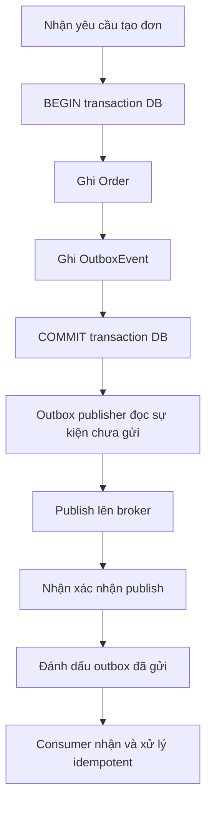

# Kiểm thử lỗi giữa các bước để xác minh ranh giới giao dịch

## 1. Vì sao cần chủ động gây lỗi trong một luồng tích hợp?

Trong **Spring Boot Integration**, một nghiệp vụ thường đi qua nhiều thành phần: lưu dữ liệu bằng JPA/JDBC, gọi HTTP client, cập nhật cache, gửi thông điệp vào broker hoặc chuyển thông điệp qua các adapter của Spring Integration. Các bước đó có thể cùng nằm trong một phương thức Java, nhưng **không mặc nhiên thuộc cùng một giao dịch**.

Ví dụ: khi tạo đơn hàng, ứng dụng ghi đơn hàng vào PostgreSQL, ghi sự kiện `OrderCreated` vào bảng outbox, sau đó một tiến trình khác phát sự kiện lên broker. Nếu thao tác lưu outbox thất bại, cả đơn hàng lẫn outbox phải được rollback. Nếu broker tạm ngừng hoạt động **sau khi** cơ sở dữ liệu đã commit, đơn hàng và outbox phải tiếp tục tồn tại để có thể gửi lại sự kiện. Đây là hai ranh giới khác nhau, đòi hỏi hai bộ kỳ vọng kiểm thử khác nhau.

Kiểm thử lỗi có chủ đích (*fault injection*) đặt ngoại lệ hoặc sự cố tại một điểm đã biết trong luồng, sau đó quan sát **trạng thái thực tế** của từng tài nguyên. Mục đích không chỉ là kiểm tra phương thức có ném ngoại lệ hay không, mà còn xác nhận rằng dữ liệu được commit, rollback, phát lại hoặc bù trừ đúng thiết kế.

### Phân biệt các loại ranh giới

| Thành phần | Ranh giới có thể kiểm soát | Điều không được suy diễn |
|---|---|---|
| Một cơ sở dữ liệu qua cùng `PlatformTransactionManager` | Các lệnh ghi tham gia cùng transaction có thể commit/rollback đồng thời | `save()` hoặc `flush()` đã commit |
| Hai phương thức Spring `@Transactional` với `REQUIRED` | Thường chia sẻ transaction hiện tại khi được gọi qua Spring proxy và cùng transaction manager | Mỗi phương thức luôn có transaction độc lập |
| Phương thức `REQUIRES_NEW` qua Spring proxy | Tạo transaction riêng, có thể commit khi transaction ngoài còn mở | Rollback transaction ngoài sẽ xóa dữ liệu đã commit của transaction trong |
| HTTP API, cache ngoài, một hệ thống đích khác | Có hợp đồng xử lý lỗi, idempotency hoặc thao tác bù trừ riêng | Rollback JPA sẽ tự hoàn tác yêu cầu HTTP đã thành công |
| Broker và database | Có thể tổ chức giao hàng lại, transaction cục bộ hoặc outbox | Gắn `@Transactional` lên một phương thức sẽ tạo atomic commit giữa DB và broker |

**Nguyên tắc kiểm thử:** với mỗi bước có thể thất bại, phải trả lời được (1) lúc đó transaction nào đã commit; (2) thành phần nào có side effect không thể rollback; (3) thông điệp có thể bị gửi lại hay không; và (4) làm cách nào xử lý lần chạy kế tiếp.

## 2. Lập bản đồ trạng thái và vị trí gây lỗi

Xét quy trình tạo đơn hàng dùng **transaction database + transactional outbox**:



Các vị trí kiểm thử nên mang tên gắn với **bước nghiệp vụ hoặc thời điểm transaction**, không phụ thuộc vào dòng mã cụ thể:

| Điểm gây lỗi | Trạng thái DB đơn hàng | Trạng thái outbox | Kỳ vọng tiếp theo |
|---|---|---|---|
| Trước khi ghi đơn hàng | Không có đơn | Không có sự kiện | Yêu cầu thất bại, có thể thử lại |
| Sau khi `Order` được `flush`, trước khi ghi outbox | Rollback đơn | Không có sự kiện | Không để lại đơn hàng mồ côi |
| Sau khi cả hai bản ghi được `flush`, trước commit | Rollback cả hai | Rollback cả hai | Không tồn tại thay đổi nửa chừng |
| Sau commit, trước khi publisher gửi broker | Đơn đã lưu | Sự kiện `PENDING` | Lần quét sau có thể phát sự kiện |
| Broker đã nhận sự kiện, publisher chết trước khi đánh dấu `SENT` | Đơn đã lưu | Có thể vẫn `PENDING` | Có thể gửi trùng; consumer phải khử trùng lặp |
| Consumer lưu DB xong nhưng lỗi trước commit | Transaction DB consumer rollback | Không liên quan | Broker phát lại theo cơ chế ack/retry được cấu hình |

Lưu ý: `flush` đẩy SQL xuống DB trong transaction hiện hành, giúp lỗi ràng buộc dữ liệu lộ diện sớm hơn; **`flush` không tương đương `commit`**. Ngoại lệ ném trước commit mặc định khiến transaction rollback nếu là `RuntimeException` hoặc `Error` và không có quy tắc rollback tùy chỉnh ghi đè.

## 3. Ví dụ: kiểm thử rollback của Order và Outbox bằng Spring Boot

Ví dụ dưới đây tập trung vào **cùng một database transaction**. Một điểm gây lỗi sẽ được đặt sau mỗi thao tác ghi để phát hiện trường hợp hai bản ghi không còn atomic. Mã mẫu dùng Spring Data JPA và Spring Boot 3.1+; các import tiêu chuẩn được lược bỏ để tập trung vào cơ chế.

### 3.1. Mô hình dữ liệu và service cần kiểm thử

```java
@Entity
@Table(name = "customer_order")
class OrderRecord {
    @Id
    private UUID id;

    @Column(nullable = false)
    private String state;

    protected OrderRecord() {} // JPA

    OrderRecord(UUID id, String state) {
        this.id = id;
        this.state = state;
    }
}

@Entity
@Table(name = "outbox_event")
class OutboxRecord {
    @Id
    private UUID id;

    @Column(nullable = false)
    private UUID orderId;

    @Column(nullable = false)
    private String eventType;

    protected OutboxRecord() {} // JPA

    OutboxRecord(UUID id, UUID orderId, String eventType) {
        this.id = id;
        this.orderId = orderId;
        this.eventType = eventType;
    }
}

interface OrderRepository extends JpaRepository<OrderRecord, UUID> {}

interface OutboxRepository extends JpaRepository<OutboxRecord, UUID> {
    boolean existsByOrderId(UUID orderId);
}

enum FailurePoint {
    AFTER_ORDER_FLUSH,
    AFTER_OUTBOX_FLUSH
}

interface FailureProbe {
    void hit(FailurePoint point);
}

@Component
class NoFailureProbe implements FailureProbe {
    @Override
    public void hit(FailurePoint point) { /* môi trường bình thường */ }
}

@Service
class PlaceOrderService {
    private final OrderRepository orders;
    private final OutboxRepository outbox;
    private final FailureProbe probe;

    PlaceOrderService(OrderRepository orders,
                      OutboxRepository outbox,
                      FailureProbe probe) {
        this.orders = orders;
        this.outbox = outbox;
        this.probe = probe;
    }

    @Transactional
    public void place(UUID orderId) {
        orders.saveAndFlush(new OrderRecord(orderId, "CREATED"));
        probe.hit(FailurePoint.AFTER_ORDER_FLUSH);

        outbox.saveAndFlush(new OutboxRecord(
            UUID.randomUUID(), orderId, "OrderCreated"));
        probe.hit(FailurePoint.AFTER_OUTBOX_FLUSH);
        // Commit diễn ra khi lời gọi qua proxy @Transactional kết thúc thành công.
    }
}
```

Trong hệ thống thực tế, `FailureProbe` có thể được thay bằng test seam khác như mock hoặc fake. Không nên biến điểm gây lỗi thành một endpoint có thể kích hoạt tự do trên production. Mẫu chỉ minh họa cách điều khiển vị trí phát sinh ngoại lệ một cách xác định.

### 3.2. Kiểm thử tích hợp với database thật

Sử dụng PostgreSQL trong Testcontainers giúp phép thử chạy qua JDBC/JPA và transaction manager thực, thay vì chỉ xác nhận lời gọi tới repository mock. Với Gradle, các dependency test liên quan thường gồm:

```groovy
testImplementation 'org.springframework.boot:spring-boot-starter-test'
testImplementation 'org.springframework.boot:spring-boot-testcontainers'
testImplementation 'org.testcontainers:junit-jupiter'
testImplementation 'org.testcontainers:postgresql'
testRuntimeOnly  'org.postgresql:postgresql'
```

```java
@SpringBootTest
@Testcontainers
class PlaceOrderTransactionIT {
    @Container
    @ServiceConnection
    static PostgreSQLContainer<?> postgres =
        new PostgreSQLContainer<>("postgres:16-alpine");

    @Autowired PlaceOrderService service;
    @Autowired OrderRepository orders;
    @Autowired OutboxRepository outbox;
    @Autowired SwitchableFailureProbe probe;

    @TestConfiguration
    static class FaultConfig {
        @Bean
        @Primary
        SwitchableFailureProbe testFailureProbe() {
            return new SwitchableFailureProbe();
        }
    }

    static class SwitchableFailureProbe implements FailureProbe {
        private volatile FailurePoint failAt;

        void failAt(FailurePoint point) { failAt = point; }
        void clear() { failAt = null; }

        @Override
        public void hit(FailurePoint point) {
            if (point == failAt) {
                throw new IllegalStateException("Injected at " + point);
            }
        }
    }

    @BeforeEach
    void resetFailurePoint() {
        probe.clear();
    }

    @Test
    void errorAfterOrderFlushRollsBackOrder() {
        UUID id = UUID.randomUUID();
        probe.failAt(FailurePoint.AFTER_ORDER_FLUSH);

        assertThrows(IllegalStateException.class, () -> service.place(id));

        assertFalse(orders.existsById(id));
        assertFalse(outbox.existsByOrderId(id));
    }

    @Test
    void errorAfterOutboxFlushRollsBackBothWrites() {
        UUID id = UUID.randomUUID();
        probe.failAt(FailurePoint.AFTER_OUTBOX_FLUSH);

        assertThrows(IllegalStateException.class, () -> service.place(id));

        assertFalse(orders.existsById(id));
        assertFalse(outbox.existsByOrderId(id));
    }

    @Test
    void successCommitsOrderAndOutboxTogether() {
        UUID id = UUID.randomUUID();

        service.place(id);

        assertTrue(orders.existsById(id));
        assertTrue(outbox.existsByOrderId(id));
    }
}
```

Trước khi chạy mẫu, cần có cấu hình schema thử nghiệm (`ddl-auto` hoặc migration Flyway/Liquibase tương ứng) và Docker/Testcontainers hoạt động. `@ServiceConnection` tự khai báo thông tin kết nối của container trong các phiên bản Spring Boot hỗ trợ tính năng này.

**Điểm quyết định độ tin cậy của phép thử:** test method phía trên **không** gắn `@Transactional`. Lời gọi `service.place(id)` đi qua Spring proxy; transaction đã commit hoặc rollback khi phương thức trả về/ném lỗi. Các truy vấn `existsById` và `existsByOrderId` chạy sau đó mới kiểm tra được trạng thái database sau giao dịch. Nếu gắn `@Transactional` lên test method, Spring Test thường rollback toàn bộ transaction test cuối phép thử; kết quả có thể tạo cảm giác rằng service rollback đúng dù thực tế service đã chạy thành công trong transaction của test.

Sử dụng UUID mới cho mỗi phép thử tránh phụ thuộc vào thứ tự chạy và không phải xóa dữ liệu thuộc test khác. Do `FailureProbe` là bean có trạng thái dùng chung, nếu chạy các test **song song**, cần thay cách tiêm lỗi bằng bean/test context cô lập cho từng test hoặc tắt parallelization đối với lớp kiểm thử này.

## 4. Kiểm thử sau commit: DB, HTTP và broker không cùng một ranh giới

### 4.1. Lỗi ngay sau commit database

Để kiểm thử đúng thời điểm *sau commit*, đặt điểm gây lỗi **bên ngoài** lời gọi service có transaction:

```java
@Component
class OrderWorkflow {
    private final PlaceOrderService placeOrderService;
    private final BrokerPublisher publisher;

    OrderWorkflow(PlaceOrderService placeOrderService,
                  BrokerPublisher publisher) {
        this.placeOrderService = placeOrderService;
        this.publisher = publisher;
    }

    // Không có @Transactional ở orchestration method này.
    public void createAndPublish(UUID orderId) {
        placeOrderService.place(orderId);  // DB commit trước khi trả về.
        publisher.publishPending();        // Có thể ném lỗi khi broker unavailable.
    }
}
```

Giả sử `publisher.publishPending()` thất bại. Kiểm thử phải khẳng định `OrderRecord` và `OutboxRecord` **vẫn tồn tại**, sự kiện còn trạng thái chờ gửi và một lần chạy publisher tiếp theo sẽ đưa sự kiện đến broker. Trong ví dụ tối giản ở mục 3, outbox chưa khai báo cột trạng thái; triển khai production cần thêm `PENDING/SENT`, thời gian thử lại, khóa/claim xử lý và cơ chế tránh nhiều publisher lấy cùng bản ghi. Kiểm thử ở mục này nên dùng implementation outbox thực tế của hệ thống.

Nếu một phương thức bên ngoài đã mở transaction với `@Transactional(REQUIRED)`, `placeOrderService.place()` có thể **tham gia transaction bên ngoài**; lúc trả về từ phương thức con chưa chắc database đã commit. Vì thế không được dùng ranh giới gọi hàm làm bằng chứng commit mà không xem propagation và transaction manager thực tế.

### 4.2. HTTP thành công rồi database rollback

Xét thiết kế gọi cổng thanh toán đồng bộ ngay trong transaction DB:

```java
@Transactional
public void placeAndCharge(UUID orderId) {
    orders.save(new OrderRecord(orderId, "CREATED"));
    paymentClient.charge(orderId); // HTTP 200: hệ thống thanh toán đã xử lý.
    throw new IllegalStateException("Fault after successful charge");
}
```

Nếu `paymentClient.charge()` đã thực hiện thanh toán thật, ngoại lệ cuối phương thức chỉ rollback dữ liệu DB của ứng dụng; nó **không tự hoàn tiền**. Phép thử tích hợp cần dùng stub HTTP có thể ghi nhận số lần gọi, buộc phản hồi thành công, sau đó kiểm tra đồng thời: đơn hàng không tồn tại trong DB, nhưng yêu cầu thanh toán đã được gửi và phía đích mô phỏng đã ghi nhận side effect. Đây là phép thử phát hiện thiết kế chưa có kế hoạch phục hồi, không phải tín hiệu rằng rollback của Spring bị lỗi.

Cách xử lý thường là dùng idempotency key, lưu trạng thái xử lý, thiết kế saga/compensating action hoặc tách việc gọi HTTP sang worker xử lý yêu cầu bền vững. Với HTTP timeout, còn phải kiểm thử tình huống **không biết phía đích đã xử lý hay chưa**: retry an toàn dựa vào idempotency key hoặc truy vấn trạng thái; không mặc nhiên cho rằng timeout nghĩa là giao dịch phía đích thất bại.

### 4.3. Broker đã nhận nhưng producer chưa ghi nhận thành công

Một outbox publisher thường có chuỗi: đọc `PENDING` → gửi broker → nhận xác nhận → đánh dấu `SENT`. Tắt publisher tại điểm **sau khi broker xác nhận nhưng trước khi cập nhật outbox**; khi chạy lại, bản ghi có thể được gửi lần thứ hai. Kỳ vọng hợp lý là cơ chế *at-least-once delivery* cùng consumer idempotent, không mặc định *exactly once* xuyên suốt các hệ thống.

Ở consumer, có thể lưu `eventId` trong bảng `processed_message` với khóa duy nhất ngay trong **cùng transaction** với thay đổi nghiệp vụ:

```java
@Transactional
public void handle(OrderCreated event) {
    if (processedMessageRepository.existsById(event.eventId())) {
        return;
    }

    inventoryRepository.reserve(event.orderId());
    processedMessageRepository.save(
        new ProcessedMessage(event.eventId()));
}
```

Đây chỉ là phác thảo: `existsById()` rồi `save()` có thể gặp race condition khi nhiều consumer xử lý cùng sự kiện đồng thời. Bản triển khai cần **unique constraint ở DB**, xử lý trường hợp insert trùng và thiết kế thứ tự thao tác an toàn. Kiểm thử phải gửi cùng `eventId` nhiều lần, có cả chạy đồng thời nếu hệ thống cho phép, rồi xác nhận tồn kho chỉ bị trừ một lần. Đồng thời cấu hình ack/offset phải được kiểm tra riêng: rollback DB không tự động bảo đảm broker sẽ redeliver nếu listener đã acknowledge trước thời điểm an toàn.

### 4.4. `REQUIRES_NEW`, cache, sự kiện sau commit và luồng bất đồng bộ

Một số điểm làm thay đổi kết quả kiểm thử dù chúng xuất hiện trong cùng call stack:

- **`REQUIRES_NEW`:** một service khác được gọi qua Spring proxy có thể commit bản ghi audit độc lập. Sau lỗi ở transaction ngoài, hãy kiểm tra audit vẫn có và dữ liệu nghiệp vụ ngoài đã rollback, nếu đây là chủ đích. Không giả định annotation hoạt động với lời gọi `this.innerMethod()` trong cùng object vì self-invocation thường bỏ qua proxy.
- **Cache/Redis:** lệnh ghi cache trực tiếp thường nằm ngoài transaction JPA. Kiểm thử lỗi sau khi sửa cache cần xác nhận cache không giữ dữ liệu sai; cân nhắc xóa/cập nhật cache sau commit hoặc dùng chiến lược nhất quán thích hợp.
- **`@TransactionalEventListener(AFTER_COMMIT)`:** handler chạy sau commit nhưng một lần crash có thể khiến sự kiện in-memory không được xử lý; cần kiểm thử đường phục hồi và dùng outbox khi yêu cầu phát sự kiện bền vững.
- **`@Async`, scheduler, message listener, Spring Integration channel/adapter:** qua ranh giới thread hoặc thông điệp có thể tạo transaction khác với transaction đầu vào. Kiểm thử từng consumer/handler và cả khả năng gửi lại, thay vì giả định transaction context tự truyền qua thread.
- **Checked exception và xử lý lỗi:** Spring thường rollback mặc định với unchecked exception, không mặc định rollback với checked exception; có thể khai báo `@Transactional(rollbackFor = ...)`. Nếu code bắt và nuốt lỗi, transaction có thể commit như bình thường. Hãy gây lỗi cả ở vị trí throw và tại nhánh catch để kiểm tra quy tắc thực tế.

## 5. Thiết kế bộ kiểm thử lỗi theo từng giai đoạn

Một bộ kiểm thử có giá trị cần gồm ít nhất một đường **thành công** và các đường thất bại có kỳ vọng rõ ràng. Với quy trình DB → outbox → broker → consumer → hệ thống đích, có thể tổ chức như sau:

| Ca kiểm thử | Cách tạo lỗi | Bằng chứng bắt buộc |
|---|---|---|
| Tạo đơn bình thường | Không gây lỗi | Đơn và outbox commit cùng nhau, sự kiện được xử lý đúng một lần về mặt nghiệp vụ |
| Lỗi sau ghi đơn | Throw sau `saveAndFlush(Order)` | Không còn Order; không còn Outbox |
| Lỗi sau ghi outbox | Throw sau `saveAndFlush(Outbox)` | Không còn Order; không còn Outbox |
| DB commit, publisher lỗi | Broker từ chối kết nối hoặc publisher throw sau khi transaction DB kết thúc | Order/Outbox tồn tại; có thể gửi lại khi broker phục hồi |
| Broker nhận rồi publisher chết | Fault sau broker ack, trước cập nhật `SENT` | Có thể phát trùng; consumer chỉ áp dụng side effect một lần |
| Consumer lỗi trước DB commit | Throw sau thao tác ghi trong consumer | Thay đổi DB consumer rollback; message được xử lý lại theo chính sách retry/ack |
| HTTP thành công rồi lỗi nội bộ | Stub HTTP trả 2xx, fault sau HTTP | Nhìn thấy side effect phía đích, xác nhận chiến lược bù trừ/idempotency |
| Timeout hoặc kết quả HTTP không rõ | Stub giữ kết nối quá timeout nhưng vẫn xử lý yêu cầu | Retry cùng idempotency key không tạo tác dụng phụ trùng |
| Transaction con `REQUIRES_NEW` | Commit audit ở bean riêng, rồi throw tại transaction ngoài | Audit commit, dữ liệu transaction ngoài rollback theo thiết kế |

Để xây dựng các ca này có tính lặp lại:

1. **Định nghĩa state invariant trước.** Chẳng hạn: “Không có Order đã commit mà thiếu outbox event tương ứng”, “Một `eventId` không được trừ kho hai lần”, “Một HTTP retry không được thu tiền hai lần”.
2. **Chọn điểm gây lỗi chính xác.** Tách rõ trước commit, sau commit, trước ack và sau ack. Dùng exception, fake/stub HTTP, container broker dừng có kiểm soát hoặc hook thử nghiệm ở publisher. Mỗi ca chỉ gây một loại lỗi chính.
3. **Dùng tài nguyên thật ở ranh giới cần xác minh.** Kiểm thử rollback JPA cần database và transaction manager thực; mock repository không thể chứng minh commit/rollback. HTTP client có thể kiểm bằng stub server; broker và redelivery có thể kiểm bằng broker test container.
4. **Kiểm tra dữ liệu sau khi giao dịch đã kết thúc.** Đọc qua connection/transaction mới, xác nhận cả bản ghi tồn tại và bản ghi không tồn tại. Với xử lý bất đồng bộ, chờ một điều kiện trạng thái có timeout xác định (ví dụ Awaitility); tránh `Thread.sleep()` cố định.
5. **Thử lại sau phục hồi.** Cho publisher/consumer chạy lại, gửi cùng request ID hoặc event ID, kiểm tra dữ liệu cuối cùng và đếm số side effect. Chỉ kiểm tra HTTP status hoặc số lần gọi mock chưa đủ chứng minh bất biến nghiệp vụ.
6. **Quan sát được nguyên nhân lỗi.** Gắn `orderId`, `eventId`, attempt number và trạng thái xử lý vào log/trace/metric nhưng tránh ghi payload nhạy cảm. Kết quả test nên giúp phân biệt rollback, retry, dead-letter và thao tác bù trừ.

## 6. Các lỗi thường khiến phép thử cho kết luận sai

**“Test pass vì cuối cùng database trống.”** Nếu toàn bộ test được bọc trong `@Transactional`, dữ liệu có thể biến mất vì *test framework* rollback, không phải service. Hãy thử ca thành công và xác nhận dữ liệu vẫn tồn tại sau lời gọi service kết thúc.

**“Service ném lỗi nên chắc chắn mọi thứ rollback.”** Cần kiểm tra loại exception, `rollbackFor`/`noRollbackFor`, propagation, transaction manager, đường gọi qua proxy và phần code bắt ngoại lệ. Ghi log “rollback” mà không kiểm tra DB sau giao dịch là chưa đủ.

**“Có `flush` tức là dữ liệu đã commit.”** `flush` chỉ đồng bộ persistence context với database trong transaction hiện tại. Gây lỗi sau `flush` là cách hữu ích để chứng minh SQL đã được gửi nhưng vẫn rollback khi transaction thất bại.

**“Publisher gửi một lần thì consumer sẽ xử lý một lần.”** Mất kết nối hoặc crash giữa broker ack và cập nhật trạng thái có thể dẫn tới phát trùng. Cần kiểm thử redelivery và idempotency cả bên gửi lẫn bên nhận.

**“Lỗi ở một service sẽ rollback cả HTTP, Redis và broker.”** Ranh giới transaction DB không bao trùm các hệ thống đó theo mặc định. Kết quả tốt của ca kiểm thử đôi khi là **phát hiện side effect còn tồn tại**, từ đó yêu cầu thiết kế cơ chế bù trừ hoặc phục hồi.

## 7. Tiêu chí hoàn thành

Việc xác minh ranh giới giao dịch chỉ đạt yêu cầu khi có thể chỉ ra bằng phép thử chạy thật rằng: các ghi chép **trong cùng transaction DB** rollback/commit nguyên khối; thay đổi **đã commit** tồn tại sau lỗi ở bước kế tiếp; các side effect **ngoài transaction** được nhận diện và xử lý bằng retry, idempotency hoặc compensation; và việc phát lại sau crash không làm sai trạng thái nghiệp vụ.

Thay vì kỳ vọng toàn bộ chuỗi tích hợp là một giao dịch duy nhất, hãy xem mỗi ranh giới commit, publish, ack và gọi hệ thống đích như một **điểm có thể thất bại**. Bản đồ trạng thái sau lỗi cùng các assertion trực tiếp lên dữ liệu là bằng chứng thực tế cho tính đúng đắn của luồng tích hợp.
