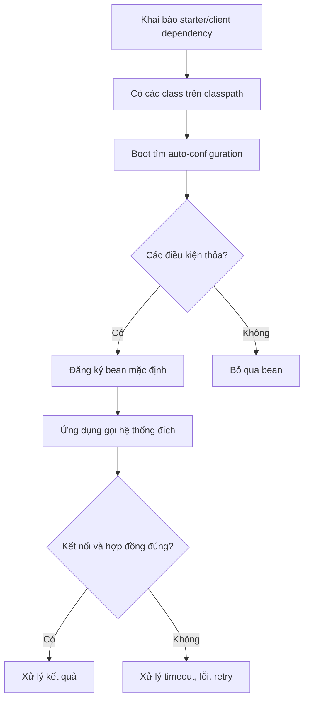

# Starter, thư viện client và điều kiện kích hoạt cấu hình tự động

> **Chương:** Cấu hình kết nối  
> **Phạm vi:** Spring Boot Integration — tổ chức kết nối với HTTP API, cơ sở dữ liệu, cache, broker thông điệp và các adapter của Spring Integration.

## 1. Vì sao cần hiểu starter, client và auto-configuration?

Giả sử ứng dụng đặt hàng cần gọi API vận chuyển bằng HTTP, lưu dữ liệu vào PostgreSQL, đọc Redis và phát sự kiện qua RabbitMQ. Để kết nối hoạt động, cần trả lời ba câu hỏi độc lập:

1. **Có đúng thư viện không?** Dependency quyết định driver, client và các API tồn tại trên classpath.
2. **Ai tạo và cấu hình bean kết nối?** Spring Boot có thể tự tạo `RestClient.Builder`, `DataSource`, `RedisConnectionFactory` hoặc `RabbitTemplate` khi đủ điều kiện.
3. **Kết nối đã thực sự sử dụng được chưa?** Một bean tồn tại không bảo đảm DNS, mạng, TLS, credential hoặc dịch vụ đích đúng và sẵn sàng. Tùy công nghệ, kết nối có thể được thử khi khởi động hoặc khi xử lý yêu cầu.

| Thành phần | Trách nhiệm | Ví dụ | Không tự bảo đảm |
| --- | --- | --- | --- |
| **Starter** | Tập hợp dependency để bắt đầu tích hợp | `spring-boot-starter-data-redis`, `spring-boot-starter-amqp` | Server đích đang chạy |
| **Client library/driver** | Cung cấp API và implementation của giao thức | Spring Web `RestClient`, JDBC driver, Lettuce | Tạo mọi bean phù hợp trong context |
| **Auto-configuration** | Tự đăng ký bean mặc định theo classpath, properties và bean hiện có | `DataSource`, `RabbitTemplate` | Biết URL, secret, timeout và nghiệp vụ nếu chưa cấu hình |
| **Application configuration** | Quy định endpoint, credential, tùy chỉnh bean | `application.yml`, `@ConfigurationProperties`, `@Bean` | Bù được driver bị thiếu |
| **Spring Integration adapter** | Liên kết một message flow với giao thức | `spring-integration-http`, `spring-integration-amqp` | Tự thiết kế luồng nghiệp vụ |

**Starter không đồng nghĩa với auto-configuration đã kích hoạt.** Starter là gói phụ thuộc; Boot chỉ đăng ký bean khi điều kiện thích hợp được thỏa mãn.



## 2. Chọn starter và thư viện client theo nhu cầu

Bảng dưới dùng tên thường gặp trong **Spring Boot 3.x**, Java 17 trở lên. Khi dùng Spring Boot 4.x hoặc nâng cấp lớn, hãy kiểm tra lại tên artifact, package, properties và BOM theo dòng phiên bản của dự án.

| Nhu cầu | Dependency | Bean/API tiêu biểu | Cần cấu hình thêm |
| --- | --- | --- | --- |
| HTTP đồng bộ | `spring-boot-starter-web` (Spring Web) | `RestClient`, `RestClient.Builder` | Base URL, HTTP timeouts, TLS, authentication |
| HTTP reactive | `spring-boot-starter-webflux` | `WebClient`, `WebClient.Builder` | Timeout, connector, mô hình reactive |
| JDBC/SQL | `spring-boot-starter-jdbc` + driver | `DataSource`, `JdbcTemplate` | URL, driver, credential, pool |
| JPA | `spring-boot-starter-data-jpa` + driver | `EntityManagerFactory`, repository | Entity, schema/migration, transaction |
| Redis | `spring-boot-starter-data-redis` | `RedisConnectionFactory`, `StringRedisTemplate` | Host, SSL/credential, serializer, TTL |
| RabbitMQ | `spring-boot-starter-amqp` | `RabbitTemplate`, listener infrastructure | Broker, vhost, queue/exchange, routing, ack |
| Kafka | `org.springframework.kafka:spring-kafka` | `KafkaTemplate`, consumer factory | Bootstrap servers, serializers, consumer group |
| Spring Integration | `spring-boot-starter-integration` + adapter | `IntegrationFlow`, channels, gateways | Khai báo flow/handler và adapter cho giao thức |

Ví dụ **chỉ** cần gọi HTTP đồng bộ bằng Spring Web:

```groovy
// build.gradle — dự án đã dùng Spring Boot BOM/dependency management
dependencies {
    implementation 'org.springframework.boot:spring-boot-starter-web'
    testImplementation 'org.springframework.boot:spring-boot-starter-test'
}
```

Nếu dùng JDBC với PostgreSQL, bổ sung các dependency tương ứng:

```groovy
dependencies {
    implementation 'org.springframework.boot:spring-boot-starter-jdbc'
    runtimeOnly 'org.postgresql:postgresql'
}
```

Nếu cần message flow Spring Integration kết nối HTTP:

```groovy
dependencies {
    implementation 'org.springframework.boot:spring-boot-starter-integration'
    implementation 'org.springframework.integration:spring-integration-http'
}
```

Đây là **ba lựa chọn độc lập**, không phải yêu cầu mọi ứng dụng phải cài tất cả. Để BOM của Spring Boot quản lý phiên bản tương thích, tránh tự ấn định các phiên bản Spring Framework, Integration và client khác nhau.

Trong Spring Framework 6.1+ / Boot 3.2+, `RestClient` có API đồng bộ; `WebClient` phù hợp mô hình reactive. Thêm WebFlux vào classpath không tự biến đoạn gọi HTTP blocking thành non-blocking. Hãy chọn client theo kiến trúc xử lý của ứng dụng.

## 3. Điều kiện kích hoạt auto-configuration

`@SpringBootApplication` bao gồm cơ chế bật auto-configuration. Khi khởi động, Boot tìm các auto-configuration được đăng ký, đánh giá điều kiện và tạo bean phù hợp.

| Điều kiện | Ý nghĩa | Tình huống |
| --- | --- | --- |
| `@ConditionalOnClass` | Class phải hiện diện trên classpath | Chỉ hỗ trợ RestClient nếu có Spring Web |
| `@ConditionalOnMissingClass` | Class không hiện diện | Chọn phương án dự phòng |
| `@ConditionalOnBean` | Đã có bean kiểu/tên yêu cầu | Chỉ tạo adapter khi có connection factory |
| `@ConditionalOnMissingBean` | Chưa có bean tương ứng | Cho phép ứng dụng ghi đè client mặc định |
| `@ConditionalOnProperty` | Property có giá trị đúng điều kiện | Chỉ bật tích hợp khi `partner.api.enabled=true` |
| `@ConditionalOnWebApplication` | Đúng loại web application | Cấu hình servlet/reactive endpoint |
| `@ConditionalOnResource` | Có resource cần thiết | Tích hợp phụ thuộc tài nguyên trên classpath |

Các điều kiện trên cùng một cấu hình thường được kết hợp bằng phép **AND**: thiếu class, sai property hoặc có sẵn bean tùy chỉnh đều có thể làm cấu hình mặc định không được đăng ký. Với `@ConditionalOnBean` và `@ConditionalOnMissingBean`, thứ tự xử lý các cấu hình cũng quan trọng vì điều kiện quan sát những bean đã được xử lý tại thời điểm kiểm tra.

Ví dụ điều kiện:

```java
@ConditionalOnProperty(
    prefix = "partner.api",
    name = "enabled",
    havingValue = "true")
```

| `partner.api.enabled` | Điều kiện |
| --- | --- |
| `true` | Khớp |
| `false` | Không khớp |
| Không khai báo | Không khớp, trừ khi dùng `matchIfMissing=true` |
| Giá trị khác `true` | Không khớp |

**Không phải mọi starter đều có property `*.enabled`.** Cờ `partner.api.enabled` chỉ là quy ước do ví dụ tự định nghĩa. Với thư viện cụ thể, cần đọc điều kiện thật của auto-configuration.

### 3.1. Điều kiện điển hình của từng công nghệ

**HTTP:** Boot có thể cung cấp `RestClient.Builder` nếu các thành phần hỗ trợ RestClient hiện diện. Bean `RestClient` cho một đối tác thường do ứng dụng hoặc starter nội bộ tạo vì framework không thể tự đoán base URL và chính sách xác thực.

**JDBC:** starter cung cấp API JDBC, nhưng datasource mặc định còn phụ thuộc driver, JDBC URL hoặc database nhúng phù hợp. Nếu người dùng đã có `DataSource` riêng, cấu hình mặc định thường nhường chỗ. Không đủ cấu hình có thể làm **khởi động thất bại**, thay vì đơn giản không có bean.

**Redis:** Boot có thể cung cấp `RedisConnectionFactory` và template nếu có thư viện tương ứng; việc tạo bean không bảo đảm Redis truy cập được. TTL, key, serializer và hành vi khi Redis mất kết nối cần được quy định riêng.

**RabbitMQ:** có thể đăng ký connection factory, `RabbitTemplate` và thành phần listener. Broker, exchange, queue, routing, ack và chính sách xử lý lỗi vẫn cần thiết để thông điệp đi đến đích.

**Spring Integration:** có core hoặc adapter trên classpath mới chỉ là có khả năng định nghĩa endpoint. Một `IntegrationFlow` với channel, router, transformer và handler không tự xuất hiện từ ý định nghiệp vụ.

## 4. Quản lý cấu hình kết nối

Tách host, credential, timeout và cờ bật/tắt khỏi Java code. Dùng `application.yml`, biến môi trường hoặc nguồn cấu hình ngoài theo quy tắc ưu tiên cấu hình của Boot.

Ví dụ cấu hình dành riêng cho HTTP API đối tác:

```yaml
partner:
  api:
    enabled: ${PARTNER_API_ENABLED:false}
    base-url: ${PARTNER_API_BASE_URL:https://partner.example.invalid}
```

`example.invalid` chỉ là tên miền minh họa, không phải endpoint thật. Khi bật tính năng trong môi trường chạy, phải cấp URL hợp lệ. Mặc định `enabled=false` giúp chưa kích hoạt kết nối khi thông tin môi trường chưa đầy đủ.

Ví dụ cho các tích hợp khác (**chỉ thêm phần thực sự dùng**):

```yaml
spring:
  datasource:
    url: ${DB_JDBC_URL}
    username: ${DB_USERNAME}
    password: ${DB_PASSWORD}
  data:
    redis:
      host: ${REDIS_HOST:localhost}
      port: ${REDIS_PORT:6379}
  rabbitmq:
    host: ${RABBIT_HOST:localhost}
    port: ${RABBIT_PORT:5672}
    username: ${RABBIT_USERNAME}
    password: ${RABBIT_PASSWORD}
```

Với Boot 3.x, Redis thường dùng namespace `spring.data.redis.*`. Đọc tài liệu phiên bản thực tế khi nâng cấp. Các placeholder không có giá trị mặc định (ví dụ `DB_JDBC_URL`) phải được cung cấp trong môi trường sử dụng; không commit mật khẩu thật lên repository hoặc log.

Ba nhóm cấu hình nên được phân biệt:

- **Địa chỉ và định tuyến:** host, port, base URL, JDBC URL, broker address/vhost.
- **Kết nối và an toàn:** TLS, secret, proxy, pool size, timeout kết nối và timeout đọc.
- **Ngữ nghĩa nghiệp vụ:** retry có giới hạn, idempotency key, transaction, TTL, dead-letter queue, xử lý trùng lặp.

Boot hỗ trợ bind các giá trị này vào bean; Boot không thể tự quyết định transaction, retry và hợp đồng dữ liệu đúng cho mọi hệ thống.

## 5. Ví dụ xuyên suốt: HTTP client tự cấu hình theo điều kiện

Giả sử một thư viện nội bộ cung cấp cách gọi API đối tác vận chuyển. Yêu cầu:

- Chỉ tạo `PartnerGateway` khi `partner.api.enabled=true`.
- Khi người dùng đã khai báo bean `PartnerGateway` riêng, cấu hình mặc định phải nhường chỗ.
- Khi bật tích hợp nhưng thiếu base URL hợp lệ, ứng dụng báo lỗi cấu hình ngay lúc khởi động.
- Cách định nghĩa dùng được trong một module auto-configuration tái sử dụng.

Ví dụ sử dụng **Java 17, Spring Boot 3.2+ và `RestClient`**; tên package phải được bổ sung theo mã nguồn của dự án.

### 5.1. Hợp đồng và implementation

```java
// PartnerGateway.java
public interface PartnerGateway {
    String fetchOrder(String orderId);
}
```

```java
// RestPartnerGateway.java
import org.springframework.web.client.RestClient;

public final class RestPartnerGateway implements PartnerGateway {
    private final RestClient client;

    public RestPartnerGateway(RestClient client) {
        this.client = client;
    }

    @Override
    public String fetchOrder(String orderId) {
        return client.get()
                .uri("/orders/{id}", orderId)
                .retrieve()
                .body(String.class);
    }
}
```

Để đơn giản, gateway trả về `String`. Trong sản phẩm thực tế, dùng DTO với schema và validation cụ thể, xác định hành vi khi body rỗng, mapping HTTP status, timeout và token xác thực.

### 5.2. Ràng buộc cấu hình với `@ConfigurationProperties`

```java
// PartnerApiProperties.java
import java.net.URI;
import org.springframework.boot.context.properties.ConfigurationProperties;

@ConfigurationProperties(prefix = "partner.api")
public record PartnerApiProperties(URI baseUrl) {
}
```

Record nhận `partner.api.base-url` thông qua cơ chế relaxed binding. Nó gom cấu hình của một hệ tích hợp vào một đối tượng rõ ràng thay vì rải nhiều `@Value` với key chuỗi khác nhau.

### 5.3. Đăng ký bean khi điều kiện thỏa

```java
// PartnerClientAutoConfiguration.java (Spring Boot 3.x)
import java.net.URI;
import org.springframework.boot.autoconfigure.AutoConfiguration;
import org.springframework.boot.autoconfigure.condition.ConditionalOnClass;
import org.springframework.boot.autoconfigure.condition.ConditionalOnMissingBean;
import org.springframework.boot.autoconfigure.condition.ConditionalOnProperty;
import org.springframework.boot.autoconfigure.web.client.RestClientAutoConfiguration;
import org.springframework.boot.context.properties.EnableConfigurationProperties;
import org.springframework.context.annotation.Bean;
import org.springframework.web.client.RestClient;

@AutoConfiguration(after = RestClientAutoConfiguration.class)
@ConditionalOnClass(RestClient.class)
@ConditionalOnProperty(
        prefix = "partner.api",
        name = "enabled",
        havingValue = "true")
@EnableConfigurationProperties(PartnerApiProperties.class)
public class PartnerClientAutoConfiguration {

    @Bean
    @ConditionalOnMissingBean(PartnerGateway.class)
    PartnerGateway partnerGateway(RestClient.Builder builder,
                                  PartnerApiProperties properties) {
        URI baseUrl = properties.baseUrl();
        if (baseUrl == null || !baseUrl.isAbsolute()) {
            throw new IllegalStateException(
                    "partner.api.base-url phải là URI tuyệt đối");
        }
        RestClient client = builder.baseUrl(baseUrl.toString()).build();
        return new RestPartnerGateway(client);
    }
}
```

Đọc đoạn code theo thứ tự:

1. `@ConditionalOnClass(RestClient.class)` yêu cầu API client hiện diện. Trong ví dụ Boot 3.2+ với starter Web thông thường, Boot cũng cung cấp bean `RestClient.Builder`; nếu một ứng dụng dùng cách đóng gói khác khiến builder vắng mặt thì phải cấp builder hoặc bổ sung điều kiện bảo vệ phù hợp.
2. `@ConditionalOnProperty` chỉ bật lớp cấu hình khi property mang giá trị `true`. Khi thiếu cờ, không đăng ký gateway.
3. `@ConditionalOnMissingBean` để bean của người dùng được ưu tiên. `@AutoConfiguration(after = RestClientAutoConfiguration.class)` mô tả thứ tự xử lý với auto-configuration HTTP của **Boot 3.x**.
4. Khi bật nhưng base URL thiếu hoặc không phải URI tuyệt đối, ném lỗi sớm để người vận hành sửa môi trường.
5. Bean `RestClient.Builder` được Boot quản lý và có thể nhận những customizer chung. Timeout, authentication, proxy và chính sách retry riêng cho đối tác vẫn cần cấu hình tường minh.

Các đoạn trên có thể đặt trong một module auto-configuration độc lập. Để Spring Boot 3.x tự tìm được cấu hình từ JAR phụ thuộc, tạo resource đúng đường dẫn:

```text
META-INF/spring/org.springframework.boot.autoconfigure.AutoConfiguration.imports
```

Nội dung ví dụ (đổi package thành package thực tế):

```text
com.example.partner.PartnerClientAutoConfiguration
```

Nếu đây chỉ là một client dùng trong **chính ứng dụng**, có thể dùng một lớp `@Configuration` chứa `@Bean` và đưa nó vào component scan. Cơ chế `AutoConfiguration.imports` phục vụ việc phân phối cấu hình qua thư viện/starter dùng lại, chứ không bắt buộc cho mọi bean ứng dụng.

### 5.4. Cho phép ứng dụng thay thế bean

```java
import org.springframework.context.annotation.Bean;
import org.springframework.context.annotation.Configuration;

@Configuration
class CustomPartnerConfiguration {
    @Bean
    PartnerGateway partnerGateway() {
        return orderId -> "Mock response for order " + orderId;
    }
}
```

Khi bean này tồn tại, `@ConditionalOnMissingBean(PartnerGateway.class)` làm bean mặc định không được tạo. Đây là cơ chế **back off**, tạo điểm mở rộng cho kiểm thử và triển khai riêng. Nếu có nhiều bean cùng kiểu, ứng dụng phải quản lý lựa chọn bằng `@Qualifier` hoặc `@Primary` khi tiêm phụ thuộc.

### 5.5. Kiểm thử các nhánh cấu hình mà không cần gọi mạng

`ApplicationContextRunner` khởi tạo một Spring context nhỏ, phù hợp để kiểm tra bean xuất hiện theo classpath, properties và bean khác. Ví dụ dùng JUnit 5/AssertJ từ `spring-boot-starter-test`:

```java
import org.junit.jupiter.api.Test;
import org.springframework.boot.autoconfigure.AutoConfigurations;
import org.springframework.boot.test.context.runner.ApplicationContextRunner;
import org.springframework.web.client.RestClient;

import static org.assertj.core.api.Assertions.assertThat;

class PartnerClientAutoConfigurationTest {
    private final ApplicationContextRunner runner = new ApplicationContextRunner()
            .withConfiguration(
                    AutoConfigurations.of(PartnerClientAutoConfiguration.class))
            .withBean(RestClient.Builder.class, RestClient::builder)
            .withPropertyValues(
                    "partner.api.base-url=https://partner.example.invalid");

    @Test
    void disabledWhenFlagIsMissing() {
        runner.run(context ->
                assertThat(context).doesNotHaveBean(PartnerGateway.class));
    }

    @Test
    void createsGatewayWhenEnabled() {
        runner.withPropertyValues("partner.api.enabled=true")
                .run(context ->
                        assertThat(context).hasSingleBean(PartnerGateway.class));
    }

    @Test
    void customGatewayWins() {
        runner.withPropertyValues("partner.api.enabled=true")
                .withBean(PartnerGateway.class, () -> id -> "stub")
                .run(context -> {
                    assertThat(context).hasSingleBean(PartnerGateway.class);
                    assertThat(context.getBean(PartnerGateway.class)
                            .fetchOrder("A-1")).isEqualTo("stub");
                });
    }
}
```

Kiểm thử chủ động khai báo `RestClient.Builder` để kiểm tra riêng logic cấu hình của gateway. Nó **không** kiểm chứng kết nối HTTP thật. Kiểm thử client nên bổ sung mock/test HTTP server và ca timeout, HTTP 4xx/5xx, authentication, contract JSON, request trùng.

## 6. Kiểm chứng từ bean đến kết nối thực

| Tầng | Điều cần xác minh | Ví dụ sai lệch |
| --- | --- | --- |
| Build/classpath | Starter, client, driver và phiên bản tương thích | Có JDBC API nhưng thiếu PostgreSQL driver |
| Spring context | Auto-configuration match hay không; bean có bị ghi đè không | `@ConditionalOnMissingBean` back off |
| Properties | Profile, URL, credential, TLS và timeout có đúng không | Thiếu biến môi trường, token hết hạn |
| Network/dịch vụ | DNS, firewall, cổng, broker và API còn sống không | Connection refused, TLS handshake error |
| Dữ liệu/nghiệp vụ | Schema, serializer, retry, transaction, idempotency đúng không | Message gửi trùng, JSON sai, dữ liệu không nhất quán |
| Vận hành | Metric, tracing, correlation ID, log và alert đủ không | Không phân biệt timeout/4xx, log làm lộ secret |

Theo từng loại kết nối, nhóm phát triển còn phải quyết định:

- **HTTP:** timeout kết nối/đọc, authentication, mapping HTTP status, retry giới hạn. Gọi lại thao tác ghi chỉ an toàn khi API có cơ chế idempotency phù hợp.
- **Cơ sở dữ liệu:** pool size, thời gian chờ connection, migration, transaction boundary; tránh giữ transaction DB trong khi chờ HTTP lâu.
- **Redis:** TTL, serializer, namespace, cache-miss, fallback; cache không mặc nhiên là nguồn dữ liệu chính.
- **Broker:** publisher confirm/ack, dead-letter, retry, duplicate delivery, consumer idempotent. Ghi DB và gửi RabbitMQ không tự tạo thành một transaction nguyên tử.
- **Spring Integration:** channel, executor, backpressure, error channel và khả năng theo dõi thông điệp khi đi qua các adapter.

### 6.1. Chẩn đoán “vì sao không có bean?”

1. Xem dependency tree: có đúng client, adapter và phiên bản không?
2. Xem tên/giá trị property, profile hiện tại và biến môi trường, không giả định mọi starter đều có cờ `enabled`.
3. Kiểm tra bean do ứng dụng hoặc thư viện khác khai báo có khiến điều kiện `@ConditionalOnMissingBean` không khớp không.
4. Bật báo cáo điều kiện bằng `--debug` trong môi trường phát triển và đọc *Conditions Evaluation Report*: cấu hình nào match, cấu hình nào bị bỏ qua và nguyên nhân.
5. Khi có Spring Boot Actuator, endpoint `conditions` có thể giúp chẩn đoán nếu được bật và phân quyền đúng; không mở endpoint chẩn đoán cho truy cập Internet công khai.
6. Sau khi bean tồn tại, thử thao tác thực có kiểm soát để phân biệt lỗi mạng/credential/contract với lỗi đăng ký bean.

```bash
java -jar app.jar --debug
```

Có thể tắt một auto-configuration của Boot bằng `spring.autoconfigure.exclude` với tên lớp tương ứng, nhưng ảnh hưởng có thể rộng hơn một client. Với tích hợp tự phát triển, cờ như `partner.api.enabled` thường thể hiện chủ đích rõ hơn.

## 7. Tình huống tổng hợp: dịch vụ đặt hàng

Ứng dụng nhận đơn lưu PostgreSQL, kiểm tra Redis, gọi API vận chuyển, phát `OrderPlaced` lên RabbitMQ và tổ chức một flow xử lý qua Spring Integration.

| Tác vụ | Hạ tầng Boot hỗ trợ | Nhóm phát triển cần tự thiết kế |
| --- | --- | --- |
| Lưu đơn | DataSource, template hoặc JPA, transaction manager khi đủ điều kiện | Schema/migration, transaction, pool |
| Cache | Redis connection factory/template | Key, TTL, serializer, xử lý cache unavailable |
| HTTP vận chuyển | RestClient builder; gateway đối tác chỉ bật theo cấu hình | URL, token, timeout, hợp đồng dữ liệu, idempotency |
| Phát sự kiện | AMQP connection factory/template | Queue/exchange/routing, confirm, outbox hoặc phương án nhất quán |
| Điều phối flow | Spring Integration core và adapter | Channel, flow/handler, error handling, retry |

Ví dụ, khi API vận chuyển đang được triển khai dần, đặt `partner.api.enabled=false` giúp không tạo gateway mặc định trong môi trường chưa sẵn sàng. Khi bật, gateway cần URL và credential thật. Có thể thay thế bằng mock `PartnerGateway` cho bài kiểm thử thông qua `@ConditionalOnMissingBean`.

Trong luồng này, **đăng ký client** và **bảo đảm tính nhất quán nghiệp vụ** là hai trách nhiệm khác nhau. Spring Boot hỗ trợ tạo connection/client nhưng không mặc nhiên bảo đảm ghi PostgreSQL và publish RabbitMQ thành công cùng nhau. Nếu yêu cầu đáng tin cậy cao, hãy xem xét transactional outbox, consumer idempotent, retry và giám sát thích hợp.

## 8. Câu hỏi tự kiểm tra

1. Tại sao thêm `spring-boot-starter-amqp` chưa đủ để bảo đảm message đến broker và được consumer xử lý?
2. Phân biệt `@ConditionalOnClass` với `@ConditionalOnBean`. Vì sao điều kiện liên quan tới bean phụ thuộc thứ tự cấu hình?
3. Không khai báo `partner.api.enabled` thì ví dụ có tạo `PartnerGateway` không? Nếu cần mặc định bật, phải thay đổi điều kiện thế nào và rủi ro vận hành là gì?
4. Vì sao có bean `RestClient.Builder` chưa đồng nghĩa đã có client ứng với một API đối tác cụ thể?
5. Redis và PostgreSQL đều có bean kết nối trong context: điều đó nói được gì và **chưa nói được gì** về tình trạng dịch vụ?
6. Khi ứng dụng muốn dùng implementation `PartnerGateway` riêng, cần khai báo gì để cơ chế back off hoạt động?

**Ghi nhớ:** starter giải quyết **dependency**; client/driver thực hiện **giao thức**; auto-configuration cung cấp **bean theo điều kiện**; cấu hình ứng dụng cùng thiết kế transaction, lỗi và quan sát quyết định **tích hợp vận hành chính xác, an toàn**.

### Tài liệu tham khảo

- [Spring Boot — Auto-configuration](https://docs.spring.io/spring-boot/reference/using/auto-configuration.html)
- [Spring Boot — Creating Your Own Auto-configuration](https://docs.spring.io/spring-boot/reference/features/developing-auto-configuration.html)
- [Spring Framework — REST Clients](https://docs.spring.io/spring-framework/reference/integration/rest-clients.html)
- [Spring Integration — Reference](https://docs.spring.io/spring-integration/reference/)
