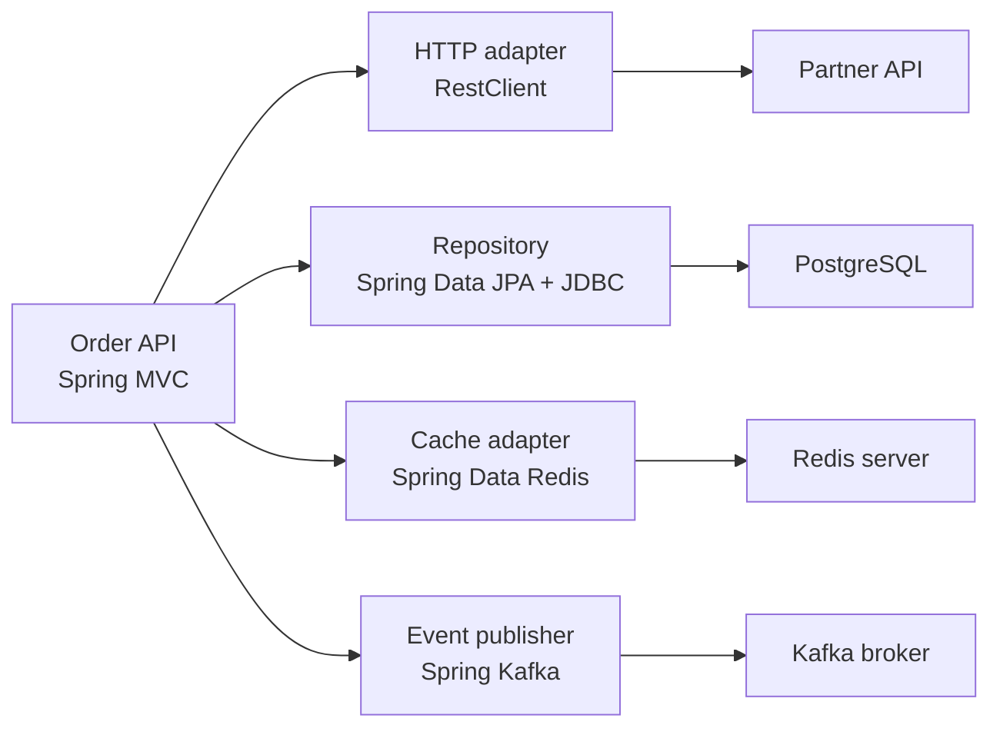
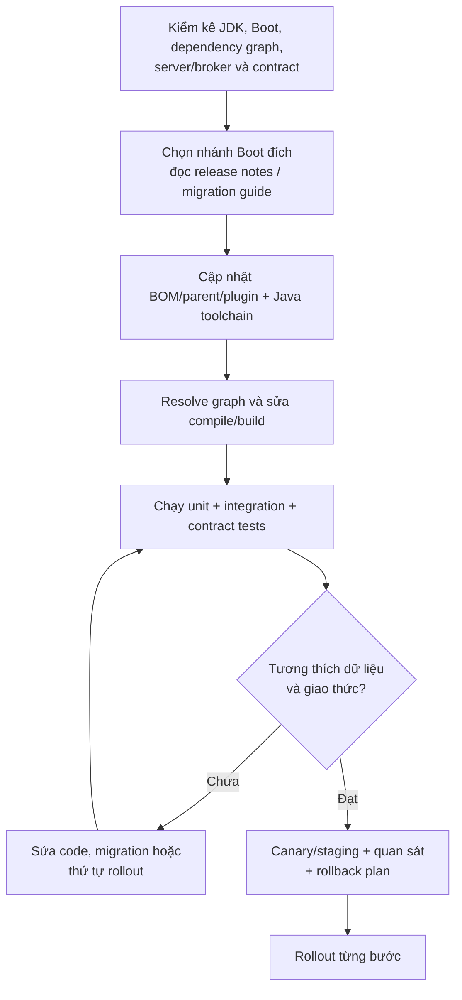

# Quản lý phiên bản phụ thuộc bằng Spring Boot và kiểm tra tương thích

## 1. Vì sao quản lý phiên bản là một phần của cấu hình kết nối?

Trong ứng dụng **SPRING_BOOT_INTEGRATION**, một luồng nghiệp vụ có thể dùng `RestClient` để gọi HTTP, JDBC/JPA để cập nhật cơ sở dữ liệu, Redis để lưu cache, Kafka/RabbitMQ để truyền sự kiện, và Spring Integration để tổ chức các adapter. Mỗi kết nối phụ thuộc vào một **tập thư viện**: Spring Framework, Spring Data, driver database, client HTTP, client broker, thư viện serialization, bảo mật và quan sát.

Ví dụ, dịch vụ đặt hàng có một chuỗi xử lý:



Nếu một thành phần tự nâng cấp `spring-core`, một thành phần khác giữ `spring-web` cũ, hoặc driver/client được chọn ngoài phạm vi hỗ trợ, ứng dụng có thể **biên dịch thành công nhưng lỗi lúc chạy**: `NoSuchMethodError`, `ClassNotFoundException`, sai cơ chế xác thực, serializer không tương thích, hoặc một tính năng broker chưa được server hỗ trợ.

Spring Boot giúp giải quyết phần **đồng bộ phiên bản thư viện trên classpath** thông qua tập phiên bản đã được quản lý và kiểm thử cùng nhau. Nhưng sự tương thích giữa ứng dụng với **PostgreSQL server, Redis server, Kafka broker, API đối tác và schema thông điệp** vẫn phải được xác minh riêng.

Sau bài này, bạn có thể:

- Giải thích vai trò của Spring Boot parent POM, **BOM** (`spring-boot-dependencies`), starter và dependency bắc cầu.
- Cấu hình quản lý phiên bản với **Maven** và **Gradle**, biết lúc nào cần khai báo version riêng.
- Đọc dependency tree để tìm phiên bản thực tế được giải quyết tại compile/test/runtime.
- Xây ma trận tương thích cho Java, Spring Boot, Spring Framework/Data, driver, broker/server và hợp đồng dữ liệu.
- Tổ chức kiểm thử, nâng cấp, rollback và kiểm soát thay đổi để giảm sự cố tích hợp.

> **Lưu ý ví dụ:** các đoạn build dùng **Spring Boot 3.5.0** như một mốc minh họa cú pháp đã phát hành, **không phải đề xuất khóa ở bản vá này**. Dự án thực tế cần chọn phiên bản Spring Boot còn được hỗ trợ và bản vá phù hợp tại thời điểm triển khai, đối chiếu release notes và ma trận hỗ trợ của các phụ thuộc liên quan. Spring Boot 3.x yêu cầu tối thiểu Java 17; dòng Boot 4 có thể thay đổi tên package, starter và các thành phần được quản lý, cần đánh giá như một lần nâng cấp lớn.

## 2. Phân biệt các lớp phiên bản

Trong một hệ tích hợp, “version” không chỉ là số ghi sau dependency.

| Lớp phiên bản | Ví dụ | Ai quản lý? | Cần kiểm chứng gì? |
| --- | --- | --- | --- |
| Runtime | Java 17/21, JVM vendor | Nền tảng triển khai và build toolchain | Phù hợp với yêu cầu của Spring Boot và thư viện |
| Framework | Spring Boot, Spring Framework, Spring Security | Tập phiên bản do Boot quản lý và cấu hình dự án | API, cấu hình, điểm mở rộng và các thay đổi bất tương thích |
| Data/integration libraries | Spring Data JPA/Redis, Spring Kafka, Spring Integration | Thường do Boot BOM quản lý | Version cùng nhánh hỗ trợ và semantics adapter |
| Client/driver | PostgreSQL JDBC, Lettuce, Kafka clients, RabbitMQ client | Boot BOM hoặc override được kiểm soát | Tương thích giao thức, bảo mật, retry, serialization |
| Server bên ngoài | PostgreSQL, Redis, Kafka broker, RabbitMQ | Đội vận hành/nhà cung cấp | Client-server compatibility, TLS, tính năng và nâng cấp theo cụm |
| Hợp đồng dữ liệu | REST v1/v2, event schema v3, migration DB | Nhóm sở hữu API/schema | Backward/forward compatibility khi deploy độc lập |
| Plugin build/test | Maven/Gradle, Java compiler, test plugins | Build config và quản trị CI | Toolchain, reproducibility, behavior của test/build |

**BOM không thể bảo đảm mọi lớp trong bảng.** Nó quản lý những version dependency đã được khai báo trong BOM, không tự sửa broker và không kiểm tra dữ liệu thực tế giữa hai hệ thống.

## 3. Spring Boot BOM, starter và dependency bắc cầu

### 3.1. BOM là gì?

**Bill of Materials (BOM)** trong Maven là một POM dùng để công bố danh sách các phiên bản được quản lý qua `dependencyManagement`. Spring Boot phát hành BOM với artifact:

```text
org.springframework.boot:spring-boot-dependencies:<spring-boot-version>
```

Ví dụ ứng dụng khai báo:

```xml
<dependency>
    <groupId>org.springframework.kafka</groupId>
    <artifactId>spring-kafka</artifactId>
</dependency>
```

Khi ứng dụng sử dụng BOM của Boot và dependency này được BOM quản lý, Maven có thể chọn phiên bản tương ứng mà **không cần viết `<version>`** trong chính dependency. Không nên tự điền một phiên bản Spring Kafka độc lập chỉ vì nó mới hơn, vì phiên bản ấy có thể yêu cầu một tổ hợp Spring Framework, Kafka clients hoặc Java khác.

BOM **không tự thêm dependency vào classpath**. Nó chỉ quy định phiên bản khi một dependency được yêu cầu. Việc import BOM cũng **không** tự bật Spring Boot auto-configuration, không cấu hình bean và không tự thêm các plugin build.

### 3.2. Starter có tác dụng gì?

Starter là dependency thuận tiện, mang theo một nhóm thư viện thường dùng:

```text
spring-boot-starter-web
  ├─ Spring Web + Spring MVC
  ├─ JSON (theo cấu hình starter/phiên bản)
  ├─ Embedded server (với starter web mặc định)
  └─ Những thư viện hỗ trợ liên quan
```

Ví dụ:

| Nhu cầu | Dependency thường dùng | Ghi chú |
| --- | --- | --- |
| HTTP đồng bộ với `RestClient` | `spring-boot-starter-web` hoặc Spring Web theo nhu cầu | `RestClient` là API đồng bộ thuộc Spring Framework |
| JPA/Hibernate | `spring-boot-starter-data-jpa` | Còn cần JDBC driver cho database thật |
| Redis cache/data | `spring-boot-starter-data-redis` | Thường mang theo client Redis mà Boot quản lý |
| Kafka producer/consumer | `org.springframework.kafka:spring-kafka` | Đúng dependency cho tích hợp Spring Kafka trên Boot 3.x |
| RabbitMQ với Spring AMQP | `spring-boot-starter-amqp` | Cần cấu hình host và credential broker |
| Luồng EIP của Spring Integration | `spring-boot-starter-integration`, cùng module adapter phù hợp | Thêm đúng adapter cần dùng, như HTTP, JDBC, AMQP hoặc Kafka |
| Test ứng dụng | `spring-boot-starter-test` và dependency test chuyên biệt | Test HTTP, integration và contract tùy tình huống |

Các starter cố ý mang dependency bắc cầu (**transitive dependencies**). Thêm `spring-boot-starter-web` không có nghĩa chỉ thêm đúng một JAR. Vì vậy cần nhìn toàn bộ đồ thị dependency trước khi đưa ra nhận định về classpath hoặc an toàn phiên bản.

### 3.3. Phân biệt dependency khai báo và dependency thực tế

Giả sử ta khai báo:

```text
spring-boot-starter-data-redis
```

Build tool sẽ giải quyết cả thư viện của starter, chẳng hạn Spring Data Redis và client/driver liên quan. Nếu dự án còn khai báo một client Redis trực tiếp với version khác, dependency graph có thể xuất hiện nhiều yêu cầu cho cùng một module. Quy tắc **chọn version cuối cùng khác nhau giữa Maven và Gradle**, và còn chịu ảnh hưởng bởi dependency management, constraints, conflict resolution và override.

Không kết luận version dựa trên những gì mắt thấy trong `pom.xml` hoặc `build.gradle`; phải kiểm tra version **đã được resolve** trong đúng configuration/classpath.

## 4. Cách 1 với Maven: dùng `spring-boot-starter-parent`

Với ứng dụng Maven độc lập và không bị buộc phải kế thừa corporate parent khác, cách phổ biến là dùng Boot parent:

```xml
<!-- pom.xml: ví dụ rút gọn, thay phiên bản minh họa trước khi triển khai -->
<project xmlns="http://maven.apache.org/POM/4.0.0"
         xmlns:xsi="http://www.w3.org/2001/XMLSchema-instance"
         xsi:schemaLocation="http://maven.apache.org/POM/4.0.0
                             https://maven.apache.org/xsd/maven-4.0.0.xsd">
    <modelVersion>4.0.0</modelVersion>

    <parent>
        <groupId>org.springframework.boot</groupId>
        <artifactId>spring-boot-starter-parent</artifactId>
        <version>3.5.0</version>
        <relativePath/>
    </parent>

    <groupId>example.integration</groupId>
    <artifactId>order-service</artifactId>
    <version>1.0.0</version>

    <properties>
        <java.version>17</java.version>
    </properties>

    <dependencies>
        <dependency>
            <groupId>org.springframework.boot</groupId>
            <artifactId>spring-boot-starter-web</artifactId>
        </dependency>
        <dependency>
            <groupId>org.springframework.boot</groupId>
            <artifactId>spring-boot-starter-data-jpa</artifactId>
        </dependency>
        <dependency>
            <groupId>org.postgresql</groupId>
            <artifactId>postgresql</artifactId>
            <scope>runtime</scope>
        </dependency>
        <dependency>
            <groupId>org.springframework.kafka</groupId>
            <artifactId>spring-kafka</artifactId>
        </dependency>
        <dependency>
            <groupId>org.springframework.boot</groupId>
            <artifactId>spring-boot-starter-test</artifactId>
            <scope>test</scope>
        </dependency>
    </dependencies>

    <build>
        <plugins>
            <plugin>
                <groupId>org.springframework.boot</groupId>
                <artifactId>spring-boot-maven-plugin</artifactId>
            </plugin>
        </plugins>
    </build>
</project>
```

Giải thích:

1. `spring-boot-starter-parent` kế thừa dependency management từ Boot và cung cấp các mặc định Maven/plugin liên quan.
2. Những dependency được Boot BOM quản lý không cần ghi version tại từng khai báo.
3. `org.postgresql:postgresql` là JDBC driver, đặt scope `runtime` khi ứng dụng không cần API riêng của driver ở compile time.
4. `spring-kafka` giúp tích hợp Kafka; **không có chuyện Boot BOM tự tạo broker**. Broker vẫn cần được triển khai và tương thích.
5. `spring-boot-maven-plugin` dùng cho đóng gói/chạy ứng dụng Boot; nó khác với dependency `spring-boot-starter-*`.

Với tổ hợp này, chỉ cần nâng bản Boot parent có chủ đích đã có thể cập nhật **nhiều thư viện liên quan** tới bộ phiên bản do Boot quản lý. Tuy nhiên vẫn phải kiểm tra release notes, dependency tree và test thực tế trước khi deploy.

## 5. Cách 2 với Maven: import BOM khi có parent riêng

Nhiều công ty có POM cha quản lý repository, plugin hoặc tiêu chuẩn build. Maven chỉ cho mỗi module **một parent trực tiếp**; nếu đã kế thừa corporate parent, ứng dụng có thể import Boot BOM trong `dependencyManagement`.

```xml
<!-- Trích đoạn pom.xml của module đang có parent khác -->
<properties>
    <spring-boot.version>3.5.0</spring-boot.version>
</properties>

<dependencyManagement>
    <dependencies>
        <dependency>
            <groupId>org.springframework.boot</groupId>
            <artifactId>spring-boot-dependencies</artifactId>
            <version>${spring-boot.version}</version>
            <type>pom</type>
            <scope>import</scope>
        </dependency>
    </dependencies>
</dependencyManagement>

<dependencies>
    <dependency>
        <groupId>org.springframework.boot</groupId>
        <artifactId>spring-boot-starter-web</artifactId>
    </dependency>
</dependencies>
```

Khi chỉ import BOM:

- Bạn nhận **dependency management** của Boot, nhưng **không** nhận toàn bộ mặc định plugin và cấu hình build từ `spring-boot-starter-parent`.
- Phiên bản Maven plugin, Java compiler, resource filtering, repackaging và các cấu hình build liên quan phải được quản lý riêng ở corporate parent hoặc POM của module.
- Nếu import nhiều BOM có cùng managed artifact, thứ tự và cấp khai báo quản lý dependency có thể ảnh hưởng version cuối; luôn xem **effective POM**.
- Không mặc định sửa một property được định nghĩa trong BOM import sẽ override version như khi kế thừa trực tiếp parent; với import BOM, cần khai báo dependency management override rõ ràng nếu cần.

Lệnh xem effective POM và dependency graph:

```bash
mvn help:effective-pom -Doutput=effective-pom.xml
mvn dependency:tree
mvn dependency:tree -Dincludes=org.springframework.kafka:spring-kafka
mvn dependency:tree -Dincludes=org.apache.kafka:kafka-clients
```

Các lệnh trên là thao tác điều tra **trong dự án mẫu**. `effective-pom.xml` chỉ là file kết quả tại nơi người học chạy lệnh; bài học này không tạo hoặc chỉnh file build nào khác trong repository đang được biên soạn.

## 6. Gradle: plugin, BOM và việc giải quyết xung đột

Spring Boot Gradle plugin phục vụ tác vụ build, đóng gói và chạy ứng dụng. Để quản lý dependency theo Boot, bạn cần dùng **dependency-management plugin** tương thích hoặc cơ chế **native Gradle platform**.

### 6.1. Cách A — dùng `io.spring.dependency-management`

```groovy
// build.gradle (Groovy DSL), ví dụ Spring Boot 3.5.0
plugins {
    id 'java'
    id 'org.springframework.boot' version '3.5.0'
    id 'io.spring.dependency-management' version '1.1.7'
}

java {
    toolchain {
        languageVersion = JavaLanguageVersion.of(17)
    }
}

repositories {
    mavenCentral()
}

dependencies {
    implementation 'org.springframework.boot:spring-boot-starter-web'
    implementation 'org.springframework.boot:spring-boot-starter-data-redis'
    implementation 'org.springframework.kafka:spring-kafka'
    runtimeOnly 'org.postgresql:postgresql'

    testImplementation 'org.springframework.boot:spring-boot-starter-test'
}

tasks.named('test') {
    useJUnitPlatform()
}
```

Khi plugin `io.spring.dependency-management` được áp dụng cùng Boot Gradle plugin, Spring Boot tự cấu hình import BOM `spring-boot-dependencies` tương ứng với version Boot plugin. Vì vậy đa số dependency trên không cần version. **Version `1.1.7` của plugin chỉ minh họa**; khi tạo dự án thực cần chọn plugin còn được hỗ trợ, tương thích với Boot/Gradle đang dùng.

### 6.2. Cách B — dùng Gradle `platform(...)` gốc

Không dùng `io.spring.dependency-management` cũng có thể import BOM bằng Gradle:

```groovy
plugins {
    id 'java'
    id 'org.springframework.boot' version '3.5.0'
}

repositories {
    mavenCentral()
}

dependencies {
    implementation platform(
        org.springframework.boot.gradle.plugin.SpringBootPlugin.BOM_COORDINATES
    )
    testImplementation platform(
        org.springframework.boot.gradle.plugin.SpringBootPlugin.BOM_COORDINATES
    )

    implementation 'org.springframework.boot:spring-boot-starter-web'
    implementation 'org.springframework.kafka:spring-kafka'
    testImplementation 'org.springframework.boot:spring-boot-starter-test'
}
```

`SpringBootPlugin.BOM_COORDINATES` trỏ về BOM tương ứng với phiên bản Boot Gradle plugin. Các configuration khác như `annotationProcessor` có thể cần thêm platform phù hợp nếu dùng dependency do BOM quản lý ở chính configuration đó.

**Khác biệt cần nhớ:** Gradle native platform đưa các version constraints vào quá trình giải quyết dependency; khi có một yêu cầu version khác trong graph, kết quả còn tùy quy tắc resolution của Gradle. `enforcedPlatform` ép version mạnh hơn nhưng có thể ảnh hưởng dependency khác và việc publish library; không sử dụng chỉ để che một xung đột chưa hiểu rõ. Hãy dùng `dependencyInsight` để xem **version được chọn và lý do được chọn**.

```bash
./gradlew dependencies --configuration runtimeClasspath
./gradlew dependencyInsight --dependency spring-kafka --configuration runtimeClasspath
./gradlew dependencyInsight --dependency kafka-clients --configuration runtimeClasspath
./gradlew dependencies --configuration testRuntimeClasspath
```

Trên Windows có thể dùng `gradlew.bat` thay `./gradlew` ở terminal tương ứng. Với dự án đa module, hãy chạy trên module/configuration thực sự đóng gói ứng dụng.

### 6.3. Chọn một chính sách quản lý nhất quán

| Tình huống | Chính sách phù hợp |
| --- | --- |
| Ứng dụng Maven độc lập | Dùng Boot parent nếu không có ràng buộc kế thừa khác |
| Maven có corporate parent | Import Boot BOM và quản lý plugin build riêng |
| Ứng dụng Gradle có dependency-management plugin | Để Boot plugin import BOM, kiểm tra plugin compatibility |
| Gradle muốn sử dụng constraints gốc | Dùng `platform(...)` và kiểm tra dependency resolution |
| Monorepo nhiều module | Có quy tắc thống nhất về version Boot/Framework, BOM và Java cho từng nhóm module |
| Thư viện được publish cho nhiều ứng dụng | Xem xét BOM/constraints được công bố ra ngoài và mức phụ thuộc vào Boot của thư viện |

Không trộn nhiều cách quản lý version mà không hiểu thứ tự ưu tiên. Một dự án có Boot BOM, Spring Cloud BOM, corporate BOM và những `force`/override có thể chạy được, nhưng việc điều tra classpath sẽ khó nếu không có quy ước rõ.

## 7. Version nào cần giữ cùng nhau?

Hãy phân biệt **bộ thư viện do Boot quản lý** với **phiên bản hệ thống bên ngoài**.

### 7.1. Spring Framework, Spring Data và Spring Integration

Spring Boot chọn các phiên bản Spring Framework, Spring Data release train và những module tích hợp phù hợp với nhánh Boot. Khi nâng riêng `spring-web`, `spring-context` hoặc `spring-data-commons`, bạn có thể tạo một classpath lẫn API cũ/mới và gặp lỗi chỉ xuất hiện khi bean khởi tạo hoặc endpoint chạy.

Không nên:

```xml
<!-- Minh họa cách dễ gây lệch phiên bản, KHÔNG khuyến nghị -->
<dependency>
    <groupId>org.springframework</groupId>
    <artifactId>spring-web</artifactId>
    <version>VERSION_TU_CHON</version>
</dependency>
```

Trong ứng dụng Boot, hãy **ưu tiên dependency đã được Boot quản lý**. Khi thực sự cần override vì lỗi bảo mật hoặc bug:

1. Kiểm tra bản vá Spring Boot có cập nhật dependency liên quan không.
2. Đọc release notes/migration guide của framework và module bị override.
3. Xác định phạm vi override nhỏ nhất, có issue và người chịu trách nhiệm.
4. Kiểm tra dependency graph và test tương thích đầy đủ.
5. Gỡ override khi nâng lên nhánh Boot đã quản lý bản sửa phù hợp.

### 7.2. Kafka client và Kafka broker

`spring-kafka` phụ thuộc vào API Spring và Kafka Java client. Broker Kafka lại chạy phiên bản riêng. Các phiên bản client và broker có thể hỗ trợ giao tiếp qua nhiều thế hệ giao thức, nhưng:

- Không được mặc định **mọi tính năng** mới của client đều hoạt động trên broker cũ.
- Cần kiểm tra compatibility matrix về version, bảo mật SASL/TLS, producer idempotence/transaction, group protocol và policy nâng cấp theo cụm.
- Nếu một message đã phát nhưng producer timeout trước khi nhận ack, version đúng cũng không loại bỏ bài toán gửi trùng; hợp đồng sự kiện và idempotency vẫn cần được thiết kế.

### 7.3. Database driver và database server

Boot BOM có thể quản lý version `org.postgresql:postgresql`, nhưng database server được triển khai độc lập. Driver tương thích không đồng nghĩa:

- Tất cả tính năng SQL, loại dữ liệu hoặc extension đều có trên server cũ.
- Migration schema an toàn với cả version ứng dụng trước và sau deploy.
- Transaction isolation, timeout, TLS/hostname verification hay connection pool mặc định đã đáp ứng yêu cầu.

Với JDBC/JPA, cần thêm tương thích **Hibernate dialect, schema thực tế và migration tool**. Kiểm tra cả thao tác đọc/ghi và migration khi nâng major version của database.

### 7.4. Redis, RabbitMQ, HTTP client

| Thành phần | Rủi ro tương thích thường gặp |
| --- | --- |
| Redis client (Lettuce/Jedis) ↔ Redis server | Authentication, TLS, protocol/features, cluster/sentinel, command mới |
| Spring AMQP ↔ RabbitMQ client/broker | Protocol, listener acknowledgment, publisher confirms, topology/quorum queue |
| `RestClient` ↔ đối tác HTTP | Status/headers, JSON schema, TLS, Content-Type, timeout và API version |
| Spring Integration ↔ adapter/broker/client | Phương thức ack, retry, transaction boundary, error channel và semantics message |
| Cache serializer ↔ dữ liệu cache hiện có | JSON field/class name, binary format, TTL, key naming khi rollout |

Đôi khi phiên bản thư viện hoàn toàn tương thích nhưng **schema JSON của đối tác đổi** vẫn làm ứng dụng lỗi. Vì vậy quản lý version phải đi kèm contract testing và kế hoạch chuyển đổi dữ liệu.

## 8. Ma trận tương thích cho một dịch vụ tích hợp

Trước mỗi lần nâng cấp đáng kể, đội phát triển nên có một bảng tổng hợp:

| Thành phần | Version đang chạy | Version đích | Chứng cứ tương thích bắt buộc |
| --- | --- | --- | --- |
| JDK | Ví dụ Java 17 | Java 21 | Boot/driver hỗ trợ, compiler target, integration test |
| Spring Boot | Version hiện tại | Bản vá/nhánh đã chọn | Release notes, migration guide, BOM |
| Spring Data / Integration | Theo BOM hiện tại | Theo BOM đích | Không override tùy tiện; test repository/adapter |
| PostgreSQL JDBC/server | Driver thực tế + server thực tế | Tổ hợp mới | Driver compatibility, migration/transaction/TLS |
| Kafka clients/brokers | Version client đã resolve và các broker | Tổ hợp mới | Ma trận Kafka, test publish/consume/transaction |
| Redis client/server | Version đã resolve + server | Tổ hợp mới | Auth/TLS, serialization, TTL, cluster mode |
| Contract HTTP/events | API v1, event schema v2 | API/event schema mới | Consumer-driven contract, compatibility rules, replay |

Đây là **khung biểu mẫu**, không phải kết luận “Java 21 luôn tương thích với mọi driver” hoặc “Kafka client mới luôn làm việc với broker cũ”. Điền version **thực tế** từ build, runtime, cluster và tài liệu chính thức của nhà cung cấp.

### Kiểm tra theo hai chiều

**Chiều A – classpath ứng dụng:** Boot BOM có quản lý dependency không? Phiên bản nào được Maven/Gradle chọn? Có trùng nhóm `org.springframework`, serializer, logging binding hoặc client library không?

**Chiều B – giao thức và dữ liệu bên ngoài:** server/broker có hỗ trợ phiên bản client và tính năng đang dùng không? Có tương thích ngược khi deploy từng instance không? Schema và định dạng dữ liệu đã viết trước đó còn đọc được không?

Một dự án chỉ kiểm tra chiều A rất dễ lỗi khi triển khai: compile pass nhưng consumer không đọc được message cũ, kết nối TLS thất bại hoặc migration làm instance phiên bản cũ không chạy được.

## 9. Cách điều tra xung đột dependency trong dự án

### 9.1. Nhìn triệu chứng trước, nhưng kiểm tra graph để kết luận

| Triệu chứng | Khả năng nguyên nhân | Cách tìm chứng cứ |
| --- | --- | --- |
| `NoSuchMethodError` ở Spring/Jackson/Kafka API | Code biên dịch với API khác phiên bản chạy | Kiểm tra runtimeClasspath, dependency tree và JAR đóng gói |
| `ClassNotFoundException` / `NoClassDefFoundError` | Thiếu module hoặc lệch version API | Kiểm tra scope, exclusions, shading và transitive dependencies |
| `ClassCastException` giữa các lớp cùng tên thư viện | Có nhiều classloader/JAR hoặc khác schema | Xác định classloader/JAR runtime và dependency graph |
| Bean không khởi tạo sau nâng Boot | Auto-configuration thay đổi, starter/driver/API khác | Xem condition evaluation report và stack trace gốc |
| `javax.persistence` không còn trong Boot 3 | Chưa migrate sang Jakarta namespace | Đánh giá `jakarta.persistence` và thư viện hỗ trợ |
| Kafka consumer chỉ lỗi khi dùng tính năng mới | Broker cũ hoặc client/server config không khớp | Ghi version broker/client thực tế, test tính năng đó |
| DB lỗi khi chạy migration | Schema/driver/server thay đổi chưa tương thích | Kiểm tra migration order và query trên DB cùng version |
| Cache đọc dữ liệu cũ bị lỗi | Serializer hoặc schema đã đổi | Test compatibility với cache data đã tồn tại |

Thông báo lỗi là **dấu hiệu**, không phải bằng chứng duy nhất. Ví dụ `NoSuchMethodError` có thể do deploy thiếu JAR, classloader tùy biến hoặc dependency được resolution sai; phải đối chiếu những bytecode đang thực sự được load.

### 9.2. Kiểm tra đúng dependency và đúng classpath

Maven:

```bash
mvn dependency:tree -Dverbose
mvn dependency:tree -Dincludes=org.springframework:spring-core
mvn dependency:tree -Dincludes=org.postgresql:postgresql
mvn dependency:tree -Dincludes=io.lettuce:lettuce-core
```

Gradle:

```bash
./gradlew dependencyInsight --dependency spring-core --configuration runtimeClasspath
./gradlew dependencyInsight --dependency lettuce-core --configuration runtimeClasspath
./gradlew dependencies --configuration runtimeClasspath
./gradlew dependencies --configuration testRuntimeClasspath
```

Quan trọng là `runtimeClasspath`: test và compile có thể dùng bộ phụ thuộc khác nhau do scope, plugin, optional dependency hoặc publish metadata. Với ứng dụng đóng gói fat JAR hoặc chạy trong container, xác minh artifact thật đã được build/deploy; đừng chỉ nhìn source branch.

Maven chọn version theo các quy tắc dependency management và khoảng cách/phân giải phụ thuộc; Gradle có hệ thống resolution và conflict handling riêng. Không nên so sánh `pom.xml` và `build.gradle` như hai cơ chế hoàn toàn giống nhau.

### 9.3. Phân biệt exclusion với khắc phục đúng nguyên nhân

Ví dụ một SDK tích hợp kéo theo thư viện HTTP phiên bản không mong muốn. Bạn có thể loại một transitive dependency:

```xml
<dependency>
    <groupId>com.example.partner</groupId>
    <artifactId>partner-sdk</artifactId>
    <version>1.8.0</version>
    <exclusions>
        <exclusion>
            <groupId>org.apache.httpcomponents.client5</groupId>
            <artifactId>httpclient5</artifactId>
        </exclusion>
    </exclusions>
</dependency>
```

Đoạn này **chỉ minh họa cú pháp**; `com.example.partner:partner-sdk:1.8.0` là artifact giả định, không phải thư viện thực để cài. Exclusion chỉ hợp lý khi đã biết phần nào mang HTTP client thay thế phù hợp và SDK không phụ thuộc vào API chỉ có ở phiên bản bị loại.

Loại dependency mù quáng có thể biến lỗi version conflict thành lỗi thiếu class. Cách khắc phục tốt hơn thường là nâng SDK lên bản có hỗ trợ phiên bản Boot đang dùng, hoặc chọn một phiên bản tương thích theo hướng dẫn của nhà cung cấp.

## 10. Quản lý override khi phát hiện CVE hoặc bug

Không có BOM nào loại bỏ nhu cầu cập nhật bảo mật. Khi công cụ quét dependency phát hiện một CVE, thứ tự xử lý nên là:

1. **Xác minh:** có đúng phiên bản dễ bị ảnh hưởng trong runtime JAR và code path liên quan hay không? Tìm advisory và điều kiện khai thác.
2. **Ưu tiên cập nhật Spring Boot patch:** nhiều bản vá Boot cập nhật các dependency managed và có bộ test tương ứng.
3. **Đánh giá override nhỏ nhất:** nếu bản vá Boot chưa có hoặc thời hạn xử lý gấp, xác định thư viện cần nâng, API tương thích, ảnh hưởng dependency bắc cầu.
4. **Kiểm tra toàn bộ graph:** không để một phiên bản cũ vẫn xuất hiện ở runtime hoặc plugin packaging.
5. **Test chức năng thật:** HTTP, JDBC, cache, broker, serialization, TLS/authorization, retry và failure handling.
6. **Ghi lại override có hạn:** kèm lý do, số issue, người phụ trách và điều kiện gỡ bỏ khi nâng Boot.

Ví dụ với Maven khi **thật sự cần** quản lý riêng một artifact:

```xml
<!-- Ví dụ cú pháp; chọn phiên bản đã xác minh, không dùng placeholder -->
<dependencyManagement>
    <dependencies>
        <dependency>
            <groupId>org.apache.kafka</groupId>
            <artifactId>kafka-clients</artifactId>
            <version>PHIEN_BAN_DA_DUOC_KIEM_CHUNG</version>
        </dependency>
    </dependencies>
</dependencyManagement>
```

Đoạn XML này **không thể build nguyên trạng**, vì phiên bản là placeholder có chủ ý. Khi dùng trong dự án thật, thay bằng phiên bản cụ thể đã được kiểm chứng theo Spring Kafka và Kafka broker đang chạy. Đừng coi override đơn lẻ là sửa xong CVE nếu một library khác còn đóng gói bản cũ ở nơi khác.

### BOM, constraints và dependency locking

| Cơ chế | Mục tiêu | Điểm cần chú ý |
| --- | --- | --- |
| Spring Boot BOM | Đồng bộ version của nhóm thư viện được quản lý | Không quản lý toàn bộ thế giới Java hoặc version server |
| Dependency constraint/override | Chọn version cụ thể khi có lý do | Có thể phá ma trận được Boot kiểm thử |
| Gradle dependency locking | Khóa kết quả resolution để build lặp lại được | Phải chủ động cập nhật lockfile và review thay đổi |
| Maven dependency management + version pin | Quản lý version theo POM/effective POM | Cần quản lý plugin và repository metadata đầy đủ |
| Vulnerability scanning / SBOM | Nhận diện thành phần, advisory và provenance | Không tự chứng minh khả năng khai thác hoặc tương thích runtime |

Quản lý version được kiểm soát còn đòi hỏi nguồn artifact/repository đáng tin, chính sách thay đổi plugin và quản lý checksum/signature/provenance theo tiêu chuẩn tổ chức.

## 11. Nâng cấp Boot 2 → Boot 3, Boot 3.x → Boot 4: xem như thay đổi kiến trúc khi cần

Với **Boot 2 → Boot 3**, những thay đổi quan trọng gồm:

- Java baseline lên **17**.
- Spring Framework 6 và nhiều API chuyển từ namespace `javax.*` sang **`jakarta.*`** cho Jakarta EE, như JPA, Servlet, Validation.
- Các thư viện dùng Spring Data, Spring Security, Hibernate, Micrometer và một số starter/API cần tương thích với bộ phiên bản mới.
- Cấu hình, custom auto-configuration, security filter chain hoặc adapter cũ có thể yêu cầu sửa code.

Ví dụ:

```java
// Trước đây, thư viện Jakarta EE cũ thường dùng:
// import javax.persistence.Entity;

// Trong ứng dụng dùng Jakarta Persistence:
import jakarta.persistence.Entity;
```

**Không nên** nâng riêng `spring-core` lên dòng major mới để “thử Boot mới” trong khi giữ các Spring module khác theo Boot cũ. Cập nhật theo **cả nhánh Boot tương thích** và test các integration adapter.

Với **Boot 3.x → Boot 4**, tiếp tục xem migration guide và ma trận chính thức. Không giả định mọi starter, package Java, thư viện third-party hoặc custom auto-configuration giữ nguyên. Đặc biệt với SDK của đối tác, plugin build và adapter Spring Integration, cần xác minh nhà cung cấp đã công bố hỗ trợ dòng Boot mới.

### Đường nâng cấp khuyến nghị



Những lần nâng minor/patch cũng nên thực hiện các kiểm tra cần thiết, nhưng độ rộng kiểm thử cần tỷ lệ với mức rủi ro. Nâng major phiên bản framework, driver hoặc schema cần đánh giá kỹ hơn thay một bản vá ít ảnh hưởng.

## 12. Ví dụ cấu hình kết nối: build đúng version chưa đủ

Giả sử đã chọn các dependency Maven trong mục 4. Ứng dụng có thể dùng cấu hình:

```yaml
# application-local.yml, chỉ dùng làm ví dụ phát triển cục bộ
spring:
  datasource:
    url: jdbc:postgresql://localhost:5432/orders
    username: ${DB_USERNAME}
    password: ${DB_PASSWORD}

  kafka:
    bootstrap-servers: localhost:9092
    consumer:
      group-id: order-service
      auto-offset-reset: earliest
```

Cấu hình này là **minh họa**, không chứa cơ chế TLS và authentication bắt buộc của môi trường production. Khi triển khai:

- JDBC cần kiểm tra driver và server thật, pooling, transaction isolation, migration, timeout và TLS verification.
- Kafka cần kiểm tra broker version, advertised listeners, security protocol, serializer/deserializer, consumer semantics và các guarantee khi xử lý trùng lặp.
- Truyền dữ liệu/event qua các phiên bản service khác nhau phải tuân thủ contract độc lập với version dependency.
- Thông tin bí mật phải đến từ secret manager hoặc biến môi trường phù hợp, không commit vào source control.

Một ứng dụng chạy `Spring Boot 3.x + Spring Kafka theo BOM` vẫn có thể **không tương thích hợp đồng** với một consumer cũ nếu producer đổi schema sự kiện mà không có quy tắc tiến hóa schema.

## 13. Kiểm thử tương thích: nhiều lớp, nhiều thời điểm

### 13.1. Lập các lớp kiểm thử

| Lớp kiểm thử | Cần xác nhận | Công cụ/chiến lược |
| --- | --- | --- |
| Build + resolution | Dependency graph không có version ngoài dự kiến; compile/test runtime classpath phù hợp | Maven `dependency:tree`, `effective-pom`; Gradle `dependencyInsight` |
| Unit test | Service, mapping, retry/backoff, error classification hoạt động với API mới | JUnit, Mockito, Spring test slice |
| Integration test HTTP | Status, header, JSON, timeout, TLS với server mock/thật | Mock server có TLS thực khi cần, test cấu hình SSL |
| Integration test DB | Driver, schema, transaction, isolation, migration và query | Testcontainers hoặc DB test tương đương môi trường thật |
| Integration test cache | Serialization, TTL, key version, cache invalidation | Redis test phù hợp, dữ liệu cache từ phiên bản cũ |
| Integration test broker | Publish, consume, ack, retry, DLQ, giao thức và quyền | Kafka/RabbitMQ test instance hoặc môi trường tích hợp |
| Contract test | API/event/schema vẫn phù hợp với phiên bản producer/consumer trước đó | Consumer-driven contract, schema registry checks |
| Staging/canary | Tương thích endpoint, bảo mật, tải và độ trễ thật | Telemetry, thử rollback và nâng cấp từng phần |

### 13.2. Chạy integration test với version server thực tế

Đừng chỉ dùng một database/broker “latest” để test trong CI khi production đang chạy bản khác. Một chiến lược phù hợp:

1. **Baseline test:** test với server và driver version hiện tại để chứng minh không phát sinh lỗi trước nâng cấp.
2. **Target test:** test với version server và driver sẽ được triển khai.
3. **Mixed-version scenario:** nếu phải rollout nhiều instance độc lập, test producer mới với consumer cũ và ngược lại (trong phạm vi hợp đồng hỗ trợ).
4. **Failure test:** mô phỏng timeout, mất kết nối, broker rebalance, retry, replay và restart để phát hiện thay đổi behavior.
5. **Migration test:** nâng schema theo thứ tự cho phép phiên bản ứng dụng đang chạy tiếp tục hoạt động.

Ví dụ migration “expand → migrate → contract”:

```text
Release 1: thêm cột mới, vẫn giữ cột cũ.
Release 2: ứng dụng đọc được cả định dạng cũ và mới; tiến hành backfill.
Release 3: sau khi mọi instance cũ được thay thế, bỏ hỗ trợ cột/format cũ.
```

Đây là vấn đề tương thích **dữ liệu và thứ tự deploy**, không được giải quyết bằng cách thay riêng driver hoặc BOM.

## 14. Tính tái lập build, bảo mật chuỗi cung ứng và quản trị version

Trong hệ thống nhiều service, chỉ khai báo BOM giống nhau vẫn chưa đảm bảo tất cả tạo artifact giống nhau. Cần quan tâm:

- **Wrapper:** cố định phiên bản Maven/Gradle wrapper hoặc cách vận hành công cụ build đã chuẩn hóa.
- **Toolchain:** ghi rõ Java version dùng để compile và Java runtime ở container.
- **Repositories:** cấu hình repository tin cậy và quy tắc mirror/proxy, tránh phụ thuộc repo tự phát.
- **Snapshot/dynamic version:** tránh `SNAPSHOT`, `+` hoặc version range không cần thiết trong artifact production.
- **Dependency locks và provenance:** sử dụng lockfile/manifest, nguồn artifact đáng tin, SBOM hoặc báo cáo component inventory để kiểm soát thứ thực sự có trong bản phát hành.
- **Release notes và advisory:** theo dõi lỗi bảo mật/bug fix ở Spring Boot, database driver, Kafka client, Spring Data, HTTP stack và những thành phần thực sự dùng.

Không lưu chỉ mỗi số phiên bản Boot mà quên kiểm tra container image. Một image dùng JDK khác với CI hoặc được build từ dependency graph cũ có thể tạo khác biệt runtime khó tái hiện.

### Quy trình review một thay đổi dependency

PR nâng dependency nên nêu:

1. **Lý do:** CVE, lỗi đã biết, nhu cầu tính năng hay hết hạn hỗ trợ.
2. **Thay đổi cụ thể:** parent/BOM/plugin nào, dependency được chọn mới, JDK và ảnh hưởng transitive.
3. **Ma trận tương thích:** những server/broker/API nào chịu ảnh hưởng; đã đọc release notes hay migration guide nào.
4. **Kiểm thử:** compile, unit, integration, contract, migration và kiểm thử failure mode.
5. **Vận hành:** cách rollout, log/metric cần theo dõi, phương án rollback hoặc cách đảm bảo tương thích ngược.

## 15. Tình huống thực hành: nâng Spring Boot cho order-service

Giả sử một service đang chạy với Boot cũ, PostgreSQL và Kafka. Đội phát triển muốn cập nhật bản vá Boot vì một lỗi bảo mật trong HTTP stack. Một SDK đối tác lại kéo theo HTTP client phiên bản riêng.

**Thứ tự xử lý hợp lý:**

1. Ghi nhận version Boot hiện tại, bản vá đích, JDK runtime và `dependency:tree`/ `dependencyInsight` trước thay đổi.
2. Nâng Boot parent/BOM/plugin theo hướng dẫn của dự án. Giữ các Spring Framework, Spring Data, Spring Kafka được Boot quản lý, trừ ngoại lệ có căn cứ.
3. Kiểm tra graph mới: HTTP client nào thực sự nằm trên runtime classpath? SDK đối tác có yêu cầu API khác không? Có JAR trùng hoặc bị exclude sai không?
4. Biên dịch, chạy unit test, kiểm thử tích hợp `RestClient` với TLS, JDBC transaction và Kafka publish/consume với version server tương ứng.
5. Chạy contract test với sự kiện dữ liệu cũ và mới; giả lập message trùng và timeout để chắc chắn tính idempotent còn đúng.
6. Triển khai canary và quan sát handshake failure, latency, retry, consumer lag, dead-letter và lỗi serialization.
7. Nếu phải rollback, bảo đảm schema DB và event đã phát vẫn đọc được bởi phiên bản cũ; nếu không, cần thay đổi chiến lược rollout.

Đây là cách giải quyết từ dependency graph đến protocol/data contract. Đổi số version mà không kiểm tra phần ngoài JVM chưa đủ để chứng minh luồng tích hợp an toàn.

## 16. Những lỗi thường gặp và cách phòng tránh

| Sai lầm | Hậu quả có thể gặp | Cách phòng tránh |
| --- | --- | --- |
| Ghi version cho mọi dependency đã được Boot quản lý | Lệch tổ hợp đã kiểm thử; khó nâng cùng Boot | Chỉ định version khi dependency không được quản lý hoặc có override được phê duyệt |
| Dùng Boot plugin nhưng quên quản lý dependency trong Gradle | Các version không tự đồng bộ như kỳ vọng | Áp dụng dependency-management plugin hoặc native platform rõ ràng |
| Import BOM nhưng nghĩ đã nhận mọi cấu hình parent Maven | Compiler/plugin build có thể thiếu hoặc lệch | Cấu hình plugin riêng; xem effective POM |
| Nâng riêng Spring Framework module giữa các nhánh | `NoSuchMethodError`, bean lỗi hoặc behavior đổi | Nâng qua Boot BOM và kiểm chứng toàn graph |
| Chỉ kiểm tra `pom.xml`/ `build.gradle` | Bỏ sót version bắc cầu và runtime conflict | Xem resolved dependency tree/runtimeClasspath |
| Cho rằng Boot quản lý cả version broker/server | Gặp lỗi giao thức hoặc tính năng chưa hỗ trợ | Lập ma trận client-server và test thật |
| Test chỉ với server bản mới nhất | Bỏ sót điều kiện production hiện tại | Test với version server đang chạy và bản đích |
| Thay serializer mà không xét cache/message cũ | Mất khả năng đọc dữ liệu tồn tại trước deploy | Version hóa schema/keys, contract test, migration |
| Override vì CVE nhưng không có lộ trình gỡ | Tích tụ ngoại lệ khó nâng cấp lâu dài | Ghi issue, giới hạn phạm vi và tái đồng bộ BOM |
| Sử dụng bản plugin/driver không pin hoặc artifact snapshot | Build thiếu tính tái lập và khó truy vết | Khóa version, quản lý repository và SBOM phù hợp |

## 17. Checklist áp dụng cho một dự án Spring Boot tích hợp

1. **Chọn phiên bản Boot/JDK:** bảo đảm được hỗ trợ và còn bản vá bảo mật phù hợp.
2. **Chỉ định một chính sách BOM:** Maven parent/import hoặc Gradle dependency-management/platform; tránh cấu hình mâu thuẫn.
3. **Khai báo dependency theo nhu cầu:** chọn starter/adapter thực sự dùng; không tự thêm phiên bản cho module đã được quản lý.
4. **Kiểm tra classpath thật:** cả compile/test/runtime, transitive dependencies và artifact phát hành.
5. **Lập ma trận client-server:** DB, Redis, Kafka/RabbitMQ, HTTP SDK, TLS/security và các tính năng đang sử dụng.
6. **Version hóa hợp đồng:** REST, event schema, cache key/serializer và database migration theo thứ tự deploy.
7. **Test nhiều lớp:** unit, integration với server tương ứng, contract, failure/retry/idempotency và canary.
8. **Quản trị override:** có lý do, chứng cứ tương thích, người sở hữu và kế hoạch bỏ override.
9. **Theo dõi vận hành:** latency, timeout, connection failure, broker lag, SQL/migration errors, serialization và rollout health.

### Câu hỏi tự kiểm tra

**1.** Nếu dùng `spring-boot-starter-parent`, vì sao thường không cần khai báo version của `spring-kafka` và `postgresql`?

**2.** Khi một dự án Maven đã có corporate parent, làm thế nào để dùng Spring Boot BOM? Import BOM có tự mang cấu hình build plugin của Boot parent không?

**3.** Trong Gradle, tại sao cần chạy `dependencyInsight` ngay cả khi `platform(...)` đã được khai báo?

**4.** Một Spring Boot service compile thành công sau khi nâng dependency, nhưng Kafka consumer không đọc được event cũ. Version quản lý bằng BOM đã giải quyết vấn đề tương thích nào, và vấn đề nào vẫn còn?

**5.** Khi phát hiện CVE trong một transitive dependency, vì sao nên kiểm tra bản vá Boot trước khi thêm override?

**6.** Cần kiểm thử những trường hợp nào nếu schema database được thay đổi trong khi một nửa instance ứng dụng vẫn chạy phiên bản cũ?

## Kết luận

Quản lý phiên bản phụ thuộc bằng Spring Boot là cách giữ **một tập thư viện Java nhất quán và có cơ sở kiểm thử**, thông qua parent/BOM và các starter hoặc module Spring phù hợp. Với Maven hay Gradle, luôn xác nhận version được resolve ở runtime, tránh override không có căn cứ và quản trị chặt thay đổi bảo mật. Nhưng thành công của một luồng tích hợp còn phụ thuộc vào **tương thích giữa client với server/broker và hợp đồng dữ liệu khi nhiều phiên bản cùng hoạt động**. Vì vậy cần kết hợp BOM với ma trận tương thích, integration/contract tests, chiến lược migration và quan sát trong rollout để nâng cấp Spring Boot an toàn.
