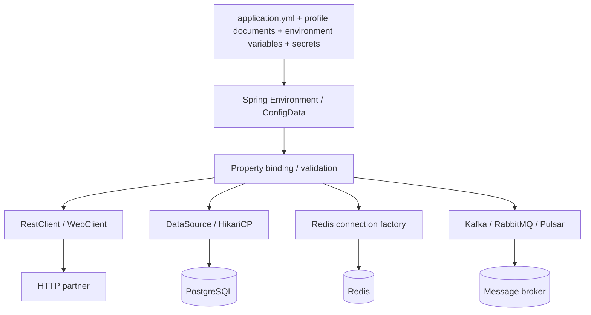

# Properties, biến môi trường và cấu hình kết nối theo từng môi trường

> **Chương:** Cấu hình kết nối  
> **Module:** SPRING_BOOT_INTEGRATION — tích hợp hệ thống trong Spring Boot qua HTTP client, cơ sở dữ liệu, cache, broker thông điệp và các adapter Spring Integration; trọng tâm là quản lý cấu hình, hợp đồng dữ liệu, giao dịch, lỗi, xử lý trùng lặp, kiểm thử và quan sát các luồng thực tế.

## 1. Bài toán: cùng một artifact, nhiều môi trường chạy

Một ứng dụng đặt hàng dùng `RestClient` để gọi dịch vụ thanh toán, JDBC để lưu PostgreSQL, Redis làm cache và Kafka để công bố `OrderCreated`. Khi triển khai sang máy lập trình viên, CI, staging và production, **code Java không nên thay đổi chỉ vì địa chỉ host, tài khoản hay timeout khác nhau**.

Những thứ phải thay đổi theo môi trường gồm:

- Địa chỉ dịch vụ: HTTP base URL, JDBC URL, Redis host, Kafka bootstrap servers, RabbitMQ/Pulsar broker.
- Danh tính kết nối: username/password, API key, token, certificate và truststore.
- Giới hạn tài nguyên: số connection, thời gian chờ, concurrency, batch, retry budget.
- Chính sách tích hợp: bật/tắt một adapter, sử dụng stub ở local, ràng buộc TLS ở production.
- Cách quan sát: log level, tracing exporter, metric tag có cardinality thấp.

Spring Boot gọi cách tiếp cận này là **externalized configuration**: đóng gói cùng một ứng dụng, nhưng truyền cấu hình phù hợp qua tệp, biến môi trường, command-line args hoặc hệ thống secret/config được hỗ trợ.



Sơ đồ chỉ mô tả luồng cấu hình. **Bean được tạo thành công không chứng minh kết nối tới hệ thống đích đang sẵn sàng**: xác thực, DNS, TLS, quyền topic và sự cố mạng có thể chỉ lộ ra ở thời điểm gửi request hoặc mở connection.

### 1.1. Mục tiêu học tập

Sau bài này, bạn có thể:

1. Phân biệt properties, nguồn cấu hình, cấu hình theo profile và giá trị bí mật.
2. Đặt tên biến môi trường và hiểu relaxed binding khi ánh xạ tới thuộc tính Spring Boot.
3. Tổ chức cấu hình `local`, `test`, `staging`, `prod` mà không nhân bản mã nguồn.
4. Dùng `@ConfigurationProperties`, kiểm tra điều kiện hợp lệ và xây bean HTTP client có cấu hình rõ ràng.
5. Cấu hình JDBC, Redis và broker theo môi trường, tránh giá trị mặc định không an toàn.
6. Kiểm thử việc override cấu hình, phát hiện cấu hình lệch, xử lý secret và quan sát lỗi kết nối.

## 2. Thuật ngữ cấu hình quan trọng

| Thuật ngữ | Ví dụ | Vai trò |
| --- | --- | --- |
| **Property key** | `spring.datasource.url` | Tên định danh cấu hình |
| **Property value** | `jdbc:postgresql://db:5432/orders` | Giá trị được dùng để thiết lập client |
| **Property source** | `application.yml`, biến môi trường, system property, CLI | Nguồn đưa key/value vào `Environment` |
| **Profile** | `local`, `test`, `prod` | Chọn nhóm cấu hình/bean gắn với môi trường |
| **Placeholder** | `${DB_URL}` hoặc `${APP_PORT:8080}` | Lấy giá trị từ `Environment`, có thể có default |
| **Relaxed binding** | `SPRING_DATASOURCE_URL` → `spring.datasource.url` | Chấp nhận một số biến thể định dạng tên property |
| **Configuration properties** | `@ConfigurationProperties(prefix="integration.partner")` | Bind nhóm property thành object typed, có validation |
| **Config data** | application files, config import, config tree | Cơ chế tải nguồn cấu hình trong quá trình khởi động |
| **Secret** | API key, password, private key | Giá trị nhạy cảm cần kênh lưu trữ và phân phối riêng |

**Quy tắc cốt lõi:** đưa *địa chỉ, credentials và thông số kết nối* ra khỏi code Java, nhưng **đừng coi mọi cấu hình là bí mật**. Hostname/timeout là configuration; password/token/private key là secret và cần kiểm soát vòng đời riêng.

## 3. Thứ tự ưu tiên: nếu một property xuất hiện ở nhiều nơi

Spring Boot tổng hợp nhiều nguồn thành một `Environment`. Khi cùng một key có nhiều giá trị, **nguồn có độ ưu tiên cao hơn sẽ thắng**. Với cách chạy ứng dụng thông thường (không xét cấu hình test đặc biệt), có thể hình dung những nguồn quen thuộc theo thứ tự **cao → thấp**:

| Nguồn | Ví dụ | Ghi chú |
| --- | --- | --- |
| Command-line argument | `--server.port=9090` | Thường ưu tiên hơn tệp config và OS environment |
| `SPRING_APPLICATION_JSON` | `{"server":{"port":9090}}` | Có thể chứa nhiều property ở dạng JSON; không dùng để ghi secret bừa bãi |
| Java system property | `-Dserver.port=9090` | Truyền khi khởi chạy JVM |
| Biến môi trường hệ điều hành | `SERVER_PORT=9090` | Phổ biến trong container/Kubernetes |
| Config data theo profile/import | `application-prod.yml` | Cách thắng/thua chi tiết phụ thuộc vị trí, thứ tự import và quy tắc ConfigData |
| Config data mặc định | `application.yml` | Đặt cấu hình chung, giá trị không nhạy cảm |
| Default properties của ứng dụng | Giá trị mặc định do code khởi tạo SpringApplication cấp | Chỉ dùng khi không có nguồn cao hơn |

**Lưu ý:** đây là bảng tóm lược **những nguồn hay gặp**, không phải danh sách đầy đủ mọi property source. Các nguồn dành cho kiểm thử như `@TestPropertySource`, `@SpringBootTest(properties=...)`, `@DynamicPropertySource` có precedence riêng. Quy tắc cho tệp profile/import cũng phức tạp hơn “profile luôn thắng mọi nguồn”. Khi có tranh chấp, kiểm tra giá trị hiệu lực và **nguồn gốc property** trong môi trường đang chạy.

Ví dụ `application.yml` có `server.port: 8080`, biến môi trường `SERVER_PORT=8181` và CLI `--server.port=8282` thì giá trị cuối cùng trong cách chạy mặc định là **8282**.

### 3.1. Thứ tự ưu tiên trong nhóm ConfigData

Với cấu hình mặc định do Spring Boot tải:

- `application.yml` mang cấu hình chung.
- `application-prod.yml` được tải khi profile `prod` có hiệu lực và có thể override giá trị cùng key trong tệp chung.
- Khi nhiều profile cùng active, thứ tự khai báo profile và thứ tự tài liệu có thể ảnh hưởng property cuối; cấu hình phức tạp nên được kiểm chứng thay vì phỏng đoán.
- Nguồn được import bằng `spring.config.import` có quy tắc ưu tiên và vị trí riêng trong cơ chế ConfigData.
- Biến môi trường thường override config data đã tải, nhưng không nhất thiết override CLI/system properties.

**Cấu hình connection không nên phụ thuộc vào nhiều tầng override khó truy vết.** Nếu `KAFKA_BOOTSTRAP_SERVERS` được đưa vào bởi một deployment pipeline, tránh đồng thời sửa cùng key ở CLI và tệp cấu hình không được kiểm soát.

## 4. Đặt tên biến môi trường đúng cho Spring Boot

Spring Boot có quy tắc **relaxed binding** cho `@ConfigurationProperties`. Với dạng canonical property name khi chuyển sang biến môi trường, quy ước phổ biến là:

1. Đổi dấu chấm thành dấu gạch dưới.
2. Bỏ dấu gạch nối trong từng phần tên.
3. Chuyển toàn bộ thành chữ in hoa.

Ví dụ:

| Property | Biến môi trường | Ghi chú |
| --- | --- | --- |
| `spring.datasource.url` | `SPRING_DATASOURCE_URL` | JDBC URL |
| `spring.datasource.username` | `SPRING_DATASOURCE_USERNAME` | Tài khoản DB |
| `spring.datasource.hikari.maximum-pool-size` | `SPRING_DATASOURCE_HIKARI_MAXIMUMPOOLSIZE` | Chú ý: `maximum-pool-size` → `MAXIMUMPOOLSIZE`, không bắt buộc thêm underscore giữa các từ |
| `spring.data.redis.host` | `SPRING_DATA_REDIS_HOST` | Redis |
| `spring.kafka.bootstrap-servers` | `SPRING_KAFKA_BOOTSTRAPSERVERS` | Dấu gạch nối được loại bỏ trong canonical chuyển đổi; ứng dụng cũng có thể dùng biến riêng qua placeholder |
| `spring.rabbitmq.host` | `SPRING_RABBITMQ_HOST` | RabbitMQ |
| `spring.pulsar.client.service-url` | `SPRING_PULSAR_CLIENT_SERVICEURL` | Pulsar broker binary URL |
| `integration.partner.base-url` | `INTEGRATION_PARTNER_BASEURL` | Property ứng dụng tự định nghĩa |

**Phân biệt:** convention canonical khi Boot bind trực tiếp và cách dùng **placeholder môi trường theo tên bạn tự đặt**:

```yaml
integration:
  partner:
    base-url: ${PARTNER_BASE_URL}
```

Ở ví dụ trên, biến thật là `PARTNER_BASE_URL` vì **placeholder gọi đúng tên đó**, không cần phụ thuộc Spring Boot suy luận từ `integration.partner.base-url`. Cách này thường dễ đọc hơn đối với tên ghép có nhiều dấu gạch nối.

### 4.1. Không suy đoán tùy tiện về dấu gạch ngang

Một số biến môi trường phổ biến trong hệ sinh thái có dạng `SPRING_KAFKA_BOOTSTRAP_SERVERS`, nhưng quy tắc biến đổi canonical property name cho binder là bỏ dấu `-`, nên dạng có thể xác minh độc lập là `SPRING_KAFKA_BOOTSTRAPSERVERS`. Khi tích hợp thông qua YAML:

```yaml
spring:
  kafka:
    bootstrap-servers: ${KAFKA_BOOTSTRAP_SERVERS}
```

thì `KAFKA_BOOTSTRAP_SERVERS` hoàn toàn rõ ràng và dễ quản lý. Tránh suy từ một biến không hoạt động rằng Kafka starter lỗi; trước tiên xác minh **property cuối cùng đã bind**.

Với biến môi trường chứa **danh sách**, map có key đặc biệt hoặc cấu trúc lồng sâu, rules có thể khác chuỗi đơn: chỉ số list được bao bởi underscore trong tên biến, map key có dấu câu có thể cần binding qua YAML/JSON. Đối với các cấu trúc phức tạp, ưu tiên file ConfigData có schema rõ thay vì một dãy env vars khó kiểm thử.

## 5. Thiết kế cấu hình chung và cấu hình theo profile

Một cách tổ chức dễ hiểu là giữ **mặc định an toàn, không nhạy cảm** trong `application.yml`, rồi dùng `application-local.yml`, `application-test.yml`, `application-staging.yml` và `application-prod.yml` cho những khác biệt rõ ràng. Những khối dưới đây là **nội dung file minh họa**, không phải yêu cầu tạo thêm file khi học bài này.

### 5.1. Cấu hình chung: application.yml

```yaml
# application.yml
spring:
  application:
    name: order-integration

  datasource:
    driver-class-name: org.postgresql.Driver
    url: ${ORDERS_DB_URL}
    username: ${ORDERS_DB_USER}
    password: ${ORDERS_DB_PASSWORD}
    hikari:
      maximum-pool-size: 12
      connection-timeout: 3000 # milliseconds (HikariCP)

  data:
    redis:
      host: ${REDIS_HOST}
      port: ${REDIS_PORT:6379}

  kafka:
    bootstrap-servers: ${KAFKA_BOOTSTRAP_SERVERS}
    producer:
      acks: all

integration:
  partner:
    base-url: ${PARTNER_BASE_URL}
    api-key: ${PARTNER_API_KEY}
    connect-timeout: 1s
    response-timeout: 3s
```

Các thuộc tính trong `integration.partner` do **ứng dụng** định nghĩa; chúng không tự tạo HTTP client, trừ khi ứng dụng viết configuration class sử dụng chúng. Các key như `spring.datasource.*`, `spring.data.redis.*` và `spring.kafka.*` được Spring Boot autoconfigure **nếu thư viện và điều kiện tương ứng có mặt**.

Trong ví dụ, thiếu một trong các biến `ORDERS_DB_URL`, `ORDERS_DB_USER`, `ORDERS_DB_PASSWORD`, `REDIS_HOST`, `KAFKA_BOOTSTRAP_SERVERS`, `PARTNER_BASE_URL` hoặc `PARTNER_API_KEY` phải được coi là lỗi cấu hình cho ứng dụng **thật sự cần tất cả kết nối đó**. Nếu module không dùng Redis/Kafka, **không nên bắt buộc** các giá trị đó một cách vô lý; hãy tách adapter hoặc cấu hình feature để ứng dụng chỉ yêu cầu các dependency đã bật.

**Không đặt mặc định production credential** trong placeholder, ví dụ tránh `${DB_PASSWORD:admin123}`. Có thể có default cho số cổng hoặc timeout không nhạy cảm (như `REDIS_PORT:6379`), nhưng hãy xem xét tránh fallback sang môi trường local khi triển khai production.

### 5.2. Profile local: application-local.yml

```yaml
# application-local.yml
spring:
  datasource:
    hikari:
      maximum-pool-size: 4

logging:
  level:
    com.example.integration: DEBUG

integration:
  partner:
    connect-timeout: 2s
    response-timeout: 5s
```

Tệp này chỉ thay các giá trị có lý do khác với cấu hình chung. Thông tin host, password, API key vẫn được cấp từ môi trường chạy local, ví dụ qua shell hoặc IDE run configuration; **không ghi secret vào file được commit**.

Nếu local cần thay đối tác bằng một mock server, trỏ `PARTNER_BASE_URL` tới endpoint của mock trong môi trường dev. Khi ứng dụng chạy trong container, hostname phải là tên có thể phân giải **bên trong container network**, không suy `localhost` luôn là máy host.

### 5.3. Profile staging: application-staging.yml

```yaml
# application-staging.yml
spring:
  datasource:
    hikari:
      maximum-pool-size: 8

integration:
  partner:
    connect-timeout: 1s
    response-timeout: 4s
```

Staging thường giống production về cấu trúc broker/TLS/schema, nhưng tách tài khoản, topic, database và dữ liệu. **Không dùng chung production topic hoặc credential**, kể cả khi staging ở cùng cluster hạ tầng.

### 5.4. Profile production: application-prod.yml

```yaml
# application-prod.yml
spring:
  datasource:
    hikari:
      maximum-pool-size: 20

management:
  endpoint:
    health:
      show-details: never

integration:
  partner:
    connect-timeout: 1s
    response-timeout: 2s
```

Không ghi URLs và secrets production trực tiếp vào file này. Chúng đến từ deployment environment/secret store. Giá trị timeout, Hikari pool size phải được đo cùng concurrency của ứng dụng, giới hạn kết nối PostgreSQL và SLA của đối tác; số liệu trên chỉ mang tính ví dụ.

**Không tự suy ra profile `prod` được kích hoạt khi image chạy trên Kubernetes.** Phải chọn active profile từ môi trường khởi chạy.

### 5.5. Kích hoạt profile

Ví dụ từ shell Unix:

```bash
export SPRING_PROFILES_ACTIVE=local
export ORDERS_DB_URL='jdbc:postgresql://127.0.0.1:5432/orders_local'
export ORDERS_DB_USER='app_local'
# ORDERS_DB_PASSWORD và PARTNER_API_KEY phải lấy từ secret/dev environment
export REDIS_HOST='127.0.0.1'
export KAFKA_BOOTSTRAP_SERVERS='127.0.0.1:9092'
export PARTNER_BASE_URL='http://127.0.0.1:8089'
java -jar app.jar
```

Hoặc khi khởi chạy:

```bash
java -jar app.jar --spring.profiles.active=staging
```

Các lệnh trên minh họa cách đặt cấu hình, **không đủ để khởi chạy** nếu những secret bắt buộc chưa được cấp. `SPRING_PROFILES_ACTIVE` hoặc `--spring.profiles.active=...` chọn profile; `SPRING_PROFILES_DEFAULT` có thể chọn default khi không có profile active, nhưng không nên dùng default thay một quyết định triển khai production rõ ràng.

### 5.6. Cấu hình nhiều document trong cùng file

Thay vì tách file, Spring Boot cũng hỗ trợ multiple YAML documents được phân tách bởi `---` cùng `spring.config.activate.on-profile`:

```yaml
app:
  feature:
    directory-lookup-enabled: false
---
spring:
  config:
    activate:
      on-profile: prod
app:
  feature:
    directory-lookup-enabled: true
```

Đây là một **ví dụ độc lập** khác với bộ file `application-*.yml` trên. Dùng một kiểu tổ chức nhất quán để dễ truy vết precedence. Không đặt `spring.profiles.active` hoặc `spring.profiles.default` trong **tài liệu chỉ được kích hoạt bởi profile**, vì Spring Boot có ràng buộc đối với nơi khai báo các thuộc tính chọn profile.

Với môi trường có nhiều điều kiện tùy chọn, `spring.profiles.group.*` có thể gom profile logic (ví dụ `prod` kích hoạt `observability`), nhưng cũng làm precedence phức tạp: nên có kiểm thử xác nhận profile active và giá trị cuối.

## 6. @ConfigurationProperties: nhóm cấu hình HTTP client theo kiểu dữ liệu

Dùng `@Value("${integration.partner.base-url}")` cho một property rất đơn giản vẫn được, nhưng khi có URL, authentication và nhiều timeout, `@ConfigurationProperties` thường rõ hơn và dễ kiểm tra lỗi lúc startup.

### 6.1. Dependency cho Bean Validation

Ví dụ Spring Boot 3.2–3.5, Java 17+:

```groovy
dependencies {
    implementation 'org.springframework.boot:spring-boot-starter-web'
    implementation 'org.springframework.boot:spring-boot-starter-validation'
    testImplementation 'org.springframework.boot:spring-boot-starter-test'
}
```

Để BOM của Boot quản lý phiên bản Spring Framework, Jakarta Validation và HTTP client. Phần validate ở đây dùng package `jakarta.validation.constraints.*` thuộc Boot 3.x.

### 6.2. Immutable record và validation

```java
import java.net.URI;
import java.time.Duration;
import jakarta.validation.constraints.NotBlank;
import jakarta.validation.constraints.NotNull;
import org.springframework.boot.context.properties.ConfigurationProperties;
import org.springframework.validation.annotation.Validated;

@Validated
@ConfigurationProperties(prefix = "integration.partner")
public record PartnerProperties(
        @NotNull URI baseUrl,
        @NotBlank String apiKey,
        @NotNull Duration connectTimeout,
        @NotNull Duration responseTimeout) {

    public PartnerProperties {
        if (connectTimeout != null &&
                (connectTimeout.isNegative() || connectTimeout.isZero())) {
            throw new IllegalArgumentException(
                    "connect-timeout must be positive");
        }
        if (responseTimeout != null &&
                (responseTimeout.isNegative() || responseTimeout.isZero())) {
            throw new IllegalArgumentException(
                    "response-timeout must be positive");
        }
    }
}
```

**Điểm cần hiểu:**

- Boot 3.x có thể constructor-bind record mà không cần dùng `@ConstructorBinding` cho trường hợp này.
- `base-url` → `baseUrl` nhờ relaxed binding; `1s` và `3s` được chuyển thành `Duration`.
- `@NotNull`/`@NotBlank` giúp thiếu giá trị bắt buộc dẫn tới lỗi cấu hình sớm, thay vì chờ HTTP request đầu tiên.
- Không xem việc class có `@ConfigurationProperties` là đủ: **bean phải được đăng ký** bằng `@ConfigurationPropertiesScan` hoặc `@EnableConfigurationProperties` (hoặc cấu hình Boot phù hợp).
- Record có `apiKey` không được tự động log qua `toString()`: giá trị secret có thể xuất hiện nguyên văn. Không log configuration properties object khi chứa token/password.

### 6.3. Khởi tạo RestClient từ properties đã được bind

```java
import java.net.http.HttpClient;
import org.springframework.boot.context.properties.EnableConfigurationProperties;
import org.springframework.context.annotation.Bean;
import org.springframework.context.annotation.Configuration;
import org.springframework.http.client.JdkClientHttpRequestFactory;
import org.springframework.web.client.RestClient;

@Configuration(proxyBeanMethods = false)
@EnableConfigurationProperties(PartnerProperties.class)
public class PartnerHttpConfiguration {

    @Bean("partnerRestClient")
    RestClient partnerRestClient(RestClient.Builder builder,
                                 PartnerProperties properties) {
        HttpClient jdkClient = HttpClient.newBuilder()
                .connectTimeout(properties.connectTimeout())
                .build();

        JdkClientHttpRequestFactory factory =
                new JdkClientHttpRequestFactory(jdkClient);
        factory.setReadTimeout(properties.responseTimeout());

        return builder
                .baseUrl(properties.baseUrl().toString())
                .requestFactory(factory)
                .defaultHeader("X-Api-Key", properties.apiKey())
                .build();
    }
}
```

Ví dụ minh họa cách **adapter sở hữu cấu hình riêng**, không quy định mọi đối tác đều dùng header `X-Api-Key`; trong hệ thống thật phải dùng phương thức authentication do đối tác cung cấp, có thể là OAuth2/mTLS. `RestClient.Builder` do Boot cấu hình có thể mang những customizer chung; việc ghi đè request factory như ví dụ cần kiểm tra có còn giữ đúng SSL bundle, pooling và monitoring mà ứng dụng muốn hay không.

Không truyền URL/token động từ request của người dùng vào `baseUrl` hoặc header mặc định mà chưa có validation; tránh SSRF và rò rỉ credential sang host ngoài danh sách được phê duyệt. Khi có nhiều đối tác, tạo client riêng với `@Qualifier` rõ ràng.

### 6.4. Fail fast khác kết nối được

`@ConfigurationProperties` validation xác nhận **định dạng và quy tắc cấu hình**, không kiểm tra rằng:

- DNS của đối tác phân giải được hoặc certificate hợp lệ.
- Database sẵn sàng, schema đã migrate và account có quyền.
- Kafka có topic/ACL phù hợp hay consumer group xử lý được.
- Redis hoặc LDAP có thể kết nối từ đúng network namespace.

Đánh giá readiness/health và integration test riêng cho từng dependency bắt buộc. Một service có thể chọn **fail startup** nếu một dependency sống còn không truy cập được, hoặc khởi động ở trạng thái **not ready** và tiếp tục phục hồi; lựa chọn này phụ thuộc SLA và mô hình vận hành.

## 7. Quản lý secret: môi trường, ConfigData import và config tree

Biến môi trường thường tiện để truyền password/token vào process, nhưng **không mặc nhiên an toàn**: giá trị có thể lộ qua cấu hình orchestration, debug dump, diagnostic tools, shell history hoặc quyền đọc process environment. Chọn kênh cấp phát dựa trên chính sách bảo mật của tổ chức; không để secret trong source code hoặc committed YAML.

### 7.1. Truyền secret qua placeholder

```yaml
spring:
  datasource:
    username: ${ORDERS_DB_USER}
    password: ${ORDERS_DB_PASSWORD}

integration:
  partner:
    api-key: ${PARTNER_API_KEY}
```

**Không dùng default giả** cho credential của production. Nếu bắt buộc phải dùng credential test ở local, quản lý trong cấu hình dev **không commit** hoặc secret test có phạm vi riêng.

### 7.2. Import thư mục secret dạng config tree

Spring Boot hỗ trợ `configtree:`: mỗi file bên dưới một thư mục được đọc dưới tên property tương ứng. Ví dụ một volume bí mật được mount:

```text
/run/secrets/
├── spring.datasource.password
└── integration.partner.api-key
```

Mỗi file chỉ chứa **giá trị secret** (không phải dòng `key=value`). Import trong configuration:

```yaml
spring:
  config:
    import: "configtree:/run/secrets/"
```

Nếu file `spring.datasource.password` chứa password thực, secret đó trở thành property `spring.datasource.password`. File `integration.partner.api-key` tương tự. Directory mount phải tồn tại khi import **không** có tiền tố `optional:`; điều này giúp phát hiện lỗi triển khai sớm.

Trong môi trường local không có mount, có thể dùng:

```yaml
spring:
  config:
    import: "optional:configtree:/run/secrets/"
```

Tuy nhiên **không nên làm optional ở production cho secret bắt buộc** chỉ để ứng dụng “khởi động cho qua”. Nhớ rằng config tree là một nguồn ConfigData; giá trị của nó vẫn chịu precedence so với environment/CLI. Tránh đồng thời đặt cùng một secret ở nhiều nguồn không có kiểm soát.

Để dùng secret provider chuyên dụng như Vault, AWS Secrets Manager hoặc Kubernetes external secrets, cần thư viện/config integration phù hợp với phiên bản Boot và mô hình tổ chức. Không tự giả định chỉ cần `spring.config.import=vault:...` sẽ hoạt động nếu chưa cài và cấu hình plugin tương ứng.

### 7.3. Secret rotation và thời điểm cập nhật

Spring Boot bind các configuration properties khi application context được tạo; **thay đổi file secret hoặc biến môi trường sau khi ứng dụng đã chạy không tự động làm mọi client cập nhật credential**. Nhiều client giữ connection pool, credential cache hoặc TLS context.

Với rotation:

1. Xác định liệu service nhận được thông báo thay đổi hay phải rolling restart/recreate bean.
2. Có giai đoạn chuyển tiếp cho secret cũ và secret mới nếu hệ thống hỗ trợ.
3. Kiểm chứng reconnect của DataSource, Redis, LDAP, Kafka và HTTP client sau rotate.
4. Xử lý lỗi xác thực tách khỏi lỗi tạm thời; không retry vô hạn với password đã hết hiệu lực.
5. Không ghi log giá trị cấu hình cũ/mới trong quá trình chẩn đoán.

## 8. Cấu hình phù hợp với từng loại kết nối

Mỗi starter có prefix và cấu trúc khác nhau. Những ví dụ dưới đây chỉ minh họa **cấu hình cần thiết cho đúng connector**, không có nghĩa một ứng dụng phải bật tất cả. Chỉ thêm dependency/starter cho các integration thực sự sử dụng.

### 8.1. JDBC/PostgreSQL và HikariCP

```yaml
spring:
  datasource:
    url: ${ORDERS_DB_URL}
    username: ${ORDERS_DB_USER}
    password: ${ORDERS_DB_PASSWORD}
    hikari:
      maximum-pool-size: ${DB_POOL_MAX:12}
      connection-timeout: 3000
```

Lưu ý:

- `url` là JDBC URL (ví dụ `jdbc:postgresql://postgres:5432/orders`), không phải `http://...`.
- Khi dùng `spring-boot-starter-jdbc` hoặc JPA starter và driver PostgreSQL đúng, Boot có thể cấu hình `DataSource`/HikariCP theo classpath.
- Một connection pool có tối đa 12 kết nối **không** có nghĩa 12 request toàn hệ thống; nếu có 10 instance, tổng số kết nối có thể lớn gấp nhiều lần. Đối chiếu với `max_connections` của DB và các hệ thống migration/background job.
- `spring.datasource.hikari.connection-timeout` trong ví dụ HikariCP dùng millisecond. Timeout lấy kết nối từ pool **khác** network connect timeout của driver và timeout query SQL.
- Không giữ DB transaction mở trong thời gian chờ HTTP partner hoặc broker ACK không cần thiết; thiết kế ranh giới consistency bằng outbox khi phù hợp.

**Đặc biệt với migration:** cấu hình `spring.flyway.*` hoặc `spring.liquibase.*` có thể dùng cùng DataSource hoặc DataSource riêng. Đừng trỏ migration của staging vào DB production do nhầm biến môi trường.

### 8.2. Redis/cache

```yaml
spring:
  data:
    redis:
      host: ${REDIS_HOST}
      port: ${REDIS_PORT:6379}
      password: ${REDIS_PASSWORD}
      timeout: 2s
```

Nếu Redis không yêu cầu password trong môi trường test, không nhất thiết phải khai báo property password trong profile đó; với production, thiết lập auth và TLS theo cách cluster hỗ trợ.

Redis cache có thể được phép degrade khi broker/cache unavailable **nếu nghiệp vụ cho phép**; Redis làm state dùng để chống trùng hoặc distributed lock lại có yêu cầu an toàn khác. Không biến lỗi Redis thành “dữ liệu chắc chắn không tồn tại” nếu điều đó có thể làm tạo đơn/thanh toán trùng.

Với Redis Sentinel hoặc Cluster, bộ property và topology khác cấu hình một node độc lập. Không chỉ thay một hostname mà kỳ vọng failover hoặc cluster slot routing tự hoạt động.

### 8.3. Apache Kafka

```yaml
spring:
  kafka:
    bootstrap-servers: ${KAFKA_BOOTSTRAP_SERVERS}
    producer:
      acks: all
      properties:
        "[enable.idempotence]": true
```

`bootstrap-servers` chỉ dùng để lấy metadata ban đầu. Kafka broker có thể trả **advertised listeners** khác; client phải truy cập được cả các địa chỉ đó. Lỗi rất thường gặp khi code chạy trong container nhưng broker quảng cáo `localhost` hoặc IP chỉ tồn tại ở máy khác.

`acks=all` xác định mức acknowledgment của producer; **không** chứng minh consumer đã xử lý message. Idempotent producer tránh một số trùng lặp trong producer retry, **không** thay thế `eventId` và idempotent consumer khi ứng dụng phát lại cùng event logic.

Với Kafka có SASL/TLS, cấu hình security protocol, mechanism, auth và truststore qua secret/config an toàn, theo tài liệu version Kafka client/cluster. Không bỏ qua certificate validation để “sửa” lỗi kết nối.

### 8.4. RabbitMQ / AMQP

```yaml
spring:
  rabbitmq:
    host: ${RABBITMQ_HOST}
    port: ${RABBITMQ_PORT:5672}
    username: ${RABBITMQ_USER}
    password: ${RABBITMQ_PASSWORD}
    virtual-host: ${RABBITMQ_VHOST:/}
```

Nếu dùng kết nối `amqps://`, TLS hoặc địa chỉ broker dạng URI, kiểm tra đúng property và security settings tương ứng thay vì chỉ thay port. Virtual host trong RabbitMQ là phạm vi logic khác, cần được cấp quyền rõ. Kết nối broker thành công không bảo đảm đã khai báo queue/exchange/binding hay có quyền publish/consume.

### 8.5. Apache Pulsar

```yaml
spring:
  pulsar:
    client:
      service-url: ${PULSAR_BROKER_URL:pulsar://localhost:6650}
    admin:
      service-url: ${PULSAR_ADMIN_URL:http://localhost:8080}
```

Đây là ví dụ local; khi lên staging/prod, **không được dùng fallback localhost**. Pulsar binary URL (`pulsar://` hoặc TLS `pulsar+ssl://`) khác HTTP(S) admin URL. Nếu authentication được yêu cầu, cấu hình riêng client/admin credentials. Việc broker và admin endpoint cùng truy cập được phải được kiểm chứng.

### 8.6. LDAP / directory

```yaml
spring:
  ldap:
    urls: ${LDAP_URL}
    base: ${LDAP_BASE_DN}
    username: ${LDAP_BIND_DN}
    password: ${LDAP_BIND_PASSWORD}
```

Ưu tiên `ldaps://` hoặc StartTLS đúng chính sách. `base` là base DN để search, không phải DN của tài khoản bind; `username` là định danh bind. Nếu LDAP dùng để xác thực người dùng cuối, chỉ thêm data LDAP starter không đủ để thiết kế authentication/authorization; cần Spring Security LDAP hoặc hệ thống nhận dạng phù hợp.

### 8.7. HTTP client cho một đối tác bên ngoài

```yaml
integration:
  partner:
    base-url: ${PARTNER_BASE_URL}
    api-key: ${PARTNER_API_KEY}
    connect-timeout: ${PARTNER_CONNECT_TIMEOUT:1s}
    response-timeout: ${PARTNER_RESPONSE_TIMEOUT:3s}
```

Phần này là **custom properties** nên ứng dụng phải tự tạo `RestClient`/`WebClient`, apply timeout, authentication, observation và giới hạn concurrency. Đổi profile không thay đổi cách API ngoài xử lý retry: HTTP POST timeout có thể có kết quả **chưa rõ**. Giữ idempotency key hoặc thực hiện đối soát trước khi gửi lại.

### 8.8. Spring Integration và adapter

Với Spring Integration HTTP/JMS/AMQP/file adapters, có những bean cấu hình dựa trên các `ConnectionFactory` hoặc `RestClient/WebClient` đã chuẩn hóa. Hãy để cấu hình connection được sở hữu ở **một nơi** và inject vào adapter tương ứng.

Nếu một adapter chỉ bật ở production, có thể guard phần cấu hình bằng `@ConditionalOnProperty` hoặc `@Profile`. Tuy nhiên cần chọn rõ mặc định: khi không khai báo feature flag, adapter **không** tự bật vì một property bị gõ sai. Không để một bean producer/consumer chạy thật trong local nếu chưa chủ động cấu hình endpoint test.

## 9. Phân phối cấu hình qua Docker, Kubernetes và CI

### 9.1. Chạy trong container: không hiểu nhầm localhost

Trong một Docker network, `localhost` bên trong container Spring Boot **thường là chính container đó**, không phải container PostgreSQL/Kafka/Redis hay máy host.

Ví dụ khi hostname của các service trong cùng network là `postgres`, `redis` và `kafka`, có thể đặt:

```text
SPRING_PROFILES_ACTIVE=staging
ORDERS_DB_URL=jdbc:postgresql://postgres:5432/orders
REDIS_HOST=redis
KAFKA_BOOTSTRAP_SERVERS=kafka:9092
PARTNER_BASE_URL=https://partner-staging.example.org/api
```

Đây là mô tả các biến cấu hình; không nên commit danh sách secrets dưới dạng plaintext vào Docker Compose file hoặc CI log. DNS và advertised listener phải đúng với network chạy thực tế.

### 9.2. Kubernetes ConfigMap và Secret

Một deployment phổ biến tách:

| Loại | Ví dụ | Kênh phù hợp |
| --- | --- | --- |
| Non-secret | `SPRING_PROFILES_ACTIVE`, timeout, pool size, Kafka bootstrap hostname | ConfigMap / GitOps config có review |
| Secret | DB password, partner API key, broker credentials, private key | Kubernetes Secret/External Secrets/secret manager theo policy |
| Mounted config tree | File `spring.datasource.password`, `integration.partner.api-key` | Volume mount + `spring.config.import=configtree:/...` |

Kubernetes `Secret` **không tự mang nghĩa encrypted-at-rest hoặc an toàn tuyệt đối**: cần kiểm soát RBAC, encryption-at-rest của cluster, audit, rotation và quyền truy cập của container. ConfigMap không dùng để lưu password/token.

Nếu config được injected bằng biến môi trường, pod thường cần rollout để nhận giá trị mới. Khi secret được mount dưới dạng file, cơ chế volume update có thể tồn tại nhưng client Java trong application vẫn chưa chắc tự rebind credential hoặc rebuild connection pool. Kiểm thử rotation/rollout, không suy từ việc file thay đổi rằng ứng dụng đã áp dụng.

### 9.3. CI và test environment

CI nên dùng database/broker test riêng hoặc Testcontainers; không cấp quyền production vào môi trường build. Có thể dùng profile `test` và test property overrides để giảm số secrets cần thiết.

Với test chạy song song, tài nguyên động (port container, database name, topic name) nên cấp phát độc lập; không hard-code tất cả test tới một shared `localhost:5432`. Kết quả test phụ thuộc đúng nguồn config mà test thực dùng; vì thế phải assert giá trị đã bind thay vì chỉ kiểm tra có file YAML.

## 10. Bật/tắt kết nối tùy theo môi trường mà không gây side effect

Trong Spring Boot, chỉ vì một dependency xuất hiện trên classpath không có nghĩa môi trường local/staging phải mở mọi connection của production. Một số adapter, listener hoặc publisher chủ động có thể làm việc khi application khởi động. Cần thiết kế **cờ bật tính năng** và điều kiện tạo bean, không dùng “URL rỗng” như cách tắt dịch vụ.

### 10.1. @Profile và @ConditionalOnProperty

```java
import org.springframework.boot.autoconfigure.condition.ConditionalOnProperty;
import org.springframework.context.annotation.Configuration;

@Configuration(proxyBeanMethods = false)
@ConditionalOnProperty(
        prefix = "integration.partner",
        name = "enabled",
        havingValue = "true")
class PartnerIntegrationFeatureConfiguration {
    // Đăng ký adapter/handler chủ động khi feature được bật.
}
```

Nếu `integration.partner.enabled` không được khai báo, điều kiện trên **không match** (vì `matchIfMissing` mặc định là false). Với integration có side effect (consumer tự chạy, poller, scheduled publish), đây là mặc định an toàn.

Ví dụ:

```yaml
integration:
  partner:
    enabled: ${PARTNER_INTEGRATION_ENABLED:false}
```

Đối với producer/adapter thật, có thể dùng `@ConditionalOnProperty` hoặc `@Profile("prod")` nhưng không nên dùng profile như một dạng **authorization**: nếu ai đó bật nhầm `prod` ở local, connection có thể kết nối nhầm production. Network policies, credentials và permissions vẫn cần được ràng buộc ở hạ tầng.

**Lưu ý quan trọng với validation:** nếu `PartnerProperties` được đăng ký trên toàn context và bắt buộc các trường secret/URL, nó có thể fail validation ngay cả khi feature adapter đang tắt. Khi muốn optional integration, cấu hình **phải đặt phần bind required properties và bean client vào nhánh điều kiện** hoặc tổ chức một bộ properties dùng giá trị nullable cùng validation có điều kiện. Không chỉ bọc handler mà quên config properties vẫn được bind vô điều kiện.

### 10.2. Chọn fail open hay fail closed theo nghiệp vụ

| Dependency | Khi unavailable | Quyết định |
| --- | --- | --- |
| DB nguồn sự thật cho đơn hàng | Không thể ghi/đọc trạng thái đơn | Thường fail closed hoặc readiness=false |
| HTTP partner tính phí | Không rõ thanh toán đã thực hiện chưa | Không tự retry POST nếu thiếu idempotency; đối soát |
| Redis dùng để cache profile hiển thị | Có thể gọi nguồn gốc thay thế nếu đáp ứng SLA | Có thể degrade, ghi metric |
| Redis dùng làm idempotency store | Không thể kiểm soát trùng lặp | Không mặc định bỏ qua bước chống trùng |
| Kafka producer cho sự kiện bắt buộc | Broker không nhận hoặc ACK không rõ | Ghi outbox bền vững, retry có giới hạn ở worker |
| LDAP kiểm tra trạng thái tài khoản | Không xác nhận quyền/đăng nhập | Thường fail closed, không coi timeout là “user hợp lệ” |

Đây là chính sách **tích hợp nghiệp vụ**, không phải lựa chọn của một property source. Cấu hình kết nối tốt phải phối hợp với contract và recovery policy, không chỉ chứa hostname.

## 11. Kiểm thử: xác minh giá trị được bind, không chỉ YAML viết đúng

### 11.1. Kiểm thử cấu hình thuần bằng ApplicationContextRunner

`ApplicationContextRunner` trong Spring Boot Test cho phép tạo context nhỏ với những property đã chỉ định, không cần chạy cả ứng dụng hoặc kết nối mạng. Ví dụ kiểm chứng `PartnerProperties` và bean `RestClient` của mục 6:

```java
import java.net.URI;
import java.time.Duration;
import org.junit.jupiter.api.Test;
import org.springframework.boot.test.context.runner.ApplicationContextRunner;
import org.springframework.web.client.RestClient;

import static org.assertj.core.api.Assertions.assertThat;

class PartnerConfigurationTest {
    private final ApplicationContextRunner runner =
            new ApplicationContextRunner()
                    .withUserConfiguration(PartnerHttpConfiguration.class)
                    .withBean(RestClient.Builder.class, RestClient::builder);

    @Test
    void bindsPropertiesAndCreatesClientWithoutNetworkCall() {
        runner.withPropertyValues(
                "integration.partner.base-url=https://partner.example.invalid/api",
                "integration.partner.api-key=placeholder-test-secret",
                "integration.partner.connect-timeout=500ms",
                "integration.partner.response-timeout=2s")
                .run(context -> {
                    assertThat(context).hasNotFailed();
                    PartnerProperties props =
                            context.getBean(PartnerProperties.class);
                    assertThat(props.baseUrl()).isEqualTo(
                            URI.create("https://partner.example.invalid/api"));
                    assertThat(props.connectTimeout()).isEqualTo(
                            Duration.ofMillis(500));
                    assertThat(props.responseTimeout()).isEqualTo(
                            Duration.ofSeconds(2));
                    assertThat(context).hasBean("partnerRestClient");
                });
    }

    @Test
    void rejectsMissingRequiredApiKey() {
        runner.withPropertyValues(
                "integration.partner.base-url=https://partner.example.invalid/api",
                "integration.partner.connect-timeout=500ms",
                "integration.partner.response-timeout=2s")
                .run(context -> assertThat(context).hasFailed());
    }
}
```

Kết quả kiểm thử ví dụ chứng minh **binding, validation và bean creation**; chưa chứng minh DNS, TLS, authentication hay timeout mạng. Trong production, không nên dùng một secret “test” bất kỳ để xác nhận credential hợp lệ; hãy kiểm tra tích hợp ở môi trường thử nghiệm riêng.

### 11.2. Dùng Testcontainers cấp thông số kết nối động

Với tích hợp JDBC, thay vì hard-code port `5432` trong CI, có thể dùng `@DynamicPropertySource`:

```java
import org.junit.jupiter.api.Test;
import org.springframework.boot.test.context.SpringBootTest;
import org.springframework.test.context.DynamicPropertyRegistry;
import org.springframework.test.context.DynamicPropertySource;
import org.testcontainers.containers.PostgreSQLContainer;
import org.testcontainers.junit.jupiter.Container;
import org.testcontainers.junit.jupiter.Testcontainers;

@Testcontainers
@SpringBootTest
class OrdersDatabaseIntegrationTest {

    @Container
    static final PostgreSQLContainer<?> postgres =
            new PostgreSQLContainer<>("postgres:16-alpine");

    @DynamicPropertySource
    static void databaseProperties(DynamicPropertyRegistry registry) {
        registry.add("spring.datasource.url", postgres::getJdbcUrl);
        registry.add("spring.datasource.username", postgres::getUsername);
        registry.add("spring.datasource.password", postgres::getPassword);
    }

    @Test
    void datasourceConnects() {
        // Thực thi một phép JDBC query/transaction thật,
        // không chỉ assert Spring context đã khởi động.
    }
}
```

Ví dụ này giả định test có `spring-boot-starter-test`, `org.testcontainers:junit-jupiter`, `org.testcontainers:postgresql` và JDBC driver PostgreSQL. Test còn cần cung cấp các thuộc tính **khác** mà context bắt buộc (HTTP partner, Redis, broker) hoặc tắt/sử dụng mock adapter của chúng.

Ở những phiên bản Boot có service connection support, có thể dùng `@ServiceConnection` để Boot tự cung cấp thông tin một số container được hỗ trợ. Đây là lựa chọn thay cho một phần `@DynamicPropertySource`; không cần kết hợp cả hai nếu không có lý do.

### 11.3. Những bài test cấu hình phải có

| Test | Điều cần assert |
| --- | --- |
| Thiếu `PARTNER_API_KEY` | Context chỉ fail khi integration đó thực sự bắt buộc; không âm thầm chạy với key rỗng |
| `response-timeout=3s` | Binder tạo đúng `Duration.ofSeconds(3)` |
| Property trong application.yml vs CLI/env | Nguồn có precedence cao hơn thắng theo dự kiến |
| `application-prod.yml` | Active profile `prod` được nhận, không kế thừa endpoint local vô ý |
| `spring.config.import=configtree:...` | Secret file đọc đúng key, permission mount đúng |
| Testcontainers PostgreSQL | App kết nối vào **host/port động** của container, không phải DB ngoài CI |
| Redis/Kafka/RabbitMQ/Pulsar | Có thể kết nối trong network test, auth/TLS/ACL/schema đúng |
| Không bật adapter | Bean listener/poller/producer phụ không khởi chạy |
| Secret rotation | Theo workflow đã thiết kế, client reload hoặc rollout được xác minh |
| Downstream timeout | Không retry vô hạn, không leak thread/connection, có metric lỗi |

**Không dùng một integration test có profile `test` để suy ra production đã cấu hình đúng**. Cần smoke test riêng cho connectivity, quyền, DNS/TLS và readiness ở staging trước khi release.

## 12. Debug khi giá trị thật không như mong đợi

### 12.1. Bảng lỗi thường gặp

| Triệu chứng | Khả năng | Kiểm tra |
| --- | --- | --- |
| `Could not resolve placeholder ...` | Thiếu biến môi trường/ConfigData | Secret injection, typo key, profile active, config import |
| `Failed to bind properties under ...` | Kiểu dữ liệu/validation sai | Duration, URI, boolean, dấu chấm/gạch nối trong property |
| Chạy local được nhưng CI không khởi động | Environment của IDE khác CI | Danh sách biến bắt buộc, scope secrets trong CI |
| Ứng dụng vẫn gọi endpoint local khi lên cluster | Fallback localhost hoặc profile không active | Resolved base URL, `SPRING_PROFILES_ACTIVE`, command-line override |
| DB pool timeout nhưng URL đúng | Pool cạn, DB max connections hoặc transaction giữ quá lâu | Hikari metrics, active/pending connections, thread/transaction traces |
| Kafka không connect dù bootstrap server hoạt động | `advertised.listeners` sai network | Metadata broker, DNS/ACL/TLS từ container thực |
| Broker đã connect nhưng publish 403/auth error | ACL/quyền topic chưa đủ | Tách transport connectivity và authorization |
| Tắt adapter bằng flag nhưng vẫn fail missing secret | Properties được bind/validated không theo conditional | Registration của config properties và điều kiện tạo bean |
| Rotated secret nhưng app dùng key cũ | Client/cache vẫn giữ credential khi runtime đang chạy | Reload/recreate connection factory, rolling restart |
| Actuator báo healthy nhưng flow vẫn lỗi | Health indicator chưa bao phủ đúng contract/end-to-end | Smoke test send/read, authentication và schema |

### 12.2. Conditions Evaluation Report và cấu hình hiệu lực

Trong dev:

```bash
java -jar app.jar --debug
```

Báo cáo điều kiện auto-configuration giúp biết `DataSource`, Kafka, Redis, HTTP client, listener... có được cấu hình tự động hoặc bị bean người dùng override không. Nhưng báo cáo match điều kiện **không thay thế** kiểm tra kết nối thực tế.

Spring Boot Actuator có các endpoint như `/actuator/env` và `/actuator/configprops` để phân tích property source/binding trong môi trường được phép. **Không expose chúng công khai**; cấu hình quyền truy cập, masking/sanitization và policy logging. Không dựa hoàn toàn vào masking để bảo vệ secrets khi cấp quyền truy cập actuator cho người không tin cậy.

Khi cần xác định **nguồn** của một property, ưu tiên metadata về origin (file/location/property source) hơn là in nguyên credential. Đối với secret, thường chỉ cần biết “có được cấp hay chưa” và “đến từ nguồn cấu hình nào được phê duyệt”, không cần log giá trị.

### 12.3. Quan sát kết nối sau khi startup

Một dashboard tích hợp nên theo dõi:

- HTTP client: số request, p95/p99 latency, connect/read timeout, retry, 429/503, pool acquire failures.
- JDBC/Hikari: active/idle/pending connections, connection timeout, query latency, transaction duration.
- Redis: connection/command errors, timeout, cache hit/miss, tác động lên idempotency store.
- Kafka/RabbitMQ/Pulsar: producer ACK latency, publish failures, consumer lag/backlog/redelivery.
- Adapter Spring Integration: số event xử lý, failure, DLT/recovery và thời gian luồng.
- Readiness: dependency sống còn đã sẵn sàng để tiếp nhận tải chưa; không biến health check thành một phép thử gây side effect không giới hạn.

Metrics/traces cụ thể tùy dependency, actuator, Micrometer registry và instrumentation đã bật; **không mặc định mọi metric tự xuất hiện chỉ vì thêm starter**. Tránh metric tags chứa URL đầy đủ, JWT, account ID hoặc giá trị rất nhiều biến thể.

## 13. Tình huống thực tế: cấu hình sai làm ảnh hưởng giao dịch và sự kiện

Xét một deployment staging:

```text
SPRING_PROFILES_ACTIVE=staging
ORDERS_DB_URL=jdbc:postgresql://postgres-staging:5432/orders
REDIS_HOST=redis-staging
KAFKA_BOOTSTRAP_SERVERS=kafka-staging:9092
PARTNER_BASE_URL=https://partner-staging.example.org/api
```

Trong lúc triển khai, biến `KAFKA_BOOTSTRAP_SERVERS` bị điền thành địa chỉ broker production. Ứng dụng vẫn có thể **khởi động thành công**, producer có thể kết nối và event test bị gửi vào topic production nếu tài khoản được cấp quyền sai phạm vi.

Đây không đơn thuần là lỗi YAML. Cần bảo vệ nhiều lớp:

1. **Config contract:** kiểm tra tên môi trường, hostname/topic được phép và kiểu dữ liệu ở startup.
2. **Isolation:** credentials staging không có quyền tới topic/broker production; network policy ngăn kết nối nhầm.
3. **Deployment review:** kiểm soát mapping ConfigMap/Secret và biến môi trường trong pipeline.
4. **Smoke test:** kiểm tra endpoint, TLS/ACL và topic test đúng môi trường trước khi nhận tải.
5. **Observability:** log tên profile, tên cluster được chuẩn hóa và kết quả connectivity — **không** log secret.
6. **Consistency:** event có thể phát trùng hoặc phát sai nơi; cần idempotent consumer và quy trình điều tra/reconciliation, không chỉ đổi URL rồi bỏ qua dữ liệu đã gửi.

Tương tự, nếu `ORDERS_DB_URL` trỏ vào production, tác động có thể nghiêm trọng ngay từ migration hoặc transaction đầu tiên. **Precedence và profile giúp chọn giá trị nhưng không phải hàng rào bảo mật**; quyền truy cập thực tế mới giới hạn được blast radius.

## 14. Checklist và câu hỏi tự kiểm tra

### 14.1. Checklist trước khi đưa integration lên production

- [ ] Đã xác định chính xác Boot/Framework version, starter và dependency management?
- [ ] Đã tách cấu hình chung khỏi cấu hình profile; không chứa secret trong Git?
- [ ] Đã xác nhận `SPRING_PROFILES_ACTIVE` và resolved URLs thật sự thuộc môi trường triển khai?
- [ ] Đã hiểu precedence giữa ConfigData, environment, Java system property, CLI và test overrides?
- [ ] Các property ứng dụng được bind typed bằng `@ConfigurationProperties` và có validation cho thông số bắt buộc?
- [ ] Các integration tùy chọn được guarded bằng feature/conditional và không khởi chạy adapter ngoài ý muốn?
- [ ] Hostname, port, `advertised.listeners`, proxy, certificate và ACL được kiểm thử từ network của container?
- [ ] Có connect/read/pool/total timeout, max connections/concurrency và retry budget được kiểm chứng?
- [ ] Secrets được cấp bởi kênh được phê duyệt, có chính sách rotation, không log và không expose Actuator?
- [ ] Không nhầm bean được khởi tạo với kết nối đã sẵn sàng và hợp đồng đã được thỏa?
- [ ] Transaction DB, publish broker, retry và idempotency được thiết kế với ranh giới rõ?
- [ ] Có automated config-binding test và integration test cho các connection bắt buộc?
- [ ] Đã phân loại lỗi cấu hình, lỗi TLS/auth, lỗi kết nối tạm và lỗi hợp đồng dữ liệu để phục hồi thích hợp?

### 14.2. Câu hỏi luyện tập

1. Khi `application.yml`, `application-prod.yml`, OS environment và CLI cùng thiết lập `server.port`, nguồn nào thường ưu tiên cao nhất?
2. Vì sao nên dùng `${PARTNER_API_KEY}` thay vì `${PARTNER_API_KEY:secret123}` cho credential?
3. `@ConfigurationProperties` khác `@Value` thế nào khi cần quản lý nhiều timeout và URL?
4. Tại sao một `RestClient` bean khởi tạo thành công chưa chứng minh API thanh toán kết nối được?
5. Điểm khác biệt giữa profile `local` và một security boundary thực sự là gì?
6. Vì sao container Spring Boot không thể luôn kết nối Kafka bằng `localhost:9092`?
7. Nếu Redis chỉ là cache hiển thị, cách xử lý khi lỗi có thể khác Redis làm idempotency store thế nào?
8. Sau khi secret mount thay đổi, vì sao nhiều client vẫn có thể dùng credential cũ?
9. Vì sao việc tắt listener bằng `@ConditionalOnProperty` chưa chắc tránh được validation lỗi ở một config properties bean được đăng ký vô điều kiện?
10. Cần thêm những kiểm tra nào để chắc chắn staging không publish message vào production?

**Ghi nhớ:** configuration của Spring Boot là một **hợp đồng triển khai**: quản lý đúng **nguồn và precedence**, cấu hình **theo profile**, truyền **secret an toàn**, bind **typed + validation**, kiểm thử **kết nối thật** và bảo đảm **transaction, retry, idempotency và observability** của các integration. Cùng một artifact phải chạy được trên nhiều môi trường mà không cần chỉnh code hay làm lộ credential.

### Tài liệu tham khảo

- [Spring Boot — Externalized Configuration](https://docs.spring.io/spring-boot/reference/features/external-config.html)
- [Spring Boot — Working with Profiles](https://docs.spring.io/spring-boot/reference/features/profiles.html)
- [Spring Boot — Type-safe Configuration Properties](https://docs.spring.io/spring-boot/reference/features/external-config.html#features.external-config.typesafe-configuration-properties)
- [Spring Boot — Config Tree Imports](https://docs.spring.io/spring-boot/reference/features/external-config.html#features.external-config.files.configtree)
- [Spring Boot — SQL Databases](https://docs.spring.io/spring-boot/reference/data/sql.html)
- [Spring Boot — Apache Kafka](https://docs.spring.io/spring-boot/reference/messaging/kafka.html)
- [Spring Framework — REST Clients](https://docs.spring.io/spring-framework/reference/integration/rest-clients.html)
