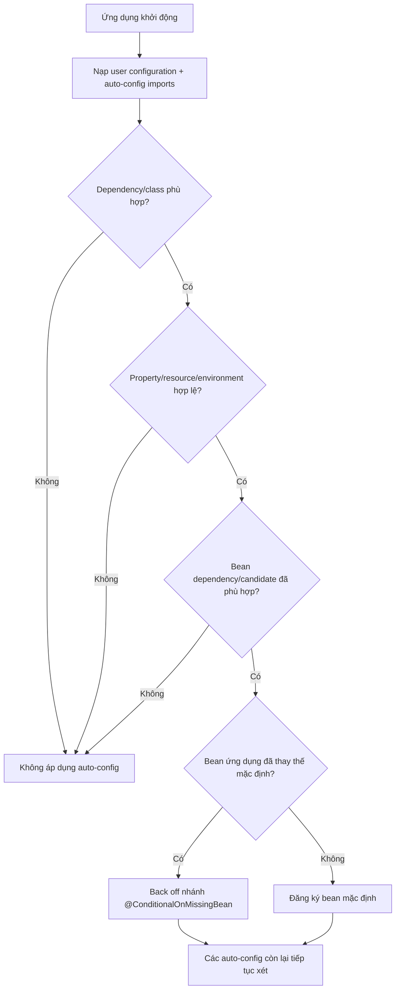
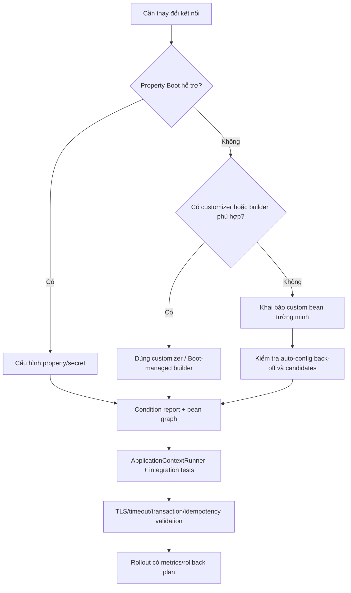

# Bean do Boot tạo, điều kiện ngừng tự cấu hình và điểm tùy chỉnh

Trong Spring Boot, thêm một *starter* có thể khiến ứng dụng có ngay `DataSource`, `JdbcTemplate`, `RestClient.Builder`, `WebClient.Builder`, `KafkaTemplate` hoặc một số bean kết nối tới Redis/JMS/RabbitMQ mà lập trình viên **không hề tự viết `@Bean`**. Cơ chế này thường được gọi là **auto-configuration**: Spring Boot kiểm tra thư viện có mặt trên classpath, cấu hình bên ngoài và các bean đã tồn tại, rồi quyết định có đăng ký cấu hình mặc định hay không.

Sự tiện lợi đó cũng là nguồn gốc của nhiều lỗi tích hợp khó phát hiện. Chẳng hạn, ứng dụng chạy tốt cho đến khi nhóm phát triển tự khai báo một `DataSource` để tùy chỉnh pool; từ thời điểm ấy, bean do Boot định tạo không còn xuất hiện. Hoặc một `RestClient` được tạo bằng `RestClient.builder()` trực tiếp nên không còn nhận customizer, codec và observation đã được cấu hình qua hệ thống. Trong một ứng dụng có hai Kafka producer hoặc hai `ConnectionFactory`, `@Primary` giúp chọn bean khi inject nhưng **không làm mọi luồng giao dịch và adapter tự động biết nguồn nào là đúng**.

Bài thuộc chương **Cấu hình kết nối** của module **SPRING_BOOT_INTEGRATION**. Mục tiêu của module là tổ chức tích hợp Spring Boot qua HTTP client, cơ sở dữ liệu, cache, broker thông điệp và các adapter Spring Integration, với trọng tâm về **cấu hình, hợp đồng dữ liệu, giao dịch, lỗi, chống trùng, kiểm thử và observability**. Vì thế, chúng ta sẽ phân tích việc Boot tự tạo bean, khi nào nó **back off** (nhường chỗ), những điểm tùy chỉnh phù hợp và cách chứng minh cấu hình thực sự đang có hiệu lực.

> **Phạm vi phiên bản:** Các tên API và ví dụ chủ yếu theo **Spring Boot 3.x / Spring Framework 6.x, Java 17+**. Một số tính năng như `RestClient` xuất hiện từ Spring Framework 6.1, được Spring Boot hỗ trợ từ dòng 3.2; Spring Boot 4.x có thay đổi package và starter. Auto-configuration có thể khác giữa các bản Boot và provider. Với hệ thống thật, luôn kiểm tra **condition report và bean graph của đúng phiên bản chạy**, không suy luận từ một blog hoặc một starter dependency đơn lẻ.

## 1. Mục tiêu học tập

Sau bài này, bạn có thể:

1. Giải thích sự khác nhau giữa **component scanning**, **user configuration**, **auto-configuration** và **externalized configuration**.
2. Đọc ý nghĩa của `@ConditionalOnClass`, `@ConditionalOnMissingBean`, `@ConditionalOnBean`, `@ConditionalOnSingleCandidate` và `@ConditionalOnProperty`.
3. Dự đoán khi nào Spring Boot tạo hoặc **không tạo** `DataSource`, `JdbcTemplate`, HTTP-client builder, Redis/Kafka/RabbitMQ/JMS infrastructure beans.
4. Phân biệt ba cấp tùy chỉnh: **property**, **builder/customizer**, **tự khai báo bean**.
5. Hiểu tác động của custom bean lên auto-configuration và các trường hợp nhiều bean, `@Primary`, `@Qualifier` hoặc custom transaction manager.
6. Chẩn đoán lỗi thiếu bean, tạo nhầm bean, bean ambiguous và “cấu hình property không có tác dụng” bằng condition report, Actuator và startup logs.
7. Kiểm thử quyết định auto-configuration bằng `ApplicationContextRunner` và kiểm thử kết nối thật bằng Testcontainers.
8. Thiết kế connection configuration có kiểm soát secret, timeout, transaction, error handling, idempotency và observability.

## 2. Những tầng tạo bean cần phân biệt

Một Spring bean có thể đến từ nhiều nguồn:

| Nguồn | Ví dụ | Đặc điểm |
| --- | --- | --- |
| **Component scan** | `@Component`, `@Service`, `@Repository` | Scan package và đăng ký type ứng dụng |
| **User configuration** | `@Configuration` với `@Bean DataSource` | Ứng dụng khai báo bean trực tiếp |
| **Imported configuration** | `@Import(...)` | Module/ứng dụng đưa thêm bean definitions |
| **Spring Boot auto-configuration** | `DataSourceAutoConfiguration` | Đăng ký bean có điều kiện, thường **nhường chỗ** nếu người dùng đã khai báo |
| **Framework infrastructure** | Transaction proxy, bean post-processor | Hỗ trợ lifecycle, AOP, validation, conversion... |
| **Environment-managed object** | JNDI `ConnectionFactory` hoặc `DataSource` | Được môi trường cấp và có thể đưa vào Spring context qua bean/auto-config |

Ví dụ:

```java
@Service
public class OrderService {
    private final JdbcTemplate jdbc;

    public OrderService(JdbcTemplate jdbc) {
        this.jdbc = jdbc;
    }
}
```

`OrderService` đến từ component scan; `JdbcTemplate` có thể do Boot tự tạo nếu có `DataSource` phù hợp. Hai cơ chế này **không cùng một thứ**. Nếu ứng dụng tạo `JdbcTemplate` riêng, Boot có thể không tạo bean mặc định tương ứng, nhưng các bean khác có thể vẫn được auto-configure.

### 2.1. @SpringBootApplication thực hiện gì?

```java
@SpringBootApplication
public class IntegrationApplication {
    public static void main(String[] args) {
        SpringApplication.run(IntegrationApplication.class, args);
    }
}
```

`@SpringBootApplication` tổng hợp các chức năng liên quan:

- `@SpringBootConfiguration`: cấu hình gốc của ứng dụng.
- `@EnableAutoConfiguration`: bật auto-configuration.
- `@ComponentScan`: quét các component trong phạm vi package phù hợp.

**Điểm nhầm phổ biến:** Thêm `spring-boot-starter-jdbc` không khiến Boot tự tìm một `DataSource` nếu không có điều kiện/configuration cần thiết, và scan `@Service` không trực tiếp tạo database connection. Starter chủ yếu mang dependency để các auto-configuration trở nên **có điều kiện phù hợp**.

### 2.2. External properties không phải bean

Trong `application.yml`:

```yaml
spring:
  datasource:
    url: ${ORDERS_JDBC_URL}
    username: ${ORDERS_DB_USERNAME}
    password: ${ORDERS_DB_PASSWORD}
```

Đây là **các giá trị cấu hình**, không phải instance `DataSource`. Auto-configuration hoặc bean do ứng dụng khai báo mới đọc/bind chúng thành object thực thi.

Nếu ứng dụng tạo một `DataSource` bằng code nhưng không bind `spring.datasource.*`, các property này có thể **không tác động** đến bean đó, dù YAML hợp lệ và IDE vẫn gợi ý key.

## 3. Auto-configuration được kích hoạt như thế nào?

### 3.1. Không phải “starter có mặt = bean chắc chắn tồn tại”

Trong Spring Boot, các class auto-configuration được cung cấp trong thư viện, đăng ký cho Boot import và được xử lý như cấu hình có điều kiện. Với Spring Boot 3.x, cơ chế đăng ký thông thường sử dụng resource:

```text
META-INF/spring/org.springframework.boot.autoconfigure.AutoConfiguration.imports
```

Ví dụ một auto-configuration có thể tương đương ý tưởng:

```java
@AutoConfiguration
@ConditionalOnClass(PartnerClient.class)
@EnableConfigurationProperties(PartnerProperties.class)
public class PartnerClientAutoConfiguration {

    @Bean
    @ConditionalOnMissingBean(PartnerClient.class)
    PartnerClient partnerClient(PartnerProperties properties) {
        return new PartnerClient(properties.baseUrl());
    }
}
```

Đây là **mẫu minh họa** cho một starter tự xây dựng, không phải class có sẵn trong Spring Boot. Nó có nghĩa:

1. Chỉ xét cấu hình này khi `PartnerClient` có trên classpath.
2. Bind properties của client nếu auto-configuration được áp dụng.
3. Chỉ tạo `PartnerClient` mặc định khi chưa có bean cùng loại khớp với điều kiện.
4. Nếu ứng dụng tự khai báo `PartnerClient`, auto-configuration thường **back off** để người dùng giữ quyền kiểm soát.

Không phải mọi auto-configuration đều có cùng điều kiện hay cùng mức độ “back off”. **Chúng ta phải đọc condition report hoặc source của auto-configuration cụ thể** để biết chính xác.

### 3.2. Những điều kiện thường gặp

| Annotation | Kiểm tra | Lỗi suy luận thường gặp |
| --- | --- | --- |
| `@ConditionalOnClass` | Class được chỉ định có mặt trên classpath | Có thư viện không có nghĩa broker/DB đã sẵn sàng |
| `@ConditionalOnMissingClass` | Class không có mặt | Dùng cho nhánh thay thế theo dependency |
| `@ConditionalOnBean` | Bean definition phù hợp đã tồn tại | Bean của ứng dụng có thể cần được khai báo đúng type |
| `@ConditionalOnMissingBean` | Chưa có bean phù hợp trong phạm vi điều kiện | Tự khai báo một bean có thể khiến Boot không tạo bean mặc định |
| `@ConditionalOnSingleCandidate` | Có một ứng viên phù hợp, có xét các trường hợp chọn candidate như primary | Có hai datasource không rõ ưu tiên thì khó tạo bean phụ thuộc |
| `@ConditionalOnProperty` | Property có giá trị phù hợp quy tắc điều kiện | `enabled=false` có thể loại bỏ cả bean cần inject |
| `@ConditionalOnResource` | Resource chỉ định có thể tìm thấy | File thiếu khiến nhánh config không chạy |
| `@ConditionalOnWebApplication` | Ứng dụng là web application phù hợp | CLI/batch app có thể thiếu web infrastructure |
| `@ConditionalOnNotWebApplication` | Không chạy trong web application | Dễ chọn nhầm mode khi test |
| `@Profile` | Profile Spring đang được kích hoạt | Không tương đương toàn bộ condition framework của Boot |

Các điều kiện có thể áp dụng ở **class level** hoặc **method level**, và nhiều điều kiện thường phải đồng thời thỏa mãn.

### 3.3. Back off không có nghĩa xóa bean đã tạo

`@ConditionalOnMissingBean` thường được kiểm tra tại thời điểm Spring xử lý bean definitions. Nếu bean của người dùng đã được biết trước, nhánh auto-configuration có thể **không đăng ký** bean mặc định.

**Không nên hiểu là:** Boot tạo bean, rồi thấy bean tùy chỉnh và xóa bean cũ. Cũng không nên xây một thư viện sử dụng `@ConditionalOnMissingBean` tùy tiện trong configuration được xử lý rất sớm: cơ chế điều kiện chỉ nhìn thấy những bean definitions đã được xử lý tại thời điểm đó. Đây là lý do annotation này thường phù hợp trong **auto-configuration** với thứ tự đăng ký được thiết kế rõ.

### 3.4. Một sơ đồ ra quyết định



Một auto-configuration thường chứa **nhiều nhánh con**. Một bean bị back off không nhất thiết khiến toàn bộ auto-configuration khác liên quan bị vô hiệu hóa.

## 4. Khái niệm “bean do Boot tạo” cần hiểu chính xác

Spring Boot không nhất thiết tạo trực tiếp mọi object runtime khi đọc YAML. Có các tầng:

```text
Spring Boot auto-configuration
       |
       +-- DataSource bean (HikariDataSource)
       |     |
       |     +-- Physical JDBC connections (tạo khi pool hoạt động)
       |
       +-- RestClient.Builder bean
       |     |
       |     +-- RestClient do ứng dụng build()
       |            |
       |            +-- HTTP connection pool/request factory
       |
       +-- KafkaTemplate bean
       |     |
       |     +-- ProducerFactory / Kafka producer clients
       |
       +-- RedisConnectionFactory bean
             |
             +-- Redis connections / provider client
```

**Có bean trong Spring context** không đồng nghĩa một network connection đã được mở thành công, broker đã xác thực, schema SQL đã sẵn sàng hoặc dữ liệu đã được xử lý. Vì vậy:

- Dùng condition report để biết **bean đã được đăng ký vì sao**.
- Dùng health/integration test để biết **tài nguyên ngoài có truy cập được không**.
- Dùng business tests để biết **hợp đồng/transaction/side effect đúng không**.

Ba cấp kiểm chứng này giải quyết ba câu hỏi khác nhau.

## 5. DataSource: trường hợp back off quan trọng nhất

### 5.1. Khi không tự khai báo DataSource

Với project Spring Boot 3.x dùng JDBC:

```groovy
dependencies {
    implementation 'org.springframework.boot:spring-boot-starter-jdbc'
    runtimeOnly 'org.postgresql:postgresql'
}
```

```yaml
spring:
  datasource:
    url: ${ORDERS_JDBC_URL}
    username: ${ORDERS_DB_USERNAME}
    password: ${ORDERS_DB_PASSWORD}
    hikari:
      pool-name: OrdersPool
      maximum-pool-size: 12
      connection-timeout: 3000
      validation-timeout: 1000
      max-lifetime: 1500000
```

Khi các điều kiện phù hợp và HikariCP là pool được chọn, Spring Boot thường tạo `HikariDataSource` rồi cấu hình bằng `spring.datasource.*` và `spring.datasource.hikari.*`.

**Lưu ý:** Các timeout Hikari ở ví dụ trên tính bằng mili giây; timeout riêng của JDBC driver có thể dùng đơn vị khác. Bean `DataSource` tồn tại không bảo đảm PostgreSQL đã nhận được kết nối, đặc biệt khi pool tạo connection muộn hoặc network chưa sẵn.

### 5.2. Khi ứng dụng tự khai báo DataSource

```java
@Configuration(proxyBeanMethods = false)
public class CustomDataSourceConfiguration {

    @Bean
    DataSource customDataSource() {
        HikariDataSource source = new HikariDataSource();
        source.setJdbcUrl("jdbc:postgresql://db.example:5432/orders");
        source.setUsername("orders_app");
        source.setMaximumPoolSize(8);
        return source;
    }
}
```

Đây là **ví dụ giải thích back-off**, **không phải cấu hình production**: không được hardcode endpoint/username, không có secret/TLS, và method chưa khai báo password hay database connection lifecycle đúng.

Khi bean `DataSource` của người dùng đã tồn tại, nhánh auto-configuration tạo `DataSource` mặc định thường **không tạo thêm bean thứ hai**.

Hệ quả cần chú ý:

- `spring.datasource.hikari.maximum-pool-size=12` trong YAML **không tự áp dụng** cho `new HikariDataSource()` ở trên nếu code không được bind với `@ConfigurationProperties` hoặc cơ chế cấu hình tương ứng.
- Các auto-configuration khác, như `JdbcTemplateAutoConfiguration`, **vẫn có thể hoạt động** với `DataSource` bạn cung cấp nếu thỏa điều kiện.
- Nếu có hai `DataSource` mà không chọn candidate phù hợp, bean phụ thuộc có thể không được tạo hoặc injection trở nên mơ hồ.
- Spring Boot có thể có logic khác khi ứng dụng đăng ký `XADataSource` hoặc R2DBC `ConnectionFactory`; đừng coi chỉ `DataSource` là điều kiện duy nhất trong mọi phiên bản.

### 5.3. Hãy tùy chỉnh pool bằng property trước

Nếu mục tiêu chỉ là tăng `maximumPoolSize`, đặt `poolName`, `connectionTimeout` hay `maxLifetime`, **ưu tiên `spring.datasource.hikari.*`** thay vì tạo `@Bean DataSource`.

Lợi ích:

1. Giữ cơ chế auto-configuration và dependency management của Boot.
2. Tránh tự quản lý đóng/mở pool, credentials, TLS/driver properties.
3. Dễ override theo environment và secrets.
4. Không vô tình vô hiệu hóa một nhánh auto-configuration.
5. Dễ kiểm tra bằng `configprops`, metrics và integration test.

Chỉ tự khai báo `DataSource` khi cần **cơ chế tạo nguồn dữ liệu thật sự khác**: nhiều datasource với quy tắc riêng, routing datasource, JNDI, vendor configuration đặc biệt hoặc lifecycle không được property hỗ trợ.

### 5.4. Nếu bắt buộc tự tạo DataSource

Dùng `DataSourceProperties` hoặc `@ConfigurationProperties` phù hợp để đọc config, thay vì hardcode:

```java
@Configuration(proxyBeanMethods = false)
@EnableConfigurationProperties(DataSourceProperties.class)
public class ExplicitOrdersDataSourceConfiguration {

    @Bean
    @ConfigurationProperties("spring.datasource.hikari")
    HikariDataSource ordersDataSource(
            DataSourceProperties properties) {
        return properties
                .initializeDataSourceBuilder()
                .type(HikariDataSource.class)
                .build();
    }
}
```

Các import minh họa:

```java
import com.zaxxer.hikari.HikariDataSource;
import org.springframework.boot.autoconfigure.jdbc.DataSourceProperties;
import org.springframework.boot.context.properties.ConfigurationProperties;
import org.springframework.boot.context.properties.EnableConfigurationProperties;
import org.springframework.context.annotation.Bean;
import org.springframework.context.annotation.Configuration;
```

Đoạn này minh họa cách **dùng `DataSourceProperties` đã được đăng ký qua `@EnableConfigurationProperties` và bind các setting Hikari khi tự tạo DataSource** trong Spring Boot 3.x, không khai báo một bean `DataSourceProperties` trùng với bean Boot có thể đã cung cấp. Khi dùng nhiều data sources, thường nên dùng **prefix riêng** như `app.datasource.orders` và `app.datasource.reporting` thay vì hai nơi cùng đọc `spring.datasource.*`.

Đặt `@Bean` cho `DataSource` sẽ đổi ownership: ứng dụng trở thành nơi chịu trách nhiệm cấu hình bean đó. Phải verify TLS/credentials/pool metrics, transaction manager và shutdown behavior.

## 6. JdbcTemplate, NamedParameterJdbcTemplate và transaction manager

### 6.1. DataSource đã có không bảo đảm mọi bean phụ thuộc

`JdbcTemplateAutoConfiguration` trong Spring Boot 3.x thường chỉ áp dụng khi có ứng viên `DataSource` phù hợp, ví dụ một `DataSource` duy nhất hoặc một ứng viên chính (`@Primary`), và các điều kiện classpath khác được đáp ứng.

Khi ứng dụng **chưa có JdbcOperations/JdbcTemplate bean tùy chỉnh**, Boot có thể tạo `JdbcTemplate`. Tương tự, Boot có thể cung cấp `NamedParameterJdbcTemplate` khi điều kiện tương ứng phù hợp.

```java
@Service
public class OrderRepository {

    private final JdbcTemplate jdbc;

    public OrderRepository(JdbcTemplate jdbc) {
        this.jdbc = jdbc;
    }

    public long countOrders() {
        Long value = jdbc.queryForObject(
                "SELECT COUNT(*) FROM orders", Long.class);
        return value == null ? 0L : value;
    }
}
```

Không cần `new JdbcTemplate(...)` trong mọi repository nếu Boot đã tạo bean.

### 6.2. Khi tự khai báo một JdbcTemplate

```java
@Bean
JdbcTemplate orderJdbcTemplate(
        @Qualifier("ordersDataSource") DataSource dataSource) {

    JdbcTemplate template = new JdbcTemplate(dataSource);
    template.setQueryTimeout(8); // Seconds.
    return template;
}
```

Bean của ứng dụng có thể khiến nhánh tạo `JdbcTemplate` mặc định back off. Đây là cách tùy chỉnh hợp lý nếu yêu cầu timeout/behavior đặc biệt, nhưng cần:

- Đặt tên rõ nếu có nhiều `JdbcTemplate`.
- Inject đúng `DataSource` theo qualifier.
- Biết một số thư viện khác cần `JdbcOperations`/`NamedParameterJdbcOperations`.
- Không dùng một template dành cho reporting datasource để ghi orders.
- Không suy luận auto-configuration transaction manager vẫn chọn đúng datasource sau khi xuất hiện nhiều bean.

### 6.3. Transaction manager không “đi theo tên template”

Một service:

```java
@Transactional
public void createOrder() {
    ordersJdbc.update(...);
    reportingJdbc.update(...);
}
```

**Không được giả định** hai `JdbcTemplate` cùng thuộc một JDBC transaction nếu chúng dùng hai data sources độc lập. `@Transactional` chọn transaction manager theo cơ chế cấu hình; manager cụ thể thường quản lý một resource.

Nếu ứng dụng có nhiều datasources:

- Khai báo transaction managers tường minh khi cần.
- Định danh `@Transactional(transactionManager = "ordersTransactionManager")` trên luồng orders.
- Không kết hợp two-resource writes vào cùng một method rồi xem là atomic nếu không có distributed transaction được cấu hình đúng.
- Cân nhắc outbox/saga/idempotent integration khi cần truyền trạng thái qua nhiều hệ.

**Back-off của DataSource không tự giải quyết transaction boundary**.

## 7. Nhiều DataSource: @Primary, @Qualifier và single candidate

### 7.1. Hai bean cùng type

Ví dụ:

```java
@Bean("ordersDataSource")
DataSource ordersDataSource() {
    // Tạo từ cấu hình orders DB.
    return ...;
}

@Bean("reportingDataSource")
DataSource reportingDataSource() {
    // Tạo từ cấu hình reporting DB.
    return ...;
}
```

Đoạn trên là **pseudocode**; dấu `...` không phải biểu thức Java hợp lệ, cần thay bằng factory/configuration thật.

Nếu constructor yêu cầu một `DataSource` không có qualifier:

```java
public OrderService(DataSource dataSource) {
    this.dataSource = dataSource;
}
```

Spring có thể báo `NoUniqueBeanDefinitionException` khi có nhiều candidate mà không đủ thông tin lựa chọn.

### 7.2. Chọn bằng @Primary

```java
@Bean("ordersDataSource")
@Primary
DataSource ordersDataSource() {
    return buildOrdersDataSource();
}
```

`@Primary` giúp Spring ưu tiên một bean khi injection theo type có nhiều candidates. Nó có thể làm một số điều kiện như `@ConditionalOnSingleCandidate` trở nên khớp, tùy auto-configuration.

Nhưng `@Primary` **không**:

- Biến hai database thành một transaction.
- Bắt mọi JmsTemplate/KafkaTemplate/RedisTemplate dùng đúng nguồn bạn muốn.
- Chuyển credential/endpoint của các clients khác.
- Thay thế nhu cầu `@Qualifier` ở luồng reporting.
- Tự động chọn `transactionManager` cho mọi module có nhiều managers.

### 7.3. Khi nào nên @Qualifier?

Khi code có mục đích nghiệp vụ cụ thể:

```java
@Service
public class ReportingService {

    private final JdbcTemplate reportsJdbc;

    public ReportingService(
            @Qualifier("reportingJdbcTemplate")
            JdbcTemplate reportsJdbc) {
        this.reportsJdbc = reportsJdbc;
    }
}
```

Một adapter nghiệp vụ rõ ràng nên gắn với bean rõ ràng. `@Primary` hữu ích để định nghĩa **mặc định hợp lý**, còn `@Qualifier` hữu ích để **không nhập nhằng ở các luồng ngoài mặc định**.

### 7.4. Bean name không phải lúc nào cũng quyết định

Trong Spring, matching có thể xét type, qualifier, primary và tên parameter trong một số tình huống. Đừng thiết kế cấu hình tích hợp quan trọng dựa vào việc “trùng tên parameter thì tự chọn đúng” khi ứng dụng có nhiều bean cùng type. Hãy khai báo qualifier hoặc injection có chủ đích, rồi kiểm thử bean thực sự được inject.

## 8. JPA và R2DBC: không đồng nhất với JDBC auto-configuration

### 8.1. JPA phụ thuộc nhiều bean khác

Thêm `spring-boot-starter-data-jpa` có thể kéo vào JPA/Hibernate infrastructure khi:

- Có các class, dependencies và điều kiện cần thiết.
- Có `DataSource` phù hợp.
- Không có user infrastructure bean làm điều kiện back off.
- Entity/repository package scanning và persistence configuration phù hợp.

Một custom `EntityManagerFactory` hoặc `JpaTransactionManager` có thể tác động riêng tới nhánh auto-configuration của JPA, nhưng **không được suy từ một bean đó rằng tất cả JDBC beans biến mất**. JDBC và JPA có quan hệ sử dụng datasource, nhưng được cấu hình qua các phần auto-configuration khác nhau.

### 8.2. R2DBC ConnectionFactory có thể thay đổi quyết định JDBC

Với reactive SQL, `io.r2dbc.spi.ConnectionFactory` là abstraction khác `javax.sql.DataSource`. Trong một số cấu hình Spring Boot 3.x, nếu ứng dụng có `ConnectionFactory` R2DBC, nhánh auto-config JDBC `DataSource` thông thường có thể **back off**.

Không suy luận rằng chỉ thêm cả JDBC và R2DBC starters sẽ mặc nhiên tạo cả hai kết nối. Nếu ứng dụng thật sự cần cả hai:

- Kiểm tra condition report của `DataSourceAutoConfiguration` và `R2dbcAutoConfiguration`.
- Tạo/định danh các beans rõ ràng khi cần.
- Dùng đúng transaction managers (JDBC/JPA vs R2DBC).
- Tránh trộn giao dịch reactive với imperative trên hai resource rồi kỳ vọng atomicity.

## 9. HTTP clients: RestClient, WebClient và RestTemplate

### 9.1. Một bảng quan trọng

| API | Boot thường hỗ trợ auto-config gì? | Điều không nên mặc định |
| --- | --- | --- |
| `RestClient` (Spring Framework 6.1+) | `RestClient.Builder` được Boot cấu hình khi classpath/conditions phù hợp | Boot không tự tạo một `RestClient` riêng cho mọi đối tác |
| `WebClient` | `WebClient.Builder` có config từ Boot khi WebFlux client classpath phù hợp | Không có sẵn một WebClient đã biết URL/tên đối tác |
| `RestTemplate` | `RestTemplateBuilder` được Boot hỗ trợ trong Boot 3.x | Boot thường **không tự tạo RestTemplate instance** cho mọi API |
| Declarative HTTP interface `@HttpExchange` | Dựa trên HTTP client adapter/proxy factory | Chỉ khai báo interface không bảo đảm tất cả version Boot tự đăng ký proxy bean |

Các builder là **điểm mở rộng** giúp ứng dụng tạo client theo từng partner trong khi vẫn nhận các thành phần Boot đã quản lý: request factory, codecs, TLS bundle, observation hoặc customizers **nếu thực sự được cấu hình trong builder đó**.

### 9.2. Vì sao không gọi RestClient.builder() trực tiếp ở khắp nơi?

Ví dụ:

```java
RestClient direct = RestClient.builder()
        .baseUrl("https://partner.example")
        .build();
```

Dòng này tạo client hợp lệ theo Spring Framework, nhưng **không bảo đảm** áp dụng toàn bộ customizations từ `RestClient.Builder` do Spring Boot cung cấp.

Một bean tốt hơn trong Spring Boot 3.2+:

```java
@Configuration(proxyBeanMethods = false)
public class PartnerHttpConfiguration {

    @Bean("partnerRestClient")
    RestClient partnerRestClient(
            RestClient.Builder bootManagedBuilder,
            @Value("${integration.partner.base-url}") String baseUrl) {

        return bootManagedBuilder
                .baseUrl(baseUrl)
                .build();
    }
}
```

Các import minh họa:

```java
import org.springframework.beans.factory.annotation.Value;
import org.springframework.context.annotation.Bean;
import org.springframework.context.annotation.Configuration;
import org.springframework.web.client.RestClient;
```

`RestClient.Builder` do Boot cung cấp trong các cấu hình phù hợp thường có scope cho phép mỗi injection nhận builder tùy chỉnh độc lập. Dù vậy, không lưu một builder mutable làm singleton rồi sửa `baseUrl` liên tục giữa nhiều thread để gọi các đối tác khác nhau.

### 9.3. RestClientCustomizer để tùy chỉnh mọi builder do Boot quản lý

Spring Boot 3.2+ có điểm mở rộng `RestClientCustomizer` trong package tương ứng:

```java
@Configuration(proxyBeanMethods = false)
public class OutboundClientDefaults {

    @Bean
    RestClientCustomizer integrationRestClientCustomizer() {
        return builder -> builder.defaultHeader(
                "X-Integration-Client", "orders-service");
    }
}
```

Import:

```java
import org.springframework.boot.web.client.RestClientCustomizer;
```

Bean customizer được auto-configured builder áp dụng theo cơ chế Spring Boot tương ứng. **Không gắn Authorization bearer token dùng chung vào global builder** nếu ứng dụng gọi nhiều đối tác với các identity khác nhau; token nên được gắn theo client/tenant/request với security boundary rõ.

Không khai báo một `RestClient.Builder` tự tạo `RestClient.builder()` nếu mục tiêu chỉ thêm header hoặc observation: làm vậy có thể khiến Boot **back off builder mặc định** và bỏ qua customizations khác.

### 9.4. WebClientCustomizer và reactive HTTP

Tương tự với WebClient trong Spring Boot 3.x:

```java
@Bean
WebClientCustomizer integrationWebClientCustomizer() {
    return builder -> builder.defaultHeader(
            "X-Integration-Client", "orders-service");
}
```

Một client theo partner:

```java
@Bean("inventoryWebClient")
WebClient inventoryWebClient(
        WebClient.Builder builder,
        @Value("${integration.inventory.base-url}") String baseUrl) {
    return builder.baseUrl(baseUrl).build();
}
```

Imports:

```java
import org.springframework.boot.web.reactive.function.client.WebClientCustomizer;
import org.springframework.web.reactive.function.client.WebClient;
```

Đừng nghĩ `WebClient` lúc nào cũng non-blocking end-to-end: code gọi `block()` vẫn là blocking và phải xem thread model, timeout, pool và transaction boundary. WebClient builder do Boot quản lý không tự tạo retry, circuit breaker hay idempotency cho mọi request.

### 9.5. Request timeout không tự đến từ auto-configuration

Boot cung cấp đường cấu hình/builder; **timeouts phải được thiết kế** theo client stack:

- Connect timeout (TCP/TLS).
- Response/read timeout.
- Pool acquisition timeout.
- Overall operation deadline.
- Retry budget/backoff.
- Cancellation và cleanup.
- Idempotency key với POST có side effect.

Các API set timeout của `ClientHttpRequestFactory`, Reactor Netty hoặc HTTP client library khác có thể khác nhau theo Boot/Spring version. Không copy thuộc tính timeout của HikariCP vào HTTP client rồi mong có cùng tác dụng.

## 10. Kafka: có KafkaTemplate không có nghĩa mọi producer như nhau

### 10.1. Những bean có thể được Boot cung cấp

Khi dependency Spring Kafka có mặt và điều kiện phù hợp, Boot có thể auto-configure những bean hạ tầng như:

- `ProducerFactory` và `ConsumerFactory`.
- `KafkaTemplate`.
- `KafkaAdmin` hoặc phần hạ tầng admin khác theo cấu hình.
- Listener container factory mặc định cho `@KafkaListener`.
- Các đối tượng properties, converter, transaction-related configuration tùy điều kiện.

Điểm quan trọng: **không phải mọi bean trong danh sách đều chắc chắn xuất hiện**. Chúng phụ thuộc classpath, custom bean, properties, broker client stack và phiên bản Boot.

### 10.2. Các properties thông thường

```yaml
spring:
  kafka:
    bootstrap-servers: ${KAFKA_BOOTSTRAP_SERVERS}
    producer:
      acks: all
      properties:
        enable.idempotence: true
    consumer:
      group-id: orders-processor
      auto-offset-reset: earliest
```

Properties trên không tự đảm bảo:

- Event ID độc nhất.
- SQL commit nguyên tử với Kafka send.
- Consumer không nhận message trùng.
- Schema tương thích.
- Kafka key cho ordering đúng per aggregate.
- Retry an toàn sau producer acknowledgment timeout.

Đó là các yêu cầu **thiết kế luồng**, không chỉ bean creation.

### 10.3. Khi khai báo KafkaTemplate riêng

```java
@Bean("auditKafkaTemplate")
KafkaTemplate<String, String> auditKafkaTemplate(
        @Qualifier("auditProducerFactory")
        ProducerFactory<String, String> factory) {
    return new KafkaTemplate<>(factory);
}
```

Một custom `KafkaTemplate` có thể làm nhánh tạo template mặc định back off tùy condition. Nếu ứng dụng còn dùng `@KafkaListener`, các listener/consumer factory auto-config khác có thể vẫn hoạt động.

Không mong mọi message publisher tự chọn `auditKafkaTemplate` chỉ vì bean có tên “audit”. Dùng qualifier và tách properties cho từng producer. Khi dùng Kafka transaction, phân biệt `KafkaTransactionManager` với JDBC transaction và xác nhận commit order, outbox/idempotency.

## 11. RabbitMQ, JMS và tài nguyên do môi trường quản lý

### 11.1. RabbitMQ

Với Spring AMQP và cấu hình phù hợp, Boot có thể tạo hạ tầng như `ConnectionFactory`, `RabbitTemplate`, listener container factories và configuration liên quan.

```yaml
spring:
  rabbitmq:
    host: ${RABBIT_HOST}
    port: ${RABBIT_PORT:5672}
    username: ${RABBIT_USERNAME}
    password: ${RABBIT_PASSWORD}
```

Tự khai báo `CachingConnectionFactory` hoặc `RabbitTemplate` có thể khiến một nhánh mặc định back off. Tuy nhiên, không mặc định publisher confirms, mandatory returns, DLQ hay retry policies sẽ tự đúng cho nghiệp vụ khi bean xuất hiện.

### 11.2. JMS ConnectionFactory

JMS thường có hai mô hình:

1. **Spring Boot/application-managed**: provider client và properties tạo `jakarta.jms.ConnectionFactory` theo auto-configuration phù hợp.
2. **Environment-managed**: application server provision một ConnectionFactory qua JNDI; Spring Boot/JndiTemplate lookup bean đó.

Ví dụ Boot 3.x:

```yaml
spring:
  jms:
    jndi-name: ${JMS_CONNECTION_FACTORY_JNDI:java:comp/env/jms/OrdersCF}
```

Tên JNDI này chỉ hoạt động khi runtime có resource binding thật. Nó không tự tạo broker hoặc mapping. Với Boot 3.x, phải dùng **Jakarta JMS (`jakarta.jms`)**; một object kiểu `javax.jms.ConnectionFactory` từ runtime cũ không tự cast được.

Khi bean ConnectionFactory của người dùng đã tồn tại, auto-configuration liên quan tới việc tạo bean mặc định có thể back off. Nhưng `JmsTemplate` hoặc listener factories **vẫn có thể được cấu hình từ bean có sẵn** theo những điều kiện riêng.

### 11.3. ConnectionFactory trùng tên nhưng khác interface

Có thể gặp nhiều type đều tên `ConnectionFactory`:

- `jakarta.jms.ConnectionFactory`: JMS.
- `org.springframework.amqp.rabbit.connection.ConnectionFactory`: RabbitMQ.
- `org.springframework.data.redis.connection.RedisConnectionFactory`: Redis.
- `io.r2dbc.spi.ConnectionFactory`: R2DBC.

Nhìn tên đơn giản “ConnectionFactory” không đủ: chúng là **những interface khác nhau**. Import sai type dẫn tới compile error, injection mismatch hoặc điều kiện auto-config không khớp. Điều này đặc biệt quan trọng khi code mở rộng cho Kafka, SQL, cache và broker cùng lúc.

## 12. Redis và CacheManager: có kết nối khác với có cache nghiệp vụ

### 12.1. Spring Data Redis

Khi dependency Redis và classpath phù hợp, Spring Boot có thể auto-configure:

- `RedisConnectionFactory` (ví dụ dựa trên Lettuce theo dependency).
- `RedisTemplate`/`StringRedisTemplate` trong các điều kiện tương ứng.
- Cấu hình timeout, database index và client options theo version.

Ví dụ:

```yaml
spring:
  data:
    redis:
      host: ${REDIS_HOST}
      port: ${REDIS_PORT:6379}
      password: ${REDIS_PASSWORD:}
      timeout: 2s
```

Không suy luận `RedisTemplate` có mặt thì Redis đang kết nối được hoặc key serialization đã phù hợp mọi data contract.

### 12.2. Cache abstraction là lớp khác

`@Cacheable` cần Spring caching infrastructure được kích hoạt, thường bởi `@EnableCaching` hoặc cơ chế tương đương. `CacheManager` được auto-configure tùy classpath, cache provider và conditions.

```java
@Configuration(proxyBeanMethods = false)
@EnableCaching
public class CachingConfiguration {
}
```

Nếu tự khai báo `CacheManager`, Boot có thể không tạo manager mặc định. Nhưng một cache manager Redis không tự tạo:

- TTL hợp lý cho từng domain.
- Serialization schema tương thích khi deploy phiên bản mới.
- Cache key tách tenant.
- Cache invalidation sau SQL commit.
- Chống cache stampede.
- Tính nhất quán SQL–cache–broker.

Khi cần thay default TTL/serializer, kiểm tra hỗ trợ của `RedisCacheManagerBuilderCustomizer` hoặc cấu hình properties trước khi thay toàn bộ `CacheManager`; các điểm mở rộng phụ thuộc phiên bản Boot/Spring Data Redis.

### 12.3. Hai RedisConnectionFactory cho hai cluster

Khi có Redis cho cache và Redis cho distributed locks, cần các factory riêng có qualifier, template riêng và policy transaction/durability độc lập. `@Primary` chỉ chọn ứng viên mặc định; không thay cho việc chỉ định rõ cluster cho mỗi module và kiểm thử failover/reconnect.

## 13. Spring Integration: auto-configure infrastructure không đồng nghĩa tạo flow

Spring Integration mang các khái niệm như `MessageChannel`, `IntegrationFlow`, gateway, transformer, router, error channel, inbound/outbound adapters và poller.

Khi dependency/conditions phù hợp, Boot có thể kích hoạt một số Spring Integration infrastructure. Nhưng **không có cơ chế mặc định tự sinh business flow** “SQL → HTTP → Kafka” chỉ vì ba starter cùng có mặt.

Ví dụ Java DSL:

```java
@Configuration(proxyBeanMethods = false)
public class IntegrationFlowConfiguration {

    @Bean
    IntegrationFlow orderNotifications(
            OrderNotificationHandler handler) {

        return IntegrationFlow
                .from("orderNotificationInput")
                .handle(handler, "handle")
                .get();
    }
}
```

Đây là ví dụ định nghĩa flow, không phải flow do Boot tự suy từ `OrderNotificationHandler`. `OrderNotificationHandler` là component ứng dụng do bạn triển khai.

### 13.1. Bean tồn tại không có nghĩa channel dùng đúng ConnectionFactory

Một JMS inbound adapter có thể dùng `jakarta.jms.ConnectionFactory` do container cấp; một Rabbit outbound adapter dùng `org.springframework.amqp.rabbit.connection.ConnectionFactory`. Nếu trong context có nhiều factory cùng type, phải inject bằng qualifier, chọn đúng destination/transaction manager và xác minh flow wiring.

### 13.2. Thread/transaction boundary

`DirectChannel` thường chạy handler đồng bộ; `ExecutorChannel`, poller hoặc broker adapter có thể chuyển sang thread/transaction khác. Auto-configuration không tự bảo đảm Spring transaction context chạy xuyên mọi ranh giới bất đồng bộ.

Nếu flow nhận message, ghi SQL rồi ack broker:

- Xác định ack ở đâu.
- Xác định transaction manager bao phủ SQL gì.
- Dùng inbox/idempotency để chịu được redelivery.
- Dùng outbox nếu SQL đã commit nhưng cần phát message tiếp.
- Không catch mọi exception rồi trả success, khiến adapter ack sớm.

## 14. Ba cấp tùy chỉnh: nên chọn cấp nào?

| Cấp | Ví dụ | Ưu điểm | Cảnh báo |
| --- | --- | --- | --- |
| **1. Properties** | `spring.datasource.hikari.maximum-pool-size` | Ít code, dễ override theo profile/secret | Chỉ có hiệu lực nếu bean được bind theo auto-config tương ứng |
| **2. Customizer/Builder** | `RestClientCustomizer`, builder injected | Giữ defaults của Boot, dễ phối hợp | Cần dùng đúng builder do Boot cung cấp; thứ tự các customizers có thể quan trọng |
| **3. Explicit @Bean** | Custom `DataSource`, multi-provider `KafkaTemplate` | Toàn quyền kiểm soát | Có thể làm Boot back off; phải chịu trách nhiệm lifecycle và dependencies |
| **4. Auto-configuration exclusion** | `spring.autoconfigure.exclude` | Tắt một auto-config khi có lý do kiến trúc | Có thể mất nhiều bean hạ tầng ngoài ý muốn |

**Thứ tự tư duy:** ưu tiên level 1 → 2 → 3, chỉ exclude auto-configuration khi hiểu đúng bean graph và lý do tắt. “Tôi không thấy bean nào đó” **không phải lý do** bật tất cả auto-config hoặc đăng ký bean trùng.

### 14.1. Properties còn có điểm mở rộng riêng

Có thể khai báo config typed dành cho các đối tác:

```java
package com.example.integration.config;

import java.net.URI;
import java.time.Duration;

import org.springframework.boot.context.properties.ConfigurationProperties;

@ConfigurationProperties(prefix = "integration.partner")
public record PartnerConnectionProperties(
        URI baseUrl,
        Duration responseTimeout,
        int maxAttempts
) {}
```

Đăng ký:

```java
@SpringBootApplication
@ConfigurationPropertiesScan
public class IntegrationApplication {
    public static void main(String[] args) {
        SpringApplication.run(IntegrationApplication.class, args);
    }
}
```

Với:

```yaml
integration:
  partner:
    base-url: ${PARTNER_BASE_URL}
    response-timeout: 3s
    max-attempts: 3
```

`@ConfigurationProperties` giúp type-safe binding, nhưng **không tự validate nghiệp vụ**; thêm Bean Validation hoặc hàm kiểm tra rõ (URI scheme, timeout > 0, maxAttempts trong giới hạn) khi cần. Nếu dùng Jakarta Bean Validation annotations, phải có implementation/validation starter phù hợp.

### 14.2. Tách cấu hình từng đối tác

Với nhiều HTTP partners, tránh dùng một global `RestClientCustomizer` để đặt base URL hoặc auth token của partner A cho tất cả clients. Nên tạo `@Bean("inventoryRestClient")` và `@Bean("billingRestClient")` riêng từ builder đã được Boot config, với properties/credentials/timeout của từng đối tác.

Một policy bảo mật tốt hơn là **config đúng phạm vi ngay từ đầu**, thay vì để mọi client dùng chung headers rồi cố loại trừ từng nơi.

## 15. Tự khai báo bean: tránh back off ngoài ý muốn

### 15.1. Tạo bean cùng type không luôn đồng nghĩa thay thế theo tên

Ví dụ bạn muốn tùy chỉnh template:

```java
@Bean("partnerTemplate")
RestClient partnerTemplate(RestClient.Builder builder) {
    return builder.baseUrl("https://partner.example").build();
}
```

Đây là `RestClient`, **khác type** với `RestClient.Builder`. Việc khai báo client hoàn chỉnh không đồng nghĩa Boot không tạo Builder; điều kiện cụ thể thường theo type mà auto-configuration đang tìm.

Ngược lại:

```java
@Bean
RestClient.Builder customRestClientBuilder() {
    return RestClient.builder();
}
```

có thể khiến auto-configured `RestClient.Builder` **back off**, làm mất những customizations mà Boot định áp dụng. Nếu chỉ cần header, filters, observation hoặc request factory, ưu tiên customizer hay dùng builder injected.

### 15.2. @ConditionalOnMissingBean trong thư viện

Nếu tự viết Spring Boot starter cho nội bộ:

```java
@AutoConfiguration
@ConditionalOnClass(PartnerTransport.class)
@EnableConfigurationProperties(PartnerConnectionProperties.class)
public class PartnerTransportAutoConfiguration {

    @Bean
    @ConditionalOnMissingBean(PartnerTransport.class)
    PartnerTransport partnerTransport(
            PartnerConnectionProperties properties) {
        return new DefaultPartnerTransport(properties);
    }
}
```

Đây là **mẫu API nội bộ**; `PartnerTransport` và `DefaultPartnerTransport` do tổ chức tự xây. Auto-config cần được đăng ký đúng resource imports nếu đóng gói starter độc lập.

**Không gọi `@ConditionalOnMissingBean` như “công cụ chọn bean có priority thấp” ở mọi `@Configuration`:** nó đánh giá trong quá trình đăng ký definitions và phụ thuộc thứ tự. Với ứng dụng bình thường, tự khai báo bean tường minh hoặc dùng profile/property condition rõ thường dễ dự đoán hơn.

### 15.3. Exclude auto-configuration có phạm vi rộng

Ví dụ:

```java
@SpringBootApplication(
        exclude = DataSourceAutoConfiguration.class)
public class NoSqlOnlyApplication {}
```

Nếu ứng dụng thật sự không dùng JDBC, exclusion có thể hợp lý. Nhưng nếu service vẫn cần `JdbcTemplate` hay Flyway, loại `DataSourceAutoConfiguration` có thể làm nhiều bean phía sau không hình thành.

Một cấu hình tương đương theo property:

```yaml
spring:
  autoconfigure:
    exclude:
      - org.springframework.boot.autoconfigure.jdbc.DataSourceAutoConfiguration
```

**Không nên dùng exclusion chỉ để “sửa lỗi startup thiếu JDBC URL”** mà không hiểu vì sao SQL starter có trong classpath và module nào cần DataSource. Nếu vô tình có dependency JDBC thừa, cách đúng có thể là chỉnh dependency. Nếu SQL thật sự cần thiết, loại auto-config chỉ che nguyên nhân.

## 16. Điều kiện ngừng tự cấu hình theo bean khác

### 16.1. @ConditionalOnMissingBean: lớp hạ tầng có thể tiếp tục

Một ví dụ chuỗi phụ thuộc:

```text
DataSourceAutoConfiguration
  -> DataSource

JdbcTemplateAutoConfiguration
  -> JdbcTemplate / NamedParameterJdbcTemplate

TransactionAutoConfiguration / manager-related config
  -> transaction infrastructure/manager theo điều kiện

JPA auto-configuration (nếu có JPA)
  -> EntityManagerFactory và related beans
```

Khi custom `DataSource` xuất hiện:

- Nhánh tạo DataSource mặc định có thể back off.
- JdbcTemplate vẫn có thể auto-configure dựa trên **custom DataSource**.
- Một số JPA/transaction auto-config còn có thể chạy nếu điều kiện khác phù hợp.
- Nếu có nhiều DataSource và không có single candidate, một số nhánh lại back off.

Vì vậy, thông điệp “tôi tạo bean X nên Boot tắt auto-config hoàn toàn” thường **không chính xác**. Phải xem nhánh nào đã matched/unmatched.

### 16.2. @ConditionalOnBean và @ConditionalOnSingleCandidate

Một auto-configuration cho `JdbcTemplate` cần một DataSource, không thể tạo template chỉ từ properties nếu DataSource chưa có. Nếu có **nhiều** DataSources mà không biết chọn cái nào, Boot có thể không tạo template mặc định.

Hai tình huống:

```text
Case A:
  ordersDataSource (single)
  -> JdbcTemplate auto-config có thể tạo

Case B:
  ordersDataSource
  reportingDataSource
  không @Primary
  -> Single-candidate condition có thể không khớp

Case C:
  ordersDataSource @Primary
  reportingDataSource
  -> Một số auto-config có thể dùng primary
```

**Hệ quả:** Một thay đổi nhỏ là thêm reporting DataSource có thể làm một bean auto-config đang tồn tại **biến mất khi restart**. Integration tests cần có tình huống multi-datasource nếu hệ thống thực sự dùng nhiều DB.

## 17. Customizer, ordering và property precedence

### 17.1. Customizer chỉ áp dụng qua đường tạo đúng

Một customizer cho Boot-managed `WebClient.Builder` **không** tự áp dụng lên `WebClient.builder()` được gọi từ static code. Tương tự, một Spring-managed `RestClient.Builder` không tự kiểm soát HttpClient instance do SDK bên ngoài tự tạo.

Muốn quản lý thống nhất:

- Quy định client tạo qua bean/builder được inject.
- Đóng gói SDK adapter phía sau một interface ứng dụng.
- Chỉ một nơi chịu trách nhiệm base URL, auth, TLS, timeouts, tracing.
- Kiểm tra cấu hình thực sự có hiệu lực bằng mock HTTP server và telemetry.

### 17.2. Thứ tự customizers có thể ảnh hưởng kết quả

Nếu hai customizers cùng đặt default header, request factory hoặc codec cho một builder, customizer được áp dụng sau có thể ghi đè hoặc bổ sung tùy API.

Với Spring, có thể dùng `@Order`/`Ordered` ở những điểm mở rộng hỗ trợ thứ tự. Nhưng thứ tự **không thay thế** việc phân chia trách nhiệm: global customizer chỉ đặt headers/observation phổ biến; partner-specific config nên nằm tại client bean.

### 17.3. Property precedence

Spring Boot nạp properties từ nhiều nguồn như application config, environment variables, command-line arguments, config imports/secret stores theo thứ tự ưu tiên có quy tắc. Cùng key có thể được override ở runtime.

Ví dụ:

```yaml
integration:
  partner:
    base-url: "https://sandbox.partner.example"
```

Một environment variable `INTEGRATION_PARTNER_BASE_URL` có thể override giá trị theo relaxed binding và property-source precedence của ứng dụng.

**Đừng chẩn đoán “YAML đúng” mà bỏ qua runtime property source.** Khi điều tra, dùng `/actuator/env` hoặc các công cụ của Boot có bảo vệ quyền và value sanitization; tuyệt đối không công khai secrets khi xem effective config.

## 18. Profile, @ConditionalOnProperty và feature toggle

### 18.1. Chọn implementation theo environment

Ví dụ interface:

```java
public interface PartnerGateway {
    PartnerResponse send(PartnerRequest request);
}
```

Trong một ứng dụng minh họa, có thể chọn hai implementations:

```java
@Configuration(proxyBeanMethods = false)
public class PartnerGatewayConfiguration {

    @Bean
    @Profile("local")
    PartnerGateway fakePartnerGateway() {
        return new LocalFakePartnerGateway();
    }

    @Bean
    @Profile("!local")
    PartnerGateway httpPartnerGateway(
            RestClient.Builder builder,
            PartnerConnectionProperties properties) {
        return new HttpPartnerGateway(
                builder.baseUrl(properties.baseUrl().toString())
                        .build());
    }
}
```

Các type `PartnerResponse`, `PartnerRequest`, `LocalFakePartnerGateway` và `HttpPartnerGateway` là **classes minh họa do dự án triển khai**.

Đặt profile để chọn mode kết nối, nhưng cần kiểm thử rằng **chỉ một implementation** được đăng ký trong môi trường đích. Một số dự án có nhiều active profiles kết hợp; `@Profile("!local")` không thay thế quy tắc vận hành rõ ràng nếu staging/prod phức tạp.

### 18.2. ConditionalOnProperty

```java
@Bean
@ConditionalOnProperty(
        prefix = "integration.partner",
        name = "enabled",
        havingValue = "true")
PartnerSyncJob partnerSyncJob(PartnerGateway gateway) {
    return new PartnerSyncJob(gateway);
}
```

Nếu `integration.partner.enabled=false`, bean `PartnerSyncJob` không được đăng ký. Nhưng nếu một bean khác inject `PartnerSyncJob` bắt buộc qua constructor, startup có thể fail.

Thiết kế feature toggle phải có mô hình rõ:

- Khi disabled thì **không tạo scheduled job/consumer**, nhưng các dependency khác có tiếp tục cần bean không?
- Cần Noop implementation hay dùng `ObjectProvider`/optional injection?
- Những messages đã nhận rồi có bị bỏ quên không?
- Toggle có ảnh hưởng idempotency/retry hoặc trạng thái job trong SQL không?

**Không sử dụng feature toggle để lặng lẽ bỏ qua message cần xử lý bền vững.**

## 19. Vì sao bean không xuất hiện? Chẩn đoán theo bằng chứng

### 19.1. Condition Evaluation Report

Trong Spring Boot, bật debug khi khởi động có thể hiển thị condition evaluation report:

```bash
java -jar integration-app.jar --debug
```

Hoặc cấu hình log phù hợp trong môi trường phát triển. Report thường có các nhánh:

- **Positive matches**: điều kiện khớp.
- **Negative matches**: điều kiện không khớp.
- **Unconditional classes** hoặc phần khác tùy version.

Ví dụ khái niệm:

```text
DataSourceAutoConfiguration matched:
  - required classes were found

DataSourceConfiguration.Hikari did not match:
  - @ConditionalOnMissingBean found an existing DataSource

JdbcTemplateAutoConfiguration matched:
  - a single candidate DataSource exists
```

Đây là **output minh họa**, không phải log được trích từ một app đang chạy. Thông điệp và tên class có thể thay đổi giữa các phiên bản Boot.

### 19.2. Actuator /conditions và /beans

Khi có Spring Boot Actuator:

```groovy
dependencies {
    implementation 'org.springframework.boot:spring-boot-starter-actuator'
}
```

Có thể cho phép các endpoint chẩn đoán ở môi trường phát triển:

```yaml
management:
  endpoints:
    web:
      exposure:
        include: "health,info,conditions,beans,configprops"
```

- `/actuator/conditions`: condition evaluation report.
- `/actuator/beans`: các bean trong context, type/dependencies theo khả năng endpoint.
- `/actuator/configprops`: properties đã bind.
- `/actuator/health`: kết quả health indicators.

**Cảnh báo:** Không mở các endpoint `beans`, `conditions`, `configprops` hoặc `env` công khai production. Bảo vệ authentication/authorization, network access và sanitization; chúng có thể lộ cấu trúc nội bộ hoặc cấu hình nhạy cảm. Chỉ bật theo chính sách vận hành phù hợp.

### 19.3. Checklist chẩn đoán thiếu bean

1. Dependency/provider class có thật trên classpath không?
2. Version Boot/Spring và Jakarta namespace có tương thích không?
3. Auto-configuration có được import hay bị exclude không?
4. `@ConditionalOnProperty`/profile có tắt nhánh không?
5. Bean dependency (DataSource, ConnectionFactory...) có tồn tại không?
6. Có custom bean cùng type khiến `@ConditionalOnMissingBean` back off không?
7. Có nhiều bean nhưng thiếu single candidate hoặc qualifier không?
8. Bean tạo ra có type/proxy phù hợp condition không?
9. Có một configuration class không nằm trong component scan không?
10. Có lỗi khởi tạo bean sau khi definition đã được đăng ký không?
11. Property có được bind lên **bean thực sự được inject** không?
12. Tài nguyên ngoài có sẵn hay vấn đề thực sự là network/credential/TLS?

Đừng nhảy ngay đến “thêm `@Primary`” khi căn nguyên là bean không có trên classpath hoặc auto-configuration đã bị loại.

## 20. Khi bean có mặt nhưng kết nối sai

### 20.1. Ba câu hỏi khác nhau

```text
A. Spring context có bean?
B. Bean được cấu hình đúng endpoint/credentials/timeout?
C. Tài nguyên ngoài đang hoạt động và contract nghiệp vụ đúng?
```

Ba câu hỏi cần ba phép kiểm chứng:

| Câu hỏi | Công cụ |
| --- | --- |
| A | Condition report, `ApplicationContextRunner`, bean graph |
| B | `@ConfigurationProperties` tests, properties binding, mock HTTP, config inspection |
| C | Testcontainers/real test service, health/readiness, end-to-end tests |

Nếu `KafkaTemplate` bean có mặt nhưng `bootstrap-servers` sai, condition report có thể hoàn toàn hợp lệ. Nếu `RestClient` bean đã tạo nhưng HTTP partner trả 401, không nên tìm nguyên nhân trong `@ConditionalOnMissingBean`.

### 20.2. Lỗi “property không có tác dụng”

Một số nguyên nhân:

- Custom bean không bind properties của Boot.
- Property prefix sai hoặc version Boot đã đổi cấu hình.
- App đang chạy profile khác với profile dự kiến.
- Environment variable override YAML.
- Có nhiều beans và code inject không đúng bean.
- Config được đọc trong constructor quá sớm hoặc không theo lifecycle đúng.
- SDK/builder được tạo trực tiếp, bỏ qua Boot customizer.
- Client pool đã tạo trước khi credential rotation và cần tái tạo resource.

Khi cần thay đổi config runtime, **đừng giả định đổi một biến môi trường của process đang chạy sẽ tự cập nhật mọi connection pool**. Nhiều bean được tạo một lần lúc khởi động; cần cơ chế reload/recreate chính thức hoặc rollout có kiểm soát.

## 21. Kiểm thử back-off bằng ApplicationContextRunner

`ApplicationContextRunner` là công cụ trong `spring-boot-test` giúp dựng một ApplicationContext nhỏ, áp dụng một số auto-configurations và kiểm tra bean graph/conditions theo từng kịch bản.

### 21.1. Dependencies test

```groovy
dependencies {
    implementation 'org.springframework.boot:spring-boot-starter-jdbc'
    runtimeOnly 'org.postgresql:postgresql'

    testImplementation 'org.springframework.boot:spring-boot-starter-test'
}
```

### 21.2. Kiểm chứng custom DataSource làm nhánh default back off

```java
package com.example.integration.config;

import static org.assertj.core.api.Assertions.assertThat;

import javax.sql.DataSource;

import com.zaxxer.hikari.HikariDataSource;

import org.junit.jupiter.api.Test;
import org.springframework.boot.autoconfigure.AutoConfigurations;
import org.springframework.boot.autoconfigure.jdbc.DataSourceAutoConfiguration;
import org.springframework.boot.test.context.runner.ApplicationContextRunner;
import org.springframework.context.annotation.Bean;
import org.springframework.context.annotation.Configuration;

class DataSourceAutoConfigurationTest {

    private final ApplicationContextRunner runner =
            new ApplicationContextRunner()
                    .withConfiguration(AutoConfigurations.of(
                            DataSourceAutoConfiguration.class));

    @Test
    void userDataSourceWinsOverBootDefault() {
        runner
                .withUserConfiguration(CustomDataSourceConfig.class)
                .run(context -> {
                    assertThat(context).hasSingleBean(DataSource.class);
                    assertThat(context.getBean(DataSource.class))
                            .isSameAs(context.getBean("customDataSource"));
                });
    }

    @Configuration(proxyBeanMethods = false)
    static class CustomDataSourceConfig {

        @Bean
        DataSource customDataSource() {
            // Test chỉ kiểm tra bean definitions; không mở DB connection.
            return new HikariDataSource();
        }
    }
}
```

**Điều test này chứng minh:** Với custom `DataSource` trong context, chỉ một bean `DataSource` được đăng ký trong mẫu test. Nó **không** chứng minh connection đến PostgreSQL hoạt động hoặc mọi property Hikari đã bind đúng.

### 21.3. Test positive path cần classpath/driver phù hợp

Nếu muốn chứng minh Boot **tự tạo** DataSource khi không có custom bean, dùng embedded DB như H2 **chỉ cho test auto-configuration**:

```groovy
testImplementation 'com.h2database:h2'
```

Ví dụ:

```java
@Test
void bootCreatesDataSourceWhenDriverAndPropertiesPresent() {
    runner
            .withPropertyValues(
                "spring.datasource.url=jdbc:h2:mem:autoconfigtest",
                "spring.datasource.driver-class-name=org.h2.Driver")
            .run(context -> {
                assertThat(context).hasSingleBean(DataSource.class);
                assertThat(context).hasBean("dataSource");
            });
}
```

Test này dùng `runner` như class ở trên, nhưng **không** thêm `CustomDataSourceConfig`. Với classpath H2 phù hợp, Boot thường tạo một datasource tên mặc định. Trong một project có nhiều auto-config bổ sung hoặc custom aliases, tên bean có thể khác; mục tiêu chính nên là type, configuration và behavior.

### 21.4. Test condition report thay vì suy đoán

`ApplicationContextRunner` còn cho phép inspect `ConditionEvaluationReport` hoặc dùng `ConditionEvaluationReportLoggingListener` trong một số test để tìm điều kiện thất bại. Đây là cách tốt khi viết **custom starter** cần kiểm tra:

- Classpath có/không có dependency.
- User bean có/không có.
- Property enabled true/false.
- Một bean/multiple beans.
- Missing configuration/invalid endpoint.
- Conditional behavior khi profile hoặc environment khác nhau.

Không chỉ kiểm tra code compile; hãy assert chính xác bean được tạo hay nhường chỗ.

## 22. Kiểm thử connection thực và ServiceConnection

### 22.1. Bean graph test không thay integration test

Sau `ApplicationContextRunner`, cần kiểm thử một kết nối thật cho những hạ tầng quan trọng:

- PostgreSQL/Testcontainers cho datasource, transaction và Hikari.
- Kafka container cho producer ack, consumer group và redelivery.
- RabbitMQ container cho routing, publisher confirm và queue policies.
- Redis container cho TTL, serializer, reconnect và failover.
- MockWebServer/WireMock phù hợp cho HTTP status, timeout, headers và retry.
- JNDI-enabled runtime thật cho managed JMS ConnectionFactory nếu production dùng application server.

### 22.2. Testcontainers @ServiceConnection (Boot 3.1+)

Một ví dụ:

```java
package com.example.integration.sql;

import static org.junit.jupiter.api.Assertions.assertEquals;

import org.junit.jupiter.api.Test;
import org.springframework.beans.factory.annotation.Autowired;
import org.springframework.boot.test.context.SpringBootTest;
import org.springframework.boot.testcontainers.service.connection.ServiceConnection;
import org.springframework.jdbc.core.JdbcTemplate;

import org.testcontainers.containers.PostgreSQLContainer;
import org.testcontainers.junit.jupiter.Container;
import org.testcontainers.junit.jupiter.Testcontainers;

@SpringBootTest
@Testcontainers
class OrdersJdbcIT {

    @Container
    @ServiceConnection
    static PostgreSQLContainer<?> postgres =
            new PostgreSQLContainer<>("postgres:16-alpine");

    @Autowired
    JdbcTemplate jdbc;

    @Test
    void datasourceActuallyConnects() {
        Integer value = jdbc.queryForObject(
                "SELECT 1", Integer.class);
        assertEquals(1, value);
    }
}
```

Test dependency:

```groovy
testImplementation 'org.springframework.boot:spring-boot-starter-test'
testImplementation 'org.springframework.boot:spring-boot-testcontainers'
testImplementation 'org.testcontainers:junit-jupiter'
testImplementation 'org.testcontainers:postgresql'
```

`@ServiceConnection` có thể cung cấp **connection details** cho auto-configuration tương ứng khi container được nhận diện. Điều này không đồng nghĩa @ServiceConnection tự tạo tất cả repository, migration hay transaction manager nếu app đã override beans hoặc conditions không phù hợp.

Với **custom DataSource**, cần test rằng nó thực sự lấy endpoint/credentials của container; một custom bean hardcode production URL có thể **bỏ qua ServiceConnection** và làm test vô tình chạm môi trường sai.

### 22.3. Đừng chỉ kiểm SELECT 1

Cần thêm các test:

- SQL transaction rollback khi INSERT thứ hai fail.
- Unique constraint/idempotency.
- Connection pool acquisition timeout, stale session.
- Kafka/Rabbit publisher acknowledgment vs business commit.
- Cache serialization và dữ liệu cũ sau deploy.
- HTTP 429/503/timeout, cancellation và retry budget.
- Spring Integration async boundary ảnh hưởng transaction/ack.
- Luồng outbox/inbox khi process crash sau SQL commit hoặc broker ack.

Khi code đổi từ Boot-created bean sang custom bean, những integration tests này phát hiện regression mà bean graph test không thấy.

## 23. Cấu hình an toàn: secrets, SSL/TLS và health

### 23.1. Không hardcode secrets trong @Bean

Sai:

```java
@Bean
DataSource unsafeDataSource() {
    HikariDataSource ds = new HikariDataSource();
    ds.setJdbcUrl("jdbc:postgresql://db.prod/orders");
    ds.setUsername("admin");
    ds.setPassword("hardcoded-password");
    return ds;
}
```

Đúng hơn là đọc từ Spring environment/secret manager qua `@ConfigurationProperties`, dùng tài khoản với quyền tối thiểu và TLS theo driver/provider. Cấu hình cũng phải giới hạn truy cập ở CI, logs, Actuator và error pages.

### 23.2. Tùy chỉnh SSL không nên làm mất verified defaults

Một client HTTP tự tạo request factory/TLS context để “khắc phục handshake” có thể vô tình tắt certificate/hostname verification. Tương tự, tự tạo Redis/JMS/Kafka connection factory mà không sao chép config TLS có thể khiến dữ liệu chạy plaintext.

Tùy chỉnh chỉ đúng khi:

- Nhận đúng trust store/certificate từ secret/config source.
- Kiểm tra hostname và certificate chain.
- Quản lý rotation với khởi tạo lại connection phù hợp.
- Có test TLS failure và invalid credential.
- Không thay thế bảo mật bằng `trust-all` trong production.

### 23.3. Health check phân biệt process, connection và nghiệp vụ

Có một bean không có nghĩa external service sẵn sàng:

| Mức | Câu hỏi | Ví dụ |
| --- | --- | --- |
| Bean registration | Spring context có bean cần dùng? | `DataSource`/`KafkaTemplate` |
| Connection health | Có mở/kiểm tra kết nối tới peer được? | JDBC `SELECT 1`, broker metadata |
| Capability health | Có đủ quyền/trạng thái để thực hiện operation? | DB có schema, queue được provision |
| Business health | Operation end-to-end đạt SLA và bất biến? | Order + outbox, consumer xử lý đúng |

Liveness thường nên báo process vẫn sống nếu có khả năng tự hồi phục; readiness cần phản ánh phụ thuộc thiết yếu cho loại traffic được nhận. Không giết restart mọi pod chỉ vì broker outage nếu outbox cho phép giữ công việc ở SQL có kiểm soát.

## 24. Observability sau khi thay đổi cấu hình

Một thay đổi bean rất nhỏ có thể gây tác động lớn:

- Tự tạo Hikari pool mới làm mất metrics/timeout defaults.
- Thay HTTP builder làm mất tracing/observation filter.
- Tự tạo KafkaTemplate thiếu producer ack config.
- Thay JMS factory khiến transaction không enlist.
- Tạo RedisTemplate với serializer khác làm dữ liệu cache đọc lỗi.
- Dùng multi-DataSource làm transaction manager chọn nguồn không mong muốn.

### 24.1. Metric đáng theo dõi

| Thành phần | Metric/tín hiệu |
| --- | --- |
| JDBC/Hikari | Active, idle, pending, acquire duration, timeout |
| HTTP client | Connect/response latency, 429/5xx, error type, retry |
| Kafka/Rabbit/JMS | Send/confirm latency, redelivery, DLQ, consumer lag/queue age |
| Redis | Connection errors, cache hit/miss, stale/corrupt entries |
| Transaction | Rollback count, deadlock, unexpected rollback, commit failure |
| Outbox/inbox | Oldest pending event, duplicate/conflict, retry attempts |
| Auto-config/beans | Startup errors, missing/ambiguous bean, condition report diff |

Các metric có thể đến từ Actuator/Micrometer, driver/provider instrumentation hoặc custom business instrumentation; **không mặc định Boot phát đủ mọi metric từ mọi provider**.

### 24.2. Log chuẩn hóa

```text
component=orders-datasource
configSource=spring.datasource.hikari
beanName=ordersDataSource
poolName=OrdersPool
operation=borrow-connection
result=TIMEOUT
errorCategory=POOL_SATURATION
correlationId=trace-c2d7
```

Không log password, bearer token, credential URI hoặc raw payload chứa dữ liệu cá nhân. Không gắn `orderId`/`eventId` vào metric labels có cardinality cao. Một bản log “Auto-config matched” không phải bằng chứng mọi database query sẽ thành công.

## 25. Những anti-pattern thường gặp

1. **“Thêm starter là có bean.”** Sai vì còn classpath, missing bean, property và dependency conditions.
2. **“Boot lúc nào cũng tự tạo RestTemplate/RestClient cho mỗi partner.”** Không; thường có builder, client cần do ứng dụng tạo.
3. **Tạo RestClient.builder() ở mọi nơi** rồi ngạc nhiên vì customizer/tracing không được áp dụng.
4. **Tạo DataSource bean chỉ để tăng pool size**, làm config `spring.datasource.hikari.*` không còn tác dụng như mong đợi.
5. **Thêm bean cùng type rồi coi Boot vẫn phải tạo bean mặc định.** Một số nhánh sẽ back off.
6. **Hiểu back off là toàn bộ auto-configuration bị tắt.** Thực tế nhiều nhánh vẫn có thể chạy.
7. **Có hai DataSources mà không dùng qualifier/transaction manager rõ ràng.**
8. **Tin @Primary tự giải quyết distributed transaction.** Nó chỉ ảnh hưởng bean candidate selection.
9. **Exclude auto-configuration để che lỗi thiếu URL**, vô tình làm mất hạ tầng SQL.
10. **Tự khai báo Kafka/Rabbit/JMS ConnectionFactory nhưng bỏ quên TLS, pooling và publisher confirms.**
11. **Dựa vào RedisTemplate để kết luận @Cacheable đã được kích hoạt và có TTL đúng.**
12. **Cho rằng Spring Integration sẽ tự tạo integration flow vì dependencies đã có.**
13. **Không xem condition report** khi bean biến mất sau một thay đổi nhỏ.
14. **Đọc application.yml nhưng bỏ qua environment variable/profile override.**
15. **Bật Actuator /beans, /configprops công khai** làm lộ cấu hình nội bộ.
16. **Dùng local mock chứng minh database/broker kết nối được production.**
17. **Tự tạo HTTP/JDBC client mỗi request**, gây cạn socket/pool và khó kiểm soát lifecycle.
18. **Đổi bean mà không kiểm thử retry, transaction và idempotency**, khiến lỗi phân tán lan xuống nghiệp vụ.
19. **Gộp nhiều BeanFactory hoặc provider classes khác type vì cùng tên ConnectionFactory.**
20. **Chỉ tìm lỗi trong Boot auto-config** khi root cause thực tế là network, secret, schema hoặc broker outage.

## 26. Quy trình thay đổi cấu hình có kiểm soát

Với mỗi yêu cầu “cần sửa bean kết nối”, hãy đi theo thứ tự:

1. Xác định **bean thực tế đang được ứng dụng inject** bằng name/type/qualifier.
2. Tìm auto-configuration đã tạo bean đó và các conditions liên quan.
3. Kiểm tra **cấu hình properties** trước: đã có key hỗ trợ chưa?
4. Nếu property không đủ, tìm **customizer/builder/provider config** chính thức.
5. Chỉ khi cần ownership khác, khai báo **custom @Bean** với type và qualifier rõ ràng.
6. Đọc lại condition report: những nhánh nào matched, back off hoặc biến mất?
7. Với nhiều beans, xác định `@Primary`, `@Qualifier` và transaction manager.
8. Kiểm tra secrets, SSL, credential rotation, timeout và pool lifecycle.
9. Viết `ApplicationContextRunner` test cho cả **có custom bean** và **không có custom bean**.
10. Chạy integration tests trên PostgreSQL/Kafka/RabbitMQ/Redis/mock HTTP phù hợp với luồng.
11. Kiểm tra rollback/ack, retry, inbox/outbox, message ordering và duplicate side effects.
12. Sau rollout, theo dõi metrics, tracing và health để phát hiện lỗi chỉ xuất hiện khi có traffic.



## 27. Câu hỏi tự kiểm tra

1. `@SpringBootApplication` tập hợp những cơ chế cấu hình chính nào?
2. `@ConditionalOnClass` và `@ConditionalOnMissingBean` khác nhau ở điều gì?
3. Vì sao thêm một `@Bean DataSource` có thể khiến Boot không tạo `HikariDataSource` mặc định?
4. Nếu tự tạo `new HikariDataSource()`, `spring.datasource.hikari.maximum-pool-size` có tự động bind vào nó không?
5. Sau khi DataSource default back off, vì sao `JdbcTemplateAutoConfiguration` vẫn có thể hoạt động?
6. Có hai DataSource không có @Primary, điều kiện single candidate có thể ảnh hưởng bean nào?
7. `@Primary` và `@Qualifier` có thay đổi transaction boundary của hai database không?
8. Tại sao `RestClient.Builder` được Boot tạo không đồng nghĩa đã có `RestClient` cho từng partner?
9. `RestClient.builder()` trực tiếp có thể bỏ qua điều gì so với builder được inject từ Boot?
10. Khi nào dùng `RestClientCustomizer` thay vì tự định nghĩa `RestClient.Builder`?
11. Có `KafkaTemplate` bean có chắc event đã publish bền vững và consumer chỉ xử lý một lần không?
12. `JmsTemplate`/`RabbitTemplate` dùng `ConnectionFactory` thuộc các package/interface nào?
13. Một JMS ConnectionFactory từ JNDI có tự đảm bảo tham gia XA transaction không?
14. Có RedisTemplate có đủ để `@Cacheable` hoạt động đúng cache provider/TTL không?
15. Vì sao có Spring Integration dependency nhưng business IntegrationFlow không tự xuất hiện?
16. Khi một property không có tác dụng, phải kiểm tra bean graph, property precedence và những gì?
17. `@ConditionalOnProperty(enabled=false)` có thể dẫn đến lỗi startup nào?
18. Condition Evaluation Report giúp phân biệt positive/negative matches ra sao?
19. `/actuator/beans` và `/actuator/conditions` có nên để public production không?
20. `ApplicationContextRunner` kiểm tra được điều gì mà mock JDBC không kiểm tra được?
21. `@ServiceConnection` hỗ trợ điều gì trong Testcontainers và không tự bảo đảm điều gì?
22. Khi đổi custom bean HTTP client, cần test những rủi ro timeout, TLS, retry và observability nào?
23. Khi đổi `DataSource`, cần kiểm thử rollback và outbox ra sao?
24. Tại sao cùng tên đơn giản “ConnectionFactory” không đủ để import đúng type?
25. Những tiêu chí nào chứng minh một custom bean thật sự tốt hơn cấu hình properties?

### Bài tập thực hành

Tạo một Spring Boot application tích hợp **PostgreSQL, HTTP inventory API và Kafka/RabbitMQ** (chọn một broker), sau đó thực hiện:

1. Dùng Boot starter tạo `DataSource` và `JdbcTemplate` mặc định. Viết test assert các bean tồn tại khi classpath/properties đầy đủ.
2. Cấu hình Hikari pool qua `spring.datasource.hikari.*`; xác nhận effective settings bằng configprops/metrics hoặc test phù hợp.
3. Thêm một custom `DataSource` trong một test context riêng, chứng minh auto-config DataSource default back off.
4. Tạo tình huống hai DataSources; quan sát lỗi missing single candidate/ambiguous injection và sửa bằng `@Primary`/`@Qualifier`.
5. Tạo `RestClient` hoặc `WebClient` theo partner từ Boot-managed builder; thêm một customizer chung và kiểm thử header/observation được áp dụng.
6. So sánh với một client tạo trực tiếp bằng static builder; chỉ ra customizations nào không còn đảm bảo.
7. Cấu hình `KafkaTemplate` hoặc `RabbitTemplate`, phát một event thử nghiệm và kiểm tra broker acknowledgement theo config.
8. Định nghĩa một IntegrationFlow rõ ràng; chứng minh chỉ thêm starter Spring Integration không đủ tạo flow nghiệp vụ.
9. Dùng Testcontainers cho PostgreSQL/broker và mock HTTP server để kiểm thử timeout, TLS/auth errors, retry và message redelivery.
10. Thêm `@Transactional` ghi order + outbox; cố tình làm INSERT outbox thất bại để assert rollback. Không publish broker bên trong SQL transaction rồi coi như atomic.
11. Dùng `ApplicationContextRunner` test conditions: missing class, user bean present, property enabled/disabled, nhiều candidates.
12. Bật `/actuator/conditions` và `/actuator/beans` **chỉ trong môi trường test được bảo vệ**; ghi lại những nhánh back off khi thêm custom bean.
13. Viết checklist rollout: secrets, endpoint, timeout, pool, transaction manager, idempotency, monitoring, rollback plan.

**Tiêu chí hoàn thành:** Ứng dụng có một mô hình ownership rõ cho từng bean kết nối, các nhánh auto-config/back-off được kiểm thử, các clients nhận đúng properties/customizers, không có ambiguity khi nhiều resources, và lỗi SQL–HTTP–broker không bị che giấu bởi cấu hình tưởng như “tự động”.

## 28. Ghi nhớ

- **Auto-configuration là tập các quyết định có điều kiện**, không phải danh sách bean được tạo bất kể môi trường.
- **Starter cung cấp dependency**, còn việc bean có xuất hiện phụ thuộc classpath, existing beans, properties, profile và các conditions cụ thể.
- **`@ConditionalOnMissingBean` tạo cơ chế back off**: khi ứng dụng cung cấp bean phù hợp, nhánh mặc định có thể không tạo bean nữa.
- **Back-off có phạm vi theo từng nhánh**; custom DataSource không nhất thiết tắt JdbcTemplate/JPA/transaction infrastructure.
- **Ưu tiên properties → customizer/builder → explicit @Bean**, tránh tự quản lý pool/HTTP client khi chưa cần.
- **Nhiều resource cần qualifier/transaction manager rõ ràng**; `@Primary` chỉ giải quyết một phần của bean selection.
- **Có bean không đồng nghĩa kết nối thành công**, và có broker client không đồng nghĩa event delivery/consumption exactly-once.
- **Condition report, Actuator, ApplicationContextRunner và Testcontainers** trả lời những câu hỏi khác nhau; dùng kết hợp.
- Với **SPRING_BOOT_INTEGRATION**, mọi thay đổi bean kết nối phải được đánh giá cùng **timeout, TLS, transaction, outbox/inbox, retry, idempotency, schema compatibility và observability**.

### Tài liệu tham khảo chính thức

1. [Spring Boot — Auto-configuration](https://docs.spring.io/spring-boot/reference/using/auto-configuration.html)
2. [Spring Boot — Creating Your Own Auto-configuration](https://docs.spring.io/spring-boot/reference/features/developing-auto-configuration.html)
3. [Spring Boot — Externalized Configuration](https://docs.spring.io/spring-boot/reference/features/external-config.html)
4. [Spring Boot — SQL Databases](https://docs.spring.io/spring-boot/reference/data/sql.html)
5. [Spring Boot — Calling REST Services](https://docs.spring.io/spring-boot/reference/io/rest-client.html)
6. [Spring Boot — Kafka](https://docs.spring.io/spring-boot/reference/messaging/kafka.html)
7. [Spring Boot — AMQP](https://docs.spring.io/spring-boot/reference/messaging/amqp.html)
8. [Spring Boot — Redis](https://docs.spring.io/spring-boot/reference/data/nosql.html)
9. [Spring Boot — JMS](https://docs.spring.io/spring-boot/reference/messaging/jms.html)
10. [Spring Boot — Testing Auto-configuration](https://docs.spring.io/spring-boot/reference/features/developing-auto-configuration.html#features.developing-auto-configuration.testing)
11. [Spring Boot — Testcontainers](https://docs.spring.io/spring-boot/reference/testing/testcontainers.html)
12. [Spring Boot Actuator — Endpoints](https://docs.spring.io/spring-boot/reference/actuator/endpoints.html)

**Kết luận:** Trong Spring Boot, câu hỏi đúng không phải “Boot có tự tạo bean đó không?”, mà là **“bean thực tế đang được tạo ở đâu, vì điều kiện nào, đã nhận cấu hình nào và ranh giới trách nhiệm đến đâu?”**. Hiểu cơ chế back off giúp bạn chọn đúng cấp tùy chỉnh, tránh làm mất các defaults quan trọng, chẩn đoán lỗi thiếu/nhầm bean bằng bằng chứng và tổ chức một hệ thống tích hợp có thể kiểm thử, quan sát và phục hồi an toàn khi kết nối HTTP, SQL, Redis, broker hoặc Spring Integration thay đổi.
