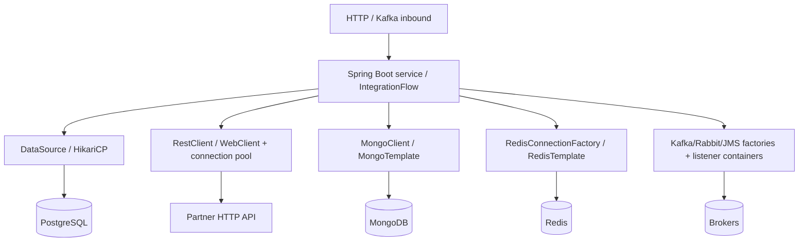
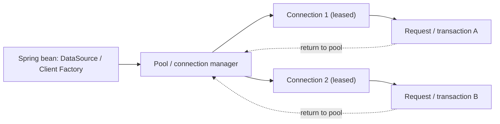
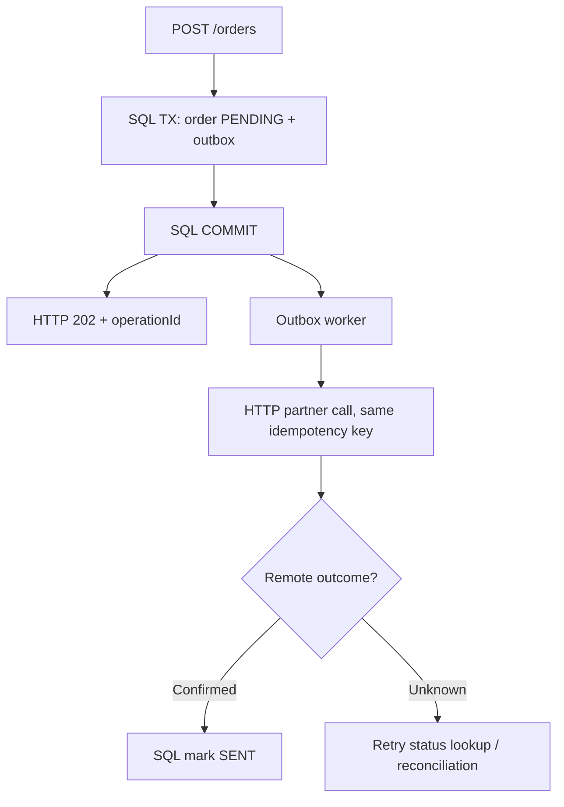
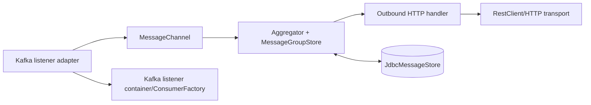
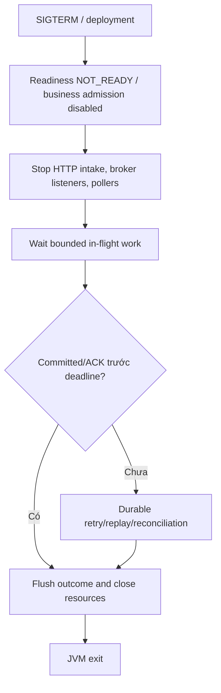
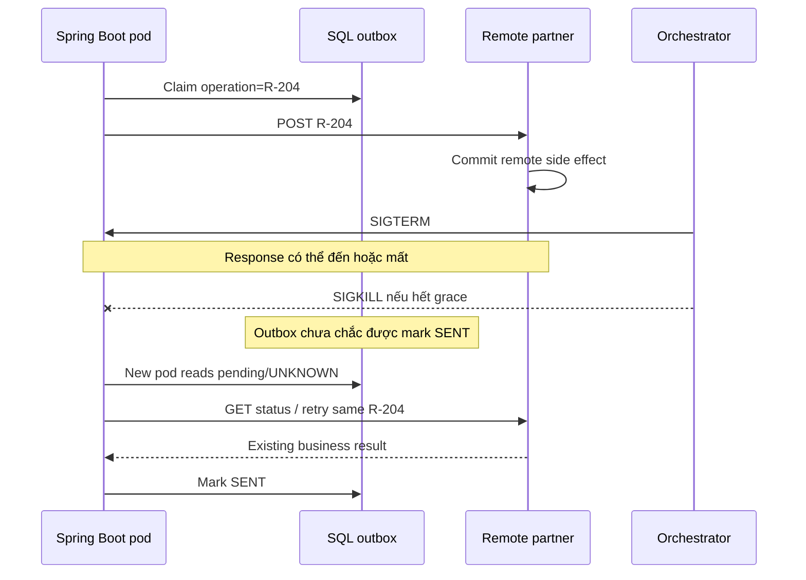

# Quản lý vòng đời kết nối và tài nguyên dùng chung

> **Chương:** Cấu hình kết nối  
> **Phạm vi:** Trong module **SPRING_BOOT_INTEGRATION**, Spring Boot tổ chức tích hợp HTTP client, SQL/NoSQL database, Redis/cache, Kafka/RabbitMQ/JMS, RSocket và các adapter của Spring Integration. Bài học tập trung vào **ai tạo, ai sở hữu, ai dùng chung và ai đóng kết nối/tài nguyên**, cách cấu hình pool và timeout, điều phối graceful shutdown, kiểm soát lỗi, chống trùng, giao dịch, kiểm thử và quan sát các luồng tích hợp thực tế.

## 1. Bài toán: một service có nhiều kiểu kết nối cùng tồn tại

Một service xử lý đơn hàng thực hiện:

1. Nhận HTTP request, xác thực rồi lưu command và outbox vào PostgreSQL.
2. Gọi một API đối tác bằng `RestClient` hoặc `WebClient`.
3. Đọc/ghi Redis cache cho metadata.
4. Nhận sự kiện từ Kafka, phát notification qua RabbitMQ.
5. Đọc trạng thái MongoDB và phát thông điệp vào Spring Integration flow.

Nếu mỗi lần xử lý đều tự tạo một HTTP client, MongoDB client hoặc broker connection rồi bỏ mặc nó, hệ thống dễ gặp **cạn socket, thread, file descriptor, connection pool, quá tải broker và không thoát JVM khi deploy**. Ngược lại, nếu dùng chung một JDBC `Connection` hoặc một transaction giữa nhiều requests, hệ thống dễ gặp **cross-request state leak** và lỗi concurrency.



**Nguyên tắc chính:** chia sẻ **factory, client đã được thiết kế thread-safe và pool**; không chia sẻ **connection/transaction/session có state request-scoped hoặc không thread-safe** nếu API không cho phép.

### Mục tiêu học tập

Sau bài này, người học có thể:

- Phân biệt **tài nguyên dùng chung**, **lease/connection mượn từ pool** và **state của từng request/transaction**.
- Tận dụng Spring Boot auto-configuration thay vì tạo client/pool mới không cần thiết.
- Cấu hình `RestClient`, `WebClient`, HikariCP, Redis, MongoDB và broker clients đúng vòng đời.
- Dùng `@Bean`, `@PreDestroy`, `SmartLifecycle` và `ContextClosedEvent` đúng mục đích.
- Chọn timeout, giới hạn concurrency, pool size và queue capacity dựa trên nhu cầu thật.
- Tránh đóng client dùng chung khi một request bị cancel hoặc fail.
- Điều phối shutdown với in-flight HTTP/broker messages và durable outbox.
- Thiết kế cho crash bất kỳ thời điểm nào bằng idempotency, retries và reconciliation.
- Dùng metrics và integration tests phát hiện connection leaks, starvation, stale connections và resource shutdown.

## 2. Mô hình ownership: ba cấp vòng đời

| Cấp | Ví dụ | Ai tạo? | Ai đóng? |
| --- | --- | --- | --- |
| **Application-scoped** | `DataSource`, `MongoClient`, `ConnectionProvider`, `RabbitTemplate`, `KafkaTemplate`, `RSocketRequester` dùng chung | Spring Boot auto-config hoặc `@Bean` của ứng dụng | Spring context hoặc **bean owner**, đúng thứ tự |
| **Operation/transaction-scoped** | JDBC `Connection` mượn từ pool, JPA `EntityManager`, Mongo `ClientSession`, JMS `Session`, một HTTP request | Framework/service ở lúc thao tác | Framework/try-with-resources/transaction boundary sau thao tác |
| **Subscription/task-scoped** | RSocket stream subscription, response body stream, `FileInputStream`, executor task, broker delivery | Caller/consumer/worker | Khi complete/error/cancel hoặc khi consumer kết thúc công việc |

**Ownership là hợp đồng, không chỉ là thời gian sống.** Một instance `WebClient` có thể sống suốt app nhưng mỗi `Mono` từ `retrieve()` đại diện cho operation riêng. Một `DataSource` tồn tại cả process nhưng `Connection` lấy từ nó cần trả về pool sau từng transaction.

### 2.1. Quy tắc “tạo một lần, sử dụng nhiều lần”

Được chia sẻ nếu library document rõ là thread-safe/reusable:

```text
Spring bean / singleton:
  RestClient
  WebClient
  JdbcTemplate / NamedParameterJdbcTemplate
  MongoTemplate
  RedisTemplate / StringRedisTemplate
  KafkaTemplate
  RabbitTemplate
  ConnectionFactory / ProducerFactory / DataSource / MongoClient

Theo thao tác:
  SQL transaction/Connection
  HTTP request body / response stream
  Mongo session/transaction
  JMS Session (thường không thread-safe)
  Kafka Consumer (không thread-safe)
  Reactive Subscription / RequestContext
```

Đây là **mẫu phân loại tổng quát**, phải đối chiếu phiên bản và chế độ cấu hình của từng thư viện. Ví dụ một request object mutable hoặc template bị thay đổi configuration trong lúc chạy có thể không còn an toàn dù template class vốn hỗ trợ reuse.

### 2.2. Đừng dùng singleton để giữ dữ liệu từng người dùng

```java
// ANTI-PATTERN: singleton service lưu Authorization của request gần nhất.
@Service
class UnsafePartnerClient {
    private String currentBearerToken;

    void setToken(String token) {
        this.currentBearerToken = token;
    }
}
```

Hai request đồng thời có thể ghi đè token/tenant của nhau. Dùng **request-local parameters**, security context theo execution model hoặc metadata của message với policy rõ; không lưu credentials/request body vào field mutable của singleton client.

## 3. Tách factory, pool, connection và operation



Một **pool size 20** nghĩa là tối đa khoảng 20 physical connections **trong pool cụ thể** (với tùy implementation), không phải hệ thống chỉ cho tối đa 20 HTTP requests hoặc 20 Java threads.

| Tình huống | Điều xảy ra |
| --- | --- |
| Chưa có connection rảnh, pool chưa đạt max | Pool có thể tạo thêm physical connection |
| Đã đạt max, toàn bộ connection đang được mượn | Caller chờ `acquire/connectionTimeout` rồi lỗi nếu hết hạn |
| Transaction thành công và đóng handle đúng | Connection thường được **trả về pool**, chưa đóng physical socket ngay |
| DB/reverse proxy cắt idle socket | Lần dùng sau có thể gặp stale/closed connection, cần pool validation/eviction |
| Application context shutdown | Pool ngừng nhận lease mới và đóng physical connections theo lifecycle |

**“Đóng connection” có thể nghĩa khác nhau**: `connection.close()` trên pooled JDBC Connection thường trả connection về pool, trong khi `MongoClient.close()`/`ConnectionProvider.dispose()` đóng **tài nguyên gốc** dùng chung. Không gọi phương thức đóng của owner sau mỗi request.

## 4. Spring Bean lifecycle là nền tảng quản lý ownership

Spring Boot tạo và wiring rất nhiều factories/pools khi dependencies và properties phù hợp. Nếu để Boot sở hữu, framework sẽ quản vòng đời bean. Nếu **tự tạo thêm tài nguyên**, bạn phải xác định destructor/stop contract của tài nguyên ấy.

### 4.1. Một số cơ chế vòng đời

| Cơ chế | Dùng để làm gì? | Chú ý |
| --- | --- | --- |
| `@Bean(destroyMethod="close")` | Đăng ký destroy method trên bean do context sở hữu | Không áp cho object mượn hoặc client shared do bean khác sở hữu |
| `@PreDestroy` | Đóng file handle hoặc cleanup nhẹ khi bean destroy | Không là nơi đợi vô hạn một workflow dài |
| `DisposableBean` | Một cách khác tham gia destruction | Tránh cần thiết nếu `@Bean` destroy method đủ |
| `ContextClosedEvent` | Quan sát context bắt đầu đóng | Không tự đảm bảo in-flight đã hết |
| `SmartLifecycle` | Điều phối start/stop theo phase, hỗ trợ stop callback | Callback phải gọi đúng khi trách nhiệm stop đã hoàn tất |
| `LifecycleProcessor` / shutdown phases | Điều phối các `Lifecycle`/`SmartLifecycle` beans | Timeout tính **theo phase**, không phải tổng app |
| `server.shutdown=graceful` | Cho web server cơ hội xử lý request đang chạy | Không tự drain Kafka/outbox/custom executor |

### 4.2. Spring singleton không đồng nghĩa toàn cục JVM

Một singleton bean là singleton **trong application context** (thường một instance trong context), không phải tự động dùng chung qua tất cả JVM/pods. Ba replicas thường có **ba Hikari pools, ba HTTP connection pools và ba Redis clients**. Tính capacity ở **cấp cluster**, không chỉ một pod.

### 4.3. @Bean destroy method

```java
package com.example.integration.resources;

import org.springframework.context.annotation.Bean;
import org.springframework.context.annotation.Configuration;

@Configuration(proxyBeanMethods = false)
class IntegrationResourceConfiguration {

    @Bean(destroyMethod = "close")
    FileBackedCursorStore cursorStore() {
        return new FileBackedCursorStore("/var/lib/app/checkpoints");
    }
}
```

`FileBackedCursorStore` là **class ứng dụng minh họa** phải tự triển khai `close()`; snippet không phải API Spring có sẵn. Điểm học: bean owner tạo resource và đăng ký đóng một lần khi context kết thúc. Không dùng `new FileBackedCursorStore(...)` bên trong từng handler rồi trông chờ Spring tự gọi close.

**Nếu bean nhận một resource do bên khác sở hữu** (ví dụ `DataSource` của Boot), không tự gọi `dataSource.close()` trong `@PreDestroy` của handler. Owner pool mới có trách nhiệm đóng pool sau khi người dùng đã stop.

## 5. Cấu hình được tổ chức theo ứng dụng, không rải trong từng request

Một cấu hình local minh họa:

```yaml
spring:
  datasource:
    url: ${APP_JDBC_URL:jdbc:postgresql://localhost:5432/integration_dev}
    username: ${APP_JDBC_USER:integration_app}
    password: ${APP_JDBC_PASSWORD}
    hikari:
      maximum-pool-size: 12
      minimum-idle: 2
      connection-timeout: 1500
      validation-timeout: 1000
      idle-timeout: 600000
      max-lifetime: 1800000

  lifecycle:
    timeout-per-shutdown-phase: 25s

  task:
    execution:
      shutdown:
        await-termination: true
        await-termination-period: 20s
    scheduling:
      shutdown:
        await-termination: true
        await-termination-period: 20s

server:
  shutdown: graceful

integration:
  partner:
    base-url: ${PARTNER_BASE_URL:http://localhost:8089}
    connect-timeout: 1s
    response-timeout: 3s
    max-connections: 80
    max-in-flight: 16
```

Trong `spring.datasource.hikari`, các giá trị timeout ở ví dụ là **milliseconds** theo convention properties Hikari, còn `spring.lifecycle.timeout-per-shutdown-phase` và các properties task shutdown của Boot dùng kiểu `Duration` như `25s`. Cần kiểm tra version/properties bindings thực tế; **không áp dụng cùng đơn vị một cách máy móc**.

`integration.partner.*` là **custom properties**, không phải Boot tự cấu hình HTTP pool khi viết những keys này. Phải bind và sử dụng chúng trong Java configuration. Secrets lấy qua environment/secret manager; **không commit password/token thật** vào repository.

### 5.1. @ConfigurationProperties cho typed settings

```java
package com.example.integration.partner;

import java.net.URI;
import java.time.Duration;
import org.springframework.boot.context.properties.ConfigurationProperties;

@ConfigurationProperties(prefix = "integration.partner")
public record PartnerClientProperties(
        URI baseUrl,
        Duration connectTimeout,
        Duration responseTimeout,
        int maxConnections,
        int maxInFlight
) {}
```

```java
@Configuration(proxyBeanMethods = false)
@EnableConfigurationProperties(PartnerClientProperties.class)
class PartnerClientConfiguration {
    // Các bean HTTP client ở phần tiếp theo.
}
```

Đoạn sau là **snippet class** cần imports `Configuration`, `EnableConfigurationProperties` và typed properties ở trên. Thêm Bean Validation/constructor validation khi cần để bảo đảm timeout dương, `maxConnections > 0`, URI scheme/host nằm trong allowlist và `maxInFlight <=` ngân sách downstream phù hợp. Không cho caller tự quyết định base URL chưa validate vì có thể tạo SSRF.

## 6. RestClient: reuse client và pool HTTP do bean sở hữu

`RestClient` (Spring Framework 6.1+, thông dụng trong Spring Boot 3.2+) là HTTP client **blocking**. `RestClient` thường được tạo một lần, reuse giữa requests; HTTP request/response có vòng đời riêng.

### 6.1. Mẫu đơn giản dùng builder do Boot cấu hình

```java
package com.example.integration.partner;

import org.springframework.context.annotation.Bean;
import org.springframework.context.annotation.Configuration;
import org.springframework.web.client.RestClient;

@Configuration(proxyBeanMethods = false)
class SimplePartnerConfiguration {

    @Bean
    RestClient partnerRestClient(
            RestClient.Builder builder,
            PartnerClientProperties props) {
        return builder
                .baseUrl(props.baseUrl().toString())
                .build();
    }
}
```

Reuse bean `partnerRestClient`; **không** viết `RestClient.create(url)` trong vòng lặp mỗi message. Mẫu đơn giản có thể dùng request factory dựa trên dependencies/autoconfiguration; nếu cần giới hạn pool và timeouts chặt, phải cấu hình **request factory/transport cụ thể** như mục 6.2.

### 6.2. Ví dụ Apache HttpClient 5 có connection pool

Thêm `org.apache.httpcomponents.client5:httpclient5` theo dependency management tương thích. Sau đó định nghĩa **một pool + một client** được Spring sở hữu:

```java
package com.example.integration.partner;

import org.apache.hc.client5.http.classic.HttpClient;
import org.apache.hc.client5.http.config.RequestConfig;
import org.apache.hc.client5.http.impl.classic.CloseableHttpClient;
import org.apache.hc.client5.http.impl.classic.HttpClients;
import org.apache.hc.client5.http.impl.io.PoolingHttpClientConnectionManager;
import org.apache.hc.client5.http.impl.io.PoolingHttpClientConnectionManagerBuilder;
import org.apache.hc.core5.util.Timeout;
import org.springframework.beans.factory.annotation.Qualifier;
import org.springframework.context.annotation.Bean;
import org.springframework.context.annotation.Configuration;
import org.springframework.http.client.HttpComponentsClientHttpRequestFactory;
import org.springframework.web.client.RestClient;

@Configuration(proxyBeanMethods = false)
public class PooledPartnerClientConfiguration {

    @Bean(destroyMethod = "close")
    CloseableHttpClient partnerApacheClient() {
        PoolingHttpClientConnectionManager manager =
                PoolingHttpClientConnectionManagerBuilder
                        .create()
                        .build();
        manager.setMaxTotal(80);
        manager.setDefaultMaxPerRoute(20);

        RequestConfig config = RequestConfig.custom()
                .setConnectionRequestTimeout(Timeout.ofSeconds(1))
                .setResponseTimeout(Timeout.ofSeconds(3))
                .build();

        return HttpClients.custom()
                .setConnectionManager(manager)
                .setDefaultRequestConfig(config)
                .evictExpiredConnections()
                .build();
    }

    @Bean("pooledPartnerRestClient")
    RestClient pooledPartnerRestClient(
            RestClient.Builder builder,
            @Qualifier("partnerApacheClient")
            CloseableHttpClient apacheClient,
            PartnerClientProperties props) {
        return builder
                .baseUrl(props.baseUrl().toString())
                .requestFactory(
                        new HttpComponentsClientHttpRequestFactory(apacheClient))
                .build();
    }
}
```

**Giới hạn của ví dụ:** Apache HttpClient 5 APIs/options phải được đối chiếu với version do BOM quản lý. Để production-ready, thêm **connect/socket timeout** trong connection manager/socket configuration theo client version, TLS trust/mTLS, idle eviction policy và HTTP client metrics. `setConnectionRequestTimeout` giới hạn **thời gian chờ mượn connection từ pool**, không phải TCP connect timeout; `setResponseTimeout` là response timeout của request layer, không nhất thiết là deadline tổng workflow.

### 6.3. Ai được đóng?

```text
Spring ApplicationContext
  owns CloseableHttpClient partnerApacheClient
     owns PoolingHttpClientConnectionManager
  exposes RestClient pooledPartnerRestClient
     borrows transport on every HTTP exchange

Business code gọi:
  restClient.post()/get()
  ...consume/close response as appropriate...

Khi shutdown:
  stop nhận công việc HTTP mới
  drain in-flight
  Spring destroys apacheClient -> close underlying pool
```

**Không gọi `apacheClient.close()` trong `finally` của một business method**. Việc đó sẽ đóng pool dùng chung ngay sau request đầu, khiến mọi request khác báo “connection pool shut down”.

### 6.4. HTTP response stream phải được đóng

Với `retrieve().body(MyDto.class)`, HTTP client/adapter thường quản lý response lifecycle sau khi body được tiêu thụ. Nhưng nếu dùng `exchange(...)` hoặc lấy response body dưới dạng stream, **chịu trách nhiệm tiêu thụ/đóng stream theo API**. Không trả một raw `InputStream` phụ thuộc connection đã đóng ra khỏi boundary mà không có ownership contract.

## 7. WebClient/Reactor Netty: connection pool và event loop

`WebClient` hỗ trợ API reactive, thường dùng Reactor Netty khi dependency phù hợp. Ngoài **connection pool**, Reactor Netty có **event-loop resources**; nếu tạo nhiều `HttpClient`/`ConnectionProvider`/`LoopResources` không kiểm soát, số sockets/threads và scheduling overhead có thể tăng.

### 7.1. Client dùng chung với pool riêng, bean owner đóng

```java
package com.example.integration.partner;

import java.time.Duration;
import io.netty.channel.ChannelOption;
import org.springframework.beans.factory.annotation.Qualifier;
import org.springframework.context.annotation.Bean;
import org.springframework.context.annotation.Configuration;
import org.springframework.http.client.reactive.ReactorClientHttpConnector;
import org.springframework.web.reactive.function.client.WebClient;
import reactor.netty.http.client.HttpClient;
import reactor.netty.resources.ConnectionProvider;

@Configuration(proxyBeanMethods = false)
public class ReactivePartnerClientConfiguration {

    @Bean(destroyMethod = "dispose")
    ConnectionProvider partnerConnectionProvider() {
        return ConnectionProvider.builder("partner-http")
                .maxConnections(80)
                .pendingAcquireMaxCount(160)
                .pendingAcquireTimeout(Duration.ofSeconds(1))
                .maxIdleTime(Duration.ofSeconds(30))
                .maxLifeTime(Duration.ofMinutes(5))
                .build();
    }

    @Bean("partnerWebClient")
    WebClient partnerWebClient(
            WebClient.Builder builder,
            @Qualifier("partnerConnectionProvider")
            ConnectionProvider provider,
            PartnerClientProperties props) {
        HttpClient transport = HttpClient.create(provider)
                .option(ChannelOption.CONNECT_TIMEOUT_MILLIS, 1000)
                .responseTimeout(Duration.ofSeconds(3));

        return builder
                .baseUrl(props.baseUrl().toString())
                .clientConnector(new ReactorClientHttpConnector(transport))
                .build();
    }
}
```

Ví dụ cần `spring-webflux` và Reactor Netty client dependencies. `ConnectionProvider` là resource do bean sở hữu; `WebClient` **không cần được đóng sau từng request**. `destroyMethod="dispose"` bắt đầu dispose của provider; nếu cần **chờ đóng hoàn tất** một khoảng hữu hạn trước JVM exit, phải điều phối theo chính Reactor Netty/Spring lifecycle APIs và version, không coi một lời gọi async dispose là synchronous completion.

**Không tự dispose Reactor Netty global resources khi còn HTTP/RSocket traffic**. Nếu code dùng resource mặc định do Spring Boot/Reactor Netty quản lý, hãy để owner tương ứng xử lý vòng đời. Khi tạo provider/loop riêng, khai báo ownership rõ.

### 7.2. Một connection có thể phục vụ nhiều requests

HTTP/1.1 keep-alive cho phép tái sử dụng connection qua các request tuần tự; HTTP/2 có thể multiplex nhiều streams trên một connection nếu transport/server hỗ trợ. Vì thế:

- `maxConnections=80` **không** đồng nghĩa “chỉ 80 HTTP requests cùng lúc” ở mọi protocol.
- Pool wait timeout khác HTTP response timeout.
- Cần đo concurrency thực, queue pending acquire và HTTP/2 stream limits.
- Idle/stale connection có thể bị proxy cắt trước maxIdleTime.
- Reactor Netty event loop là tài nguyên xử lý network I/O; **không chạy JDBC blocking trên event loop**.

### 7.3. WebClient không làm blocking operation tự biến thành non-blocking

```java
// ANTI-PATTERN: JDBC blocking nằm trong reactive event-loop.
webClient.get().uri("/orders/42").retrieve()
        .bodyToMono(OrderReply.class)
        .map(reply -> jdbcTemplate.queryForObject(
                "SELECT status FROM orders WHERE order_id=?",
                String.class, reply.orderId()));
```

`jdbcTemplate` là blocking API. Nếu cần dùng trong reactive pipeline, chuyển **riêng blocking unit** sang scheduler phù hợp:

```java
Mono<String> status = webClient.get()
        .uri("/orders/42")
        .retrieve()
        .bodyToMono(OrderReply.class)
        .flatMap(reply -> Mono.fromCallable(() ->
                jdbcTemplate.queryForObject(
                        "SELECT status FROM orders WHERE order_id=?",
                        String.class, reply.orderId()))
                .subscribeOn(Schedulers.boundedElastic()));
```

Đây là snippet cần imports `Mono` và `Schedulers` cùng `OrderReply`/`jdbcTemplate` được định nghĩa. `boundedElastic` không phải DB connection pool và không tự tạo SQL transaction. Với nhiều requests đồng thời, vẫn cần giới hạn tổng pending work và Hikari pool.

### 7.4. Giới hạn lượng dữ liệu khi download

Một `WebClient` deserialize hàng triệu JSON objects qua `collectList()` có thể OOM dù HTTP pool chỉ có 10 connections. Thiết kế streaming/bounded buffer, byte limits, `Flux` backpressure và contract phân trang. Khi cancel stream, đóng subscription/response resource đúng API; **không dispose cả WebClient/ConnectionProvider dùng chung** vì một caller cancel.

## 8. Pool sizing: dùng phép đo, không chọn số lớn tùy ý

Một pool quá nhỏ gây chờ; quá lớn gây nhiều sockets, DB context switching, TLS handshakes, file descriptors và CPU. Nguồn lực có giới hạn ở cả **caller** lẫn **server**.

### 8.1. Nguyên tắc gần đúng

Với workload tương đối ổn định, có thể dùng **Little's Law** để ước tính mức concurrency:

\[
L \approx \lambda \times W
\]

- `L`: số operations đang ở trong hệ trung bình.
- `λ`: số operations/giây đến.
- `W`: thời gian trung bình (giây) mỗi operation mất trong một stage.

Ví dụ một service gửi khoảng **200 HTTP calls/giây**, mỗi call chiếm connection khoảng **0,08 giây** trung bình, concurrency ở stage này khoảng **16**. Không kết luận pool luôn phải chính xác 16: p95/p99, bursts, HTTP/2, retry, upstream rate và headroom mới quyết định cấu hình sản xuất.

### 8.2. Tính tổng across replicas

```text
Spring Boot replicas      = 12
Hikari max pool per pod   = 20
Potential DB connections  = 12 × 20 = 240

Trong rolling deployment:
  có thể tạm tồn tại cả old pods và new pods
  -> peak connection demand cao hơn steady state
```

Đối chiếu với PostgreSQL `max_connections`, connection reserved cho admin/maintenance, other services, transaction pooling/proxy và dự phòng failover. **Tăng Hikari từ 20 lên 200 trên mỗi pod không làm PostgreSQL xử lý transaction nhanh hơn**.

### 8.3. Quy tắc ưu tiên khi chọn pool

1. Đo request rate, p95/p99 latency, peak concurrency và queue wait.
2. Biết server-side limit: DB connections, partner rate limits, broker channels, Redis max clients.
3. Dùng một pool chung theo **một mục đích/endpoint** khi có thể, không tạo pool riêng cho mỗi bean không cần thiết.
4. Giới hạn **max in-flight** trước khi pool được lấp đầy hoàn toàn.
5. Thêm timeout acquisition ngắn để fail fast/backpressure thay vì giữ thread chờ vô hạn.
6. Kiểm thử khi dependency chậm, một instance chết, số pods tăng và deployment overlap.
7. Theo dõi saturation và tune từ dữ liệu; không thay cấu hình mỗi khi xuất hiện một timeout.

## 9. JDBC/HikariCP: DataSource dùng chung, Connection theo transaction

Spring Boot JDBC thường auto-configure `HikariDataSource` khi HikariCP có trên classpath và không bị cấu hình khác thay thế. `JdbcTemplate`, JPA/JOOQ hoặc Spring Batch có thể dùng chung `DataSource` (nếu dependency cùng trỏ tới bean ấy), nhưng không nên dùng chung **một JDBC Connection** theo cách thủ công qua nhiều threads.

### 9.1. Một service dùng JdbcTemplate

```java
package com.example.integration.orders;

import org.springframework.jdbc.core.JdbcTemplate;
import org.springframework.stereotype.Repository;

@Repository
public class OrderReadRepository {
    private final JdbcTemplate jdbc;

    public OrderReadRepository(JdbcTemplate jdbc) {
        this.jdbc = jdbc;
    }

    public String findStatus(String orderId) {
        return jdbc.queryForObject(
                "SELECT status FROM orders WHERE order_id = ?",
                String.class,
                orderId);
    }
}
```

Không gọi `dataSource.getConnection()` mỗi lần rồi quên đóng; `JdbcTemplate` đã sử dụng connection acquisition/release theo Spring JDBC semantics. Nếu tự dùng JDBC:

```java
try (Connection connection = dataSource.getConnection();
     PreparedStatement statement = connection.prepareStatement(
             "SELECT status FROM orders WHERE order_id=?")) {
    statement.setString(1, orderId);
    try (ResultSet rs = statement.executeQuery()) {
        if (!rs.next()) {
            throw new IllegalStateException("Order not found");
        }
        return rs.getString(1);
    }
}
```

Đây là snippet **ngoài Spring-managed transaction**. Nếu đang dùng `@Transactional` và cố tình gọi raw `dataSource.getConnection()` không theo Spring transaction utilities, có thể lấy connection khác với transaction hiện tại. Ưu tiên `JdbcTemplate` hoặc `DataSourceUtils` khi cần phối hợp đúng transaction manager.

### 9.2. Hikari timeout/idle/maxLifetime

| Property | Ý nghĩa | Cạm bẫy |
| --- | --- | --- |
| `maximumPoolSize` | Giới hạn số connections mà pool quản lý | Tổng nhiều pods có thể vượt DB capacity |
| `minimumIdle` | Số idle connections pool cố duy trì | Không phải “mức request tối thiểu”; tăng idle tốn sockets |
| `connectionTimeout` | Chờ lấy connection từ pool | Không phải SQL query timeout |
| `validationTimeout` | Thời hạn kiểm tra connection sống khi cần | Phải nhỏ hơn connection timeout theo Hikari constraints |
| `idleTimeout` | Thời gian idle trước khi eligible retire (có điều kiện) | Không tự đóng connection đang được lease |
| `maxLifetime` | Giới hạn tuổi connection trong pool | Không cưỡng bức giết transaction đang mượn giữa chừng |
| `keepaliveTime` | Ping idle connection để tránh idle network/DB timeout | Có điều kiện minimum interval và nhỏ hơn maxLifetime |
| `leakDetectionThreshold` | Cảnh báo connection bị giữ quá lâu | Có false positives với transaction hợp lệ dài |

**Hikari là pool của JDBC connections**, không phải SQL execution scheduler. Một transaction có 100 query tuần tự có thể giữ một connection lâu; một `@Async` task có thể mở transaction riêng trên thread khác.

### 9.3. Connection leak là giữ connection quá lâu hoặc không trả

Ví dụ sai:

```java
// ANTI-PATTERN: mượn Connection rồi giữ vào singleton field.
class UnsafeOrderDAO {
    private final Connection connection;

    UnsafeOrderDAO(DataSource ds) throws SQLException {
        this.connection = ds.getConnection();
    }
}
```

Connection này có thể bị chia sẻ giữa threads hoặc không bao giờ trả pool. Hãy dùng `JdbcTemplate`, transaction boundary ngắn và try-with-resources khi phải thao tác low-level.

### 9.4. Transaction timeout và DB statement timeout là hai thứ khác nhau

- **Pool acquisition timeout:** hết thời gian lấy connection.
- **Connect timeout:** hết thời gian tạo TCP connection tới DB.
- **Statement/query timeout:** SQL chạy quá lâu.
- **Transaction timeout:** transaction vượt ngân sách do transaction manager đặt.
- **Socket/read timeout:** client chờ data qua network quá lâu.

Thiết kế sao cho lỗi được phân loại đúng, tránh chỉ tăng `connectionTimeout` để che slow SQL. Một query bị lock 60 giây không được cải thiện vì pool có thêm 100 connections.

## 10. Local SQL transaction không đóng gói remote HTTP

Một service muốn lưu đơn, gọi partner và cập nhật trạng thái:

```java
@Transactional
public void submitOrder(OrderCommand command) {
    orders.insertPending(command);
    partnerRestClient.post()
            .uri("/reservations")
            .body(command)
            .retrieve()
            .toBodilessEntity();
    orders.markReserved(command.orderId());
}
```

Đây là **anti-pattern về transaction**, không phải ví dụ nên triển khai. JDBC transaction vẫn giữ connection/locks khi chờ partner HTTP; nếu HTTP timeout sau khi partner đã commit, rollback SQL **không đảo ngược** remote reservation.

### 10.1. Dùng local transaction ngắn và outbox



**Connection ownership đúng:** request thread dùng JDBC connection ngắn để commit outbox; worker mượn connection cho claim/update state, **không giữ connection/transaction mở suốt HTTP call**. Partner HTTP client dùng connection pool riêng.

### 10.2. Commit trước broker ACK

Trong luồng Kafka/Rabbit/JMS → SQL:

1. Nhận message, validate schema/tenant.
2. Transaction SQL ghi **inbox unique event ID + business effects + outbox**.
3. Commit SQL.
4. ACK broker/commit offset theo container semantics.

Crash sau SQL commit trước ACK có thể gây redelivery. Vì thế **idempotency + durable inbox** là điều kiện để có consistency. Không tái sử dụng một `Connection` từ listener thread vào thread khác để “giữ giao dịch xuyên async flow”.

## 11. JPA, jOOQ và Spring Batch: cùng pool nhưng khác context

Các abstraction làm việc với SQL có vòng đời riêng:

| Thành phần | Thường có thể chia sẻ? | Không được dùng sai |
| --- | --- | --- |
| `DataSource`/`HikariDataSource` | Application-scoped | Không tạo pool riêng cho mỗi repository |
| `JdbcTemplate`/`NamedParameterJdbcTemplate` | Bean singleton, thread-safe khi cấu hình không đổi | Không giữ raw `Connection` trong singleton |
| jOOQ `DSLContext` | Có thể inject/reuse khi được cấu hình theo Spring transaction integration | Không giữ `ResultQuery` mutable đang build qua nhiều requests |
| JPA `EntityManagerFactory` | Factory application-scoped | Không tạo mới cho từng HTTP request |
| JPA `EntityManager` | Context-bound, thường thread-confined | Không lưu một EntityManager thực vào singleton rồi chia sẻ |
| Spring Batch `JobRepository` | Component hạ tầng dùng chung trong process | Metadata/state có schema và transaction riêng |
| Spring Batch reader/writer có state | Thường theo Step/Job scope | Không dùng cùng cursor mutable cho nhiều JobExecutions |

### 11.1. Đừng giữ persistence context qua workflow từ xa

Một `@Transactional` service dùng JPA có persistence context gắn với transaction. Nếu gọi HTTP 30 giây trong transaction, `EntityManager`/connection/locks có thể vẫn bị giữ, và lazy loading sau khi context đóng có thể lỗi.

**Chia việc theo ranh giới**: transaction SQL ngắn để ghi business state, outbox; worker gửi remote; transaction SQL ngắn để commit outcome. Không dùng `OpenEntityManagerInView` như cách “giữ connection đến khi trả HTTP response” cho tích hợp lâu.

### 11.2. Spring Batch cần checkpoint, không cần giữ connection cả job

Job import hàng triệu records nên dùng **chunk transactions** để mượn/trả JDBC connections theo chunk, commit checkpoint qua `JobRepository`. Nếu Step xử lý HTTP/SFTP, side effect ngoài DB phải idempotent; **đừng giữ một JDBC transaction 30 phút** để mong job restart không trùng.

Khi số Step/job chạy song song tăng, cần tính **tổng concurrency qua Batch + HTTP + broker listeners + API** so với Hikari max. Một service vừa chạy Batch vừa phục vụ HTTP cần ưu tiên pool reservation hoặc throttling để batch không chiếm hết connections.

## 12. MongoDB: MongoClient chung, ClientSession theo thao tác

MongoDB Java driver quản một **cluster topology view** và connection pools theo server. Một `MongoClient` thường được tạo cho một tập cấu hình cluster/identity và reuse trong application; `MongoTemplate`/Spring Data repositories dùng nó. Tạo một client trong mỗi request làm tăng connections, background monitoring threads và gây khó cho failover.

### 12.1. Dùng auto-configuration khi đủ

```yaml
spring:
  data:
    mongodb:
      uri: ${MONGODB_URI:mongodb://localhost:27017/integration_dev}
```

Spring Boot tạo `MongoClient`/`MongoTemplate` từ properties và dependencies phù hợp. Trong production cần TLS/auth/replica set/sharding URI và kiểm soát timeout/pool qua cấu hình driver/`MongoClientSettings` theo Boot version.

**Không khai báo thêm một `MongoClient` cùng thông tin kết nối chỉ để gọi một repository** nếu auto-configured client đã đúng. Nếu có nhiều Mongo clusters hoặc credentials khác nhau, tạo và đặt tên beans riêng có owner rõ.

### 12.2. Custom MongoClient khi cần pool settings

```java
package com.example.integration.mongo;

import java.util.concurrent.TimeUnit;
import com.mongodb.ConnectionString;
import com.mongodb.MongoClientSettings;
import com.mongodb.client.MongoClient;
import com.mongodb.client.MongoClients;
import org.springframework.beans.factory.annotation.Value;
import org.springframework.context.annotation.Bean;
import org.springframework.context.annotation.Configuration;

@Configuration(proxyBeanMethods = false)
class MongoClientConfiguration {

    @Bean(destroyMethod = "close")
    MongoClient integrationMongoClient(
            @Value("${integration.mongo.uri}") String uri) {
        ConnectionString connection = new ConnectionString(uri);

        MongoClientSettings settings = MongoClientSettings.builder()
                .applyConnectionString(connection)
                .applyToConnectionPoolSettings(pool -> pool
                        .maxSize(40)
                        .minSize(4)
                        .maxWaitTime(2, TimeUnit.SECONDS))
                .build();

        return MongoClients.create(settings);
    }
}
```

`integration.mongo.uri` là **custom property** phải cấu hình. Ở version MongoDB Java driver mới, một số methods có overload/khuyến nghị mới; xác nhận cụ thể driver/BOM. Khi khai báo custom `MongoClient`, Spring Boot có thể back off auto-configuration của client mặc định; kiểm tra `MongoTemplate` đang inject **đúng bean/cluster** và không có hai clients ngoài ý muốn.

### 12.3. Connection vs ClientSession

MongoDB driver chịu trách nhiệm mượn/trả connections. Nếu dùng transaction:

```java
try (ClientSession session = mongoClient.startSession()) {
    session.startTransaction();
    try {
        // Gọi các operations sử dụng session theo contract của driver.
        session.commitTransaction();
    } catch (RuntimeException ex) {
        session.abortTransaction();
        throw ex;
    }
}
```

Đây là **snippet minh họa transaction session**. Với Spring Data transaction management, ưu tiên dùng `MongoTransactionManager` và `@Transactional` khi topology phù hợp, thay vì trộn raw session vào code repository không tương thích. **Không chia sẻ `ClientSession` giữa nhiều threads/requests**; đóng session khi complete/error.

### 12.4. MongoDB không cần Spring Cloud LoadBalancer

MongoDB driver nhận biết replica set/sharded cluster và chọn server theo **read/write semantics** của nó. Không dùng một round-robin HTTP load balancer để chọn ngẫu nhiên MongoDB primary/secondary. Pool và topology discovery của MongoDB driver cần hoạt động độc lập.

## 13. Redis/Lettuce: dùng chung factory, không giữ raw connection sai cách

Spring Data Redis thường auto-configure `RedisConnectionFactory` và `RedisTemplate`/`StringRedisTemplate`. Khi dùng Lettuce, nhiều operations có thể được xử lý trên một connection thread-safe theo configuration, nhưng **transaction/blocking/pub-sub** có semantics riêng; không suy mọi Redis connection object có thể dùng chung tùy ý.

### 13.1. Cache/repository dùng StringRedisTemplate

```java
package com.example.integration.redis;

import java.time.Duration;
import org.springframework.data.redis.core.StringRedisTemplate;
import org.springframework.stereotype.Service;

@Service
public class PartnerMetadataCache {
    private final StringRedisTemplate redis;

    public PartnerMetadataCache(StringRedisTemplate redis) {
        this.redis = redis;
    }

    public void cacheVersion(String partnerId, String version) {
        redis.opsForValue().set(
                "partner:version:" + partnerId,
                version,
                Duration.ofMinutes(10));
    }
}
```

`StringRedisTemplate` là bean reusable. Mỗi operation lấy Redis connection theo Spring Data Redis factory semantics và release đúng cách. Không tự tạo `LettuceConnectionFactory` trong `cacheVersion`, không gọi `redis.getConnectionFactory().getConnection().close()` tùy tiện sau template call.

### 13.2. Redis native connection và các ngoại lệ

Đọc kỹ API khi dùng raw connection:

- Với `RedisConnectionFactory#getConnection()`, owner phải release theo Spring API/transaction context; không giữ raw wrapper trong singleton.
- Lettuce native connections có những thread-safety guarantees riêng, nhưng **blocking commands và Pub/Sub** thường cần dedicated connections để không chặn phần còn lại.
- `MULTI/EXEC`, pipeline và callback context có state; không cho hai threads trộn commands của hai transactions trên một connection.
- Redis Cluster/Sentinel dùng topology discovery của Redis driver, không phải HTTP load balancing.

### 13.3. Cache TTL khác lifecycle của connection

`TTL=10 minutes` là thời gian sống **cache entry**. Nó không nói Redis TCP connection nên mở 10 phút rồi đóng. Một cache key hết hạn không yêu cầu `RedisConnectionFactory.destroy()`. Không chạy `FLUSHALL` trong `@PreDestroy`: những replicas khác vẫn có thể dùng cùng Redis và cache invalidation có thể gây tải đột biến.

### 13.4. Redis không mặc nhiên là durable ledger

Nếu code trả HTTP `202 Accepted` sau khi chỉ ghi một task vào Redis cache có eviction/TTL, chưa chắc có guarantee giữ task qua restart/node failure. Với công việc nghiệp vụ không được mất, hãy lưu vào broker/SQL outbox hoặc cơ chế durable queue có semantics được kiểm chứng. Dùng Redis cho distributed locks hoặc idempotency phải đánh giá expiry, crash windows và fencing.

## 14. Kafka: ProducerFactory/KafkaTemplate chung, Consumer theo container

Kafka clients có hai tập quy tắc ownership khác nhau:

- `KafkaProducer` được thiết kế cho concurrency/reuse theo Kafka client contract; Spring Kafka quản producers qua `ProducerFactory` và `KafkaTemplate`.
- `KafkaConsumer` **không thread-safe**; đừng chia sẻ một consumer giữa các threads. Spring Kafka listener container sở hữu Kafka consumers, poll loop, partition assignment và ACK/commit lifecycle.

### 14.1. Spring Boot configuration

```yaml
spring:
  kafka:
    bootstrap-servers: ${KAFKA_BOOTSTRAP_SERVERS:localhost:9092}
    producer:
      acks: all
      properties:
        enable.idempotence: true
    consumer:
      group-id: order-projection
      enable-auto-commit: false
      auto-offset-reset: earliest
```

`auto-offset-reset: earliest` có tác dụng khi **chưa có committed offset hợp lệ** cho partition theo Kafka semantics; không có nghĩa mỗi lần restart đọc lại tất cả messages. Trong production, chọn retention, consumer group ID và offset reset theo recovery policy, không copy `earliest` chỉ vì tutorial.

`enable.idempotence=true` và `acks=all` cải thiện producer semantics trong phạm vi Kafka, **không** biến SQL/HTTP side effect thành exactly-once. Cần cấu hình serializers, authentication, TLS, delivery/retry timeouts và broker replication phù hợp.

### 14.2. KafkaTemplate reusable

```java
package com.example.integration.kafka;

import org.springframework.kafka.core.KafkaTemplate;
import org.springframework.stereotype.Component;

@Component
public class OrderEventPublisher {
    private final KafkaTemplate<String, String> kafka;

    public OrderEventPublisher(KafkaTemplate<String, String> kafka) {
        this.kafka = kafka;
    }

    public void publish(String orderId, String eventJson) {
        kafka.send("orders.confirmed.v1", orderId, eventJson);
    }
}
```

**Đây chỉ là snippet fire-and-forget về mặt application logic**: gọi `send(...)` trả future và **không tự chứng minh broker đã xác nhận**. Trong production, cần quan sát completion/error, retry/outbox và policy xử lý publish failures. Không tạo/đóng producer mới cho mỗi event để tránh churn.

### 14.3. Spring Kafka listener container sở hữu consumers

```java
@KafkaListener(
        topics = "orders.confirmed.v1",
        groupId = "order-projection")
void onConfirmed(ConsumerRecord<String, String> record,
                 Acknowledgment acknowledgment) {
    orderProjectionService.processOnce(record.value());
    acknowledgment.acknowledge();
}
```

Snippet này giả định listener container được cấu hình **manual acknowledgment mode** và `processOnce` hoàn tất SQL business commit **trước** khi method return. Nếu business fail thì không ACK; error handler/DLT policy quyết định tiếp. Không copy listener này khi đang dùng auto-commit hoặc ACK mode không tương thích.

**Trong shutdown:** container stop và consumer poll/offset handling do Spring Kafka quản lý. Tránh tự `consumer.close()` trong handler hoặc `System.exit(0)` khi nhận SIGTERM. Với slow handlers, cần cấu hình concurrency, `max.poll.interval.ms`, task deadline và grace period đồng bộ.

### 14.4. Kafka connection khác HTTP pool

Kafka bootstrap addresses để client lấy **cluster metadata**, sau đó Kafka client tự quản broker connections và partition leadership. Không đưa Kafka broker URLs qua `@LoadBalanced RestClient` hoặc DNS service round-robin tùy ý vì protocol yêu cầu có thể kết nối đúng advertised broker listeners.

## 15. RabbitMQ: ConnectionFactory chung, channel/consumer được quản lý

RabbitMQ/AMQP clients phân biệt **TCP connection**, **channel** và **consumer**. Một TCP connection có thể mang nhiều AMQP channels; channels có ordering/confirm state và không nên bị chia sẻ tùy tiện giữa threads nếu API không hỗ trợ.

### 15.1. Spring AMQP sử dụng CachingConnectionFactory

```yaml
spring:
  rabbitmq:
    host: ${RABBIT_HOST:localhost}
    port: ${RABBIT_PORT:5672}
    username: ${RABBIT_USER:guest}
    password: ${RABBIT_PASSWORD:guest}
    cache:
      channel:
        size: 25
    publisher-confirm-type: correlated
    publisher-returns: true
    listener:
      simple:
        prefetch: 20
        concurrency: 2
        max-concurrency: 4
```

Spring Boot thường dùng `CachingConnectionFactory` và `RabbitTemplate` từ autoconfiguration. Cấu hình phù hợp tài liệu Spring AMQP/Boot version; môi trường production phải dùng TLS/auth và không để `guest/guest` ngoài local trusted environment.

**`spring.rabbitmq.cache.channel.size=25` là cache size**, không mặc nhiên giới hạn tổng số channels có thể được tạo ở mọi chế độ. Cần xem `channelCheckoutTimeout`/cache mode và configuration thực để hiểu giới hạn. Cũng không cộng `prefetch=20` rồi coi đó là maximum backlog toàn instance nếu có nhiều consumers.

### 15.2. RabbitTemplate reusable

```java
package com.example.integration.rabbit;

import org.springframework.amqp.rabbit.core.RabbitTemplate;
import org.springframework.stereotype.Component;

@Component
class NotificationPublisher {
    private final RabbitTemplate rabbit;

    NotificationPublisher(RabbitTemplate rabbit) {
        this.rabbit = rabbit;
    }

    void publish(String routingKey, String json) {
        rabbit.convertAndSend(
                "notifications.exchange",
                routingKey,
                json);
    }
}
```

Tương tự Kafka, việc `convertAndSend` method return **không tự là bằng chứng message đã durable trên broker hoặc downstream đã ACK**. Publisher confirms/returns, broker durability/routing và outbox/retry cần chính sách riêng.

### 15.3. Channel lifecycle và ACK

Spring AMQP listener container quản consumers/channels; khi dùng manual ACK, phải ACK trên đúng channel/delivery tag **sau durable business commit**. Không lấy channel từ một callback rồi dùng lâu trong executor khác mà bỏ qua thread-safety/delivery lifecycle.

Khi connection đóng trước ACK, broker có thể redeliver unacked message; **inbox idempotency** phải xử lý được replay, kể cả khi cùng business event đến qua connection/channel mới. Phân biệt publisher confirm (broker nhận publish) và consumer ACK (delivery đã được xử lý) — chúng là hai hợp đồng khác nhau.

## 16. JMS: ConnectionFactory reuse, Session có state riêng

JMS providers như ActiveMQ/Artemis sử dụng `ConnectionFactory` để tạo JMS connections và sessions. `JmsTemplate` reusable; `DefaultMessageListenerContainer` quản listeners. **JMS Session thường không thread-safe**, vì vậy không lưu một `Session` trong singleton service rồi cho nhiều request cùng dùng.

### 16.1. Vai trò của CachingConnectionFactory

Spring JMS cung cấp `CachingConnectionFactory` để cache sessions và resources liên quan, nhưng không nên bọc factory bằng nhiều lớp pooling/caching mà không hiểu cách `JmsTemplate`/listener containers quản sessions. Provider có thể cung cấp pooled connection factory riêng.

**Một số cấu hình listener container cần `ConnectionFactory` và session/consumer handling khác producer**. Hãy xem tài liệu provider/Spring JMS và test redelivery/transactions, thay vì áp chung một cache strategy cho mọi loại client.

### 16.2. JMS transaction khác SQL transaction

```text
Receive JMS delivery
  -> SQL TX: inbox + business result -> COMMIT
  -> JMS session ACK/COMMIT
```

Khi SQL commit thành công nhưng JMS ACK mất do process crash, message có thể được giao lại. Một JMS local session transaction **không tự** cam kết atomically với PostgreSQL transaction. XA/JTA có thể giải quyết một phần bài toán theo hạ tầng cụ thể nhưng chi phí và failure recovery phức tạp; không mặc định mọi Boot app tự có distributed transaction.

## 17. RSocketRequester: reuse connection, không dispose theo stream

RSocket hoạt động qua TCP/WebSocket và hỗ trợ request–response, fire-and-forget, request-stream và request-channel. Nhiều logical interactions có thể chạy trên cùng RSocket connection, nên quản lý **connection lifetime** khác HTTP request lifetime.

### 17.1. Requester dùng chung

```java
package com.example.integration.rsocket;

import org.springframework.beans.factory.annotation.Value;
import org.springframework.context.annotation.Bean;
import org.springframework.context.annotation.Configuration;
import org.springframework.messaging.rsocket.RSocketRequester;

@Configuration(proxyBeanMethods = false)
public class RSocketClientConfiguration {

    @Bean(destroyMethod = "close")
    SharedPartnerRequester sharedPartnerRequester(
            RSocketRequester.Builder builder,
            @Value("${integration.rsocket.host}") String host,
            @Value("${integration.rsocket.port}") int port) {
        return new SharedPartnerRequester(builder.tcp(host, port));
    }
}
```

```java
package com.example.integration.rsocket;

import org.springframework.messaging.rsocket.RSocketRequester;
import reactor.core.publisher.Flux;

public final class SharedPartnerRequester implements AutoCloseable {
    private final RSocketRequester requester;

    public SharedPartnerRequester(RSocketRequester requester) {
        this.requester = requester;
    }

    public Flux<OrderChange> changes(ChangeQuery query) {
        return requester.route("orders.changes.v1")
                .data(query)
                .retrieveFlux(OrderChange.class);
    }

    @Override
    public void close() {
        requester.rsocket().dispose();
    }
}
```

`OrderChange` và `ChangeQuery` là DTO ứng dụng phải định nghĩa, RSocket transport phải reachable, codec/auth/route phải khớp server. Wrapper là **bean owner** của một requester; `close()` được gọi lúc context destroy, **không** sau mỗi `changes(...)`. Một client có retry/reconnect/pool requester phức tạp hơn cần ownership và destroy logic tương ứng, không mặc định một socket là đủ.

### 17.2. Cancellation của một stream không được đóng requester chung

```java
Flux<OrderChange> firstTen = requester.changes(query)
        .take(10);
```

`take(10)` có thể cancel subscription ở upstream khi đủ số phần tử. Nó **không được hiểu** là tín hiệu “đóng RSocket connection và mọi streams khác”. Khi client đang drain trong shutdown, phải quyết định stream nào hoàn tất/cancel, lưu checkpoint và đóng requester **sau khi** in-flight work được giải quyết theo deadline.

### 17.3. Reconnect không thay idempotency

RSocket resume là protocol feature có điều kiện và cần cấu hình đúng; một connection mới hoặc retry request-stream có thể khiến event cũ xuất hiện lại. Nếu stream ghi SQL, checkpoint phải phản ánh **business commit**, không chỉ item đã nhận qua socket. Nếu request–response làm payment/booking, timeout/cancel không chứng minh remote chưa commit.

## 18. Spring Integration: các endpoint tạo và sở hữu consumer resources

Trong Spring Integration, `IntegrationFlow` có thể liên kết HTTP inbound/outbound, JDBC, Kafka/RabbitMQ, Redis, SFTP, file poller và các `MessageChannel`. **Channel không tự sở hữu mọi connection**: adapter/endpoint, client factory, listener container, scheduler và executor khác nhau có vòng đời khác nhau.



### 18.1. Stop thứ tự theo nguồn và downstream

Trong shutdown:

1. Đặt **admission gate** không nhận business operations mới.
2. Dừng `@KafkaListener`/Rabbit/JMS inbound adapters và pollers/schedulers đang claim jobs.
3. Cho messages đã nhận có cơ hội kết thúc trong deadline.
4. Commit SQL/inbox/outbox và ACK theo contract trước khi resource bị đóng.
5. Dừng/dispose outbound clients, connection pools và transports.
6. Close datasource/cache/broker resources do owner quản lý.

**Đây là thứ tự logic mong muốn**, không phải cam kết framework luôn chạy các callbacks tuần tự như vậy. Cần xác minh lifecycle phases và stop contract của các endpoints thực tế.

### 18.2. DirectChannel và ExecutorChannel khác về thread/transaction

`DirectChannel` thường gọi handler trên thread sender; transaction context có thể truyền qua các bước synchronous khi dùng đúng manager. `ExecutorChannel` chuyển xử lý sang thread khác, có thể khiến **thread-bound JDBC transaction không còn có hiệu lực** ở handler. Vì vậy không chia sẻ transaction-scoped `Connection` qua channel chỉ bằng cách đặt vào message header.

### 18.3. Message store bền vững không thay business outbox

`JdbcMessageStore` có thể lưu aggregator state, `JdbcChannelMessageStore` có thể backing `QueueChannel` theo semantics riêng, nhưng sau release output chưa chắc đã được business handler commit. Nếu output có remote side effect, cần **durable result/outbox/idempotency** và reconciliation cho cửa sổ crash.

## 19. File/SFTP và resource không phải connection pool

Một file integration flow có `InputStream`, parser và remote SFTP session. Chúng là **resources cần đóng**, dù không giống HTTP/JDBC connection pool.

| Resource | Owner thường là | Quy tắc |
| --- | --- | --- |
| `InputStream`/`BufferedReader` | Worker xử lý file | Đóng khi complete/error/cancel; try-with-resources |
| SFTP `SessionFactory` | Bean ứng dụng/adapter | Reuse factory theo supported caching/ownership |
| SFTP `Session` | Remote operation/adapter callback | Trả lại cache hoặc close đúng API; không giữ vào singleton |
| File polling watcher/scheduler | Spring Integration endpoint/task scheduler | Stop polling trước khi close files/session factory |
| Serializer/compressor streams | Một record/batch/request | Flush/close theo output completion semantics |

### 19.1. File success cần atomic publish

Đóng `FileOutputStream` sau khi ghi không đảm bảo file đã đến đúng partner hoặc dữ liệu đã được commit ở downstream. Một pattern thường dùng:

```text
Write report.tmp
  -> flush/close
  -> verify checksum/record count
  -> atomic rename trong cùng filesystem nếu được hỗ trợ
  -> record manifest + business status
  -> partner picks up report.csv
```

Đối với SFTP, rename/atomicity phụ thuộc server/FS và protocol; không mặc định mọi server hỗ trợ atomic rename across directories. Khi retry phải dùng file ID/checksum ổn định để tránh gửi file trùng.

## 20. ThreadPoolTaskExecutor và TaskScheduler: bounded queues

Connection pool chỉ là một phần. Nếu application có 5.000 threads/tasks đồng thời tranh **12 JDBC connections**, phần còn lại sẽ xếp hàng hoặc timeout. Điều đó có thể tạo thread starvation dù DB không overloaded theo CPU.

### 20.1. Custom executor do Spring sở hữu

```java
package com.example.integration.workers;

import org.springframework.context.annotation.Bean;
import org.springframework.context.annotation.Configuration;
import org.springframework.scheduling.concurrent.ThreadPoolTaskExecutor;

@Configuration(proxyBeanMethods = false)
public class WorkerPoolConfiguration {

    @Bean("integrationWorkerExecutor")
    ThreadPoolTaskExecutor integrationWorkerExecutor() {
        ThreadPoolTaskExecutor executor =
                new ThreadPoolTaskExecutor();
        executor.setCorePoolSize(8);
        executor.setMaxPoolSize(8);
        executor.setQueueCapacity(100);
        executor.setThreadNamePrefix("integration-worker-");
        executor.setWaitForTasksToCompleteOnShutdown(true);
        executor.setAwaitTerminationSeconds(20);
        return executor;
    }
}
```

Spring quản lifecycle/init/shutdown của `ThreadPoolTaskExecutor` bean; với bean tự tạo thủ công ngoài context, phải khởi tạo và stop/dispose riêng. **`setWaitForTasksToCompleteOnShutdown(true)` có thể khiến queued tasks được thực thi trong shutdown** tùy version và Spring lifecycle behavior; nếu các tasks mới làm HTTP side effect mà grace deadline ngắn, policy này có thể không phù hợp. Đặt rõ **admission/stop intake**, không coi “await termination” đồng nghĩa “đừng nhận job mới”.

### 20.2. Queue capacity hữu hạn bảo vệ hệ thống

`queueCapacity=100` giúp tránh tích lũy vô hạn trong RAM, nhưng khi queue đầy sẽ xảy ra **task rejection** hoặc backpressure tùy executor/caller. Caller phải có policy rõ: HTTP 429/503, broker nack/retry, durable outbox, hay từ chối ngay. Không silently drop business work để giữ dashboard queue size ở 0.

### 20.3. Dùng Boot-managed executors khi phù hợp

```yaml
spring:
  task:
    execution:
      pool:
        core-size: 8
        max-size: 16
        queue-capacity: 100
      shutdown:
        await-termination: true
        await-termination-period: 20s
```

Những properties này áp vào **executor do Boot auto-configure** theo conditions của version và beans trên classpath. Chúng **không tự** thay mọi `ExecutorService` được tạo bằng `Executors.newFixedThreadPool()`, hoặc một custom `ThreadPoolTaskExecutor` tự khai báo như mục 20.1. Với task schedulers, có nhóm `spring.task.scheduling.*` riêng.

### 20.4. Scheduled tasks và poller

Nếu dùng `@Scheduled` để claim outbox jobs, cần stop lập lịch trước khi đóng DataSource hoặc HTTP client. Khi poller đọc từ broker/SQL, batch size và poll concurrency cần được giới hạn; không scan/claim cả triệu pending jobs trước shutdown. Bất kỳ queue trong memory nào không durable đều phải được xem xét khi process bị `SIGKILL`.

## 21. Graceful shutdown: ngừng nhận việc mới trước khi đóng pool

Shutdown lý tưởng không bắt đầu bằng `dataSource.close()`. Khi ứng dụng nhận SIGTERM:



Đây là **thứ tự mục tiêu**, không phải một sơ đồ cam kết thứ tự callbacks chính xác trong mọi framework. Web server, listener containers, schedulers và bean destroy thuộc những lifecycle khác nhau; cần phối hợp owner/dependencies và tests trên đúng Spring Boot version.

### 21.1. Bật web graceful shutdown

```yaml
server:
  shutdown: graceful

spring:
  lifecycle:
    timeout-per-shutdown-phase: 25s
```

`server.shutdown=graceful` hỗ trợ web server graceful shutdown theo implementation; nó **không tự dừng mọi consumer Kafka, outbox scheduler hoặc RSocket long-lived stream**. `timeout-per-shutdown-phase` là thời gian chờ **mỗi phase**, không phải thời gian tối đa của cả JVM. Một custom bean có `@PreDestroy` block lâu vẫn có thể kéo dài shutdown.

### 21.2. Đóng admission gate bằng ContextClosedEvent

```java
package com.example.integration.lifecycle;

import org.springframework.context.event.ContextClosedEvent;
import org.springframework.context.event.EventListener;
import org.springframework.stereotype.Component;

@Component
public class AdmissionGate {
    private boolean accepting = true;
    private int acceptedInProgress;

    public synchronized boolean tryEnter() {
        if (!accepting) {
            return false;
        }
        acceptedInProgress++;
        return true;
    }

    public synchronized void leave() {
        if (acceptedInProgress <= 0) {
            throw new IllegalStateException("Unbalanced exit");
        }
        acceptedInProgress--;
    }

    public synchronized int inProgress() {
        return acceptedInProgress;
    }

    @EventListener(ContextClosedEvent.class)
    public synchronized void stopAccepting() {
        accepting = false;
    }
}
```

Gate này chỉ theo dõi **những công việc thực sự đi qua `tryEnter()/leave()`**. Nó không tự biết có bao nhiêu Kafka deliveries, HTTP streams hoặc outbox jobs đang chạy. Để điều phối chúng, listener/poller adapters phải đóng intake và có tracker riêng hoặc lifecycle callback hợp lệ.

### 21.3. Sử dụng gate trong API đồng bộ

```java
@PostMapping("/integration/operations")
ResponseEntity<?> accept(@RequestBody NewOperation command) {
    if (!gate.tryEnter()) {
        return ResponseEntity.status(503)
                .header("Retry-After", "10")
                .body("Instance is draining");
    }
    try {
        String operationId = submissionService.persistAccepted(command);
        return ResponseEntity.accepted()
                .body(new AcceptedOperation(operationId, "PENDING"));
    } finally {
        gate.leave();
    }
}
```

Đây là **controller method skeleton** với `gate` và `submissionService` đã inject; `NewOperation`/`AcceptedOperation` là DTO ứng dụng. `persistAccepted` phải commit một **durable job/outbox** trước khi trả 202, có validation, authorization và stable idempotency key. Khi lỗi DB, phải trả lỗi phù hợp chứ không trả 202.

**Với WebFlux/async MVC**, `try/finally` bao quanh method tạo `Mono`/`DeferredResult` có thể chạy xong **trước khi asynchronous work hoàn tất**. Cần gắn counter release vào **subscription termination/cancellation** hoặc async completion handler; không copy nguyên MVC synchronous pattern.

## 22. SmartLifecycle: stop theo phase, không đóng nhầm dependency

`SmartLifecycle` là contract Spring hỗ trợ start/stop component và asynchronous stop callback. Về nguyên tắc, **phase cao thường start muộn, stop sớm**; Spring lifecycle processor có thể chờ callback của các beans trong một phase.

### 22.1. Ví dụ owner chỉ dừng nhận batch mới

```java
package com.example.integration.lifecycle;

import java.util.concurrent.atomic.AtomicBoolean;
import org.springframework.context.SmartLifecycle;
import org.springframework.stereotype.Component;

@Component
public class OutboxAdmissionLifecycle implements SmartLifecycle {
    private final AtomicBoolean running = new AtomicBoolean();

    @Override
    public void start() {
        running.set(true);
    }

    @Override
    public void stop() {
        running.set(false);
    }

    @Override
    public void stop(Runnable callback) {
        running.set(false);
        callback.run();
    }

    @Override
    public boolean isRunning() {
        return running.get();
    }

    @Override
    public int getPhase() {
        return 100;
    }

    public boolean mayClaimJob() {
        return running.get();
    }
}
```

**Giới hạn chủ ý:** bean này chỉ chịu trách nhiệm **ngừng claim batch mới**. Vì vậy gọi `callback.run()` ngay sau khi chuyển trạng thái là phù hợp **chỉ với trách nhiệm đó**. Nó **không chứng minh in-flight outbox jobs đã drain**. Nếu component sở hữu worker tasks và phải chờ chúng, callback phải được gọi **sau khi worker drain/abort đúng policy**, không gọi sớm rồi hứa shutdown đã sạch.

`getPhase()=100` chỉ minh họa, **không phải con số ma thuật**. Kiểm tra phase của listener containers, HTTP server, schedulers, DataSource/resource owners và các beans phụ thuộc; test shutdown thật. Trường hợp resource được inject qua bean khác, dependency ordering cũng ảnh hưởng destruction order.

### 22.2. Đừng dùng @PreDestroy để chờ vô hạn

```java
// ANTI-PATTERN:
@PreDestroy
void stop() {
    while (activeJobs.get() > 0) {
        Thread.sleep(1000); // có thể đợi mãi
    }
}
```

Snippet trên không xử lý `InterruptedException` và không có deadline; nó chỉ để minh họa lỗi thiết kế. Một destroy callback block vô hạn có thể khiến process bị orchestrator cưỡng bức kill. Thay vào đó cần stop intake trước, **bounded drain** theo shutdown budget, để pending durable work phục hồi sau restart.

### 22.3. Nếu stop bất đồng bộ

Một `SmartLifecycle.stop(Runnable callback)` có thể dùng worker khác để đợi in-flight. Nhưng phải bảo đảm **executor đó vẫn còn sống**, code xử lý task rejection, và callback được gọi **đúng một lần** khi trách nhiệm stop đã hoàn tất. Không schedule callback vào chính executor đã được destroy ở phase trước.

## 23. Kubernetes và ngân sách dừng tiến trình

Trong Kubernetes, khi một pod kết thúc, runtime có **termination grace period**. Nếu app không đóng trước deadline, process có thể bị kill, không kịp chạy `@PreDestroy`/flush/ACK.

```yaml
apiVersion: apps/v1
kind: Deployment
metadata:
  name: orders-integration
spec:
  replicas: 3
  selector:
    matchLabels:
      app: orders-integration
  template:
    metadata:
      labels:
        app: orders-integration
    spec:
      terminationGracePeriodSeconds: 90
      containers:
        - name: app
          image: example/orders-integration:1.0.0
          ports:
            - containerPort: 8080
          readinessProbe:
            httpGet:
              path: /actuator/health/readiness
              port: 8080
            periodSeconds: 5
```

Manifest chỉ minh họa phần lifecycle/readiness, **không đủ toàn bộ bảo mật/resources/health probes của production**. `terminationGracePeriodSeconds` bao gồm cả `preStop` nếu được cấu hình, routing propagation, application shutdown và JVM exit. Mọi shutdown phase/await timeout cộng lại có thể vượt budget.

### 23.1. Dự trù theo thời gian thực

```text
Total K8s grace                  = 90s
Endpoint propagation/preStop    = ~5s (nếu có)
Stop intake                     = ~3s
Max bounded drain               = ~60s
Close resources + JVM exit      = ~10s
Safety margin                   = phần thời gian còn lại
```

Đây là phép chia **ví dụ**, phải đo trên workload, server implementation và infrastructure thật. **Không** lấy `spring.lifecycle.timeout-per-shutdown-phase=25s` rồi tuyên bố JVM chỉ dừng tối đa 25 giây: nhiều phases có thể bị đợi lần lượt.

### 23.2. SIGKILL và OOM không chạy graceful hooks

Một thiết kế chỉ an toàn nếu `@PreDestroy` chạy đã **chưa đủ**. Với `SIGKILL`, node crash hoặc OOM, in-memory tasks/queues có thể mất, HTTP remote side effect có thể ở trạng thái **UNKNOWN**, broker messages có thể redeliver. Hãy lưu obligations bền vững và kiểm thử restart/replay ngay cả khi mọi cleanup hooks bị bỏ qua.

## 24. Hủy, timeout và resource ownership của từng operation

Một HTTP caller timeout hoặc reactive stream bị cancel **không tự có nghĩa**:

- SQL transaction ở remote đã rollback.
- Kafka publish đã bị xóa khỏi log.
- Redis write chưa thực hiện.
- SFTP upload chưa tạo file.
- JDBC connection đã được trả pool.
- RSocket connection dùng chung nên bị dispose.

### 24.1. Bảng ranh giới

| Tín hiệu | Có thể kết thúc gì? | Không chứng minh gì? |
| --- | --- | --- |
| HTTP request timeout | Caller ngừng chờ response | Remote side effect chưa commit |
| Reactor `cancel()` | Subscription ngừng yêu cầu thêm tín hiệu | Mọi async/background task đã được undo |
| Hikari acquisition timeout | Không mượn được JDBC connection trong deadline | SQL query hiện có đã bị cancel |
| Mongo client socket timeout | Network operation không hoàn tất rõ | Database chưa thực hiện write |
| Kafka consumer stop | Dừng poll/dispatch theo container semantics | SQL changes đã được ACK atomically với offset |
| Rabbit channel close | Unacked deliveries có thể được requeue | Publisher confirms đã thành công |
| RSocketRequester dispose | Đóng underlying connection/streams | Phía đối tác rollback operations |
| Spring ContextClosedEvent | Application bắt đầu shutdown | Mọi bean đã xong stop và mọi resource đã close |

### 24.2. Thời gian sống của response body stream

Khi download file lớn qua HTTP client:

1. Client/pool là singleton.
2. Một response body stream thuộc **một HTTP operation**.
3. Consume stream với bounded buffers; ghi ra file tạm.
4. Close body stream dù complete, error hay cancellation.
5. Commit manifest/checksum và đổi trạng thái trong business transaction.
6. Không đóng singleton HTTP client trong `finally` của phương thức download.

Nếu caller mất kết nối, cần xác định **download có thể resume bằng Range/ETag hay phải tải lại**; partial output file không được mặc định là file hoàn chỉnh.

## 25. Secret rotation, TLS và việc “kết nối cũ vẫn sống”

Một thay đổi secret hoặc certificate không tự động khiến mọi pooled connection hiện có dùng credential/certificate mới.

### 25.1. Quy trình rotation điển hình

```text
T0: Secret version 1 đang dùng; pool có connections v1
T1: Phát hành secret version 2, backend chấp nhận v1 và v2
T2: Reload/configure client mới hoặc recreate pool theo policy
T3: Các connections cũ được drain/evict trong deadline
T4: Xác minh client mới xác thực bằng v2
T5: Thu hồi secret version 1 sau thời gian chuyển đổi
```

**Không giả định** sửa một environment variable khi JVM đang chạy sẽ khiến `DataSource`, `MongoClient` hoặc `RabbitConnectionFactory` tự cập nhật credentials. Tùy API, có thể cần rebuild client/pool, rotate credentials qua capability provider, hoặc rolling restart.

### 25.2. Chiến lược không làm mất kết nối đang phục vụ

- Thêm giai đoạn **overlap credentials** khi backend hỗ trợ.
- Đặt max connection lifetime/retirement phù hợp để old sockets được thay theo thời gian.
- Có health/metrics xác nhận canary pool mới kết nối thành công.
- **Không tự close pool cũ khi in-flight tasks chưa drain**; đồng thời có deadline nếu old credentials sắp bị thu hồi.
- Phân quyền secret riêng cho HTTP partner, MongoDB, Redis và broker thay vì một admin credential dùng cho tất cả.
- Xác minh TLS peer identity, CA chain, mTLS certificate lifecycle và service audience.

### 25.3. TLS trust thay đổi không chỉ là config string

`RestClient`/Reactor Netty/Redis/Mongo/AMQP drivers có TLS configuration APIs khác nhau. Nếu certificate của đối tác hết hạn, **không sửa bằng cách tắt hostname verification hoặc trust-all SSL**. Hãy xác định trust store/mTLS ownership, rotate và test handshake trong môi trường có routing/identity giống production.

## 26. Multi-tenant, multi-cluster và cache client theo identity

Một hệ tích hợp nhiều tenants có thể gọi nhiều partners khác nhau. Có ba lựa chọn:

| Thiết kế | Có ích khi | Rủi ro |
| --- | --- | --- |
| Một client/transport chung, credentials theo từng request | Cùng endpoint/trust domain, HTTP client cho phép inject auth per request | Không được để token tenant A tràn sang B |
| Một client/pool cho một partner/credential set hữu hạn | TLS/auth/proxy/connection pool policy khác nhau rõ rệt | Nhiều pools tốn sockets, threads, memory |
| Tạo client/pool động theo tenant ID không giới hạn | Chỉ trong kiến trúc có lifecycle/cache eviction được kiểm soát | Hàng nghìn tenants → hàng nghìn pools, file descriptors cạn |

### 26.1. Tránh per-tenant connection pool explosion

```text
500 tenants
× 1 MongoClient + 1 Redis factory + 1 HTTP pool / tenant
× 10 idle connections / pool
= 15.000 idle connections (ví dụ minh họa)
```

Số này là ước lượng **chỉ để thấy độ lớn**, chưa gồm driver-specific monitor threads và các cluster members. Nếu thực sự cần separate credentials/pools, phải có quota, LRU/TTL eviction có safe close, reference counting hoặc owner đảm bảo không đóng client đang dùng. Không tạo một client mới theo mọi tenant request rồi để GC dọn.

### 26.2. Tenant scope phải có trong business keys

Một outbox record hoặc Kafka event ID đôi khi chỉ unique **trong tenant**. Sử dụng composite key như `(tenantId, operationId)` ở inbox/ledger; tenant identity lấy từ principal/trusted message metadata, không tin chuỗi bất kỳ do HTTP caller truyền.

### 26.3. Tránh SSRF và cross-tenant routing

Không nhận `partnerBaseUrl` từ JSON body rồi truyền thẳng vào `WebClient` chung; điều đó có thể gọi localhost, cloud metadata service, Redis admin endpoint hoặc internal pods. Dùng **allowlisted partner IDs → configured endpoint**, kiểm tra URI scheme/host/network boundaries và TLS identity.

## 27. Quan sát vòng đời pool và tài nguyên

Một lỗi pool thường thể hiện ở **queue wait và số in-flight**, không chỉ tổng connections đang mở.

| Metric / tín hiệu | Ý nghĩa |
| --- | --- |
| Hikari `active`, `idle`, `pending`, `max` | Pool đang bận/mượn hết connections? |
| JDBC acquisition time / timeout | Threads đang chờ connection bao lâu? |
| SQL query/transaction duration | Connection bị giữ vì query chậm/lock lâu? |
| HTTP pool active/idle/pending acquire | Outbound client có quá nhiều pending requests? |
| HTTP connect vs response latency | Chậm ở TCP/TLS hay xử lý phía remote? |
| Reactor Netty event-loop pending tasks | Có blocking operation/CPU-heavy mapping trên event loop? |
| Mongo connection pool checked-out/wait queue | Mongo slow queries hoặc client overprovision? |
| Redis command latency, connections, reconnects | Redis cache hot key, network errors, blocking commands? |
| Kafka producer send/ack latency, consumer lag | Broker throughput/retry/poll processing chậm? |
| Rabbit channel/connection count, unacked deliveries | Channel churn, prefetch và slow consumers? |
| Executor active threads, queue depth, rejected tasks | Queue overload trước pool/DB? |
| RSocket active connections/streams, cancellations | Kết nối dài đang được cleanup đúng? |
| Shutdown duration, unfinished jobs, forced kills | Vòng đời stop có đủ budget và recovery? |

Tên trên là **nhóm metric cần theo dõi**, không phải tên registry series có sẵn trong mọi Boot version. Dùng Actuator/Micrometer và driver-specific metrics; bật instrumentation ở từng resource owner.

### 27.1. Hikari leak detection không phải phép đo duy nhất

`leakDetectionThreshold` có thể cảnh báo khi một connection bị giữ quá lâu, nhưng một transaction hợp lệ chạy lâu cũng có thể bị ghi là leak. Ngược lại, một leak mất vài giây nhưng xảy ra nhiều lần có thể tích tụ dần mà cấu hình threshold không bắt được. Phối hợp:

- Traces/timing của query/transaction.
- `active/pending` connections và pool acquisition errors.
- Thread dumps khi có request treo.
- Database-side active sessions, locks, idle-in-transaction.
- Code review đường xử lý exception/cancellation/early return.

**Không log SQL parameters chứa PII/tokens** ở môi trường production để debug pool mà không có kiểm soát. Sử dụng SQL fingerprints và correlation IDs.

### 27.2. Metric cardinality

Tránh dùng `orderId`, `tenantId` tùy ý, `eventId`, raw URL/host hoặc user ID làm metric label. Có thể dùng:

```text
client=partner-payments
pool=partner-http
operation=reserve
outcome=timeout
backend_type=http
route=/reservations
```

Không dùng tên pod IP động/operation ID làm metric label hàng triệu giá trị; dùng distributed tracing có retention/security policy để điều tra từng request.

### 27.3. Một ví dụ log shutdown theo ownership

```text
event=drain_start instance=orders-pod-12
event=kafka_intake_stopped in_flight=8
event=outbox_claim_stopped in_flight=3 pending_durable=204
event=drain_progress http_active=2 jdbc_active=5 outbox_active=1
event=clients_disposing reactor_provider=partner-http
event=jdbc_pool_closed pool=orders-db
event=shutdown_complete elapsed_ms=17800
```

Các event chỉ là **mẫu instrumentation**, không phải log do Spring tự sinh. “Pool đã đóng” không chứng minh backlog durable broker/outbox bằng 0; nó chỉ cho biết resource owner đã kết thúc phase của mình.

## 28. Ma trận lỗi: triệu chứng khác nhau có thể cùng một nguyên nhân

| Triệu chứng | Nguyên nhân thường gặp | Cách xác minh và xử lý |
| --- | --- | --- |
| Hikari `Connection is not available, request timed out` | Connection bị giữ lâu, pool quá nhỏ, DB lock hoặc leak | Đo active/pending, query times, idle-in-transaction |
| PostgreSQL `too many connections` | Tổng pools × số pods vượt DB capacity | Tính connections cluster-wide, có margin cho rollout |
| HTTP `Connection pool shut down` | Bean owner bị close từ handler/request khác | Tìm `close()/dispose()` trong đường code request |
| HTTP pending acquire timeout | Pool max đạt ngưỡng, đối tác chậm, retry amplification | Limit in-flight, timeout và pool metrics |
| Reactor Netty event loop blocked | JDBC/blocking I/O trong `map/doOnNext` | Thread dumps, BlockHound/test và scheduler đúng |
| HTTP response bị reset khi deploy | Pool/web server bị dispose trước drain, stale connection | Thứ tự lifecycle, graceful shutdown, readiness |
| MongoDB số connections tăng liên tục | Tạo `MongoClient` theo request/tenant không close | Đếm client beans, sockets/monitor threads |
| Mongo `WaitQueueTimeoutException` | Driver pool bận, query chậm hoặc maxWait không hợp | Mongo pool metrics và slow queries |
| Redis timeout khi cache miss | Blocking command/pubsub dùng chung resource sai, Redis overloaded | Client config, server latency, connection lifecycle |
| Kafka messages lặp sau pod restart | SQL commit trước offset commit, redelivery bình thường | Inbox unique key, manual ACK/commit policy |
| Kafka consumer bị rebalance liên tục | Handler block quá lâu, vượt poll interval, session issues | Consumer lag, `max.poll.interval.ms`, partition ownership |
| RabbitMQ unacked tăng | Handler chậm, prefetch lớn, manual ACK chưa đúng | Consumer concurrency, ACK/commit, DLQ policy |
| Rabbit channel count tăng | Tạo channel/connection mỗi request không cache hoặc close | CachingConnectionFactory metrics và code ownership |
| JMS session errors | Share JMS Session giữa threads, resource closed sai | Listener/container thread model, session cache |
| RSocket streams bị kill khi một request cancel | Dispose underlying shared requester trong `doFinally` | Phân biệt stream cancellation với owner close |
| Scheduler tiếp tục gửi sau SIGTERM | Custom executor không được managed, stop intake trễ | `SmartLifecycle`, `ContextClosedEvent` và task shutdown |
| Redis/Mongo credentials đổi nhưng vẫn auth fail | Pool cũ giữ connections/credentials v1 | Secret rotation lifecycle và pool recreation |
| Response HTTP thành công nhưng broker event mất | ACK/publish/SQL side effects chưa được điều phối bền | Transactional outbox, broker confirms và reconciliation |

**Không sửa mọi lỗi bằng cách tăng pool size hoặc timeout.** Pool exhaustion có thể là **triệu chứng** của SQL lock, slow downstream, retry storm hoặc transaction giữ resource quá lâu. Tăng pool có thể khiến database/partner quá tải nhanh hơn.

### 28.1. Quy trình điều tra pool starvation

1. Xác định resource cụ thể: Hikari, Apache HTTP, Reactor Netty, Mongo, Redis hay channel pool.
2. Xác minh **pool này thuộc bean nào**, scope nào, endpoint/identity nào.
3. Đo số connections checked-out, pending queue và thời gian giữ connection.
4. Xem thread dump/traces của operations đang giữ resource.
5. Kiểm tra SQL locks, backend latency, TCP resets và token expiry.
6. Tìm repeated client creation, missing close, early return hoặc infinite retries.
7. Nếu giảm concurrency/giới hạn queue, phải có durable retry/ack policy thay vì mất work.
8. Test trên staging/production-like load rồi mới điều chỉnh pool and timeout.

### 28.2. Đừng coi “server trả timeout” đồng nghĩa “không cần ghi trạng thái”

Một HTTP client có thể timeout sau khi remote POST đã được xử lý. Nếu caller chỉ giữ connection error mà không ghi trạng thái operation, application sẽ không biết cần retry hay reconcile. Với payment/order/file transfer, phải lưu operation ID, payload fingerprint, last attempt và trạng thái **UNKNOWN** khi không thể xác nhận kết quả.

## 29. Kiểm thử ownership và lifecycle bằng integration tests

### 29.1. Một checklist test theo tầng

| Tầng test | Điều cần chứng minh |
| --- | --- |
| Unit test client factory | Cùng một Spring bean/client được inject ở nhiều consumers; config đúng |
| Test HTTP transport pool | Hai requests tái sử dụng pool, không close sau request thứ nhất |
| Test WebClient cancel | Cancel một stream không dispose pool/requester dùng chung |
| Test Hikari pool exhaustion | Chờ timeout đúng khi max connections bị giữ; không leak sau lỗi |
| Test SQL transaction | Connection được release sau commit, rollback và exception |
| Test Mongo lifecycle | Dùng lại một `MongoClient`; session đóng sau operation |
| Test Redis lifecycle | Template reused; cache TTL không destroy factory |
| Test Kafka/Rabbit/JMS redelivery | Không ACK trước business commit, replay idempotent |
| Test Spring Integration flow | Endpoint stop trước resource owner destroy |
| Test executor rejection | Queue đầy: HTTP 503 hoặc durable work retry, không silent drop |
| Test graceful shutdown | In-flight có cơ hội hoàn tất, intake đóng, pool close cuối |
| Test SIGKILL | Không có cleanup hooks nhưng accepted work vẫn recover |
| Test secret rotation | New connection dùng credential mới, old connections được drain |
| Test multi-replica | Tổng pools không vượt backend capacity, rolling overlap được quan sát |

**Mock-only tests không chứng minh pool/socket đóng đúng.** Với những hành vi này, cần backend thực hoặc Testcontainers, HTTP mock server có sockets thật và thử dừng process/container.

### 29.2. Test reuse RestClient bean

```java
package com.example.integration.partner;

import static org.assertj.core.api.Assertions.assertThat;

import org.junit.jupiter.api.Test;
import org.springframework.beans.factory.annotation.Autowired;
import org.springframework.boot.test.context.SpringBootTest;
import org.springframework.web.client.RestClient;

@SpringBootTest
class RestClientOwnershipIT {
    @Autowired
    RestClient partnerRestClient;

    @Autowired
    PartnerGateway gateway;

    @Test
    void usesApplicationScopedClient() {
        // Test skeleton: PartnerGateway là class do app định nghĩa
        // và được cấu hình inject chính RestClient này.
        assertThat(partnerRestClient).isNotNull();
        assertThat(gateway).isNotNull();
        // Kiểm chứng identity/injection qua config hoặc thêm accessor
        // ở test-only boundary; không chỉ so hai DTO responses.
    }
}
```

**Đây là skeleton test wiring**, chưa chứng minh pool reuse trên mạng. Với nhiều `RestClient` beans, phải đặt `@Qualifier` tương ứng; nếu không có một bean tên `partnerRestClient` duy nhất trong application context, có thể không inject được. Test pool thật bằng HTTP server/broker thật và metrics của transport.

### 29.3. Test JDBC connection được trả sau exception

```java
@Test
void jdbcConnectionIsReleasedAfterFailure() {
    // Test setup đã inject HikariDataSource ds.
    int before = ds.getHikariPoolMXBean().getActiveConnections();

    assertThatThrownBy(() -> service.failInsideTransaction())
            .isInstanceOf(RuntimeException.class);

    // Với môi trường cô lập, chờ ngắn nếu cần cho operations kết thúc.
    await().untilAsserted(() ->
            assertThat(ds.getHikariPoolMXBean().getActiveConnections())
                    .isEqualTo(before));
}
```

Đây là snippet **trong test class** có AssertJ và Awaitility (dependency tùy chọn) cùng `ds`, `service` do test setup tạo. Nếu các operations khác chạy đồng thời, assert tuyệt đối `active==before` có thể sai vì noise; dùng database/container cô lập, kiểm tra phạm vi transaction và pool observation tương ứng.

### 29.4. Test pool saturation có giới hạn

Thiết kế thử nghiệm:

1. Khởi tạo Hikari pool max=2 với PostgreSQL Testcontainers.
2. Hai worker mượn connections, giữ bằng latches có timeout ngắn trong test.
3. Worker thứ ba yêu cầu connection, assert `connectionTimeout` hữu hạn.
4. Giải phóng hai latches trong `finally`.
5. Assert pool phục hồi và test tiếp theo mượn connection thành công.
6. Không dùng `Thread.sleep` không giới hạn hay giữ transaction mãi khiến CI bị treo.

**Không dùng `DataSource.getConnection()` và quên try-with-resources trong chính test.** Test gây leak phải có cleanup ở `finally`, nếu không làm ảnh hưởng test suite và chẩn đoán sai.

### 29.5. Test HTTP pool với connection reuse và timeouts

Chạy một HTTP stub server thật (WireMock/MockWebServer hoặc server test), cho request #1 trả 200, request #2 trả 503 hoặc delay, rồi request #3 trả 200:

- Sau request #2, pool vẫn còn hoạt động cho #3.
- Connect/response/pool acquisition timeouts đúng phạm vi.
- Nếu server đóng keep-alive connection, client tạo connection khác mà không giữ stale resource vô hạn.
- Một slow request không chiếm hết pool khi `maxInFlight` đã hạn chế.
- Khi Spring context đóng, close event được gọi đúng owner và client không còn nhận work mới.

**Đừng assert “phải reuse đúng một TCP socket” trong mọi test**: HTTP protocol, server keep-alive, proxy hoặc pool policy có thể thay đổi. Assert behavior/metrics quan trọng hơn socket identity trong một transport có nhiều hợp lệ.

## 30. Test shutdown và forced kill theo đúng mốc lỗi

Một process-only integration test có thể:

1. Chạy Spring Boot service như **process/container riêng** với SQL/broker thật.
2. Gửi command đã được application **commit vào outbox**.
3. Để worker bắt đầu HTTP call tới stub chậm.
4. Gửi SIGTERM và xác minh application **ngừng claim** thêm jobs.
5. Cho stub trả response trong grace period; xác minh worker ghi kết quả và pool close sau.
6. Lặp lại với stub không trả response; vượt grace period rồi **SIGKILL**.
7. Khởi động instance mới; quan sát outbox status `UNKNOWN/RETRY_WAIT`, reconciliation và retry cùng idempotency key.
8. Đối chiếu partner ledger: business side effect tối đa một lần theo operation ID, dù request attempts có thể nhiều.



**Điểm test phải chứng minh:** việc đóng tài nguyên đúng làm giảm sự cố khi rolling deployment, nhưng **khả năng không mất/không trùng business side effect phải vẫn đúng khi shutdown hooks không chạy**.

### 30.1. Kiểm tra callback lifecycle

Một test gọi `applicationContext.close()` có thể xác nhận:

- `ContextClosedEvent` làm admission gate đóng.
- `SmartLifecycle.stop(Runnable)` được gọi.
- Bean owner/`@PreDestroy` đóng đúng clients/pools.

Nhưng việc close context **không mô phỏng** đúng SIGKILL, pod eviction, load balancer propagation, broker rebalance hoặc network half-open. Vì vậy cần test ở mức process/kubernetes để chứng minh vận hành thật.

### 30.2. Không bắt đầu bằng shutdown order hard-coded

Thứ tự hooks giữa framework beans không nên được test bằng một chuỗi tên class cố định nếu framework version thay đổi. Hãy test **invariant**:

```text
Sau drain_start:
  Không claim job mới vào process đang dừng.
  Resource clients không bị đóng khi handler đã accept còn cần chúng.
  Mọi accepted work đã durable đều được commit hoặc có thể retry sau restart.
  Pool không leak khi exception/cancel/timeout.
```

Nếu các invariant đúng, internal ordering có thể được điều chỉnh theo Spring lifecycle phase/version.

## 31. Nâng cấp và thay đổi pool configuration khi rolling deployment

Thay đổi `maximumPoolSize` từ 12 lên 40 trên mỗi pod có thể gây **DB connection surge** khi đồng thời chạy phiên bản cũ và mới.

### 31.1. Kế hoạch rollout

1. **Kiểm kê:** liệt kê các resource factories/pools và owner, dependency version, backend capacity.
2. **Baseline:** đo active/idle/pending, query duration, connection errors và retry count.
3. **Preflight:** tính tổng connections khi old/new replicas cùng tồn tại, secrets/TLS và compatibility.
4. **Canary:** tăng một replica với config mới; đo timeouts, connection count, pool waits và backend CPU/locks.
5. **Rolling:** điều chỉnh surge/unavailable, readiness và graceful shutdown.
6. **Verify:** trạng thái outbox/broker lag, SQL sessions, remote call latency và duplicate rate.
7. **Rollback:** tránh đổi cả schema/business semantics cùng một lúc; có cách quay lại pool config cũ.

Đừng triển khai thay đổi pool khi backend chưa có capacity cho cả old+new pools.

### 31.2. Multi-DataSource và transaction manager

Nếu `integrationDataSource` và `businessDataSource` cùng tồn tại:

- Mỗi pool cần `@Qualifier`, tên/metrics riêng.
- `@Transactional(transactionManager="businessTransactionManager")` phải trỏ đúng manager.
- Spring Integration `JdbcMessageStore`, Spring Batch `JobRepository` hoặc JPA repositories không được âm thầm dùng sai DataSource.
- Không giả định một transaction ở DB A rollback DB B.
- Số connections hai pool cộng lại có thể vượt tổng DB capacity nếu cùng DB server.

Khi đổi password hoặc host cho một DataSource, chỉ rotate/rebuild pool thuộc owner đó; không tác động tùy tiện sang cluster khác.

## 32. Bài thực hành: kiểm soát tài nguyên của dịch vụ tích hợp đơn hàng

### 32.1. Đề bài

Ứng dụng `orders-integration` có:

- HTTP API nhận tối đa 300 requests/giây ở peak.
- Một PostgreSQL database giới hạn 200 user connections khả dụng cho tất cả services.
- 6 Spring Boot pods, mỗi pod có Kafka listener và outbox scheduler.
- REST partner có rate limit 100 calls/giây, p99 latency 2 giây.
- Redis cache lưu partner metadata.
- Mỗi Kafka message được ghi vào inbox và outbox trước ACK.
- Khi rolling deployment, có thể có tối đa 8 pods cùng chạy.

**Yêu cầu:** không mất accepted work, không vượt connection budget, không leak connection khi exception và không nhân partner side effect khi timeout/retry.

### 32.2. Thiết kế gợi ý

| Resource | Owner/scoping | Hướng cấu hình |
| --- | --- | --- |
| Hikari DataSource | Một bean/pod; connections theo transaction | Max pool dựa trên DB capacity **của cả cluster**, không chọn theo một pod |
| JDBC transactions | Per operation/chunk | Không chờ HTTP partner trong transaction |
| Partner RestClient/WebClient | Một hoặc vài beans có trust domain rõ | Pool bounded, connect/response timeout |
| Partner concurrency | Global trên mỗi pod + rate limit phân tán nếu cần | Không để mỗi Kafka/HTTP/Batch nguồn tự gửi vượt rate limit |
| Redis ConnectionFactory | Một bean/pod theo cluster/credentials | Reuse template, TTL chỉ trên keys |
| Kafka listener container | Framework owner | Stop trước pool close, ACK sau durable commit |
| Outbox scheduler | Spring-managed executor | Stop claim khi drain, lease/retry/reconcile |
| Telemetry | App + backend exporters | Pool wait, pending tasks, DB sessions, latency, UNKNOWN outcomes |

### 32.3. Tính budget minh họa

Giả sử chia **144 JDBC connections** cho nhóm 8 pods lúc surge, còn lại làm margin cho admin/other services:

```text
144 / 8 pods = 18 JDBC connections/pod
Nếu đặt maxPoolSize = 18:
  tại peak 8 pods dùng tối đa khoảng 144 connections từ nhóm này

Không có nghĩa 18 là tối ưu throughput;
  phải đo transaction duration, SQL locks và concurrency thật.
```

Phép tính này chỉ xem xét **một Hikari pool/pod**. Nếu có thêm Batch/JPA/metadata DataSources cùng trỏ database, phải cộng chúng. Với 200 connections khả dụng toàn DB, không tự khẳng định có thể dành 144 connections cho orders-integration khi chưa biết nhu cầu của services khác.

Với partner `rate limit=100/s`, nếu 8 pods độc lập mỗi pod giới hạn 100/s, hệ thống vẫn có thể gửi **800/s**. Cần rate limit cluster-wide, partitioning công việc hoặc một broker/outbox dispatcher đảm bảo tổng rate ở mức đã thỏa thuận.

### 32.4. Các mốc lỗi cần thử

1. Kafka message được nhận nhưng SQL commit chưa xong: kill pod → redelivery, không ACK giả.
2. SQL inbox/outbox commit xong nhưng ACK mất: cùng event ID đến lại → không tạo hai jobs.
3. Remote HTTP đã xử lý nhưng response timeout → status UNKNOWN và retry cùng operation ID.
4. Cạn 18 JDBC connections → request chờ có giới hạn, không tạo 1000 threads vô hạn.
5. Partner chậm 30 giây → concurrency/rate limit ngăn retry storm và DB lock tăng.
6. Người dùng cancel HTTP stream → không dispose singleton `WebClient`.
7. Kết nối Redis lỗi → cache fallback theo contract, không coi cache là durable ledger.
8. SIGTERM trong lúc Batch/JMS/Rabbit listener active → bounded drain và recover pending work.
9. Secret rotation → connection mới dùng credentials mới, old ones retire đúng.
10. Rolling 6→8 pods → tổng DB connections và producer/client pools vẫn trong budget.

### 32.5. Tiêu chí nghiệm thu

```text
[ ] Không có client/pool tạo trong vòng lặp request hoặc per-message.
[ ] Mỗi resource có owner và destroy/stop contract rõ.
[ ] SQL transaction không ôm HTTP call dài.
[ ] No ACK before durable business commit.
[ ] Business inbox/outbox xử lý replay và UNKNOWN outcome.
[ ] Connection acquisition/response timeout có giới hạn.
[ ] Thread queues, pool sizes và concurrency bounded.
[ ] Redis/Mongo/RSocket cancellation không close shared client sai.
[ ] Shutdown dừng intake trước khi đóng clients/pools.
[ ] Forced kill + restart không làm mất accepted jobs.
[ ] Dashboard phân biệt pool exhaustion với backend slowness.
[ ] Secrets/tenant context không nằm trong mutable singleton fields.
```

## 33. Những anti-pattern thường gặp

1. **“Mỗi request tạo mới `RestClient`/`WebClient` sẽ an toàn hơn.”** Thường không cần thiết và có thể tạo nhiều pools/transports.
2. **“Singleton nghĩa là có thể giữ mọi mutable request state trong field.”** Sai: rò rỉ token/tenant và race.
3. **“`dataSource.getConnection()` ở constructor thì tái sử dụng tốt.”** Sai: connection bị giữ/leak và không thread-safe.
4. **“`Connection.close()` trên Hikari luôn đóng physical socket.”** Thường là trả connection về pool.
5. **“Cứ tăng maxPoolSize là xử lý nhanh.”** Sai: backend resource limits/locks mới là nút thắt.
6. **“Pool acquisition timeout chính là SQL query timeout.”** Sai: hai giai đoạn khác nhau.
7. **“Một HTTP response timeout chứng minh partner chưa commit.”** Sai: kết quả có thể UNKNOWN.
8. **“`@Transactional` bảo đảm rollback HTTP và SQL cùng lúc.”** Sai: local DB transaction không rollback remote.
9. **“Đóng `CloseableHttpClient` trong finally sau mỗi HTTP call.”** Sai: phá pool chung.
10. **“Reactive WebClient cho phép gọi JDBC blocking trên event-loop.”** Sai: vẫn block thread I/O.
11. **“`maxConnections` tự giới hạn mọi concurrency cả app.”** Sai: nhiều pools, protocols và HTTP/2 khác nhau.
12. **“Khi HTTP stream cancel thì dispose toàn bộ Reactor Netty resources.”** Sai: ảnh hưởng requests khác.
13. **“Đổi Redis TTL nghĩa là thay tuổi TCP connection.”** Sai: key TTL và connection lifecycle độc lập.
14. **“MongoClient nên tạo lại cho mỗi query để luôn kết nối mới.”** Sai: mất driver pool/topology reuse.
15. **“Kafka Consumer dùng chung nhiều threads như KafkaTemplate.”** Sai: consumer không thread-safe.
16. **“Publisher send return là broker đã persist/consumer đã ACK.”** Sai: có futures/confirms riêng.
17. **“Rabbit channel cache size chính là giới hạn tuyệt đối channels.”** Không phải trong mọi cấu hình.
18. **“JMS Session có thể share tùy ý giữa listener threads.”** Sai: cần container/session ownership.
19. **“Một RSocket stream cancel thì close shared requester ngay.”** Sai: kết nối có thể phục vụ streams khác.
20. **“`@PreDestroy` đợi vô hạn là graceful shutdown.”** Sai: orchestrator có deadline, crash hooks có thể không chạy.
21. **“Đã bật `server.shutdown=graceful` thì Kafka/poller chắc đã drain.”** Sai: cần điều phối riêng.
22. **“Boot task shutdown settings áp cho mọi executor do app tự new.”** Sai: chỉ resources theo autoconfig/owner phù hợp.
23. **“Cache/buffer in-memory là hàng đợi nghiệp vụ bền vững.”** Sai: mất khi JVM crash.
24. **“Client dùng chung nên có thể set bearer token làm state mutable chung.”** Sai: cross-tenant credential leak.
25. **“Sau secret rotation, mọi pooled connection tự lấy password mới.”** Không được bảo đảm.
26. **“Circuit breaker/retry chỉ giúp, không bao giờ tăng tải.”** Sai: retry storms có thể nhân attempts.
27. **“Một unit test mock HTTP chứng minh socket resource không leak.”** Sai: cần integration/transport tests.
28. **“Hikari leakDetectionThreshold luôn chứng minh code leak.”** Sai: long legitimate transactions có false positives.
29. **“Khi group đã complete thì các remote side effects đã xong.”** Sai: outbox/reconciliation có ranh giới riêng.
30. **“Một pod chỉ cần không vượt connection budget của chính nó.”** Sai: cộng tất cả replicas và surge.

## 34. Checklist production theo thứ tự ưu tiên

1. **Liệt kê resources:** HTTP client, JDBC DataSource, MongoClient, Redis factory, Kafka/Rabbit/JMS, RSocket, SFTP, scheduler/executor.
2. **Chỉ rõ owner:** Bean nào tạo resource, bean nào mượn, bean nào dispose, resource do Boot hay ứng dụng sở hữu?
3. **Kiểm tra thread-safety:** Dùng chung client/template/factory, không dùng chung session/transaction/Connection không thread-safe.
4. **Tận dụng Boot auto-config:** Chỉ override transport/pool khi có nhu cầu và test, tránh hai clients cùng purpose.
5. **Typed configuration:** URI/timeout/limit validation, secrets externalized, không hard-code tokens.
6. **Bound mọi hàng đợi:** Connection pools, pending acquire, executor queue, broker prefetch, file batches, max in-flight.
7. **Ngân sách thời gian:** Connect timeout, acquire timeout, response timeout, SQL timeout, business deadline và shutdown grace khác nhau.
8. **Transaction ngắn:** Không giữ DB connection khi chờ network, chỉ commit local state và outbox.
9. **Durability:** Accepted jobs phải có ledger/outbox/broker retention phù hợp; không hứa từ memory queue.
10. **ACK đúng:** Kafka/Rabbit/JMS commit/ack sau durable outcome, idempotency cho replay.
11. **Cancellation đúng:** Operation scope cleanup, không dispose shared client do một stream cancel.
12. **Liveness/readiness:** Không nhận job mới khi drain, không kill liveness chỉ vì dependency outage ngắn.
13. **Shutdown order:** Stop intake → drain deadline → close outbound clients → close pool/factories.
14. **Crash recovery:** SIGKILL/OOM không chạy hooks; retry/reconciliation xử lý UNKNOWN.
15. **Security:** TLS/mTLS, secret rotation, per-tenant auth, allowed destinations, no SSRF.
16. **Cluster capacity:** Tính tổng pool sizes qua replicas, Batch jobs, old/new deployment overlap.
17. **Observability:** Pool active/idle/pending, connection waits, SQL locks, HTTP timeouts, broker lag, executor queue, resource close.
18. **Tests:** Pool exhaustion, exception cleanup, cancellation, graceful and forced shutdown, restart/redelivery.
19. **Release:** Canary thay pool/timeouts/secret, có rollback config và metrics xác minh.
20. **Runbook:** Ai xử lý pool exhausted, backend unavailable, stale TLS credential, duplicate job, UNKNOWN remote outcome?

### Câu hỏi tự kiểm tra

1. Vì sao `DataSource` nên tồn tại lâu còn JDBC `Connection` không nên giữ trong singleton?
2. `Connection.close()` trên Hikari thường làm gì?
3. Khác nhau giữa HTTP **connection acquisition**, **connect** và **response timeout**?
4. Khi nào tạo custom Apache HttpClient pool thay vì dùng `RestClient.Builder` của Boot?
5. Vì sao `WebClient` và `ConnectionProvider` có owners/vòng đời khác nhau?
6. `maxConnections=80` có luôn bằng maximum concurrent HTTP requests không?
7. Vì sao không chạy `JdbcTemplate` trực tiếp trên Reactor Netty event-loop?
8. Little's Law giúp ước tính concurrency ở một stage như thế nào và giới hạn của phép đo này?
9. Với 12 pods, mỗi pod Hikari max=20, cần tính capacity database ra sao?
10. Tại sao `@Transactional` không bảo đảm rollback một POST ở partner?
11. Khi nào nên dùng outbox thay vì giữ SQL transaction qua remote call?
12. `MongoClient` có nên tạo mới mỗi query để cập nhật topology không?
13. Vì sao `ClientSession`/JMS `Session` không nên chia sẻ qua threads?
14. TTL của Redis cache key có liên quan gì tới TCP connection lifetime không?
15. `KafkaTemplate.send` và RabbitTemplate `convertAndSend` chứng minh mức durability nào?
16. Vì sao Kafka Consumer khác Producer về thread safety?
17. Kafka message redelivery sau SQL commit trước offset commit cần giải pháp gì?
18. Có thể đóng RSocketRequester dùng chung trong `doFinally(CANCEL)` của một stream không?
19. `ContextClosedEvent` có nghĩa toàn bộ work đã drain hay mới bắt đầu shutdown?
20. Khi dùng `SmartLifecycle.stop(Runnable)`, khi nào được gọi callback?
21. Vì sao một custom ThreadPoolTaskExecutor có thể không hưởng Boot shutdown settings?
22. Khi worker queue đầy, tại sao silent drop là sai với business commands?
23. Credential/certificate rotation ảnh hưởng pooled connections đang tồn tại thế nào?
24. Nếu mỗi tenant được tạo một pool riêng, những resource exhaustion nào có thể xuất hiện?
25. Hikari active connections chạm max có luôn đồng nghĩa pool phải tăng không?
26. Sự khác biệt giữa test đóng Spring context và test `SIGKILL` là gì?
27. Vì sao rollout cần tính cả old/new pods thay vì chỉ steady-state?
28. Những metrics tối thiểu nào cho biết HTTP partner đang chậm khiến pool và DB cùng nghẽn?
29. Làm thế nào bảo đảm không duplicate reservation khi HTTP retry đổi instance?
30. Một accepted job chỉ nằm trong in-memory executor queue có an toàn trước JVM crash không?

## 35. Tài liệu tham khảo

- [Spring Boot — Features / Externalized Configuration](https://docs.spring.io/spring-boot/reference/features/external-config.html): cấu hình từ environment, typed configuration và profiles.
- [Spring Boot — SQL Databases](https://docs.spring.io/spring-boot/reference/data/sql.html): DataSource, Hikari, JDBC/JPA và transaction integration.
- [Spring Boot — Graceful Shutdown](https://docs.spring.io/spring-boot/reference/web/graceful-shutdown.html): web server shutdown và lifecycle phase timeout.
- [Spring Framework — Bean Lifecycle](https://docs.spring.io/spring-framework/reference/core/beans/factory-nature.html): init/destroy methods, `SmartLifecycle` và ownership.
- [Spring Framework — REST Clients](https://docs.spring.io/spring-framework/reference/integration/rest-clients.html): `RestClient`, `WebClient` và HTTP client contracts.
- [Reactor Netty — Reference Guide](https://projectreactor.io/docs/netty/release/reference/): `ConnectionProvider`, TCP/HTTP client timeouts, connection pooling và resource lifecycle.
- [HikariCP — Configuration](https://github.com/brettwooldridge/HikariCP): pool size, timeout, maxLifetime và leak detection.
- [Spring Data MongoDB](https://docs.spring.io/spring-data/mongodb/reference/): `MongoClient`, mapping, sessions và transactions.
- [Spring Data Redis](https://docs.spring.io/spring-data/redis/reference/): Lettuce connection factory, templates, transactions và Pub/Sub.
- [Spring for Apache Kafka](https://docs.spring.io/spring-kafka/reference/): producer/consumer factories, listener containers, offsets và acknowledgments.
- [Spring AMQP](https://docs.spring.io/spring-amqp/reference/): `CachingConnectionFactory`, `RabbitTemplate`, listener lifecycle và confirms.
- [Spring Framework — JMS](https://docs.spring.io/spring-framework/reference/integration/jms.html): `JmsTemplate`, sessions và listener containers.
- [Spring Framework — RSocket](https://docs.spring.io/spring-framework/reference/rsocket.html): requester, connection, streaming và cancellation.
- [Spring Integration](https://docs.spring.io/spring-integration/reference/): channels, inbound/outbound adapters, message stores và endpoint lifecycle.
- [Kubernetes — Pod Lifecycle](https://kubernetes.io/docs/concepts/workloads/pods/pod-lifecycle/): probes, termination grace period và SIGTERM.

**Ghi nhớ:** **Tài nguyên dùng chung phải có owner rõ, được tạo với phạm vi phù hợp và đóng đúng lúc**. Trong Spring Boot, hãy reuse factories, clients và pools đã được thiết kế cho concurrency, nhưng **không** chia sẻ tùy tiện connections, sessions, subscriptions hoặc transaction state theo từng operation. Pool không thay backpressure, timeout không thay idempotency, graceful shutdown không thay crash recovery. Một hệ tích hợp đáng tin cậy cần **giới hạn sockets/threads/queue, timeout theo stage, transaction SQL ngắn, durable inbox/outbox, ACK đúng, observability và kiểm thử khi mất kết nối hoặc JVM bị kill**. Khi những ranh giới này được xác định, việc dùng RestClient, WebClient, Hikari, MongoDB, Redis, Kafka, RabbitMQ, JMS, RSocket và Spring Integration trở nên nhất quán và dễ vận hành hơn.
