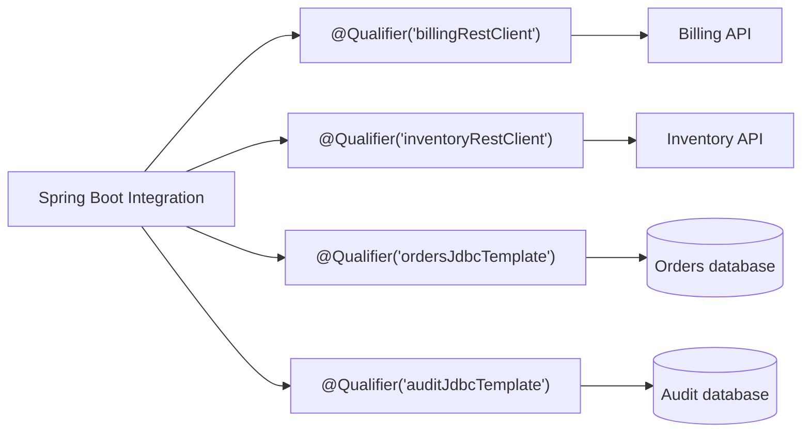

# Kết nối nhiều hệ thống cùng loại và xác định bean theo qualifier

## 1. Bài toán: cùng một kiểu Java nhưng kết nối đến nhiều đích khác nhau

Trong module **Spring Boot Integration**, ứng dụng thường trao đổi dữ liệu với nhiều hệ thống qua HTTP client, cơ sở dữ liệu, cache, broker thông điệp hoặc các adapter của Spring Integration. Một dịch vụ có thể gọi **hai REST API**, đọc ghi **hai database** hoặc xuất bản thông điệp qua **hai broker**. Các kết nối này có thể dùng cùng một kiểu Java, nhưng địa chỉ, thông tin xác thực, timeout, phạm vi dữ liệu và cách xử lý lỗi hoàn toàn khác nhau.

Ví dụ, một ứng dụng đồng bộ đơn hàng cần:

- `billingRestClient`: gọi hệ thống thanh toán `billing.example.org`.
- `inventoryRestClient`: gọi hệ thống kho `inventory.example.org`.
- `ordersDataSource`: ghi dữ liệu đơn hàng ở database vận hành.
- `auditDataSource`: ghi dữ liệu kiểm toán ở database độc lập.

Hai HTTP client đều có kiểu `RestClient`; hai kết nối database đều có kiểu `DataSource`. Nếu chỉ viết `@Autowired RestClient client` hoặc `@Autowired DataSource dataSource`, Spring có thể không biết nên chọn đối tượng nào. Nếu cấu hình bean mặc định thiếu rõ ràng, chương trình có thể dùng sai endpoint hoặc sai cơ sở dữ liệu, đặc biệt khi có thêm bean từ auto-configuration.

**Mục tiêu** là tạo từng bean có danh tính rõ ràng, gắn cấu hình riêng cho từng hệ thống và chỉ định chính xác bean tại mỗi điểm sử dụng bằng `@Qualifier`. Việc này giúp quyết định tuyến tích hợp tại thời điểm khởi tạo đối tượng, thay vì phụ thuộc vào thứ tự tạo bean hoặc tên biến tình cờ trùng khớp.



## 2. Spring chọn bean như thế nào?

Spring quản lý bean theo **tên** và **kiểu** cùng các metadata liên quan. Khi injection cần một đối tượng có kiểu `RestClient`, container tìm các bean đủ điều kiện của kiểu đó. Nếu chỉ có một ứng viên phù hợp, việc inject đơn giản. Nếu có nhiều ứng viên, cần thêm thông tin để giải quyết sự mơ hồ.

### 2.1. `@Bean(name = ...)`, `@Qualifier` và `@Primary`

| Cơ chế | Vai trò | Dùng khi nào? |
| --- | --- | --- |
| `@Bean("billingRestClient")` | Đăng ký bean với tên tường minh | Phân biệt hai cấu hình tạo ra cùng một kiểu `RestClient`. |
| `@Qualifier("billingRestClient")` | Thu hẹp ứng viên inject theo qualifier; tên bean có thể là một giá trị qualifier | Điểm sử dụng phải chọn đúng một hệ thống cụ thể. |
| `@Primary` | Ưu tiên bean khi inject một đối tượng theo kiểu mà không có chỉ định rõ hơn | Có một lựa chọn mặc định hợp lý cho phần mã hiện hữu. |
| `@Bean` không chỉ định tên | Theo mặc định, tên bean lấy từ tên phương thức khai báo | Chỉ phù hợp khi tên phương thức ổn định, dễ hiểu và không xung đột. |
| Inject `List<T>` hoặc `Map<String,T>` | Nhận tập các bean có kiểu phù hợp; khóa của map thường là bean name | Cần duyệt hoặc đăng ký nhiều implementation, có quy tắc chọn riêng. |

Ví dụ tối giản:

```java
@Configuration
class ClientConfiguration {
    @Bean("billingRestClient")
    RestClient billingRestClient() {
        return RestClient.create("https://billing.example.org");
    }

    @Bean("inventoryRestClient")
    RestClient inventoryRestClient() {
        return RestClient.create("https://inventory.example.org");
    }
}

@Service
class BillingGateway {
    private final RestClient client;

    BillingGateway(@Qualifier("billingRestClient") RestClient client) {
        this.client = client;
    }
}
```

Ở đây, `@Qualifier` chỉ định **bean cần inject**, không thay đổi kiểu của biến `client`. Giá trị qualifier nên là một tên ổn định gắn với ý nghĩa hệ thống. Trong các dự án có nhiều kết nối, dùng cùng một quy ước tên ở cấu hình, constructor và tài liệu vận hành sẽ giảm lỗi định tuyến.

### 2.2. Điều gì xảy ra khi không có qualifier?

Với hai bean `RestClient` cùng đủ điều kiện và không có lựa chọn mặc định rõ ràng, injection theo kiểu đơn lẻ có thể thất bại bằng `NoUniqueBeanDefinitionException`:

```java
// Có hai RestClient, Spring không có đủ thông tin để chọn một.
@Service
class AmbiguousGateway {
    AmbiguousGateway(RestClient client) {
        // Lỗi phụ thuộc cấu hình bean khi ứng dụng khởi tạo context.
    }
}
```

Spring còn có quy tắc giải quyết theo qualifier, bean name, tên injection point và các metadata khác tùy phiên bản, vì vậy không nên mô tả toàn bộ thuật toán bằng một thứ tự cố định cho mọi trường hợp. Điều cần nắm là **một dependency quan trọng phải có lựa chọn tường minh**. Hãy dùng `@Qualifier` ở constructor khi ý nghĩa nghiệp vụ đòi hỏi chính xác một endpoint.

Nếu đánh dấu một bean `@Primary`, các điểm inject `RestClient` không ghi qualifier thường nhận bean chính đó. Tuy nhiên, `@Primary` không có nghĩa là bean còn lại sẽ tự được chọn cho một nghiệp vụ khác, và không phải cơ chế định tuyến theo dữ liệu runtime. Tại điểm inject có qualifier khớp một bean cụ thể, qualifier giúp chọn đúng bean đó kể cả khi bean khác là primary.

### 2.3. Tên biến không phải hợp đồng cấu hình

Ví dụ `BillingGateway(RestClient billingRestClient)` đôi khi có thể được Spring giải quyết qua tên tham số nếu metadata và điều kiện khớp, nhưng cách này phụ thuộc tên tham số và cấu hình build. Đổi tên biến khi refactor có thể thay đổi cách resolve dependency. Dùng `@Qualifier("billingRestClient")` rõ ý hơn và dễ kiểm tra trong code review.

Constructor injection được ưu tiên vì dependency bắt buộc xuất hiện rõ trong chữ ký của lớp, dễ kiểm thử và cho phép khai báo trường `final`. Nếu dùng Lombok để tạo constructor tự động, cần kiểm tra qualifier trên **tham số constructor được sinh** thực sự còn đủ thông tin; gắn `@Qualifier` trên field rồi mặc định tin Lombok sẽ luôn chuyển annotation sang constructor là một giả định dễ sai.

## 3. Ví dụ 1: hai REST API với hai `RestClient` riêng

Giả sử dịch vụ đồng bộ cần gọi Billing API và Inventory API. Mỗi client có base URL riêng; về lâu dài có thể thêm credentials, timeout, retry hoặc metrics riêng theo hệ thống.

### 3.1. Khai báo cấu hình theo namespace

```yaml
# application.yml
integration:
  billing:
    base-url: ${BILLING_API_BASE_URL}
  inventory:
    base-url: ${INVENTORY_API_BASE_URL}
```

Giá trị URL thực tế được cấp qua biến môi trường hoặc hệ thống cấu hình của deployment. Ví dụ chỉ dùng tên miền minh họa; đừng nhúng endpoint nội bộ cố định hoặc API key vào mã nguồn. Nếu mỗi API dùng một token khác nhau, nên tách secret và chính sách cấp quyền theo đúng tài khoản dịch vụ của API đó.

### 3.2. Tạo hai bean có tên khác nhau

Ví dụ áp dụng cho **Spring Boot 3.2+ / Spring Framework 6.1+**, khi `RestClient` và `RestClient.Builder` khả dụng:

```java
import org.springframework.beans.factory.annotation.Value;
import org.springframework.context.annotation.Bean;
import org.springframework.context.annotation.Configuration;
import org.springframework.web.client.RestClient;

@Configuration
public class HttpClientsConfiguration {

    @Bean("billingRestClient")
    RestClient billingRestClient(
            RestClient.Builder builder,
            @Value("${integration.billing.base-url}") String baseUrl) {
        return builder.clone()
                .baseUrl(baseUrl)
                .build();
    }

    @Bean("inventoryRestClient")
    RestClient inventoryRestClient(
            RestClient.Builder builder,
            @Value("${integration.inventory.base-url}") String baseUrl) {
        return builder.clone()
                .baseUrl(baseUrl)
                .build();
    }
}
```

`RestClient.Builder` do Spring Boot cấu hình có thể mang message converters, observation và các customizer chung. Gọi `clone()` trước khi đặt base URL giúp hai cấu hình độc lập, tránh vô tình thay đổi các thiết lập của builder được dùng ở nơi khác. Trong hệ thống thật, hãy cấu hình connection timeout, read timeout, connection pooling và bảo mật của từng HTTP client theo thư viện HTTP bên dưới và chính sách của API đích.

### 3.3. Inject từng bean vào đúng adapter

```java
import org.springframework.beans.factory.annotation.Qualifier;
import org.springframework.stereotype.Component;
import org.springframework.web.client.RestClient;

@Component
public class BillingAdapter {
    private final RestClient billingClient;

    public BillingAdapter(
            @Qualifier("billingRestClient") RestClient billingClient) {
        this.billingClient = billingClient;
    }

    public InvoiceDto getInvoice(String invoiceId) {
        return billingClient.get()
                .uri("/v1/invoices/{id}", invoiceId)
                .retrieve()
                .body(InvoiceDto.class);
    }
}

@Component
public class InventoryAdapter {
    private final RestClient inventoryClient;

    public InventoryAdapter(
            @Qualifier("inventoryRestClient") RestClient inventoryClient) {
        this.inventoryClient = inventoryClient;
    }

    public StockDto getStock(String sku) {
        return inventoryClient.get()
                .uri("/v1/stock/{sku}", sku)
                .retrieve()
                .body(StockDto.class);
    }
}

record InvoiceDto(String invoiceId, String status) {}
record StockDto(String sku, long available) {}
```

`InvoiceDto` và `StockDto` là hợp đồng dữ liệu minh họa: API thật cần ánh xạ đúng cấu trúc response và xử lý trường hợp dữ liệu thiếu. Phương thức `retrieve()` có thể ném ngoại lệ cho trạng thái HTTP lỗi; adapter cần có chính sách riêng cho `4xx`, `5xx`, timeout, retry và idempotency, nhất là với request thay đổi dữ liệu. `@Qualifier` giải quyết **đúng hệ thống nào được gọi**, còn hợp đồng dữ liệu và xử lý lỗi vẫn cần được thiết kế riêng.

Nếu Billing API dùng bearer token và Inventory API dùng mTLS, hãy gắn phần cấu hình xác thực vào đúng client tương ứng. Dùng một `RestClient` chung rồi đổi header hoặc URL từ nhiều luồng xử lý là cách dễ gây gửi token đến sai đích, nhất là khi mã có trạng thái dùng chung.

## 4. Ví dụ 2: hai database với hai `DataSource` và `JdbcTemplate`

Một ứng dụng cần đọc/ghi database đơn hàng và ghi nhật ký kiểm toán vào database riêng. Cả hai đều dùng JDBC; Spring nhìn thấy hai bean `DataSource` và có thể có hai bean `JdbcTemplate`.

### 4.1. Cấu hình database tách biệt

```yaml
app:
  datasource:
    orders:
      url: ${ORDERS_JDBC_URL}
      username: ${ORDERS_DB_USER}
      password: ${ORDERS_DB_PASSWORD}
      driver-class-name: org.postgresql.Driver
    audit:
      url: ${AUDIT_JDBC_URL}
      username: ${AUDIT_DB_USER}
      password: ${AUDIT_DB_PASSWORD}
      driver-class-name: org.postgresql.Driver
```

`app.datasource.*` là namespace do ứng dụng chọn để mô tả nhiều database. Vì không dùng duy nhất `spring.datasource.*`, ta cần chủ động tạo và bind các bean. `DataSourceProperties` xử lý những thuộc tính chuẩn như `url`, `username`, `password`, `driver-class-name` và hỗ trợ tạo datasource theo driver/pool có sẵn. Với HikariCP, cách tạo qua `initializeDataSourceBuilder()` giúp tránh nhầm `url` của Spring Boot với thuộc tính native `jdbcUrl` của Hikari khi bind trực tiếp không đúng cách.

### 4.2. Tạo `DataSourceProperties`, `DataSource`, `JdbcTemplate` và transaction manager

```java
import javax.sql.DataSource;
import org.springframework.beans.factory.annotation.Qualifier;
import org.springframework.boot.autoconfigure.jdbc.DataSourceProperties;
import org.springframework.boot.context.properties.ConfigurationProperties;
import org.springframework.context.annotation.Bean;
import org.springframework.context.annotation.Configuration;
import org.springframework.context.annotation.Primary;
import org.springframework.jdbc.core.JdbcTemplate;
import org.springframework.jdbc.datasource.DataSourceTransactionManager;
import org.springframework.transaction.PlatformTransactionManager;

@Configuration
public class MultiDatabaseConfiguration {

    @Bean("ordersDataSourceProperties")
    @Primary
    @ConfigurationProperties(prefix = "app.datasource.orders")
    DataSourceProperties ordersDataSourceProperties() {
        return new DataSourceProperties();
    }

    @Bean("auditDataSourceProperties")
    @ConfigurationProperties(prefix = "app.datasource.audit")
    DataSourceProperties auditDataSourceProperties() {
        return new DataSourceProperties();
    }

    @Bean("ordersDataSource")
    @Primary
    DataSource ordersDataSource(
            @Qualifier("ordersDataSourceProperties") DataSourceProperties props) {
        return props.initializeDataSourceBuilder().build();
    }

    @Bean("auditDataSource")
    DataSource auditDataSource(
            @Qualifier("auditDataSourceProperties") DataSourceProperties props) {
        return props.initializeDataSourceBuilder().build();
    }

    @Bean("ordersJdbcTemplate")
    JdbcTemplate ordersJdbcTemplate(
            @Qualifier("ordersDataSource") DataSource dataSource) {
        return new JdbcTemplate(dataSource);
    }

    @Bean("auditJdbcTemplate")
    JdbcTemplate auditJdbcTemplate(
            @Qualifier("auditDataSource") DataSource dataSource) {
        return new JdbcTemplate(dataSource);
    }

    @Bean("ordersTxManager")
    @Primary
    PlatformTransactionManager ordersTxManager(
            @Qualifier("ordersDataSource") DataSource dataSource) {
        return new DataSourceTransactionManager(dataSource);
    }

    @Bean("auditTxManager")
    PlatformTransactionManager auditTxManager(
            @Qualifier("auditDataSource") DataSource dataSource) {
        return new DataSourceTransactionManager(dataSource);
    }
}
```

Các bean `DataSourceProperties`, `DataSource` và `PlatformTransactionManager` của hệ đơn hàng được đánh dấu `@Primary` như lựa chọn mặc định có chủ đích. Dù vậy, từng `JdbcTemplate` và từng transaction manager vẫn được nối với **đúng datasource bằng `@Qualifier`**, giúp sơ đồ kết nối rõ ràng. Nếu không có nghiệp vụ mặc định hợp lý, có thể bỏ `@Primary` và bắt buộc mọi điểm inject đơn lẻ chỉ định qualifier.

Trong dự án có **JPA/Hibernate**, việc cấu hình nhiều datasource đòi hỏi thêm `EntityManagerFactory`, `JpaTransactionManager`, repository packages và mapping phù hợp cho từng persistence unit; hai bean `JdbcTemplate` trong ví dụ không tự giải quyết toàn bộ việc cấu hình JPA. Với Flyway, Liquibase hoặc SQL initialization, cũng cần xác định rõ migration/schema thuộc database nào thay vì mặc định mọi script chạy trên cả hai.

### 4.3. Inject vào service và xác định ranh giới transaction

```java
import org.springframework.beans.factory.annotation.Qualifier;
import org.springframework.jdbc.core.JdbcTemplate;
import org.springframework.stereotype.Service;
import org.springframework.transaction.annotation.Transactional;

@Service
public class OrderRepositoryAdapter {
    private final JdbcTemplate ordersJdbcTemplate;

    public OrderRepositoryAdapter(
            @Qualifier("ordersJdbcTemplate") JdbcTemplate ordersJdbcTemplate) {
        this.ordersJdbcTemplate = ordersJdbcTemplate;
    }

    @Transactional(transactionManager = "ordersTxManager")
    public void updateStatus(long orderId, String status) {
        ordersJdbcTemplate.update(
                "UPDATE orders SET status = ? WHERE id = ?",
                status, orderId);
    }
}

@Service
public class AuditRepositoryAdapter {
    private final JdbcTemplate auditJdbcTemplate;

    public AuditRepositoryAdapter(
            @Qualifier("auditJdbcTemplate") JdbcTemplate auditJdbcTemplate) {
        this.auditJdbcTemplate = auditJdbcTemplate;
    }

    @Transactional(transactionManager = "auditTxManager")
    public void writeEvent(String eventId, String action) {
        auditJdbcTemplate.update(
                "INSERT INTO audit_event (event_id, action) VALUES (?, ?)",
                eventId, action);
    }
}
```

Giả sử `OrderRepositoryAdapter.updateStatus()` và `AuditRepositoryAdapter.writeEvent()` được gọi lần lượt, **hai transaction manager quản lý hai database khác nhau**. `@Transactional("ordersTxManager")` chỉ bảo vệ những thao tác dùng transaction resource của hệ orders; nó không tạo một giao dịch nguyên tử trên cả orders và audit. Nếu ghi orders thành công rồi audit thất bại, cần chiến lược nhất quán như transactional outbox, retry idempotent hoặc saga tùy yêu cầu nghiệp vụ. Dùng `@Qualifier` đúng **bean** không đồng nghĩa đã giải quyết transaction phân tán.

Lưu ý: ví dụ giả định đã có bảng `orders`, `audit_event` và ứng dụng có dependency JDBC driver, Spring JDBC và transaction management phù hợp. Nếu database không được cấu hình hoặc secret thiếu, cần để ứng dụng fail rõ ràng trong giai đoạn khởi tạo hoặc kiểm tra sức khỏe, không âm thầm chuyển sang một database dự phòng sai mục đích.

## 5. Phân biệt `@Qualifier`, `@Primary` và định tuyến động

Một lỗi thiết kế phổ biến là dùng `@Primary` để đại diện cho “hệ thống được ưu tiên” ở mọi ngữ cảnh. `@Primary` chỉ là quy tắc **chọn bean tại injection point khi có nhiều ứng viên**; nó không định tuyến từng đơn hàng hoặc request. Nếu phải chọn hệ thống theo tenant, vùng địa lý hoặc loại sự kiện lúc chạy, cần một lớp routing có quy tắc rõ ràng.

Ví dụ định tuyến theo một enum được kiểm soát:

```java
public enum ExternalSystem {
    BILLING,
    INVENTORY
}

@Component
public class ClientRouter {
    private final RestClient billing;
    private final RestClient inventory;

    public ClientRouter(
            @Qualifier("billingRestClient") RestClient billing,
            @Qualifier("inventoryRestClient") RestClient inventory) {
        this.billing = billing;
        this.inventory = inventory;
    }

    public RestClient select(ExternalSystem target) {
        return switch (target) {
            case BILLING -> billing;
            case INVENTORY -> inventory;
        };
    }
}
```

Router này cho phép nghiệp vụ chọn một trong **hai client đã cấu hình**. Nó không tự cho phép URL tùy ý được truyền từ request của người dùng. Nếu định tuyến theo `tenantId`, cần ánh xạ tenant đến một cấu hình được phê duyệt, kiểm tra quyền truy cập tenant và kiểm soát việc sử dụng credential theo tenant. Không ghép trực tiếp URL hoặc bean name từ dữ liệu ngoài rồi gửi request tới bất kỳ host nào; đây là rủi ro sai đích và có thể tạo lỗ hổng SSRF.

### 5.1. Khi nào nhận `Map<String, RestClient>`?

Spring có thể inject một map chứa các bean cùng kiểu, với **khóa là tên bean**:

```java
@Component
class ClientRegistry {
    private final Map<String, RestClient> clients;

    ClientRegistry(Map<String, RestClient> clients) {
        this.clients = clients;
    }

    RestClient billing() {
        return Objects.requireNonNull(
                clients.get("billingRestClient"),
                "Missing billingRestClient bean");
    }
}
```

Ví dụ này cần imports cho `Map` và `Objects`. Map còn có thể chứa các bean `RestClient` khác cùng kiểu mà ứng dụng hoặc auto-configuration đăng ký. Khi chỉ có hai hệ thống cố định, inject từng bean qua constructor thường rõ ràng hơn. Khi cần một plugin registry mở rộng, nên định nghĩa giao diện/metadata dành riêng cho integration adapter để tránh dùng chuỗi tên bean như hợp đồng nghiệp vụ ở khắp nơi.

## 6. Áp dụng nguyên tắc tương tự cho cache, broker và adapter

Không phải integration nào cũng nên có cùng cấu trúc bean. Tuy nhiên, nguyên tắc **mỗi đích có cấu hình riêng và injection rõ ràng** áp dụng rộng rãi:

| Loại tích hợp | Những bean thường cần phân biệt | Rủi ro khi inject nhầm |
| --- | --- | --- |
| Nhiều HTTP API | `RestClient`, `WebClient`, adapter theo API | Gọi sai base URL, dùng sai token hoặc timeout. |
| Nhiều JDBC database | `DataSource`, `JdbcTemplate`, `TransactionManager` | Ghi sai schema/database, transaction sai phạm vi. |
| Nhiều Redis instance | `RedisConnectionFactory`, `RedisTemplate` | Đọc/ghi sai môi trường hoặc namespace cache. |
| Nhiều RabbitMQ broker | `ConnectionFactory`, `RabbitTemplate`, listener container factory | Publish vào sai broker; listener dùng nhầm kết nối. |
| Nhiều Kafka cluster | Producer/consumer factory, `KafkaTemplate`, listener container factory | Publish/consume nhầm cluster hoặc topic. |
| Nhiều Spring Integration flow | Channel, gateway, adapter, handler | Thông điệp đi sai luồng hoặc bị xử lý không đúng hợp đồng. |

Với listener, chỉ inject đúng template gửi thông điệp thường **chưa đủ**. Ví dụ, nhiều RabbitMQ broker đòi hỏi cấu hình rõ `ConnectionFactory` và listener container factory; `@RabbitListener(containerFactory = "...")` phải tham chiếu đến factory dự định dùng. Tương tự, Kafka listener phải gắn đúng listener container factory khi có nhiều cluster. Các ví dụ này minh họa nguyên tắc; cấu hình đầy đủ phụ thuộc phiên bản Spring AMQP/Kafka và cách hệ thống tổ chức consumer.

## 7. Đóng gói thông tin cấu hình để tránh lặp lại

Khi số hệ thống tăng, lặp nhiều `@Value` trong các bean cấu hình có thể khiến việc kiểm soát thiếu trường và đặt nhầm URL khó hơn. Nên nhóm cấu hình theo tên hệ thống bằng `@ConfigurationProperties`, kiểm tra giá trị bắt buộc và giới hạn việc đọc cấu hình tại lớp adapter.

Ví dụ về cách tổ chức:

```java
import org.springframework.boot.context.properties.ConfigurationProperties;

@ConfigurationProperties(prefix = "integration.billing")
public record BillingClientProperties(String baseUrl) {}
```

Để Spring Boot quản lý record cấu hình, đăng ký nó bằng `@EnableConfigurationProperties(BillingClientProperties.class)` tại lớp `@Configuration` hoặc dùng `@ConfigurationPropertiesScan` phù hợp. Khi muốn bắt buộc URL không rỗng, thêm Bean Validation cùng `@Validated` và ràng buộc `@NotBlank` nếu đã có dependency validation tương ứng. Không chỉ kiểm tra chuỗi không rỗng: cần quy định scheme (`https`), hostname được phép và endpoint của từng môi trường.

Với mỗi kết nối, nhóm cấu hình có thể bao gồm:

- **Địa chỉ và danh tính đích:** base URL, host/port, database name, cluster hoặc virtual host.
- **Bảo mật:** credentials/secret riêng, TLS truststore, quyền tối thiểu.
- **Giới hạn tài nguyên:** connect/read timeout, connection pool, concurrency, rate limit.
- **Xử lý lỗi:** retry có giới hạn, backoff, circuit breaker, idempotency và cơ chế bù trừ.
- **Quan sát vận hành:** log có tên hệ thống, latency, error rate và health indicator riêng.

Giữ mã gọi hệ thống đằng sau các interface có ý nghĩa nghiệp vụ như `BillingGateway` hoặc `AuditWriter` giúp tránh truyền `RestClient`/`JdbcTemplate` khắp ứng dụng. Sau đó, chỉ lớp cấu hình và adapter cần biết `@Qualifier`, còn tầng nghiệp vụ gọi các phương thức mang ý nghĩa rõ ràng.

## 8. Kiểm thử và quan sát việc chọn đúng bean

Với nhiều hệ thống cùng loại, **ứng dụng khởi động thành công chưa chứng minh kết nối được chọn đúng**. Hai bean có thể tồn tại hợp lệ nhưng adapter được gắn nhầm qualifier. Cần kiểm thử cả wiring lẫn hành vi:

1. **Kiểm thử context:** các bean được đăng ký với tên dự kiến và các adapter nhận đúng bean. Kiểm tra lỗi nếu xóa một bean hoặc đổi qualifier.
2. **Kiểm thử HTTP adapter:** dùng HTTP mock server hoặc stub server riêng cho Billing và Inventory, xác minh mỗi adapter gọi đúng host, path, header và xử lý status/timeout như kỳ vọng.
3. **Kiểm thử database adapter:** dùng hai database cô lập (ví dụ Testcontainers), ghi thử qua mỗi `JdbcTemplate` và xác minh dữ liệu chỉ xuất hiện ở database đích tương ứng.
4. **Kiểm thử transaction:** tạo lỗi giữa các bước ghi khác database để kiểm tra cơ chế retry, outbox hoặc bù trừ; không giả định rollback một transaction manager sẽ rollback database còn lại.
5. **Kiểm thử cấu hình môi trường:** chạy với cấu hình staging/production mẫu và xác minh thiếu secret, URL sai hoặc TLS lỗi được phát hiện rõ ràng.

Ví dụ test đơn giản nhằm xác định bean name tương ứng với đúng dependency:

```java
import static org.junit.jupiter.api.Assertions.assertNotSame;
import static org.junit.jupiter.api.Assertions.assertSame;
import org.junit.jupiter.api.Test;
import org.springframework.beans.factory.annotation.Autowired;
import org.springframework.beans.factory.annotation.Qualifier;
import org.springframework.boot.test.context.SpringBootTest;
import org.springframework.context.ApplicationContext;
import org.springframework.web.client.RestClient;

@SpringBootTest
class RestClientWiringTest {
    @Autowired ApplicationContext context;
    @Autowired @Qualifier("billingRestClient") RestClient billing;
    @Autowired @Qualifier("inventoryRestClient") RestClient inventory;

    @Test
    void usesTwoDistinctConfiguredBeans() {
        assertSame(context.getBean("billingRestClient"), billing);
        assertSame(context.getBean("inventoryRestClient"), inventory);
        assertNotSame(billing, inventory);
    }
}
```

Test này chỉ chứng minh **wiring và hai instance riêng biệt**. Nó chưa xác minh base URL, credentials hay hành vi HTTP; cần test adapter riêng như mục 2. Nếu dùng `@SpringBootTest`, mọi bean kết nối khác của ứng dụng có thể được khởi tạo theo cấu hình test, nên chuẩn bị properties test hợp lệ hoặc viết test context nhỏ chỉ chứa cấu hình cần kiểm tra.

Trong production, nên gắn metric với tên logical integration, ví dụ `billing`, `inventory`, `orders-db`, `audit-db` để so sánh độ trễ, timeout và tỷ lệ lỗi. Không dùng password, token hoặc connection string chứa secret làm tag metric. Health check cần tách lỗi từng đích; nếu một API không sẵn sàng, quyết định làm ứng dụng mất readiness hay chỉ giảm chức năng phải dựa trên yêu cầu thực tế.

## 9. Các lỗi thường gặp và cách xử lý

| Hiện tượng | Nguyên nhân phổ biến | Cách xử lý |
| --- | --- | --- |
| `NoUniqueBeanDefinitionException` | Có nhiều bean cùng kiểu, injection không xác định đủ rõ | Dùng `@Qualifier` theo đích; `@Primary` chỉ khi có mặc định hợp lý. |
| `NoSuchBeanDefinitionException` khi dùng qualifier | Bean name/qualifier sai, bean chưa đăng ký hoặc profile không bật | Kiểm tra `@Bean` name, component scan, điều kiện cấu hình và giá trị annotation. |
| `BeanDefinitionOverrideException` hoặc xung đột tên | Hai cấu hình đăng ký cùng bean name | Đặt tên bean duy nhất, loại bỏ khai báo trùng; không bật override để che xung đột. |
| HTTP client gọi nhầm API dù context khởi động | Copy nhầm `@Qualifier` hoặc base URL giữa hai client | Test từng adapter bằng server stub, log logical target/metrics phù hợp. |
| `@Primary` khiến nhiều nơi dùng cùng một database | Injection mặc định được sử dụng ở điểm cần database khác | Thêm qualifier và tách repository/adapter theo hệ thống. |
| `@Transactional` chạy nhưng ghi database thứ hai không rollback | Transaction manager chỉ quản lý resource được gắn với nó | Dùng transaction manager đúng, thiết kế outbox/saga nếu cần nhất quán liên hệ thống. |
| Kết nối pool bị cạn | Mỗi datasource tạo pool riêng, tổng tải vượt giới hạn DB | Điều chỉnh pool trên từng nguồn, cộng tổng số kết nối của mọi replica. |
| Chỉ thay `spring.datasource.url` mà mong hai DB tự được tạo | Auto-configuration thông thường không tự hiểu namespace thứ hai | Khai báo `DataSourceProperties` và các bean riêng cho từng DB. |
| Dữ liệu cấu hình thiếu hoặc chọn nhầm môi trường | Namespace nhập nhằng, default URL quá rộng, secret dùng chung | Đặt prefix theo tên hệ thống, kiểm tra giá trị bắt buộc và tách secret. |
| Qualifier bị mất sau khi dùng constructor sinh bằng Lombok | Annotation trên field không được chuyển theo cách mong đợi | Viết constructor tường minh hoặc kiểm tra annotation propagation trong build. |

### 9.1. Tình huống điều tra: bean được tạo nhưng dữ liệu ghi sai chỗ

Giả sử service lưu bản ghi audit thành công nhưng đội vận hành tìm thấy bản ghi trong database orders. Một quy trình kiểm tra thực tế:

1. Tìm constructor của `AuditRepositoryAdapter`: tham số `JdbcTemplate` có `@Qualifier("auditJdbcTemplate")` không?
2. Kiểm tra `@Bean("auditJdbcTemplate")` thực sự được xây dựng từ `@Qualifier("auditDataSource")` hay vô tình lấy `ordersDataSource`.
3. Kiểm tra `auditDataSource` bind từ `app.datasource.audit` đúng URL, credential và database name theo môi trường.
4. Kiểm tra liệu `@Primary` đã vô tình được dùng ở một dependency không có qualifier hoặc có một bean được tạo từ auto-configuration khác.
5. Thêm test tích hợp ghi thử một bản ghi kiểm soát, xác minh nơi dữ liệu xuất hiện và triển khai bản sửa cùng quan sát kết quả.

Chỉ nhìn thấy hai bean `DataSource` trong context chưa đủ; cần xác minh cả **đường đi từ adapter → template → datasource → endpoint thật**.

## 10. Checklist khi tích hợp nhiều hệ thống cùng loại

Trước khi đưa một cấu hình nhiều kết nối vào vận hành, hãy trả lời:

1. Mỗi hệ thống có bean name và cấu hình riêng theo cùng một quy ước đặt tên chưa?
2. Tất cả constructor cần chọn một hệ thống cụ thể đã dùng `@Qualifier` rõ ràng chưa?
3. Có thật sự cần `@Primary` không; nếu có, lựa chọn mặc định có an toàn cho mọi điểm inject không chỉ định qualifier không?
4. HTTP client, datasource, cache hoặc broker bean có sử dụng đúng endpoint, secret và TLS của hệ thống tương ứng không?
5. Đã phân biệt rõ transaction manager cho từng database và ranh giới nhất quán giữa nhiều hệ thống chưa?
6. Timeout, connection pool, retry và giới hạn tài nguyên có được tính theo từng kết nối và tổng số replica không?
7. Đã có test chứng minh **mỗi adapter truy cập đúng đích**, không chỉ kiểm tra context khởi động thành công chưa?
8. Nếu chọn đích tại runtime, có lớp routing cho phép những đích hợp lệ, kiểm tra quyền và tránh URL tùy ý không?
9. Metric, log và cảnh báo có định danh được hệ thống nào chậm, lỗi hay thiếu quyền không?
10. Khi một hệ thống ngoài thất bại, ứng dụng có phân loại lỗi, giới hạn retry và cách khôi phục phù hợp với hợp đồng dữ liệu không?

**Điểm cần nhớ:** `@Qualifier` giúp Spring chọn chính xác **bean nào được inject** khi có nhiều bean cùng kiểu. Đặt bean name và namespace cấu hình theo từng hệ thống, giới hạn `@Primary` vào trường hợp có mặc định thực sự, kiểm thử toàn bộ đường đi của dependency và thiết kế riêng transaction, lỗi, idempotency cùng khả năng quan sát cho mỗi luồng tích hợp. Đây là nền tảng để một ứng dụng Spring Boot kết nối nhiều HTTP API, database, cache hoặc broker mà vẫn xác định rõ dữ liệu đang đi tới đâu.
