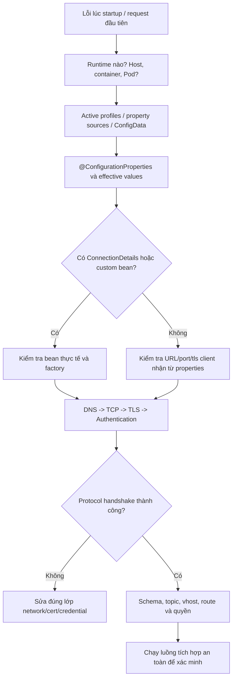
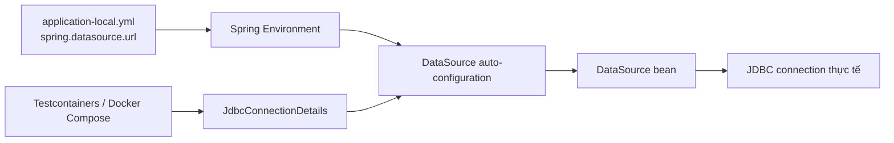
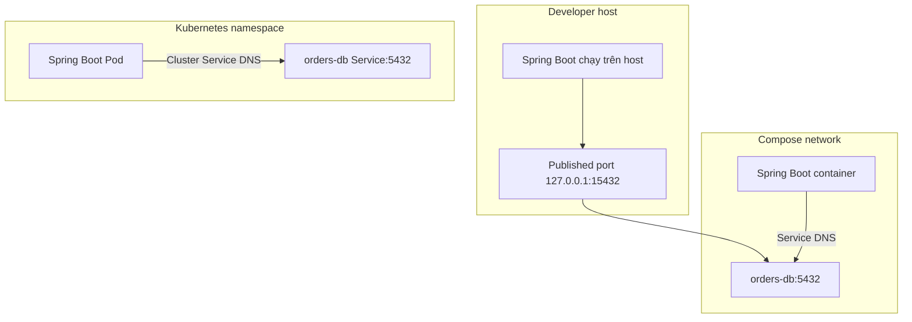

# Kiểm tra cấu hình thực tế và chẩn đoán kết nối ban đầu

## 1. Bài toán: có cấu hình nhưng không chắc ứng dụng đang dùng cấu hình nào

Trong một ứng dụng Spring Boot tích hợp nhiều hệ thống, ta thường có PostgreSQL để lưu dữ liệu/giao dịch, Redis để cache, RabbitMQ hoặc Kafka để gửi nhận thông điệp, thêm HTTP/SOAP client để gọi dịch vụ bên ngoài. Mỗi kết nối có địa chỉ, port, thông tin xác thực, TLS, timeout, pool và chính sách retry riêng.

Khi ứng dụng vừa khởi động, một lỗi `Connection refused`, `UnknownHostException`, `SSLHandshakeException` hoặc “authentication failed” có thể đến từ các lớp hoàn toàn khác nhau. Mặt khác, **ứng dụng chạy được chưa chắc đã kết nối đúng**: một DataSource có thể âm thầm trỏ tới cơ sở dữ liệu local trong khi nhóm nghĩ đang dùng Testcontainers; một client HTTP có thể vẫn sử dụng URL production; Kafka có thể nối được bootstrap broker nhưng không nối được các broker được quảng bá trong metadata.

Bài học **“Kiểm tra cấu hình thực tế và chẩn đoán kết nối ban đầu”** thuộc chương **Cấu hình kết nối** của module `SPRING_BOOT_INTEGRATION`. Mục tiêu là xác nhận đường đi của cấu hình từ nguồn đến bean client thực tế, kiểm tra kết nối theo từng lớp và chứng minh rằng luồng tích hợp HTTP, database, cache, broker hoặc adapter của Spring Integration hoạt động đúng hợp đồng.

**Nguyên tắc:** đừng kết luận từ một property trong YAML, một port mở hay một health check duy nhất. Cần phân biệt **effective property**, **effective client configuration**, **network connectivity** và **business readiness**.

## 2. Bốn mức độ xác minh không được đánh đồng

| Mức | Câu hỏi | Bằng chứng phù hợp |
| --- | --- | --- |
| **Nguồn và giá trị property** | Spring Boot đang dùng profile nào? Giá trị đến từ YAML, env, CLI hay ConfigData? | `Environment`, origin, `@ConfigurationProperties` binding |
| **Client/bean thực sự** | DataSource, RedisConnectionFactory, RabbitTemplate, RestClient đang dùng host/transport nào? | Auto-configuration condition, bean/`ConnectionDetails`, client-specific configuration |
| **Kết nối giao thức** | DNS, TCP, TLS, authentication và protocol có đi qua không? | Thử từ chính runtime của app; query hoặc protocol handshake thích hợp |
| **Kết quả nghiệp vụ** | DB đúng schema, message route đúng queue, HTTP response đúng hợp đồng và không trùng side effect? | Integration test, migration check, broker confirm/ack, state ở đích |

Ví dụ, `SELECT 1` thành công chưa chứng minh database đúng schema hoặc user có quyền ghi vào bảng cần thiết. Kafka bootstrap server trả TCP connection chưa chứng minh client truy cập được advertised broker endpoints. RabbitMQ `ConnectionFactory` khởi tạo xong chưa chắc vhost và queue hợp lệ. HTTP 200 không chứng minh payload JSON/SOAP tương thích hợp đồng.

Để kiểm tra có hệ thống, luôn ghi rõ **mức nào đã PASS** và **mức nào chưa được chứng minh**, tránh báo “kết nối OK” quá sớm.

## 3. Bản đồ chẩn đoán từ cấu hình tới nghiệp vụ



Có hai nhánh lỗi chính:

1. **Không tìm được cấu hình hoặc bean**: thiếu driver, thiếu property, không scan configuration, condition không matched hoặc nhiều bean ambiguous. Thường phải sửa classpath, profile và wiring trước.
2. **Đã có bean nhưng không kết nối được hoặc kết nối sai**: hostname, cổng, TLS, credential, pool, topology hoặc tài nguyên nghiệp vụ. Phải chẩn đoán từ vị trí process Java đang chạy.

Khi chưa xác minh đúng database, **không chạy thử migration ghi dữ liệu hoặc lệnh xóa bảng** chỉ để xem có thông suốt không.

## 4. Spring Boot đọc cấu hình từ nhiều nguồn

Những nguồn thường gặp gồm `application.yml`, `application-{profile}.yml`, tệp config nằm ngoài JAR, tài nguyên qua `spring.config.import`, biến môi trường, Java system properties và command-line arguments. Các nền tảng như Kubernetes hoặc config server có thể bổ sung nguồn riêng qua cơ chế tương ứng.

Ví dụ cấu hình chung:

```yaml
# application.yml
spring:
  application:
    name: order-integration

integration:
  partner:
    base-url: https://sandbox.partner.example.test
    connect-timeout: 3s
    read-timeout: 10s
```

Profile local:

```yaml
# application-local.yml
integration:
  partner:
    base-url: http://127.0.0.1:18080
```

Lệnh chạy:

```bash
java -jar integration-service.jar \
  --spring.profiles.active=local \
  --integration.partner.read-timeout=5s
```

Nếu `local` được active, địa chỉ partner có thể đến từ `application-local.yml`; read timeout sẽ đến từ CLI khi không có nguồn có precedence cao hơn. Tuy nhiên, quy tắc ưu tiên đầy đủ của Spring Boot còn liên quan thứ tự ConfigData, source properties, profile và cách application được khởi chạy; **không nên đoán nguồn thắng chỉ từ tên file**.

### 4.1. Active profile phải được xác minh ở process đang lỗi

`SPRING_PROFILES_ACTIVE=local` đặt trong một terminal không mặc nhiên truyền sang process khởi chạy từ IDE, service manager hoặc một Pod đã chạy từ trước. Profile group, active/include profiles và `spring.config.activate.on-profile` cũng có thể thay đổi tập tài liệu cấu hình được nạp.

Cần kiểm tra active profiles thực sự và những property sources có hiệu lực. Nếu staging đang báo lỗi nhưng log cho thấy profile `local`, hãy sửa cách deploy/config trước khi điều tra hostname phía database.

### 4.2. Env variable và relaxed binding

Spring Boot có relaxed binding cho `@ConfigurationProperties`; ví dụ `integration.partner.connect-timeout` có thể được cung cấp qua biến env theo quy tắc tên chuẩn của Spring Boot, như `INTEGRATION_PARTNER_CONNECTTIMEOUT`. Không được giả định mọi chuỗi dấu gạch/ngăn cách hay cách viết acronym đều được bind như nhau trong mọi bối cảnh.

Các giá trị dạng `${ENV_VAR}` trong YAML được thay khi source property tương ứng có hiệu lực. Cần có validation và lỗi startup rõ nếu một biến bắt buộc thiếu, thay vì tự động rơi vào endpoint hoặc mật khẩu nguy hiểm.

## 5. Kiểm tra property bằng @ConfigurationProperties

Thay vì rải nhiều `@Value` trong các HTTP adapter, gom cấu hình có cùng phạm vi thành một bean typed:

```java
package com.example.integration.config;

import java.net.URI;
import java.time.Duration;
import org.springframework.boot.context.properties.ConfigurationProperties;

@ConfigurationProperties(prefix = "integration.partner")
public record PartnerConnectionProperties(
        URI baseUrl,
        Duration connectTimeout,
        Duration readTimeout,
        boolean enabled) {}
```

Đăng ký scan (ví dụ Spring Boot 3.x):

```java
import org.springframework.boot.autoconfigure.SpringBootApplication;
import org.springframework.boot.context.properties.ConfigurationPropertiesScan;

@SpringBootApplication
@ConfigurationPropertiesScan
public class IntegrationApplication {
    public static void main(String[] args) {
        org.springframework.boot.SpringApplication.run(
                IntegrationApplication.class, args);
    }
}
```

Trong project thật, thêm validation `@Validated`, `@NotNull` và kiểm tra Duration dương, URI scheme/host nằm trong allowlist tương ứng với environment. Fail-fast khi một endpoint quan trọng bị thiếu thường an toàn hơn việc dùng một default trỏ tới production hoặc service không đúng.

Sử dụng qua constructor injection để mỗi adapter nhận cấu hình riêng; tránh tạo một mutable global properties object rồi thay `baseUrl` theo từng HTTP request.

### 5.1. Xem cấu hình có nguồn gốc, nhưng không log secret

`Environment.getProperty(...)` có thể trả một giá trị đang hiệu lực; `@ConfigurationProperties` cho thấy binder đã chuyển đổi chuỗi thành URI/Duration/boolean đúng hay chưa. Nhưng công cụ chẩn đoán không nên gọi `System.getenv()` hoặc in toàn bộ object cấu hình.

Nên xuất những trường **được phép hiển thị**: adapter logic, active profile, tên nguồn, scheme, hostname đã kiểm soát, port, timeout và kết quả kiểm tra. Không in password, access token, JDBC URL chứa query parameter bí mật, truststore password hoặc dữ liệu khách hàng.

## 6. ConnectionDetails có thể thay thế host/port trong YAML

Spring Boot 3.x có cơ chế `ConnectionDetails` cho một số auto-configuration. Khi dùng Docker Compose support hoặc Testcontainers `@ServiceConnection`, Boot có thể lấy host/port/credentials từ container runtime để tạo `DataSource`, `RedisConnectionFactory`, `RabbitConnectionFactory` hoặc client phù hợp.



Điều này tạo một vấn đề chẩn đoán phổ biến: `spring.datasource.url` trong YAML vẫn ghi `localhost:5432`, nhưng Testcontainers publish PostgreSQL ở host port động. Nếu DataSource auto-configuration dùng `JdbcConnectionDetails`, ứng dụng vẫn kết nối được mà không sử dụng URL trong file cấu hình.

Ngược lại, một DataSource hoặc HTTP client **do ứng dụng tự new và cấu hình thủ công** có thể không sử dụng `ConnectionDetails` dù bean này tồn tại.

Do đó cần trả lời hai câu hỏi riêng:

1. `Environment` nhìn thấy property nào?
2. Bean client mà service thực sự dùng được xây từ nguồn nào: auto-configuration, `ConnectionDetails`, `@ConfigurationProperties` hay bean custom?

Không được dùng chỉ số (1) để thay cho bằng chứng (2).

## 7. Actuator hỗ trợ điều tra nhưng phải bảo vệ nghiêm ngặt

Spring Boot Actuator giúp quan sát config và auto-configuration. Các endpoint hữu ích:

| Endpoint | Giúp điều tra | Hạn chế |
| --- | --- | --- |
| `/actuator/health` | Các health indicator đang hoạt động | UP không chứng minh nghiệp vụ hoàn tất |
| `/actuator/env` | Property sources và một số thông tin nguồn gốc | Không cho biết mọi bean client thực tế dùng property nào |
| `/actuator/configprops` | Binding của `@ConfigurationProperties` | Không bao phủ custom bean không dùng binder |
| `/actuator/conditions` | Vì sao auto-configuration matched/backed off | Không phải phép thử TCP/TLS |
| `/actuator/beans` | Bean class, dependency và sự hiện diện | Không tự chứng minh kết nối đúng server |
| `/actuator/metrics` | Pool/client/luồng xử lý nếu có meter | Phụ thuộc instrumentation được cấu hình |

Ví dụ **chỉ cho local hoặc môi trường chẩn đoán được kiểm soát**:

```yaml
management:
  endpoints:
    web:
      exposure:
        include: health,info,env,configprops,conditions,beans,metrics
  endpoint:
    env:
      show-values: never
    configprops:
      show-values: never
```

Giá trị không được hiển thị là một lớp bảo vệ, nhưng **tên bean, đường dẫn property source, condition và endpoint** vẫn có thể tiết lộ thông tin nội bộ. Không mở các endpoint chẩn đoán này ra Internet. Với production, chỉ expose nội dung cần thiết qua xác thực, phân quyền, network policy và audit; bảo vệ cả endpoint không nằm trong web exposure nếu ứng dụng cho phép truy cập theo giao thức khác.

Khi bean DataSource không xuất hiện, hãy xem `conditions` để xác định là thiếu driver, thiếu starter, thiếu property, có bean custom khiến auto-config back off hay một condition khác. Đừng sửa firewall khi bean chưa được khởi tạo.

## 8. Diagnostic code chỉ dành cho local, không in thông tin nhạy cảm

Một `ApplicationRunner` có thể xác minh DataSource thực sự mở connection:

```java
import java.sql.Connection;
import javax.sql.DataSource;
import org.springframework.boot.ApplicationRunner;
import org.springframework.context.annotation.Bean;
import org.springframework.context.annotation.Configuration;
import org.springframework.context.annotation.Profile;

@Configuration(proxyBeanMethods = false)
@Profile("local")
public class LocalDatabaseProbeConfiguration {

    @Bean
    ApplicationRunner localDatabaseProbe(DataSource dataSource) {
        return args -> {
            try (Connection connection = dataSource.getConnection()) {
                boolean valid = connection.isValid(2);
                String product = connection.getMetaData()
                        .getDatabaseProductName();
                System.out.println(
                        "Local database probe: product=" + product
                        + ", valid=" + valid);
            }
        };
    }
}
```

Đoạn này minh họa bước thử kết nối vào **bean DataSource thực tế**. Trong production, dùng health indicator/metric phù hợp thay vì in dữ liệu cấu hình và bắt startup thực hiện thêm query không cần thiết. Nếu dependency có thể tạm không sẵn sàng và service được phép chạy degraded, không nên ép `ApplicationRunner` throw làm cả application shutdown.

Với PostgreSQL, một phép thử read-only xác nhận database/schema đang dùng:

```sql
SELECT current_database(), current_schema();
```

Sau khi chắc chắn đúng database và được cấp quyền, mới cho phép migration hoặc business operation thực hiện lệnh ghi. Không chạy lệnh DDL trên một database chỉ vì nó trả `SELECT 1` thành công.

## 9. Cấu trúc mạng: localhost trong Docker/Kubernetes có ý nghĩa khác

`localhost` hoặc `127.0.0.1` luôn phụ thuộc **network namespace của process**. Khi Spring Boot chạy trong Docker container, `localhost` là container ứng dụng, không phải PostgreSQL container bên cạnh và cũng không phải laptop.

| JVM chạy ở đâu | Địa chỉ DB thường dùng | Cần tránh |
| --- | --- | --- |
| IDE trên host; Compose publish port `15432:5432` | `127.0.0.1:15432` | `orders-db:5432` nếu host không resolve tên Compose |
| Container application cùng Compose network | `orders-db:5432` | `localhost:15432` trỏ về chính app container |
| Pod trong Kubernetes namespace `integration` | Service DNS như `orders-db.integration.svc.cluster.local:5432` | Địa chỉ port-forward chỉ có trên máy developer |
| Host process dùng Testcontainers | Host/mapped port do Testcontainers cấp hoặc `ConnectionDetails` | Cố định `localhost:5432` khi mapped port động |
| Remote Docker/CI | Endpoint runtime trả về | Giả định Docker host luôn là `localhost` |

Hình dung:



Luôn thử DNS, TCP và TLS từ **chính runtime đang báo lỗi**. `curl` chạy được trên máy cá nhân không chứng minh Pod của deployment truy cập được endpoint đó, nhất là khi có VPN, proxy, service mesh hoặc NetworkPolicy.

## 10. Chẩn đoán đúng thứ tự: DNS → TCP → TLS → auth → giao thức

### 10.1. DNS

`UnknownHostException` thường báo resolver không chuyển hostname thành địa chỉ phù hợp. Kiểm tra tên service, namespace, network, DNS search domain và runtime topology.

Ví dụ trên Linux:

```bash
nslookup orders-db
getent hosts orders-db
```

Ví dụ Windows PowerShell:

```powershell
Resolve-DnsName orders-db
```

Đây là các lệnh minh họa để chạy ở môi trường được cho phép. `getent` không sẵn trên mọi hệ điều hành. Phân giải DNS thành công chỉ xác minh tên, không xác minh ứng dụng trên port.

### 10.2. TCP socket

Trên Linux có thể kiểm tra:

```bash
nc -vz orders-db 5432
```

Trên PowerShell:

```powershell
Test-NetConnection orders-db -Port 5432
```

`Connection refused` có thể do port không listen, mapped port sai hoặc thiết bị trả kết nối từ chối. Timeout có thể do route, firewall, NetworkPolicy, quá tải hoặc endpoint không phản hồi. Đây là hướng điều tra, **không phải quan hệ một-lỗi-một-nguyên-nhân**.

Cổng TCP mở không chứng minh PostgreSQL đang chạy sau đó. Nếu một client PostgreSQL trỏ nhầm vào Redis port, socket có thể mở nhưng handshake giao thức vẫn thất bại.

### 10.3. TLS

Với HTTPS:

```bash
curl --verbose --connect-timeout 3 \
    https://sandbox.partner.example.test/health
```

Với một TLS endpoint phù hợp:

```bash
openssl s_client -connect broker.example.test:5671 \
    -servername broker.example.test
```

Cần kiểm tra certificate chain, hostname/SAN, truststore, ngày hết hạn, protocol/cipher và client certificate khi dùng mTLS. Khi gặp `SSLHandshakeException` hay `PKIX path building failed`, **không tắt hostname/certificate verification trong production** để cho lỗi biến mất.

### 10.4. Authentication và authorization

Một lỗi HTTP 401/403, PostgreSQL authentication failed, Redis `NOAUTH`/`NOPERM` hoặc RabbitMQ `ACCESS_REFUSED` chỉ ra kết nối đã tiến tới tầng xác thực hoặc kiểm soát quyền. Đổi timeout hiếm khi sửa được password/role sai.

Xác nhận đúng secret reference và identity của process, tài khoản có quyền tối thiểu với database/schema, Redis key/command, RabbitMQ vhost/exchange/queue hoặc Kafka topic/group. Khi một request chứa thông tin nhạy cảm, không log token/password để “chứng minh” giá trị đang được dùng.

### 10.5. Protocol và hợp đồng nghiệp vụ

Sau khi TLS/auth thành công, vẫn cần xác minh tương thích protocol: JDBC driver, Redis serialization/cluster, Kafka metadata, RabbitMQ topology, HTTP status/content-type, SOAP 1.1/1.2 + JAXB. Đến lúc này mới kiểm tra migration/schema, retry, transaction và idempotency.

## 11. PostgreSQL và HikariCP: chẩn đoán chính DataSource đang được dùng

Ví dụ cấu hình khi **không có `ConnectionDetails` ghi đè**:

```yaml
spring:
  datasource:
    url: jdbc:postgresql://127.0.0.1:15432/orders_dev
    username: orders_dev
    password: ${DEV_DB_PASSWORD}
    hikari:
      maximum-pool-size: 8
      connection-timeout: 3s
      validation-timeout: 2s
```

Cần phân biệt:

- **Kết nối mới:** host, port, driver, TLS, credentials và database name.
- **Lấy connection từ pool:** `connection-timeout` của Hikari liên quan việc chờ connection trong pool; không thay mọi socket/read/query timeout.
- **Migration:** Flyway/Liquibase có thể tạo kết nối và báo lỗi trước khi business service sẵn sàng.
- **Quyền nghiệp vụ:** user có thể `SELECT 1` nhưng không có quyền `INSERT`/`UPDATE` hoặc thiếu schema cần dùng.

| Lỗi | Khả năng cần kiểm tra |
| --- | --- |
| `Failed to determine a suitable driver class` | JDBC driver/classpath, URL hoặc auto-configuration |
| `Connection refused` | DB chưa listen, sai mapped port hoặc endpoint |
| `password authentication failed` | User/secret, server hoặc volume đã init với credential khác |
| `database does not exist` | DB name, quyền kết nối hoặc init script/volume |
| `too many connections` | Tổng pool của mọi instance vượt ngân sách DB |
| `HikariPool ... Connection is not available` | Pool exhaustion, leak, query chậm hoặc DB quá tải |
| Flyway checksum/schema error | Migration history, datasource/schema sai hoặc thay đổi migration cũ |
| `permission denied for table` | Có connection nhưng role thiếu quyền thao tác |

Ví dụ quan trọng: thay `POSTGRES_PASSWORD` trong Compose không nhất thiết đổi mật khẩu của database đã được khởi tạo và lưu trong persistent volume. Không xóa volume ngay; trước tiên xác minh đó là dữ liệu local có thể reset và theo đúng quy trình của nhóm.

Sau khi xác nhận DataSource đúng, thử một transaction nhỏ trên dữ liệu fixture/dev để kiểm tra unique constraint, rollback và quyền đọc/ghi. Với dữ liệu production, ưu tiên probe chỉ đọc và audit đầy đủ.

## 12. Redis: không chỉ là Redis host/port

Ví dụ Spring Boot 3.x:

```yaml
spring:
  data:
    redis:
      host: 127.0.0.1
      port: 16379
      timeout: 3s
      connect-timeout: 2s
```

Khi dùng dev service, `RedisConnectionDetails` có thể cung cấp host/port khác. Nếu Redis chạy Sentinel hoặc Cluster, một node `PING` thành công không chứng minh mọi route/redirect đều hoạt động.

Các lớp lỗi:

| Triệu chứng | Hướng chẩn đoán |
| --- | --- |
| Connection refused | Redis process/port, container mapping, network |
| Timeout | Redis quá tải, pool, firewall, route hoặc socket timeout |
| `NOAUTH`/`WRONGPASS` | Credential/ACL user |
| `NOPERM` | Quyền command/key pattern |
| TLS error | Server/client không thống nhất TLS hoặc trust/cert |
| Cache deserialization error | Serializer/codec/schema khác phiên bản |
| Key hết hạn bất thường | TTL và thời gian cập nhật cache |

Bài kiểm chứng cache cần kiểm tra round-trip dữ liệu và TTL trong namespace dev riêng, không chỉ `PING`. Tuyệt đối không dùng `FLUSHALL` trên Redis dùng chung như một phép chẩn đoán.

## 13. RabbitMQ: broker connection khác với message routing

Ví dụ địa chỉ RabbitMQ AMQP trên host với Compose mapping `15672:5672`:

```yaml
spring:
  rabbitmq:
    host: 127.0.0.1
    port: 15672
    username: orders_dev
    password: ${DEV_MQ_PASSWORD}
    virtual-host: /
    connection-timeout: 5s
```

**Port `15672` trong ví dụ là host port được ánh xạ tới AMQP port `5672`**, không phải mặc định RabbitMQ Management UI. Thực tế nhiều Compose file dùng 15672 cho management và 5672 cho AMQP. Luôn xem `ports` thật, không đoán dịch vụ theo số cổng.

Ba tầng kiểm chứng:

1. **Broker connection:** host/port, TLS, username, password và virtual host.
2. **Topology:** exchange, queue, routing key, binding, DLX và quyền truy cập.
3. **Delivery semantics:** publisher confirms/returns, consumer ack, retry, prefetch và DLQ.

`RabbitTemplate.convertAndSend(...)` không ném exception chưa chắc message đã được route vào queue đích. Producer có thể publish thành công tới exchange nhưng message không có binding phù hợp. Test cần kiểm tra publisher confirms/returns khi được cấu hình, queue topology và consumer đã nhận/ack.

Nếu broker báo `ACCESS_REFUSED`, phân biệt user/password với vhost/resource permissions; tăng retry không giải quyết được quyền của user.

## 14. Kafka: bootstrap thành công nhưng advertised broker unreachable

Ví dụ:

```yaml
spring:
  kafka:
    bootstrap-servers: 127.0.0.1:19092
    consumer:
      group-id: order-projection
      auto-offset-reset: earliest
```

Kafka client dùng bootstrap servers để lấy metadata, sau đó kết nối tới broker endpoints mà cluster quảng bá qua `advertised.listeners`. Với Kafka chạy Docker, một cấu hình phổ biến là bootstrap port publish cho host, nhưng metadata lại trả `kafka:9092`; JVM chạy trên host không thể resolve tên `kafka` thuộc Docker network.

Khi producer/consumer gặp metadata timeout, kiểm tra:

- Bootstrap addresses áp dụng cho app chạy **host hay container**?
- Broker đang quảng bá host/port nào cho listener tương ứng?
- Client có DNS/TCP route tới mọi broker leader được metadata trả về không?
- Đang dùng PLAINTEXT/SSL/SASL với mechanism và truststore nào?
- Topic tồn tại, principal có ACL với topic/consumer group không?
- Serializer/deserializer, Schema Registry URL và schema version có đúng không?
- Consumer group có offset hợp lệ, nhưng lưu ý offset không sửa lỗi network/auth.

`TimeoutException` không đồng nghĩa broker chắc chắn down. Đừng chỉ tăng timeout hoặc đổi `auto-offset-reset` rồi coi như xử lý xong; cần chứng minh client nhận metadata và publish/consume được một event ở topic kiểm thử.

## 15. HTTP, SOAP và client tùy biến: property có thể chưa được sử dụng

Giả sử có hai đối tác:

```yaml
integration:
  erp:
    base-url: https://sandbox.erp.example.test/api
    connect-timeout: 3s
    read-timeout: 8s
  accounting:
    base-url: https://sandbox.accounting.example.test/ws
    connect-timeout: 2s
    read-timeout: 20s
```

Các properties này **do ứng dụng định nghĩa**, Spring Boot không tự tạo `RestClient` hoặc `WebServiceTemplate` theo chúng. Nếu client được dựng thủ công với URL hard-code hoặc `@Qualifier` bị thiếu, config đã bind đúng vẫn không có tác dụng.

Một bean RestClient với endpoint riêng:

```java
import org.springframework.beans.factory.annotation.Qualifier;
import org.springframework.context.annotation.Bean;
import org.springframework.context.annotation.Configuration;
import org.springframework.web.client.RestClient;

@Configuration(proxyBeanMethods = false)
public class ErpClientConfiguration {

    @Bean("erpRestClient")
    RestClient erpRestClient(
            RestClient.Builder builder, ErpProperties properties) {
        return builder.clone()
                .baseUrl(properties.baseUrl().toString())
                .build();
    }
}
```

`ErpProperties` là record `@ConfigurationProperties` của project cần được khai báo/đăng ký. Đoạn code chỉ minh họa base URL; **chưa cấu hình timeout**. Connect/read/response timeout phải áp dụng trên request factory/HTTP client implementation thực tế tương thích với version Spring Framework, không phải nhờ việc YAML có key `connect-timeout`.

Với WebClient, HTTP connector và Reactor Netty có cách đặt timeout riêng. Với WebServiceTemplate, phải kiểm tra sender, SOAP envelope version, SOAPAction, JAXB, TLS và WS-Security. Với mỗi client, nên có metric theo tên adapter logic, ví dụ `erp`/`accounting` thay vì log toàn bộ URI chứa query token.

Các lỗi HTTP cần tách:

- **DNS/TCP/TLS:** chưa gửi được request tới đúng server.
- **401/403:** server nhận request nhưng xác thực/quyền chưa đúng.
- **404:** sai path hoặc API version.
- **429/503:** có thể transient, nhưng retry cần backoff và giới hạn.
- **HTTP 200 với body sai:** lỗi contract/parser/schema, không phải kết nối thành công về nghiệp vụ.
- **Timeout sau khi gửi request:** kết quả phía đối tác có thể đã commit; cần idempotency key hoặc reconciliation trước khi retry side effect.

## 16. Kubernetes, Docker Compose và Testcontainers: nguồn cấu hình khác nhau

### 16.1. Docker Compose

Các lệnh tham khảo khi được cấp quyền vận hành:

```bash
docker compose -f compose.dev.yaml config
docker compose -f compose.dev.yaml ps
docker compose -f compose.dev.yaml port orders-db 5432
docker compose -f compose.dev.yaml logs --tail 100 orders-db
```

`docker compose config` có thể hiển thị secrets sau nội suy, nên không đưa nguyên output lên issue công khai. Nếu container dùng image nội bộ, Spring Boot Compose support có thể cần nhãn `org.springframework.boot.service-connection` phù hợp để sinh connection details. “Container running” không chứng minh Spring Boot đã nhận diện service và tạo client bean.

### 16.2. Testcontainers

Container publish port động. Với `@ServiceConnection`, Spring Boot có thể nhận kết nối từ container mà không cần hard-code `spring.datasource.url`. Nếu tự tạo connection bằng `localhost:5432` thay vì `getHost()`/`getMappedPort()` đúng thời điểm, ứng dụng có thể nối nhầm DB cài trên máy.

### 16.3. Kubernetes

Trong Pod, xác minh namespace/Service/EndpointSlice, DNS, NetworkPolicy, Secret/ConfigMap, service mesh, proxy và config của **Pod thực sự đang chạy**. Một ConfigMap cập nhật không luôn khiến env vars trong Pod cũ tự đổi; rollout/restart theo chính sách mới giúp đưa cấu hình mới vào process.

Ví dụ lệnh minh họa:

```bash
kubectl -n integration get pods
kubectl -n integration get services
kubectl -n integration logs deployment/order-integration --tail=100
```

Không yêu cầu cluster-admin chỉ để chẩn đoán hostname. Log và thông tin describe có thể chứa dữ liệu nội bộ, phải bảo vệ khi chia sẻ.

## 17. Startup successful chưa chứng minh mọi dependency đã kết nối

Các client có thời điểm mở connection khác nhau:

- HikariCP, Flyway hoặc Liquibase có thể kết nối lúc startup.
- Redis client bean có thể tồn tại trước lần Redis command đầu.
- HTTP `RestClient` bean có thể được khởi tạo mà chưa gửi request.
- RabbitMQ listener có thể bắt đầu connection khi listener container startup; `RabbitTemplate` dùng gửi mới kết nối khi cần.
- Kafka producer/consumer nhận metadata theo lifecycle và hoạt động thực tế.

Vì thế cần phân biệt:

**Liveness** phản ánh process còn hoạt động; không nên tùy tiện đánh fail vì đối tác HTTP tạm outage khiến Pod restart lặp. **Readiness** phản ánh khả năng nhận traffic theo nhiệm vụ; có thể phụ thuộc database, broker hoặc chính sách ứng dụng. **Business readiness** là khả năng thực hiện một workflow cụ thể, ví dụ tạo hóa đơn qua ERP.

Một service chỉ cần nhận command và ghi outbox có thể vẫn sẵn sàng phục vụ request khi ERP tạm unavailable; một service bắt buộc query DB trên mọi request lại có điều kiện readiness khác. Không đặt mọi external dependency vào liveness mà không phân tích hậu quả.

## 18. Timeout ở nhiều tầng không thay thế nhau

| Giới hạn | Đặt ở đâu? | Không thay thế được |
| --- | --- | --- |
| DNS resolution | Resolver/runtime | Thời gian xử lý nghiệp vụ |
| TCP connect | Socket/HTTP/JDBC/broker client | TLS handshake hoặc read timeout |
| TLS handshake | TLS client/transport | Auth hoặc certificate validation |
| Pool acquisition | Hikari/HTTP pool | Network timeout của connection mới |
| HTTP response/read | HTTP transport | Side effect phía server có thể đã commit |
| JDBC query | JDBC driver/DB | Pool wait timeout |
| Kafka/Rabbit publish ack | Broker client | Business consumer đã xử lý hay chưa |
| Spring Integration gateway reply | Gateway message flow | Hủy handler đã chạy hoặc rollback DB |
| Overall deadline | Adapter/service logic | Không tự xuất hiện chỉ vì YAML có property |

Một property custom:

```yaml
integration:
  partner:
    overall-deadline: 10s
```

không có tác dụng nếu ứng dụng không bind và thực thi nó. Cần tính cả retry budget, circuit breaker, số request đang chờ và timeout của dependency thực. Đặt ngưỡng quá lớn có thể gây thread/pool starvation; đặt quá nhỏ dễ tạo kết quả “không rõ” và duplicate khi caller retry.

## 19. Security: chẩn đoán đủ thông tin mà không lộ bí mật

Không log:

- Toàn bộ `System.getenv()` hoặc `Environment`.
- JDBC URL có password, Redis URI chứa credential, Kafka SASL config.
- HTTP Authorization, OAuth token, SOAP WS-Security header, client private key.
- Nội dung message lỗi chứa PII, số tài khoản hoặc dữ liệu khách hàng.
- Actuator env/configprops ở endpoint công khai.

Thay vào đó có thể ghi structured log với những trường ít nhạy cảm:

```text
dependency=orders-db
environment=staging
client=jdbc
phase=tls-handshake
outcome=FAILED
errorCode=CERTIFICATE_HOSTNAME_MISMATCH
correlationId=diag-419
```

Không bỏ TLS verification hoặc dùng tài khoản root/admin như cách khắc phục lâu dài. Nếu cần xem secrets, dùng công cụ quản trị có cấp quyền, ghi audit và tránh đưa nội dung thực vào terminal history hoặc ticket.

Khi metric có label, chỉ dùng tên adapter/loại lỗi có tập giá trị hữu hạn; không dùng raw URL, payload, event ID hoặc hostname sinh động với cardinality cao.

## 20. Bảng tra lỗi nhanh

| Triệu chứng | Lớp cần ưu tiên | Phép kiểm chứng đầu tiên |
| --- | --- | --- |
| `Could not resolve placeholder` | Property source/binding | Profile, env/CLI, ConfigData import |
| `No bean of type DataSource` | Auto-config/DI | Driver/starter, conditions, custom bean |
| `UnknownHostException` | DNS/runtime network | Resolve từ app container/Pod/host |
| `Connection refused` | TCP/listener | Port mapping và process server |
| `SocketTimeoutException` | Connect/read/network/backend | Phân biệt connect vs response timeout |
| `SSLHandshakeException` | TLS | CA chain, SAN/hostname, truststore, mTLS |
| HTTP 401/403 | Authentication/authorization | Token/identity/scope đúng endpoint |
| HTTP 404 | Path/API contract | Base URL, context path, API version |
| PostgreSQL auth failed | DB credentials | Secret và server/volume đang sử dụng |
| `HikariPool ... not available` | Pool/DB load | Pool metrics, connection leak, query |
| Redis `NOAUTH`/`NOPERM` | ACL | User/password và quyền command |
| RabbitMQ `ACCESS_REFUSED` | Vhost/ACL | Vhost, user, resource permissions |
| Kafka metadata timeout | Advertised listeners/TLS/SASL | Broker metadata và host reachable |
| SOAP Fault | XML/WSDL/business | SOAPAction, namespace, binding, fault code |
| Migration failed | Schema/version/DB identity | Xác minh đúng datasource trước khi sửa migration |

Một lỗi “retry exhausted” có thể là **hậu quả**, không phải nguyên nhân. Tìm exception gốc theo correlation ID, số lần thử và nơi đầu tiên thất bại.

## 21. Runbook xử lý sự cố kết nối ban đầu

### Bước 1 — Ghi lại bối cảnh

Thu thập environment, app version, active profiles, thời điểm, adapter bị lỗi, runtime topology, stack trace đã che secret và thay đổi gần nhất về cấu hình, image, secrets hoặc certificate. Phân biệt lỗi startup với lỗi ở lần sử dụng đầu tiên.

### Bước 2 — Xác minh effective configuration

Dùng `Environment`/`@ConfigurationProperties`/Actuator có bảo vệ để xem property nguồn nào có hiệu lực. Nếu thiếu property hoặc profile sai, sửa bước này trước. Không đổi đồng thời YAML, CLI và env mà không ghi lại nguồn ưu tiên.

### Bước 3 — Xác nhận bean và connection details

Kiểm tra DataSource/client bean, `@Qualifier`, custom configuration và `ConnectionDetails`. Với nhiều database hoặc HTTP client, xác nhận **service nào đang inject bean nào**, không chỉ bean đã tồn tại.

### Bước 4 — Vẽ đường đi trên mạng

```text
Spring Boot process
  -> hostname / DNS
  -> IP + network route
  -> TCP port
  -> TLS endpoint
  -> authenticated protocol service
```

Kiểm tra từ đúng môi trường. Với Docker/Kubernetes, phân biệt host port, container port, Service DNS và network boundary.

### Bước 5 — Xác minh protocol bằng thao tác an toàn

Dùng query read-only cho DB, Redis command ở namespace dev, RabbitMQ topology/permission, Kafka topic metadata, HTTP request hoặc SOAP contract test. Không dùng lệnh xóa dữ liệu hay migration trên một DB chưa xác minh danh tính.

### Bước 6 — Kiểm tra tác động nghiệp vụ

Một kết nối thành công có thể vẫn không đủ quyền hoặc dùng schema/topic sai. Chạy một luồng test nhỏ với correlation/request ID; đối chiếu DB, cache, broker ack/confirm, HTTP response và side effect ở đích. Kiểm tra duplicate/idempotency khi retry.

### Bước 7 — Sửa đúng một nguyên nhân

Thay đúng hostname, route, truststore, secret reference, ACL, dependency hoặc profile; lặp lại phép đo đã thất bại. Lưu kết quả trước/sau và bổ sung regression test để giảm tái diễn.

### Bước 8 — Chốt bằng bằng chứng

Có startup/readiness đúng, một nghiệp vụ kiểm thử có outcome xác định, không có warning về connection leak/retry storm và không lộ secret trong log. Cập nhật runbook và tài liệu cấu hình của đúng môi trường.

## 22. Tình huống: chạy được trong IDE nhưng lỗi sau khi đóng gói Docker

Giả sử service `order-integration` nhận lệnh REST, lưu PostgreSQL, phát RabbitMQ, dùng Redis cache và gọi API của ERP.

Ban đầu app chạy trực tiếp trên laptop, PostgreSQL Docker Compose publish host port 15432 nên kết nối qua `127.0.0.1:15432`. Sau khi chuyển application vào container cùng Compose network, URL cũ bắt đầu báo `Connection refused`. Lý do: `localhost` trong application container không còn chỉ tới laptop/DB container.

Quy trình:

1. Xác định process Java đang ở network namespace của container.
2. Kiểm tra Compose DNS `orders-db` và container port 5432; cập nhật đường kết nối trong profile container hoặc dùng service connection phù hợp.
3. Dùng DataSource bean kiểm tra `current_database()`/`current_schema()` trước khi cho phép migration.
4. Khi RabbitMQ báo `ACCESS_REFUSED`, không sửa PostgreSQL nữa; kiểm tra user/vhost và queue/exchange permission.
5. Khi ERP trả HTTP 401, xem lại endpoint môi trường và token audience/scope; network đã đủ để server xử lý auth.
6. Thử một event `OrderAccepted(requestId=req-701)`, xác minh DB ghi một lần, RabbitMQ được ack, Redis chứa trạng thái hợp lệ và ERP mock phản hồi đúng.
7. Đưa test host/container mapping và profile binding vào CI/local checklist.

Tăng timeout của tất cả kết nối không sửa được hostname sai, vhost không đủ quyền hay token sai. Chính việc phân lớp nguyên nhân giúp chẩn đoán nhanh và tránh thao tác gây mất dữ liệu.

## 23. Ma trận kiểm thử để phòng lỗi cấu hình tái diễn

| Kịch bản | Điều cần chứng minh |
| --- | --- |
| Profile local | URL chỉ trỏ mock/dev services, không trỏ production |
| Profile staging | Env/secret, DNS và TLS staging được áp dụng |
| Property bắt buộc thiếu | Binding/validation fail-fast, không fallback nguy hiểm |
| Sai biến môi trường | Test phát hiện effective value không như mong muốn |
| Testcontainers với host port động | Client dùng đúng `ConnectionDetails` |
| Docker Compose custom image | Service connection label/type đúng khi cần |
| Docker host vs container | DNS/port mapping được kiểm thử ở cả hai runtime |
| DB connection OK nhưng schema sai | Migration/schema validation báo lỗi rõ |
| Redis ACL denied | Phân loại auth/permission, không retry như lỗi mạng |
| RabbitMQ queue không được bind | Publish/route được xác minh bằng test thực |
| Kafka advertised listener sai | Test bắt lỗi sau bootstrap metadata |
| TLS certificate không hợp lệ | Handshake fail an toàn, không tắt verification |
| HTTP API 404/401/503 | Phân biệt path/auth/transient và retry budget |
| DB commit nhưng ack/response mất | Idempotency không tạo side effect trùng |
| Pool bị cạn | Metric và timeout cho thấy bottleneck đúng |

Kết hợp unit test cho binding, `@SpringBootTest` để xem bean/conditions, và integration test bằng Testcontainers hoặc hạ tầng test thật. Một test chỉ assert `Environment.getProperty(...)` chưa chứng minh client đã dùng property đó. Phải có **round-trip với đúng endpoint và một assertion về kết quả**.

## 24. Những hiểu lầm phổ biến

| Hiểu lầm | Cách hiểu đúng |
| --- | --- |
| “URL đã nằm trong `application.yml` nên client dùng URL đó.” | Profile, env, CLI và ConnectionDetails/custom bean có thể thay nguồn |
| “`/actuator/env` hiện giá trị này nên DataSource chắc chắn dùng nó.” | Auto-configuration có thể dùng `JdbcConnectionDetails` |
| “`localhost` luôn chỉ máy laptop.” | Trong container/Pod, nó chỉ chính namespace mạng hiện tại |
| “DNS resolve được nghĩa là kết nối DB được.” | Còn TCP, TLS, authentication và protocol |
| “TCP port broker mở nghĩa là message đã route.” | Còn vhost, topic, binding, confirms và ack |
| “Application started nghĩa là mọi HTTP API đã reachable.” | Nhiều client lazy-connect khi request đầu tiên |
| “HTTP timeout nghĩa là server chưa thực hiện nghiệp vụ.” | Server có thể đã commit dù client chưa nhận response |
| “Tăng timeout sửa được authentication failed.” | Credential/quyền sai phải sửa ở tầng auth |
| “Health UP chứng minh dữ liệu đã đồng bộ đúng.” | Chỉ nói về indicators được cấu hình |
| “Log toàn bộ env là cách debug nhanh nhất.” | Có thể rò secrets và PII, không chấp nhận |

## 25. Checklist chẩn đoán ban đầu

- [ ] Xác nhận runtime (host/VM/Docker/Kubernetes) và active profiles thực tế.
- [ ] Xác nhận property sources, ConfigData và env/CLI có hiệu lực mà không log secret.
- [ ] `@ConfigurationProperties` có validation cho endpoint/timeout bắt buộc.
- [ ] Phân biệt effective properties với `ConnectionDetails` và bean client thật.
- [ ] Nếu nhiều client cùng loại, xác minh `@Qualifier`/ownership.
- [ ] Đã kiểm tra DNS, TCP, TLS, authentication và protocol từ đúng vị trí process Java.
- [ ] Địa chỉ host port, container port hoặc Kubernetes Service DNS đúng.
- [ ] Không tắt TLS verification hoặc dùng admin credentials để chữa lỗi.
- [ ] JDBC đúng DB/schema/migration; Redis ACL/TTL; RabbitMQ topology; Kafka metadata/ACL; HTTP/SOAP contract.
- [ ] Timeout, pool, retry, circuit breaker và health/readiness phù hợp nhu cầu.
- [ ] Diagnostic/Actuator endpoints có phân quyền và không xuất secrets.
- [ ] Đã chạy một luồng tích hợp nhỏ và kiểm tra trạng thái đích/ack thật.
- [ ] Có bài test phòng ngừa cấu hình sai khi đổi profile/deploy/image.
- [ ] Có runbook ghi bối cảnh, giả thuyết, cách kiểm chứng và kết quả khắc phục.

**Kết luận:** chẩn đoán kết nối trong Spring Boot Integration phải bắt đầu bằng việc xác minh cấu hình **mà runtime thực sự sử dụng**, sau đó kiểm tra network theo thứ tự DNS → TCP → TLS → authentication → protocol, cuối cùng đối chiếu trạng thái nghiệp vụ. Phương pháp có bằng chứng này ngăn việc sửa sai tầng, tránh lộ secrets, hạn chế kết nối nhầm môi trường và giúp các luồng HTTP, cơ sở dữ liệu, cache, broker và Spring Integration vận hành đáng tin cậy.
