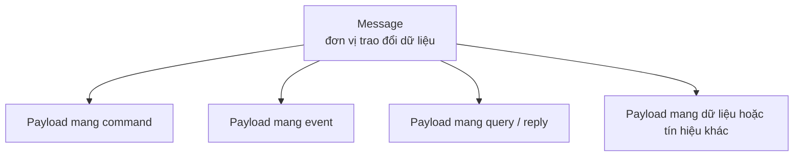
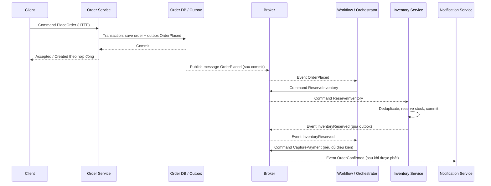
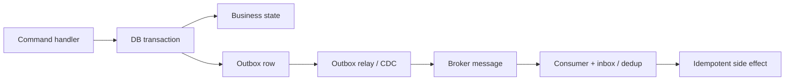

# Phân biệt command, event và message trong giao tiếp hệ thống

> **Chương:** Nền tảng nhắn tin  
> **Module:** SPRING_BOOT_INTEGRATION — tích hợp hệ thống bằng Spring Boot qua HTTP client, cơ sở dữ liệu, cache, broker thông điệp và adapter của Spring Integration.

## 1. Vì sao cần phân biệt ba khái niệm?

Trong một hệ thống bán hàng, ứng dụng có thể gửi yêu cầu **giữ hàng**, thông báo **đơn hàng đã được tạo**, hoặc chuyển một **gói dữ liệu** từ service này sang service khác qua Kafka hay RabbitMQ. Cả ba có thể được biểu diễn bằng JSON và cùng đi qua một message broker, nhưng chúng mang ý nghĩa rất khác nhau.

- **Command (lệnh):** một bên **yêu cầu** bên có trách nhiệm thực hiện một hành động, ví dụ `ReserveInventory` — “Hãy giữ 2 sản phẩm cho đơn hàng này”.
- **Event (sự kiện):** một bên **công bố sự thật đã xảy ra**, ví dụ `InventoryReserved` — “Hai sản phẩm đã được giữ thành công”.
- **Message (thông điệp):** đơn vị dữ liệu **được gửi, nhận hoặc trao đổi** qua một kênh giao tiếp. Command và event có thể được đóng gói thành message; message cũng có thể mang query, reply, tín hiệu điều khiển hoặc dữ liệu khác.

Phân biệt đúng giúp đội phát triển xác định ai sở hữu nghiệp vụ, bên nhận có bắt buộc xử lý hay không, khi nào được công bố sự kiện, xử lý lỗi/retry ra sao và cần cam kết điều gì với các hệ thống tích hợp.

### Mục tiêu học tập

Sau bài này, bạn có thể:

1. Phân biệt command, event và message theo **ý nghĩa**, **trách nhiệm**, **điểm phát sinh** và **phản ứng mong đợi**.
2. Nhìn vào một luồng tích hợp Spring Boot để chọn mô hình giao tiếp phù hợp.
3. Thiết kế hợp đồng payload và metadata phục vụ versioning, correlation, idempotency và quan sát vận hành.
4. Giải thích vì sao broker, queue, topic và `Message<T>` của Spring không tự quyết định một thông điệp là command hay event.
5. Nhận diện các lỗi thường gặp với giao dịch database, phân phối lặp, thứ tự xử lý và tính nhất quán giữa các hệ thống.

## 2. Định nghĩa chính xác

### 2.1. Command: đề nghị một hành động

**Command thể hiện ý định**: “Hãy thực hiện X”. Một command hợp lệ thường nêu rõ hành động, dữ liệu cần thiết, bên chịu trách nhiệm và mã định danh để theo dõi hoặc xử lý lặp.

Ví dụ:

- `CreateOrder`: yêu cầu tạo đơn hàng.
- `ReserveInventory`: yêu cầu giữ hàng.
- `ChargePayment`: yêu cầu thu tiền.
- `CancelShipment`: yêu cầu hủy vận đơn.

Command có thể được **chấp nhận, từ chối, hết hạn, xử lý thất bại hoặc thành công**. Việc gửi command không chứng minh hành động đã thành công. Kể cả broker xác nhận “đã nhận message”, đó cũng chưa phải xác nhận nghiệp vụ.

Thông thường, một command có **một chủ sở hữu nghiệp vụ logic**. Chủ sở hữu đó có thể chạy nhiều replica để mở rộng quy mô, nhưng toàn bộ replica phải phối hợp như một nhóm xử lý cùng trách nhiệm. Nếu nhiều service độc lập cùng nhận `ChargePayment` và đều trừ tiền, giao thức đã sai.

Command có thể truyền qua HTTP đồng bộ hoặc qua broker bất đồng bộ. **Không bắt buộc command phải đi qua queue.**

### 2.2. Event: thông báo một sự thật đã xảy ra

**Event mô tả điều đã xảy ra** và thường được đặt tên ở dạng quá khứ:

- `OrderPlaced`: đơn hàng đã được tạo/đặt.
- `InventoryReserved`: hàng đã được giữ.
- `PaymentCaptured`: tiền đã được thu.
- `ShipmentCancelled`: vận đơn đã bị hủy.

Một event thường do hệ thống **sở hữu trạng thái** phát ra sau khi trạng thái thực tế đã chuyển đổi thành công. Producer không cần biết trước tất cả consumer; nhiều consumer có thể tự quyết định phản ứng: cập nhật cache, gửi email, ghi log phân tích, khởi động một quy trình mới.

Event **không phải mệnh lệnh trá hình**. Nếu event có tên `UserRegistered` nhưng bên nhận buộc phải tạo tài khoản ngay và không có sự kiện đăng ký thật nào đã xảy ra, hợp đồng đang dùng sai ngữ nghĩa.

Có hai phạm vi hay gặp:

- **Domain event:** biểu diễn điều có ý nghĩa trong một bounded context, ví dụ `OrderConfirmed` của miền đơn hàng. Có thể chỉ dùng nội bộ.
- **Integration event:** sự kiện được chủ động công bố cho hệ thống bên ngoài với hợp đồng tương đối ổn định, khả năng tương thích phiên bản và dữ liệu đã được cân nhắc về quyền riêng tư.

Không nhất thiết đưa nguyên object domain hoặc entity JPA vào integration event.

### 2.3. Message: đơn vị trao đổi dữ liệu

**Message là hình thức giao tiếp**. Một message thường gồm **payload** và **headers/metadata**. Payload có thể chứa command, event, query, reply, một batch dữ liệu hoặc tín hiệu hệ thống.

Ở Spring, `org.springframework.messaging.Message<T>` có hai phần cơ bản:

- `getPayload()`: đối tượng dữ liệu.
- `getHeaders()`: metadata như ID, thời gian, content type và các header tùy chỉnh.

Kafka record, RabbitMQ delivery hoặc HTTP request cũng là các đơn vị dữ liệu được truyền, nhưng mô hình metadata và hành vi xác nhận của từng công nghệ không giống nhau. Đừng đồng nhất `Message<T>` của Spring với một record Kafka hay một object trong database.

**Quan hệ giữa chúng:**



Một command hoặc event có thể được serialize và đóng gói thành message để gửi. Cùng một event nghiệp vụ đôi khi được truyền nhiều lần bởi các message vật lý khác nhau khi retry hoặc replay; vì vậy cần phân biệt **event ID** và **delivery/message ID**.

## 3. Bảng so sánh trọng tâm

| Tiêu chí | Command | Event | Message |
|---|---|---|---|
| Câu hỏi chính | “Hãy làm gì?” | “Điều gì đã xảy ra?” | “Đơn vị dữ liệu nào được trao đổi?” |
| Bản chất | Ý định/yêu cầu hành động | Sự thật đã xảy ra | Cấu trúc và phương tiện mang dữ liệu |
| Cách đặt tên | Động từ mệnh lệnh: `ReserveInventory` | Động từ quá khứ: `InventoryReserved` | Theo hợp đồng truyền tải: `payload`, `headers` |
| Trách nhiệm | Có một chủ sở hữu nghiệp vụ logic | Producer công bố; consumer tự chọn phản ứng | Phụ thuộc kiểu nội dung và protocol |
| Bên nhận | Thường có đích logic xác định | Có thể 0, 1 hoặc nhiều subscriber | Bất kỳ bên nhận theo cơ chế transport |
| Phản hồi/thất bại | Cần xác định thành công, từ chối, timeout và xử lý lại | Không “hủy” sự thật chỉ vì một consumer lỗi | ACK/NACK/retry chỉ cho biết trạng thái truyền/xử lý theo transport |
| Quan hệ với trạng thái | Mong muốn thay đổi trạng thái | Ghi nhận trạng thái/sự thật đã thay đổi | Không tự mang ý nghĩa trạng thái |
| Ví dụ | `CapturePayment` | `PaymentCaptured` | Kafka record chứa `PaymentCaptured` |

**Quy tắc quan trọng:** cách đặt tên và ý nghĩa hợp đồng có giá trị hơn tên topic. Một record trên topic `events` vẫn có thể là command thiết kế sai; một message trên queue có thể là event.

### 3.1. Command không đồng nghĩa request–reply

Command có thể được gửi qua HTTP và nhận kết quả tức thời:

```http
POST /inventory/reservations
Content-Type: application/json

{"commandId":"cmd-101","orderId":"ord-42","sku":"SKU-9","quantity":2}
```

HTTP có thể trả `202 Accepted` khi hệ thống chỉ **tiếp nhận** để xử lý sau; `200 OK` hoặc `201 Created` phải gắn với hợp đồng cụ thể. HTTP timeout không chứng minh command chưa được thực thi.

Command cũng có thể đi qua Kafka/RabbitMQ mà không có phản hồi đồng bộ. Khi cần biết kết quả, có thể dùng reply message, truy vấn trạng thái theo command ID hoặc công bố event thành công/thất bại. **Event phản ánh kết quả thực tế; ACK từ broker chỉ xác nhận theo tầng transport.**

### 3.2. Event không đồng nghĩa publish–subscribe

Event thường phù hợp với pub/sub, nhưng nó vẫn có thể được chuyển qua queue hoặc HTTP webhook. Ngược lại, một thông điệp publish tới nhiều nhóm subscriber chưa chắc là event: nếu nội dung yêu cầu tất cả bên nhận làm cùng một việc, có thể đó là nhiều command độc lập bị đóng gói chung.

## 4. Tình huống thực tế: đặt hàng, giữ kho và thu tiền

Giả sử hệ thống có `Order Service`, `Inventory Service`, `Payment Service` và `Notification Service`.

1. Client gửi command `PlaceOrder` qua HTTP đến Order Service.
2. Order Service kiểm tra yêu cầu, lưu đơn hàng `PENDING` và event `OrderPlaced` vào outbox trong cùng transaction database.
3. Một tiến trình xuất bản outbox gửi message chứa `OrderPlaced` lên broker.
4. Bộ điều phối quy trình (hoặc Order Service) gửi command `ReserveInventory` đến **Inventory Service**, đúng nơi sở hữu việc giữ hàng.
5. Inventory Service xử lý command, thay đổi dữ liệu kho, rồi công bố event `InventoryReserved` hoặc `InventoryReservationRejected`.
6. Quy trình nhận event kết quả và quyết định gửi command `CapturePayment`, xác nhận đơn hoặc thực hiện bù trừ.
7. Notification Service có thể subscribe `OrderConfirmed` để gửi email, không cần Order Service biết chi tiết của hệ thống email.



Sơ đồ thể hiện quan hệ nhân quả, không bảo đảm mọi bước hoàn thành ngay lập tức. Producer outbox và các bước tiếp theo cần retry, kiểm tra trạng thái và giám sát riêng. Trong thực tế, `OrderConfirmed` chỉ được phát sau khi các điều kiện xác nhận của nghiệp vụ thực sự hoàn tất, **không phải ngay sau `InventoryReserved` nếu còn chờ thanh toán**.

### 4.1. Ai được quyền ra command?

Một service chỉ nên gửi command đến bên **sở hữu hành động**. Ví dụ, Order Service không trực tiếp cập nhật bảng tồn kho của Inventory Service. Nó gửi `ReserveInventory` hoặc phản ứng với event theo quy trình đã thỏa thuận.

### 4.2. Ai được quyền phát event?

Service sở hữu sự thật công bố event về sự thật đó. Inventory Service phát `InventoryReserved`; Order Service phát `OrderConfirmed` khi đơn hàng thực sự được xác nhận. Event không nên diễn đạt kết quả mà producer chưa biết chắc.

### 4.3. Choreography và orchestration

- **Choreography:** các service phản ứng với event của nhau; phù hợp luồng ít bước, quan hệ đơn giản. Cần quản lý chuỗi phản ứng và tránh vòng lặp khó quan sát.
- **Orchestration:** một thành phần điều phối nắm trạng thái quy trình và phát command đến các chủ sở hữu; phù hợp khi có nhiều bước, timeout và bù trừ.

Hai cách không loại trừ nhau: một orchestrator có thể **nhận event và phát command**. Quyết định dựa vào mức độ phức tạp của quy trình, khả năng theo dõi và tính độc lập của các service.

## 5. Thiết kế hợp đồng command, event và envelope

Một payload cần tên dễ hiểu, dữ liệu tối thiểu đủ dùng và phiên bản hợp đồng. Ngoài payload, message cần metadata để truy vết và xử lý lặp.

### 5.1. Ví dụ command

```json
{
  "messageId": "msg-501",
  "kind": "command",
  "type": "inventory.reserve.v1",
  "schemaVersion": 1,
  "createdAt": "2026-11-20T02:30:00Z",
  "correlationId": "order-flow-42",
  "causationId": "evt-401",
  "target": "inventory-service",
  "payload": {
    "commandId": "cmd-501",
    "orderId": "ord-42",
    "sku": "SKU-9",
    "quantity": 2,
    "idempotencyKey": "reserve:ord-42:SKU-9"
  }
}
```

- `commandId` nhận diện **một yêu cầu nghiệp vụ**, nên ổn định khi retry cùng yêu cầu. Một yêu cầu thực sự mới cần ID mới.
- `target` mô tả chủ sở hữu logic, không buộc message phải gửi trực tiếp tới đúng một process.
- `correlationId` nối các bước trong một luồng nghiệp vụ. `causationId` trỏ tới thông điệp/sự kiện tạo ra hành động hiện tại; hai khái niệm khác nhau.
- `idempotencyKey` cho phép bên nhận phát hiện cùng một lệnh đã được áp dụng. Không nên tùy tiện tạo khóa mới mỗi lần transport retry.

### 5.2. Ví dụ event

```json
{
  "messageId": "msg-601",
  "kind": "event",
  "type": "inventory.reserved.v1",
  "schemaVersion": 1,
  "occurredAt": "2026-11-20T02:30:02Z",
  "correlationId": "order-flow-42",
  "causationId": "cmd-501",
  "producer": "inventory-service",
  "subject": "order/ord-42",
  "payload": {
    "eventId": "evt-601",
    "orderId": "ord-42",
    "reservationId": "res-77",
    "sku": "SKU-9",
    "reservedQuantity": 2
  }
}
```

`eventId` đại diện cho **sự kiện đã xảy ra** và cần giữ nguyên khi phát lại cùng một event. Một cơ chế republish có thể tạo delivery/message ID mới, nhưng không nên biến cùng một sự kiện thành nhiều sự kiện nghiệp vụ khác nhau. `occurredAt` cho biết thời điểm diễn ra sự kiện, không đồng nghĩa với thời điểm consumer nhận hoặc broker ghi message.

**Các JSON trên chỉ là hợp đồng minh họa**, không phải chuẩn envelope bắt buộc của Kafka, RabbitMQ hay Spring Integration. Thực tế, metadata có thể nằm trong broker headers thay vì JSON body; hãy chuẩn hóa cách mã hóa, đặt tên, định dạng thời gian, nội dung nào được ký/xác thực và cách ánh xạ metadata trước khi tích hợp.

### 5.3. Message ID, command ID, event ID: không dùng thay nhau

| ID | Đại diện cho | Ứng dụng phổ biến |
|---|---|---|
| `messageId` / delivery ID | Một lần đóng gói/trao đổi message theo hợp đồng | Log và quan sát vận chuyển; có thể thay đổi khi gửi lại |
| `commandId` | Một ý định được yêu cầu xử lý | Idempotency của command, tra cứu trạng thái |
| `eventId` | Một sự kiện nghiệp vụ duy nhất | Consumer deduplication, replay và audit |
| `correlationId` | Cùng một quy trình/transaction nghiệp vụ xuyên service | Distributed tracing, ghép log và điều tra lỗi |
| `causationId` | Thông điệp/hành động trực tiếp dẫn tới kết quả | Phân tích chuỗi nguyên nhân |
| `aggregateId` / `orderId` | Thực thể nghiệp vụ | Khóa phân vùng, liên kết dữ liệu, thứ tự tương đối |

Không phải mọi hệ thống đều dùng đủ các trường. Điều quan trọng là định nghĩa **ngữ nghĩa ổn định và duy nhất** cho từng trường được dùng. Không sử dụng correlation ID làm khóa dedup cho mọi event của cả quy trình vì nhiều event hợp lệ có thể cùng correlation ID.

## 6. Liên hệ trực tiếp với Spring Boot và Spring Integration

### 6.1. Spring Message mang nội dung, không quy định ý nghĩa

`org.springframework.messaging.Message<T>` chỉ mô tả payload và headers. Kiểu nghiệp vụ do ứng dụng quy định, chẳng hạn record command:

```java
public record ReserveInventoryCommand(
    String commandId,
    String orderId,
    String sku,
    int quantity
) {}
```

Đóng gói command thành Spring message:

```java
import org.springframework.messaging.Message;
import org.springframework.messaging.support.MessageBuilder;

ReserveInventoryCommand command =
    new ReserveInventoryCommand("cmd-501", "ord-42", "SKU-9", 2);

Message<ReserveInventoryCommand> message = MessageBuilder
    .withPayload(command)
    .setHeader("kind", "command")
    .setHeader("type", "inventory.reserve.v1")
    .setHeader("correlationId", "order-flow-42")
    .build();
```

`MessageBuilder` tạo một object trong ứng dụng; chỉ tạo `Message<?>` **chưa hề gửi** dữ liệu ra Kafka/RabbitMQ. Muốn truyền qua network cần `MessageChannel`, Spring Integration adapter, Spring Kafka, Spring AMQP hoặc cơ chế phù hợp đã được cấu hình.

Trong Spring Integration:

- `MessageChannel` biểu diễn kênh trao đổi trong ứng dụng.
- `MessageHandler`/service activator xử lý message.
- Router chọn kênh dựa trên header hoặc payload.
- Gateway/adapter kết nối luồng nội bộ với HTTP, JMS, AMQP, Kafka hoặc nguồn khác tùy adapter và phiên bản được hỗ trợ.

Ví dụ `DirectChannel` có thể chuyển message cho handler trong cùng process, **không tự bảo đảm lưu bền, retry hoặc giao hàng ít nhất một lần**. Những điều đó phụ thuộc kênh, adapter, transport, transaction và cấu hình cụ thể.

### 6.2. Minh họa command handler với Spring Kafka

Giả sử payload đã được giải mã thành Java record bằng cấu hình serializer/deserializer tương thích:

```java
import org.springframework.kafka.annotation.KafkaListener;
import org.springframework.stereotype.Component;

@Component
public class InventoryCommandConsumer {
    private final InventoryService inventoryService;

    public InventoryCommandConsumer(InventoryService inventoryService) {
        this.inventoryService = inventoryService;
    }

    @KafkaListener(
        topics = "inventory.commands.v1",
        groupId = "inventory-service"
    )
    public void onReserve(ReserveInventoryCommand command) {
        // reserveOnce cần xử lý lặp commandId và thay đổi tồn kho
        // trong giao dịch DB phù hợp.
        inventoryService.reserveOnce(
            command.commandId(),
            command.orderId(),
            command.sku(),
            command.quantity()
        );
    }
}
```

Đây là **mẫu minh họa về trách nhiệm của consumer**, chưa phải toàn bộ cấu hình chạy được. Để chạy thật cần khai báo broker connection, serialization, error handler, retry/DLT, schema, transaction và hành vi publish kết quả. `reserveOnce` là phương thức nghiệp vụ do ứng dụng triển khai, không phải API có sẵn của Spring.

Kafka phân phối các record cùng partition cho các thành viên trong **một consumer group** theo cơ chế của nó; nếu nhiều group độc lập cùng subscribe topic command, mỗi group có thể nhận bản sao. Muốn một chủ sở hữu logic duy nhất, phải thiết kế topic, group và quyền truy cập nhất quán với hợp đồng command. Đừng suy diễn “Kafka bảo đảm một lệnh chỉ được xử lý đúng một lần”.

### 6.3. Event consumer có thể có nhiều nhóm độc lập

```java
import org.springframework.kafka.annotation.KafkaListener;
import org.springframework.stereotype.Component;

public record OrderConfirmedEvent(
    String eventId,
    String orderId,
    String customerId
) {}

@Component
public class NotificationEventConsumer {
    private final NotificationService notificationService;

    public NotificationEventConsumer(NotificationService notificationService) {
        this.notificationService = notificationService;
    }

    @KafkaListener(
        topics = "orders.events.v1",
        groupId = "notification-service"
    )
    public void onConfirmed(OrderConfirmedEvent event) {
        notificationService.notifyOnce(event.eventId(), event.orderId());
    }
}
```

Một nhóm khác (ví dụ analytics) có thể nhận cùng event mà không xung đột trách nhiệm với nhóm notification. Cả hai cần cơ chế idempotency phù hợp với side effect riêng.

Đoạn ví dụ giả định topic/consumer được định tuyến đến **đúng kiểu event**; nếu topic chứa nhiều event type, consumer phải phân loại bằng header/type discriminator hoặc deserializer/routing phù hợp. Không thể giả định mọi record trong topic đều là `OrderConfirmedEvent`.

### 6.4. HTTP client, database và cache nằm ở đâu?

- **HTTP client (WebClient/RestClient):** có thể gửi command/request hoặc nhận webhook báo event; giao thức HTTP không tự phân biệt ý nghĩa nghiệp vụ.
- **Database:** nắm trạng thái và ranh giới transaction; việc ghi thành công là cơ sở để công bố event.
- **Cache:** consumer có thể nhận `ProductPriceChanged` để làm mới hoặc vô hiệu hóa cache, nhưng vẫn phải xử lý trễ, trùng và lỗi theo chính sách.
- **Broker:** đảm nhiệm vận chuyển/định tuyến/duy trì message tùy công nghệ, nhưng không thay chủ sở hữu nghiệp vụ.
- **Spring Integration adapter:** nối các endpoint và chuyển đổi/định tuyến message; adapter không tự tạo ra contract command/event đúng nghĩa.

## 7. Queue, topic, routing key và consumer group

Các công nghệ message broker có mô hình khác nhau. Cần hiểu **routing** tách biệt với **ngữ nghĩa**.

| Thành phần | Điểm cần hiểu | Ví dụ sử dụng |
|---|---|---|
| Queue / competing consumers | Nhiều worker có thể chia nhau xử lý message trong một hàng đợi; cơ chế chi tiết phụ thuộc broker | Worker cùng xử lý `ReserveInventory` dưới một chủ sở hữu |
| Pub/sub / fan-out | Nhiều subscriber logic có thể nhận cùng một event | Notification và Analytics nhận `OrderConfirmed` |
| Kafka topic + consumer group | Mỗi group có vị trí đọc độc lập; mỗi partition tại một thời điểm thường được gán cho một thành viên group | Nhóm inventory xử lý command; các nhóm độc lập nhận event |
| RabbitMQ exchange + queue + binding | Exchange định tuyến message theo loại exchange/routing key/binding; các queue khác nhau có thể nhận bản sao | Fanout event tới nhiều queue; command tới queue của chủ xử lý |

**Không có luật “command = queue, event = topic” áp dụng cho mọi broker.** Lựa chọn dựa vào mô hình sở hữu, fan-out, thứ tự, retention, replay, throughput, bảo mật và phương thức xác nhận.

Topic/queue name có thể gợi ý ý nghĩa (`inventory.commands.v1`, `orders.events.v1`) nhưng **hợp đồng** phải mô tả chính xác người phát, người nhận, schema và cách xử lý lỗi.

## 8. Delivery, ACK và idempotency

### 8.1. Một message có thể được xử lý hơn một lần

Trong hệ thống phân tán, producer có thể không biết message đã được broker ghi hay chưa khi mất kết nối. Consumer có thể xử lý và commit database nhưng chết trước khi ACK/commit offset. Sau khi khởi động lại, cùng message có thể được giao lại.

Các mức cam kết thường gặp:

- **At-most-once:** có thể mất thông điệp, tránh giao lại trong một số cấu hình.
- **At-least-once:** cố gắng giao lại khi chưa xác nhận, nên consumer phải chấp nhận **trùng lặp**.
- **Exactly-once trong phạm vi giới hạn:** một số broker/transaction hỗ trợ ở phạm vi định nghĩa rõ; **không mặc nhiên bảo đảm** side effect bên ngoài như gọi HTTP, thu tiền hoặc ghi database khác chỉ xảy ra một lần.

Command có thể phải xử lý lại mà không tạo hành động kép; event consumer cũng vậy. Ví dụ, hai lần nhận `PaymentCaptured` không được gửi hai lần một yêu cầu hoàn tiền chỉ vì message bị gửi lại.

### 8.2. Idempotency ở mức nghiệp vụ

Với command `ReserveInventory`, bên nhận ghi lại `commandId` hoặc idempotency key trong cùng giao dịch với thay đổi tồn kho. Nếu khóa đã được xử lý thành công, consumer trả về trạng thái cũ hoặc bỏ qua tác động trùng, tùy hợp đồng.

Một bảng theo dõi minh họa:

```sql
CREATE TABLE processed_messages (
    consumer_name VARCHAR(120) NOT NULL,
    business_message_id VARCHAR(160) NOT NULL,
    processed_at TIMESTAMPTZ NOT NULL DEFAULT NOW(),
    PRIMARY KEY (consumer_name, business_message_id)
);
```

Quy trình trong **một transaction của cùng database**:

1. Thử ghi (`consumer_name`, `commandId` hoặc `eventId`) với unique constraint.
2. Nếu đã tồn tại, bỏ qua **side effect trùng** theo kết quả đã lưu.
3. Nếu là khóa mới, thực hiện cập nhật nghiệp vụ cần thiết rồi commit.
4. ACK message **sau** khi transaction nghiệp vụ thành công, phù hợp cơ chế của consumer.

Nếu bước nghiệp vụ lỗi thì cả dấu đã xử lý và cập nhật nghiệp vụ cần rollback cùng nhau; nếu ghi dấu trước rồi transaction lỗi mà vẫn lưu dấu, lần retry có thể bị bỏ qua oan. Đối với side effect ngoài database (gửi email/HTTP), bảng dedup một mình chưa bảo đảm tác động bên ngoài chỉ diễn ra một lần; cần idempotency phía đích, outbox hoặc quy trình bù trừ.

### 8.3. Command thất bại khác event consumer thất bại

- **Command bị từ chối nghiệp vụ:** không đủ hàng, tài khoản không hợp lệ, yêu cầu quá hạn. Cần kết quả có nghĩa như `InventoryReservationRejected`, trạng thái command, hoặc reply lỗi theo hợp đồng. Không retry vô hạn một lỗi dữ liệu cố định.
- **Command gặp lỗi tạm thời:** database/network gián đoạn. Có thể retry với backoff và giới hạn số lần; bảo toàn command ID.
- **Event consumer thất bại:** event đã xảy ra vẫn là sự thật. Consumer cần retry, dead-letter hoặc quy trình tái xử lý; không yêu cầu producer “thu hồi” event chỉ vì một subscriber chưa cập nhật cache.

## 9. Giao dịch database, outbox và inbox

Gửi thành công command/event vào broker và commit database **không tự nhiên nằm trong một transaction nguyên tử**.

Ví dụ sai lầm:

```text
1. UPDATE orders SET status = 'CONFIRMED'
2. COMMIT
3. publish OrderConfirmed
```

Nếu process chết sau bước 2 và trước bước 3, database đã xác nhận đơn nhưng event có thể mất. Đảo thứ tự publish trước commit lại có nguy cơ consumer nhận event về trạng thái chưa được commit hoặc sau đó rollback.

### Transactional outbox

Trong một transaction database, ghi **cập nhật nghiệp vụ** và **outbox record** cùng nhau. Một relay đọc outbox, publish qua broker và cập nhật trạng thái phát. Relay có thể publish lại khi không biết broker đã nhận hay chưa, nên consumer vẫn phải deduplicate.



Inbox/dedup ở consumer hỗ trợ xử lý lại an toàn. Outbox không tự giải quyết thứ tự giữa mọi aggregate, atomicity giữa nhiều database hoặc side effect bên ngoài. Với chuỗi command/event dài, cần thiết kế trạng thái quy trình (saga), timeout, compensation và reconciliation.

**Điểm phân biệt:** outbox record là dữ liệu chuẩn bị **phát message**; event bên trong phản ánh một sự thật đã xảy ra. Bảng outbox không làm mọi record trở thành “event”; trong một số thiết kế outbox cũng có thể mang command cần gửi sau commit.

## 10. Thứ tự sự kiện, thời gian và việc phát lại

- **Ordering:** nhiều broker chỉ bảo đảm thứ tự trong phạm vi partition/queue và điều kiện cụ thể. Với Kafka, chọn key ổn định theo aggregate, ví dụ `orderId`, nếu các event của một đơn cần cùng partition. Không suy diễn có thứ tự toàn cục giữa mọi đơn hàng.
- **Out-of-order:** `OrderConfirmed` có thể tới một consumer trước event khác nếu đi qua các topic, relay, group hoặc đường mạng khác nhau. Consumer cần version, sequence number theo aggregate hoặc cách reconcile khi dữ liệu đến không theo kỳ vọng.
- **Replay:** event lưu lâu có thể được phát lại để rebuild projection, nhưng consumer gửi email, thanh toán hoặc gọi API bên ngoài không được thực hiện lại side effect ngoài ý muốn. Phân biệt projection tái tạo được và hành động tác động ra thế giới thực.
- **Clock:** `occurredAt` giúp quan sát, nhưng đồng hồ các service không phải cơ sở đảm bảo thứ tự tuyệt đối. Cần aggregate version/sequence khi hợp đồng đòi hỏi kiểm soát trình tự.
- **Retention:** Kafka có thể giữ log theo thời gian/kích thước; nhiều loại queue thường xóa message khi hoàn thành và ACK. Đừng dùng khả năng replay làm giả định chung cho mọi broker.

## 11. Versioning và khả năng tương thích hợp đồng

Command và integration event là **hợp đồng giữa các hệ thống**. Producer/consumer không nhất thiết được deploy cùng lúc.

Nguyên tắc thực tế:

1. Có `type` rõ nghĩa và `schemaVersion` hoặc cơ chế version registry đã thống nhất.
2. Thay đổi tương thích như **thêm field tùy chọn** có thể ít rủi ro hơn việc đổi tên/xóa field hoặc đổi ý nghĩa của field cũ; khả năng tương thích còn phụ thuộc schema/serialization.
3. Nếu có thay đổi phá vỡ contract, tạo phiên bản mới và có kế hoạch chuyển đổi, dual publish/consume tạm thời khi cần.
4. Không để payload event phụ thuộc lớp nội bộ của JPA/entity; chỉ công bố trường cần cho các consumer.
5. Không đặt mật khẩu, token, PII không cần thiết, thông tin thẻ hay dữ liệu nhạy cảm vào message/log; áp dụng ACL, mã hóa và chính sách retention phù hợp.
6. Với command, cần nêu rõ điều kiện tiên quyết, deadline, expected version (nếu dùng optimistic concurrency) và hành vi nhận lại command trùng.
7. Với event, cần nêu rõ **thời điểm được coi là xảy ra**, nguồn sự thật, ý nghĩa trường và cách consumer phát hiện bản cũ/mới.

Phân biệt **event notification** (chỉ báo “đã đổi, hãy truy vấn nguồn”) với **event-carried state transfer** (mang đủ dữ liệu cần thiết để cập nhật projection). Notification giảm dữ liệu đính kèm nhưng tạo thêm HTTP/database lookup; state transfer giảm phụ thuộc đồng bộ nhưng tăng trách nhiệm duy trì hợp đồng và xử lý event đến trễ.

## 12. Observability: truy vết từ command tới event

Mỗi bước cần có thông tin phù hợp để điều tra “đã nhận nhưng không xử lý”, “đã xử lý nhưng không có event” hoặc “consumer xử lý trùng”.

| Chỉ số/tín hiệu | Ý nghĩa |
|---|---|
| Command accepted/rejected/expired | Khác biệt giữa đã nhận, từ chối và kết quả nghiệp vụ |
| Producer publish success/failure | Trạng thái xuất bản message; không tương đương kết quả nghiệp vụ |
| Consumer lag, retry, dead-letter | Mức tồn đọng và khả năng xử lý kịp thời |
| Outbox age và số bản ghi pending | Khả năng phát tán sự thật đã commit tới broker |
| Duplicate-detection count | Mức độ lặp do retry/replay hoặc producer |
| Handler processing latency, error category | Độ trễ và nguyên nhân hỏng thực tế |
| `correlationId`, `causationId`, trace/span | Ghép chuỗi request–command–event–subscriber |

Trong Spring Boot, có thể dùng Actuator/Micrometer và hệ thống tracing tập trung. Việc trace context tự động đi qua broker hay Spring Integration adapter **phụ thuộc phiên bản, instrumentation và cấu hình**; cần kiểm tra thực tế. Log nên ghi các ID và trạng thái có ích, tránh log toàn payload chứa dữ liệu nhạy cảm.

## 13. Kiểm thử hợp đồng và luồng tích hợp

| Ca kiểm thử | Kết quả cần xác minh |
|---|---|
| Nhận `ReserveInventory` hợp lệ | Handler cập nhật đúng tồn kho và công bố kết quả sau commit |
| Command bị từ chối do hết hàng | Không đổi tồn kho trái phép; có kết quả từ chối đúng hợp đồng |
| Producer gửi lại cùng `commandId` | Không giữ hàng hai lần |
| Consumer nhận lại cùng `eventId` | Không lặp side effect, hoặc đạt cùng trạng thái mong muốn |
| Consumer chết sau DB commit nhưng trước ACK | Retry an toàn và không mất tiến độ |
| DB commit xong, broker tạm ngừng | Outbox còn dữ liệu và tiếp tục publish khi broker phục hồi |
| Nhận phiên bản schema cũ/mới | Deserializer/consumer hoạt động theo hợp đồng tương thích |
| Event tới lệch thứ tự, replay | Projection xử lý version/sequence hoặc reconcile đúng |
| Hai subscriber độc lập cùng nhận event | Mỗi nhóm xử lý theo nhiệm vụ riêng, không ảnh hưởng ACK của nhau |
| Broker down/consumer lag tăng | Retry, cảnh báo, timeout và dead-letter theo ngưỡng đã định |

Nên kết hợp **unit test cho logic command handler**, **contract test cho schema/version**, **integration test dùng broker/database cùng loại với production** (ví dụ Testcontainers phù hợp) và các phép thử retry, crash, concurrent duplicate. Không chỉ assert lời gọi `KafkaTemplate.send()` hoặc `MessageChannel.send()`; phải xác nhận trạng thái nghiệp vụ và hậu quả khi message bị phát lại.

## 14. Các ngộ nhận dễ gây lỗi

| Ngộ nhận | Hiểu đúng |
|---|---|
| “Gửi event là yêu cầu service khác làm việc.” | Event thông báo sự thật; dùng command khi muốn yêu cầu một chủ sở hữu thực thi. |
| “Đã gửi command là đã xong.” | Broker ACK và ứng dụng hoàn thành nghiệp vụ là hai thời điểm khác nhau. |
| “Một message chỉ có thể là event.” | Message là đơn vị truyền tải; có thể mang command, event, query, reply, dữ liệu khác. |
| “Kafka topic là event, RabbitMQ queue là command.” | Cơ chế routing không quyết định ý nghĩa payload. |
| “`@KafkaListener` xử lý đúng một lần.” | Delivery/rebalance/retry có thể lặp; cần idempotency và transaction đúng phạm vi. |
| “Nếu consumer lỗi thì event chưa xảy ra.” | Producer có thể đã commit sự thật; lỗi consumer cần xử lý độc lập. |
| “`@Transactional` bao được cả DB và broker bất kỳ.” | Ranh giới DB/broker cần outbox hoặc cơ chế phối hợp được thiết kế rõ ràng. |
| “Cùng correlation ID nghĩa là trùng sự kiện.” | Correlation ID gắn các bước cùng quy trình; dedup phải dựa vào event/command ID phù hợp. |
| “Một JSON dùng chung mãi cho mọi bên là thuận tiện.” | Hợp đồng public cần quản lý phiên bản, quyền riêng tư và tránh lộ cấu trúc nội bộ. |

## 15. Cách chọn cho một yêu cầu tích hợp mới

Khi thiết kế một endpoint, handler hoặc adapter Spring Boot, hãy trả lời tuần tự:

1. **Ta muốn một bên làm gì, hay muốn thông báo việc đã xảy ra?** Nếu cần hành động có chủ sở hữu, dùng command; nếu sự thật đã commit và cần phát tán, dùng event.
2. **Ai sở hữu trạng thái và ai quyết định thành công?** Đừng để broker hoặc subscriber phụ quyết định thay chủ sở hữu nghiệp vụ.
3. **Một hay nhiều subscriber độc lập cần thông tin?** Thiết kế routing, consumer group, queue/topic phù hợp; đừng suy ngữ nghĩa chỉ từ broker.
4. **Làm sao biết tiếp nhận khác với hoàn tất?** Định nghĩa ACK, kết quả, timeout, trạng thái command và event phản hồi nếu cần.
5. **Nếu giao lặp, đến trễ hoặc đảo thứ tự thì sao?** Có command/event ID, dedup, schema version, khóa thứ tự hoặc bước reconciliation.
6. **Nếu database commit nhưng broker lỗi thì sao?** Dùng outbox hoặc cơ chế đáng tin cậy tương đương; xác định rõ giới hạn transaction.
7. **Có theo dõi và kiểm thử được không?** Thiết lập correlation/causation ID, metric, log, traces và các ca failure injection.

### Tự kiểm tra nhanh

**Tình huống A:** `Billing Service` gửi `ChargeCustomer` sang `Payment Service`. Đây là **command** vì yêu cầu chủ sở hữu thực thi hành động, có thể thành công hoặc từ chối.

**Tình huống B:** `Payment Service` đã hoàn tất thu tiền, phát `PaymentCaptured` cho Order/Accounting/Notification. Đây là **event** vì công bố một sự thật; các consumer tự quyết định phản ứng.

**Tình huống C:** Kafka record chứa `PaymentCaptured` với key `paymentId` và headers `correlationId`. Đây là **message ở tầng truyền tải**, có payload mang event. Key và header giúp phân vùng/truy vết nhưng không làm thay đổi bản chất của sự kiện.

**Tình huống D:** Client POST `/orders`, service trả `202 Accepted` rồi enqueue `PlaceOrder`. HTTP response chỉ xác nhận lệnh được nhận theo hợp đồng; **OrderPlaced** chỉ nên được công bố sau khi đơn thực sự được tạo.

Điểm cốt lõi của **Nền tảng nhắn tin** trong `SPRING_BOOT_INTEGRATION`: **command mô tả ý định cần thực hiện, event ghi nhận một sự thật đã xảy ra, message là phương tiện mang nội dung**. Khi kết hợp Spring Boot, HTTP, database, cache, broker và Spring Integration, ranh giới này giúp thiết kế hợp đồng đúng, giao dịch nhất quán, xử lý trùng có kiểm soát và quan sát được toàn bộ luồng tích hợp.
