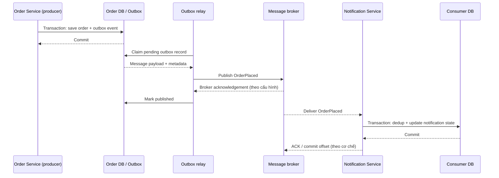
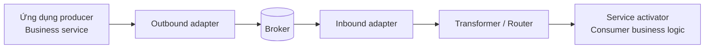
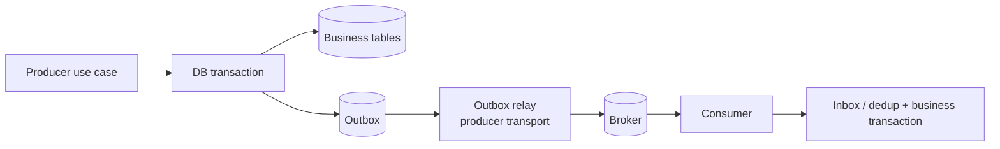
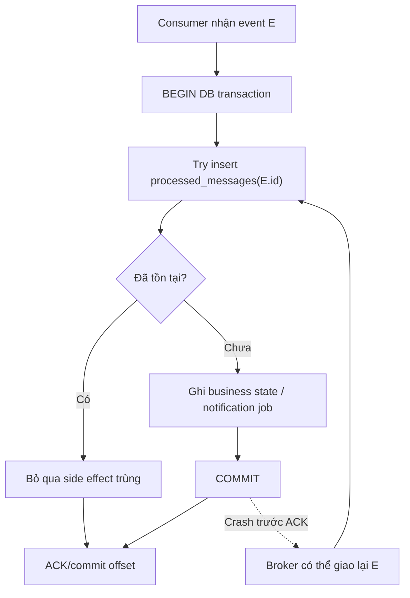

# Producer, broker, consumer và trách nhiệm của từng thành phần

> **Chương:** Nền tảng nhắn tin  
> **Module:** `SPRING_BOOT_INTEGRATION` — tổ chức tích hợp hệ thống trong Spring Boot qua HTTP client, cơ sở dữ liệu, cache, broker thông điệp và các adapter Spring Integration. Trọng tâm của bài là cấu hình, hợp đồng dữ liệu, giao dịch, lỗi, chống xử lý trùng, kiểm thử và quan sát luồng thông điệp.

## 1. Tại sao phải tách rõ ba vai trò?

Một đơn hàng được đặt thành công trên website. Dịch vụ đơn hàng cần báo cho các hệ thống kho, thông báo và phân tích rằng đơn đã được tạo. Thay vì lần lượt gọi HTTP tới từng bên và chờ toàn bộ phản hồi, dịch vụ có thể xuất bản thông điệp qua một message broker. Các hệ thống còn lại tiếp nhận theo nhịp xử lý của mình.

Trong mô hình này có ba vai trò:

- **Producer (bên phát):** tạo thông điệp đúng hợp đồng, chọn nơi gửi và chịu trách nhiệm xử lý kết quả xuất bản.
- **Broker (hạ tầng trung gian):** nhận, định tuyến, lưu giữ và phân phối thông điệp theo khả năng và cấu hình của công nghệ sử dụng.
- **Consumer (bên nhận):** đọc thông điệp, kiểm tra và áp dụng hành động nghiệp vụ, xử lý lỗi/lặp và xác nhận tiến độ với broker.

Ba vai trò này tách rời để một bên phát không cần biết mọi chi tiết triển khai của bên nhận. Tuy nhiên, **tách rời không có nghĩa là tự động đáng tin cậy**. Producer có thể không biết broker đã lưu message hay chưa khi mất kết nối; broker có thể phát lại message; consumer có thể ghi database thành công rồi chết trước lúc ACK. Hợp đồng, trạng thái, idempotency và observability vẫn cần được thiết kế.

### Mục tiêu học tập

Sau bài này, bạn có thể:

1. Trình bày trách nhiệm cụ thể của producer, broker và consumer, cùng những điều mỗi thành phần **không** bảo đảm.
2. Phân biệt xác nhận của producer, ghi nhận tại broker và kết quả nghiệp vụ ở consumer.
3. Thiết kế một message envelope có event/command ID, schema version, correlation ID và partition/routing key.
4. Cấu hình và minh họa producer/consumer bằng Spring Boot và Spring Kafka; hiểu khác biệt với RabbitMQ và adapter Spring Integration.
5. Tổ chức transaction, outbox/inbox, retry, dead-letter và idempotency trong luồng tích hợp.
6. Kiểm thử những khoảng hở thất bại giữa database, HTTP, broker và consumer.

## 2. Tổng quan vòng đời một thông điệp



Sơ đồ có **ba mốc thành công khác nhau**:

1. **Trạng thái nghiệp vụ producer đã commit:** đơn hàng được tạo và bản ghi outbox đã được lưu. Không có nghĩa thông điệp đã tới broker.
2. **Broker xác nhận đã nhận/ghi thông điệp:** mức độ xác nhận phụ thuộc broker và cấu hình, ví dụ Kafka `acks` hoặc publisher confirm của RabbitMQ. Không có nghĩa consumer đã xử lý.
3. **Consumer hoàn thành nghiệp vụ và xác nhận tiến độ:** ví dụ đã lưu notification vào database rồi commit offset hoặc ACK. Không có nghĩa mọi consumer khác cũng đã hoàn tất.

Trường hợp không dùng outbox, producer có thể phát trực tiếp ra broker. Khi đó phải hiểu rõ khoảng hở giữa transaction database và thao tác publish.

### 2.1. Message, command và event không đồng nghĩa nhau

**Message** là đơn vị được vận chuyển: payload và metadata. Nó có thể chứa:

- **Command:** yêu cầu một chủ sở hữu thực thi hành động, ví dụ `ReserveInventory`.
- **Event:** thông báo sự thật đã xảy ra, ví dụ `OrderPlaced` hoặc `InventoryReserved`.
- **Query/reply** hoặc dữ liệu đồng bộ khác.

Producer, broker và consumer là **vai trò trong tuyến giao tiếp**; command và event là **ý nghĩa nghiệp vụ của nội dung**. Một record Kafka có payload `ReserveInventory` vẫn là message mang command, mặc dù nằm trên topic. Một delivery RabbitMQ chứa `OrderPlaced` vẫn có thể là message mang event, mặc dù đi qua queue.

## 3. Producer: tạo thông điệp và chịu trách nhiệm xuất bản

Producer là thành phần khởi tạo việc gửi. Trong Spring Boot, producer có thể là service gọi `KafkaTemplate`, `RabbitTemplate`, `JmsTemplate`, hoặc một outbound adapter của Spring Integration. Với mô hình outbox, relay phát message cũng là **producer ở ranh giới broker**, dù sự kiện nghiệp vụ do service khác tạo ra trước đó.

### 3.1. Producer phải làm gì?

| Trách nhiệm | Diễn giải | Câu hỏi kiểm tra |
|---|---|---|
| Xác định thời điểm phát | Event chỉ công bố sau khi sự thật đã xảy ra; command phải chứa ý định rõ ràng | `OrderPlaced` đã thật sự được commit chưa? |
| Xây hợp đồng dữ liệu | Đúng `type`, `schemaVersion`, field bắt buộc, content type | Consumer phiên bản cũ có hiểu payload không? |
| Tạo ID ổn định | `eventId`/`commandId` giữ nguyên khi retry cùng nghiệp vụ | Gửi lại có bị coi là một công việc mới không? |
| Đặt địa chỉ và khóa | Chọn topic/exchange/queue, key/routing key có chủ đích | Message của cùng order cần giữ thứ tự tương đối không? |
| Serialize và bảo vệ dữ liệu | JSON/Avro/Protobuf theo hợp đồng; loại secret/PII không cần thiết | Dữ liệu có an toàn để lưu/replay không? |
| Xử lý kết quả publish | Quan sát thành công/thất bại/timeout; giới hạn retry | Broker đã nhận hay producer chỉ gửi request? |
| Phục hồi khi chưa chắc kết quả | Có outbox hoặc thao tác idempotent để phát lại an toàn | Mất response publish sau khi broker đã lưu thì sao? |
| Quan sát | Log `messageId`, `eventId`, `correlationId`, metric và latency | Có tìm được message bị kẹt ở đâu không? |

### 3.2. Producer acknowledgement khác consumer acknowledgement

Giả sử producer nhận kết quả thành công từ `KafkaTemplate.send(...)`. Điều đó xác nhận việc gửi được broker xử lý theo yêu cầu của client, **không** xác nhận Notification Service đã gửi email. Tương tự, RabbitMQ publisher confirm chứng minh broker xác nhận publish theo cơ chế broker; consumer acknowledgement lại là cơ chế khác.

Cần mô hình hóa rõ API trả gì:

- `202 Accepted` có thể diễn đạt rằng yêu cầu đã được ghi nhận để xử lý về sau, nếu ứng dụng thực sự có trạng thái tiếp nhận phù hợp.
- `201 Created` có thể chỉ có nghĩa một bản ghi nghiệp vụ được tạo.
- “Broker publish OK” không tương đương “giao dịch bên nhận đã commit”.

Không nên trả “Đã gửi email thành công” ngay khi producer mới publish event yêu cầu gửi email.

### 3.3. Producer phải bảo vệ idempotency khi retry

Giả sử producer phát `OrderPlaced` với `eventId = evt-42`. Nếu network timeout sau khi broker đã ghi message, ứng dụng có thể **không biết chắc** publish đã thành công. Khi retry, cần tiếp tục dùng cùng `eventId`, dù broker có thể nhận hai message vật lý. Consumer dùng event ID để chống tác động lặp.

**Idempotent producer** của một broker là tối ưu khác với **idempotent nghiệp vụ**. Chẳng hạn Kafka producer idempotence hỗ trợ chống ghi lặp trong một phạm vi và cơ chế producer nhất định, nhưng không tự giải quyết việc ứng dụng tạo hai sự kiện nghiệp vụ mới hoặc phát lại bản ghi outbox từ một producer session khác.

## 4. Broker: trung gian vận chuyển, định tuyến và lưu giữ

Broker là hạ tầng nhận message từ producer và cung cấp nó cho consumer theo mô hình của công nghệ: topic/partition/log trong Kafka, exchange/queue/binding trong RabbitMQ, hoặc destination trong JMS provider.

### 4.1. Broker thường chịu trách nhiệm gì?

- **Tiếp nhận và điều phối:** nhận publish request; xác định đích dựa trên topic, partition, exchange, routing key hoặc subscription.
- **Lưu trữ/đệm:** giữ dữ liệu theo chính sách persistence, retention, queue durability và giới hạn tài nguyên.
- **Phân phối:** chuyển message tới consumer; quản lý partition assignment, subscription hoặc delivery.
- **Tiến độ tiêu thụ:** theo dõi hoặc hỗ trợ lưu offset/acknowledgement theo cơ chế broker.
- **Xử lý tải:** giới hạn throughput, queue length, dung lượng đĩa, flow control và quota.
- **Bảo mật và vận hành:** xác thực, phân quyền, TLS, monitoring và khả năng phục hồi theo cấu hình cluster.

Các trách nhiệm này **không** bao gồm kiểm tra quy tắc “đơn đã thanh toán mới được giao hàng” hoặc bảo đảm một side effect HTTP bên ngoài chỉ xảy ra đúng một lần. Đó là trách nhiệm của ứng dụng producer/consumer và hợp đồng tích hợp.

### 4.2. Các broker không có cùng ngữ nghĩa

| Khía cạnh | Apache Kafka | RabbitMQ (AMQP 0-9-1 phổ biến) |
|---|---|---|
| Đơn vị tổ chức | Topic gồm các partition; record được ghi vào log | Producer publish tới exchange; exchange route tới queue thông qua binding |
| Cách đọc | Consumer đọc theo offset; record được giữ theo retention | Consumer nhận delivery từ queue; message thường bị loại khỏi queue sau xử lý và ACK theo chính sách |
| Nhóm consumer | Các member cùng group chia sẻ partition assignment | Nhiều consumer cùng queue thường cạnh tranh nhận message |
| Fan-out | Nhiều group độc lập đọc cùng topic | Bind nhiều queue vào exchange để mỗi queue nhận bản sao phù hợp |
| Replay | Có thể đọc lại record còn trong retention bằng offset | Queue thông thường không cung cấp replay log như Kafka; cơ chế khác cần thiết kế riêng |
| Thứ tự | Có thứ tự trong một partition theo log | Phụ thuộc queue, số consumer, prefetch, redelivery và điều kiện cụ thể |
| Thất bại/tiếp tục | Offset commit, retry topic/DLT tùy ứng dụng | ACK/NACK, requeue, TTL/DLX/DLQ tùy cấu hình |
| Phân phối bền vững | Phụ thuộc replication, ISR, producer ack và cấu hình cluster | Phụ thuộc durable queue/type, persistent message, publisher confirm và cấu hình broker |

Bảng mô tả hai mô hình phổ biến, không có nghĩa mọi triển khai Kafka/RabbitMQ luôn có sẵn durability, HA hoặc exactly-once. Ví dụ với Kafka, `acks=all` cần được kết hợp với replication và `min.insync.replicas` phù hợp; một topic chỉ có một replica không có cùng mức chịu lỗi như một cụm được sao chép.

**JMS** là một API/đặc tả nhắn tin trong Java, không phải một broker cụ thể. Spring JMS kết nối tới một JMS provider, và đặc tính ACK/persistence/transaction phụ thuộc provider và cấu hình.

### 4.3. Broker không phải database nghiệp vụ

Kafka giữ log có retention, còn RabbitMQ queue giữ message theo lifecycle/điều kiện tương ứng. Dù message có được lưu bền, broker **không thay thế** bảng trạng thái đơn hàng, ledger thanh toán, hay nguồn sự thật của ứng dụng. Kafka có thể là nguồn event của một kiến trúc event sourcing được thiết kế riêng, nhưng đó là quyết định kiến trúc cần projection, schema, replay và cơ chế vận hành, không phải mặc định cho mọi topic.

## 5. Consumer: biến message thành kết quả nghiệp vụ

Consumer là thành phần nhận/đọc message và quyết định phản ứng. Với Spring Boot, consumer có thể là `@KafkaListener`, `@RabbitListener`, JMS listener, hoặc inbound adapter của Spring Integration.

### 5.1. Trách nhiệm của consumer

| Bước | Việc cần làm | Nếu bỏ qua |
|---|---|---|
| Decode và xác nhận hợp đồng | Kiểm tra serializer, content type, schema version, field, quyền xử lý | Có thể thực thi dữ liệu sai hoặc lỗi decode lặp vô hạn |
| Xác định danh tính message nghiệp vụ | Lấy `eventId`/`commandId` và khóa aggregate | Khó nhận biết duplicate hoặc xử lý thứ tự |
| Chống lặp | Unique constraint/inbox/dedup theo consumer và message ID | Retry có thể gửi email, giữ kho hoặc thu tiền hai lần |
| Áp dụng nghiệp vụ | Ghi DB, gọi service, làm mới cache theo transaction/ranh giới phù hợp | ACK khi chưa có kết quả thực tế |
| Phân loại lỗi | Retryable, non-retryable, poison message, timeout không chắc kết quả | Retry vô hạn hoặc mất thông điệp |
| Xác nhận tiến độ | ACK/commit offset sau khi đã đạt tiêu chí hoàn tất | Crash có thể gây mất hoặc lặp công việc ngoài dự kiến |
| Quan sát | Log, metrics, trace, lag/queue depth, retry, DLT/DLQ | Không xác định được chỗ tắc nghẽn |

**Một consumer logic có thể chạy trên nhiều replica.** Với Kafka, các member cùng group thường chia partition cho nhau, không có nghĩa từng record chỉ được xử lý một lần tuyệt đối. Với RabbitMQ, nhiều worker cùng queue nhận các delivery khác nhau, nhưng redelivery có thể xảy ra khi worker chết trước ACK.

### 5.2. Consumer phải phân biệt lỗi nghiệp vụ và lỗi kỹ thuật

Ví dụ `ReserveInventory`:

- Không đủ tồn kho là **kết quả nghiệp vụ**: ghi nhận từ chối, công bố `InventoryReservationRejected` nếu hợp đồng yêu cầu; không retry mãi cùng dữ liệu.
- Database bị timeout là **lỗi kỹ thuật có thể hồi phục**: retry sau backoff khi thao tác idempotent.
- JSON không thể parse là **lỗi hợp đồng**: đưa vào nơi cách ly/dead-letter có kiểm soát, không cố gọi service nghiệp vụ.
- Gọi đối tác timeout sau khi đối tác có thể đã xử lý là **kết quả không chắc chắn**: phải đối soát hoặc dùng idempotency key khi retry.

### 5.3. ACK/offset khác transaction database

Một tình huống phổ biến:

```text
Consumer nhận event E
→ UPDATE notification_status trong database
→ COMMIT thành công
→ Consumer chết trước ACK/commit offset
→ Broker giao lại E
```

Nếu consumer không có dedup, tác động của E có thể bị thực hiện hai lần. Việc commit DB và ACK broker thường là **hai thao tác nằm ở hai hệ thống khác nhau**. Cơ chế transaction của một broker không mặc nhiên làm side effect trên PostgreSQL/HTTP trở thành exactly-once.

Nguyên tắc thực dụng: **xử lý nghiệp vụ idempotent rồi xác nhận tiến độ theo cơ chế consumer đã cấu hình**. Đừng coi callback/listener được gọi là bằng chứng xử lý hoàn tất.

## 6. Hợp đồng message phải có những gì?

Một message envelope minh họa cho event đơn hàng:

```json
{
  "messageId": "msg-1042",
  "kind": "event",
  "type": "order.placed.v1",
  "schemaVersion": 1,
  "occurredAt": "2026-11-20T03:15:00Z",
  "producer": "order-service",
  "correlationId": "checkout-flow-88",
  "causationId": "cmd-place-88",
  "aggregateId": "order-88",
  "payload": {
    "eventId": "evt-order-88",
    "orderId": "order-88",
    "customerId": "customer-12",
    "totalAmount": "125.50",
    "currency": "USD"
  }
}
```

Đây là **một hợp đồng ví dụ**; không có yêu cầu mọi broker hoặc mọi ứng dụng Spring phải dùng đúng JSON này. Metadata có thể nằm ở headers của broker thay vì body.

| Trường | Ý nghĩa | Lưu ý |
|---|---|---|
| `type` và `schemaVersion` | Định danh nội dung và phiên bản | Consumer phải có chính sách tương thích |
| `eventId` / `commandId` | Danh tính hành động/sự kiện nghiệp vụ | Ổn định khi retry cùng sự kiện/lệnh |
| `messageId` | Danh tính envelope/message tùy hợp đồng | Có thể thay đổi qua một lần republish; không dùng thay event ID một cách tùy tiện |
| `aggregateId` / `orderId` | Danh tính đối tượng nghiệp vụ | Có thể dùng làm Kafka partition key khi cần thứ tự theo aggregate |
| `correlationId` | Ghép các bước trong cùng quy trình | Nhiều message hợp lệ có thể cùng correlation ID |
| `causationId` | Dấu vết về hành động/sự kiện kích hoạt trực tiếp | Hữu ích khi điều tra chuỗi sự kiện |
| `occurredAt` | Thời gian sự kiện xảy ra | Không đồng nghĩa thời điểm broker ghi hoặc consumer nhận |
| `producer` | Nguồn phát được khai báo | Không thay thế xác thực phía transport |

Không đưa thông tin thẻ, mật khẩu, access token hoặc PII không cần thiết vào payload/log. Dữ liệu trong topic lưu lâu hoặc dead-letter có thể bị giữ lại vượt thời gian dự kiến nếu không đặt retention phù hợp.

### 6.1. Partition key và routing key phục vụ các mục đích khác nhau

- **Kafka key:** thường được sử dụng để chọn partition. Nếu nhiều event của cùng đơn hàng phải giữ thứ tự trong log, một key ổn định như `orderId` giúp chúng đi vào cùng partition theo partitioner nhất quán. Không có thứ tự toàn cục giữa mọi partition.
- **RabbitMQ routing key:** dùng cùng loại exchange và binding để quyết định queue đích. Nó **không tương đương** Kafka partition key. Với fan-out exchange, routing key có thể không tham gia quyết định định tuyến theo cách của direct/topic exchange.

Đặt key là một lựa chọn trong **hợp đồng vận chuyển**, cần phối hợp cùng thiết kế nghiệp vụ, không chỉ chọn ngẫu nhiên khi gọi template.

## 7. Cấu hình Spring Boot và dependency theo công nghệ

Spring Boot cung cấp starter/auto-configuration, externalized configuration và các bean thường gặp; thư viện chuyên biệt triển khai API. Boot **không tự tạo một topic bền vững, retry nghiệp vụ hoặc outbox** chỉ vì đã thêm dependency.

### 7.1. Ví dụ Gradle cho Kafka

```gradle
dependencies {
    implementation("org.springframework.boot:spring-boot-starter-web")
    implementation("org.springframework.kafka:spring-kafka")
    implementation("org.springframework.boot:spring-boot-starter-actuator")

    // Nếu consumer lưu inbox/outbox bằng JPA:
    implementation("org.springframework.boot:spring-boot-starter-data-jpa")
    runtimeOnly("org.postgresql:postgresql")

    testImplementation("org.springframework.boot:spring-boot-starter-test")
    testImplementation("org.springframework.kafka:spring-kafka-test")
}
```

Cú pháp Gradle Groovy DSL; giả định phiên bản phụ thuộc do Spring Boot BOM/dependency management hiện tại của dự án quản lý. Tùy phiên bản Spring Boot, tên starter và cách hỗ trợ có thể thay đổi; ví dụ sử dụng module Spring Kafka trực tiếp để minh họa.

### 7.2. application.yml cho Kafka với String JSON

```yaml
spring:
  kafka:
    bootstrap-servers: ${KAFKA_BOOTSTRAP_SERVERS:localhost:9092}
    producer:
      key-serializer: org.apache.kafka.common.serialization.StringSerializer
      value-serializer: org.apache.kafka.common.serialization.StringSerializer
      acks: all
      properties:
        enable.idempotence: true
    consumer:
      key-deserializer: org.apache.kafka.common.serialization.StringDeserializer
      value-deserializer: org.apache.kafka.common.serialization.StringDeserializer
      enable-auto-commit: false
      auto-offset-reset: earliest
    listener:
      ack-mode: record
```

Cấu hình ví dụ sử dụng payload JSON đã được serialize thành `String`. Nó **không cấu hình broker cluster, topic replication, TLS/SASL, retry/DLT hoặc transaction database**. `ack-mode: record` nghĩa listener container ghi nhận offset theo từng record sau khi listener xử lý thành công theo cơ chế của container (khi auto-commit đã tắt); không thể suy ra rằng mọi side effect nằm ngoài Kafka đều đã được xác nhận nguyên tử.

`auto-offset-reset: earliest` chỉ được xét khi consumer group **không có offset hợp lệ**, không tự khiến consumer đọc lại toàn bộ log mỗi khi khởi động. Trong production cần chọn chính sách theo ngữ nghĩa dữ liệu và quy trình khôi phục.

## 8. Ví dụ Spring Kafka producer: publish một event

Giả sử ứng dụng tạo record sự kiện:

```java
public record OrderPlacedEvent(
    String eventId,
    String orderId,
    String customerId,
    int schemaVersion
) {}
```

Producer dùng `KafkaTemplate<String, String>` và Jackson để biến event thành JSON:

```java
import com.fasterxml.jackson.core.JsonProcessingException;
import com.fasterxml.jackson.databind.ObjectMapper;
import java.util.concurrent.CompletableFuture;
import org.springframework.kafka.core.KafkaTemplate;
import org.springframework.kafka.support.SendResult;
import org.springframework.stereotype.Service;

@Service
public class OrderEventPublisher {
    private final KafkaTemplate<String, String> kafkaTemplate;
    private final ObjectMapper objectMapper;

    public OrderEventPublisher(KafkaTemplate<String, String> kafkaTemplate,
                               ObjectMapper objectMapper) {
        this.kafkaTemplate = kafkaTemplate;
        this.objectMapper = objectMapper;
    }

    public CompletableFuture<SendResult<String, String>> publish(
            OrderPlacedEvent event) {

        try {
            String json = objectMapper.writeValueAsString(event);
            return kafkaTemplate.send(
                "orders.events.v1",
                event.orderId(), // key: cùng order thường vào cùng partition
                json
            );
        } catch (JsonProcessingException e) {
            return CompletableFuture.failedFuture(e);
        }
    }
}
```

Ví dụ dùng API `CompletableFuture` của Spring Kafka hiện đại. Ứng dụng thực tế cần kiểm tra phiên bản Spring Kafka tương ứng và template/serializer bean được auto-configure thành công. Producer này **chỉ phát message**, không ghi outbox hay bảo đảm event đã được commit trong DB.

Caller phải quan sát future và phân loại lỗi:

```java
publisher.publish(event).whenComplete((result, error) -> {
    if (error != null) {
        // Ghi log/metric, cập nhật outbox để retry theo chính sách.
        recordPublishFailure(event.eventId(), error);
    } else {
        // Chỉ là xác nhận publish theo broker/client settings.
        recordPublishAck(event.eventId(), result.getRecordMetadata().offset());
    }
});
```

`recordPublishFailure` và `recordPublishAck` là phương thức minh họa do dự án tự định nghĩa. Nếu dùng outbox relay, việc đánh dấu `PUBLISHED` phải **được ghi bền vững**, có điều kiện xử lý retry và claim record an toàn giữa nhiều instance. Callback đơn lẻ trong RAM không thay cơ chế outbox.

### 8.1. Đảm bảo producer không khai báo thành công quá sớm

Một anti-pattern:

```java
kafkaTemplate.send("orders.events.v1", orderId, json);
return ResponseEntity.ok("Notification sent successfully");
```

Lệnh `send` là bất đồng bộ; response trên vừa bỏ qua khả năng publish lỗi, vừa khẳng định sai rằng notification đã được gửi. Nếu endpoint chỉ tiếp nhận một yêu cầu, contract HTTP nên diễn đạt rõ **mốc thành công** tương ứng và cung cấp job ID/trạng thái nếu cần.

## 9. Ví dụ Spring Kafka consumer: xử lý một lần theo nghiệp vụ

Consumer đọc JSON từ topic và chuyển vào service xử lý dữ liệu:

```java
import com.fasterxml.jackson.core.JsonProcessingException;
import com.fasterxml.jackson.databind.ObjectMapper;
import org.springframework.kafka.annotation.KafkaListener;
import org.springframework.stereotype.Component;

@Component
public class NotificationEventConsumer {
    private final ObjectMapper objectMapper;
    private final NotificationService notificationService;

    public NotificationEventConsumer(ObjectMapper objectMapper,
                                     NotificationService notificationService) {
        this.objectMapper = objectMapper;
        this.notificationService = notificationService;
    }

    @KafkaListener(
        topics = "orders.events.v1",
        groupId = "notification-service"
    )
    public void onMessage(String json) throws JsonProcessingException {
        OrderPlacedEvent event =
            objectMapper.readValue(json, OrderPlacedEvent.class);

        if (event.schemaVersion() != 1) {
            throw new IllegalArgumentException("Unsupported schema version");
        }

        notificationService.recordOnce(event);
    }
}
```

Điểm quan trọng:

- `NotificationService.recordOnce(...)` là service **do dự án triển khai**, phải idempotent và chỉ hoàn tất sau khi transaction DB cần thiết đã commit.
- Exception parse/schema không nên retry vô hạn; cần error handler phân loại, dead-letter topic/quarantine và alert tùy contract.
- Với `ack-mode: record` của ví dụ cấu hình trước, listener container xử lý offset theo cơ chế đã cấu hình sau khi listener trả về thành công. Điều này **không** tạo transaction nguyên tử với PostgreSQL.
- Nếu topic chứa nhiều loại event, phải có cơ chế phân loại `type` trước khi parse về `OrderPlacedEvent`. Đoạn mã giả định topic chỉ chứa event schema tương ứng.
- Khi consumer thực hiện side effect ngoài database (gửi email/HTTP), cần idempotency ở hệ thống đích hoặc lưu job/outbox; chỉ lưu `eventId` rồi gửi HTTP không thể tự bảo đảm exactly-once.

### 9.1. Thiết kế recordOnce bằng database

Một bảng dedup dành riêng cho consumer:

```sql
CREATE TABLE processed_messages (
    consumer_name VARCHAR(120) NOT NULL,
    event_id VARCHAR(160) NOT NULL,
    processed_at TIMESTAMPTZ NOT NULL DEFAULT CURRENT_TIMESTAMP,
    PRIMARY KEY (consumer_name, event_id)
);
```

Với consumer dùng PostgreSQL, trong **một transaction database** có thể:

1. Thử thêm `(consumer_name, event_id)` bằng thao tác an toàn với unique constraint.
2. Nếu khóa đã tồn tại do được xử lý thành công, bỏ qua side effect trùng.
3. Nếu khóa mới, cập nhật projection hoặc ghi notification job **trong cùng transaction**.
4. Commit rồi để listener xác nhận offset theo policy. Nếu DB lỗi, rollback dedup lẫn nghiệp vụ để lần nhận sau còn cơ hội xử lý.

Trên PostgreSQL có thể dùng `INSERT ... ON CONFLICT DO NOTHING` để phân biệt insert mới và duplicate. Nếu bước side effect là gọi API bên ngoài, transactional outbox cho job gửi tiếp hoặc idempotency key phía đích giúp thu hẹp khoảng hở DB–HTTP.

Không dùng `correlationId` chung cho toàn workflow làm khóa dedup, vì nhiều event hợp lệ của cùng đơn hàng có thể chia sẻ ID đó.

## 10. So sánh với RabbitMQ producer và consumer

Một ứng dụng Spring Boot cũng có thể dùng Spring AMQP. Ví dụ producer sử dụng `RabbitTemplate`, gửi đến exchange/routing key đã được cấu hình trước:

```java
import org.springframework.amqp.rabbit.core.RabbitTemplate;
import org.springframework.stereotype.Service;

@Service
public class RabbitOrderPublisher {
    private final RabbitTemplate rabbitTemplate;

    public RabbitOrderPublisher(RabbitTemplate rabbitTemplate) {
        this.rabbitTemplate = rabbitTemplate;
    }

    public void publishJson(String eventId, String json) {
        rabbitTemplate.convertAndSend(
            "orders.events.exchange",
            "order.placed",
            json,
            message -> {
                message.getMessageProperties().setMessageId(eventId);
                return message;
            }
        );
    }
}
```

Ví dụ này dùng `String` payload; RabbitMQ exchange, queue, binding, content type/serializer, persistent delivery và publisher confirm cần được cấu hình theo hạ tầng thật. `messageId` được đặt bằng event ID ổn định theo hợp đồng minh họa; cần phân biệt event ID với order ID để nhiều sự kiện hợp lệ của cùng order không bị nhầm là duplicate.

Consumer queue:

```java
import org.springframework.amqp.rabbit.annotation.RabbitListener;
import org.springframework.stereotype.Component;

@Component
public class RabbitOrderConsumer {
    private final NotificationMessageHandler handler;

    public RabbitOrderConsumer(NotificationMessageHandler handler) {
        this.handler = handler;
    }

    @RabbitListener(queues = "notification.orders.queue")
    public void onMessage(String json) {
        handler.handle(json);
    }
}
```

`NotificationMessageHandler` là component ứng dụng tự định nghĩa. Với Spring AMQP, ACK/NACK/requeue/dead-letter phụ thuộc cấu hình listener container và error handler. Nếu auto-ack được dùng theo chế độ container, nó không đồng nghĩa **nhận đã hoàn tất** tại thời điểm consumer method vừa bắt đầu; cần xác định cách container ACK khi listener thành công và xử lý exception.

Để phát một event tới nhiều nhóm độc lập, RabbitMQ có thể bind **nhiều queue** vào exchange thích hợp. Nếu hai consumer cùng nhận từ **một queue**, chúng thường chia nhau delivery, không phải mỗi bên luôn nhận bản sao riêng.

## 11. Spring Integration nằm ở đâu trong ba vai trò?

Spring Integration cung cấp cách ghép các bước message thành flow với `Message<?>`, `MessageChannel`, gateway, router, transformer, filter, service activator và adapter vào/ra.



Những phần tương ứng:

- **Producer:** service tạo nội dung và outbound adapter/template publish.
- **Broker:** Kafka/RabbitMQ/JMS provider độc lập; không phải một `MessageChannel` trong RAM.
- **Consumer:** inbound adapter nhận, transformer/routing kiểm tra contract, service activator gọi use case.

`DirectChannel` của Spring Integration thường truyền đồng bộ trong cùng tiến trình; `ExecutorChannel` có thể chuyển sang executor; `QueueChannel` có thể đệm in-memory. Những kênh này **không tự thay thế broker bền vững** hoặc bảo đảm một transaction xuyên tất cả endpoint. Hành vi durability, ACK, retry phải xác định ở adapter và transport cụ thể.

Ví dụ luồng chuyển đổi message là lợi thế của Spring Integration khi tích hợp nhiều endpoint, nhưng nếu chỉ có một Kafka listener gọi một service, `@KafkaListener` trực tiếp có thể đơn giản hơn.

## 12. Transactional outbox và inbox kết nối trách nhiệm

Một lỗi kinh điển của producer:

```text
1. UPDATE orders ... (DB commit)
2. publish OrderPlaced lên broker
```

Nếu tiến trình chết giữa hai bước, trạng thái DB thay đổi nhưng downstream không nhận event. Gửi broker trước commit có thể tạo event về trạng thái bị rollback.

**Transactional outbox** giải quyết khoảng hở này bằng cách ghi **trạng thái nghiệp vụ + bản ghi outbox** trong **cùng transaction database**. Relay riêng gửi bản ghi ra broker, theo dõi publish result và retry nếu cần.



| Khoảng hở | Cơ chế phù hợp |
|---|---|
| DB commit nhưng chưa publish | Outbox lưu ý định phát để relay có thể tiếp tục |
| Broker đã ghi nhưng relay không nhận được ACK | Relay có thể phát lại **cùng event ID** |
| Consumer commit DB nhưng chưa ACK | Inbox/dedup giúp lần giao lại không nhân đôi side effect |
| Consumer gọi HTTP nhưng timeout không biết kết quả | Idempotency key phía đích, trạng thái tác vụ hoặc reconciliation |
| Một luồng có nhiều hệ thống độc lập | Saga/orchestration, trạng thái tiến độ và bù trừ khi cần |

Outbox/inbox không tự bảo đảm exactly-once xuyên database, broker và API đối tác; chúng là các cơ chế để biến **at-least-once delivery** thành xử lý nghiệp vụ an toàn hơn.

### 12.1. Tại sao không ACK ngay sau khi lập lịch @Async?

Giả sử `@KafkaListener` nhận message, gọi `@Async` để xử lý sau rồi trả về thành công; container có thể commit offset trước khi worker hoàn tất. Nếu tiến trình chết sau ACK nhưng trước khi worker xử lý xong, tác vụ có thể mất. Muốn tách xử lý, hãy **ghi công việc vào nơi lưu bền vững trước khi xác nhận**, hoặc dùng một mô hình consumer/transaction/ACK thích hợp đã được kiểm thử.

## 13. Delivery semantics, thứ tự và replay

### 13.1. At-most-once, at-least-once và exactly-once

| Mức giao nhận | Ý nghĩa thực tế | Yêu cầu bổ sung |
|---|---|---|
| **At-most-once** | Có thể mất message nhưng tránh một số hình thức phát lại | Chỉ phù hợp khi nghiệp vụ chấp nhận mất |
| **At-least-once** | Có thể giao lại để tránh mất khi chưa xác nhận | Consumer idempotent, event ID ổn định |
| **Exactly-once trong phạm vi cụ thể** | Broker hoặc framework có thể hỗ trợ atomicity ở một đường xử lý nhất định | Phải xác định chính xác phạm vi; không suy ra HTTP/DB bên ngoài là exactly-once |

Một producer gọi `send` thành công không bảo đảm downstream hoàn tất, cũng như consumer ACK không bảo đảm email đã đến hộp thư người dùng. **Định nghĩa thành công phải xuất phát từ hợp đồng nghiệp vụ.**

### 13.2. Thứ tự có phạm vi

- Kafka bảo đảm thứ tự record trong **một partition**. Key theo `orderId` thường giúp event của cùng order vào cùng partition; event của hai order khác nhau không có thứ tự toàn cục.
- RabbitMQ thường xử lý thứ tự theo queue, nhưng nhiều consumer, ưu tiên, redelivery và requeue có thể làm thứ tự quan sát thay đổi. Không nên giả định mọi delivery được hoàn tất đúng thứ tự phát.
- Consumer nên cân nhắc `aggregateVersion` hoặc sequence number nếu phải loại bỏ event cũ/đến trễ. Timestamp của hệ thống khác không đủ để chứng minh một thứ tự toàn cục.

### 13.3. Replay và thay đổi schema

Replay một event có thể hữu ích để dựng lại read model/projection. Nhưng **không** nên tự động gửi lại email, trừ tiền hoặc gọi API tạo shipment chỉ vì replay, nếu side effect đó không được thiết kế idempotent.

Khi tăng schema version, producer và consumer không triển khai đồng thời. Cần xác định:

1. Field bổ sung có tùy chọn hay phá tương thích?
2. Consumer cũ xử lý field lạ và version mới thế nào?
3. Có cần dual publish, dual consume hoặc chuyển đổi schema trong giai đoạn migration?
4. Message trong dead-letter hoặc retention cũ có còn đọc được sau khi deploy code mới không?

## 14. Retry, dead-letter và giới hạn quá tải

### 14.1. Retry cần có ngân sách

Retry vô hạn có thể khiến một poison message chiếm chỗ mãi. Khi thiết kế chính sách xử lý lỗi:

- Phân loại lỗi **retryable** và **non-retryable**; lỗi parse/schema thường cần chuyển cách ly thay vì retry tức thì vô tận.
- Dùng backoff, jitter và giới hạn lần thử; cân nhắc thời hạn nghiệp vụ.
- Duy trì **cùng event/command ID** khi retry cùng công việc.
- Có nơi lưu dead-letter và quy trình reprocess với người chịu trách nhiệm.
- Giới hạn concurrency/prefetch/partition assignment theo năng lực DB/HTTP phía sau.

Kafka có thể dùng retry topic/DLT hoặc error handler phù hợp; RabbitMQ có TTL, dead-letter exchange/queue và cơ chế requeue. Không có một default chung cho mọi phiên bản Spring Kafka, AMQP và topology.

### 14.2. Những hình thức quá tải

| Triệu chứng | Có thể nằm ở đâu? | Cần kiểm tra |
|---|---|---|
| Producer gửi chậm | Broker, network, buffer producer | Latency publish, retry, acks, quota, buffer exhaustion |
| Queue backlog tăng | Broker và consumer | Rate in/out, queue depth, unacked, prefetch |
| Kafka consumer lag tăng | Consumer group/partition hoặc xử lý downstream | Throughput xử lý, số partition, rebalance, DB/HTTP latency |
| Consumer CPU cao | Deserialize, transform, business logic | Profile, payload size, concurrency |
| Database cạn connection | Consumer hoặc producer service | Transaction giữ connection, pool size, lock wait |
| Dead-letter tăng | Contract/schema hoặc lỗi nghiệp vụ | Loại lỗi, mẫu message, deploy mới |
| Event cuối cùng chưa đến | Outbox relay, routing hoặc consumer | Pending age, routing key, offset/ACK, trạng thái retry |

Không giải quyết mọi vấn đề bằng tăng số consumer: Kafka không thể phân công nhiều consumer cùng group hơn số partition đang có theo cách mỗi member đều nhận một partition riêng; database và đối tác cũng có giới hạn. Với RabbitMQ, tăng consumer có thể làm tăng tranh chấp DB và mức unacked, cần điều chỉnh prefetch/concurrency có đo đạc.

## 15. Bảo mật và observability xuyên ba thành phần

### 15.1. Bảo mật

Producer và consumer cần xác thực với broker theo cấu hình (TLS/SASL/ACL hoặc cơ chế phù hợp). Chỉ cho producer quyền publish tới các destination cần thiết, consumer quyền đọc group/queue cần thiết. Có chính sách retention và bảo vệ dead-letter vì thông điệp có thể chứa dữ liệu nhạy cảm.

**Quyền của broker không đồng nghĩa quyền nghiệp vụ**: việc một service được publish vào topic không có nghĩa message của nó tự động đáng tin để thực hiện chuyển tiền hoặc thay đổi quyền truy cập. Consumer phải kiểm tra nguồn, schema và điều kiện nghiệp vụ theo mức tin cậy của topology.

### 15.2. Những metric nên có

| Vai trò | Metric/log/tracing | Câu hỏi được trả lời |
|---|---|---|
| Producer | Publish attempt/success/failure, latency, outbox pending age | Event đã được tạo và publish đến đâu? |
| Broker | Throughput, retention/disk, ISR/replication, queue depth, unacked, quota | Broker đang đệm hay tắc nghẽn ở đâu? |
| Consumer | Lag, processing latency, retry, dedup, failure reason, DLT count | Đã áp dụng nghiệp vụ chưa, kẹt ở event nào? |
| Toàn luồng | `correlationId`, `eventId`, trace/span, timestamps | Mất thời gian giữa các bước ở đâu? |

Spring Boot Actuator, Micrometer và instrumentation cho Kafka/AMQP có thể cung cấp metric/trace tùy dependency và cấu hình; metric nghiệp vụ như “đã cập nhật tồn kho thành công” cần được ứng dụng tự định nghĩa. Không giả định mọi adapter tự truyền tracing context xuyên broker nếu chưa kiểm chứng bằng trace thực tế.

Log nên có source/destination, group, event ID, correlation ID và kết quả xử lý. Tránh log toàn payload, secret hoặc token để phục vụ truy vết.

## 16. Kiểm thử trách nhiệm của producer, broker và consumer

Một chiến lược kiểm thử tốt phải bao phủ **mỗi ranh giới** và những tình huống crash, không chỉ assert đã gọi `KafkaTemplate.send(...)`.

| Tình huống | Kết quả cần khẳng định |
|---|---|
| Producer serialize event mới | Payload/schema/headers/partition key đúng hợp đồng |
| Producer publish thất bại | Lỗi được ghi nhận, outbox còn pending hoặc có retry phù hợp |
| Broker xác nhận publish | Chỉ ghi trạng thái publish; không ghi nhầm consumer completed |
| Consumer nhận event hợp lệ | Transaction nghiệp vụ thành công rồi tiến độ được ACK/commit |
| Broker giao lại cùng event | Consumer dedup, không nhân đôi tác động |
| Consumer chết sau DB commit trước ACK | Event được giao lại và xử lý an toàn |
| DB commit rồi relay chết trước publish | Outbox còn bản ghi để phát tiếp |
| Relay publish xong nhưng mất confirm | Có thể publish lặp cùng event ID; downstream không lặp side effect |
| Message sai schema | DLT/quarantine theo chính sách, có metric/alert |
| Hai event cùng aggregate đến lệch thứ tự | Version/sequence giúp xử lý hoặc hòa giải đúng |
| Consumer lag/queue depth tăng | Hệ thống phát hiện backlog và kiểm soát tải |
| Nhiều consumer group/subscription | Fan-out và trách nhiệm độc lập đúng với topology |
| HTTP đối tác timeout sau khi nhận command | Idempotency/reconciliation ngăn tạo side effect lặp |

Nên dùng unit test cho hợp đồng/logic, contract test cho schema và integration test với broker và database tương ứng (ví dụ Testcontainers hoặc môi trường tích hợp thực). Dùng failure injection có kiểm soát để tái hiện mất confirm, rebalance, crash và mất mạng. Mock test đơn thuần không thể chứng minh hiệu lực của retention, unique constraint, transaction hoặc cơ chế ACK thực.

### 16.1. Sơ đồ kiểm thử tình huống consumer crash



Ví dụ cần test rằng bước `processed_messages` và ghi dữ liệu nghiệp vụ là **một transaction** của cùng database. Nếu dấu processed được commit riêng trước khi nghiệp vụ hoàn tất, retry có thể bị loại bỏ sai.

## 17. Những ngộ nhận hay gặp

| Ngộ nhận | Hiểu đúng |
|---|---|
| “Producer đã gửi là consumer đã xử lý.” | Publish ack chỉ chứng minh trạng thái theo broker/client; consumer là bước khác. |
| “Broker sẽ tự xử lý nghiệp vụ hoặc chống trùng business.” | Broker vận chuyển; idempotency nghiệp vụ thuộc ứng dụng. |
| “Topic là event, queue là command.” | Command/event là ngữ nghĩa, topic/queue là cơ chế transport. |
| “Consumer group luôn bảo đảm exactly-once.” | Retry/rebalance/ACK có thể khiến xử lý trùng; cần dedup. |
| “`acks=all` nghĩa là không bao giờ mất message.” | Durability còn phụ thuộc replication/ISR, lưu trữ, cấu hình và tình huống lỗi. |
| “RabbitMQ publish thành công nghĩa là message đến đúng queue.” | Phải xét exchange/binding/mandatory returns/publisher confirms và cấu hình tương ứng. |
| “Commit DB và ACK broker là một transaction.” | Mặc định là hai ranh giới khác nhau. |
| “Mỗi Kafka consumer mới đều làm throughput tăng.” | Phụ thuộc partition, group và năng lực downstream. |
| “Một message lỗi có thể retry vô hạn.” | Poison message gây nghẽn; cần phân loại và DLT/quarantine. |
| “Spring Integration channel là một broker bền vững.” | Nhiều channel hoạt động trong process; durability tùy adapter/transport/cấu hình. |
| “Replay event không gây side effect.” | Replay có thể lặp email/HTTP/payment nếu consumer không idempotent. |

## 18. Checklist thiết kế một luồng nhắn tin mới

Trước khi đưa một flow vào production, trả lời lần lượt:

1. **Producer là ai, tạo command hay event?** Đã định nghĩa thời điểm sự thật xảy ra hoặc hành động được yêu cầu chưa?
2. **Hợp đồng message gồm gì?** Có type/schema version, event/command ID, correlation ID, kích thước và chính sách dữ liệu nhạy cảm chưa?
3. **Broker và topology nào?** Kafka topic/partition/group, hay RabbitMQ exchange/queue/binding? Có quyền, retention, durability và HA phù hợp?
4. **Mốc publish thành công là gì?** Producer có chờ/quan sát broker acknowledgement và xử lý mất confirm?
5. **Từ database tới broker có khoảng hở không?** Có cần transactional outbox để không bỏ mất event sau commit?
6. **Consumer thực sự làm gì?** Có định nghĩa điều kiện thành công nghiệp vụ, transaction và phản hồi sau xử lý?
7. **Nếu message đến lặp thì sao?** Có idempotency key ổn định, unique constraint và dedup theo consumer?
8. **Nếu message đến trễ hoặc đảo thứ tự thì sao?** Có partition key/aggregate version và phương án reconciliation?
9. **Nếu lỗi kéo dài thì sao?** Có retry budget, backoff, DLT/DLQ, alert và quy trình reprocess?
10. **Khi tải tăng thì sao?** Đã giới hạn concurrency, connection pool, quota và đo backlog chưa?
11. **Có kiểm thử được failure mode không?** Bao gồm crash ở ranh giới DB–broker–consumer và replay?
12. **Quan sát xuyên hệ thống được không?** Có message/event ID, correlation ID, metric và trace phù hợp?

### Tự kiểm tra nhanh

**Câu 1:** Order Service đã commit đơn hàng và gửi Kafka event nhưng không nhận được response publish. Có thể kết luận broker chưa lưu event không?  
**Trả lời:** Không. Cần xem trạng thái outbox/producer và có khả năng phát lại cùng event ID; consumer phải idempotent.

**Câu 2:** Notification Service đã ghi DB thành công, nhưng chết trước commit offset. Sau restart có thể nhận lại event không?  
**Trả lời:** Có. Cần dedup hoặc bảo đảm side effect idempotent.

**Câu 3:** Hai service muốn mỗi bên nhận toàn bộ event từ Kafka. Nên đặt cùng consumer group?  
**Trả lời:** Thông thường không; dùng các group độc lập để mỗi group có tiến độ đọc riêng. Hai instance cùng một group thường phối hợp chia partition.

**Câu 4:** Tại sao đặt ba consumer RabbitMQ cùng một queue không phải fan-out cho ba hệ thống?  
**Trả lời:** Chúng thường cạnh tranh delivery từ một queue. Muốn các nhóm độc lập nhận bản sao, cần nhiều queue được bind phù hợp.

**Câu 5:** Khi producer được broker ACK, có thể trả cho người dùng rằng đã gửi email xong không?  
**Trả lời:** Không, trừ khi ứng dụng thực sự có xác nhận nghiệp vụ từ bước gửi email; broker acknowledgement chỉ là mốc vận chuyển.

---

Trong chương **Nền tảng nhắn tin** của `SPRING_BOOT_INTEGRATION`, hãy nhớ: **producer chịu trách nhiệm tạo và phát đúng thông điệp; broker chịu trách nhiệm tiếp nhận, lưu giữ/định tuyến và phân phối theo cấu hình; consumer chịu trách nhiệm kiểm tra, áp dụng nghiệp vụ và xác nhận tiến độ**. Spring Boot và các thư viện như Spring Kafka, Spring AMQP hay Spring Integration cung cấp API/adapter, nhưng **hợp đồng, transaction, idempotency, retry, độ tin cậy xuyên hệ thống và observability** phải được thiết kế ở đúng ranh giới.
