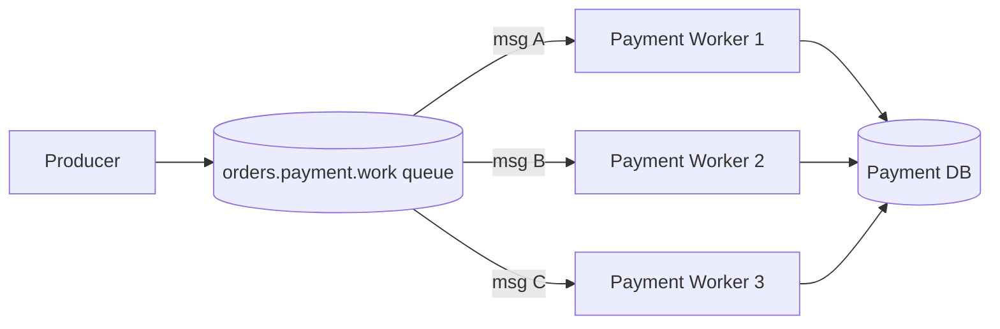
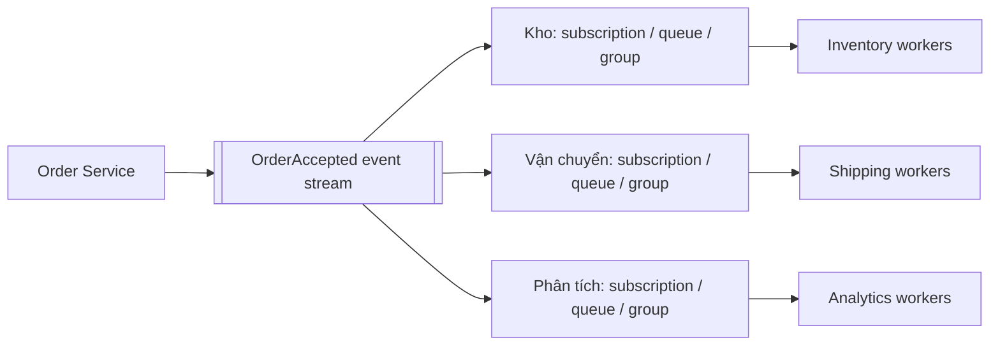
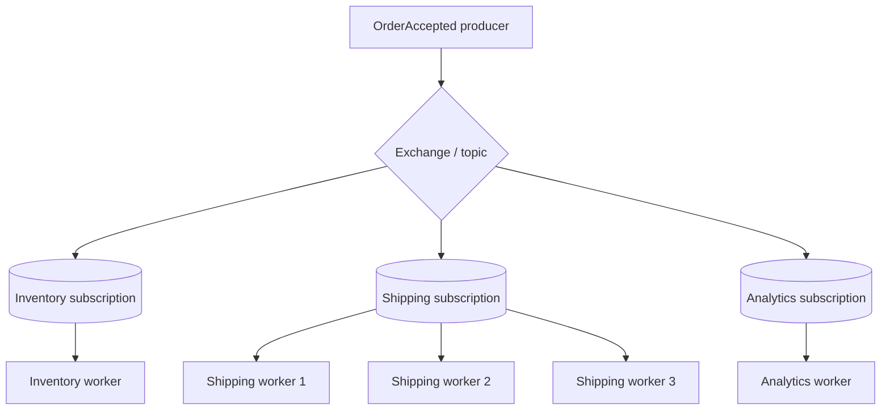
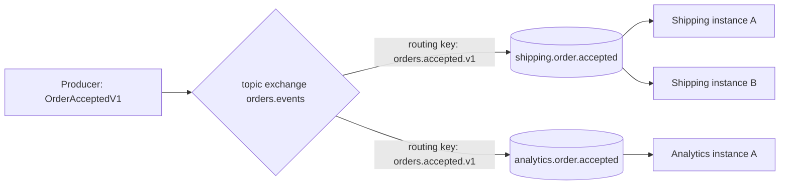
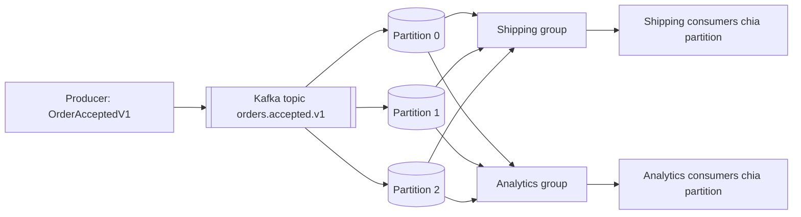
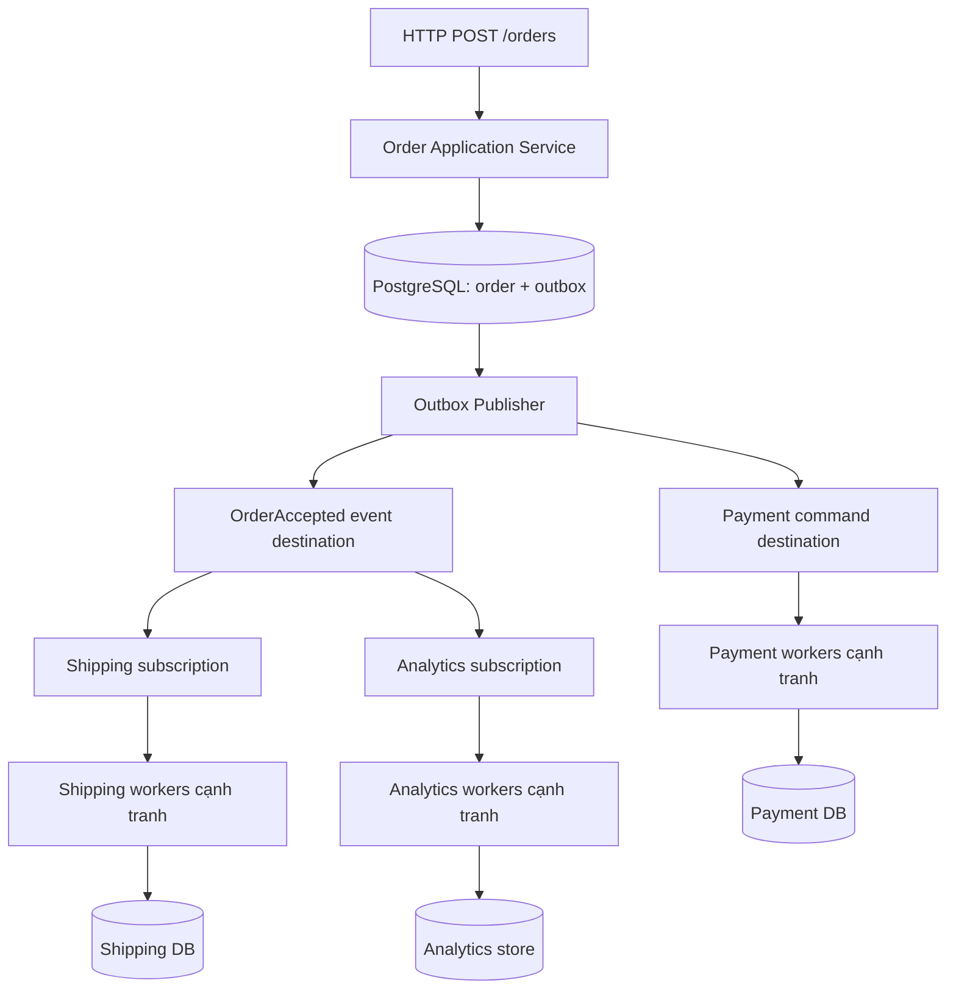
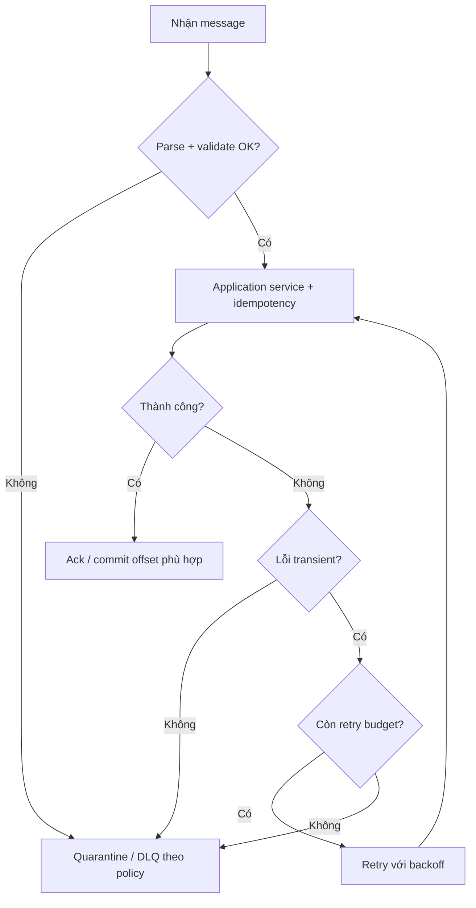
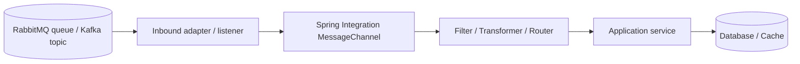

# Queue, topic, subscription và mô hình chia sẻ công việc

Trong **SPRING_BOOT_INTEGRATION**, Spring Boot có thể trao đổi dữ liệu qua HTTP client, cơ sở dữ liệu, cache, broker thông điệp và các adapter Spring Integration. Khi một luồng cần xử lý bất đồng bộ, câu hỏi đầu tiên không phải là chọn Kafka hay RabbitMQ, mà là: **một thông điệp cần được xử lý bởi đúng một worker trong nhóm, hay bởi nhiều nhóm độc lập?** Câu trả lời quyết định cách thiết kế **queue**, **topic**, **subscription** và mô hình **chia sẻ công việc** (*competing consumers / work queue*).

Ví dụ: khi khách hàng đặt hàng, một yêu cầu **tính cước vận chuyển** có thể chỉ cần một worker xử lý; nhưng sự kiện **đơn hàng đã được chấp nhận** có thể cần được giao độc lập đến hệ thống kho, vận chuyển và phân tích. Nếu dùng nhầm queue chung cho cả ba nhóm, chỉ một nhóm có thể nhận message; nếu tạo subscription mới tùy tiện cho mỗi instance, một tác động nghiệp vụ có thể bị thực hiện nhiều lần.

Bài thuộc chương **Nền tảng nhắn tin**. Chúng ta sẽ tách biệt cách nói khái niệm với cơ chế thật của **RabbitMQ/AMQP, Kafka, JMS và MQTT**, rồi liên hệ tới cấu hình Spring Boot, hợp đồng dữ liệu, transaction, retry, idempotency, kiểm thử và quan sát vận hành. Ví dụ Java chủ yếu theo **Spring Boot 3.x, Java 17+ và các thư viện Spring AMQP/Spring Kafka** được quản lý version bằng Boot BOM; với thế hệ thư viện khác cần đối chiếu API thực tế.

## 1. Mục tiêu học tập

Sau bài này, bạn có thể:

1. Phân biệt **point-to-point/work queue**, **publish–subscribe**, **subscription**, **consumer group** và **competing consumers**.
2. Giải thích RabbitMQ **exchange → binding → queue → consumer** khác Kafka **topic → partition → consumer group** như thế nào.
3. Thiết kế luồng **một lệnh, một nhóm xử lý** và luồng **một sự kiện, nhiều nhóm xử lý độc lập**.
4. Ước tính concurrency, ordering, backlog, ack/redelivery và khả năng replay theo từng nền tảng mà không giả định quá mức.
5. Cấu hình các thành phần Spring Boot cần thiết và nhận diện những gì Boot **không tự tạo**.
6. Thiết kế JSON/event contract, retry/DLQ, idempotency, transactional outbox, kiểm thử và observability cho hệ thống nhắn tin thực tế.

## 2. Một message gồm những gì?

Message trong broker thường có **payload** và **metadata**. Định dạng cụ thể tùy nền tảng, nhưng một sự kiện đơn hàng có thể được mô tả như sau:

```json
{
  "eventId": "evt-ord-1024",
  "eventType": "OrderAccepted",
  "schemaVersion": 1,
  "orderId": "ORD-1024",
  "occurredAt": "2026-11-21T10:30:00Z"
}
```

| Trường/metadata | Vai trò | Lưu ý |
| --- | --- | --- |
| `eventId` | Nhận diện **sự kiện logic** ổn định qua retry/replay | Không sinh mới mỗi lần gửi lại từ outbox; dùng làm khóa xử lý trùng khi phù hợp. |
| `eventType` và `schemaVersion` | Chọn bộ giải mã/hợp đồng tương ứng | Không dựa tùy tiện vào tên Java class của producer. |
| `orderId` | Khóa nghiệp vụ; có thể dùng làm Kafka partition key | Không đồng nhất `orderId` với `eventId`: nhiều sự kiện có thể thuộc một đơn hàng. |
| `occurredAt` | Thời điểm sự kiện diễn ra theo hợp đồng | Thống nhất timezone/ISO-8601; khác với thời điểm message được broker nhận. |
| Correlation/trace ID | Truy vết giữa HTTP, database, producer và consumer | Chỉ truyền metadata an toàn; không log credential hoặc dữ liệu cá nhân. |
| Routing key/topic/queue | Chỉ định hoặc ảnh hưởng đường đi của message | Là metadata vận chuyển, không thay thế event type và schema version. |

**Command** và **event** không tương đương. `ProcessPaymentCommand` yêu cầu một hành động; `OrderAcceptedEvent` thông báo một sự kiện đã xảy ra. Command thường có **một chủ sở hữu xử lý**; event có thể có **nhiều nhóm quan tâm**. Một queue có thể mang event và một topic có thể mang command, nhưng nên chọn topology sao cho người đọc dễ hiểu ý định và độ tin cậy mong muốn.

## 3. Queue: chia công việc trong một nhóm

**Work queue / point-to-point** là mô hình các message được đặt vào một hàng đợi chung và nhiều worker **cạnh tranh** nhận việc từ hàng đợi đó. Ở một lần phân phối bình thường, **một message được giao cho một consumer trong nhóm**; nếu consumer lỗi hoặc không ack, broker có thể giao lại cho consumer khác tùy giao thức và cấu hình.



Đây là **chia tải trong một chức năng**, không phải phát một bản copy tới mọi worker. Nếu gửi 100 yêu cầu tới cùng queue và có bốn consumer, mỗi consumer sẽ nhận **một phần** công việc; tỷ lệ thực tế phụ thuộc prefetch, mức độ bận, thời gian xử lý và cách broker phân phối, **không bảo đảm chính xác 25 message cho mỗi consumer**.

Các thuộc tính cần định nghĩa:

- **Độ bền:** queue có lưu qua restart broker không; message có được publish persistent hay không; replication/quorum có được cấu hình không? Tên “queue” không tự bảo đảm dữ liệu sống qua mọi sự cố.
- **Ack:** khi nào broker được phép loại bỏ một delivery khỏi tập cần xử lý; lỗi trước/sau ack có thể dẫn đến phát lại hoặc mất tác động.
- **Năng lực tiêu thụ:** số consumer, prefetch, giới hạn thread và tài nguyên downstream.
- **Thứ tự:** nhiều worker có thể hoàn thành trái thứ tự phân phối; không được hứa thứ tự xử lý toàn cục chỉ vì queue tuân FIFO trong trường hợp đơn giản.
- **Quá tải:** backlog tăng khi tốc độ producer cao hơn tốc độ consumer; cần theo dõi tuổi message, queue depth và thông lượng thực.

Ví dụ thực tế: “Mỗi đơn hàng chỉ được ghi nhận một yêu cầu tính phí vận chuyển”. Nhiều instance của **cùng dịch vụ tính phí** cùng tiêu thụ một work queue để mở rộng năng lực. Các instance không nên có những subscription riêng khiến mỗi instance nhận một bản copy lệnh.

## 4. Topic và publish–subscribe: nhiều nhóm nhận cùng một sự kiện

**Publish–subscribe** phục vụ bài toán **một sự kiện, nhiều người tiêu thụ độc lập**. Một producer công bố `OrderAcceptedEventV1`. Nhóm kho dự trữ hàng, nhóm vận chuyển tạo lịch giao và nhóm analytics cập nhật dashboard. Mỗi nhóm cần **quyền tiến triển riêng**: nhóm vận chuyển bị lỗi không nên ngăn kho tiếp tục nhận event khi hạ tầng hỗ trợ phân phối độc lập.



**Topic** có nghĩa khác nhau giữa các broker:

- Trong **JMS**, topic là đích của publish–subscribe; subscriber nhận message theo cơ chế subscription được cấu hình.
- Trong **Kafka**, topic là **log phân vùng được lưu giữ**; mỗi consumer group duy trì tiến độ đọc riêng và tạo hiệu ứng pub/sub giữa các group.
- Trong **RabbitMQ**, thuật ngữ **topic exchange** chỉ **cách định tuyến theo routing-key pattern tới queue**. Consumer không đọc trực tiếp từ exchange; consumer vẫn đọc từ **queue**.
- Trong **MQTT**, topic là tên/kênh phân cấp theo chuỗi; client subscribe theo topic filter. Shared subscription là cơ chế bổ sung, không phải behavior mặc định của mọi topic.

Vì vậy, không thể suy luận **topic = broadcast tới mọi process**. Điều quan trọng là: có **bao nhiêu subscription/queue/group độc lập**, và **mỗi subscription/group có bao nhiêu consumer cạnh tranh**.

### 4.1. Subscription là một mối quan tâm logic, không nhất thiết là một TCP connection

Một subscription thường mô tả “tập message mà một nhóm muốn nhận”, có thể kèm tên, bộ lọc, trạng thái tiến độ và chính sách độ bền. Trên từng hệ:

| Nền tảng | Đơn vị nhận độc lập | Chia việc giữa nhiều instance cùng nhóm |
| --- | --- | --- |
| RabbitMQ | Một **queue** được bind vào exchange phù hợp | Các consumer cùng đọc **một queue** cạnh tranh delivery. |
| Kafka | Một **consumer group** đọc topic/partitions | Các instance dùng **cùng `group.id`** chia partition. |
| JMS topic | Subscription (non-durable/durable; shared khi hỗ trợ) | Shared subscription phù hợp mới cho nhiều consumer chia việc. |
| MQTT | Subscription theo client/session; shared subscription nếu broker hỗ trợ | Nhiều client dùng cùng tên shared group cùng chia matching messages. |

Chỉ thêm một instance mới không có nghĩa phải tạo một subscription mới. Nếu mục tiêu là **scale cùng workload**, các instance phải dùng cùng đơn vị nhận logic; nếu mục tiêu là **thêm chức năng độc lập**, tạo đơn vị nhận logic mới.

## 5. Hai cấp phân phối cần tách biệt

Trong nhiều hệ thống, publish–subscribe và competing consumers được kết hợp:

1. **Fan-out giữa các nhóm:** cùng một event đi tới inventory, shipping và analytics.
2. **Work sharing trong từng nhóm:** ba instance shipping cạnh tranh xử lý phần việc của **nhóm shipping**, không tự nhận ba bản copy của cùng một message chỉ vì scale ngang.



Sơ đồ dùng tên chung “subscription”, nhưng khi triển khai phải chuyển đúng sang **queue/binding** ở RabbitMQ hoặc **group/partition** ở Kafka. Không diễn giải nhầm broker topology bằng tên trừu tượng rồi tạo nhầm số lượng consumer.

### 5.1. Đặt câu hỏi đúng trước khi chọn mô hình

| Câu hỏi | Nếu câu trả lời là… | Thiết kế gợi ý |
| --- | --- | --- |
| Một message có cần được xử lý bởi nhiều chức năng? | **Không**, chỉ một chức năng sở hữu | Một work queue hoặc một consumer group cho chức năng. |
| Nhiều chức năng phải độc lập nhận cùng event? | **Có** | Nhiều queue bind exchange hoặc nhiều group trên cùng Kafka topic. |
| Nhiều instance có phải replica của cùng service? | **Có** | Chia cùng queue/group, không tạo destination/subscription độc lập cho mỗi instance. |
| Có cần replay lịch sử? | **Có** | Nền tảng có retention/offset phù hợp (ví dụ Kafka), hoặc thiết kế lưu trữ/replay riêng. |
| Cần thứ tự theo một entity? | **Có** | Kafka key/partition hoặc tuần tự hóa theo khóa, giới hạn concurrency, thiết kế idempotency. |
| Message chỉ là tín hiệu realtime có thể bỏ lỡ? | **Có** | Có thể cân nhắc pub/sub không bền vững nếu hợp đồng chấp nhận mất message. |

Không có câu trả lời “Kafka luôn tốt hơn queue” hoặc “RabbitMQ luôn dễ hơn topic”. Chọn theo số người tiêu thụ độc lập, độ bền, retention/replay, thứ tự, throughput, vận hành và ràng buộc của cả hệ thống.

## 6. Queue, topic, subscription không phải bảo đảm giao đúng một lần

Cần tách ba câu hỏi khác nhau:

1. **Routing:** message nào được đưa tới destination/subscription nào?
2. **Delivery:** broker có thể giao message **không lần nào, một lần hay nhiều lần** trong tình huống lỗi/ack/retention?
3. **Business effect:** nghiệp vụ có tạo hai giao dịch, trừ tiền hai lần hoặc gửi hai email dù message được giao lại không?

| Kiểu bảo đảm | Diễn giải | Rủi ro |
| --- | --- | --- |
| **At-most-once** | Có thể mất delivery nhưng không cố phát lại theo cơ chế đã chọn | Mất dữ liệu khi consumer chết sau khi thông điệp đã được coi là xử lý. |
| **At-least-once** | Cố gắng giao lại cho tới khi có dấu thành công thích hợp | Consumer có thể nhận trùng; bắt buộc thiết kế idempotency. |
| **Exactly-once trong một phạm vi hẹp** | Một nền tảng/cơ chế có thể bảo đảm kết quả theo phạm vi định nghĩa (ví dụ luồng Kafka-to-Kafka có transaction phù hợp) | Không tự bao gồm database, HTTP, filesystem và side effect bên ngoài. |

**Ack hoặc commit offset không đồng nghĩa tác động nghiệp vụ đã hoàn tất** nếu ứng dụng xác nhận trước khi DB commit hoặc gọi đối tác xong. Ngược lại, DB có thể commit thành công rồi consumer chết trước ack; message sẽ được giao lại. Vì vậy, khóa nghiệp vụ/bảng inbox/outbox và transaction boundary quan trọng hơn việc tin rằng queue hay topic “đảm bảo exactly once”.

## 7. RabbitMQ/AMQP: exchange định tuyến, queue giữ việc, consumer xử lý

Trong RabbitMQ dùng AMQP 0-9-1, producer thông thường publish message vào **exchange**, sau đó broker dùng **binding** và **routing key** để đưa message đến một hay nhiều queue. **Consumer tiêu thụ từ queue, không subscribe trực tiếp vào exchange.**

| Thành phần RabbitMQ | Chức năng | Ví dụ |
| --- | --- | --- |
| `direct exchange` | Gửi theo routing key khớp chính xác binding key | `payment.requested` → `orders.payment.work` |
| `topic exchange` | Khớp routing key theo mẫu phân đoạn bằng dấu chấm, với `*` và `#` | `orders.accepted.v1`, binding `orders.*.v1` |
| `fanout exchange` | Phân phối tới mọi queue được bind với exchange, bỏ qua routing key | Một event đến queue inventory và analytics |
| `queue` | Giữ delivery và phục vụ một hoặc nhiều consumer | `shipping.order.accepted` |
| `binding` | Liên hệ exchange với queue và quy tắc định tuyến | Bind `orders.events` với hai queue khác nhau |
| `ack/nack/reject` | Xác nhận, yêu cầu giao lại hoặc loại delivery theo chính sách | Handler thành công ack; lỗi cố định đưa DLQ |

**`topic exchange` của RabbitMQ không phải “Kafka topic”.** Nó là một **router**; để tạo hai subscription độc lập bạn cần **hai queue khác nhau** được bind vào exchange phù hợp. Nếu hai dịch vụ cùng consume **một queue**, chúng **chia việc** chứ không nhận hai bản copy.



Trong topology này, event được **route vào mỗi queue phù hợp**, sau đó hai instance shipping cạnh tranh delivery từ **một queue shipping**. Tăng instance shipping không làm analytics nhận thêm event; thêm một **queue analytics mới** mới thay đổi số bản sao độc lập.

### 7.1. Spring Boot AMQP starter và cấu hình kết nối

Để sử dụng RabbitMQ trực tiếp từ Spring Boot 3.x, thêm:

```xml
<dependency>
    <groupId>org.springframework.boot</groupId>
    <artifactId>spring-boot-starter-amqp</artifactId>
</dependency>
```

Nếu ứng dụng còn dùng Java DSL của Spring Integration cho các message endpoint, thêm `spring-boot-starter-integration` và **`spring-integration-amqp`** khi thực sự cần adapter AMQP trong flow. Không buộc mọi ứng dụng dùng RabbitMQ phải chuyển qua Spring Integration: `RabbitTemplate` và `@RabbitListener` của Spring AMQP đã đủ cho nhiều bài toán.

Ví dụ `application.yml`:

```yaml
spring:
  rabbitmq:
    host: ${RABBITMQ_HOST:localhost}
    port: 5672
    username: ${RABBITMQ_USER}
    password: ${RABBITMQ_PASSWORD}
    publisher-confirm-type: correlated
    publisher-returns: true
    template:
      mandatory: true
    listener:
      simple:
        concurrency: 2
        max-concurrency: 4
        prefetch: 10
```

Đây là cấu hình minh họa: credentials phải lấy từ môi trường/secret manager; với TLS/vhost và nhiều cluster, bổ sung cấu hình phù hợp. `concurrency`, `max-concurrency` và `prefetch` chỉ là điểm xuất phát để đo tải, không phải “thiết lập tối ưu” cho mọi queue. Nếu muốn giới hạn concurrency khác nhau cho payment và analytics, cấu hình listener factory riêng hoặc override trên listener theo API version đang dùng.

Khi đủ dependency và property, **Spring Boot có thể tự cấu hình** `CachingConnectionFactory`, `RabbitTemplate`, listener container factory và hạ tầng liên quan. **Boot không tự tạo exchange, queue, binding và handler nghiệp vụ** theo tên chúng ta tưởng tượng. Những bean topology và listener dưới đây do ứng dụng chủ động khai báo.

### 7.2. Khai báo command queue và hai subscription event

Giả sử ta muốn hai đường đi:

- **Command `payment.requested`:** chỉ **một worker** trong nhóm payment xử lý mỗi delivery từ `orders.payment.work`.
- **Event `orders.accepted.v1`:** cả shipping lẫn analytics đều có queue độc lập, đồng thời mỗi queue có thể mở rộng bằng nhiều worker.

```java
import org.springframework.amqp.core.Binding;
import org.springframework.amqp.core.BindingBuilder;
import org.springframework.amqp.core.DirectExchange;
import org.springframework.amqp.core.Queue;
import org.springframework.amqp.core.QueueBuilder;
import org.springframework.amqp.core.TopicExchange;
import org.springframework.beans.factory.annotation.Qualifier;
import org.springframework.context.annotation.Bean;
import org.springframework.context.annotation.Configuration;

@Configuration(proxyBeanMethods = false)
public class OrderMessagingTopology {

    @Bean("ordersCommandsExchange")
    DirectExchange commandsExchange() {
        return new DirectExchange("orders.commands", true, false);
    }

    @Bean("paymentWorkQueue")
    Queue paymentWorkQueue() {
        return QueueBuilder.durable("orders.payment.work")
                .deadLetterExchange("orders.commands.dlx")
                .deadLetterRoutingKey("payment.failed")
                .build();
    }

    @Bean
    Binding paymentCommandBinding(
            @Qualifier("paymentWorkQueue") Queue queue,
            @Qualifier("ordersCommandsExchange") DirectExchange exchange) {
        return BindingBuilder.bind(queue)
                .to(exchange).with("payment.requested");
    }

    @Bean("commandsDeadLetterExchange")
    DirectExchange commandsDlx() {
        return new DirectExchange("orders.commands.dlx", true, false);
    }

    @Bean("paymentDeadLetterQueue")
    Queue paymentDlq() {
        return QueueBuilder.durable("orders.payment.dlq").build();
    }

    @Bean
    Binding paymentDeadLetterBinding(
            @Qualifier("paymentDeadLetterQueue") Queue queue,
            @Qualifier("commandsDeadLetterExchange") DirectExchange exchange) {
        return BindingBuilder.bind(queue)
                .to(exchange).with("payment.failed");
    }

    @Bean("ordersEventsExchange")
    TopicExchange eventsExchange() {
        return new TopicExchange("orders.events", true, false);
    }

    @Bean("shippingEventsQueue")
    Queue shippingQueue() {
        return QueueBuilder.durable("shipping.order.accepted").build();
    }

    @Bean("analyticsEventsQueue")
    Queue analyticsQueue() {
        return QueueBuilder.durable("analytics.order.accepted").build();
    }

    @Bean
    Binding shippingBinding(
            @Qualifier("shippingEventsQueue") Queue queue,
            @Qualifier("ordersEventsExchange") TopicExchange exchange) {
        return BindingBuilder.bind(queue)
                .to(exchange).with("orders.accepted.v1");
    }

    @Bean
    Binding analyticsBinding(
            @Qualifier("analyticsEventsQueue") Queue queue,
            @Qualifier("ordersEventsExchange") TopicExchange exchange) {
        return BindingBuilder.bind(queue)
                .to(exchange).with("orders.accepted.v1");
    }
}
```

Đặt tên các queue theo **chức năng nhận** giúp phân biệt subscription lâu dài với instance đang chạy. `shipping.order.accepted` không nên thêm ID pod/hostname vào tên nếu mục tiêu chỉ là scale cùng một nhóm worker.

Ví dụ dùng **queue arguments** để khai báo dead-letter exchange cho payment nhằm diễn giải topology. Trên production, RabbitMQ thường khuyến khích dùng **policy** do vận hành quản lý cho các thuộc tính DLX/TTL thay vì cố định tất cả bằng `x-arguments` trong code. Nếu dùng DLQ, thiết kế giới hạn retry, cách phân loại lỗi, alert và quy trình replay để không biến DLQ thành nơi lưu lỗi vô thời hạn.

`QueueBuilder.durable(...)` giúp định nghĩa queue durable, nhưng message durability còn phụ thuộc tính persistent của message, loại queue, publisher confirm và cấu hình broker/replication. **Durable queue không đồng nghĩa với bảo đảm không mất message trong mọi tình huống.**

### 7.3. DTO, JSON converter và listener

```java
import java.math.BigDecimal;
import java.time.Instant;

public record PaymentRequestedV1(
        String requestId,
        String orderId,
        BigDecimal amountCents
) {}

public record OrderAcceptedV1(
        String eventId,
        int schemaVersion,
        String orderId,
        Instant occurredAt
) {}
```

Khi dùng JSON payload với Jackson 2/Spring AMQP tương ứng:

```java
import com.fasterxml.jackson.databind.ObjectMapper;
import org.springframework.amqp.support.converter.Jackson2JsonMessageConverter;
import org.springframework.amqp.support.converter.MessageConverter;
import org.springframework.context.annotation.Bean;
import org.springframework.context.annotation.Configuration;

@Configuration(proxyBeanMethods = false)
public class AmqpJsonConfiguration {
    @Bean
    MessageConverter rabbitMessageConverter(ObjectMapper mapper) {
        return new Jackson2JsonMessageConverter(mapper);
    }
}
```

Spring Boot có thể dùng bean converter này để cấu hình template/listener factory mặc định khi điều kiện tương ứng thỏa mãn. **Cần test actual wire payload** và type inference của consumer; đừng mặc định mọi client ở hệ thống khác có cùng Java type header hoặc cùng Jackson module. Với Java 17 record và `Instant`, mapper phải hỗ trợ record/`JavaTimeModule` phù hợp.

```java
import org.springframework.amqp.rabbit.annotation.RabbitListener;
import org.springframework.stereotype.Component;

@Component
public class OrderRabbitConsumers {
    private final PaymentApplicationService payments;
    private final ShippingApplicationService shipping;
    private final AnalyticsApplicationService analytics;

    public OrderRabbitConsumers(
            PaymentApplicationService payments,
            ShippingApplicationService shipping,
            AnalyticsApplicationService analytics) {
        this.payments = payments;
        this.shipping = shipping;
        this.analytics = analytics;
    }

    @RabbitListener(queues = "orders.payment.work")
    public void processPayment(PaymentRequestedV1 command) {
        payments.processOnce(command);
    }

    @RabbitListener(queues = "shipping.order.accepted")
    public void updateShipping(OrderAcceptedV1 event) {
        shipping.applyOnce(event);
    }

    @RabbitListener(queues = "analytics.order.accepted")
    public void updateAnalytics(OrderAcceptedV1 event) {
        analytics.applyOnce(event);
    }
}
```

`PaymentApplicationService`, `ShippingApplicationService` và `AnalyticsApplicationService` là các service **do ứng dụng cài đặt**; phương thức `processOnce`/`applyOnce` phải có kiểm soát transaction và idempotency. Với listener container theo chế độ xác nhận mặc định `AUTO` của Spring AMQP, container thường ack sau khi listener trả về thành công; exception chuyển sang error handling và requeue/reject theo cấu hình. **`AUTO` ở đây không đồng nghĩa RabbitMQ `autoAck=true`**; cần kiểm thử chính sách với version container đang sử dụng.

Đoạn listener và topology minh họa đường đi; ứng dụng production còn phải cấu hình chính sách lỗi cho **từng queue**. Chẳng hạn, queue shipping/analytics cũng cần dead-letter strategy nếu lỗi cố định được reject. Không bật `default-requeue-rejected=false` toàn cục mà chỉ tạo DLX cho payment rồi nghĩ rằng mọi lỗi ở các queue khác đều được giữ an toàn.

### 7.4. Publish event và hiểu giới hạn publisher confirm

```java
import org.springframework.amqp.rabbit.core.RabbitTemplate;
import org.springframework.stereotype.Component;

@Component
public class OrderAcceptedPublisher {
    private final RabbitTemplate rabbit;

    public OrderAcceptedPublisher(RabbitTemplate rabbit) {
        this.rabbit = rabbit;
    }

    public void publish(OrderAcceptedV1 event) {
        rabbit.convertAndSend(
                "orders.events",
                "orders.accepted.v1",
                event,
                message -> {
                    message.getMessageProperties().setMessageId(event.eventId());
                    return message;
                });
    }
}
```

`publisher-confirm-type: correlated` và `publisher-returns: true` hỗ trợ quan sát kết quả broker nhận publish hoặc message không được định tuyến, nhưng ứng dụng phải đăng ký và **xử lý kết quả confirm/return**; riêng lời gọi `convertAndSend` trở về không chứng minh consumer đã xử lý thành công. Nếu cần bảo đảm DB và event không bị tách rời, dùng **transactional outbox** thay vì tin rằng publisher confirm có thể rollback commit DB.

## 8. Kafka: topic là log phân vùng, consumer group là đơn vị chia việc

Kafka dùng **topic** để lưu record trong những **partition**. Record không bị xóa khỏi topic ngay khi một consumer xử lý xong; dữ liệu được giữ hoặc loại bỏ theo **retention/compaction policy**. Mỗi **consumer group** theo dõi offset riêng theo partition, nhờ đó nhiều nhóm có thể đọc cùng topic một cách độc lập.



Trong một consumer group, tại một thời điểm ổn định, **mỗi partition chỉ được phân cho một consumer thành viên của group**. Nếu topic có ba partition và shipping group có năm consumer thì tối đa **ba consumer** trong group có partition đang được phân công; hai consumer có thể rảnh. Mỗi group khác có tập consumer/offset riêng nên có thể đọc cùng record.

| Khái niệm Kafka | Ý nghĩa |
| --- | --- |
| Topic | Dòng record có tên, lưu giữ theo cấu hình và phân thành partition. |
| Partition | Đơn vị lưu trữ, đọc theo thứ tự offset; cũng là đơn vị phân công work trong group. |
| Offset | Vị trí record trong một partition; thứ tự offset chỉ có nghĩa trong partition đó. |
| Consumer group | Những consumer **chia partition** và tiến độ xử lý của một chức năng. |
| `group.id` | Danh tính group, quyết định các instance cạnh tranh hay đọc độc lập. |
| Message key | Thường ảnh hưởng việc chọn partition; cùng key thường được gửi đến cùng partition khi topology/partitioning nhất quán. |
| Committed offset | Tiến độ đọc mà group ghi nhận; **không xóa** record khỏi Kafka log. |

**Hai quy tắc cần nhớ:**

- Muốn thêm replica của shipping service: các replica dùng **cùng `group.id=shipping-service`**.
- Muốn analytics đọc độc lập cùng event: dùng **`group.id=analytics-service`** khác shipping.

Nếu vô tình đặt `group.id` theo hostname hoặc pod ID cho mỗi shipping instance, các instance trở thành **những group độc lập**, có thể đọc toàn bộ event của topic và lặp tác động nghiệp vụ. Ngược lại, nếu shipping và analytics vô tình dùng **cùng một group ID**, chúng chia partition chứ **không** mỗi bên nhận đầy đủ sự kiện.

### 8.1. Spring Boot và Spring Kafka

Với Spring Boot 3.x, thêm dependency Spring Kafka được Boot BOM quản lý:

```xml
<dependency>
    <groupId>org.springframework.kafka</groupId>
    <artifactId>spring-kafka</artifactId>
</dependency>
```

Ví dụ cấu hình cho payload String JSON (các event class/JSON contract phải được kiểm soát riêng):

```yaml
spring:
  kafka:
    bootstrap-servers: ${KAFKA_BOOTSTRAP_SERVERS:localhost:9092}
    producer:
      key-serializer: org.apache.kafka.common.serialization.StringSerializer
      value-serializer: org.apache.kafka.common.serialization.StringSerializer
    consumer:
      key-deserializer: org.apache.kafka.common.serialization.StringDeserializer
      value-deserializer: org.apache.kafka.common.serialization.StringDeserializer
      enable-auto-commit: false
      auto-offset-reset: earliest
    listener:
      ack-mode: record
      concurrency: 3
```

Khi classpath/property và auto-configuration phù hợp, Boot có thể tạo producer/consumer factory, `KafkaTemplate` và listener container infrastructure. **Boot không tự định nghĩa topic nghiệp vụ, group riêng cho mỗi chức năng hay handler xử lý sự kiện.** Trong môi trường production, topic, partition count, retention, ACL và replication thường được quản lý bằng Infrastructure as Code hoặc quy trình vận hành được kiểm soát.

`auto-offset-reset: earliest` chỉ áp dụng khi group **không có committed offset hợp lệ** cho partition trong tình huống tương ứng; nó không có nghĩa mọi lần khởi động đều replay từ đầu. Để replay có chủ đích, phải dùng group mới hoặc quy trình reset offset phù hợp, kiểm soát việc ghi lại side effect.

Ví dụ hai consumer logic độc lập, cùng topic nhưng **khác group**:

```java
import com.fasterxml.jackson.core.JsonProcessingException;
import com.fasterxml.jackson.databind.ObjectMapper;
import org.apache.kafka.clients.consumer.ConsumerRecord;
import org.springframework.kafka.annotation.KafkaListener;
import org.springframework.stereotype.Component;

@Component
public class OrderKafkaConsumers {
    private final ObjectMapper mapper;
    private final ShippingApplicationService shipping;
    private final AnalyticsApplicationService analytics;

    public OrderKafkaConsumers(
            ObjectMapper mapper,
            ShippingApplicationService shipping,
            AnalyticsApplicationService analytics) {
        this.mapper = mapper;
        this.shipping = shipping;
        this.analytics = analytics;
    }

    @KafkaListener(
            topics = "orders.accepted.v1",
            groupId = "shipping-service")
    public void ship(ConsumerRecord<String, String> record)
            throws JsonProcessingException {
        OrderAcceptedV1 event =
                mapper.readValue(record.value(), OrderAcceptedV1.class);
        shipping.applyOnce(event);
    }

    @KafkaListener(
            topics = "orders.accepted.v1",
            groupId = "analytics-service")
    public void analyze(ConsumerRecord<String, String> record)
            throws JsonProcessingException {
        OrderAcceptedV1 event =
                mapper.readValue(record.value(), OrderAcceptedV1.class);
        analytics.applyOnce(event);
    }
}
```

Đoạn mã đặt hai group trong một ứng dụng **để minh họa**. Thực tế shipping và analytics thường là hai service riêng, mỗi service chỉ triển khai consumer của mình. Từng group có offset độc lập. `ack-mode: record` chỉ định cách container commit offset trong cấu hình tương ứng; một lỗi từ handler có thể dẫn tới retry/seek/rebalance theo error handler được cấu hình. **Không suy ra một exception mặc định tự được đưa vào dead-letter topic:** cần cấu hình retry, `DefaultErrorHandler`, recoverer/DLT và chính sách redelivery rõ ràng.

Một producer ví dụ gửi JSON theo key đơn hàng:

```java
import com.fasterxml.jackson.core.JsonProcessingException;
import com.fasterxml.jackson.databind.ObjectMapper;
import java.util.concurrent.CompletableFuture;
import org.springframework.kafka.core.KafkaTemplate;
import org.springframework.kafka.support.SendResult;
import org.springframework.stereotype.Component;

@Component
public class OrderKafkaPublisher {
    private final KafkaTemplate<String, String> kafka;
    private final ObjectMapper mapper;

    public OrderKafkaPublisher(
            KafkaTemplate<String, String> kafka,
            ObjectMapper mapper) {
        this.kafka = kafka;
        this.mapper = mapper;
    }

    public CompletableFuture<SendResult<String, String>> publish(
            OrderAcceptedV1 event) throws JsonProcessingException {
        String json = mapper.writeValueAsString(event);
        return kafka.send("orders.accepted.v1", event.orderId(), json);
    }
}
```

`KafkaTemplate.send(...)` trả về future với kết quả producer. Nó không tự mở transaction bao gồm PostgreSQL, không chứng minh shipping/analytics đã hoàn tất, và timeout trong lúc chờ future không chứng minh broker chưa nhận record. Với outbox, event ID và JSON payload cần ổn định qua các lần publish lại.

### 8.2. Ordering và chia tải theo partition

Kafka bảo toàn **thứ tự record theo offset trong từng partition**, không cung cấp một thứ tự toàn cục giữa mọi partition. Nếu các sự kiện liên quan cùng `orderId` cần theo đúng trình tự, producer thường dùng `orderId` làm key để định tuyến chúng vào cùng partition. Tuy nhiên:

- Nếu thay đổi số lượng partition hoặc logic partitioner, một key có thể được phân sang partition khác; kế hoạch nâng số partition phải xem xét yêu cầu ordering trong giai đoạn chuyển đổi.
- Nếu nhiều producer gửi cùng key đồng thời, thứ tự nghiệp vụ mong muốn vẫn cần quy định và kiểm soát; thứ tự xuất hiện trên log không tự đồng nghĩa thứ tự giao dịch trong DB.
- Nếu listener chuyển xử lý sang executor bất đồng bộ hoặc gọi downstream song song, **thứ tự hoàn tất** có thể khác thứ tự đọc; cần hạn chế concurrency theo entity khi hợp đồng yêu cầu.
- Khi rebalance, retry hoặc replay, cùng record có thể bị xử lý lại. Offset và ordering **không thay thế idempotency**.

Tăng số consumer lên 20 khi topic chỉ có 4 partition **không thể tự làm nhóm đó xử lý 20 partition cùng lúc**. Cần đo thông lượng/lag, chi phí handler, số partition và tài nguyên DB/HTTP downstream; không tăng thread vô hạn để che bottleneck.

## 9. JMS, MQTT và các biến thể subscription

### 9.1. JMS: queue point-to-point và topic publish–subscribe

JMS/Jakarta Messaging định nghĩa hai mô hình destination chính:

- **Queue:** nhiều consumer cạnh tranh nhận message của một hàng đợi theo hành vi nhà cung cấp JMS; phù hợp command/work distribution.
- **Topic:** mỗi subscription có thể nhận message phù hợp khi nó đang hoạt động. Subscription **non-durable** thường không giữ message cho consumer khi không có subscription hoạt động; **durable subscription** cho phép giữ message chưa nhận theo quy tắc broker trong thời gian subscriber offline.

Theo JMS 2.0, **shared subscription** và **shared durable subscription** hỗ trợ nhiều consumer cùng chia việc trong một subscription logic, thay vì tạo nhiều durable subscriptions độc lập. Tên subscription, client identity và khả năng chia sẻ/độ bền phải được cấu hình đúng theo **JMS provider** và Spring JMS listener container. Không suy ra rằng nhiều `@JmsListener` cùng nghe một topic sẽ tự cạnh tranh như queue nếu chúng được cấu hình thành những subscription độc lập.

Spring Boot có thể tự cấu hình một số thành phần JMS khi driver/starter cụ thể và `ConnectionFactory` phù hợp tồn tại; ứng dụng vẫn phải khai báo destination, loại domain, subscription name, client ID/ack/transaction và listener. Với **JMS topic** cần kiểm tra `pubSubDomain` thay vì chỉ đổi chuỗi tên queue thành topic.

### 9.2. MQTT: topic filter và shared subscriptions

MQTT sử dụng topic phân cấp, ví dụ `factory/line-1/temperature`. Client subscribe theo topic filter như `factory/+/temperature`. Theo broker và phiên bản MQTT hỗ trợ, shared subscription thường có cú pháp:

```text
$share/telemetry-workers/factory/+/temperature
```

Các client dùng cùng **shared group** có thể chia message phù hợp cho nhóm, trong khi một subscription thông thường của nhiều client khác nhau thường khiến mỗi client nhận message theo subscription riêng. **QoS 0/1/2** và session persistence giải quyết các thuộc tính giao hàng ở tầng MQTT theo phạm vi của chúng; không đồng nghĩa hoàn toàn với bảo đảm business transaction đúng một lần qua database.

Mỗi MQTT broker có thể khác nhau về shared subscription, retained messages, session expiry và phân phối giữa consumer. Cần kiểm tra tài liệu broker thực tế. Spring Integration có `spring-integration-mqtt` để xây message flow với adapter phù hợp, nhưng thêm dependency không tự khai báo topic filter hay group.

### 9.3. Redis pub/sub không phải queue bền vững

Redis **Pub/Sub** truyền thông điệp đến các subscriber đang kết nối; cơ chế cơ bản **không lưu backlog** để replay như Kafka topic hoặc broker queue bền vững. Một subscriber offline có thể bỏ lỡ thông điệp. Redis Streams là cấu trúc khác, có consumer groups và trạng thái pending, cần thiết kế retention/ack/claim riêng.

Không dùng Redis Pub/Sub đơn thuần làm nguồn sự thật cho các lệnh thanh toán không được phép mất chỉ vì ứng dụng đã dùng Redis làm cache. **Tên “publish–subscribe” không bảo đảm độ bền hay retry giữa các nền tảng.**

### 9.4. Ánh xạ nhanh tới nền tảng cloud

| Nền tảng | Phân phối tới nhiều chức năng | Chia việc trong một chức năng |
| --- | --- | --- |
| AWS SNS + SQS | SNS topic fan-out tới **nhiều SQS queues** | Nhiều worker cùng poll **một SQS queue** |
| Google Cloud Pub/Sub | Một topic có **nhiều subscriptions** độc lập | Nhiều subscriber clients dùng **cùng subscription** |
| Azure Service Bus | Topic có **nhiều subscriptions** độc lập | Nhiều receiver xử lý **cùng queue/subscription** |
| Kafka | Topic với **nhiều consumer groups** | Các consumer trong **cùng group** chia partition |
| RabbitMQ | Exchange bind với **nhiều queue** | Các consumer trong **cùng queue** cạnh tranh message |

Các dịch vụ cloud có thể bổ sung FIFO, ordering key, exactly-once delivery theo **phạm vi được nhà cung cấp định nghĩa**, DLQ, filter và retention riêng. Không ánh xạ một thuộc tính từ nền tảng này sang nền tảng khác chỉ vì chúng cùng được gọi là “subscription”.

## 10. Chọn topology từ nhu cầu nghiệp vụ, không từ tên sản phẩm

| Yêu cầu | Work queue / competing consumers | Pub/sub nhiều subscription/group |
| --- | --- | --- |
| Chỉ một chức năng cần xử lý mỗi lệnh | Rất phù hợp | Có thể gây lặp tác động nếu tạo quá nhiều nhóm. |
| Nhiều chức năng độc lập cần cùng event | Không đủ nếu chỉ có một queue | Phù hợp: một đơn vị nhận logic cho mỗi chức năng. |
| Mở rộng một service bằng replica | Tăng consumer của **cùng queue/group** | Cũng cần chia trong mỗi group, không thêm subscription chỉ vì scale. |
| Bắt buộc replay dữ liệu lịch sử | Tùy hạ tầng và nguồn lưu lịch sử riêng | Kafka retention/offset có lợi thế, nhưng dữ liệu vẫn có hạn lưu. |
| Cần xử lý có thứ tự theo entity | Giới hạn concurrency/chọn chiến lược per-key | Kafka partition key hoặc cơ chế tuần tự khác phù hợp. |
| Worker có nhiều loại lỗi | DLQ, retry, lease/ack cần thiết | Mỗi subscription/group cũng phải có chính sách lỗi riêng. |

**Quy tắc thiết kế dễ nhớ:** **một chức năng nghiệp vụ = một đơn vị nhận logic độc lập; nhiều instance của chức năng đó = cùng chia đơn vị nhận ấy.** Cần kiểm tra ngoại lệ khi một chức năng thực sự có nhiều pipeline/ưu tiên hoặc những bộ lọc khác nhau, nhưng đó là quyết định nghiệp vụ rõ ràng chứ không phải hệ quả ngẫu nhiên của deployment.

## 11. Thiết kế xuyên suốt: lệnh thanh toán và sự kiện chấp nhận đơn

Giả sử `Order API` nhận lệnh tạo đơn qua HTTP, ghi PostgreSQL rồi phát thông điệp. Có hai loại công việc:

1. **`PaymentRequestedV1`**: lệnh để **nhóm payment** thực hiện một tác động có kiểm soát; nhiều worker payment cùng chia công việc.
2. **`OrderAcceptedV1`**: sự kiện để **shipping và analytics** xử lý độc lập, mỗi nhóm có backlog/trạng thái xử lý riêng.



Mô hình trên **không yêu cầu mọi lệnh và event phải phát trong một lần gọi HTTP**. Transaction có thể ghi các outbox record cần phát; publisher vận chuyển độc lập. Trạng thái đơn hàng cần quy định rõ: “đã chấp nhận”, “đang chờ thanh toán”, “đã thanh toán” là các chuyển trạng thái riêng, không suy ra `OrderAccepted` đồng nghĩa thanh toán đã xong. Trong ví dụ, việc phát cả command và event chỉ hợp lệ khi nghiệp vụ thật đã xác định thời điểm tương ứng.

### 11.1. Lệnh và sự kiện có hợp đồng khác nhau

| Command: `PaymentRequestedV1` | Event: `OrderAcceptedV1` |
| --- | --- |
| Yêu cầu một chức năng thực thi hành động | Thông báo một sự kiện đã được ghi nhận |
| Có thể cần phản hồi/trạng thái hoàn tất hoặc thời hạn xử lý | Các consumer độc lập chọn phản ứng theo nhu cầu |
| Đích logic thường là nhóm payment | Đích logic gồm nhiều nhóm: shipping, analytics, audit... |
| Khóa chống trùng thường là `requestId`/business operation ID | Khóa chống trùng thường là `eventId` ổn định |
| Nếu consumer không thể xử lý, cần retry/DLQ/quy trình điều tra | Mỗi consumer có retry/DLQ/tiến độ riêng |

Chẳng hạn, analytics có thể xử lý lại các event lịch sử để xây lại báo cáo; việc đó **không được** vô tình phát lại lệnh trừ tiền cho khách hàng. Tách command khỏi event và tách subscription theo chức năng giúp kiểm soát ranh giới này.

### 11.2. Mỗi consumer phải tự bảo vệ side effect

Một hàng đợi chia việc hoặc Kafka group giúp phân phối, nhưng **không thay thế unique constraint/transaction**. Với PostgreSQL, có thể thiết kế một bảng inbox theo **tên consumer logic + eventId**:

```sql
CREATE TABLE consumer_inbox (
    consumer_name VARCHAR(100) NOT NULL,
    event_id      VARCHAR(160) NOT NULL,
    processed_at  TIMESTAMPTZ NOT NULL DEFAULT NOW(),
    PRIMARY KEY (consumer_name, event_id)
);

CREATE TABLE shipping_job (
    order_id VARCHAR(160) PRIMARY KEY,
    state    VARCHAR(30) NOT NULL
);
```

Khóa chính **`(consumer_name, event_id)`** quan trọng: event được shipping xử lý **không** làm analytics mất quyền xử lý cùng event ID. Nếu dùng chung một `processed_event(event_id PRIMARY KEY)` cho tất cả chức năng trong cùng database, nhóm xử lý thứ hai có thể bị xem nhầm là duplicate và bỏ qua.

Ví dụ một application service idempotent dành cho shipping:

```java
import org.springframework.jdbc.core.JdbcTemplate;
import org.springframework.stereotype.Service;
import org.springframework.transaction.annotation.Transactional;

@Service
public class ShippingApplicationService {
    private final JdbcTemplate jdbc;

    public ShippingApplicationService(JdbcTemplate jdbc) {
        this.jdbc = jdbc;
    }

    @Transactional
    public void applyOnce(OrderAcceptedV1 event) {
        if (event.schemaVersion() != 1
                || event.eventId() == null || event.eventId().isBlank()
                || event.orderId() == null || event.orderId().isBlank()) {
            throw new IllegalArgumentException("Invalid order event");
        }

        int claimed = jdbc.update("""
                INSERT INTO consumer_inbox (consumer_name, event_id)
                VALUES (?, ?)
                ON CONFLICT (consumer_name, event_id) DO NOTHING
                """, "shipping-service", event.eventId());

        if (claimed == 0) {
            return; // Sự kiện logic đã được xử lý thành công trước đó.
        }

        jdbc.update("""
                INSERT INTO shipping_job (order_id, state)
                VALUES (?, 'REQUESTED')
                ON CONFLICT (order_id) DO NOTHING
                """, event.orderId());
    }
}
```

Hai thao tác ghi dùng cùng transaction Spring/JDBC. Nếu thao tác tạo shipping job ném exception và transaction rollback, dấu inbox cũng rollback để lần giao lại có thể xử lý. Listener gọi method qua Spring bean/proxy được quản lý; nếu chỉ tự gọi method `@Transactional` từ cùng instance thì transaction proxy có thể không được áp dụng như mong đợi.

**Giới hạn của ví dụ:** nếu cùng `eventId` bị gửi lại với payload **khác** `orderId`, logic chỉ dựa trên ID sẽ bỏ qua mâu thuẫn. Trong production nên lưu fingerprint/fields hợp đồng và đối chiếu, đưa vào quarantine hoặc báo xung đột khi cùng ID nhưng nội dung khác nhau. Nếu bản thân `shipping_job` cần được cập nhật qua nhiều sự kiện, phải quy định transition/version và chống xử lý sai thứ tự, không chỉ `INSERT ... ON CONFLICT DO NOTHING`.

### 11.3. Transactional outbox ở phía producer

Giả sử HTTP request tạo đơn trong PostgreSQL, rồi code gọi Kafka/RabbitMQ publisher **trong cùng method**:

```text
INSERT order -> COMMIT DB -> PUBLISH event
```

Nếu process chết sau DB commit nhưng trước khi publish, event bị thiếu. Ngược lại, publish thành công rồi transaction DB rollback có thể tạo event “ma”. Đưa ý định phát vào **outbox trong cùng DB transaction**:

```text
BEGIN
  INSERT order
  INSERT outbox(event_id, event_type, schema_version, payload_json)
COMMIT

Outbox publisher:
  SELECT pending outbox
  SEND broker
  MARK published theo chính sách confirm
```

Publisher có thể chết **sau broker nhận event nhưng trước khi đánh dấu đã gửi**; sau restart nó sẽ publish lại. Vì vậy, consumer tiếp tục cần inbox/idempotency. Có thể lưu **JSON payload đã version hóa** tại thời điểm transaction để retry không vô tình đổi định dạng khi code deploy version mới.

## 12. Ordering và concurrency: chia việc nhanh chưa chắc đúng nghiệp vụ

Chia nhiều worker giúp tăng throughput nhưng có thể phá giả định thứ tự.

Ví dụ `OrderCreated` rồi `OrderCancelled` của cùng một đơn:

- Nếu hai event được hai RabbitMQ consumers xử lý đồng thời, `OrderCancelled` có thể hoàn tất trước `OrderCreated` dù broker đã phân phối theo một thứ tự ban đầu.
- Với Kafka, dùng cùng `orderId` làm key giúp các record về đơn đó đi vào cùng partition khi topology/partitioning phù hợp, nhưng nếu handler tự đẩy việc sang executor song song thì thứ tự hoàn tất vẫn có thể đổi.
- Khi retry, một event cũ có thể xuất hiện sau event mới; cần version, state machine hoặc luật chuyển trạng thái có kiểm soát.

| Yêu cầu | Giải pháp thường gặp | Đánh đổi |
| --- | --- | --- |
| Đơn hàng khác nhau xử lý song song | Partition theo `orderId`, hoặc nhiều queue/worker có idempotency | Concurrency cao, cần xử lý hot key. |
| Mọi sự kiện của một đơn phải xử lý tuần tự | Cùng Kafka key/partition, tránh async reordering; hoặc actor/lock theo key | Một hot key có thể là bottleneck. |
| Cần thứ tự tuyệt đối trên toàn hệ thống | Một luồng tuần tự hoặc cơ chế ordering đặc biệt | Hạn chế scale và thông lượng đáng kể. |
| Cho phép xử lý sai thứ tự | Version/sequence number và logic bỏ qua/đệm/reconcile | Phức tạp hơn nhưng linh hoạt hơn khi retry/replay. |
| Công việc độc lập không cần thứ tự | Competing consumers với concurrency phù hợp | Dễ scale, nhưng cần idempotency. |

### Prefetch, partition và giới hạn tài nguyên

RabbitMQ `prefetch` cho biết lượng delivery chưa được ack có thể được đưa tới consumer theo semantics broker/container; prefetch cao có thể giúp throughput nhưng cũng khiến một consumer chậm giữ nhiều message, giảm độ công bằng và tăng RAM. Kafka `max.poll.records`, số partition, consumer concurrency và khoảng poll có vai trò khác nhau; không thể coi tất cả chỉ là “số thread”.

**Tốc độ xử lý tổng** bị giới hạn bởi dependency chậm nhất: DB pool, HTTP đối tác, CPU parse JSON, tốc độ broker, hoặc giới hạn rate của hệ ngoài. Tăng từ 4 lên 40 consumer khi PostgreSQL chỉ có 10 connection có thể làm thời gian chờ tăng và lỗi lan rộng.

Một chiến lược vận hành phải liên kết:

1. Số consumer/concurrency và prefetch/batch size.
2. Kích thước pool DB/HTTP, timeout và max in-flight.
3. Backpressure/rate limit khi downstream chậm.
4. Độ trễ processing, tuổi message trong queue/consumer lag.
5. Chính sách scale dựa trên workload thực, không chỉ CPU.

## 13. Retry, DLQ và xử lý poison message trong từng nhóm

Một message có thể thất bại vì **transient fault** (mất kết nối DB, broker chậm) hoặc **permanent fault** (schema version không hỗ trợ, JSON hỏng, không thể thỏa quy tắc nghiệp vụ). Nếu mọi lỗi đều retry vô hạn, một message lỗi có thể giữ chặt queue/partition, đẩy backlog tăng hoặc tạo vòng requeue liên tục.



| Thành phần | Chính sách nên thiết kế |
| --- | --- |
| **Retry** | Max attempts, backoff có jitter khi phù hợp, deadline và kiểm tra side effect trước khi gửi lại. |
| **Dead-letter/quarantine** | Nơi lưu message không thể xử lý; có metadata lỗi, event ID, version và thời điểm. |
| **Replay/redrive** | Công cụ/quy trình phát lại có kiểm soát, không làm trùng business effect. |
| **Ack/offset** | Chỉ đánh dấu hoàn tất theo hợp đồng xử lý; không nuốt exception rồi ack nhầm. |
| **Poison payload** | Phân biệt lỗi JSON/schema với lỗi tạm thời; tránh retry không giới hạn. |
| **Per-subscription isolation** | Shipping thất bại không ngăn analytics tiến triển nếu thiết kế có queue/group độc lập. |

RabbitMQ có dead-letter exchange/queue và cơ chế requeue/reject; cấu hình phải tránh vòng DLX không giới hạn và phải có chính sách routing đúng. Kafka thường cần error handler + dead-letter topic/recoverer được **ứng dụng cấu hình**; một record lỗi có thể khiến partition bị mắc nếu không có cách skip/recover an toàn. JMS và các cloud broker có cơ chế redelivery/DLQ riêng, phải kiểm tra giới hạn số lần và thứ tự ack/transaction theo nhà cung cấp.

**DLQ không tự sửa lỗi dữ liệu.** Nếu producer vừa thay JSON schema mà consumer cũ không đọc được, cần sửa hợp đồng hoặc nâng cấp consumer trước khi redrive. Nếu một sự kiện đã gây side effect ở bước đầu và thất bại ở bước sau, retry phải được thiết kế **idempotent cho mọi bước** hoặc có checkpoint/bù trừ phù hợp.

## 14. Spring Integration: channel nội bộ khác queue/topic của broker

Spring Integration đưa dữ liệu vào **`Message<?>`** và phối hợp xử lý qua **`MessageChannel`**, filter, transformer, router, gateway và adapter. Các channel thông dụng như `DirectChannel` hay `QueueChannel` có thể chạy **trong cùng process** và **không tự thay thế** queue bền vững hoặc Kafka topic.



**Hai cách thường dùng:**

1. Dùng Spring AMQP `@RabbitListener` hoặc Spring Kafka `@KafkaListener` gọi service trực tiếp. Phù hợp khi luồng ngắn và ít bước.
2. Dùng `spring-integration-amqp` hoặc `spring-integration-kafka` để đưa message từ broker vào `IntegrationFlow`. Phù hợp khi cần nhiều bước filter/transform/route hoặc hợp nhất nhiều nguồn vào cùng một pipeline.

Với Spring Boot, `spring-boot-starter-integration` cung cấp hạ tầng Spring Integration theo điều kiện; module adapter giao thức cung cấp endpoint cụ thể. **Không có `IntegrationFlow` hoặc inbound adapter nào tự subscribe một topic chỉ vì thêm starter.**

Ví dụ một flow nội bộ xử lý event:

```java
import org.springframework.context.annotation.Bean;
import org.springframework.context.annotation.Configuration;
import org.springframework.integration.dsl.IntegrationFlow;

@Configuration(proxyBeanMethods = false)
public class ShippingMessageFlow {

    @Bean
    IntegrationFlow shippingOrderAcceptedFlow(
            ShippingApplicationService shipping) {
        return IntegrationFlow.from("shipping.events.input")
                .handle(OrderAcceptedV1.class, (event, headers) -> {
                    shipping.applyOnce(event);
                    return null;
                })
                .get();
    }
}
```

Code trên **chưa đọc RabbitMQ/Kafka**. Nó chỉ định nghĩa một luồng xử lý message đến channel `shipping.events.input`. Muốn nhận từ broker, phải thêm inbound adapter/gateway hoặc listener đưa đúng event vào channel. Nếu dùng một listener Spring AMQP gọi messaging gateway nội bộ:

```java
import org.springframework.integration.annotation.MessagingGateway;

@MessagingGateway(defaultRequestChannel = "shipping.events.input")
public interface ShippingEventGateway {
    void accept(OrderAcceptedV1 event);
}
```

Interface gateway phải được Spring context đăng ký, chẳng hạn bằng `@IntegrationComponentScan` đặt ở configuration phù hợp. Listener RabbitMQ gọi `shippingEventGateway.accept(event)` sau khi deserialize. Khi channel dùng đường **đồng bộ** và handler ném lỗi, exception có thể truyền lại listener để container xử lý ack/requeue theo cấu hình. Nếu thay bằng `ExecutorChannel` hoặc queue async, listener có thể trả về **trước khi xử lý nghiệp vụ hoàn tất**; khi đó có nguy cơ broker được ack trong lúc handler vẫn chạy.

Đây là một **quyết định reliability**, không chỉ là thay đổi hiệu năng. Khi cần tách thread, phải thiết kế riêng điểm nào được xem là “tiếp nhận bền vững”, cách báo lỗi và cơ chế phát lại. Channel in-memory không đủ để hứa với broker rằng message đã được xử lý an toàn sau khi listener trả về.

## 15. Hợp đồng dữ liệu và bảo mật tại biên message

Mỗi message đi qua broker là một **hợp đồng với bên nhận**, không phải bản dump đối tượng JPA hoặc một bản sao bất kỳ của HTTP response.

### 15.1. Versioning và tương thích

Ví dụ event `OrderAcceptedV1` được analytics và shipping cùng dùng; khi producer cần thêm `currency` hoặc thay ý nghĩa `status`, hai consumer có thể nâng cấp ở những thời điểm khác nhau. Cần xác định:

- `eventType` và `schemaVersion` hoặc schema ID được ghi ở đâu, ai là chủ sở hữu schema;
- trường mới **bắt buộc hay tùy chọn**, default và tác động tới consumer cũ;
- Jackson JSON, Avro/Protobuf hoặc format khác có chính sách compatibility nào;
- cách xử lý **event version không được hỗ trợ**: reject, route sang queue thích hợp hay đưa quarantine;
- liệu historical events/outbox pending có còn đọc được sau deploy.

Đổi tên Java record hoặc Jackson naming strategy không nên âm thầm đổi JSON wire format. Khi consumer strict đọc trường lạ, thêm field có thể làm hỏng consumer cũ. Với Kafka retention/replay và DLQ redrive, dữ liệu lịch sử vẫn có thể xuất hiện lâu sau khi code producer thay đổi.

### 15.2. Metadata, multi-tenant và quyền truy cập

- **ACL:** publisher chỉ có quyền ghi exchange/topic được phép; mỗi consumer chỉ có quyền đọc queue/topic cần dùng. Namespace và group ID không thay thế xác thực/phân quyền của broker.
- **Tenant isolation:** nếu nhiều tenant chia cùng topic/queue, validate tenant context trong payload và service, áp dụng khóa/idempotency theo tenant khi phù hợp; không tin một header do client bất kỳ cung cấp nếu chưa xác minh.
- **Payload nhạy cảm:** tránh công bố thông tin thanh toán, token hoặc dữ liệu cá nhân cho analytics chỉ vì analytics có quyền subscribe `OrderAccepted`. Có thể phát event tối thiểu cho từng đối tượng nhận.
- **Kích thước message:** giới hạn payload, timeouts, độ sâu JSON và schema validation để tránh poison message hoặc cạn bộ nhớ.
- **Tracing:** propagate correlation/trace ID qua metadata được cho phép, nhưng không dùng payload chứa credential làm log mặc định.

Một queue tồn tại bền vững và một Kafka consumer group đọc được message **không chứng minh các consumer đang được cấp quyền xem dữ liệu đó**. Quyết định dữ liệu nào được công bố phải nằm trong thiết kế contract và quyền nghiệp vụ.

## 16. Kiểm thử queue, topic và subscription theo hành vi thật

### 16.1. Ba cấp kiểm thử

| Cấp | Phạm vi | Ví dụ |
| --- | --- | --- |
| **Unit test** | Logic handler, DTO mapper, validation, business rule và idempotency decisions | Cùng event đã xử lý trả kết quả duplicate; schema version lạ bị reject. |
| **Integration test** | Broker thật, serializer, queue/topic, binding, group, ack, transaction và retry | RabbitMQ Testcontainers: hai queue nhận cùng event; Kafka: hai group đọc cùng topic. |
| **End-to-end test** | Hành trình từ HTTP/API hoặc outbox đến kết quả cuối được ghi nhận qua broker và consumer | Tạo order → outbox → event → shipping job + analytics record. |

Mock `RabbitTemplate` hoặc `KafkaTemplate` không chứng minh topology, routing key hay group ID đã đúng. Dùng **RabbitMQContainer** hoặc **KafkaContainer**/cách Testcontainers tương ứng với phiên bản đang dùng để kiểm tra broker thật, nhưng vẫn chỉ gọi một bài test là E2E khi toàn hành trình đã định nghĩa được thực thi.

### 16.2. Các test tối thiểu cho mô hình chia việc

| Tình huống | Thao tác test | Assert quan trọng |
| --- | --- | --- |
| **Competing consumers** | Gửi nhiều command đến **một queue** với nhiều worker | Mỗi command có một tác động nghiệp vụ; không yêu cầu worker nào nhận message cụ thể. |
| **Fan-out RabbitMQ** | Bind hai queue shipping/analytics vào cùng exchange rồi publish event | **Mỗi queue** nhận message phù hợp; nhiều worker cùng queue không nhân đôi hiệu ứng. |
| **Kafka group independence** | Hai group ID khác nhau subscribe cùng topic | Mỗi group đọc được record theo offset/retention của mình. |
| **Kafka same group sharing** | Nhiều consumer trong cùng group và topic có nhiều partition | Mỗi partition chỉ có một owner trong cùng group tại một thời điểm ổn định; không kỳ vọng tất cả consumer đều bận. |
| **Routing mismatch** | Publish routing key không khớp binding | Kiểm tra publisher return/unroutable policy, không giả vờ publish thành công có nghĩa đích nhận. |
| **Ack/restart** | Consumer commit DB nhưng chết trước ack/commit offset | Message có thể được giao lại; inbox bảo vệ không ghi trùng. |
| **Poison message** | Gửi JSON sai/schema version lạ | Retry có giới hạn, message đến DLQ/quarantine đúng chính sách. |
| **Replay** | Reset offset hoặc dùng consumer group mới trong giới hạn retention | Consumer đọc lại lịch sử; trạng thái nghiệp vụ vẫn idempotent. |
| **Ordering** | Gửi nhiều event cùng `orderId` với sequence khác nhau | State machine không bị xử lý sai; thứ tự được bảo vệ theo phạm vi đã hứa. |
| **Backpressure** | Cố ý làm DB/HTTP downstream chậm | Backlog/lag tăng có kiểm soát, không gây bão retry hoặc cạn pool. |

Khi kiểm tra RabbitMQ fan-out, đừng cho listener production đang chạy lấy mất message trước khi test kiểm tra queue; hoặc **kiểm tra tác động cuối của từng listener**, hoặc dùng profile test riêng để chỉ test routing, với business listeners được tắt có chủ đích. Khi kiểm tra Kafka, mỗi bài test nên có topic/group/offset/ID cô lập; nhóm đã có committed offset từ lần chạy trước có thể khiến kết quả khác kỳ vọng.

Với xử lý bất đồng bộ, dùng **điều kiện chờ có deadline** (ví dụ Awaitility đọc DB hoặc trạng thái consumer) thay vì `Thread.sleep(5000)`. Đừng assert “hai replica xử lý mỗi bên đúng 50%” vì broker phân phối phụ thuộc timing và trạng thái worker; assert **điều kiện đúng nghiệp vụ**: mỗi công việc cuối cùng được thực hiện một lần về tác động và tất cả nhóm độc lập nhận được sự kiện phù hợp.

### 16.3. Test lỗi ở đúng ranh giới

Những thời điểm cần mô phỏng:

1. Producer ghi DB nhưng process chết trước khi publish.
2. Broker đã nhận publish nhưng producer mất confirm/response.
3. Consumer ghi DB thành công rồi chết trước ack/offset commit.
4. Consumer xử lý JSON thành công nhưng downstream HTTP timeout sau khi đối tác có thể đã commit.
5. Nhiều worker nhận lại cùng `eventId` sau rebalance/requeue.
6. Một nhóm shipping bị dừng lâu; analytics vẫn tiến triển, shipping bắt kịp sau khi hoạt động trở lại trong giới hạn lưu giữ của nền tảng.

Các bài test trên cần kiểm tra **transaction và dữ liệu thật** thay vì chỉ đếm method mock được gọi. Kiểm thử với PostgreSQL/Testcontainers giúp xác minh unique constraint/rollback; test với broker giúp xác minh cơ chế delivery/ack đúng công nghệ.

## 17. Quan sát từng nhóm, không chỉ broker còn sống

Một broker có thể báo health tốt nhưng một subscription bị kẹt nhiều giờ. Hệ thống cần đo cả **đầu vào** lẫn **tiến độ của từng nhóm tiêu thụ**:

| Tín hiệu | Ý nghĩa |
| --- | --- |
| RabbitMQ ready/unacked messages theo queue | Queue nào tồn đọng; consumer đã nhận nhưng chưa ack bao nhiêu. |
| Kafka consumer lag theo topic/group/partition | Group nào đang chậm so với log. |
| Tuổi message lâu nhất | Mức độ trễ nghiệp vụ thực, thường quan trọng hơn queue depth đơn thuần. |
| Processing latency theo handler | Bước DB/HTTP hoặc serialization nào chiếm thời gian. |
| Retry, reject, DLQ/DLT và replay count | Có poison message, lỗi transient hoặc vòng retry bất thường không. |
| Consumer active, rebalance và reconnect | Số consumer thực hoạt động, lỗi kết nối hoặc thay đổi phân công partition. |
| Inbox duplicate count và DB unique conflicts | Hệ thống có đang nhận giao trùng; idempotency có hoạt động. |
| Outbox pending/age và publish confirm failure | Producer có bị kẹt trước khi event đến broker không. |

Spring Boot Actuator/Micrometer, công cụ quản trị broker và tracing có thể cung cấp một phần metric tùy dependency/cấu hình. Ứng dụng nên bổ sung metric nghiệp vụ như `shipping_jobs_created_total`, `payment_commands_rejected_total`, `order_events_duplicate_total` để phân biệt **broker delivery** với **business processing**.

Không dùng `orderId`, `eventId` hoặc `customerId` làm metric label có cardinality cao; dùng correlation ID trong log/trace đã hạn chế quyền truy cập. Một dashboard tốt phải giúp trả lời: **shipping bị chậm nhưng analytics có đang bình thường không?** Đây là phép kiểm tra trực tiếp tính độc lập của các subscription.

## 18. Những cách hiểu sai phổ biến

**“Topic thì mọi instance đều nhận cùng một message.”** Không đúng chung. Trong Kafka, nhiều instance cùng group chia partition; trong RabbitMQ, nhiều consumer cùng queue cạnh tranh; MQTT shared subscription cũng là chia việc.

**“RabbitMQ topic exchange chính là Kafka topic.”** Không. Topic exchange là bộ định tuyến đến queue; Kafka topic là log partition có retention và offset.

**“Tôi muốn scale shipping nên tạo thêm queue/subscription shipping-2.”** Thường sai. Nếu đó là replica của cùng chức năng, phải tiêu thụ từ **cùng queue/group**, nếu không dễ tạo duplicate business effect.

**“Hai dịch vụ khác nhau dùng cùng group ID để tiết kiệm tài nguyên.”** Với Kafka, chúng sẽ **chia partition**, không mỗi dịch vụ nhận toàn bộ event. Mỗi chức năng độc lập cần group riêng.

**“Bật durable queue là chắc chắn không mất message và exactly once.”** Không. Cần publisher confirm/routing policy, persistence/replication thích hợp, ack chính xác và idempotency cho side effect.

**“Đã ack thì business transaction chắc chắn hoàn thành.”** Không nếu ack quá sớm hoặc handler nuốt lỗi; phải xác minh commit và cơ chế ack/offset.

**“Kafka commit offset sẽ xóa message khỏi topic.”** Không. Retention/compaction quyết định dữ liệu được lưu bao lâu; offset là tiến độ đọc của group.

**“Tăng số consumer bao nhiêu cũng tăng throughput tương ứng.”** Không. Kafka bị giới hạn bởi số partition trong group, RabbitMQ bởi downstream/prefetch/queue/CPU, và cả hai bởi DB pool/HTTP capacity.

**“Redis Pub/Sub phù hợp cho công việc không được phép mất.”** Không với cơ chế pub/sub cơ bản; nếu cần durability và replay, phải chọn nguồn lưu phù hợp.

**“Thêm `spring-boot-starter-integration` là tự có Kafka/Rabbit consumer.”** Không. Starter cung cấp nền tảng; adapter và business subscriptions cần được khai báo cụ thể.

## 19. Checklist trước khi triển khai topology messaging

Trước khi tạo queue/topic/subscription, hãy trả lời:

1. **Command hay event?** Ai là chủ sở hữu xử lý, ai chỉ muốn quan sát, kết quả được coi là hoàn tất tại thời điểm nào?
2. **Bao nhiêu nhóm độc lập?** Mỗi chức năng có queue/group/subscription riêng chưa; các replica có đang cùng chia một đơn vị nhận?
3. **Bản chất broker?** RabbitMQ exchange/binding/queue, Kafka topic/partition/group, JMS topic/shared subscription hoặc MQTT shared group đã được đối chiếu đúng chưa?
4. **Retention/durability?** Broker crash, consumer offline, replay lịch sử và expire message đã có chính sách nào?
5. **Concurrency và ordering?** Số partition/prefetch/consumer có phù hợp, có cần ordering theo entity hay không?
6. **Ack/commit?** Dấu thành công của delivery nằm trước hay sau khi business transaction commit; sự cố giữa hai bước được giải quyết ra sao?
7. **Retry/DLQ?** Lỗi transient, poison schema, requeue loop, dead-letter và quy trình redrive có được định nghĩa theo từng nhóm?
8. **Idempotency và outbox/inbox?** Khóa business/event ổn định, uniqueness theo consumer, transaction DB và event publish đã xử lý trường hợp crash/retry?
9. **DTO và quyền:** Event type/schema version, validation, dữ liệu nhạy cảm, ACL và tenant isolation có đúng đối tượng nhận không?
10. **Spring Boot wiring:** Starter/driver/adapter nào được Boot auto-configure, topology và handler nào do ứng dụng khai báo, property/secret theo môi trường đã đúng?
11. **Kiểm thử thật:** Có test routing/fan-out, same-group competition, redelivery, rollback, replay, concurrency và consumer offline với broker thật chưa?
12. **Observability:** Có backlog/lag theo queue hoặc group, tuổi message, DLQ rate, duplicate count, outbox age và business completion metrics chưa?

**Ghi nhớ:** **queue/work sharing** giúp nhiều worker của **một chức năng** chia công việc; **publish–subscribe** giúp **nhiều chức năng** nhận cùng một sự kiện; **subscription/consumer group/queue** là cách từng nền tảng biểu diễn đơn vị nhận logic. Trong Spring Boot, cần thiết kế chính xác topology và hợp đồng trước khi chọn starter hay adapter. Message có thể bị giao lại sau lỗi, vì vậy **transaction, idempotency, retry có giới hạn, kiểm thử và quan sát** mới tạo nên độ tin cậy của toàn tuyến từ HTTP đến database, cache và broker.
