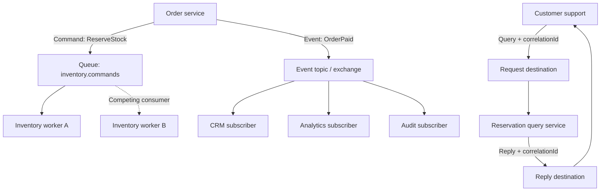
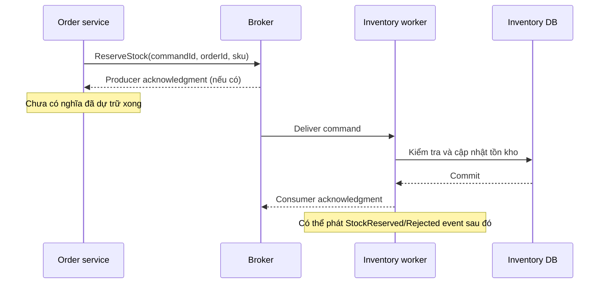
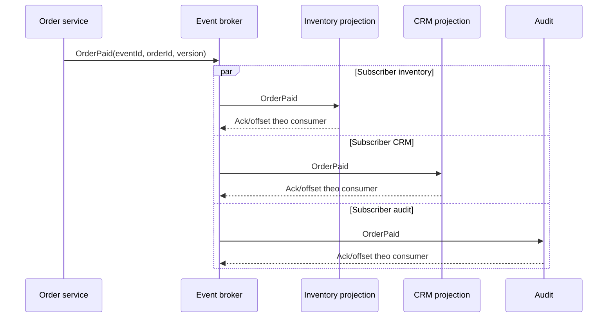
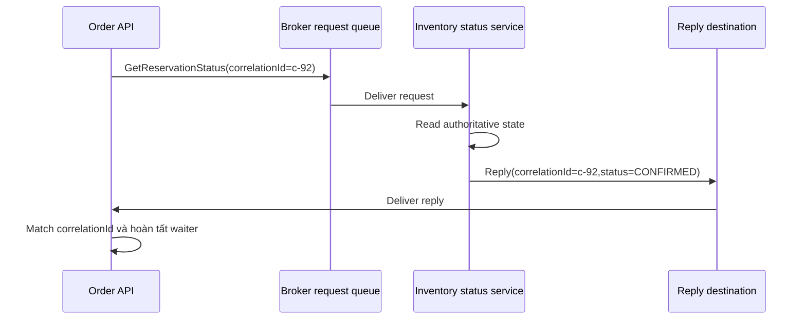
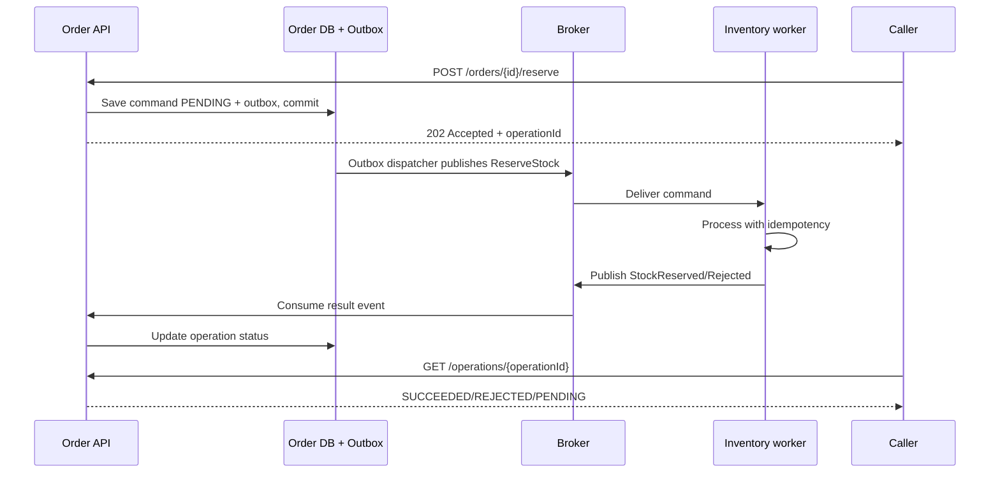
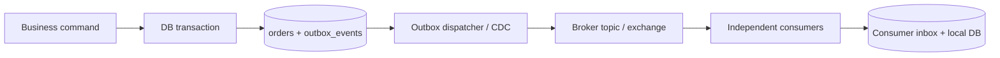
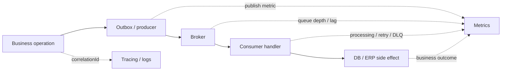

# Giao tiếp một chiều, publish-subscribe và request-reply

## 1. Vì sao phải chọn đúng kiểu giao tiếp khi tích hợp hệ thống?

Một ứng dụng Spring Boot có thể nhận yêu cầu HTTP, ghi đơn hàng vào PostgreSQL, tra Redis, gửi lệnh cho ERP, phát sự kiện cho các hệ thống tồn kho và kế toán, rồi xử lý phản hồi đến từ Kafka hoặc RabbitMQ. Các bước ấy không có cùng yêu cầu về **đích nhận, thời điểm cần kết quả và độ tin cậy**. Chọn sai kiểu giao tiếp sẽ gây trễ không cần thiết, xử lý trùng, mất công việc hoặc tạo liên kết quá chặt giữa các dịch vụ.

Trong module **SPRING_BOOT_INTEGRATION**, chương **Nền tảng nhắn tin** đặt câu hỏi: **khi nào nên dùng giao tiếp một chiều, khi nào dùng publish-subscribe và khi nào dùng request-reply?** Không chỉ cần phân biệt mẫu hình, mà còn phải hiểu hợp đồng dữ liệu, giao dịch, acknowledgment, retry, idempotency, kiểm thử và quan sát các luồng tích hợp thực tế.

Ví dụ xuyên suốt là nền tảng quản lý đơn hàng:

1. `Order API` nhận yêu cầu thanh toán và ghi trạng thái mới vào database.
2. Hệ thống cần **gửi lệnh dự trữ tồn kho** cho một dịch vụ chịu trách nhiệm thực hiện.
3. Hệ thống cần **thông báo đơn đã thanh toán** đến kho, CRM, báo cáo và kiểm toán.
4. Một màn hình chăm sóc khách hàng đôi lúc cần **hỏi trạng thái dự trữ ngay** rồi chờ kết quả có thời hạn.

Ba nhu cầu trên tương ứng với ba mẫu hình khác nhau. Việc tất cả đều có thể dùng message broker không có nghĩa tất cả đều nên dùng chung kiểu exchange/topic, chung consumer group hay chung chính sách lỗi.

Sau bài học, bạn có thể:

- Giải thích **one-way**, **publish-subscribe** và **request-reply** theo hướng dữ liệu, số bên nhận và yêu cầu phản hồi.
- Phân biệt **command**, **event**, **query** và **reply**, kể cả sự khác nhau giữa producer acknowledgment và kết quả xử lý nghiệp vụ.
- Ánh xạ các mẫu hình lên Kafka, RabbitMQ/AMQP, JMS và Spring Integration.
- Thiết kế correlation ID, reply destination, deadline, retry, DLQ, idempotency và outbox.
- Viết Spring Boot producer/consumer cơ bản và xác định những giới hạn của từng ví dụ.
- Kiểm thử và giám sát tính đúng đắn khi message bị giao lại, đến trễ hoặc sai thứ tự.

## 2. Cùng dùng message nhưng ba hợp đồng rất khác

| Mẫu hình | Ai biết người nhận? | Số bên xử lý mong muốn | Có chờ phản hồi nghiệp vụ? | Ví dụ |
|---|---|---|---|---|
| **One-way / fire-and-forget** | Thường xác định một chức năng/đích. | Một bên nhận nhiệm vụ logic; có thể nhiều worker cạnh tranh. | **Không** trong cùng lời gọi. | Gửi `ReserveStock` vào hàng đợi lệnh của kho. |
| **Publish-subscribe (pub/sub)** | Publisher không cần biết từng subscriber. | Nhiều subscriber độc lập cùng nhận sự kiện logic. | **Không** đòi một reply cho publisher. | Phát `OrderPaid` để CRM, kho, audit cùng phản ứng. |
| **Request-reply** | Biết dịch vụ/operation được hỏi hoặc routing tương đương. | Một bên xử lý request logic, trả kết quả tương ứng. | **Có**, thường kèm timeout/deadline. | `GetReservationStatus` trả `CONFIRMED` hoặc `PENDING`. |

Một chiều và pub/sub đều thường là giao tiếp **không chờ kết quả nghiệp vụ**, nhưng chúng khác về mô hình phân phối: **một lệnh cho một chức năng xử lý** đối lập với **một sự kiện cho nhiều nhóm tiêu thụ độc lập**.

Không đồng nhất “không chờ reply” với “không có acknowledgment”: producer có thể vẫn đợi **broker xác nhận đã nhận/lưu message**, consumer có thể vẫn phải **ack sau khi xử lý**, nhưng hai tín hiệu này không phải business reply.

### 2.1. Sơ đồ tổng quan



Mỗi nhánh có yêu cầu riêng về routing, durability, ordering, failure handling và monitoring.

## 3. Phân biệt command, event và query trước khi chọn broker

Trong tích hợp thông điệp, **ý nghĩa nghiệp vụ** của message quyết định phần lớn kiến trúc:

| Message | Diễn đạt | Đơn vị chịu trách nhiệm | Ví dụ |
|---|---|---|---|
| **Command** | “Hãy thực hiện hành động X.” | Một owner/handler logic. | `ReserveStock`, `SendInvoice`. |
| **Event** | “Việc X đã xảy ra.” | Không giới hạn subscriber; mỗi bên tự quyết định phản ứng. | `OrderPaid`, `StockReserved`. |
| **Query/request** | “Cho biết trạng thái/thông tin X.” | Một dịch vụ có thẩm quyền trả dữ liệu. | `GetReservationStatus`. |
| **Reply/response** | “Kết quả tương ứng với request Y.” | Caller đang đợi hoặc workflow lưu kết quả. | `ReservationStatusReply`. |

Một command gửi vào topic khiến ba consumer groups cùng thực hiện `ChargePayment` có thể dẫn tới **ba lần thanh toán** nếu các nhóm độc lập đều xử lý lệnh. Ngược lại, gửi event `OrderPaid` vào một queue với ba competing consumers sẽ chỉ có **một trong ba worker** nhận mỗi bản giao, khiến CRM và báo cáo không cùng cập nhật.

**Quy tắc:** đặt tên command bằng động từ/hành động hướng tới người thực hiện; đặt tên event theo sự kiện đã xảy ra, thường ở quá khứ. Tên không thay cho cấu hình broker, nhưng giúp review hợp đồng và tránh nhầm ngữ nghĩa.

### 3.1. Message envelope có định danh và phiên bản

Một event thực tế cần nhiều hơn payload nghiệp vụ:

```json
{
  "eventId": "evt-683c",
  "eventType": "OrderPaid",
  "schemaVersion": 2,
  "aggregateId": "ord-1042",
  "aggregateVersion": 7,
  "occurredAt": "2026-11-21T03:00:00Z",
  "correlationId": "flow-8e21",
  "causationId": "cmd-7519",
  "data": {
    "orderId": "ord-1042",
    "paymentReference": "pay-5931"
  }
}
```

- `eventId` nhận diện **một sự kiện** để xử lý lặp/idempotency.
- `aggregateId`/`aggregateVersion` giúp định tuyến, phân vùng và giải quyết event sai thứ tự.
- `schemaVersion` hỗ trợ nâng cấp hợp đồng dữ liệu khi producer/consumer chạy khác phiên bản.
- `correlationId` liên kết một workflow; `causationId` cho biết thao tác đã gây ra event.
- `occurredAt` là thời điểm nghiệp vụ ghi nhận, **không** phải thời điểm broker giao thành công.

ID và payload trong ví dụ là giả định. Không đưa token, mật khẩu, số thẻ hoặc dữ liệu cá nhân không cần thiết vào event. Correlation ID hữu ích cho log/trace nhưng **không nên làm metric tag** vì cardinality cao.

## 4. One-way: gửi thông điệp mà không chờ kết quả nghiệp vụ

Ở giao tiếp một chiều, producer gửi command/event đến một điểm nhận rồi tiếp tục luồng xử lý. Producer có thể cần biết broker đã **accept** message, nhưng nó không chờ handler trả `ReservationResult` trong cùng lời gọi.



Tùy broker và client, thao tác send có thể trả Future/Publisher hoặc block đến một mức xác nhận. Điều này chỉ chứng minh một giai đoạn của delivery, không phải ERP/DB downstream đã hoàn tất.

### 4.1. Khi nào phù hợp?

- Công việc có thể được xử lý sau: gửi email, đồng bộ dữ liệu, tạo báo cáo.
- Producer và consumer cần được cách ly về tốc độ/khả dụng.
- Yêu cầu xử lý có thể xếp hàng bền vững và được retry.
- API trả **202 Accepted** sau khi đã lưu **ý định xử lý đủ bền vững**; kết quả thật tra qua status API hoặc event.

Nếu người dùng phải biết ngay số dư đã được trừ/đơn đã dự trữ thành công hay chưa, one-way có thể vẫn phù hợp khi trải nghiệm cho phép `PENDING`, nhưng không được trả `COMPLETED` chỉ vì broker nhận message.

### 4.2. Ví dụ Spring AMQP: gửi command vào RabbitMQ

Spring Boot 3.x có thể dùng `spring-boot-starter-amqp`. Ví dụ một điểm định tuyến bền vững:

```java
import org.springframework.amqp.core.Binding;
import org.springframework.amqp.core.BindingBuilder;
import org.springframework.amqp.core.Queue;
import org.springframework.amqp.core.QueueBuilder;
import org.springframework.amqp.core.TopicExchange;
import org.springframework.context.annotation.Bean;
import org.springframework.context.annotation.Configuration;

@Configuration(proxyBeanMethods = false)
class InventoryCommandTopology {

    @Bean
    TopicExchange orderCommandsExchange() {
        return new TopicExchange("orders.commands", true, false);
    }

    @Bean
    Queue reserveStockQueue() {
        return QueueBuilder.durable("inventory.reserve.commands").build();
    }

    @Bean
    Binding reserveStockBinding(
            Queue reserveStockQueue, TopicExchange orderCommandsExchange) {
        return BindingBuilder.bind(reserveStockQueue)
                .to(orderCommandsExchange)
                .with("inventory.reserve");
    }
}
```

Publisher:

```java
import org.springframework.amqp.rabbit.core.RabbitTemplate;
import org.springframework.stereotype.Component;

public record ReserveStockCommand(
        String commandId, String orderId, String sku, int quantity) {}

@Component
class InventoryCommandPublisher {

    private final RabbitTemplate rabbit;

    InventoryCommandPublisher(RabbitTemplate rabbit) {
        this.rabbit = rabbit;
    }

    void submit(ReserveStockCommand command) {
        rabbit.convertAndSend(
                "orders.commands", "inventory.reserve", command);
    }
}
```

Consumer:

```java
import org.springframework.amqp.rabbit.annotation.RabbitListener;
import org.springframework.stereotype.Component;

@Component
class InventoryCommandHandler {

    private final InventoryService inventory;

    InventoryCommandHandler(InventoryService inventory) {
        this.inventory = inventory;
    }

    @RabbitListener(queues = "inventory.reserve.commands")
    public void handle(ReserveStockCommand command) {
        inventory.reserveIdempotently(
                command.commandId(), command.orderId(),
                command.sku(), command.quantity());
    }
}
```

`InventoryService` là service nghiệp vụ do ứng dụng định nghĩa. Ví dụ giả định producer và listener **được cấu hình message converter tương thích** cho `ReserveStockCommand` (chẳng hạn JSON với type mapping được kiểm soát); không mặc định mọi object Java được gửi/đọc đúng kiểu qua mọi converter.

**Durable queue không đủ để đảm bảo không mất thông điệp.** Cần xem exchange/queue durability, persistent message delivery, publisher confirms, routing/mandatory returns, broker replication, consumer ack và topology thực tế. `convertAndSend(...)` trả về bình thường không tự chứng minh message đã được lưu bền vững và handler đã thành công.

## 5. One-way không có reply nhưng vẫn có nhiều mức xác nhận

Một command có thể trải qua các cột mốc sau:

| Mốc | Ý nghĩa | Không chứng minh điều gì? |
|---|---|---|
| **Accepted vào bộ nhớ publisher** | Thư viện client đã nhận lời gọi send. | Chưa chắc đã gửi lên broker. |
| **Broker acknowledgment/confirm** | Broker đã phản hồi theo cấu hình protocol. | Chưa chắc được route tới queue hoặc consumer xử lý. |
| **Consumer delivery** | Một consumer đã nhận message. | Chưa chắc transaction DB commit. |
| **Consumer ack/offset commit** | Client báo message đã xử lý theo chính sách ứng dụng/container. | Không tự đồng bộ nguyên tử với DB/ERP side effect. |
| **Business completion event** | Hệ thống owner thông báo `StockReserved`. | Phải xác minh sự kiện dựa trên commit/thực trạng đáng tin cậy. |

Ở RabbitMQ, **publisher confirm** và **consumer acknowledgment** là hai cơ chế khác; publisher returns còn liên quan tới trường hợp exchange không route được message khi dùng mandatory setting. Ở Kafka, producer acknowledgment và consumer offset commit cũng là hai hoạt động tách biệt.

**Thiết kế API:** `202 Accepted` nên gắn với một mốc tiếp nhận bền vững đã định nghĩa trong hợp đồng; không viết “dự trữ thành công” khi chỉ mới gọi `execute(...)` hoặc gửi vào queue nội bộ JVM.

## 6. Publish-subscribe: một sự kiện cho nhiều bên quan tâm

Pub/sub biểu diễn sự kiện đã xảy ra và tách publisher khỏi số lượng subscriber. Ví dụ `OrderPaid` là một fact đã được ghi nhận; kho có thể giao hàng, CRM cập nhật lịch sử, báo cáo cộng doanh thu, audit lưu dấu vết.



Publisher không cần gọi tuần tự ba API và không cần đợi tất cả phản hồi. Khi thêm subscriber thứ tư, lý tưởng là không sửa publisher. Tuy nhiên, vẫn phải quản lý **phiên bản schema**, retention, ACL, tăng trưởng lưu lượng và trách nhiệm của từng subscriber.

### 6.1. Pub/sub không có nghĩa mỗi instance đều xử lý cùng message

Đây là phân biệt quan trọng:

- **RabbitMQ:** mỗi queue được binding vào exchange theo routing nhận một bản copy logic; **nhiều consumer trên cùng một queue** cạnh tranh xử lý, không phải tất cả đều nhận.
- **Kafka:** mỗi **consumer group** có khả năng đọc luồng sự kiện theo offset riêng; các consumer **trong cùng một group** chia các partitions, không phải mỗi instance đều nhận mọi record.
- **JMS:** queue biểu diễn point-to-point; topic biểu diễn publish-subscribe theo semantics của provider/subscription. Với durable subscription/shared subscriptions cần xét lifecycle và nhóm subscriber.
- **Spring Integration:** `PublishSubscribeChannel` nhân bản thông điệp cho các subscriber trong application flow, nhưng bản thân nó không tự cung cấp durability như broker.

Một cấu hình nhầm group/queue có thể khiến một business function nhận quá ít hoặc quá nhiều messages.

## 7. Pub/sub trên RabbitMQ: exchange và các queue riêng

RabbitMQ có exchange để route message tới queues. Với topic exchange:

- Publisher gửi event tới exchange `orders.events`, routing key `order.paid`.
- Queue `inventory.order-events` bind key đó.
- Queue `crm.order-events` cũng bind key đó.
- Hai nhóm subscriber nhận và ack độc lập.

```java
import org.springframework.amqp.core.*;
import org.springframework.context.annotation.Bean;
import org.springframework.context.annotation.Configuration;

@Configuration(proxyBeanMethods = false)
class OrderEventTopology {

    @Bean
    TopicExchange ordersEventsExchange() {
        return new TopicExchange("orders.events", true, false);
    }

    @Bean
    Queue inventoryEventsQueue() {
        return QueueBuilder.durable("inventory.order-events").build();
    }

    @Bean
    Queue crmEventsQueue() {
        return QueueBuilder.durable("crm.order-events").build();
    }

    @Bean
    Binding inventoryEventsBinding(
            TopicExchange ordersEventsExchange,
            Queue inventoryEventsQueue) {
        return BindingBuilder.bind(inventoryEventsQueue)
                .to(ordersEventsExchange)
                .with("order.paid");
    }

    @Bean
    Binding crmEventsBinding(
            TopicExchange ordersEventsExchange,
            Queue crmEventsQueue) {
        return BindingBuilder.bind(crmEventsQueue)
                .to(ordersEventsExchange)
                .with("order.paid");
    }
}
```

`TopicExchange` cho phép phân phối theo routing pattern, ví dụ `order.*` hay `order.#`. Nếu tất cả các queue phải nhận mọi routing key, `FanoutExchange` phù hợp hơn. Không trộn queue dùng cho command với queues của từng subscriber event để tránh nhầm competing consumers thành fan-out.

Publisher:

```java
public record OrderPaid(
        String eventId, String orderId,
        long version, String paymentReference) {}

rabbitTemplate.convertAndSend(
        "orders.events", "order.paid", orderPaid);
```

Các listener ở **hai service** (hoặc hai bean độc lập) dùng queue khác nhau:

```java
@RabbitListener(queues = "inventory.order-events")
public void onInventoryEvent(OrderPaid event) {
    inventoryProjection.applyOnce(event);
}

@RabbitListener(queues = "crm.order-events")
public void onCrmEvent(OrderPaid event) {
    crmProjection.applyOnce(event);
}
```

Các service/fields trong đoạn minh họa do ứng dụng cung cấp; message converter và hợp đồng JSON cần được cấu hình và kiểm thử thực tế.

### 7.1. Một queue có ba replicas không phải ba subscriber

Nếu ba pod của inventory đều nghe `inventory.order-events`, broker thường chia messages giữa ba pod theo cơ chế competing consumers. Đó là **scale-out một subscriber logic**, không phải mỗi pod nhận toàn bộ stream. Muốn CRM nhận nữa, phải cấp một queue/subscription riêng.

## 8. Pub/sub trên Kafka: topic, partition và consumer group

Kafka lưu record trong **topic** được chia thành **partitions**. Producer chọn key/partition; mỗi consumer group duy trì vị trí đọc độc lập. Một topic `orders.events` có thể phục vụ:

- Group `inventory-projection`.
- Group `crm-projection`.
- Group `audit-projection`.

Trong group `inventory-projection` có nhiều consumer instances, mỗi partition thường được assign cho một consumer tại một thời điểm theo cơ chế group coordinator. Số partitions, assignment strategy, rebalances và phiên bản client ảnh hưởng concurrency/ordering.

Ví dụ Spring Kafka 3.x, phù hợp với thế hệ Spring Boot 3.x tương ứng:

```java
import java.util.concurrent.CompletableFuture;
import org.springframework.kafka.core.KafkaTemplate;
import org.springframework.kafka.support.SendResult;
import org.springframework.stereotype.Component;

@Component
class OrderEventKafkaPublisher {

    private final KafkaTemplate<String, OrderPaid> kafka;

    OrderEventKafkaPublisher(KafkaTemplate<String, OrderPaid> kafka) {
        this.kafka = kafka;
    }

    CompletableFuture<SendResult<String, OrderPaid>> publish(
            OrderPaid event) {
        return kafka.send(
                "orders.events", event.orderId(), event);
    }
}
```

`KafkaTemplate<String, OrderPaid>` yêu cầu producer serializers và cấu hình broker tương ứng. Với JSON, cần cấu hình serializer/deserializer, mapping class/schema và trusted packages có kiểm soát; method `send` không tự khiến Kafka biết chuyển record Java sang wire format.

Ví dụ hai **consumer groups**:

```java
@KafkaListener(
    topics = "orders.events",
    groupId = "inventory-projection")
public void inventoryProjection(OrderPaid event) {
    inventory.applyOnce(event);
}

@KafkaListener(
    topics = "orders.events",
    groupId = "crm-projection")
public void crmProjection(OrderPaid event) {
    crm.applyOnce(event);
}
```

Đoạn code minh họa hai handler logic với bean/service dependencies giả định; production phải cấu hình JSON conversion và container error handlers, offset/ack policy.

### 8.1. Key và ordering

Gửi `orderId` làm record key thường giúp các event cùng đơn hàng đi vào cùng partition trong một topic khi partitioner/topology ổn định, để giữ thứ tự **trong partition** ở mức log. Kafka **không** cung cấp một total order toàn topic đa partition.

Ngay cả khi record trong partition có thứ tự, ứng dụng xử lý bất đồng bộ, chuyển executor, retry hoặc kết hợp nhiều topic vẫn có thể khiến **side effects hoàn tất sai thứ tự**. Dùng `aggregateVersion` hoặc optimistic locking khi trạng thái không được phép quay ngược.

### 8.2. Replay và retention khác RabbitMQ queue

Kafka có log retention theo thời gian/dung lượng/compaction tùy topic, nên một consumer group có thể đọc lại dữ liệu còn được lưu theo offset và policy. RabbitMQ queue truyền thống thường xóa message sau ack; replay cần thiết kế riêng, không suy ra từ cùng chữ “pub/sub”. Chọn công nghệ theo retention/replay, routing, latency và vận hành chứ không dựa vào tên mẫu hình.

## 9. Publish-subscribe trong Spring Integration

Spring Integration đưa mẫu hình tương tự vào **message channels**. `PublishSubscribeChannel` cho phép một message được gửi đến nhiều subscribers trong cùng integration flow.

Ví dụ Java DSL, các service `auditService` và `searchService` do ứng dụng định nghĩa:

```java
import org.springframework.context.annotation.Bean;
import org.springframework.integration.dsl.IntegrationFlow;

@Bean
IntegrationFlow localOrderFanOut() {
    return IntegrationFlow.from("orderEventsInput")
        .publishSubscribeChannel(spec -> spec
            .subscribe(flow -> flow.handle("auditService", "append"))
            .subscribe(flow -> flow.handle("searchService", "project")))
        .get();
}
```

**Lưu ý API theo phiên bản:** trong một số phiên bản Spring Integration hiện đại, static DSL entrypoint có thể là `IntegrationFlow.from(...)`; `IntegrationFlows` đã thay đổi/deprecate theo đời thư viện. Ví dụ này dùng `IntegrationFlow.from(...)` và chỉ minh họa cấu trúc fan-out; cần khai báo channel/service beans và dependency Spring Integration phù hợp.

Với cách xử lý đồng bộ mặc định, một subscriber chậm có thể giữ caller và ảnh hưởng subscriber còn lại. Nếu cấu hình executor, xuất hiện ranh giới thread/transaction và cần kiểm tra cách exception/ack được xử lý. `PublishSubscribeChannel` trong RAM không thay thế broker durable event log hoặc outbox.

### 9.1. Phân biệt publish-subscribe với channel cạnh tranh

Trong một Spring Integration `DirectChannel` mặc định, message có thể được dispatch tới **một** trong những handler subscribed theo load-balancing strategy; `PublishSubscribeChannel` phát cho **nhiều** handlers. Nếu nhiệm vụ là một command có owner, không nên dùng pub/sub channel chỉ vì muốn nhiều worker song song.

## 10. Request-reply: dùng message nhưng caller cần một câu trả lời

Request-reply mô phỏng tương tác hai chiều trên hạ tầng message. Caller gửi request có **correlation ID**; responder xử lý và gửi reply đến một **reply destination** (queue/topic/channel) hoặc cơ chế direct reply-to do framework/broker hỗ trợ. Caller cần kết hợp đúng reply với request và giới hạn thời gian chờ.



Dù transport dùng broker, caller vẫn phải **chờ**; nếu chờ đồng bộ trên HTTP thread, độ trễ và timeout có thể tương tự HTTP RPC, cộng thêm queue wait/broker hops. Request-reply **không tự mang lại loose coupling** về thời gian.

### 10.1. Các thành phần hợp đồng request-reply

| Thành phần | Mục đích |
|---|---|
| `requestId`/`correlationId` | Ghép reply với một request cụ thể. |
| Reply destination hoặc `replyTo` | Chỉ nơi responder gửi kết quả. |
| Deadline / reply timeout | Xác định caller chờ bao lâu, lúc nào bỏ waiter. |
| Business status | `FOUND`, `NOT_FOUND`, `PENDING`, `REJECTED` theo contract. |
| Error reply contract | Phân biệt lỗi nghiệp vụ với lỗi transport/timeouts. |
| Request version / schema | Tránh producer và responder hiểu sai payload. |
| Idempotency key (nếu có side effect) | Tránh chạy lại một lệnh khi request bị retry. |
| Orphan/late reply handling | Xử lý reply đến sau khi caller đã timeout. |

**Một reply timeout không chứng minh responder chưa chạy.** Reply có thể bị mất, chậm vì queue, responder đã cập nhật DB nhưng chưa kịp gửi, hoặc caller đã dừng đợi. Với command có side effect, đây là trạng thái **UNKNOWN** cần tra cứu/đối soát.

## 11. Request-reply với RabbitMQ và `RabbitTemplate`

Spring AMQP có `RabbitTemplate.convertSendAndReceive(...)`, giúp caller gửi request rồi chờ reply theo cơ chế RabbitMQ và cấu hình template. Listener nhận request và **return** object để framework gửi reply theo metadata khi đường reply được thiết lập đúng.

Ví dụ topology request queue:

```java
import org.springframework.amqp.core.*;
import org.springframework.context.annotation.Bean;
import org.springframework.context.annotation.Configuration;

@Configuration(proxyBeanMethods = false)
class ReservationRpcTopology {

    @Bean
    TopicExchange reservationRpcExchange() {
        return new TopicExchange("reservation.rpc", true, false);
    }

    @Bean
    Queue reservationStatusQueue() {
        return QueueBuilder.durable("reservation.status.requests").build();
    }

    @Bean
    Binding reservationStatusBinding(
            Queue reservationStatusQueue,
            TopicExchange reservationRpcExchange) {
        return BindingBuilder.bind(reservationStatusQueue)
                .to(reservationRpcExchange)
                .with("reservation.status");
    }
}
```

Request/reply DTO:

```java
public record ReservationStatusQuery(
        String requestId, String reservationId) {}

public record ReservationStatusReply(
        String requestId, String reservationId,
        String status, String errorCode) {}
```

Responder:

```java
import org.springframework.amqp.rabbit.annotation.RabbitListener;
import org.springframework.stereotype.Component;

@Component
class ReservationQueryResponder {

    private final ReservationQueryService service;

    ReservationQueryResponder(ReservationQueryService service) {
        this.service = service;
    }

    @RabbitListener(queues = "reservation.status.requests")
    public ReservationStatusReply handle(ReservationStatusQuery query) {
        return service.lookup(query);
    }
}
```

Caller:

```java
import org.springframework.amqp.rabbit.core.RabbitTemplate;
import org.springframework.stereotype.Component;

@Component
class ReservationQueryClient {

    private final RabbitTemplate rabbit;

    ReservationQueryClient(RabbitTemplate rabbit) {
        this.rabbit = rabbit;
    }

    ReservationStatusReply findStatus(ReservationStatusQuery query) {
        Object raw = rabbit.convertSendAndReceive(
                "reservation.rpc", "reservation.status", query);

        if (!(raw instanceof ReservationStatusReply reply)) {
            throw new IllegalStateException(
                    "No valid reservation-status reply");
        }
        return reply;
    }
}
```

Đây là **ví dụ kiến trúc**, giả định dependency `spring-boot-starter-amqp`, cấu hình JSON converter/type mapping tương thích ở caller/responder và bean `ReservationQueryService`. Trong production, không nên dùng `IllegalStateException` chung cho mọi timeout/error: phân loại **no reply**, lỗi decode, lỗi broker và business negative result bằng exception/DTO chuẩn hóa.

Một cấu hình timeout mẫu (kiểm tra binding thực tế theo Spring Boot version):

```yaml
spring:
  rabbitmq:
    template:
      reply-timeout: 2s
```

`reply-timeout` đặt thời gian caller chờ phản hồi từ `RabbitTemplate`, **không** tự hủy handler đang chạy. Request-reply qua RabbitMQ thường dùng cơ chế **direct reply-to** khi hỗ trợ; tùy phiên bản/config có thể dùng reply queue cố định hoặc container riêng. Không mặc định một queue phản hồi riêng tạo thủ công là bắt buộc cho mọi lời gọi.

### 11.1. Correlation và kết quả đến trễ

Framework có thể quản lý request correlation nội bộ khi dùng `RabbitTemplate.convertSendAndReceive`, nhưng ứng dụng vẫn nên có `requestId` nghiệp vụ cho đối soát. Khi reply đến sau timeout, caller không còn waiter tương ứng; hệ thống cần log/metric các late/orphan replies theo cơ chế phù hợp, không xử lý chúng như kết quả của request khác.

Nếu một request có side effect, dùng `requestId`/idempotency key để tra cứu tiến độ sau timeout. Không tự tạo key mới cho mỗi lần retry cùng ý định nghiệp vụ.

## 12. Kafka request-reply: có thể làm, nhưng cần cân nhắc

Kafka có thể triển khai request-reply bằng **request topic + reply topic** và correlation headers. Spring Kafka cung cấp hỗ trợ như `ReplyingKafkaTemplate` cho các tình huống phù hợp; thiết lập reply consumer/container và correlation là trách nhiệm cấu hình của ứng dụng.

Sơ đồ:

```text
Client --[request topic: reservation-queries]--> Responder
Client <--[reply topic: reservation-replies]---- Responder
               correlationId + reply partition/routing
```

Các điểm khó hơn HTTP/Rabbit RPC:

- Cần quy hoạch reply topic, partitions, group IDs và routing reply về đúng caller instance.
- Caller có thể restart, scale-out hoặc rebalance trong khi đang đợi reply.
- Kafka log retention/offset không tự lưu một Future “đang đợi” sau restart.
- Reply đến trễ và duplicate replies phải được nhận diện bằng correlation.
- Thêm latency của batch/commit/consumer poll so với kết nối request-response trực tiếp.

**Không chọn Kafka request-reply chỉ vì ứng dụng đã dùng Kafka.** Nếu mục tiêu là query nhanh với SLO chặt và dịch vụ trực tiếp có thể truy cập, HTTP/gRPC có thể rõ ràng hơn. Nếu muốn giao tiếp bất đồng bộ bền vững cho một workflow dài, thường thích hợp hơn là **command + event kết quả** và một resource status, thay vì giữ một thread chờ reply lâu.

## 13. Spring Integration request-reply và reply channel

Spring Integration có các abstraction `MessageChannel`, `MessagingTemplate` và gateway để tổ chức request-reply. Một request có thể có header `replyChannel`; handler gửi reply về channel đó. Tùy luồng, reply có thể được trả trực tiếp trong cùng JVM hoặc đi qua adapter/broker.

Ví dụ khái niệm:

```java
import org.springframework.messaging.Message;
import org.springframework.messaging.support.MessageBuilder;
import org.springframework.integration.core.MessagingTemplate;

Message<String> request = MessageBuilder
        .withPayload("reservation-123")
        .setHeader("correlationId", "corr-123")
        .build();

MessagingTemplate template = new MessagingTemplate();
template.setReceiveTimeout(1500);
Message<?> reply = template.sendAndReceive(
        requestChannel, request);
```

`requestChannel` là `MessageChannel` đã được ứng dụng định nghĩa; ví dụ minh họa concept, cần các bean/import phù hợp. `sendAndReceive` cần một flow có reply thực sự; nếu handler chỉ nhận message một chiều và không gửi trả, caller sẽ nhận `null`/timeout theo chính sách của template.

**Đừng nhầm timeout gửi/nhận channel với network timeout của HTTP client downstream.** Một gateway Spring Integration không tự đảm bảo request/reply bền vững nếu các channels là in-memory.

### 13.1. `replyChannel` trong JVM khác `replyTo` trên broker

Header `replyChannel` có thể tham chiếu một kênh message trong Spring context; nó không đương nhiên là một RabbitMQ queue/Kafka topic có thể truy cập từ process khác. Khi qua broker adapter, cần mapping header/address và bảo mật rõ. Không serialize bừa Java channel object vào wire contract.

## 14. Request-reply không phù hợp với mọi workflow dài

Giả sử `ReserveStock` mất 30 giây ở ERP, đôi khi kéo dài vài phút. Giữ HTTP thread hoặc RPC waiter trong broker suốt thời gian ấy:

- Chiếm tài nguyên và tăng p95/p99 latency của API.
- Dễ timeout khi load tăng hoặc broker có sự cố.
- Caller restart khiến reply không còn waiter.
- Nếu request side effect hoàn tất sau timeout, caller không biết có nên retry.

Một thiết kế khác:



Cách này đưa **business completion** vào event/status resource có thể khôi phục sau restart, thay vì giữ waiter trong RAM. Nó vẫn cần outbox, consumer idempotency, DLQ và đối soát; nhưng thời gian workflow không phụ thuộc một request-reply timeout duy nhất.

## 15. So sánh các nền tảng cho ba mẫu hình

| Nền tảng | One-way / competing consumers | Publish-subscribe | Request-reply |
|---|---|---|---|
| **RabbitMQ/AMQP** | Gửi command tới queue qua exchange, nhiều consumers cạnh tranh. | Exchange route event tới nhiều queue riêng. | `RabbitTemplate` RPC/direct reply-to/reply queue. |
| **Kafka** | Command topic với một consumer group owner, partition phân tải. | Các consumer groups đọc cùng topic độc lập. | Request/reply topics + `ReplyingKafkaTemplate` hoặc workflow event. |
| **JMS provider** | Queue + message listener. | Topic + durable/shared subscriptions tùy provider. | `JMSReplyTo`/`JMSCorrelationID`, request/reply client pattern. |
| **Spring Integration** | `DirectChannel`/`ExecutorChannel`/`QueueChannel` và handlers. | `PublishSubscribeChannel` và nhiều subscribers. | Gateways, `replyChannel`, `MessagingTemplate`. |
| **HTTP/gRPC** | HTTP 202 + durable task để chuyển thành async. | Không mặc nhiên pub/sub; cần event stream/broker/webhook. | Request-response trực tiếp, thường đơn giản hơn cho query nhanh. |

Không có lựa chọn “Kafka là pub/sub còn RabbitMQ chỉ là queue” theo nghĩa tuyệt đối: cả hai có thể hiện thực nhiều mẫu hình, nhưng **routing, storage, retention, acknowledgment và vận hành khác nhau**.

**Lưu ý tính năng theo phiên bản:** Spring Boot 3.x sử dụng các thế hệ Spring Kafka/Spring AMQP/Spring Integration tương thích theo BOM; method/API và default error handling có thể thay đổi giữa versions. Cần đối chiếu release đang dùng, không lấy code của thế hệ cũ để áp nguyên cho dự án mới.

## 16. Ack, retry và delivery semantics: ba mẫu hình đều cần

Nhắn tin không tự bảo đảm exactly-once business effect. Ba kiểu cơ bản:

| Semantics | Ý nghĩa gần đúng | Rủi ro |
|---|---|---|
| **At-most-once** | Không cố giao lại sau khi một mốc nhất định được ghi nhận. | Có thể mất message nếu crash trước xử lý. |
| **At-least-once** | Có thể giao lại đến khi hoàn tất theo ack/offset policy. | Có thể xử lý **trùng**. |
| **Exactly-once** | Một số broker/transactional workflows có bảo đảm giới hạn về xử lý record/offset. | Không tự bao phủ DB, HTTP ERP và mọi side effect ngoài broker. |

Các trường hợp điển hình:

1. Consumer ghi PostgreSQL, **commit DB thành công**.
2. Process crash trước khi ack RabbitMQ hoặc commit Kafka offset.
3. Broker giao lại message.
4. Nếu handler không có idempotency, bản ghi/side effect có thể được thực hiện lần nữa.

### 16.1. Acknowledgment nên theo một mốc bền vững

Với command cần xử lý tới cuối, ack sau khi DB transaction/side effect phù hợp hoàn tất. Nếu muốn ack sớm để giải phóng broker consumer, phải **lưu công việc vào durable inbox/job table** trước khi ack; enqueue `TaskExecutor` RAM không đủ.

Spring Kafka và RabbitMQ có nhiều chế độ ack, error handler, batch/prefetch và transaction integration. Không tự giả định listener method trả bình thường đồng nghĩa DB commit: điều này phụ thuộc transaction boundary và container configuration.

### 16.2. Retry theo loại lỗi, không lặp vô hạn

| Lỗi | Chính sách thường hợp lý |
|---|---|
| JSON/schema không tương thích | Không retry nóng; đưa vào DLQ/quarantine và cảnh báo contract. |
| Validation/business rejection | Ghi kết quả từ chối, không retry nếu dữ liệu không đổi. |
| Redis timeout/DB deadlock tạm thời | Retry bounded/backoff nếu operation an toàn. |
| ERP HTTP 429/503 | Tôn trọng quota, backoff/jitter và deadline. |
| Read timeout sau lệnh ghi ERP | **UNKNOWN**, cần idempotency/tra cứu trạng thái. |
| Reply timeout request-reply | Không kết luận responder chưa chạy; không gửi lệnh ghi lại tùy tiện. |
| Consumer crash sau DB commit trước ack | Redelivery phải xử lý an toàn với idempotency. |

Tránh ba tầng cùng retry (broker → service → HTTP client) tạo số attempts theo cấp số nhân. Quy định một tầng sở hữu retry chính, tổng ngân sách và dấu hiệu dừng/DLQ.

## 17. Inbox, idempotency và outbox giúp nối các ranh giới

### 17.1. Consumer inbox hoặc bảng đánh dấu event đã xử lý

Một strategy phổ biến lưu `eventId` cùng business update trong **một transaction DB**, dùng unique constraint bảo vệ duplicate:

```sql
CREATE TABLE consumed_events (
    consumer_name VARCHAR(100) NOT NULL,
    event_id VARCHAR(100) NOT NULL,
    processed_at TIMESTAMPTZ NOT NULL DEFAULT now(),
    PRIMARY KEY (consumer_name, event_id)
);
```

Một transaction nghiệp vụ có thể thử insert đánh dấu trước, xử lý domain update/outbox rồi commit. Nếu event trùng, unique constraint/ngữ nghĩa `ON CONFLICT DO NOTHING` giúp handler bỏ qua mà không tạo side effect. Cần kiểm tra **insert đánh dấu và business update commit cùng nhau**; nếu đánh dấu xử lý thành công trước rồi nghiệp vụ rollback, lần giao lại bị bỏ sai.

Nếu cùng một event được nhiều subscriber logic xử lý, khóa nên bao gồm `consumer_name` hoặc tương đương. Không dùng global dedupe làm subscriber CRM thấy event đã bị inventory “ăn mất”.

### 17.2. Transactional outbox cho producer

Vấn đề dual-write:

```text
BEGIN transaction
  UPDATE orders SET status='PAID'
COMMIT
publish OrderPaid -> broker lỗi
=> DB nói PAID, subscriber không nhận event
```

Outbox pattern:



Ghi business state **và outbox row trong cùng local DB transaction**. Sau commit, dispatcher/CDC phát sự kiện và đánh dấu đã publish theo policy. Dispatcher có thể phát lặp khi publish thành công nhưng update trạng thái outbox thất bại; consumer phải idempotent.

### 17.3. Exactly-once phải mô tả phạm vi

Kafka transactional producer có thể phối hợp writes và offsets trong **phạm vi Kafka** theo cấu hình phù hợp. Nó không tự rollback một PostgreSQL transaction hay thao tác `POST /erp/payments`. Với nguồn dữ liệu khác broker, thường phải thiết kế **effectively-once** ở cấp nghiệp vụ bằng unique business IDs, idempotency keys, outbox/inbox và reconciliation.

## 18. Ordering, partitioning và concurrency

Một command `ReserveStock` có thể chịu xử lý song song theo SKU, nhưng hai event `OrderPaid(version=7)` và `OrderRefunded(version=8)` cho cùng đơn phải không làm projection quay lại state cũ.

| Yếu tố | Ảnh hưởng |
|---|---|
| Kafka partition key | Quyết định event cùng aggregate có nhiều khả năng nằm cùng partition. |
| Consumer group/partition assignment | Giới hạn concurrency của mỗi consumer group. |
| RabbitMQ queue + nhiều consumers/prefetch | Có thể hoàn thành không theo thứ tự publish; requeue/retry có thể đảo hiệu ứng. |
| Spring Integration `ExecutorChannel` | Chuyển handler sang executor, có thể thay thứ tự hoàn tất. |
| DB version/optimistic locking | Có thể từ chối update từ event cũ. |
| Retry/DLQ/replay | Record đến muộn vẫn có thể được xử lý sau event mới. |

Nếu business yêu cầu version đơn điệu, dùng câu lệnh cập nhật có điều kiện:

```sql
UPDATE order_projection
SET status = :status, version = :incoming_version
WHERE order_id = :order_id
  AND version < :incoming_version;
```

Đây là **mẫu logic** minh họa, cần đảm bảo row đã tồn tại hoặc xử lý insert/upsert cạnh tranh với khóa/unique constraint. Nếu consumer nhận version 9 trước 8, chính sách có thể là bỏ 8, đệm chờ, hoặc rebuild từ source of truth tùy hợp đồng. Không dùng arrival timestamp để suy ra thứ tự nghiệp vụ.

## 19. Request-reply: timeout, correlation và backpressure cần thiết kế riêng

Một broker RPC có ít nhất hai bộ tài nguyên: request queue/consumers **và** số waiter ở caller. Nếu lượng request tăng:

- Request queue dài → reply chậm.
- Caller giữ nhiều threads/Futures → tăng memory và connection load.
- Timeout → orphan replies và retry storm.
- Consumer lỗi nhưng message được retry lâu → caller đã timeout trong khi server vẫn xử lý.

### 19.1. Định nghĩa deadline đầu-cuối

```text
caller deadline
  -> serialize/send
  -> broker enqueue + queue wait
  -> handler xử lý + DB/ERP
  -> reply publish
  -> reply queue + delivery
  -> caller deserialize/match correlation
```

Một reply timeout 2 giây phải được đặt trong **ngân sách HTTP inbound** và thời gian chờ thực tế. Nếu caller đã chờ DB 800 ms mà API deadline 1 giây, không nên bắt đầu broker RPC thêm 2 giây. Nếu framework cho phép truyền deadline, responder nên kiểm tra nó trước side effect.

### 19.2. Không dùng request-reply như khóa phân tán

Hai request có cùng business ID có thể đồng thời được gửi và nhận hai replies. Correlation ID chỉ **ghép lời đáp**, không tạo mutual exclusion hoặc idempotency. Nếu responder ghi dữ liệu, vẫn cần unique constraint/business key/transaction.

### 19.3. Kết quả kỹ thuật khác kết quả nghiệp vụ

- **Technical timeout:** không nhận reply trong thời hạn, trạng thái xử lý không biết.
- **Business `NOT_FOUND`:** responder đã chạy và trả kết quả hợp lệ.
- **Business `REJECTED`:** responder đã đánh giá và từ chối.
- **Broker publish failure:** request có thể chưa được gửi thành công; tùy mốc confirm phải phân loại.
- **Deserializer error:** reply tồn tại nhưng caller không hiểu schema.

Không bắt mọi tình huống thành `null` rồi kết luận “đơn không tồn tại”.

## 20. Chọn mẫu hình theo nhu cầu thay vì theo thư viện có sẵn

Một bảng quyết định ngắn:

| Câu hỏi | Nếu có | Hướng lựa chọn |
|---|---|---|
| Có cần **một owner** thực hiện lệnh không? | Có. | One-way command tới queue/consumer group owner. |
| Có cần **nhiều ứng dụng độc lập** nhận cùng một fact không? | Có. | Pub/sub event với subscription/group độc lập. |
| Caller có thật sự cần **kết quả ngay** trong deadline ngắn? | Có. | Request-reply hoặc HTTP/gRPC trực tiếp tùy topology. |
| Công việc có thể mất phút/giờ hoặc sống qua restart không? | Có. | Durable command + status/event, không giữ RPC waiter dài. |
| Có cần event replay/stream processing không? | Có. | Xem Kafka log/retention/compaction và consumer groups. |
| Có routing linh hoạt và queue-based work distribution không? | Có. | Xem RabbitMQ exchanges/queues hoặc JMS provider phù hợp. |
| Có DB side effect và event phải nhất quán theo commit không? | Có. | Outbox, inbox/idempotency bất kể mẫu hình. |

**Không biến mọi thứ thành pub/sub** để “giảm coupling”: một command có owner vẫn cần biết ai chịu trách nhiệm, cách phát hiện không có consumer và điều kiện hoàn tất. **Không biến mọi thứ thành request-reply** chỉ để code giống gọi hàm: như vậy kéo theo temporal coupling, timeout, orphan replies và resource pressure.

## 21. Khả năng quan sát: đo cả broker và nghiệp vụ

Đo lường phải trả lời “message ở đâu, đã xử lý đến đâu, có đang retry hay không?”:

| Metric/trace | One-way | Pub/sub | Request-reply |
|---|---|---|---|
| Publish success/failure/confirm | Cần. | Cần. | Cần cho request và reply. |
| Queue depth, oldest message age | Cần khi queue-based. | Theo từng queue/group. | Cả request/reply backlog. |
| Kafka consumer lag | Theo owner group. | Theo **từng** subscriber group. | Nếu triển khai RPC bằng topics. |
| Handler processing duration/outcome | Cần. | Theo subscriber/operation. | Cần cùng reply latency. |
| Retry, redelivery, DLQ/quarantine | Cần. | Theo từng subscriber. | Cần thêm orphan/late reply. |
| End-to-end business latency | Từ command accepted tới completed. | Từ event commit tới projection cập nhật. | Từ send tới reply hoặc timeout. |
| Correlation/trace propagation | Theo workflow ID. | Qua message headers/event envelope. | Cần ghép spans request và reply. |

Spring Boot Actuator, Micrometer Observation/Tracing và các thư viện messaging có thể instrument producer/consumer tùy phiên bản và config. **Không giả định mọi broker metric tự xuất hiện** khi thêm Actuator. Kafka lag, Rabbit queue depth, publish confirm, consumer ack và application business status cần các nguồn telemetry khác nhau.



### 21.1. Cardinality và bảo mật

- Không đưa `eventId`, `orderId`, correlation ID, tenant account, token hoặc full payload vào **metric labels**.
- Nên dùng labels hữu hạn: `topic`/`queue`, `consumerGroup`, `operation`, `outcome`, `errorType` đã chuẩn hóa.
- Correlation IDs thuộc trace/log có kiểm soát, redaction và retention thích hợp.
- Không log raw headers chứa `Authorization` hoặc dữ liệu khách hàng; dùng broker TLS, ACL, authentication, schema validation và giới hạn payload.
- Không để unauthenticated publisher tự chọn arbitrary reply destination để truy xuất dữ liệu nhạy cảm/SSRF nội bộ qua responder.

## 22. Kiểm thử ba mẫu hình với Spring Boot

Một test chỉ mock `KafkaTemplate.send(...)` hoặc `RabbitTemplate.convertAndSend(...)` có thể xác nhận method được gọi, nhưng không chứng minh routing, acknowledgment, serialization và consumer transaction.

Nên có ba lớp:

1. **Unit test:** mapping command/event, phân loại lỗi, deadline, idempotency key, correlation/reply parsing.
2. **Contract test:** JSON/Avro/Protobuf schema, compatibility, event version, header, error reply.
3. **Integration test với broker thật:** Testcontainers Kafka/RabbitMQ, topic/exchange/queue topology, redelivery, DB commit, outbox và correlation.

### 22.1. Ma trận test bắt buộc

| Tình huống | Điều cần chứng minh |
|---|---|
| One-way command gửi đến queue | Chỉ owner handler logic thực thi, không có nhiều competing handlers gây nhân bản side effect. |
| Producer nhận confirm | Test phân biệt confirm/routing và completion nghiệp vụ. |
| Command bị redeliver sau crash | Inbox/idempotency ngăn duplicate update. |
| Event pub/sub có 2 subscriber | Cả hai nhóm/queues đều nhận và xử lý độc lập. |
| Nhiều instances cùng group/queue | Message phân tải, không mặc định nhân tới mọi instance. |
| Event đi sai thứ tự | Projection không bị update ngược version. |
| Consumer JSON/schema lỗi | Retry/DLQ/quarantine phù hợp, không poison loop vô hạn. |
| Request-reply success | Ghép đúng correlation, nhận đúng response schema. |
| Nhiều requests song song | Không trộn reply của hai correlation IDs. |
| Reply mất hoặc đến trễ | Timeout hữu hạn, không rò waiter và late reply được xử lý. |
| Responder thực hiện ghi rồi caller timeout | Retry/tra cứu dựa trên idempotency key, không nhân side effect. |
| Database commit + broker publish fail | Outbox còn record, dispatcher có thể phát lại. |
| Database commit + consumer ack fail | Message giao lại nhưng business effect không nhân đôi. |
| Broker/network outage | Producer/consumer có lỗi phân loại và backpressure. |

### 22.2. Testcontainers và assertions theo trạng thái cuối

Với Kafka hoặc RabbitMQ, dùng container thật và cấu hình Spring Boot test bằng `@ServiceConnection` nếu container/factory được version hỗ trợ, hoặc `@DynamicPropertySource` khi cần. Đợi consumer/subscription sẵn sàng trước khi publish; không dùng `Thread.sleep(...)` đoán thời gian.

Ví dụ một test pub/sub nên:

1. Tạo topic/queues/subscriber groups cô lập cho test.
2. Phát một `OrderPaid(eventId=E1)`.
3. Poll DB với deadline đến khi inventory và CRM projection đều ghi dấu `E1`.
4. Gửi lại cùng `E1` và xác nhận mỗi projection chỉ áp dụng side effect một lần.
5. Cho một subscriber thất bại, xác minh subscriber còn lại vẫn xử lý thành công, và subscriber lỗi đi qua retry/DLQ đúng policy.

Đó mới kiểm chứng đúng **fan-out độc lập** thay vì chỉ kiểm tra `send()` trả về bình thường.

### 22.3. Test request-reply với thời gian chờ hữu hạn

Dùng test responder trả reply khác nhau theo request ID, phát nhiều requests đồng thời và assert không lẫn correlation. Tạo tình huống responder không reply/exception, caller phải timeout đúng, dọn waiter và ghi metric `reply_timeout`. Kiểm tra reply đến sau timeout không tự tạo kết quả cho request mới.

Nếu test dùng `@Transactional` trên test method, hãy xem nó có che hành vi `AFTER_COMMIT`/outbox hay không. Test side effect thực nên có transaction thật, unique keys và cleanup phù hợp.

## 23. Troubleshooting: từ hiện tượng tới thiết kế giao tiếp

| Hiện tượng | Gốc lỗi thường gặp | Hướng kiểm tra |
|---|---|---|
| CRM không nhận `OrderPaid` nhưng kho nhận | Hai subscriber lỡ dùng **cùng Rabbit queue** hoặc cùng Kafka group. | Tách subscription/group theo chức năng. |
| Một command được ba hệ thống thực thi | Đã publish command như event cho ba subscriber độc lập. | Đổi routing theo owner, thêm idempotency. |
| Producer log “sent” nhưng không có worker xử lý | Không route queue, publish chưa confirm, thiếu consumer hoặc permission. | Kiểm tra exchange/bindings/mandatory returns, Kafka partition/topic/ACL. |
| Worker xử lý rồi vẫn nhận lại | Ack/offset chưa commit sau business DB commit. | Thiết kế inbox/unique key và ack policy. |
| Queue depth/consumer lag tăng mạnh | Handler chậm, DB/ERP bottleneck, retry storm. | Kiểm tra processing latency, pool, DLQ, quota. |
| Event đến không đúng thứ tự | Partition key, prefetch, concurrency/retry/replay. | Kiểm tra aggregate version và conditional update. |
| RPC reply timeout dù responder xử lý xong | Reply routing/correlation sai, reply queue backlog, caller timeout. | Kiểm tra headers, reply destination, waiter lifecycle và latency. |
| RPC hai request nhận nhầm reply | Correlation ID trùng hoặc reply multiplexing sai. | Dùng request IDs duy nhất và match atomic. |
| Hết HTTP threads khi dùng broker RPC | Chờ synchronous reply quá lâu, không có deadline/backpressure. | Giảm waiter, dùng async status workflow hoặc HTTP direct cho query nhanh. |
| Một subscriber bị poison message vô hạn | Retry không giới hạn, schema không tương thích. | DLQ/quarantine và contract validation. |
| DB cập nhật nhưng event không phát | Dual-write DB/broker không nguyên tử. | Outbox/CDC, kiểm tra dispatcher backlog. |
| Kafka transaction bật nhưng ERP vẫn tạo trùng | Exactly-once chỉ có phạm vi nhất định; ERP là external side effect. | Business idempotency và reconciliation. |

### 23.1. Runbook khi hệ thống nhắn tin gặp sự cố

1. Xác định **mẫu hình và business contract** trước: command, event hay request.
2. Theo dõi producer publish acknowledgment, broker topology và routing.
3. Kiểm tra consumer groups/queues, số instances, assignments/partitions, queue depth/lag.
4. Kiểm tra DB transaction, idempotency key, ack/offset order và outbox.
5. Phân loại failures: deserialize, business reject, transport timeout, dependency exhaustion.
6. Xem retry/DLQ/quarantine; không replay tất cả nếu command có side effect chưa rõ.
7. Với request-reply, kiểm tra reply correlation, deadline, waiters và late replies.
8. Chỉ phát lại/khôi phục sau khi đã xác định chính sách không tạo duplicate và có theo dõi hiệu quả.

## 24. Các phản mẫu cần tránh

1. **Nhầm producer acknowledgment với business completion.**
2. **Dùng một queue cho nhiều subscribers độc lập và kỳ vọng mọi bên nhận mỗi event.**
3. **Dùng nhiều Kafka consumer groups cho một command có side effect mà thiếu owner/idempotency.**
4. **Bật request-reply cho workflow chạy hàng phút**, giữ hàng nghìn waiters.
5. **Retry lệnh ghi sau timeout mà không có idempotency key hoặc đối soát.**
6. **Ack broker sau khi enqueue task vào JVM RAM**, trước khi lưu ý định bền vững.
7. **Tin transaction Kafka sẽ bao phủ PostgreSQL hoặc ERP HTTP call.**
8. **Phát event sau DB commit bằng một lệnh publish rời mà không có cơ chế phục hồi.**
9. **Cập nhật projection theo thời điểm nhận mà bỏ qua aggregate version.**
10. **Không version hóa schema**, khiến consumer cũ lỗi khi field/type đổi.
11. **Đặt event ID hoặc order ID vào metrics tags**, gây cardinality cao.
12. **Để DLQ thành kho chứa vĩnh viễn không ai giám sát**, khiến workflow kẹt âm thầm.
13. **Cho mỗi subscriber logic dùng chung consumer group ID**, làm mất broadcast logic.
14. **Không có timeout cho request-reply**, khiến caller chờ vô hạn hoặc lâu hơn SLO.
15. **Dùng Spring Integration in-memory channel như durable queue**.
16. **Cho rằng broker delivery order đồng nghĩa DB side effects commit cùng thứ tự**.

## 25. Checklist triển khai

- [ ] Đã xác định message là **command, event, query hay reply** theo hợp đồng.
- [ ] Đã chọn one-way/pub-sub/request-reply dựa trên số owner, số subscriber và deadline.
- [ ] Với RabbitMQ, phân biệt exchange/bindings, queue cho command và queues riêng từng subscriber.
- [ ] Với Kafka, cấu hình topic, partition key và consumer groups theo chức năng.
- [ ] Với JMS, chọn queue/topic, subscription durability/shared semantics phù hợp provider.
- [ ] Với Spring Integration, biết channel nào dispatch tới một hay nhiều subscribers và có bền vững hay không.
- [ ] Có schema version, event/message ID, business key, correlation/causation và thời điểm phát.
- [ ] Producer confirms/ack và consumer ack/offset commit được xác định theo mốc **bền vững**.
- [ ] Có outbox khi business DB commit phải dẫn tới publish event.
- [ ] Có inbox/unique constraint/idempotency cho consumer dễ bị redelivery.
- [ ] Retry, backoff, jitter, quota, DLQ/quarantine và replay policy đã được thiết kế.
- [ ] Với reply, có request correlation, reply destination, deadline, error reply contract và cleanup late replies.
- [ ] Request-reply không thay thế status resource cho workflow dài hoặc có side effect không rõ.
- [ ] Ordering/concurrency được kiểm tra bằng aggregate version, partitioning và conditional update.
- [ ] Broker TLS/auth/ACL, payload size và data minimization được kiểm soát.
- [ ] Có metrics publish/lag/queue depth/processing/retry/DLQ và business completion latency.
- [ ] Không đưa ID riêng của từng sự kiện/người dùng vào metric labels.
- [ ] Unit/contract/integration tests bao gồm duplicate, out-of-order, timeout, broker outage và DB commit/ack gap.
- [ ] Có runbook xử lý backlog, poison message, orphan reply và reconciliation.

## 26. Tổng kết

**One-way** gửi một command hoặc thông tin mà caller không chờ kết quả nghiệp vụ; **publish-subscribe** phân phối một event cho nhiều nhóm tiêu thụ độc lập; **request-reply** yêu cầu một kết quả tương ứng với request, nên cần correlation, reply destination và timeout. Ba mẫu hình có thể được xây dựng bằng Kafka, RabbitMQ, JMS hoặc Spring Integration, nhưng **routing, retention, ack và failure semantics** phải theo từng nền tảng.

Trong **SPRING_BOOT_INTEGRATION**, chọn đúng mẫu hình mới là bước đầu. Một luồng tích hợp đáng tin cậy phải định nghĩa **source of truth, contract/version, transaction boundary, producer/consumer acknowledgment, retry, idempotency, outbox, deadline, testing và observability**. Khi producer biết rõ “đã được nhận”, consumer biết rõ “đã hoàn tất”, và hệ thống biết cách phục hồi sau timeout/crash, messaging mới giúp tách các dịch vụ mà không đánh mất tính đúng đắn nghiệp vụ.
