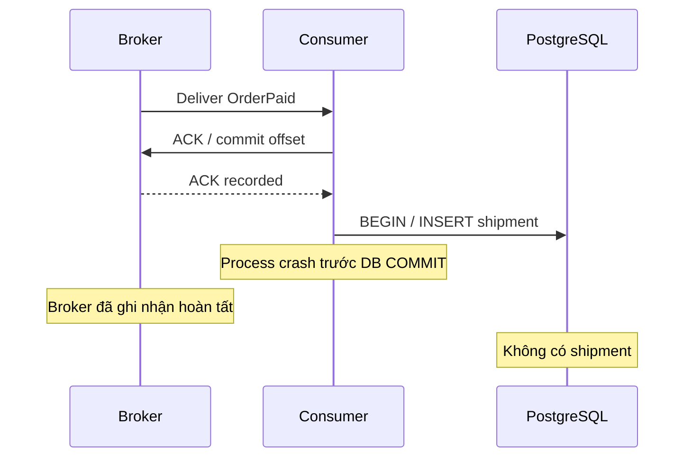
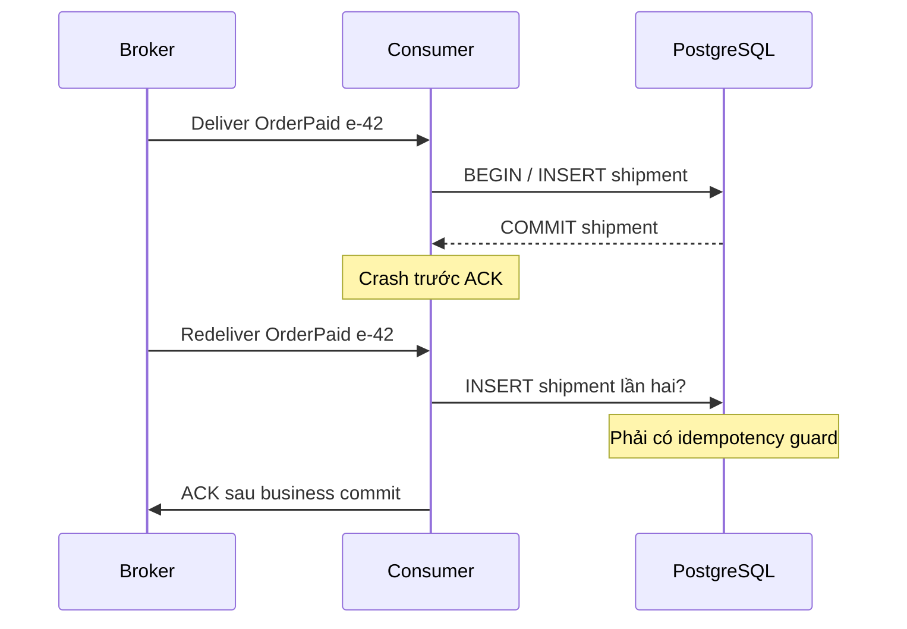
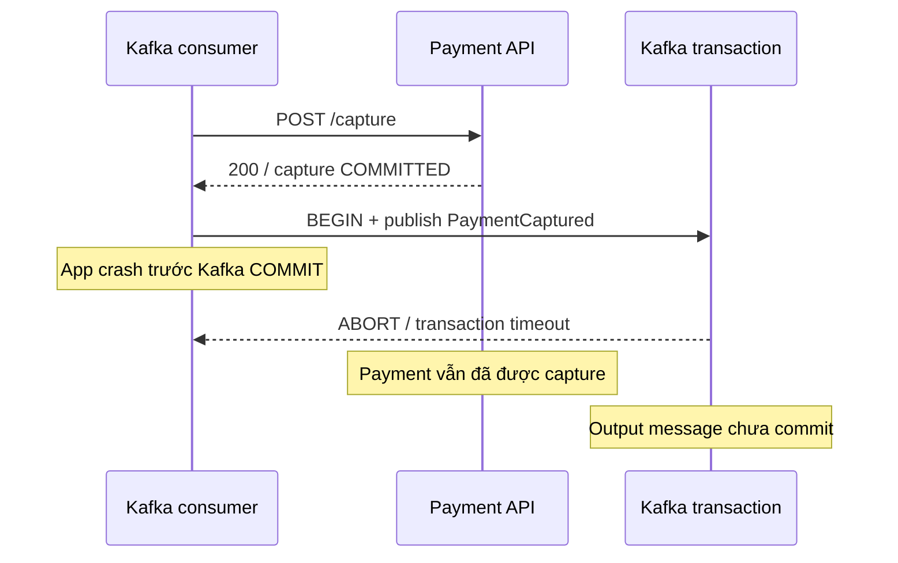
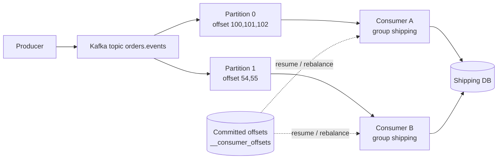
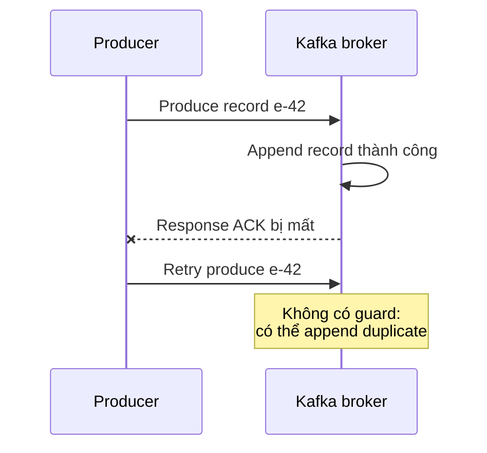
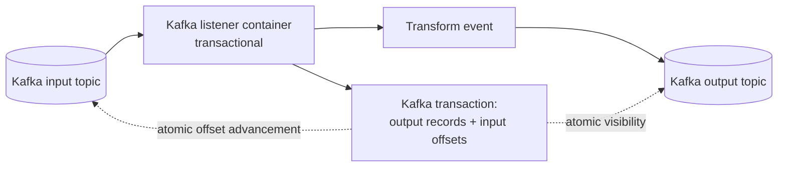
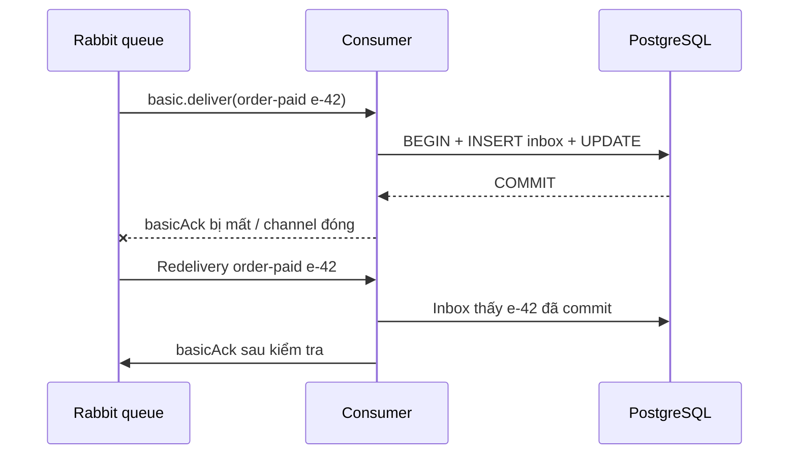
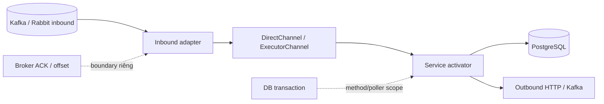
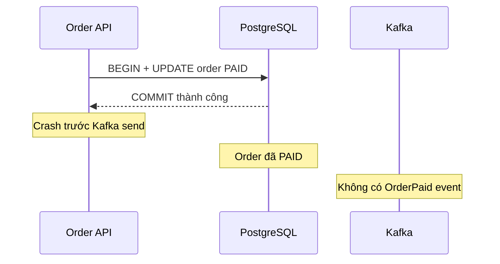
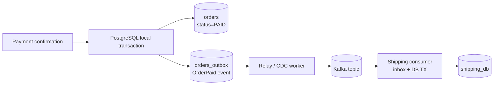

# At-most-once, at-least-once và giới hạn của exactly-once

## 1. Vì sao một message có thể mất hoặc được xử lý nhiều lần?

Giả sử `order-service` cập nhật trạng thái đơn hàng trong PostgreSQL rồi phát `OrderPaid` lên Kafka; `shipping-service` nhận message để tạo vận đơn. Trong môi trường bình thường, một event được phát một lần, consumer xử lý một lần và kết quả trông có vẻ chính xác. Nhưng nếu process chết đúng lúc commit hoặc mất phản hồi từ broker thì một event có thể **không được phát**, **được giao lại** hoặc **đã tạo vận đơn nhưng consumer không biết mình đã hoàn tất**.

```text
Payment service             Message broker             Shipping service
      |                            |                            |
      |-------- OrderPaid -------->|                            |
      |                            |-------- OrderPaid -------->|
      |                            |                  INSERT shipment
      |                            |                  COMMIT database
      |                            |<--- ACK bị mất ---X         |
      |                            |-------- OrderPaid -------->|
      |                            |           xử lý lại cùng event?
```

Khi ACK bị mất, broker không thể dựa vào suy đoán rằng handler đã commit database. Nó phải đưa ra quyết định: **giao lại** để tránh mất việc, hay **không giao lại** để tránh trùng. Từ đây xuất hiện ba nhóm ngữ nghĩa phân phối:

- **At-most-once:** có thể mất message, nhưng không cố tình giao lại sau khi đã đánh dấu xong.
- **At-least-once:** ưu tiên không bỏ lỡ message; có thể giao lại và xử lý trùng.
- **Exactly-once:** tuyên bố một hiệu ứng chỉ xảy ra đúng một lần **trong một phạm vi được định nghĩa chặt chẽ**; không mặc nhiên bảo đảm mọi database, HTTP và broker cùng commit nguyên tử.

Bài **“At-most-once, at-least-once và giới hạn của exactly-once”** thuộc chương **Nền tảng nhắn tin** của module `SPRING_BOOT_INTEGRATION`. Ta xem các bảo đảm này khi tích hợp Spring Boot với HTTP client, PostgreSQL, Kafka, RabbitMQ/JMS, Redis và Spring Integration, chú trọng hợp đồng sự kiện, giao dịch, lỗi, idempotency, kiểm thử và quan sát hệ thống.

**Mục tiêu:**

1. Phân biệt *delivery*, *processing* và *business side effect* thay vì nói chung chung “đã xử lý đúng một lần”.
2. Chỉ ra cửa sổ lỗi tương ứng của at-most-once và at-least-once.
3. Hiểu Kafka idempotent producer, producer transactions, offset transactions và phạm vi Kafka exactly-once semantics.
4. Hiểu RabbitMQ acknowledgment, publisher confirms, redelivery và local channel transactions; phân biệt với JDBC commit.
5. Dùng Spring Boot/Spring Kafka để xây consumer at-least-once có **idempotent database effect** nhờ inbox và unique constraint.
6. Dùng transactional outbox khi cần đảm bảo event không bị mất sau database commit.
7. Thiết kế retry, DLT/parking, ordering, idempotency TTL, version guard và phục hồi sau crash.
8. Kiểm thử từng failure window bằng broker/database thật và giám sát trùng lặp hay backlog.

> **Phiên bản áp dụng:** Ví dụ dựa trên Java 17+, Spring Boot 3.x, Spring Kafka 3.x, Kafka broker phù hợp, Spring AMQP, PostgreSQL và Spring Framework 6.x. Nếu sử dụng Spring Boot 4.x, Spring Kafka 4.x hoặc broker/driver phiên bản khác, đối chiếu cấu hình và APIs tương ứng. Một số đoạn mã là phương án độc lập hoặc phác thảo có ghi rõ; không gộp mọi ví dụ thành một application mà chưa quyết định business workflow.

## 2. Ba tầng của khái niệm “một lần”

Khi nghe “message được xử lý đúng một lần”, hãy hỏi **một lần ở tầng nào**:

| Tầng | Điều quan sát | Điều bảo đảm không tự suy ra |
| --- | --- | --- |
| **Producer → broker** | Record có được append vào topic/queue một lần khi producer retry? | Consumer chỉ chạy một lần, database chỉ commit một lần. |
| **Broker → consumer** | Message có thể được delivery/redelivery bao nhiêu lần? | Một delivery đồng nghĩa một transaction DB thành công. |
| **Consumer → business state** | Đơn hàng, sổ cái, vận đơn, email hoặc HTTP call có tác dụng phụ mấy lần? | Broker offset/ACK đã commit thì mọi side effect chắc chắn hoàn tất. |
| **Chuỗi nhiều hệ thống** | Một logical command có hoàn tất mọi bước? | Kafka transaction tự bao PostgreSQL, Redis và HTTP provider. |

Một message có thể được broker giao **hai lần**, consumer invocation chạy **hai lần**, nhưng nếu business database có một unique ledger thì **chỉ có một shipment được tạo**. Đó là một thiết kế **at-least-once delivery + idempotent consumer**, không phải bằng chứng rằng broker không redeliver.

Ngược lại, broker có thể chỉ giao một lần, nhưng handler mở hai threads gọi hai APIs tạo cùng side effect: **at-most-once delivery không tự tạo exactly-once effect**.

### 2.1. Phân biệt các đơn vị nhận dạng

```text
HTTP request ID          : định danh một request/trace
Business command ID      : định danh một yêu cầu nghiệp vụ logic
Event ID                 : định danh một sự kiện đã phát
Kafka record identity    : topic + partition + offset
Rabbit delivery tag      : số thứ tự delivery trên một channel
Aggregate ID / version   : entity + phiên bản thay đổi
Side-effect key          : ID charge / reservation / shipment tại provider
```

Không dùng lẫn các định danh:

- Kafka `offset` hữu ích để biết vị trí trong **một partition**, nhưng record được publish lại sau crash có thể mang **offset khác** dù cùng logical event.
- Rabbit delivery tag gắn với **channel**, không phải business event ID bền vững.
- Một logical command có thể phát nhiều events hợp lệ; không dùng mỗi `orderId` để chống trùng toàn bộ sự kiện của vòng đời đơn hàng.
- Event ID phải ổn định khi relay gửi lại cùng outbox row; nếu mỗi retry sinh UUID mới, consumer khó phân biệt duplicate nghiệp vụ.

### 2.2. Mất message khác xử lý thất bại

Một event **mất** nếu nó không còn trên đường phục hồi trong khi nghiệp vụ vẫn cần xử lý. Một event được đưa vào DLT/parking là **chưa xử lý thành công**, nhưng có thể **chưa mất** nếu DLT bền vững, có retention, owner và quy trình replay.

Một event bị retry mãi và kẹt partition cũng chưa chắc bị mất, nhưng nó có thể khiến **liveness** của cả luồng giảm về 0. Vì thế cần đo cả *safety* (không tạo side effect sai) lẫn *liveness* (công việc tiến về trạng thái hoàn tất).

## 3. At-most-once: ghi nhận đã nhận trước khi xử lý

At-most-once thường được mô phỏng bằng cách **commit offset/ack trước khi thực hiện side effect**. Nếu process chết sau ACK nhưng trước DB commit, broker tin rằng record đã xong và không giao lại record đó theo cơ chế retry bình thường.



**Kết quả:** có thể không có shipment dù `OrderPaid` đã từng được consumer nhận.

| Đặc điểm | At-most-once |
| --- | --- |
| Ưu tiên | Hạn chế redelivery. |
| Chi phí | Có cửa sổ mất công việc. |
| Hợp lý khi | Dữ liệu có thể bỏ qua: telemetry sampled, cache hint không quan trọng, metrics best-effort. |
| Không hợp lý khi | Thanh toán, tạo vận đơn, ghi sổ kế toán hoặc cập nhật trạng thái bắt buộc. |
| Vấn đề cần quản lý | ACK trước processing không thể chứng minh business success. |

**Lưu ý Kafka:** trong consumer Kafka, “at-most-once” là cách quản lý vị trí offset/commit so với processing, không có thuộc tính `delivery.guarantee=at-most-once` dùng chung cho mọi Spring Kafka listener. Khi commit sớm, phải hiểu offset commit thường lưu **offset tiếp theo**; một sai lệch có thể bỏ qua records.

**Lưu ý RabbitMQ:** manual `basicAck` trước DB write có cửa sổ mất tương tự. `autoAck=true` (một cách vận hành fire-and-forget ở mức broker) cũng có thể làm message bị coi đã giao dù ứng dụng chưa xử lý an toàn. Không nhầm AUTO acknowledgement của từng framework với bảo đảm at-most-once trên mọi side effect.

### 3.1. Tại sao “không retry” không tự bằng at-most-once?

Ngay cả khi application không chủ động retry, broker có thể redeliver khi connection/channel bị đóng trước ACK hoặc consumer group rebalance trước offset commit. Cần quan sát **thời điểm acknowledgment thật**. Nếu chọn at-most-once, phải cố tình chấp nhận rủi ro mất dữ liệu; tắt retry đơn thuần không tạo ra một guarantee đáng tin.

## 4. At-least-once: xử lý trước, ACK sau

At-least-once thường ưu tiên khả năng phục hồi bằng cách chỉ ACK/commit offset sau khi xử lý đã thành công. Nếu process chết sau DB commit nhưng trước ACK, broker có thể giao lại event.



Một broker có thể giao cùng logical message nhiều lần vì:

- Consumer xử lý xong nhưng ACK bị mất.
- Consumer crash sau commit DB nhưng trước offset commit.
- Visibility timeout/lease hết hạn (với queue có cơ chế visibility).
- Rebalance khiến record chưa commit được giao lại cho consumer khác.
- Producer retry hoặc outbox relay publish lại event cùng nội dung nhưng **vị trí broker khác**.
- Operator replay DLT, reset offsets hoặc backfill historical messages.

**At-least-once thường là mặc định thực tế khi muốn không mất event, nhưng chỉ thực hiện đúng khi có persistence, retry/replay và ack policy phù hợp.** Nếu TTL/retention hết trước khi consumer theo kịp, broker cũng không thể cam kết sự kiện sẽ có mãi.

### 4.1. Commit database trước ACK là cần, nhưng chưa đủ

```text
Consume event e-42
    -> BEGIN PostgreSQL
    -> UPDATE order_projection
    -> COMMIT PostgreSQL
    -> broker ACK / offset commit
```

Đường này giảm khả năng *mất việc* do ack sớm. Tuy nhiên, sau DB commit có thể crash trước ACK và gây **duplicate delivery**. Vì vậy phải thêm **idempotent business effect** chứ không chỉ di chuyển dòng `acknowledge()`.

### 4.2. Delivery thành công không đồng nghĩa business state thành công

```text
Broker delivery OK
JSON decode OK
Listener method returned OK
Asynchronous DB task still pending
Broker ACK recorded
DB task later failed
```

Nếu listener trả bình thường trước khi asynchronous work được xác nhận bền vững, broker có thể ack một công việc chưa hoàn tất. Với reactive `Mono`/`Flux`, cần compose/subscribe đúng tại boundary để container chỉ coi hoàn thành khi side effect quan trọng đã commit. Với imperative local transaction, nên đặt ACK **sau lời gọi service đã kết thúc commit**, không gọi trong method transaction trước điểm commit.

## 5. Exactly-once: luôn ghi rõ phạm vi và định nghĩa

Thuật ngữ exactly-once thường bị hiểu thành “bất kỳ event nào cũng có một business effect duy nhất trong mọi tình huống”. Trên hệ thống phân tán, điều đó đòi hỏi làm rõ phạm vi transaction, định danh, persistence và khả năng quan sát.

Một phiên bản có thể chứng minh trong Kafka là:

> Trong một luồng **consume-transform-produce** được cấu hình đúng với Kafka transactions, records đầu ra và consumer offsets có thể được commit atomically **trong Kafka**; downstream `read_committed` chỉ thấy các transaction đã commit.

Nó **không** có nghĩa:

- JDBC database tham gia Kafka producer transaction.
- HTTP Payment API hoặc Warehouse reservation có thể rollback nếu Kafka abort.
- Redis cache/một object storage upload được commit cùng Kafka.
- Consumer callback Java chỉ chạy đúng một lần.
- Một operator không thể replay một command nghiệp vụ bằng event ID mới.
- Mỗi webhook/email hoặc external API sẽ chỉ tạo một tác dụng phụ.

### 5.1. Ba kiểu tuyên bố cần phân biệt

| Tuyên bố | Phạm vi có thể đạt được | Không suy ra |
| --- | --- | --- |
| **Kafka producer idempotence** | Broker loại bỏ một số duplicate writes do **retry của cùng producer session/sequence**. | Loại bỏ mọi publish trùng từ outbox relay sau restart. |
| **Kafka transaction / EOS** | Atomic commit của Kafka output records và offsets (khi framework được cấu hình đúng). | Atomic commit với PostgreSQL, HTTP, Redis. |
| **Exactly-once business effect** | Một effect logic theo stable command/event ID, protected bởi unique constraint/transaction hoặc provider idempotency contract. | Message chỉ được giao/handler chỉ chạy một lần. |

Một business effect có thể đạt **effectively once** trong phạm vi đã kiểm soát nhờ event ID ổn định, inbox, DB unique constraints và atomic transaction. Phải nêu điều kiện của chính effect đó; khi có side effect ngoài DB, cần mở rộng idempotency sang provider/compensation/reconciliation.

### 5.2. Ví dụ nhỏ chứng minh giới hạn



Kafka exactly-once không hoàn tác capture ở provider. Nếu gọi lại `POST /capture`, cần provider idempotency key và trạng thái thanh toán để không thu tiền hai lần.

## 6. Đặt các bảo đảm lên một trục so sánh

| Tính chất | At-most-once | At-least-once | Kafka exactly-once (trong Kafka) |
| --- | --- | --- | --- |
| Message có thể mất ở cửa sổ crash? | **Có** nếu ACK sớm. | Thiết kế để retry/replay nếu message vẫn được lưu bền. | Có giới hạn retention/operational caveats; atomic visibility trong phạm vi Kafka TX. |
| Message có thể được giao lại? | Thông thường không theo normal retry sau ACK. | **Có**. | Consumer work có thể chạy lại; Kafka output/offset commit atomically trong đúng flow. |
| Handler code chạy nhiều hơn một lần? | Có thể do lỗi implementation hoặc trigger khác. | **Có**, cần dự liệu. | **Có** khi transaction abort/retry. |
| External JDBC/HTTP effect chỉ một lần? | Không. | Không, nếu thiếu idempotency. | **Không tự bảo đảm.** |
| Cơ chế trọng tâm | ACK/offset trước xử lý. | Xử lý bền vững trước ACK, chịu duplicate. | Producer ID + sequence, transaction coordinator, transactional offsets, `read_committed`. |
| Chi phí/độ phức tạp | Thấp nhưng có rủi ro mất dữ liệu. | Thường phù hợp đa số business flows. | Cao hơn; phụ thuộc producer/consumer/transaction config và broker vận hành. |

**Nguyên tắc lựa chọn:** Ưu tiên bắt đầu từ **at-least-once delivery + idempotent handler** cho business events. Chỉ chấp nhận at-most-once cho dữ liệu mất được. Dùng Kafka EOS khi có nhu cầu Kafka-to-Kafka atomic processing, không dùng từ “exactly-once” để che việc thiếu transaction giữa DB, broker và HTTP.

## 7. Kafka: record, partition, offset và consumer group

Kafka lưu records trong **partition logs**. Trong mỗi topic-partition, record có offset và được đọc theo thứ tự log. Consumer thuộc cùng group được phân công partitions; group lưu committed offsets thể hiện vị trí sẽ đọc tiếp khi consumer restart hoặc rebalance.



**Phân biệt position với business completion:**

- Consumer đã poll record offset 100 không đồng nghĩa đã commit business database.
- Consumer đã xử lý record 100 nhưng chưa commit offset 101 có thể nhận lại offset 100.
- Kafka committed offset là vị trí trong broker; nó không kiểm tra xem vận đơn, email, thanh toán hoặc Redis side effect đã thành công chưa.
- Một group thường chia công việc giữa members; record không broadcast tới **mọi pod trong cùng group**.
- Một topic có thể có nhiều consumer groups độc lập: `shipping` và `analytics` mỗi group đọc records theo offset riêng.

### 7.1. Key và ordering

Nếu các thay đổi của một đơn hàng cần được xử lý theo thứ tự, producer nên chọn **Kafka record key ổn định theo aggregate** như `tenantId:orderId`, nhờ đó các records của một key thường được đưa vào cùng partition dưới cùng partitioning strategy/partition count.

```text
Key tenant-a:order-42:
  OrderCreated(version=1)
  OrderPaid(version=2)
  OrderShipped(version=3)
```

Điều đó **không** tạo global ordering giữa các partitions. Nếu tăng số partitions hoặc đổi partitioner, key có thể được route khác so với trước và thứ tự xuyên giai đoạn migration cần được thiết kế. Một consumer dùng `flatMap` concurrency cao cũng có thể hoàn tất DB writes **khác thứ tự** dù records poll đúng thứ tự.

### 7.2. Retention và replay

Kafka retention phụ thuộc cấu hình broker/topic và khả năng lưu trữ; việc commit offset không làm Kafka xóa record ngay. Replay có thể bằng group mới/seek/reset offset khi record còn. Nhưng nếu retention hết, không có cách khôi phục missing events từ Kafka log trừ khi có nguồn lưu khác (transactional outbox, database snapshot, archive).

Vì vậy “at-least-once” phải đi kèm **độ bền của producer/queue + monitoring lag/retention horizon**. Một consumer ngừng 20 ngày trong khi topic giữ 7 ngày không thể đòi broker giao lại dữ liệu đã bị xóa.

## 8. Kafka producer: idempotence và acknowledgments

### 8.1. Producer retry có thể tạo duplicate records



Kafka **idempotent producer** dùng producer identity, epoch và per-partition sequence numbers để broker nhận ra các retry có thể gây duplicate trong phạm vi hỗ trợ. Kafka client/broker còn có các yêu cầu như acknowledgments, in-flight settings, retry và cluster durability. Với producer idempotence được bật và cấu hình hợp lệ, các retries của producer session có thể được dedupe.

**Giới hạn rất quan trọng:** nếu app restart và outbox relay gọi `send(...)` lại cùng logical event, đó có thể là một producer session khác và Kafka vẫn append **một record mới ở offset khác**. Idempotence của Kafka producer không so sánh nội dung `eventId` như business uniqueness key.

### 8.2. Cấu hình Spring Boot producer

Với Spring Boot 3.x, dependency thường là:

```xml
<dependency>
    <groupId>org.springframework.kafka</groupId>
    <artifactId>spring-kafka</artifactId>
</dependency>
```

Ví dụ:

```yaml
spring:
  kafka:
    bootstrap-servers: ${KAFKA_BOOTSTRAP_SERVERS:localhost:9092}
    producer:
      key-serializer: org.apache.kafka.common.serialization.StringSerializer
      value-serializer: org.apache.kafka.common.serialization.StringSerializer
      acks: all
      retries: 5
      properties:
        enable.idempotence: true
        max.in.flight.requests.per.connection: 5
        delivery.timeout.ms: 120000
```

Các con số ở đây là **ví dụ**, không phải khuyến nghị chung cho mọi SLA/broker. Kafka clients hiện đại có defaults hỗ trợ idempotence khi không cấu hình xung đột, nhưng ghi rõ `enable.idempotence=true` giúp ý định dễ review. `acks=all` chỉ có ý nghĩa phù hợp khi cluster/topic có replication và `min.insync.replicas` thích hợp; broker leader mất dữ liệu trong cấu hình replication không an toàn vẫn có thể làm thay đổi guarantee.

**Phân biệt:**

- `send(...)` trả future **không đồng nghĩa** broker đã append/ack thành công.
- Producer callback/future completion cho biết kết quả mà client quan sát được; response timeout vẫn có thể tạo **unknown outcome**.
- `acks=all` không tự bảo đảm consumer đã xử lý.
- `enable.idempotence` không tự bảo đảm không có hai business events mang event ID khác nhau.

### 8.3. Producer acknowledgment phải gắn với kết quả thật

Ví dụ publish đơn giản:

```java
// OrderEventPublisher.java
package com.example.messaging;

import java.util.concurrent.CompletableFuture;
import org.springframework.kafka.core.KafkaTemplate;
import org.springframework.kafka.support.SendResult;
import org.springframework.stereotype.Component;

@Component
public class OrderEventPublisher {
    private final KafkaTemplate<String, String> kafka;

    public OrderEventPublisher(
        KafkaTemplate<String, String> kafka
    ) {
        this.kafka = kafka;
    }

    public CompletableFuture<SendResult<String, String>>
        publish(String aggregateKey, String eventJson) {
        return kafka.send(
            "orders.events.v1", aggregateKey, eventJson
        );
    }
}
```

Caller phải **observe completion** của future trước khi kết luận broker đã xác nhận publish, và cần đặt timeout/deadline của workflow. Không gọi `publish(...)` rồi đánh dấu outbox row là `published=true` ngay lập tức trong khi future còn pending.

### 8.4. Cần xác định event ID, key và schema version

Một event contract tối thiểu:

```json
{
  "eventId": "evt-order-42-paid-v2",
  "eventType": "OrderPaid",
  "schemaVersion": 1,
  "tenantId": "tenant-a",
  "orderId": "order-42",
  "version": 2,
  "status": "PAID",
  "occurredAt": "2026-11-21T03:10:00Z"
}
```

`eventId` nhận diện logical event xuyên các lần relay/restart; `tenantId + orderId` là Kafka key để hỗ trợ ordering theo aggregate; `version` giúp consumer bỏ qua trạng thái đã cũ hoặc phát hiện version gaps. `occurredAt` là thời gian nghiệp vụ từ nguồn phát, không phải bảo đảm thứ tự tuyệt đối giữa các producers.

## 9. Kafka transaction và exactly-once semantics trong phạm vi broker

Kafka transaction có thể gom nhiều Kafka producer records trong một transaction. Khi dùng đúng giao thức consume-process-produce, Kafka có thể commit **output records và offsets** cùng một transaction. Downstream sử dụng `isolation.level=read_committed` để không thấy records thuộc aborted transaction.

### 9.1. Producer transaction đơn thuần

```yaml
spring:
  kafka:
    producer:
      transaction-id-prefix: ${KAFKA_TX_PREFIX:orders-publisher-}
```

Với Spring Boot/Spring Kafka 3.x và transactional producer factory, một số auto-configuration có thể tạo `KafkaTransactionManager` khi cung cấp transaction-id-prefix. Khi dùng nhiều instances, **transactional IDs phải không xung đột giữa các active producers**; prefix cần được thiết kế theo deployment/process identity hoặc cơ chế transaction ID management mà Spring Kafka hỗ trợ. Nếu cùng transactional ID được dùng bởi hai producers, cơ chế fencing có thể dừng một producer; đó là bảo vệ consistency, không phải lỗi nên retry vô hạn.

```java
// Ví dụ Kafka-only transaction.
import org.springframework.kafka.core.KafkaTemplate;

public void publishTwoEvents(
    KafkaTemplate<String, String> template
) {
    template.executeInTransaction(operations -> {
        operations.send(
            "orders.events.v1",
            "tenant-a:order-42",
            "{\"eventId\":\"e1\",\"eventType\":\"OrderPaid\"}"
        );
        operations.send(
            "orders.events.v1",
            "tenant-a:order-42",
            "{\"eventId\":\"e2\",\"eventType\":\"OrderConfirmed\"}"
        );
        return null;
    });
}
```

Trong phạm vi Kafka producer transaction này, hai records được commit hoặc abort theo transaction; consumer `read_committed` không thấy records của transaction abort. Nhưng nó **không** bảo đảm database update hoặc HTTP call xảy ra trước/sau đó được rollback cùng Kafka.

### 9.2. Consume-transform-produce với offsets cùng Kafka transaction



Một kiểu cấu hình đúng cần:

1. Transactional `ProducerFactory` với transactional IDs không xung đột.
2. Listener container được cấu hình phù hợp với `KafkaTransactionManager` để bắt đầu Kafka transaction cho processing.
3. Output records được gửi trong **transaction của container**; offsets của input records được đưa vào transaction theo cơ chế Spring Kafka.
4. Exception quan trọng phải **thoát khỏi processing** để transaction abort; nếu catch rồi return bình thường, framework có thể commit dù business logic lỗi.
5. Downstream consumer dùng `isolation.level=read_committed` để bỏ qua aborted/uncommitted output.
6. Error handler/recovery phù hợp khi transaction abort, re-seek và replay.

Điều này tạo một bảo đảm hữu ích **trong Kafka logs**, nhưng user code vẫn có thể chạy lại trên abort. Nếu listener bên trong đã gọi HTTP Payment hoặc INSERT vào PostgreSQL ngoài Kafka transaction, side effect ấy **không** tự bị undo.

### 9.3. Transactional Kafka không phải JTA/XA với JDBC

```text
BEGIN PostgreSQL
  UPDATE orders
COMMIT PostgreSQL    <-- thành công

BEGIN Kafka transaction
  SEND OrderPaid
COMMIT Kafka         <-- thất bại
```

Kết quả: orders database đã thay đổi nhưng event có thể không được publish như mong muốn. Đảo thứ tự commits tạo cửa sổ ngược: Kafka event xuất hiện trước khi DB commit. Spring Kafka có cơ chế synchronization/transaction sequencing trong một số flow, nhưng **sắp xếp thứ tự hai local commits không tạo atomic distributed 2PC**.

Giải pháp thường dùng là **transactional outbox**: ghi order và event intent trong **cùng PostgreSQL transaction**, sau đó relay sang Kafka có retry/reconciliation.

### 9.4. Kafka EOS không có nghĩa “một invocation Java”

Nếu Kafka transaction abort vì producer fencing, timeout hoặc consumer rebalance, framework có thể xử lý lại input. Handler được gọi nhiều hơn một lần, nhưng những **output records chưa commit** không trở thành records đã commit trong Kafka đối với downstream `read_committed`. Đây là khác biệt giữa **exactly-once output semantics** và **exactly-once code execution**.

### 9.5. Consumer isolation level và lưu ý compatibility

```yaml
spring:
  kafka:
    consumer:
      properties:
        isolation.level: read_committed
```

`read_committed` ảnh hưởng visibility của các transactional Kafka records và cách consumer đi qua aborted/open transactions. Nó **không** khử duplicate application events đã được publish ở hai transactions thành công khác nhau; một duplicate `eventId` vẫn phải được xử lý tại business layer. Nếu topic không dùng transactions, `read_committed` không biến những records đó thành records có guarantee mới.

## 10. Spring Boot consumer at-least-once: ACK sau local DB commit

Ví dụ xây một Kafka consumer cập nhật PostgreSQL read model. Ta dùng **at-least-once delivery** và **idempotency inbox** để đảm bảo cùng event không làm thay đổi trạng thái nghiệp vụ nhiều lần.

### 10.1. Dependencies

```xml
<!-- Spring Boot parent/BOM quản lý versions phù hợp -->
<dependency>
    <groupId>org.springframework.kafka</groupId>
    <artifactId>spring-kafka</artifactId>
</dependency>
<dependency>
    <groupId>org.springframework.boot</groupId>
    <artifactId>spring-boot-starter-jdbc</artifactId>
</dependency>
<dependency>
    <groupId>org.postgresql</groupId>
    <artifactId>postgresql</artifactId>
    <scope>runtime</scope>
</dependency>
<dependency>
    <groupId>org.springframework.boot</groupId>
    <artifactId>spring-boot-starter-test</artifactId>
    <scope>test</scope>
</dependency>
<dependency>
    <groupId>org.springframework.kafka</groupId>
    <artifactId>spring-kafka-test</artifactId>
    <scope>test</scope>
</dependency>
```

### 10.2. application.yml

```yaml
spring:
  datasource:
    url: ${JDBC_URL:jdbc:postgresql://localhost:5432/orders_projection}
    username: ${DB_USERNAME:orders_app}
    password: ${DB_PASSWORD}
  kafka:
    bootstrap-servers: ${KAFKA_BOOTSTRAP_SERVERS:localhost:9092}
    consumer:
      group-id: orders-projection
      key-deserializer: org.apache.kafka.common.serialization.StringDeserializer
      value-deserializer: org.apache.kafka.common.serialization.StringDeserializer
      properties:
        enable.auto.commit: false
        isolation.level: read_committed
    listener:
      ack-mode: manual_immediate
      concurrency: 3
```

Đoạn này dùng manual acknowledgment để thể hiện thứ tự **DB commit → ACK**. Trong môi trường có Kafka transaction coordinator/container EOS, cách cấu hình acknowledgment có thể khác; **không** gộp manual ack ví dụ này với transactional listener container khác rồi kỳ vọng cả hai được điều khiển tự động.

`concurrency: 3` là số concurrent listener containers/threads phù hợp khi topic có đủ partitions; nếu topic ít partitions hơn, tăng concurrency không tạo nhiều parallel partitions hơn. Cân nhắc connection pool và thứ tự xử lý theo aggregate.

### 10.3. Bảng read model và inbox

```sql
CREATE TABLE order_projection (
    tenant_id          VARCHAR(80) NOT NULL,
    order_id           VARCHAR(100) NOT NULL,
    status             VARCHAR(30) NOT NULL,
    last_event_version BIGINT NOT NULL DEFAULT 0,
    updated_at         TIMESTAMPTZ NOT NULL DEFAULT CURRENT_TIMESTAMP,
    PRIMARY KEY (tenant_id, order_id),
    CHECK (last_event_version >= 0)
);

CREATE TABLE processed_events (
    consumer_name VARCHAR(80) NOT NULL,
    event_id      VARCHAR(160) NOT NULL,
    processed_at  TIMESTAMPTZ NOT NULL DEFAULT CURRENT_TIMESTAMP,
    PRIMARY KEY (consumer_name, event_id)
);

-- Fixture: read model đã được tạo từ OrderCreated version=1.
INSERT INTO order_projection(
    tenant_id, order_id, status, last_event_version
) VALUES ('tenant-a', 'order-42', 'PENDING', 1);
```

**Quy tắc:** Inbox marker và UPDATE business state phải nằm trong **cùng local PostgreSQL transaction**. Nếu marker commit trước rồi UPDATE thất bại, lần redelivery sau có thể bị coi là duplicate và bỏ qua sai; nếu UPDATE commit trước marker, crash có thể nhân đôi side effect.

### 10.4. Event DTO và validation

```java
// OrderPaidEvent.java
package com.example.messaging;

public record OrderPaidEvent(
    String eventId,
    String tenantId,
    String orderId,
    long version,
    String status
) {}
```

Ví dụ chỉ xử lý **absolute state** `status=PAID` cho một aggregate version, không phải delta `balance += amount`. Với delta không giao hoán, cần ordering/version gap handling mạnh hơn.

### 10.5. Business handler transactionally deduplicates

```java
// OrderProjectionWriter.java
package com.example.messaging;

import org.springframework.jdbc.core.JdbcTemplate;
import org.springframework.stereotype.Service;
import org.springframework.transaction.annotation.Transactional;

@Service
public class OrderProjectionWriter {
    private final JdbcTemplate jdbc;

    public OrderProjectionWriter(JdbcTemplate jdbc) {
        this.jdbc = jdbc;
    }

    @Transactional(transactionManager = "transactionManager")
    public void apply(OrderPaidEvent event) {
        if (event.eventId() == null || event.eventId().isBlank()
            || event.tenantId() == null || event.tenantId().isBlank()
            || event.orderId() == null || event.orderId().isBlank()
            || event.version() <= 0
            || !"PAID".equals(event.status())) {
            throw new InvalidEventContractException(
                "Invalid OrderPaid event"
            );
        }

        int first = jdbc.update("""
            INSERT INTO processed_events (consumer_name, event_id)
            VALUES ('orders-projection', ?)
            ON CONFLICT (consumer_name, event_id) DO NOTHING
            """, event.eventId());

        if (first == 0) {
            // Cùng consumer đã commit eventId này trước đó.
            return;
        }

        int updated = jdbc.update("""
            UPDATE order_projection
            SET status = 'PAID',
                last_event_version = ?,
                updated_at = CURRENT_TIMESTAMP
            WHERE tenant_id = ?
              AND order_id = ?
              AND last_event_version < ?
            """,
            event.version(),
            event.tenantId(),
            event.orderId(),
            event.version()
        );

        if (updated == 0) {
            // Với absolute-state event, version cũ hơn có thể
            // đã được vượt qua; nhưng thiếu aggregate là lỗi.
            Integer existing = jdbc.queryForObject("""
                SELECT COUNT(*)
                FROM order_projection
                WHERE tenant_id = ? AND order_id = ?
                """, Integer.class,
                event.tenantId(), event.orderId());

            if (existing == null || existing == 0) {
                throw new MissingOrderProjectionException(
                    event.orderId()
                );
            }
        }
    }
}
```

```java
// InvalidEventContractException.java
package com.example.messaging;

public class InvalidEventContractException
    extends RuntimeException {
    public InvalidEventContractException(String message) {
        super(message);
    }
}

// MissingOrderProjectionException.java — file riêng.
package com.example.messaging;

public class MissingOrderProjectionException
    extends RuntimeException {
    public MissingOrderProjectionException(String orderId) {
        super("Projection missing for " + orderId);
    }
}
```

**Lưu ý về tên manager:** trong ví dụ chỉ có một PostgreSQL datasource nên Spring Boot thường tạo bean manager tên `transactionManager` phù hợp; hãy xác minh tên trong dự án. Nếu có nhiều datasource, đặt `@Transactional(transactionManager="ordersTxManager")` và đảm bảo `JdbcTemplate` dùng **chính datasource** mà manager quản lý. Không đoán rằng một manager tự bao nhiều connections.

**Vì sao marker trước UPDATE vẫn an toàn?** Nếu `UPDATE`/business validation ném exception, transaction rollback cả marker. Nếu event đã commit trước đó, unique constraint ngăn effect lặp. Nếu 2 consumers cùng cố insert event ID, PostgreSQL xử lý tranh chấp tại unique index/transaction boundary; không dùng `SELECT exists` trước rồi `INSERT` sau mà không có atomic constraint.

**Giới hạn của code:** Khi UPDATE 0 vì projection đang ở version cao hơn, ví dụ coi event absolute-state cũ là superseded. Với **các chuyển trạng thái không thể đảo**, cần xác minh trạng thái version cao hơn hợp lệ; với *delta events* hoặc yêu cầu xử lý đủ mọi version, phải phát hiện gap/strict ordering thay vì đơn giản bỏ qua. Ngoài ra, nếu cùng `eventId` được gửi với payload khác, unique inbox sẽ coi là duplicate; hệ thống production nên lưu/check payload fingerprint/schema để phát hiện một event ID bị tái sử dụng sai.

### 10.6. Listener gọi writer qua bean, sau đó ACK

```java
// OrderProjectionListener.java
package com.example.messaging;

import com.fasterxml.jackson.databind.ObjectMapper;
import org.apache.kafka.clients.consumer.ConsumerRecord;
import org.springframework.kafka.annotation.KafkaListener;
import org.springframework.kafka.support.Acknowledgment;
import org.springframework.stereotype.Component;

@Component
public class OrderProjectionListener {
    private final ObjectMapper mapper;
    private final OrderProjectionWriter writer;

    public OrderProjectionListener(
        ObjectMapper mapper,
        OrderProjectionWriter writer
    ) {
        this.mapper = mapper;
        this.writer = writer;
    }

    @KafkaListener(
        topics = "orders.events.v1",
        groupId = "orders-projection"
    )
    public void onMessage(
        ConsumerRecord<String, String> record,
        Acknowledgment ack
    ) throws Exception {
        OrderPaidEvent event = mapper.readValue(
            record.value(), OrderPaidEvent.class
        );

        // Phải return bình thường SAU khi transaction DB commit.
        writer.apply(event);

        // Thao tác ACK/offset được listener container xử lý.
        ack.acknowledge();
    }
}
```

**Ranh giới quan trọng:**

1. Listener **không** mang `@Transactional` của database trên chính method `onMessage`.
2. Nó gọi một Spring bean khác `OrderProjectionWriter.apply(...)` qua proxy.
3. Local DB transaction bắt đầu, ghi marker và projection, rồi **commit khi `apply` hoàn tất**.
4. Chỉ sau đó listener mới gọi `ack.acknowledge()`.
5. Nếu DB rollback/ném exception, code không gọi ACK và error handler/container có thể retry/seek/recover theo cấu hình.

Nếu bạn đặt `@Transactional` trên listener method rồi gọi `ack.acknowledge()` **trước khi method return**, transaction interceptor có thể chưa commit DB tại thời điểm ACK; đó là cửa sổ mất dữ liệu nếu commit sau đó thất bại. Do vậy đặt DB transaction trong service riêng dễ giải thích và kiểm thử hơn.

**Bổ sung về ACK:** `Acknowledgment.acknowledge()` là lệnh gửi yêu cầu ghi nhận đến listener container; Kafka offset commit có thể dùng sync/async mode và còn phụ thuộc lỗi network/rebalance. Không nên coi việc method trả về từ `acknowledge()` là bằng chứng business event đã exactly once; nếu offset chưa commit rồi app crash, record vẫn có thể redeliver. Inbox xử lý đúng trường hợp này.

### 10.7. Khi Spring Kafka listener xử lý dữ liệu sai định dạng

JSON malformed hoặc schema không tương thích có thể ném exception trước `writer.apply`. Một exception liên tục từ cùng record tạo **poison pill** làm partition không tiến nếu retry vô hạn. Hãy cấu hình `DefaultErrorHandler`, non-retryable exceptions, DLT hoặc parking có owner; ack/offset policy sau recovery phải được test thực tế. Không “catch mọi Exception rồi ACK” chỉ để làm consumer lag về 0.

## 11. Kafka retry và DLT: không được vô tình chuyển at-least-once thành mất việc

Với Spring Kafka 3.x, `DefaultErrorHandler` có thể retry lỗi phù hợp và chuyển event sang dead-letter topic sau khi hết attempts.

### 11.1. Error handler với retry bounded

```java
// KafkaErrorHandlingConfiguration.java
package com.example.messaging;

import org.springframework.context.annotation.Bean;
import org.springframework.context.annotation.Configuration;
import org.springframework.kafka.listener.DefaultErrorHandler;
import org.springframework.kafka.listener.DeadLetterPublishingRecoverer;
import org.springframework.util.backoff.FixedBackOff;

@Configuration(proxyBeanMethods = false)
public class KafkaErrorHandlingConfiguration {
    @Bean
    DefaultErrorHandler defaultKafkaErrorHandler(
        DeadLetterPublishingRecoverer recoverer
    ) {
        DefaultErrorHandler handler = new DefaultErrorHandler(
            recoverer,
            new FixedBackOff(500L, 2L)
        );
        handler.addNotRetryableExceptions(
            InvalidEventContractException.class
        );
        return handler;
    }
}
```

Trong ví dụ, `FixedBackOff(500, 2)` có **hai lần retry sau lần thử đầu**. `DeadLetterPublishingRecoverer` phải được cấu hình/khai báo cùng Kafka producer, serializer và target DLT tương thích, ví dụ `orders.events.v1-dlt`; **không** giả định auto-configuration luôn tạo recoverer phù hợp. Khi có deserializer lỗi trước listener invocation, cần `ErrorHandlingDeserializer` hoặc cơ chế error handling tương ứng để poisoned bytes có đường xử lý.

**Lưu ý quan trọng với manual ack:** việc handler recovered, consumer offset được commit, và DLT publish được broker xác nhận là **ba việc khác nhau**. Spring Kafka có cấu hình như `ackAfterHandle`, `commitRecovered`, container ack mode và transaction integration; kiểm thử đường DLT với broker thật, không đọc snippet rồi tuyên bố offset đã atomic với DLT. Nếu DLT publish thất bại, policy cần để record có thể retry chứ không được silently skip.

### 11.2. Retry topic và tác động đến ordering

Spring Kafka hỗ trợ non-blocking retry topics qua `@RetryableTopic` trong những phiên bản/cấu hình phù hợp. Nó hữu ích khi cần delay lớn mà không block listener thread, nhưng có đánh đổi:

```text
Main topic partition:
  OrderPaid(order-42, version=2) -> thất bại -> retry topic delay
  OrderShipped(order-42, version=3) -> có thể được xử lý trước

Retry topic:
  OrderPaid(order-42, version=2) -> trở lại muộn
```

Nếu handler chỉ set absolute state với version guard, một event cũ có thể bị bỏ qua an toàn theo contract. Nếu event là delta (ví dụ `inventory -= quantity`), bỏ qua hoặc đảo thứ tự có thể sai. Cần version-gap buffer, partition pause/seek, durable parking theo aggregate hoặc thiết kế state machine phù hợp.

### 11.3. Không retry vô hạn poison records

| Loại lỗi | Chính sách gợi ý |
| --- | --- |
| PostgreSQL deadlock đã rollback | Retry transaction mới, backoff/jitter hữu hạn. |
| Redis tạm mất, nhưng business DB đã commit | Không chạy lại toàn business effect nếu không có dedup guard; retry cache invalidation riêng. |
| JSON malformed/unknown schema version | Parking/DLT/quarantine; alert contract owner. |
| Dependency trả 503 khi xử lý command idempotent | Retry bounded với key ổn định; nếu lâu, chuyển durable work. |
| External payment timeout sau gửi request | `UNKNOWN_OUTCOME`; inquiry theo provider ID/key trước khi quyết định retry. |
| Kafka producer fenced | Điều tra transactional ID ownership; không retry vô hạn cùng faulty instance. |

### 11.4. DLT không đồng nghĩa “đã xử lý thành công”

Nếu một record được chuyển sang DLT, nó chỉ là **được giữ để phục hồi**. Chỉ ack nguồn sau khi việc lưu bền vững vào DLT/parking được xác nhận theo policy. DLT cần owner, metric oldest-age, retention, DLQ triage, schema-aware tooling và kiểm tra idempotency khi replay.

## 12. RabbitMQ: delivery acknowledgments, prefetch và redelivery

RabbitMQ dùng queue để phân phối messages đến consumers. Một queue có thể chứa **durable messages** khi cấu hình exchange/queue/message persistence phù hợp; broker còn có nhiều queue types như classic và quorum với các durability/failover trade-offs.

**Manual ACK** là phần then chốt của at-least-once:



### 12.1. ACK, NACK, reject, requeue

| Lệnh/cơ chế | Ý nghĩa | Rủi ro/đánh đổi |
| --- | --- | --- |
| `basicAck(deliveryTag, false)` | Xác nhận message trên channel. | ACK trước DB commit có thể mất business work. |
| `basicNack(tag, false, true)` | NACK và yêu cầu requeue. | Có thể tạo hot redelivery loop khi poison message. |
| `basicReject(tag, false)` | Reject không requeue; thường gửi DLX nếu được cấu hình. | Nếu không có DLX phù hợp, message có thể bị loại bỏ. |
| `basicNack(tag, false, false)` | NACK không requeue. | Cần DLX/parking để không biến lỗi thành mất dữ liệu. |
| Channel/connection close trước ACK | Unacked messages có thể được broker đưa lại queue. | Duplicate delivery sau DB commit. |
| Prefetch > 1 | Nhiều unacked messages đang được consumer giữ. | Crash/rebalance có thể gây burst redelivery. |

**Delivery tag chỉ có giá trị trong channel đã nhận message**, không được lưu như business deduplication key. Cũng không suy ra Rabbit `redelivered=true/false` là bằng chứng message đã/chưa commit business side effect. Nó chỉ cho biết một số trạng thái delivery mà broker quan sát được.

### 12.2. Spring AMQP manual ack configuration

Một ví dụ Spring Boot 3.x:

```xml
<dependency>
    <groupId>org.springframework.boot</groupId>
    <artifactId>spring-boot-starter-amqp</artifactId>
</dependency>
```

```yaml
spring:
  rabbitmq:
    host: ${RABBIT_HOST:localhost}
    port: ${RABBIT_PORT:5672}
    username: ${RABBIT_USER:orders_consumer}
    password: ${RABBIT_PASSWORD}
    listener:
      simple:
        acknowledge-mode: manual
        prefetch: 20
        concurrency: 2
        max-concurrency: 4
```

Các giá trị prefetch/concurrency chỉ là ví dụ. Với production: TLS, vhost, ACL, connection recovery, queue policy, message TTL, DLX và retry parameters phải được cấu hình đúng broker topology. Manual ack mode **không** làm Spring tự biết khi nào PostgreSQL đã commit; application phải đặt ACK ở boundary đúng.

### 12.3. Listener ACK sau writer transaction

```java
// RabbitOrderListener.java
package com.example.messaging;

import com.fasterxml.jackson.databind.ObjectMapper;
import com.rabbitmq.client.Channel;
import org.springframework.amqp.core.Message;
import org.springframework.amqp.rabbit.annotation.RabbitListener;
import org.springframework.stereotype.Component;

@Component
public class RabbitOrderListener {
    private final ObjectMapper mapper;
    private final OrderProjectionWriter writer;

    public RabbitOrderListener(
        ObjectMapper mapper,
        OrderProjectionWriter writer
    ) {
        this.mapper = mapper;
        this.writer = writer;
    }

    @RabbitListener(queues = "orders.paid.q")
    public void onMessage(
        Message message, Channel channel
    ) throws Exception {
        OrderPaidEvent event = mapper.readValue(
            message.getBody(), OrderPaidEvent.class
        );

        // Transaction DB commit trước khi writer.apply trả về.
        writer.apply(event);

        long deliveryTag =
            message.getMessageProperties().getDeliveryTag();
        channel.basicAck(deliveryTag, false);
    }
}
```

Ví dụ dùng lại `OrderProjectionWriter` và schema `processed_events` ở mục 10; thực tế một consumer Rabbit và một consumer Kafka có thể dùng **consumer_name khác nhau** hoặc cùng dedup scope có chủ đích. Chỉ chạy một đường nếu không có thiết kế phối hợp để tránh xử lý event ở hai nền tảng độc lập không mong muốn.

**Ở failure path:** listener ném exception trước ACK. Với manual acknowledgment, cách container xử lý exception, requeue và reject phụ thuộc `SimpleRabbitListenerContainerFactory`/error handler/`defaultRequeueRejected`/retry advice và phiên bản framework. Phải cấu hình một **owner xử lý negative acknowledgment** rõ ràng, không vừa tự `basicNack` vừa để container tự reject lần nữa. Đối với transient errors, dùng bounded retry/delayed queues; với permanent failures, route DLX/parking. Không coi snippet trên là một chính sách retry/DLX hoàn chỉnh.

### 12.4. Publisher confirms khác consumer ACKs

Một publisher gửi `OrderPaid` vào RabbitMQ cần biết broker đã nhận publish hay chưa, và message có được route đến queue mong muốn hay không. Trong Spring AMQP có cơ chế publisher confirms/returns (khi được cấu hình) để tăng độ chắc chắn:

```yaml
spring:
  rabbitmq:
    publisher-confirm-type: correlated
    publisher-returns: true
    template:
      mandatory: true
```

- **Publisher confirm** báo broker đã xử lý publish theo semantics tương ứng của broker/queue type; không đồng nghĩa một consumer đã tạo vận đơn.
- **Publisher return** giúp phát hiện unroutable mandatory message; confirm ACK và return có thể là các tín hiệu khác nhau.
- Durable exchange/queue và message persistence cần phù hợp với yêu cầu bảo toàn khi broker crash; publisher confirms không chữa sai routing topology.
- Nếu publisher mất confirm response, nó có thể publish lại; consumer vẫn phải chịu duplicate.

**RabbitMQ channel transaction** (`txSelect/txCommit` hoặc abstractions tương ứng) không biến PostgreSQL thành cùng một distributed transaction. Local Rabbit transaction và local JDBC transaction có thể lệch commit.

## 13. JMS: acknowledgment và transacted sessions

Với JMS provider, semantics phụ thuộc acknowledgment mode, session transactions, listener container và redelivery policy:

| Mode / cơ chế | Ghi chú |
| --- | --- |
| `AUTO_ACKNOWLEDGE` | Ack timing theo JMS/session/container; không tự bao side effect JDBC. |
| `CLIENT_ACKNOWLEDGE` | Application/client quyết định ack, nhưng JMS acknowledgment có scope của session/provider; phải kiểm tra redelivery behavior. |
| Transacted JMS session | Message receive/ack có thể được commit/rollback trong **local JMS transaction**. |
| `JmsTransactionManager` | Spring local JMS transaction management; không tự tạo XA với JDBC. |
| `JtaTransactionManager` với XA | Có thể phối hợp XA-capable JMS + XA-capable database qua coordinator thật, với chi phí và điều kiện vận hành. |

JMS local transaction có thể bảo đảm receive/produce nằm trong scope được hỗ trợ của cùng JMS session, nhưng không tự rollback một HTTP Payment API hay Redis `SET`.

**Không dựa vào tên API “transaction” để kết luận end-to-end exactly once.** Cần định nghĩa transaction participants, who commits when, response/ACK failure windows và recovery logs của coordinator nếu dùng XA.

## 14. Spring Integration: điểm ACK và transaction boundary nằm ở đâu?

Spring Integration có inbound channel adapters, gateways, pollers, channels, service activators và outbound adapters. Một flow có thể:



### 14.1. DirectChannel, ExecutorChannel và QueueChannel

- `DirectChannel` thường dispatch đồng bộ trên thread sender, nên Spring transaction context có thể tiếp tục qua handler **đồng bộ** nếu cấu hình và datasource phù hợp.
- `ExecutorChannel` chuyển xử lý sang executor/thread khác; imperative transaction state gắn ThreadLocal **không tự được chuyển**.
- `QueueChannel` là buffer trong JVM theo mặc định, **không phải durable broker**; enqueue thành công không nghĩa DB commit hoặc task sống qua process crash.
- Một poller transaction có thể kết thúc ngay sau khi message được enqueue cho xử lý async; đừng ACK broker dựa trên việc enqueue vào in-memory channel nếu business cần durability.

### 14.2. Retry advice không thay inbox

`RequestHandlerRetryAdvice` trong Spring Integration có thể retry handler theo `RetryTemplate`. Nếu handler đã commit DB nhưng lỗi phát sinh trước khi trả kết quả, retry handler có thể chạy lại. Một `RetryTemplate` không tự bảo vệ side effect; dùng event/command ID và atomic inbox.

Khi recovery advice gửi message tới `errorChannel` hoặc DLT, phải xác định **durable parking thành công trước ACK**. Một `errorChannel` in-memory không đủ để tuyên bố không mất message qua crash.

### 14.3. File adapter và các nguồn không phải broker

Đọc một file rồi move/delete file nguồn có vấn đề tương tự ACK:

```text
Move file sang "processed" trước DB commit
   -> process crash
   -> DB không có record nhưng file bị coi đã xong

DB commit trước move file "processed"
   -> process crash
   -> file còn trong inbox directory, có thể được đọc lại
```

Thiết kế idempotency theo source file ID/checksum/business rows, xử lý tên file tạm/atomic rename và reconciliation. Một Spring transaction manager JDBC không rollback file rename đã hoàn tất.

### 14.4. Bản chất chung của mọi integration adapter

Mỗi adapter có một **acknowledgment point** hoặc **checkpoint**: Kafka offset, Rabbit ACK, JMS session commit, JDBC poller claim, file rename, remote HTTP status. Nếu điểm checkpoint xảy ra trước khi durable business state có thể khôi phục, có cửa sổ mất việc. Nếu checkpoint sau durable commit, có cửa sổ duplicate. Nên chọn **replayable + idempotent** thay vì giả định đồng thời nguyên tử khi nguồn và đích là hai hệ thống khác nhau.

## 15. Transactional outbox: không mất ý định phát event sau DB commit

Một failure window phổ biến ở producer:



Nếu đảo thứ tự và publish Kafka trước DB commit, consumer có thể nhận event cho dữ liệu chưa commit, hoặc event tồn tại trong khi DB rollback. Hai local transactions nối tiếp **không có atomicity**.

**Transactional outbox** đặt thông tin event cần phát trong **cùng database transaction** với business write:



Nếu orders transaction commit, outbox row cũng commit; nếu rollback, cả hai không tồn tại. Relay có thể resume sau crash. Tuy nhiên relay có thể publish trùng khi broker đã ACK nhưng worker chết trước khi mark event `published`. Outbox vì thế thường mang tính chất **at-least-once publish**, phối hợp với **inbox/idempotency** ở consumer.

### 15.1. Schema orders và outbox

```sql
CREATE TABLE orders (
    tenant_id    VARCHAR(80) NOT NULL,
    order_id     VARCHAR(100) NOT NULL,
    status       VARCHAR(30) NOT NULL,
    version      BIGINT NOT NULL DEFAULT 0,
    updated_at   TIMESTAMPTZ NOT NULL DEFAULT CURRENT_TIMESTAMP,
    PRIMARY KEY (tenant_id, order_id)
);

CREATE TABLE orders_outbox (
    event_id       VARCHAR(160) PRIMARY KEY,
    tenant_id      VARCHAR(80) NOT NULL,
    aggregate_id   VARCHAR(100) NOT NULL,
    aggregate_ver  BIGINT NOT NULL,
    event_type     VARCHAR(80) NOT NULL,
    schema_version INTEGER NOT NULL,
    payload_json   TEXT NOT NULL,
    published      BOOLEAN NOT NULL DEFAULT FALSE,
    created_at     TIMESTAMPTZ NOT NULL DEFAULT CURRENT_TIMESTAMP,
    published_at   TIMESTAMPTZ
);

CREATE INDEX idx_orders_outbox_pending
    ON orders_outbox (published, created_at);
```

Mỗi `event_id` gắn với một **logical event**, tồn tại qua retry. Với nhiều event types và aggregate versions, ID có thể được tạo theo quy tắc deterministic hoặc một UUID được sinh **một lần khi tạo outbox row** rồi lưu bền. **Không sinh event ID mới trong mỗi relay retry**.

### 15.2. Ghi order và outbox trong cùng transaction

```java
// OrderPaymentWriter.java
package com.example.messaging;

import org.springframework.jdbc.core.JdbcTemplate;
import org.springframework.stereotype.Service;
import org.springframework.transaction.annotation.Transactional;

@Service
public class OrderPaymentWriter {
    private final JdbcTemplate jdbc;
    private final OrderEventJsonSerializer serializer;

    public OrderPaymentWriter(
        JdbcTemplate jdbc,
        OrderEventJsonSerializer serializer
    ) {
        this.jdbc = jdbc;
        this.serializer = serializer;
    }

    @Transactional(transactionManager = "transactionManager")
    public void markPaid(
        String tenantId, String orderId, long expectedVersion
    ) {
        int changed = jdbc.update("""
            UPDATE orders
            SET status = 'PAID',
                version = version + 1,
                updated_at = CURRENT_TIMESTAMP
            WHERE tenant_id = ?
              AND order_id = ?
              AND version = ?
              AND status = 'PENDING'
            """, tenantId, orderId, expectedVersion);

        if (changed != 1) {
            throw new OrderTransitionConflictException(orderId);
        }

        long newVersion = expectedVersion + 1;
        String eventId = "order-paid:"
            + tenantId + ":" + orderId + ":v" + newVersion;

        OrderPaidEvent event = new OrderPaidEvent(
            eventId, tenantId, orderId, newVersion, "PAID"
        );

        jdbc.update("""
            INSERT INTO orders_outbox (
                event_id, tenant_id, aggregate_id,
                aggregate_ver, event_type, schema_version,
                payload_json
            )
            VALUES (?, ?, ?, ?, 'OrderPaid', 1, ?)
            """,
            eventId,
            tenantId,
            orderId,
            newVersion,
            serializer.toJson(event)
        );
    }
}
```

```java
// OrderEventJsonSerializer.java
package com.example.messaging;

public interface OrderEventJsonSerializer {
    String toJson(OrderPaidEvent event);
}

// OrderTransitionConflictException.java — file riêng.
package com.example.messaging;

public class OrderTransitionConflictException
    extends RuntimeException {
    public OrderTransitionConflictException(String orderId) {
        super("Order transition/version conflict: " + orderId);
    }
}
```

`OrderEventJsonSerializer` là adapter do application cung cấp, ví dụ dùng Jackson `ObjectMapper` với schema/version đã kiểm soát; không phải một Spring API mặc định. Trong code thực tế, mỗi `public` class/interface cần file riêng.

Nếu outbox INSERT thất bại, Spring rollback cả UPDATE order vì chúng dùng **cùng JdbcTemplate/DataSource và local transaction**. Nếu đã có nhiều datasource, phải xác minh manager thuộc đúng DB; một outbox nằm ở database khác không được bảo vệ bởi local orders transaction.

**Lưu ý retry:** nếu API timeout sau khi `markPaid` commit, caller gọi lại với `expectedVersion` cũ sẽ nhận conflict. Nó có thể đọc trạng thái order và nhận ra command đã thành công; nếu cần trả lại đúng response sau retry, dùng command ID/idempotency ledger cho API chứ không đổi `expectedVersion` tùy ý để “thử lại”.

### 15.3. Relay không được mark published trước broker ACK

Một relay thực hiện:

```text
1. Poll/claim các outbox rows published=false
2. Publish Kafka record với:
     key     = tenantId + ":" + aggregateId
     value   = payload_json có eventId ổn định
3. Chờ Kafka broker acknowledgment
4. Mark outbox row published=true trong database
5. Archive/cleanup theo retention policy
```

Điều cần tránh:

```java
// SAI: KafkaTemplate.send(...) trả future pending.
kafkaTemplate.send(topic, key, payload);
jdbc.update("UPDATE orders_outbox SET published=true WHERE ...");
```

Nếu send future thất bại sau bước UPDATE, event bị đánh dấu đã publish nhưng chưa tới broker. Cần theo dõi future completion và lỗi commit/ack, có retry/lease logic. Ngay cả khi chờ broker ACK đúng, relay vẫn có thể crash **sau ACK nhưng trước DB UPDATE**; đó là duplication window phải chấp nhận và kiểm soát ở consumer.

### 15.4. Claim, concurrent relay và retry state

Nếu hai relay pods cùng đọc `published=false`, cả hai có thể gửi event trùng. Cần claim/lease hoặc CDC:

- PostgreSQL `FOR UPDATE SKIP LOCKED` trong một transaction **ngắn** để claim rows.
- Trường `claimed_by`, `lease_until`, `attempt_count` và trạng thái để worker khác nhận lại khi lease hết.
- Fencing/compare-and-set khi mark published để worker hết lease không ghi trạng thái thay worker mới.
- Không giữ transaction PostgreSQL mở khi chờ Kafka network timeout lâu; thiết kế claim ngắn và ack/mark riêng.
- Đo pending count, oldest pending age, attempts, duplicate/replay và poison payloads.

**Ordering complication:** Hai event của cùng aggregate version 2 và 3 có thể được relay song song, nên output Kafka không tự bảo đảm thứ tự business. Với strict ordering, relay cần per-aggregate sequencing/partition strategy hoặc consumers dùng version-gap handling. Outbox chỉ đảm bảo **event intent nằm cùng DB commit**, không tự đảm bảo thứ tự phát giữa nhiều workers.

### 15.5. Relay crash matrix

| Crash window | Orders DB | Outbox | Kafka | Phản ứng |
| --- | --- | --- | --- | --- |
| Trước orders DB commit | Rollback. | Không có committed row. | Chưa publish. | Có thể retry business command theo contract. |
| Sau DB commit, trước relay poll | Đã commit. | Pending. | Chưa có record. | Worker restart tiếp tục. |
| Sau relay claim, trước send | Đã commit. | Claimed/leased. | Chưa có. | Lease expires, worker khác retry. |
| Kafka append xong, ACK bị mất | Đã commit. | Chưa published. | Có thể đã có. | Retry với **cùng event ID**, consumer dedup. |
| Kafka ACK xong, trước mark published | Đã commit. | Chưa published. | Có event. | Replay có thể tạo duplicate record. |
| Mark published xong | Đã commit. | Published. | Có event được ACK. | Theo dõi consumer lag/processing riêng. |

**Kết luận:** Transactional outbox tránh gap “DB commit nhưng event intent biến mất”; nó **không** biến producer ↔ Kafka ↔ consumer DB thành một transaction toàn cục exactly-once.

## 16. Idempotent consumer: một business effect dù delivery nhiều lần

Đây là mảnh ghép thứ hai sau outbox. Ta phân biệt:

- **Delivery dedupe:** sự kiện cùng `eventId` được nhận lại nhưng chưa chắc đã được business xử lý.
- **Business dedupe:** một effect đã được commit theo `eventId`/command ID/unique business key; replay trả no-op hoặc kết quả đã lưu.
- **State ordering:** event version 3 đến trước version 2; có thể cần buffer/park, không được coi mọi event cũ là duplicate.

### 16.1. Vì sao `SELECT exists` rồi `INSERT` không an toàn?

```text
Consumer A: SELECT processed_events WHERE event_id=e42 -> none
Consumer B: SELECT processed_events WHERE event_id=e42 -> none
Consumer A: INSERT shipment
Consumer B: INSERT shipment
Consumer A: INSERT marker
Consumer B: INSERT marker -> duplicate marker lỗi, nhưng có side effect?
```

Nếu mọi bước nằm trong **cùng transaction**, duplicate marker constraint có thể rollback B; nhưng nếu shipment creation là HTTP call đã commit hoặc một bảng khác autocommit, kết quả vẫn có thể bị nhân đôi.

Mẫu tốt hơn cho **local DB side effect**:

```sql
BEGIN;

INSERT INTO processed_events (consumer_name, event_id)
VALUES ('shipping', 'evt-42')
ON CONFLICT (consumer_name, event_id) DO NOTHING;

-- Nếu INSERT trả 1 row, tiếp tục INSERT/UPDATE shipment
-- trong CÙNG transaction. Nếu trả 0, kiểm tra replay.

COMMIT;
```

Hệ thống cần kiểm tra **row count**, không cứ INSERT rồi luôn chạy business effect. Với concurrency, unique index + transaction semantics mới cho một claim có tính nguyên tử. Nếu claim marker ghi cùng transaction mà side effect lỗi, rollback marker để event được retry.

### 16.2. Stable eventId và payload fingerprint

Nếu cùng `eventId=e42` nhưng bản payload mới lại đổi `amount` hoặc `orderId`, âm thầm coi là duplicate có thể che lỗi dữ liệu. Một production inbox có thể lưu:

```sql
CREATE TABLE consumer_inbox (
    consumer_name VARCHAR(80) NOT NULL,
    event_id      VARCHAR(160) NOT NULL,
    payload_hash  CHAR(64) NOT NULL,
    processed_at  TIMESTAMPTZ NOT NULL DEFAULT CURRENT_TIMESTAMP,
    PRIMARY KEY (consumer_name, event_id)
);
```

Khi event đã tồn tại, so sánh fingerprint canonical của payload (hoặc schema version + business command semantics). **Same ID/different payload** phải thành contract violation/quarantine, không được trả success giả. Hash không thay authorization/tenant check.

Một fingerprint cần:

1. Canonical hóa fields nghiệp vụ có ý nghĩa (không phụ thuộc JSON whitespace/order).
2. Quy định fields nào được phép thay đổi trong transport metadata.
3. Version hóa schema/canonicalization để các releases cùng tính.
4. Kiểm soát thuật toán hash và cách lưu; không dùng `hashCode()` của Java object.

### 16.3. Nếu side effect là HTTP payment?

Một inbox marker chỉ bảo vệ **database transaction của consumer**. Nếu handler:

```text
BEGIN consumer DB
  INSERT inbox marker
  POST /payments/capture
  provider COMMIT charge
  consumer process crash trước DB commit
```

marker rollback, nhưng payment vẫn đã capture. Redelivery gọi payment lần nữa có thể thu tiền hai lần. Cần provider-side idempotency key giữ nguyên qua retries/restarts, inquiry theo payment intent/charge ID và durable workflow state `PAYMENT_UNKNOWN` khi outcome không rõ.

**Không giữ PostgreSQL transaction mở qua HTTP payment call dài** chỉ để che vấn đề: vừa giữ locks/connections lâu, vừa không tạo distributed atomicity. Thường tốt hơn là local transaction ghi state/outbox, worker gọi provider và lưu kết quả/idempotency ledger theo từng bước.

### 16.4. Redis SET/DEL và file operations cũng là side effects

Nếu consumer cập nhật Redis cache rồi DB rollback, cache có thể stale; nếu DB commit rồi Redis DEL fail, cache cũ còn. Redis cache nên được xử lý bằng after-commit invalidation/outbox và TTL; không nhầm tính lũy đẳng của `DEL key` với exactly-once business effects.

Nếu consumer move file, upload object storage hay gửi email, những thao tác đó **không** rollback cùng JDBC. Cần stable business key và state machine/compensation hoặc provider idempotency contract.

### 16.5. Retention của inbox phải dài hơn cửa sổ replay

Nếu `processed_events` chỉ giữ 24 giờ nhưng Kafka topic/DLT có thể được replay sau 30 ngày, cùng event e-42 trở lại sau khi marker bị xóa có thể gây duplicate effect.

Phương án:

- Giữ inbox marker đủ lâu cho **toàn bộ** retry, retention, backfill và manual replay horizon.
- Dùng unique **business effect key** bền vững tại bảng đích, ví dụ `shipment.order_id UNIQUE`, nếu business thật sự chỉ cho một shipment/order.
- Tách short-lived inbox optimization khỏi một ledger bền vững bảo vệ payment/ledger side effects.
- Khi phải xóa history vì retention/privacy policy, quyết định rõ cách reconcile replay cũ và cửa sổ duplicate còn chấp nhận được.

## 17. Ordering, retry và poison messages làm đổi kết quả nghiệp vụ

Một hệ thống “không nhân đôi event” vẫn có thể **sai** nếu xử lý events khác thứ tự:

```text
InventoryChanged(SKU-42, version=10, absoluteQuantity=12)
InventoryChanged(SKU-42, version=11, absoluteQuantity=9)

Đến consumer theo thứ tự:
  v11 trước -> set quantity=9
  v10 sau   -> set quantity=12 (SAI nếu không có version guard)
```

### 17.1. Absolute state vs delta events

| Event type | Có thể xử lý out-of-order bằng version guard? | Lưu ý |
| --- | --- | --- |
| Set absolute status/quantity với version | Có thể bỏ qua version thấp hơn trong nhiều read models. | Phải bảo đảm không có business transition bắt buộc ở giữa. |
| `InventoryDecreased(quantity=2)` dạng delta | **Không được tự ý bỏ** event cũ. | Cần xử lý đủ một lần, đúng trình tự/commutativity contract. |
| PaymentCaptured(eventId, amount) | Có thể dedupe theo event ID/charge ID, nhưng không coi hai charges khác ID là một. | Reconciliation với provider ledger. |
| CustomerProfileUpdated snapshot | Last-write-wins theo version có thể chấp nhận. | Version phải đến từ authority, không dùng clock client tùy ý. |

### 17.2. Version gap detection

Đối với event không thể bỏ qua:

```sql
-- Expected next version là last_event_version + 1.
UPDATE aggregate_projection
SET state_value = ?,
    last_event_version = ?
WHERE aggregate_id = ?
  AND last_event_version = ?;
```

Nếu expected version không khớp, không ACK như success. Có thể park event chờ missing earlier event, load lại snapshot từ source authority hoặc trigger reconciliation; tránh retry nóng vô hạn làm kẹt partition.

### 17.3. Kafka topic repartition và concurrency

Kafka chỉ bảo đảm ordering **trong một topic-partition log**. Những điều có thể phá ordering ở application:

- Event cùng aggregate bị phân về partitions khác nhau do key/partitioner không ổn định.
- Có nhiều producers phát events cùng aggregate mà không có sequence authority.
- Consumer tạo tasks async rồi ACK trước khi từng task hoàn tất.
- Retry topics chuyển event lỗi sang topic khác, cho event mới vượt lên.
- Database writes dùng concurrency mà không kiểm tra version.

Chọn partition key theo aggregate và dùng version/sequence validation. Khi migrate số partitions, cần đánh giá routing/backfill/dual-write windows; **không** coi record key là global distributed lock.

## 18. Kiểm thử at-least-once + inbox bằng PostgreSQL thật

Một unit test gọi handler hai lần với mock repository có thể chứng minh code có nhánh dedup, nhưng **không chứng minh unique index/transaction hoạt động dưới concurrency**. Hãy dùng Testcontainers PostgreSQL hoặc database test thực có schema chính xác.

### 18.1. Test dependencies

```xml
<dependency>
    <groupId>org.testcontainers</groupId>
    <artifactId>postgresql</artifactId>
    <scope>test</scope>
</dependency>
<dependency>
    <groupId>org.testcontainers</groupId>
    <artifactId>junit-jupiter</artifactId>
    <scope>test</scope>
</dependency>
```

Testcontainers Java 1.x/2.x có thể đổi artifact/package APIs; chọn version tương thích BOM/môi trường CI. Các đoạn code dưới đây theo API quen thuộc của Testcontainers 1.x.

### 18.2. Integration test: redelivery không làm effect lặp

```java
// OrderProjectionWriterTest.java
package com.example.messaging;

import static org.junit.jupiter.api.Assertions.*;

import org.junit.jupiter.api.BeforeEach;
import org.junit.jupiter.api.Test;
import org.springframework.beans.factory.annotation.Autowired;
import org.springframework.boot.test.context.SpringBootTest;
import org.springframework.jdbc.core.JdbcTemplate;
import org.springframework.test.context.DynamicPropertyRegistry;
import org.springframework.test.context.DynamicPropertySource;
import org.testcontainers.containers.PostgreSQLContainer;
import org.testcontainers.junit.jupiter.Container;
import org.testcontainers.junit.jupiter.Testcontainers;

@SpringBootTest(properties = {
    "spring.kafka.listener.auto-startup=false"
})
@Testcontainers
class OrderProjectionWriterTest {

    @Container
    static final PostgreSQLContainer<?> postgres =
        new PostgreSQLContainer<>("postgres:16-alpine");

    @DynamicPropertySource
    static void dataSourceProperties(
        DynamicPropertyRegistry registry
    ) {
        registry.add(
            "spring.datasource.url",
            postgres::getJdbcUrl
        );
        registry.add(
            "spring.datasource.username",
            postgres::getUsername
        );
        registry.add(
            "spring.datasource.password",
            postgres::getPassword
        );
    }

    @Autowired JdbcTemplate jdbc;
    @Autowired OrderProjectionWriter writer;

    @BeforeEach
    void prepare() {
        // Chỉ để minh họa test fixture. Project thật dùng migration.
        jdbc.execute("""
            CREATE TABLE IF NOT EXISTS order_projection (
              tenant_id VARCHAR(80) NOT NULL,
              order_id VARCHAR(100) NOT NULL,
              status VARCHAR(30) NOT NULL,
              last_event_version BIGINT NOT NULL DEFAULT 0,
              updated_at TIMESTAMPTZ NOT NULL
                DEFAULT CURRENT_TIMESTAMP,
              PRIMARY KEY (tenant_id, order_id)
            )
            """);
        jdbc.execute("""
            CREATE TABLE IF NOT EXISTS processed_events (
              consumer_name VARCHAR(80) NOT NULL,
              event_id VARCHAR(160) NOT NULL,
              processed_at TIMESTAMPTZ NOT NULL
                DEFAULT CURRENT_TIMESTAMP,
              PRIMARY KEY (consumer_name, event_id)
            )
            """);
        jdbc.update("DELETE FROM processed_events");
        jdbc.update("DELETE FROM order_projection");
        jdbc.update("""
            INSERT INTO order_projection(
                tenant_id, order_id, status, last_event_version
            ) VALUES ('tenant-a','order-42','PENDING',1)
            """);
    }

    @Test
    void duplicateDeliveryHasOneCommittedBusinessEffect() {
        OrderPaidEvent event = new OrderPaidEvent(
            "evt-order-42-paid-v2",
            "tenant-a",
            "order-42",
            2,
            "PAID"
        );

        writer.apply(event); // Delivery #1
        writer.apply(event); // Redelivery sau ACK loss

        Integer inboxCount = jdbc.queryForObject("""
            SELECT COUNT(*) FROM processed_events
            WHERE consumer_name='orders-projection'
              AND event_id=?
            """, Integer.class, event.eventId());

        Long version = jdbc.queryForObject("""
            SELECT last_event_version FROM order_projection
            WHERE tenant_id='tenant-a' AND order_id='order-42'
            """, Long.class);

        assertEquals(1, inboxCount);
        assertEquals(2L, version);
    }

    @Test
    void failedBusinessUpdateDoesNotCommitInbox() {
        OrderPaidEvent missing = new OrderPaidEvent(
            "evt-missing-v2",
            "tenant-a",
            "order-not-yet-created",
            2,
            "PAID"
        );

        assertThrows(MissingOrderProjectionException.class,
            () -> writer.apply(missing)
        );

        Integer inboxCount = jdbc.queryForObject("""
            SELECT COUNT(*) FROM processed_events
            WHERE consumer_name='orders-projection'
              AND event_id='evt-missing-v2'
            """, Integer.class);

        assertEquals(0, inboxCount);
    }
}
```

**Điều kiện để test hợp lệ:**

- Có Spring Boot application class/component scan chứa `OrderProjectionWriter` và transaction manager đúng datasource.
- Listener Kafka được tắt auto-start để test DB không đòi broker; test Kafka thật ở lớp khác.
- Không đặt `@Transactional` trên test method, vì transaction của test chưa commit tại thời điểm assert có thể che boundary của service.
- Migrations production cần được chạy có kiểm soát; test DDL không thay thế schema-management.
- Nếu startup application còn các Kafka connection checks/custom listeners khác, dùng test profile/conditional beans phù hợp.

### 18.3. Concurrent duplicate cần test riêng

Hai consumer threads/pods có thể cùng xử lý một event ID. Tạo test dùng barrier:

```text
Thread A: start -> INSERT inbox e42 -> UPDATE projection
Thread B: start -> INSERT inbox e42 (chờ unique lock nếu cần)
A: COMMIT
B: ON CONFLICT DO NOTHING (row count = 0)
Assert:
  processed_events = 1
  projection version = 2
  không có duplicate side effect
```

Nếu unique insert ở B gặp lock timeout/deadlock trong một thử nghiệm concurrency, consumer phải phân loại thành lỗi transient để retry transaction mới, không catch rồi ACK giả success. Tests nên đo cơ chế PostgreSQL thật, không chỉ dùng mock DAO vốn không mô phỏng unique constraints và locking.

## 19. Kiểm thử broker thật và các cửa sổ crash

Ở cấp hệ thống, cần chạy Kafka/Rabbit broker test (Testcontainers/cluster staging) cùng PostgreSQL, không chỉ test một method Java.

### 19.1. Kafka: kill process sau DB commit, trước ACK

Kịch bản:

1. Publish một `OrderPaid(eventId=e-42)` lên Kafka.
2. Consumer nhận record, ghi inbox + read model, **commit PostgreSQL**.
3. Dùng fault-injection hook để crash process **trước `ack.acknowledge()`**.
4. Restart consumer cùng group; broker redeliver record nếu offset chưa commit.
5. Assert inbox một row, read model version đúng, chỉ một business effect.
6. Assert eventual offset progress sau redelivery/ACK.

Đây là kiểm thử quan trọng nhất cho **at-least-once delivery + idempotent effect**. Một lần chạy không tái hiện được mọi network races; nên có test deterministically controlled checkpoints.

### 19.2. Kafka: producer ACK mất nhưng record đã append

Đặt proxy/network failure giữa producer và broker để drop ACK sau append:

```text
Producer -> broker append event e42
Broker ACK -> bị mất trên mạng
Producer retry/publisher relay restart
Broker có thể có:
  - một record sau idempotent retry trong cùng producer session
  - hai records sau application-level republish mới
```

Assert downstream chỉ thực hiện một business effect theo `eventId`. Đừng dùng `topic+partition+offset` làm key chống trùng nghiệp vụ trong trường hợp application republish.

### 19.3. Kafka: transactional output visibility

Với producer transactional:

1. Publish records trong Kafka transaction, rồi **abort**.
2. Consumer `read_committed` không thấy aborted records như records đã commit.
3. Publish và commit transaction khác, consumer thấy committed records.
4. Nếu consumer dùng `read_uncommitted`, kiểm tra khác biệt khi broker hỗ trợ phù hợp.
5. Với consume-transform-produce transactional listener, fail giữa callback và commit; assert output không bị duplicate committed và offset được xử lý lại theo Kafka transaction protocol.

**Đừng lấy test này để kết luận PostgreSQL side effect exactly-once.** Phải test DB/HTTP ngoài Kafka riêng.

### 19.4. RabbitMQ: ACK bị mất và DLX

1. Publish persistent event vào durable/quorum queue theo cấu hình test.
2. Consumer COMMIT DB rồi đóng channel trước ACK.
3. Rabbit redeliver message, inspect redelivery signal nếu có.
4. Inbox ngăn INSERT/UPDATE trùng; consumer ACK sau xác nhận.
5. Với malformed event, thực hiện bounded retry và gửi đến DLX/parking theo cấu hình.
6. Xác minh message vẫn truy xuất được trong DLQ và không bị drop khi DLX/queue không tồn tại.

### 19.5. Replay sau hết hạn dedup marker

Cho một event đã được xử lý quay lại sau thời gian dài. Nếu inbox marker đã bị cleanup, test phải chứng minh business uniqueness constraint/ledger vẫn ngăn effect trùng, hoặc quy trình reconcile phát hiện sự kiện ngoài retention. Nếu không chứng minh được, cần thay đổi retention và điều kiện replay.

### 19.6. Kafka manual ACK + transaction tests

Kiểm tra cụ thể thứ tự:

```text
Listener receives
 -> writer.apply starts DB transaction
 -> DB COMMIT confirmed
 -> writer.apply returns
 -> ack.acknowledge called
 -> container attempts offset commit
```

Nếu `writer.apply` rollback/throw, ACK không được gọi trong happy path. Nếu listener có catch rồi return, đảm bảo nó chỉ return khi đã durable park/recover theo contract. Khi dùng container transactional Kafka producer, kiểm tra acknowledgment behavior tương ứng; không suy ra từ ví dụ manual ack khác.

## 20. Failure matrix: kết quả nào có thể xảy ra?

| Cửa sổ lỗi | Producer / broker | Consumer DB | Rủi ro và recovery |
| --- | --- | --- | --- |
| API DB commit trước publish rồi crash | Không có event. | Chưa chạy. | Dùng transactional outbox. |
| Outbox INSERT lỗi trong DB transaction | Event chưa commit. | Chưa chạy. | Rollback business write, retry command an toàn. |
| Relay mark published trước Kafka ACK | Broker có thể chưa nhận. | Chưa chạy. | **Mất event intent**; chỉ mark sau ACK. |
| Kafka append, ACK mất | Broker có event. | Chưa chắc. | Retry có thể duplicate; stable event ID + inbox. |
| Kafka transaction abort | Output transactional records không commit. | External DB có thể đã commit. | Kafka replay, external dedup/reconcile. |
| Consumer ACK trước DB commit rồi crash | Broker coi record xong. | Rollback/chưa commit. | At-most-once loss; tránh cho critical event. |
| Consumer DB commit, ACK chưa xong | Record có thể redeliver. | Đã commit. | Inbox/unique effect. |
| Consumer DB commit, process crash trước commit offset | Record vẫn có thể redeliver. | Đã commit. | At-least-once; xử lý duplicate idempotently. |
| Rabbit queue DLX chưa cấu hình, NACK requeue=false | Message có thể bị drop. | Chưa xử lý. | Cấu hình durable DLX/parking, test routing. |
| Poison event bị retry nóng vô hạn | Partition/queue kẹt. | Không tiến. | Bounded retry, DLT/quarantine, alert. |
| Event v3 đến trước v2 | Broker vẫn đã giao. | Có thể update lệch. | Version gap/ordering policy. |
| Inbox marker commit nhưng business DB update chưa commit | Marker có, effect thiếu. | Sai tính nguyên tử. | Ghi cả hai cùng DB transaction. |
| Side effect là HTTP Payment, response mất | Provider có thể đã commit. | Consumer chưa chắc. | Idempotency key + inquiry/UNKNOWN_OUTCOME. |
| DLT replay sau 30 ngày, inbox chỉ giữ 1 ngày | Event được coi là mới. | Có thể duplicate. | Retention phù hợp hoặc business ledger bền. |

### 20.1. Ba câu hỏi chẩn đoán nhanh

1. **Dữ liệu gốc đã commit chưa?** (Database/outbox row/source event)
2. **Broker đã ghi nhận gì?** (Topic record/offset, queue unacked/DLQ, publisher confirm/transaction status)
3. **Business effect cuối đã commit chưa?** (Inbox/ledger/side-effect provider ID)

Không gộp ba câu trả lời thành một boolean `processed=true`. Một workflow có thể ở trạng thái `DB_COMMITTED_EVENT_PENDING`, `EVENT_PUBLISHED_CONSUMER_PENDING` hoặc `REMOTE_EFFECT_UNKNOWN`. Những trạng thái này hướng đến recovery khác nhau.

## 21. Observability: đo delivery, replay và business effect

| Metric/tín hiệu | Nguồn thường gặp | Câu hỏi giải đáp |
| --- | --- | --- |
| Kafka consumer lag theo group/topic/partition | Broker/consumer metrics | Consumer có theo kịp log trước retention không? |
| Last committed offset, last processed event | Consumer instrumentation | Ack/offset có đi trước business commit không? |
| Kafka producer send errors/retries/latency | Kafka client/Micrometer | Broker đang yếu hay publish retries tăng? |
| Kafka transactional abort/fencing count | Client logs/metrics | EOS path có bị abort thường xuyên không? |
| Rabbit ready/unacked/redelivered messages | RabbitMQ broker metrics | Queue backlog hay unacked window có vấn đề? |
| Rabbit publisher returns/negative confirms | Spring AMQP publisher instrumentation | Routing/persistence có lỗi không? |
| Outbox pending count và oldest age | Database custom metrics | Event intent có đang kẹt? |
| Outbox published/attempts/lease expiration | Relay custom metrics | Relay có crash hoặc đẩy trùng thường xuyên không? |
| Inbox duplicate prevented count | Consumer business metrics | Bao nhiêu redeliveries được xử lý idempotently? |
| Event version-gap / stale rejected | Consumer business metrics | Events đến sai thứ tự hoặc thiếu snapshot? |
| DLT/parking count và oldest age | Broker + consumer tooling | Có poison/missing contract chưa được xử lý? |
| Saga UNKNOWN_OUTCOME / reconciliation age | Workflow DB | Remote effect chưa chắc chắn bao lâu? |
| Business effect count theo stable IDs | Database/provider reports | Có duplicate shipment/payment không? |

Spring Boot Actuator/Micrometer và Kafka/Rabbit broker exporters có thể cung cấp một số metrics, nhưng **inbox duplicates**, **partial commit** và **outbox oldest-unpublished-age** thường cần instrumentation tự xây dựng.

### 21.1. Metric labels phải bounded

Tốt:

```text
service=shipping
consumerGroup=shipping-v1
topic=orders.events.v1
outcome=duplicate_prevented
errorCategory=DB_DEADLOCK
```

Không dùng mỗi `orderId`/`eventId`/payment ID làm metric tag, vì cardinality cao và có thể lộ dữ liệu. Các IDs dùng trong structured logs/traces có phân quyền, redaction, sampling và retention phù hợp. Không log đầy đủ message payload chứa PII/secrets hoặc headers chứa tokens.

### 21.2. Alerts cần phản ánh khả năng mất dữ liệu

Ví dụ rule ý tưởng:

```text
outbox_oldest_unpublished_age_seconds > freshness_slo
AND outbox_pending_count > 0

kafka_consumer_lag_time_estimate > retention_remaining

dead_letter_oldest_unresolved_age > operator_response_slo

inbox_duplicate_prevented_rate tăng đột ngột
```

Đây **không phải PromQL hoàn chỉnh** mà là điều kiện cảnh báo ở mức thiết kế. Các ngưỡng thật phải được đo theo API/event contract. Kafka lag theo **số records** không phải thời gian trực tiếp: muốn dự đoán rủi ro retention, cần event timestamps, throughput và broker retention policy.

### 21.3. Alert consumer lag về 0 không chứng minh chính xác

Consumer có thể ACK mọi message rồi bỏ qua xử lý DB, làm lag về 0 nhưng dữ liệu nghiệp vụ thiếu. Vì vậy cần reconcile **source-of-truth count/state** với read model/side-effect ledger và outbox/inbox metrics. Một dashboard xanh với chỉ Kafka offset không phải một bằng chứng về đúng đắn nghiệp vụ.

## 22. Runbook khi nghi mất message hoặc xử lý trùng

**Triệu chứng:** khách hàng đã thanh toán nhưng vận đơn không xuất hiện, hoặc xuất hiện hai vận đơn cho một payment event.

1. **Tìm logical command và event ID:** lấy `tenantId`, `orderId`, `commandId`, `eventId` và aggregate version từ nguồn dữ liệu tin cậy. Đừng chỉ tìm theo Kafka offset.
2. **Xác nhận source DB:** trạng thái `PAID` có thật sự commit không, hay API trả timeout khi transaction vẫn chưa commit?
3. **Kiểm tra outbox row:** event intent có được tạo cùng DB transaction không, còn pending/leased hay đã published?
4. **Kiểm tra broker publish:** Kafka topic/partition/offset hoặc Rabbit publisher confirm/return; nếu ACK bị mất, chuẩn bị khả năng có duplicate.
5. **Kiểm tra consumer group:** committed offset, current assignment/rebalance, consumer lag, Rabbit unacked/ready/requeue và DLT.
6. **Kiểm tra inbox/ledger:** event ID đã commit chưa? Side effect cuối có business unique key hoặc external provider ID không?
7. **Nếu event đã publish nhưng consumer chưa xử lý:** kiểm tra poison records, schema compatibility, retries, DLT, version gaps và connection errors.
8. **Nếu có duplicate:** xác định duplicate **delivery**, **handler invocation** hay **business effect**. Inbox count một row nhưng payment provider hai charges là lỗi khác với Kafka có hai records.
9. **Nếu thiếu event:** replay outbox row/archived event an toàn, giữ nguyên event ID/payload; không sinh command nghiệp vụ mới tùy tiện.
10. **Nếu HTTP effect UNKNOWN:** inquiry theo provider command/charge ID trước khi retry POST; không đánh dấu `FAILED_NOT_EXECUTED` nếu chưa có bằng chứng.
11. **Nếu DLT replay:** kiểm tra retention của inbox, business ledger và ordering; không reset offsets rộng làm replay vô hạn.
12. **Sau khôi phục:** thêm fault-injection test, cập nhật cảnh báo, RCA về ACK/commit ordering và kiểm tra data consistency giữa các projections.

**Không** sửa sự cố bằng cách xóa `processed_events`, reset mọi group offsets hoặc xóa DLT để “hết lỗi” trước khi kiểm tra business ledger. Các hành động đó có thể làm mất khả năng chống trùng và phá thứ tự sự kiện. Mọi replay/compensation cần audit trail và owner rõ.

### 22.1. Nếu event nằm trong DLT

```text
DLT message observed
  -> kiểm tra schema/validation/business state
  -> xem cùng eventId đã có inbox marker chưa
  -> xác định có thể replay an toàn không
  -> phát lại với cùng eventId & aggregate key
  -> theo dõi commit/ACK, version guard và outcome
  -> đánh dấu parking task resolved
```

Nếu message gốc là **delta event cần thứ tự**, replay sau khi các event mới đã được apply có thể sai. Có thể cần rebuild read model từ snapshot/event log hoặc chạy reconciliation theo authority thay vì apply từng delta cũ.

### 22.2. Khi nào không nên replay?

Không replay tự động khi:

- Business command đã phát sinh một side effect không idempotent và chưa rõ outcome.
- Event payload đã bị sửa nhưng giữ nguyên event ID, vi phạm fingerprint.
- Inbox/business unique markers đã hết retention và không có ledger lâu dài khác.
- Event phụ thuộc một state transition không còn hợp lệ.
- Provider hợp đồng/credential/tenant scope đã thay đổi và có nguy cơ cross-tenant writes.

Thay vì đẩy message liên tục, chuyển vào trạng thái `REQUIRES_RECONCILIATION` để operator kiểm tra nguồn chân lý và side-effect provider.

## 23. Các sai lầm thường gặp

| Sai lầm | Vì sao nguy hiểm | Cách xử lý |
| --- | --- | --- |
| Nói “Kafka exactly-once” nghĩa là payment HTTP cũng exactly-once | Kafka TX không quản lý HTTP provider. | Provider idempotency key/inquiry và durable workflow. |
| Nhầm producer idempotence với business event dedup | App republish sau restart có thể tạo record mới. | Event ID ổn định + inbox. |
| Chỉ dùng Kafka offset làm khóa dedup | Event republish có offset mới. | Business event ID/command ID/aggregate key. |
| ACK trước DB commit | Crash để lại message bị coi đã xong, DB không có effect. | Commit DB trước ACK hoặc durable parking. |
| ACK trong `@Transactional` listener trước method return | DB transaction có thể chưa commit. | Tách transactional writer bean, ACK sau call trả. |
| Consumer DB commit rồi crash trước ACK được coi là bug broker | Đây là redelivery mong đợi của at-least-once. | Idempotent consumer và tests. |
| Chỉ `SELECT exists` để chống duplicate | Hai consumer có thể cùng thấy “chưa tồn tại”. | Unique constraint/atomic claim + transaction. |
| Commit inbox marker trước business update | Crash có marker nhưng chưa có effect, redelivery bị bỏ qua. | Cùng local DB transaction. |
| Đặt inbox trong Redis TTL 5 phút | Replay sau 1 ngày có thể nhân đôi effect. | Durable DB ledger/retention theo replay horizon. |
| Cùng event ID nhưng payload khác vẫn no-op | Che schema/producer bug, có thể sai tiền/tenant. | Fingerprint kiểm tra và quarantine. |
| Outbox relay mark published ngay sau `KafkaTemplate.send()` | Future chưa ACK; event có thể mất. | Quan sát broker ACK rồi mark. |
| Dùng outbox rồi tuyên bố producer publish exactly once | Crash giữa Kafka ACK và outbox mark có thể gửi lại. | At-least-once publish + consumer dedup. |
| Chọn `@RetryableTopic` cho delta events strict order mà không có gap handling | Event v3 có thể vượt event v2. | Version/partition sequencing, parking, rebuild. |
| Rabbit `autoAck` cho critical payment command | ACK có thể trước DB commit. | Manual ACK sau durable success. |
| Rabbit NACK requeue vô hạn với poison event | Hot loop và backlog. | Bounded retry, DLX/parking, alerts. |
| Rabbit publisher confirm coi là consumer đã xử lý | Confirm là broker publish, không phải business ACK. | Consumer side inbox/ledger. |
| Dùng Rabbit delivery tag làm event ID | Tag chỉ tồn tại theo channel. | Stable event ID trong message payload/headers. |
| Kafka group được coi là broadcast tới mọi consumer instance | Group members chia partitions. | Nhóm riêng hoặc broadcast topology theo mục tiêu. |
| Tăng Kafka listener concurrency vô hạn | Không vượt partitions; tăng DB pool pressure. | Tune theo partitions và downstream capacity. |
| Không bật `read_committed` khi muốn bỏ qua Kafka aborted records | Consumer có thể thấy records chưa commit theo isolation level. | Cấu hình consumer isolation phù hợp. |
| `read_committed` được coi là tự dedupe hai committed records cùng eventId | Cả hai committed records vẫn có thể được thấy. | Inbox idempotency. |
| Kafka EOS kết hợp JDBC được gọi là JTA/XA | Kafka transaction không tự enlist JDBC. | Outbox hoặc XA khi participants thực sự hỗ trợ. |
| Retry toàn HTTP payment sau timeout | Provider có thể đã capture. | Stable key + inquiry/UNKNOWN_OUTCOME. |
| DLT có message nhưng không có owner/retention | Việc tồn đọng có thể hết hạn và mất. | Durable parking/alerts/runbook/replay. |
| Dùng `Flux.subscribe()` rồi ACK listener ngay | Side effect còn đang chạy ngoài ACK boundary. | Compose completion và transaction đúng. |
| Dựa vào `consumer lag=0` để kết luận không mất event | Consumer có thể ACK sai hoặc bỏ qua DB work. | Reconcile source/outbox/inbox/business state. |

## 24. Checklist thiết kế message platform

1. **Định nghĩa logical unit:** command ID, event ID, aggregate ID/version, side-effect ID và tenant scope.
2. **Định nghĩa guarantee theo từng chặng:** producer→broker, broker→consumer, consumer→DB, consumer→HTTP/Redis; không gọi chung một nhãn.
3. **Chọn delivery semantics:** at-most-once chỉ khi chấp nhận mất; at-least-once khi cần durable processing; Kafka EOS khi có Kafka-to-Kafka transaction scope phù hợp.
4. **Producer:** broker acknowledgments, retries, idempotence, partition key, schema version, transactional ID uniqueness và unknown send outcome.
5. **Source DB → broker:** nếu business update phải kèm event intent, dùng transactional outbox cùng local DB transaction.
6. **Consumer:** commit business DB + inbox marker atomically; ACK/offset sau durable completion.
7. **Multi-resource side effects:** HTTP provider idempotency key/status inquiry; Redis invalidation after commit/outbox; file/object storage checkpoint.
8. **Ordering:** aggregate version/sequence, partition key, concurrency, retry-topic/DLT trade-offs, gap handling.
9. **Retry:** phân loại transient/permanent/unknown, backoff+jitter, retry budget và DLT/parking có owner.
10. **Retention:** Kafka topic, Rabbit DLX, outbox, inbox, provider idempotency key và archive horizons phải thống nhất với manual replay policy.
11. **Security:** producer/consumer ACL, TLS, tenant validation, schema deserialization allowlist, không log payload nhạy cảm.
12. **Testing:** crash sau DB commit trước ACK, broker ACK loss, publisher replay, duplicate concurrent delivery, poison event, ordering gap, retention expiry.
13. **Observability:** outbox oldest age, consumer lag, duplicate prevented, Kafka transaction abort, Rabbit unacked, DLT unresolved và business reconciliation.
14. **Runbook:** rõ ai quyết định replay, khi nào cần inquiry/compensation, cách tránh duplicate và cách đối soát source-of-truth.

## 25. Bài tập thực hành

### Bài A — ba cách đặt ACK

Giả định message `OrderPaid(e-42)` cập nhật `shipping_db`. Vẽ sequence diagram cho ba phương án:

1. ACK trước DB transaction.
2. ACK sau DB transaction nhưng không có inbox.
3. ACK sau DB transaction, có inbox và unique business key.

Với mỗi phương án, đặt crash tại ba điểm: trước DB BEGIN, sau DB COMMIT, trước broker ACK. Ghi rõ kết quả **mất / có thể trùng / effect một lần** và giới hạn của tuyên bố đó.

### Bài B — Kafka producer idempotence có đủ không?

Tạo một outbox row `eventId=e42` và relay:

1. Publish thành công lên Kafka.
2. Crash trước khi đánh dấu outbox published.
3. Restart relay với producer session mới, publish lại.
4. Quan sát Kafka topic có thể có hai records với offsets khác nhau nhưng cùng event ID.
5. Cho consumer idempotent đọc cả hai, assert chỉ có một business effect.

Giải thích vì sao bật `enable.idempotence=true` không thay consumer inbox.

### Bài C — Kafka transaction và database

Tạo một ứng dụng consume-transform-produce có Kafka transaction. Chứng minh với consumer `read_committed` rằng output records của aborted transaction không xuất hiện như committed output. Sau đó thêm một INSERT PostgreSQL *ngoài Kafka transaction*, cố ý abort Kafka và quan sát database không tự rollback theo. Viết kết luận rõ ràng về **phạm vi** exactly-once.

### Bài D — RabbitMQ redelivery

Tạo một Rabbit durable/quorum queue với manual ACK. Consumer:

1. Nhận event và commit PostgreSQL cùng inbox marker.
2. Đóng channel trước `basicAck`.
3. Broker redeliver event.
4. Assert inbox một row, business effect một lần, ACK sau redelivery.
5. Gửi một malformed event, kiểm tra DLX/parking không làm mất dữ liệu.

### Bài E — ordering, snapshot và replay

Phát ba events theo aggregate version 1, 2, 3; cố ý làm version 2 đi vào retry topic để version 3 tới trước. Thử hai kiểu consumer: *absolute state* và *delta state*. Thiết kế version-gap/parking cho delta và đo sự khác nhau về độ tươi, correctness và consumer lag.

### Bài F — retention và vận hành

Giả sử Kafka topic giữ 7 ngày, DLT giữ 30 ngày, inbox giữ 24 giờ và payment provider giữ idempotency keys 48 giờ. Đánh giá điều gì xảy ra khi operator replay một event sau 20 ngày. Đề xuất policy mới gồm durable ledger, reconciliation, DLQ handling và giới hạn những commands có thể replay tự động.

## 26. Câu hỏi tự kiểm tra

1. At-most-once khác at-least-once ở thời điểm ACK như thế nào?
2. Vì sao at-least-once có thể giao lại cùng event sau một database commit thành công?
3. Kafka producer idempotence có tự khử duplicate outbox republish sau process restart không? Vì sao?
4. Khi consumer ACK trước DB commit, crash tạo rủi ro gì?
5. Kafka offset có phải business event ID bền vững không?
6. Kafka transaction kết hợp output records và input offsets ở phạm vi nào?
7. Tại sao `isolation.level=read_committed` không tự khử hai committed records cùng event ID?
8. Vì sao transaction Kafka không rollback được một HTTP payment đã commit?
9. Một listener có `@Transactional` trên chính method rồi gọi `ack.acknowledge()` trong body có thể sai ở đâu?
10. Inbox marker và business UPDATE phải ở cùng local transaction vì lý do gì?
11. Hai consumers cùng kiểm tra `SELECT exists` rồi INSERT có rủi ro gì? Cơ chế DB nào khắc phục?
12. Vì sao outbox giải quyết mất event intent nhưng không bảo đảm publish record đúng một lần?
13. Nếu relay publish Kafka rồi crash trước mark published, consumer nên hành xử thế nào?
14. Rabbit publisher confirm có bảo đảm consumer đã tạo vận đơn không?
15. Rabbit delivery tag có thể được dùng để chống business duplicate trong nhiều ngày không?
16. Khi Rabbit message bị NACK với `requeue=false` nhưng không cấu hình DLX, rủi ro gì?
17. `REQUIRES_NEW` hay hai transaction managers có tự tạo XA/2PC giữa PostgreSQL và broker không?
18. DLT có nghĩa event đã được xử lý nghiệp vụ thành công không?
19. Vì sao Kafka retry topic có thể phá thứ tự xử lý event của cùng aggregate?
20. Nếu event là `balance -= amount`, có được bỏ qua version cũ chỉ vì đang thấy version lớn hơn không?
21. Vì sao Kafka lag bằng 0 vẫn có thể đi cùng dữ liệu thiếu trong database?
22. Retention inbox nên liên hệ thế nào với retry, backfill, DLT và manual replay horizon?
23. Nếu một HTTP POST đã commit nhưng response mất, tại sao retry bằng idempotency key mới nguy hiểm?
24. Kafka consumer group chia records giữa members hay broadcast tới mọi pod?
25. Cần kiểm thử những failure windows nào trước khi nói consumer có “effectively once business update”?

## 27. Tài liệu tham khảo

- [Apache Kafka — Documentation](https://kafka.apache.org/documentation/): producers, consumer groups, offsets, replication, transactions và delivery semantics.
- [Apache Kafka — Producer Configuration](https://kafka.apache.org/documentation/#producerconfigs): `acks`, retries, idempotence, transactional IDs và producer batching.
- [Apache Kafka — Consumer Configuration](https://kafka.apache.org/documentation/#consumerconfigs): group, offset commit, isolation level và poll behavior.
- [Spring for Apache Kafka — Reference](https://docs.spring.io/spring-kafka/reference/): Spring Boot listeners, consumer error handling và transactional integration.
- [Spring for Apache Kafka — Transactions](https://docs.spring.io/spring-kafka/reference/kafka/transactions.html): `KafkaTransactionManager`, listener transaction scope và Kafka transaction configuration.
- [Spring for Apache Kafka — Exactly Once Semantics](https://docs.spring.io/spring-kafka/reference/kafka/exactly-once.html): phạm vi EOS khi xử lý record và Kafka output.
- [Spring for Apache Kafka — Error Handling](https://docs.spring.io/spring-kafka/reference/kafka/annotation-error-handling.html): `DefaultErrorHandler`, recoverers và listener failure.
- [Spring for Apache Kafka — Non-Blocking Retries](https://docs.spring.io/spring-kafka/reference/retrytopic.html): retry topics, DLT và ordering trade-offs.
- [RabbitMQ — Consumer Acknowledgements and Publisher Confirms](https://www.rabbitmq.com/docs/confirms): ACK, NACK, publisher confirm và recovery.
- [RabbitMQ — Reliability Guide](https://www.rabbitmq.com/docs/reliability): persistence, reconnection, duplicates và broker failure modes.
- [RabbitMQ — Quorum Queues](https://www.rabbitmq.com/docs/quorum-queues): durability và replication semantics của queue type.
- [Spring AMQP — Listener Container](https://docs.spring.io/spring-amqp/reference/amqp/receiving-messages/async-consumer.html): manual acknowledgments, error handling và concurrency.
- [Spring AMQP — Publisher Confirms and Returns](https://docs.spring.io/spring-amqp/reference/amqp/template.html): correlated confirms/returns và routing.
- [Spring Framework — Declarative Transaction Management](https://docs.spring.io/spring-framework/reference/data-access/transaction/declarative.html): local transaction boundaries, proxy và rollback.
- [Spring Integration — Transactions](https://docs.spring.io/spring-integration/reference/transactions.html): poller/handler transaction boundaries.
- [Spring Integration — Channels](https://docs.spring.io/spring-integration/reference/channel.html): DirectChannel, ExecutorChannel và QueueChannel.
- [Testcontainers — Kafka](https://java.testcontainers.org/modules/kafka/): tích hợp kiểm thử broker và producer/consumer.
- [Testcontainers — PostgreSQL](https://java.testcontainers.org/modules/databases/postgres/): kiểm thử local DB transaction, unique constraints và inbox.
- [CloudEvents — Specification](https://cloudevents.io/): chuẩn hóa event metadata/identity khi thiết kế event contracts; chuẩn này không tự bảo đảm exactly-once.
