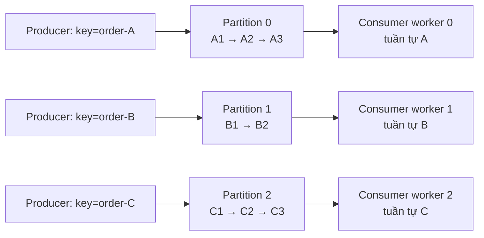

# Thứ tự thông điệp, phân vùng và xử lý song song

## 1. Vì sao thứ tự thông điệp quan trọng trong tích hợp Spring Boot?

Trong hệ thống tích hợp Spring Boot, một service thường phát sự kiện qua broker để service khác cập nhật dữ liệu, gọi HTTP API, đồng bộ cache hoặc chạy quy trình Spring Integration. Khi số lượng sự kiện tăng, ta muốn có nhiều consumer xử lý cùng lúc. Tuy nhiên, **xử lý song song có thể phá vỡ thứ tự nghiệp vụ** nếu không xác định rõ thông điệp nào phải đi trước thông điệp nào.

Ví dụ, một đơn hàng lần lượt phát ba sự kiện:

1. `OrderCreated` — đơn được tạo.
2. `OrderPaid` — thanh toán đã thành công.
3. `OrderCancelled` — đơn bị hủy hoặc quy trình hoàn tiền được kích hoạt.

Nếu consumer áp dụng `OrderCancelled` trước `OrderCreated`, hoặc cập nhật trạng thái `PAID` sau khi đã cập nhật `CANCELLED`, bảng projection có thể phản ánh trạng thái cũ mặc dù tất cả thông điệp đều đã được nhận.

Tuy nhiên, không cần buộc **mọi** đơn hàng xử lý tuần tự. Sự kiện của đơn `A` và đơn `B` thường độc lập:

- **Yêu cầu thứ tự theo khóa:** `A1 → A2 → A3`; `B1 → B2`.
- **Có thể xử lý song song:** luồng `A` và luồng `B`.
- **Không nhất thiết cần thứ tự toàn cục:** không bắt buộc `A1` xảy ra trước `B1` chỉ vì hai sự kiện được tạo gần nhau.

Bài học thuộc nhóm **Nền tảng nhắn tin** của `SPRING_BOOT_INTEGRATION`. Mục tiêu là thiết kế luồng tích hợp Spring Boot qua broker sao cho quản lý tốt hợp đồng dữ liệu, thứ tự, phân vùng, độ song song, lỗi, xử lý trùng lặp, kiểm thử và khả năng quan sát.

## 2. Phân biệt bốn loại “thứ tự”

Một hệ thống có thể nói “broker bảo đảm thứ tự” nhưng vẫn ghi dữ liệu sai nếu hiểu sai đối tượng được bảo đảm.

| Khái niệm | Ý nghĩa | Rủi ro dễ nhầm |
| --- | --- | --- |
| **Thứ tự nghiệp vụ** | Thứ tự thay đổi hợp lệ của một entity/aggregate, ví dụ version 7 rồi 8 | Hai producer phát sự kiện lệch thứ tự so với giao dịch DB |
| **Thứ tự ghi vào broker** | Thứ tự broker chấp nhận và lưu thông điệp trong log/queue | Không nhất thiết trùng với timestamp hoặc thứ tự nghiệp vụ |
| **Thứ tự giao tới consumer** | Thứ tự bản ghi được chuyển cho một consumer hoặc một nhóm consumer | Rebalance, redelivery, nhiều consumer có thể làm phức tạp việc nhận |
| **Thứ tự hiệu lực xử lý** | Thứ tự các side effect được commit: ghi DB, gọi API, cập nhật cache | `@Async`, thread pool, retry hoặc timeout khiến bản ghi sau hoàn thành trước |

Trong Kafka, các record thuộc **cùng một partition** có thứ tự offset. Việc có offset 101 trước 102 không tự chứng minh giao dịch DB của 101 được commit trước giao dịch của 102. Nếu consumer đẩy cả hai sang thread pool rồi commit offset ngay, record 102 có thể hoàn tất trước 101.

**Thứ tự timestamp cũng khác thứ tự offset.** Đồng hồ của producer có thể lệch; thời điểm sự kiện phát sinh và thời điểm broker nhận không phải cùng một mốc. Nếu logic phụ thuộc nhân quả, cần dùng version hoặc sequence được tạo tại nguồn nghiệp vụ, không chỉ sắp xếp theo `occurredAt`.

Vì vậy, hợp đồng sự kiện cần mô tả cụ thể:

> “Với một `orderId`, trạng thái phải được áp dụng theo `aggregateVersion` tăng dần. Các `orderId` khác nhau có thể xử lý đồng thời. Consumer phải chịu được duplicate và redelivery.”

Một tuyên bố như trên kiểm thử được; câu “hệ thống bảo đảm FIFO” vẫn chưa nói đủ phạm vi và cách xử lý lỗi.

## 3. Partition là đơn vị song song hóa và giới hạn thứ tự

### 3.1. Cách Kafka sử dụng partition

Một topic Kafka có thể gồm nhiều partition. Mỗi partition là một log có offset tăng theo thứ tự append. Producer gửi record với `key`; cơ chế partitioner phân phối record vào partition, thường dựa trên hash của key khi key có giá trị và không có cơ chế partitioning tùy chỉnh.



Sơ đồ mang tính minh họa: không phải mỗi key được Kafka cấp riêng một partition. **Nhiều key có thể cùng nằm trong một partition**, khi đó chúng chia sẻ thứ tự đọc và năng lực xử lý của partition đó.

Kafka có thể duy trì thứ tự **trong một partition**, nhưng không cung cấp một thứ tự tổng quát có ý nghĩa giữa offset của các partition khác nhau. Offset `20` của partition 0 không có quan hệ thứ tự với offset `20` của partition 1.

### 3.2. Chọn khóa để giữ thứ tự theo entity

Nếu nghiệp vụ cần đồng bộ từng đơn hàng, nên dùng cùng `orderId` làm message key cho mọi sự kiện của đơn hàng đó:

```text
topic: order-events

key = "order-4711"
value = {"eventId":"e-101","orderId":"order-4711","version":1,"type":"OrderCreated"}

key = "order-4711"
value = {"eventId":"e-102","orderId":"order-4711","version":2,"type":"OrderPaid"}

key = "order-4711"
value = {"eventId":"e-103","orderId":"order-4711","version":3,"type":"OrderShipped"}
```

Trái lại, nếu đặt key là `eventId`, ba record có thể vào ba partition khác nhau. Nếu đặt key là `tenantId`, toàn bộ sự kiện của một tenant có thể dồn về một partition, tạo điểm nóng khi tenant lớn.

Quy tắc chọn key:

1. Xác định **aggregate** cần giữ thứ tự, chẳng hạn `orderId`, `accountId`, `shipmentId`.
2. Giữ key **ổn định** trong vòng đời của aggregate và giữa các loại event cùng chia sẻ yêu cầu thứ tự.
3. Tránh key trống hoặc key ngẫu nhiên nếu cần giữ thứ tự theo aggregate.
4. Kiểm tra phân bố lưu lượng của key: một key quá nóng làm hạn chế thông lượng vì nó không thể xử lý song song tùy ý mà vẫn giữ thứ tự nghiêm ngặt.
5. Nếu thay đổi thuật toán partition hoặc **tăng số partition**, đánh giá lại tính ổn định của ánh xạ key. Các record cũ và mới của một key có thể nằm ở các partition khác nhau trong giai đoạn chuyển đổi, nên cần chiến lược drain/cutover trước khi coi thứ tự là liên tục.

Thông thường, bảo đảm thứ tự theo key chỉ có hiệu lực trong **cùng topic, cùng tập partition và cơ chế phân phối key phù hợp**. Nếu tách `OrderCreated` sang topic A và `OrderPaid` sang topic B, người tiêu thụ không thể suy ra thứ tự toàn cục giữa hai topic.

### 3.3. Consumer group quyết định mức độ song song

Trong một Kafka consumer group theo mô hình subscription thông thường, mỗi partition tại một thời điểm do một consumer của nhóm đảm trách. Nếu có `P` partition và tổng cộng `C` consumer thread hợp lệ trên các instance, số nhánh đọc partition hoạt động đồng thời tối đa là:

\[
\text{active consumers} \leq \min(P, C)
\]

Ví dụ, topic có 6 partition, hai instance ứng dụng, mỗi instance cấu hình `concurrency=3`. Tổng cộng có thể có 6 Kafka consumer trong group; đủ để phân công 6 partition. Tăng `concurrency` lên 10 trên mỗi instance không tạo thêm partition và không làm một partition tự chạy trên nhiều consumer trong cùng group.

Lưu ý: đây là **giới hạn song song ở tầng đọc partition**. Trong cùng consumer, nếu code tự tách record ra worker pool, số tác vụ xử lý có thể lớn hơn và không còn bảo đảm thứ tự hoàn thành.

## 4. Các mức xử lý song song và ảnh hưởng đến ordering

| Cách tăng throughput | Có thể giữ thứ tự theo key? | Điều kiện |
| --- | --- | --- |
| Tăng partition, phân phối key ổn định | Có, trong từng partition | Mọi event cùng key phải vào cùng partition trong giai đoạn vận hành |
| Tăng số consumer của **cùng group** tới số partition | Có | Listener xử lý tuần tự trong phạm vi partition, không tự giao side effect ra ngoài thứ tự |
| Nhiều consumer **khác group** | Mỗi group có luồng riêng | Các group độc lập, không thể dùng làm đồng bộ thứ tự liên service |
| Gửi từng record vào `ExecutorService` hoặc `@Async` | Không tự động | Cần hàng đợi tuần tự theo key và chỉ ack khi side effect hoàn tất |
| Dùng Reactor `flatMap` cho các record | Không tự động | Các publisher con có thể hoàn tất không theo thứ tự nhận |
| Dùng `concatMap` theo từng key hoặc partition | Có thể | Cần điều tiết concurrency, backpressure và bộ nhớ, đồng thời duy trì ranh giới key |

Ví dụ sai phổ biến:

```java
@KafkaListener(topics = "order-events")
public void onMessage(String payload) {
    executor.submit(() -> projectionService.update(payload));
    // Hàm trả về ngay: container có thể coi record đã xử lý thành công.
}
```

Có hai vấn đề: (1) tác vụ sau có thể cập nhật DB trước tác vụ trước; (2) nếu consumer commit offset khi listener trả về, một tác vụ thất bại về sau có thể không được redeliver như kỳ vọng.

Nếu cần bảo đảm thứ tự, hãy để listener **đợi xử lý bền vững hoàn tất** trong luồng được kiểm soát, hoặc thiết kế bộ lập lịch tuần tự theo key với cơ chế commit/ack tương ứng. Không nên dùng fire-and-forget cho side effect quan trọng.

## 5. So sánh ordering trên các nền tảng nhắn tin

### 5.1. Apache Kafka

- Thứ tự có ý nghĩa **theo partition**, thông qua offset.
- Các record cùng key thường vào cùng partition theo partitioner phù hợp; key không tự mang “sequence nghiệp vụ”.
- Trong một group, có thể xử lý song song giữa nhiều partition.
- Retry, redelivery hoặc rebalance có thể khiến cùng record được xử lý lại. Kafka transaction/idempotent producer giải quyết một số vấn đề ghi/đọc trong hệ sinh thái Kafka, nhưng **không tự bảo đảm exactly-once cho cập nhật database hoặc HTTP API bên ngoài Kafka**.

### 5.2. RabbitMQ

RabbitMQ lưu thông điệp trong queue và giao cho consumer. Với một queue, một consumer hoạt động tuần tự, không có cơ chế worker phụ bất đồng bộ và không có priority/requeue gây xáo trộn, thứ tự xử lý thường dễ kiểm soát.

Tuy nhiên, **nhiều competing consumer trên một queue**, prefetch nhiều thông điệp, xử lý bất đồng bộ, redelivery và requeue có thể khiến thứ tự *hoàn tất nghiệp vụ* khác thứ tự enqueue. RabbitMQ có cơ chế `single active consumer` khi cần chỉ một consumer hoạt động trên một queue; cấu hình này vẫn phải đi kèm xử lý tuần tự và chính sách retry phù hợp.

Muốn xử lý song song **giữa các key** mà giữ thứ tự **trong từng key**, có thể định tuyến key theo hash vào một số queue cố định (bucket), sau đó xử lý tuần tự trong mỗi queue. Cách này cần thiết kế routing và vận hành nhiều queue; RabbitMQ không tự cung cấp partition log như Kafka chỉ bằng việc tạo một queue thông thường.

### 5.3. Amazon SQS

- **SQS Standard** ưu tiên khả năng mở rộng và at-least-once; có thể giao trùng hoặc khác thứ tự. Không dùng nếu nghiệp vụ phụ thuộc vào FIFO nghiêm ngặt.
- **SQS FIFO** sử dụng `MessageGroupId` để duy trì thứ tự theo nhóm và cho phép xử lý các nhóm khác nhau song song. Consumer vẫn phải xử lý đúng thứ tự khi nhận một batch có nhiều thông điệp cùng nhóm, đồng thời quản lý visibility timeout và duplicate.

Bảng quyết định nhanh:

| Nhu cầu | Hướng thiết kế |
| --- | --- |
| Cần replay lịch sử, fan-out cho nhiều group và scale theo partition | Kafka, key là aggregate ID |
| Work queue với routing tùy chỉnh, retry/ack rõ ràng | RabbitMQ, thiết kế queue và số consumer phù hợp ordering |
| Queue managed trên AWS, ordering theo nhóm | SQS FIFO và `MessageGroupId` theo aggregate |
| Thông điệp độc lập, không cần ordering | Tận dụng nhiều partition/consumer hoặc work queue song song |
| Cần đúng thứ tự giữa mọi thông điệp trên toàn hệ thống | Phân tích lại yêu cầu: một luồng tuần tự dễ thành nút thắt; nếu thật sự cần, chấp nhận đánh đổi throughput và availability |

Đừng suy ra rằng “Kafka luôn có thứ tự, RabbitMQ luôn FIFO, SQS FIFO luôn đúng mọi trường hợp”. **Mỗi công nghệ chỉ bảo đảm trong phạm vi xác định**, còn ứng dụng phải đảm bảo thứ tự của side effect.

## 6. Thiết kế hợp đồng sự kiện có khả năng kiểm soát thứ tự

Một event envelope thường cần đủ các trường sau:

```json
{
  "eventId": "6ec27d63-8b47-42a0-b02b-169c6154d20c",
  "eventType": "OrderPaid",
  "aggregateType": "Order",
  "aggregateId": "order-4711",
  "aggregateVersion": 8,
  "occurredAt": "2026-11-21T05:00:00Z",
  "correlationId": "checkout-792",
  "payload": {
    "paymentId": "payment-123",
    "amountMinor": 159900,
    "currency": "VND"
  }
}
```

Ý nghĩa của một số trường:

- `eventId`: ID duy nhất cho **mỗi sự kiện logic**, hữu ích để deduplicate. Việc redeliver cùng sự kiện phải giữ nguyên ID.
- `aggregateId`: khóa routing/partition và phạm vi mà ordering có ý nghĩa.
- `aggregateVersion`: phiên bản nghiệp vụ tăng sau mỗi thay đổi được cam kết của aggregate, dùng để chặn áp dụng dữ liệu cũ hoặc nhận ra khoảng trống phiên bản.
- `occurredAt`: phục vụ quan sát và phân tích độ trễ, không dùng thay thế sequence khi cần thứ tự nhân quả.
- `correlationId`: nối log/trace của request HTTP, outbox, broker và consumer.
- `eventType` và `payload`: hợp đồng dữ liệu phải có chính sách versioning/schema evolution riêng nếu consumer nhiều phiên bản cùng tồn tại.

**Version cần có nghĩa rõ ràng.** Nếu hệ thống phát mọi thay đổi của aggregate với phiên bản liên tiếp `1, 2, 3...`, consumer có thể kiểm tra chính xác `incomingVersion = lastAppliedVersion + 1`. Nếu chỉ phát một tập con sự kiện, dãy version có thể có khoảng nhảy hợp lệ; khi đó không thể áp dụng quy tắc cộng một nếu chưa định nghĩa thêm sequence của stream được publish.

Ngoài khóa và version, cần xác định **ai là nguồn phát sự kiện chuẩn**. Hai service độc lập cùng tăng `aggregateVersion` theo ý riêng không tự tạo ra thứ tự nhân quả có thể tin cậy.

## 7. Ví dụ Spring Boot + Spring Kafka

Giả sử service `order-service` xuất bản sự kiện trạng thái đơn hàng, còn `order-projection` cập nhật bảng đọc phục vụ API. Yêu cầu là các sự kiện của **một `orderId` phải được xử lý theo thứ tự**, đồng thời các đơn khác nhau có thể chạy song song.

### 7.1. Cấu hình phía producer

Ví dụ `application.yml`, sử dụng kiểu giá trị String chứa JSON (để tập trung vào ordering):

```yaml
spring:
  kafka:
    bootstrap-servers: ${KAFKA_BOOTSTRAP_SERVERS}
    producer:
      key-serializer: org.apache.kafka.common.serialization.StringSerializer
      value-serializer: org.apache.kafka.common.serialization.StringSerializer
      acks: all
      properties:
        "[enable.idempotence]": true
        "[max.in.flight.requests.per.connection]": 5
```

Các option `acks=all` và `enable.idempotence=true` giúp producer giảm nguy cơ ghi trùng do retry và duy trì các điều kiện ordering được Kafka hỗ trợ. Khi bật idempotence, `max.in.flight.requests.per.connection` phải tương thích với giới hạn Kafka; ví dụ dùng 5. Đừng dựa vào cấu hình mặc định theo trí nhớ: kiểm tra phiên bản Kafka client của dự án và các option thực tế.

Để các sự kiện của một đơn được định tuyến theo cùng key:

```java
@Service
public class OrderEventPublisher {
    private final KafkaTemplate<String, String> kafkaTemplate;

    public OrderEventPublisher(KafkaTemplate<String, String> kafkaTemplate) {
        this.kafkaTemplate = kafkaTemplate;
    }

    public CompletableFuture<SendResult<String, String>> publish(
            String orderId, String eventJson) {
        return kafkaTemplate.send("order-events", orderId, eventJson);
    }
}
```

Đoạn này minh họa API `KafkaTemplate` trong Spring Kafka 3.x. Người gọi cần xử lý kết quả bất đồng bộ: log/trace lỗi, retry có kiểm soát và theo dõi trạng thái gửi. **Đừng coi việc gọi `send` là đã phát thành công**.

Đặc biệt, nếu service vừa cập nhật DB vừa gửi Kafka, hai thao tác đó không tự là một atomic transaction. Với nghiệp vụ quan trọng, nên cân nhắc **transactional outbox**: trong cùng transaction DB, ghi thay đổi nghiệp vụ và một bản ghi outbox; worker/CDC publish outbox về broker rồi đánh dấu trạng thái phù hợp. Tuy nhiên, outbox cũng cần quy tắc sắp thứ tự: nếu nhiều worker đồng thời xuất bản các phiên bản của **cùng một aggregate**, chúng có thể phát lệch thứ tự. Hãy dùng khóa/sequence theo aggregate và cơ chế dispatch đảm bảo thứ tự cần thiết.

### 7.2. Cấu hình consumer và listener xử lý đồng bộ

```yaml
spring:
  kafka:
    bootstrap-servers: ${KAFKA_BOOTSTRAP_SERVERS}
    consumer:
      group-id: order-projection
      key-deserializer: org.apache.kafka.common.serialization.StringDeserializer
      value-deserializer: org.apache.kafka.common.serialization.StringDeserializer
      enable-auto-commit: false
    listener:
      ack-mode: record
```

Listener:

```java
@Service
public class OrderProjectionConsumer {
    private final OrderProjectionService projectionService;

    public OrderProjectionConsumer(OrderProjectionService projectionService) {
        this.projectionService = projectionService;
    }

    @KafkaListener(topics = "order-events", concurrency = "3")
    public void onMessage(ConsumerRecord<String, String> record) {
        // Xử lý và commit DB phải xong trước khi listener trả về.
        projectionService.applyIdempotently(record.value());
    }
}
```

Ở đây:

- `concurrency = "3"` tạo tối đa ba Kafka consumer thread cho listener container của **một instance**; tăng thêm instance có thể tăng tổng số consumer trong group.
- Với cơ chế xử lý listener tuần tự thông thường của Spring Kafka, các record của cùng partition được gọi theo thứ tự trong consumer thread tương ứng. Không thêm `@Async` hoặc tự `submit` sang pool rồi trả về sớm.
- `ack-mode: record` cho container ghi nhận offset sau khi listener xử lý một record thành công; nếu listener ném exception, xử lý tiếp ra sao còn phụ thuộc cấu hình error handler và retry. Cấu hình ack không thay cho transaction DB.
- `applyIdempotently` cần là service có transaction phù hợp và không được nuốt lỗi trước khi dữ liệu bền vững.

Đoạn code là **khung tích hợp**; cần bổ sung dependency Spring Kafka, định nghĩa `OrderProjectionService`, schema DB, serializer/schema contract và error handler theo hệ thống thực tế. Không mặc định nên chọn độ song song 3 khi topic chỉ có một partition.

### 7.3. Thuật toán áp dụng idempotent trong DB

Một cách triển khai cho PostgreSQL là có bảng:

```sql
CREATE TABLE processed_message (
    consumer_name VARCHAR(80) NOT NULL,
    event_id UUID NOT NULL,
    processed_at TIMESTAMPTZ NOT NULL DEFAULT CURRENT_TIMESTAMP,
    PRIMARY KEY (consumer_name, event_id)
);

CREATE TABLE order_projection (
    order_id VARCHAR(100) PRIMARY KEY,
    status VARCHAR(40) NOT NULL,
    last_version BIGINT NOT NULL
);
```

Phác thảo thuật toán **trong một transaction DB**:

```text
BEGIN TRANSACTION

1. Đọc eventId, orderId, aggregateVersion; validate schema/hợp đồng.
2. INSERT (consumer_name, event_id) vào processed_message;
   ON CONFLICT DO NOTHING.
3. Nếu record đã tồn tại:
     COMMIT; return (duplicate, đã từng áp dụng thành công).
4. Khóa dòng order_projection tương ứng (hoặc tạo dòng khởi đầu có version=0)
   bằng cơ chế DB phù hợp.
5. Với stream phiên bản liên tiếp:
     Nếu incomingVersion != lastVersion + 1:
         ROLLBACK; báo thiếu/lệch phiên bản, không ACK như thành công.
6. Cập nhật projection và lastVersion trong cùng transaction.
7. COMMIT.

Sau khi DB commit thành công, listener mới kết thúc để container ack/commit offset.
```

Nếu bước 5 hoặc 6 thất bại, transaction rollback **cả** record đánh dấu đã xử lý. Điều này rất quan trọng: nếu đã lưu dedupe marker nhưng projection chưa cập nhật, lần retry có thể bị bỏ qua sai.

Một transaction DB và việc commit Kafka offset vẫn thuộc hai hệ thống. Nếu DB đã commit mà ứng dụng chết trước khi offset được commit, record có thể được giao lại; dedupe theo `eventId` sẽ giúp xử lý an toàn. Đó là ý nghĩa thực tế của **at-least-once + idempotent consumer**.

Lưu ý: tạo dòng ban đầu, khóa hàng và kiểm tra version phải tránh race condition khi nhiều worker tác động lên cùng aggregate; DB unique constraint, locking hoặc compare-and-set theo version nên là phần của thiết kế. Nếu consumer còn gọi HTTP API tạo side effect bên ngoài, transaction DB ở trên không thể tự rollback API đó. Khi ấy cần idempotency key ở API nhận, outbox cho side effect, hoặc một workflow bù trừ có kiểm soát.

## 8. Retry, redelivery, dead-letter và tác động đến thứ tự

Giả sử cùng `orderId=A` có ba record:

```text
offset 100: A-v1
offset 101: A-v2  ← xử lý thất bại
offset 102: A-v3
```

Nếu consumer chuyển `A-v2` sang dead-letter topic (DLT) và tiếp tục `A-v3`, hệ thống đã phá vỡ điều kiện “mọi version phải áp dụng liên tiếp”, dù dữ liệu trong partition Kafka vẫn được lưu đúng thứ tự.

Có hai chính sách khác nhau:

**Chính sách A — bảo toàn thứ tự nghiêm ngặt**

- Retry `A-v2` trong phạm vi khiến `A-v3` chưa được áp dụng.
- Có backoff, giới hạn số lần thử, cảnh báo và quy trình khắc phục khi lỗi kéo dài.
- Có thể gây **head-of-line blocking**: một record lỗi chặn luồng của partition hoặc key; đánh đổi throughput để giữ tính đúng đắn.

**Chính sách B — ưu tiên tiến độ xử lý**

- Chuyển record lỗi sang DLT hoặc hàng đợi lỗi, cho phép các record sau tiếp tục.
- Chỉ phù hợp khi nghiệp vụ cho phép bỏ qua một số event, hoặc projection có cơ chế phát hiện thiếu phiên bản và chặn áp dụng sai.
- Việc replay riêng event ở DLT **không tự phục hồi thứ tự**; phải đối chiếu trạng thái và xử lý các event kế tiếp.

Cần phân biệt:

- **Transient failure:** lỗi mạng, database tạm unavailable, HTTP 503; có thể retry với backoff.
- **Permanent failure:** JSON không hợp lệ, schema không tương thích, vi phạm dữ liệu không khắc phục được khi retry; cần quarantine/DLT, cảnh báo và sửa nguồn/hợp đồng.
- **Ordering gap:** đã nhận version 10 nhưng còn thiếu 9; giải quyết bằng đợi, replay/backfill hoặc tải lại snapshot đúng version, không đánh đồng với duplicate.
- **Duplicate:** cùng `eventId` đã áp dụng trước đó; ghi nhận đã xử lý và cho qua an toàn.

Nếu dùng non-blocking retry topic của Spring Kafka, record retry có thể được xử lý sau record ở topic gốc. Vì vậy, **non-blocking retry không thích hợp khi cần bảo toàn thứ tự nghiêm ngặt theo partition**, trừ khi bạn bổ sung cơ chế thứ tự/version ở tầng nghiệp vụ. Cấu hình `DefaultErrorHandler`, retry và `DeadLetterPublishingRecoverer` cần phù hợp với chính sách đã chọn; không mặc định mọi DLT là an toàn cho luồng cần FIFO.

## 9. Rebalance, thay đổi partition và chuyển phiên bản ứng dụng

### 9.1. Khi consumer group rebalance

Consumer có thể rời group vì deploy, crash, heartbeat timeout hoặc thay đổi số instance. Broker/giao thức group sẽ chuyển quyền nhận partition sang consumer khác. Một partition được gán cho một consumer của group ở một thời điểm theo cơ chế thông thường, nhưng **tác vụ async chưa hoàn tất ở consumer cũ** có thể tiếp tục chạy nếu ứng dụng không hủy/đợi chúng đúng cách.

Biện pháp:

- Xử lý side effect đồng bộ trong listener, hoặc chủ động phối hợp in-flight task trước khi revoke partition.
- Không commit offset vượt quá record có side effect chưa bền vững.
- Dùng idempotency, version guard và giám sát rebalance.
- Khi shutdown, đợi tác vụ đang chạy hoàn thành trong một khoảng thời gian được kiểm soát, rồi bàn giao partition theo cấu hình container.

### 9.2. Khi tăng số partition

Tăng partition có thể tăng thông lượng cho các key **mới**, nhưng với nhiều cơ chế mapping key theo partition, số partition thay đổi có thể làm một key cũ chuyển sang partition khác. Record cũ ở partition trước và record mới ở partition sau có thể được xử lý song song, không còn ordering nối tiếp giữa hai partition.

Nếu tính đúng đắn phụ thuộc thứ tự theo key, cân nhắc:

1. Thiết kế số partition và headroom ngay từ đầu, đo throughput trước khi tăng.
2. Khi buộc phải đổi mapping, dừng hoặc điều tiết nguồn publish, drain backlog, xác nhận checkpoint/consumer đã bắt kịp, rồi mới đổi routing theo kế hoạch cutover.
3. Với nhu cầu ổn định key-routing lâu dài, xem xét một lớp bucket logic cố định hoặc topic mới và migration có phiên bản; phải đánh giá chi phí vận hành, không coi đây là mặc định Kafka.
4. Luôn có kiểm tra `aggregateVersion` ở DB khi yêu cầu nghiệp vụ nghiêm ngặt.

### 9.3. Khi producer cùng ghi một aggregate

Thứ tự append của broker là thứ tự các request đến broker, không phải bằng chứng transaction DB nào commit trước. Hai producer có thể phát `v12` và `v11` gần nhau rồi gửi tới broker theo thứ tự đảo. Nếu cần thứ tự chính xác từ trạng thái nguồn, phải cấp phát version tại nơi ghi dữ liệu có đồng bộ và phát thông qua cơ chế tôn trọng version/commit order, thường là transactional outbox được tuần tự hóa theo aggregate.

## 10. Xử lý song song theo khóa trong Spring Integration và Reactor

Luồng tích hợp còn có thể phân nhánh qua các channel hoặc adapter ngoài Kafka.

### 10.1. Spring Integration channels

- `DirectChannel` gọi handler đồng bộ trên thread gửi trong luồng đơn giản. Tuy nhiên, nhiều thread cùng gửi vào một channel vẫn có thể xen kẽ; bản thân channel không tạo thứ tự nghiệp vụ toàn cục.
- `ExecutorChannel` chuyển handler sang task executor, tăng khả năng xử lý đồng thời nhưng có thể thay đổi thứ tự hoàn tất.
- Poller với nhiều worker, aggregator/resequencer hoặc các nhánh HTTP/JDBC chạy async cần chính sách rõ ràng cho ordering, timeout và correlation.

Khi chọn channel, phải xem **đường đi end-to-end**: adapter Kafka đọc theo partition nhưng gửi ngay sang `ExecutorChannel` rồi ack có thể làm mất tính chất mong muốn. Một bước HTTP chậm còn có thể khiến record sau hoàn thành trước record trước.

### 10.2. Reactor và WebFlux

Ví dụ minh họa **ý tưởng** khi đã có một Flux sự kiện:

```java
source
    .groupBy(OrderEvent::orderId)
    .flatMap(group ->
        group.concatMap(event -> processAsync(event)),
        maxConcurrentGroups
    );
```

`concatMap` giữ thứ tự xử lý trong mỗi group, trong khi `flatMap` cho phép nhiều group hoạt động song song. Tuy nhiên, `groupBy` cho key có cardinality rất cao có thể tạo nhiều nhóm tồn tại lâu, gây tiêu thụ bộ nhớ hoặc áp lực backpressure. Đây là **mẫu giải thích**, không thể đem nguyên vào production mà không thiết kế vòng đời group, số nhóm tối đa và quy tắc ack/commit.

Một cách bền vững hơn trong môi trường có nhiều key là dùng số bucket cố định, hash key vào bucket và xử lý tuần tự từng bucket. Độ song song tối đa bằng số bucket đang được cấp worker. Chấp nhận rằng các key khác nhau cùng bucket cũng chờ nhau.

## 11. Hiệu năng: thứ tự là một ràng buộc, không phải lỗi của broker

Khi throughput bị giới hạn, cần xác định chính xác nút thắt:

| Triệu chứng | Khả năng nguyên nhân | Cách khảo sát |
| --- | --- | --- |
| Một partition lag cao, các partition khác rảnh | Hot key, phân bố key lệch hoặc xử lý chậm | Đo lag theo partition, lượng event theo key/bucket |
| Tăng instance không tăng throughput | Ít partition hơn consumer hoặc bottleneck ở DB/API | Đối chiếu số partition, số consumer active, pool kết nối và latency |
| Latency tăng theo chiều dài hàng chờ | Xử lý tuần tự bị chặn bởi một event chậm | Phân loại lỗi, tối ưu I/O, cân nhắc tách luồng độc lập nếu nghiệp vụ cho phép |
| Có nhiều record/s nhưng projection sai trạng thái | Side effect bất đồng bộ, thiếu version guard hoặc ack trước commit | Trace eventId/version qua listener → DB, kiểm tra retry |
| Sau tăng partition mới xảy ra đảo thứ tự | Key mapping thay đổi | Đối chiếu partition trước/sau cutover, lịch sử version |
| Replay DLT gây ghi đè dữ liệu mới | Xử lý event cũ không kiểm tra version | Dedupe + chặn version lùi, quy trình repair state |

Không nên “giải quyết” một key nóng bằng cách ngẫu nhiên phân phối record của chính key đó sang nhiều partition nếu sự kiện cùng key yêu cầu xử lý có thứ tự. Muốn tăng throughput thực sự, có thể cần đổi ranh giới aggregate: ví dụ các giao dịch **độc lập** thuộc nhiều tài khoản con có thể dùng khóa `accountSubId`, nhưng chỉ khi nghiệp vụ cho phép áp dụng song song.

Nếu cập nhật trạng thái có tính giao hoán (chẳng hạn cộng số đếm với điều kiện đúng) hoặc chỉ yêu cầu eventual consistency, có thể nới yêu cầu ordering và thiết kế idempotency/reconciliation theo semantics đó. Không áp dụng quy tắc này cho chuyển trạng thái không giao hoán như `CREATED → PAID → SHIPPED` khi consumer không có guard.

## 12. Kiểm thử thực tế cho ordering và parallelism

Kiểm thử nên dùng broker và database gần production nhất có thể; ví dụ Spring Boot Testcontainers với Kafka và PostgreSQL, kèm test fixture kiểm soát eventId/version. Không đủ nếu chỉ mock listener rồi gọi hàm ba lần tuần tự.

| Kịch bản | Điều kiện đạt |
| --- | --- |
| **Một aggregate, nhiều sự kiện** | Gửi `A-v1`, `A-v2`, `A-v3`; projection cuối cùng có version 3 và trạng thái chính xác |
| **Nhiều aggregate xen kẽ** | `A-v1, B-v1, A-v2, B-v2`; mỗi key giữ thứ tự riêng, hệ thống vẫn xử lý song song giữa các key |
| **Nhiều key cùng partition** | Không giả định một key có partition riêng; side effect vẫn hợp lệ |
| **Consumer crash sau DB commit, trước offset commit** | Record redeliver nhưng không ghi trùng side effect |
| **Retry ở event giữa** | Nếu cần strict ordering, `A-v3` không được áp dụng trước `A-v2` hoặc phải bị version guard chặn |
| **Event cũ đến muộn** | Version guard không cho `A-v4` ghi đè projection đang ở `A-v5` |
| **Mất event** | Gap detection báo thiếu phiên bản và xử lý theo chính sách được thiết kế |
| **Rebalance/rolling deploy** | Không có hai side effect cùng aggregate chạy chồng nhau dẫn tới trạng thái sai |
| **Thay đổi số partition** | Có kế hoạch cutover và kiểm chứng không đảo thứ tự trong giai đoạn chuyển |
| **Poison message/DLT** | Biết khi nào cho phép bỏ qua và khi nào phải dừng, có công cụ replay/repair đúng version |
| **Backpressure/hot key** | Giới hạn concurrency, thread, kết nối DB; hệ thống không gây nghẽn tài nguyên toàn cụm |

Một test có giá trị là **chủ động gây lỗi sau khi DB commit nhưng trước offset commit**, rồi xác minh hệ thống redeliver mà không nhân đôi kết quả. Test này kiểm tra đúng giả định at-least-once trong thực tế.

## 13. Quan sát vận hành và xử lý sự cố

Bên cạnh throughput chung, cần đo:

- **Consumer lag theo partition:** phát hiện partition quá tải hoặc bị chặn.
- **Thời gian xử lý và thời gian từ event tới applied state:** theo dõi percentile, không chỉ trung bình.
- **Số lần retry, redelivery, DLT/quarantine, event gap và duplicate:** phân biệt lỗi hạ tầng và lỗi hợp đồng dữ liệu.
- **Tần suất rebalance, số consumer active, số partition được gán:** giải thích thay đổi độ song song.
- **Độ lệch phiên bản projection so với nguồn** (khi đo được): phát hiện thiếu event dù lag broker đã về 0.
- **Tỷ lệ lưu lượng theo key hoặc bucket** được tổng hợp phù hợp: phát hiện hot key mà không đưa identifier nhạy cảm làm metric label có cardinality lớn.

Trong log hoặc trace, lưu `eventId`, `aggregateId`, `aggregateVersion`, `topic`, `partition`, `offset` và `correlationId` theo chính sách bảo vệ dữ liệu. Không dùng toàn bộ `aggregateId` hoặc `eventId` làm label metric dạng time series nếu cardinality quá cao. Việc có thể tra cứu một sự kiện theo ID từ producer, outbox, broker consumer tới database giúp xác định nó bị đảo thứ tự ở tầng nào.

Khi thấy trạng thái projection sai, kiểm tra lần lượt:

1. Nguồn nghiệp vụ có phát version đúng và liên tiếp theo hợp đồng không?
2. Producer dùng key nào; event có cùng partition trước/sau thay đổi cấu hình không?
3. Log của consumer có xử lý đồng bộ hay đẩy sang executor/reactive operator không?
4. DLT/retry có để một version bị vượt qua không?
5. DB transaction, dedupe và version guard có hoạt động không?
6. Có replay, rebalance hoặc thay đổi số partition gần thời điểm lỗi không?

Kiểm tra cả **độ đúng của dữ liệu**, không chỉ offset lag. Một consumer có lag bằng 0 vẫn có thể đã xử lý sai thứ tự và ghi projection sai.

## 14. Tình huống tổng hợp: đồng bộ trạng thái thanh toán

Giả sử một Spring Boot service nhận webhook thanh toán, lưu trạng thái vào PostgreSQL rồi phát `PaymentAuthorized`, `PaymentCaptured`, `PaymentRefunded`. Một service khác tiêu thụ để tạo hóa đơn, cập nhật trạng thái đơn hàng và đẩy dữ liệu sang hệ thống kế toán.

Thiết kế có thể chọn:

1. **Phạm vi thứ tự:** theo `paymentId`. Mọi event liên quan một thanh toán có `aggregateId=paymentId`, version tăng trong transaction nơi lưu trạng thái.
2. **Xuất bản:** ghi transactional outbox cùng thay đổi PostgreSQL; dispatcher phát vào Kafka với `key=paymentId`, duy trì thứ tự theo aggregate.
3. **Phân vùng:** topic nhiều partition để thanh toán khác nhau xử lý song song. Chưa tăng partition khi không có kế hoạch giữ ordering trong cutover.
4. **Tiêu thụ:** mỗi partition tuần tự trong listener; consumer có thể scale giữa partition. Service ghi `processed_message` và projection trong cùng DB transaction, sau đó mới commit offset.
5. **Tích hợp HTTP bên ngoài:** gửi `eventId` làm idempotency key nếu API đích hỗ trợ, hoặc ghi riêng một outbox gọi API để có retry, trạng thái và đối soát.
6. **Lỗi:** nếu `PaymentCaptured` xử lý thất bại, không để `PaymentRefunded` ghi đè khi vẫn chưa biết kết quả của captured; lưu lỗi, retry/backfill hoặc reconcile từ nguồn.
7. **Quan sát:** lag theo partition, version gap, duplicate, độ trễ đồng bộ và trạng thái những thanh toán đang chờ phục hồi.

Nhờ tách được “thứ tự theo một thanh toán” khỏi “độ song song giữa các thanh toán”, hệ thống vừa mở rộng được năng lực xử lý vừa bảo vệ trạng thái nghiệp vụ.

## 15. Checklist khi thiết kế một luồng message mới

- [ ] Xác định rõ cần thứ tự toàn cục, theo aggregate/key hay hoàn toàn không cần thứ tự.
- [ ] Thống nhất message key/`MessageGroupId`/routing key và giữ ổn định trong vòng đời aggregate.
- [ ] Định nghĩa event ID, version/sequence, hợp đồng payload và nguồn tạo version đáng tin cậy.
- [ ] Chọn partition/queue và số consumer phù hợp; hiểu giới hạn song song của từng broker.
- [ ] Không ack/commit trước khi side effect quan trọng hoàn tất; tránh fire-and-forget thiếu kiểm soát.
- [ ] Có idempotent consumer, transaction DB và chính sách xử lý record cũ/gap.
- [ ] Định nghĩa rõ retry, DLT, replay có được phép vượt sự kiện lỗi hay không.
- [ ] Có quy trình rebalance, rolling deploy và thay đổi số partition bảo vệ ordering.
- [ ] Kiểm thử duplicate, out-of-order, crash, nhiều aggregate song song và dữ liệu thực tế.
- [ ] Đo lag theo partition, hot key, version gap, retry và độ trễ cập nhật kết quả nghiệp vụ.

**Điểm cốt lõi:** partition và consumer group cho phép xử lý song song, còn thứ tự cần được định nghĩa theo phạm vi nghiệp vụ và bảo vệ tới tận nơi ghi side effect. Broker chỉ là một tầng trong bảo đảm đó. Một hệ thống Spring Boot Integration đúng đắn phải phối hợp khóa phân vùng, version sự kiện, xử lý tuần tự khi cần, idempotency, transaction và kiểm thử lỗi xuyên suốt luồng tích hợp.
