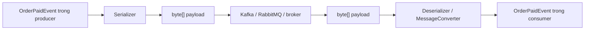
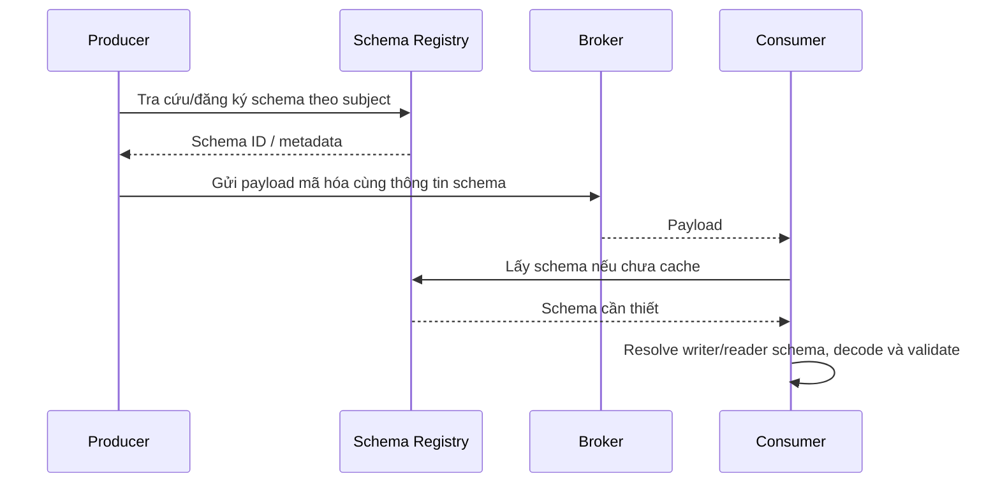
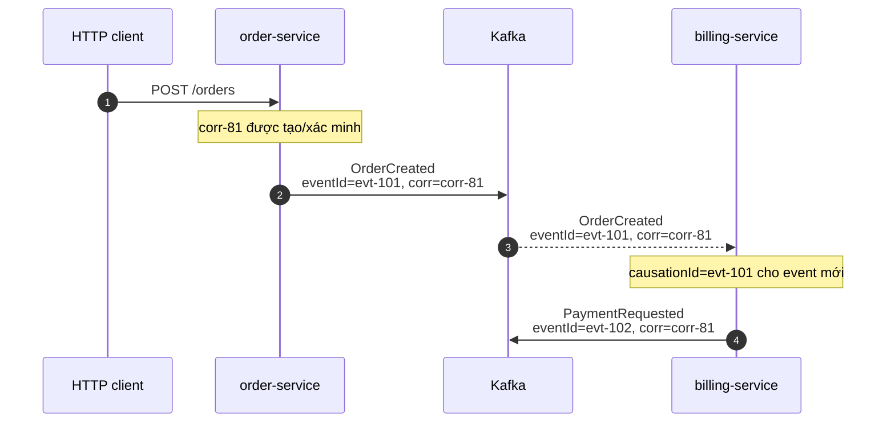
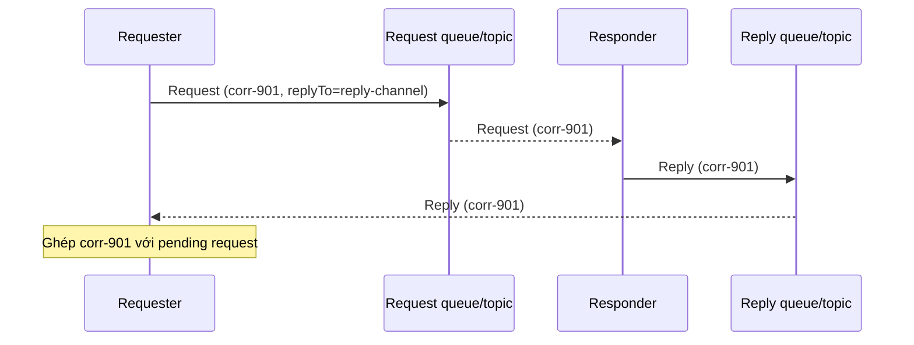
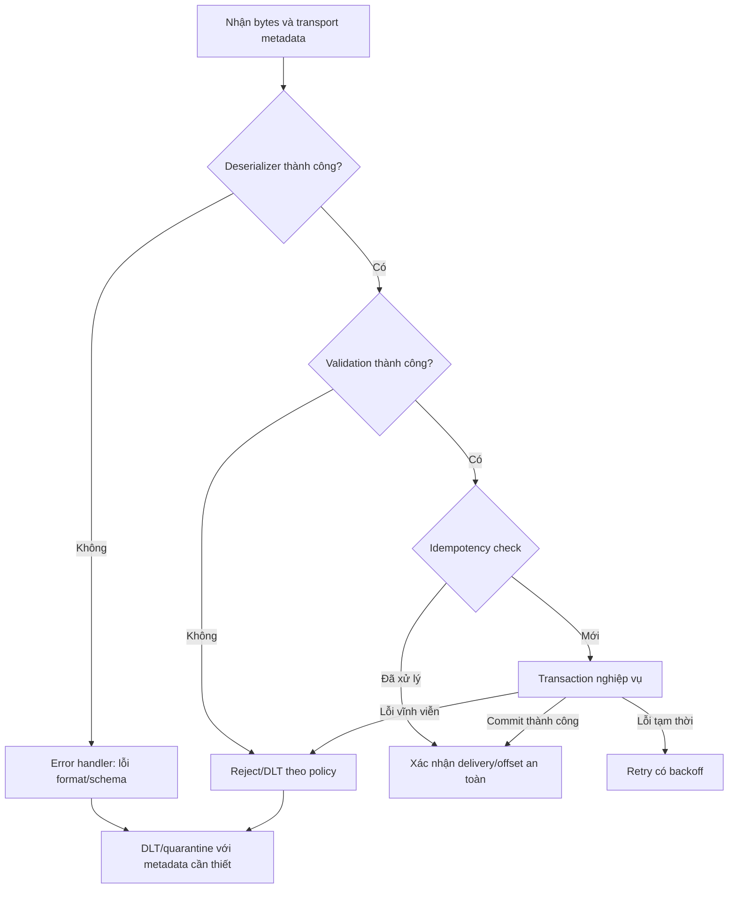

# Serializer, schema, header và mã tương quan

Khi một dịch vụ Spring Boot phát sự kiện sang Kafka, RabbitMQ hoặc một broker thông điệp khác, bên nhận không nhận trực tiếp một Java object. Broker chuyển tiếp **dữ liệu đã được mã hóa**, kèm một số thông tin vận chuyển. Muốn hai ứng dụng tích hợp ổn định, nhóm phát và nhóm nhận phải thống nhất **serializer**, **schema**, **header**, cùng quy tắc tạo và truyền **mã tương quan (correlation ID)**.

Ví dụ dịch vụ đặt hàng phát sự kiện `OrderPaid`. Dịch vụ hóa đơn cần đọc đúng số tiền và mã đơn hàng; bộ phận vận hành cần biết sự kiện đó liên quan đến HTTP request hay sự kiện nào trước đó; hệ thống retry phải tránh thanh toán trùng; và một lần nâng phiên bản DTO không được làm consumer cũ ngừng hoạt động. Những yêu cầu này kết nối chặt chẽ với nhau nhưng thuộc các lớp trách nhiệm khác nhau.

Bài thuộc chương **Nền tảng nhắn tin** của mô-đun **SPRING_BOOT_INTEGRATION**, tập trung tổ chức tích hợp hệ thống trong Spring Boot qua HTTP client, cơ sở dữ liệu, cache, broker thông điệp và Spring Integration adapters. Các ví dụ nhấn mạnh hợp đồng dữ liệu, cấu hình, giao dịch, lỗi, idempotency, kiểm thử và khả năng quan sát. Các API minh họa chủ yếu dựa trên Spring Boot 3.x, Spring Kafka 3.x và Spring AMQP 3.x; đối chiếu phiên bản thật trước khi đưa vào dự án.

## 1. Sau bài học, bạn cần làm được gì?

1. Mô tả chính xác đường đi `Java object → bytes → broker → bytes → Java object`.
2. Phân biệt định dạng tuần tự hóa (JSON, Avro, Protobuf, String, byte[]) với **schema nghiệp vụ** và **schema registry**.
3. Thiết kế event envelope gồm event ID, event type/version, timestamp và business payload.
4. Chọn message key, headers và correlation ID đúng chức năng, không trộn lẫn chúng.
5. Giải thích quan hệ giữa correlation ID, causation ID, trace ID và idempotency key.
6. Cấu hình Spring Kafka producer/consumer JSON một cách có kiểm soát; hiểu rủi ro của type headers và deserialization errors.
7. Ánh xạ metadata tương ứng trong Spring AMQP/RabbitMQ, và hiểu vì sao transport headers không hoàn toàn tương thích giữa các broker.
8. Thực hiện schema evolution an toàn, định nghĩa chính sách retry/DLT và xây test kiểm tra tương thích giữa producer với consumer.

## 2. Bốn thành phần trong một message

Một thông điệp thường có bốn nhóm thông tin:

| Thành phần | Câu hỏi cần trả lời | Ví dụ |
|---|---|---|
| **Payload** | Sự kiện hoặc lệnh có dữ liệu gì? | `{"orderId":"O-101","amount":85000}` |
| **Schema/contract** | Bytes phải được giải mã và hiểu thế nào? | `OrderPaid.v1`, JSON Schema hoặc Avro schema |
| **Transport metadata** | Message được gửi/đọc/định tuyến ra sao? | Kafka topic, partition, key, offset; AMQP exchange, routing key |
| **Headers/correlation** | Loại content, version, dấu vết liên hệ và chính sách xử lý nào đi kèm? | `content-type`, `event-type`, `x-correlation-id`, `traceparent` |

Một bản tin thử nghiệm:

```text
Broker: Kafka
Topic: orders.events
Key: O-101

Headers:
  content-type: application/json
  event-type: order.paid
  schema-version: 1
  x-correlation-id: req-01H...
  traceparent: 00-...-...-01

Payload (bytes UTF-8 chứa JSON):
  {
    "eventId": "evt-7f2",
    "eventType": "order.paid",
    "schemaVersion": 1,
    "occurredAt": "2026-11-21T05:30:00Z",
    "data": {
      "orderId": "O-101",
      "amountMinor": 85000,
      "currency": "VND"
    }
  }
```

Trong ví dụ, `eventId` nằm **trong payload** để vẫn xác định được sự kiện khi chuyển sang storage, DLT hoặc broker khác. `x-correlation-id` nằm ở header để quan sát và kết nối request dễ dàng. Một hệ thống có thể chọn mang correlation ID trong cả envelope và header, nhưng phải quy định trường nào là nguồn chân lý khi hai giá trị không khớp.

Không có chuẩn toàn cầu bắt buộc mọi broker dùng các tên header trong ví dụ. Chúng là **quy ước do hệ thống công bố**; muốn tích hợp với đối tác, cần thỏa thuận tên, kiểu dữ liệu, encoding và hành vi khi thiếu header.

## 3. Serializer và deserializer làm công việc gì?

`Serializer<T>` biến dữ liệu ứng dụng thành bytes để đưa vào broker; `Deserializer<T>` thực hiện chiều ngược lại. Với Kafka, producer cấu hình key serializer và value serializer; consumer cấu hình key deserializer và value deserializer.



Serializer quyết định **cách mã hóa**, không quyết định một người đọc bất kỳ có hiểu được ý nghĩa nghiệp vụ của field hay không.

Ví dụ:

```java
public record OrderPaidEvent(
    String eventId,
    String orderId,
    long amountMinor,
    String currency
) {}
```

Với JSON serializer, event có thể thành:

```json
{
  "eventId": "evt-7f2",
  "orderId": "O-101",
  "amountMinor": 85000,
  "currency": "VND"
}
```

Nhưng với Protobuf, cùng thông tin có thể mã hóa thành bytes nhị phân không đọc trực tiếp được bằng text editor. Người nhận phải biết đúng message definition và version tương thích. Chỉ biết `content-type=application/x-protobuf` không đủ để tự suy ra cách diễn giải tất cả bytes.

### 3.1. Serialization không đồng nghĩa validation

Một JSON document có thể đúng cú pháp mà vẫn sai nghiệp vụ:

```json
{
  "eventId": "evt-7f2",
  "orderId": "",
  "amountMinor": -900,
  "currency": "UNKNOWN"
}
```

Deserializer có thể tạo object thành công, nhưng application phải kiểm tra các ràng buộc như:

- `eventId` bắt buộc, ổn định và có định dạng hợp lệ.
- `orderId` tồn tại và phù hợp domain.
- `amountMinor` không âm nếu đây là sự kiện thanh toán không hỗ trợ giá trị âm.
- `currency` thuộc tập mã tiền tệ mà hợp đồng hỗ trợ.
- `schemaVersion` tương thích với version consumer biết đọc.

Phân biệt **lỗi decode**, **lỗi schema** và **lỗi business validation** vì chiến lược retry/DLT có thể khác nhau.

## 4. Lựa chọn định dạng dữ liệu

| Định dạng | Ưu điểm thường thấy | Đánh đổi và yêu cầu |
|---|---|---|
| JSON UTF-8 | Dễ đọc, debug, tương thích rộng với HTTP | Payload thường lớn hơn; contract phải quản lý chặt |
| Avro | Binary gọn, có schema và quy tắc evolution | Cần schema và cơ chế writer/reader resolution phù hợp |
| Protocol Buffers | Binary nhỏ, kiểu dữ liệu rõ, hỗ trợ nhiều ngôn ngữ | Phải quản lý field numbers và evolution chặt chẽ |
| String | Đơn giản với command/identifier nhỏ | Dễ thiếu cấu trúc, dễ phát sinh parsing thủ công |
| Raw byte[] | Chủ động hoàn toàn về wire protocol | Mọi phía phải tự quản lý codec, schema, version và an toàn |

Chọn theo hệ sinh thái producer/consumer, độ lớn event, yêu cầu tương thích giữa ngôn ngữ, latency, công cụ schema registry và khả năng vận hành. Không nên dùng Java native serialization để truyền lâu dài giữa các dịch vụ độc lập: nó gắn với cấu trúc lớp và mang rủi ro tương thích, bảo mật.

### 4.1. JSON không phải lúc nào cũng có schema rõ ràng

Hai dịch vụ có thể cùng parse được JSON nhưng hiểu khác nhau về `amount`:

```json
{"amount": 85000}
```

Đó là 85.000 VND, 850 VND hay 850,00 một đơn vị tiền khác? Nếu contract thiếu đơn vị, đúng cú pháp vẫn có thể tạo lỗi tiền tệ nghiêm trọng. Nên đặt tên rõ `amountMinor`, định nghĩa đơn vị, currency và quy tắc làm tròn.

### 4.2. Version của serializer khác version của event

Việc đổi từ JSON sang Protobuf là thay đổi **wire format/codec**, có thể không tương thích với consumer cũ dù tên event không đổi. Việc bổ sung `couponCode` vào JSON là **schema evolution**, không nhất thiết đổi codec. Quản lý cả hai theo hợp đồng:

```text
content-type      = application/json
event-type        = order.paid
schema-version    = 2
payload contract  = OrderPaidV2
```

Consumer phải biết cách đọc các message còn tồn tại trong broker hoặc DLT, kể cả sau nhiều đợt triển khai.

## 5. Thiết kế schema cho event

Schema là mô tả hợp đồng dữ liệu: field nào có mặt, kiểu dữ liệu, ràng buộc, ý nghĩa, optional/default và quy tắc thay đổi. Dưới đây là cấu trúc JSON Schema minh họa:

```json
{
  "$schema": "https://json-schema.org/draft/2020-12/schema",
  "title": "OrderPaidV1",
  "type": "object",
  "additionalProperties": true,
  "required": [
    "eventId", "eventType", "schemaVersion", "occurredAt", "data"
  ],
  "properties": {
    "eventId": {"type": "string", "minLength": 1},
    "eventType": {"const": "order.paid"},
    "schemaVersion": {"const": 1},
    "occurredAt": {"type": "string", "format": "date-time"},
    "data": {
      "type": "object",
      "additionalProperties": true,
      "required": ["orderId", "amountMinor", "currency"],
      "properties": {
        "orderId": {"type": "string", "minLength": 1},
        "amountMinor": {"type": "integer", "minimum": 0},
        "currency": {"type": "string", "minLength": 3, "maxLength": 3}
      }
    }
  }
}
```

`additionalProperties: true` cho phép các field mới xuất hiện mà consumer vẫn có thể bỏ qua nếu parser được cấu hình tương ứng. Điều này thuận lợi cho mở rộng, nhưng cũng có nghĩa **không** phát hiện mọi lỗi đánh máy; cần cân bằng giữa tolerant reader và kiểm soát hợp đồng. Một schema registry hoặc CI validator có thể yêu cầu chiến lược khác tùy tổ chức.

### 5.1. Quy tắc đặt tên và kiểu dữ liệu

- Event name biểu thị **sự kiện đã xảy ra** như `order.paid`, khác command `charge.requested`.
- `eventId` là định danh một sự kiện bất biến; không dùng `orderId` để thay thế vì một đơn có thể có nhiều sự kiện hợp lệ.
- Thời gian nên có timezone rõ, ví dụ ISO-8601 UTC.
- Giá trị tiền tệ nên có đơn vị và quy tắc chính xác, tránh binary floating point cho số tiền cần chính xác tuyệt đối.
- Trường optional cần phân biệt **không có field**, **null** và **giá trị mặc định** nếu nghiệp vụ có ý nghĩa khác nhau.
- Không đưa token, secret, số thẻ hoặc dữ liệu riêng tư không cần thiết vào event có thể được lưu lâu, replay hoặc đưa sang DLT.

### 5.2. Event envelope so với business data

Có thể xây record bao ngoài:

```java
import java.time.Instant;

public record EventEnvelope<T>(
    String eventId,
    String eventType,
    int schemaVersion,
    Instant occurredAt,
    String correlationId,
    String causationId,
    T data
) {}
```

Envelope tạo vị trí thống nhất cho metadata **cần bền vững** dù đổi transport. Tuy nhiên `EventEnvelope<T>` là kiểu generic; khi deserialize JSON phải cung cấp kiểu `T` cụ thể qua Jackson `JavaType`/`TypeReference`, hoặc dùng DTO cụ thể cho từng event. Không nên kỳ vọng JSON generic luôn khôi phục đúng Java subtype mà không cấu hình.

Một giải pháp đơn giản cho topic đơn hợp đồng là record cụ thể:

```java
import java.time.Instant;

public record OrderPaidV1(
    String eventId,
    String eventType,
    int schemaVersion,
    Instant occurredAt,
    String correlationId,
    String causationId,
    PaymentData data
) {
    public record PaymentData(
        String orderId,
        long amountMinor,
        String currency
    ) {}
}
```

Code ở phần sau dùng dạng `OrderPaidV1` để giảm mơ hồ khi thiết lập JSON deserializer. Trong code thật nên đặt namespace package riêng như `com.example.contracts` và quản lý dependency phiên bản của contracts.

## 6. Schema evolution: thay đổi khi producer và consumer không triển khai cùng lúc

Trong hệ thống thực tế, producer V2 có thể chạy trước khi mọi consumer nâng cấp. Kafka còn giữ message V1 theo retention; DLT có thể chứa message của nhiều tháng trước. Vì vậy một schema không chỉ cần đọc được dữ liệu **mới**, mà còn phải có chiến lược đọc **dữ liệu cũ**.

Ba khái niệm tương thích quan trọng:

| Kiểu tương thích | Ý nghĩa tổng quát | Câu hỏi kiểm tra |
|---|---|---|
| **Backward** | Reader mới đọc được dữ liệu do writer cũ tạo | Consumer V2 có đọc event V1 không? |
| **Forward** | Reader cũ đọc được dữ liệu do writer mới tạo | Consumer V1 có đọc event V2 không? |
| **Full** | Cả backward và forward theo quy tắc format | Có thể triển khai hai phía không đồng bộ trong cả hai hướng không? |

Định nghĩa cụ thể phụ thuộc JSON/Avro/Protobuf và bộ kiểm tra compatibility. Không tự áp quy tắc của Avro sang Protobuf hoặc ngược lại.

### 6.1. Ví dụ thêm field optional

V1:

```json
{"orderId":"O-101","amountMinor":85000,"currency":"VND"}
```

V2:

```json
{
  "orderId": "O-101",
  "amountMinor": 85000,
  "currency": "VND",
  "paymentMethod": "WALLET"
}
```

Consumer cũ chỉ đọc được V2 nếu JSON parser của nó chấp nhận field không biết hoặc schema được quy định tolerant. Jackson có thể được cấu hình để bỏ qua unknown properties, nhưng **không được giả định mọi consumer** có hành vi đó. Consumer mới đọc dữ liệu cũ cần xử lý `paymentMethod` không có mặt, ví dụ bằng giá trị nullable hoặc default được contract cho phép.

### 6.2. Thay tên hoặc đổi ý nghĩa field là thay đổi lớn

Thay `amountMinor` bằng `amount` hoặc đổi VND sang đơn vị khác **không** phải chỉ là chỉnh tên, vì người đọc cũ có thể hiểu sai dữ liệu. Có thể dùng lộ trình:

1. Consumer mới hỗ trợ field cũ và mới trong giai đoạn chuyển tiếp.
2. Producer bắt đầu phát thêm field mới, vẫn duy trì field cũ với ngữ nghĩa ổn định.
3. Đo consumer còn dùng field cũ; nâng cấp những consumer còn lại.
4. Sau cửa sổ retention và replay phù hợp mới bỏ field cũ hoặc chuyển sang event type/major version mới.

Đây là mô hình **expand → migrate → contract**. Nếu thay đổi ngữ nghĩa không thể hỗ trợ song song, dùng topic/event version mới có thể an toàn hơn.

### 6.3. Quy tắc riêng của Avro và Protobuf

Với Avro, mỗi schema có writer và reader schema; quy tắc tương thích liên quan đến cách reader resolve field và default. Khi thêm field mà reader mới cần đọc dữ liệu cũ, default hợp lệ có thể là yếu tố quyết định.

Với Protocol Buffers, **field number** là định danh quan trọng trên wire:

```proto
syntax = "proto3";

message OrderPaid {
  string event_id = 1;
  string order_id = 2;
  int64 amount_minor = 3;
  string currency = 4;
}
```

Khi xóa field, không tái sử dụng field number cũ cho ý nghĩa mới. Có thể dùng `reserved` để giữ số hoặc tên đã loại bỏ. Không tùy tiện đổi numeric type/wire compatibility, không bỏ qua cách biểu diễn giá trị không có mặt và không đồng nhất Protobuf message name với topic routing.

## 7. Schema registry và schema ID

Schema registry quản lý các schema, version và quy tắc compatibility cho event. Một pipeline với Avro/Protobuf thường có dạng:



Tuy nhiên **cách đặt schema ID không thống nhất**:

- Một số serializer của hệ sinh thái Confluent đặt magic byte và schema ID **trong tiền tố payload**, không phải trong header Kafka.
- Hệ sinh thái khác có thể dùng headers, properties hoặc metadata riêng của broker.
- Apache Pulsar có cơ chế schema gắn với topic qua broker và hỗ trợ schema-aware producer/consumer.
- JSON thuần có thể chỉ có `eventType` và `schemaVersion` mà hoàn toàn không dùng schema registry.

Vì vậy không có quy tắc “Kafka luôn gắn `schema-id` vào header”. Producer/consumer phải dùng **cùng wire format và registry integration**. Đọc những bytes nhị phân của serializer có schema registry bằng một JSON deserializer thông thường sẽ thất bại.

### 7.1. Subject, compatibility mode và deployment

Registry có thể tổ chức schema theo topic, record name hoặc chiến lược khác. Phải công bố:

- Quy tắc đặt subject của nhóm.
- Ai được đăng ký schema và có cần approval trong CI.
- Compatibility mode (backward/forward/full, có hoặc không transitive) và ý nghĩa của mode trong registry thật.
- Chính sách phát event version mới và thời gian giữ version cũ.
- Thao tác khi registry tạm không kết nối: producer/consumer có cache schema không, còn phát message được không.

Không để producer production tự động tạo schema không kiểm soát chỉ vì serializer cho phép auto-registration. Chính sách phải phù hợp quyền vận hành và tốc độ phát hành của tổ chức.

## 8. Headers: metadata phục vụ xử lý và theo dõi

Headers giúp producer truyền thông tin phụ trợ mà consumer không phải mở payload để đọc trước khi phân loại. Ví dụ:

| Header đề xuất | Ý nghĩa | Có bắt buộc không? |
|---|---|---|
| `content-type` | Wire format, ví dụ `application/json` | Nên có khi nhiều định dạng cùng tồn tại |
| `event-type` | Phân loại `order.paid`/`order.cancelled` | Tùy thiết kế topic/contract |
| `schema-version` | Phiên bản event schema | Cần nếu consumer cần chọn decoder theo version |
| `x-correlation-id` | Nhóm các thao tác cùng một yêu cầu/luồng | Nên có với integration đa bước |
| `x-causation-id` | Định danh event/command trực tiếp gây event hiện tại | Có ích khi audit chuỗi sự kiện |
| `traceparent` | W3C Trace Context cho distributed tracing | Theo tracer và trust boundary |
| `baggage` | Thuộc tính ngữ cảnh tracing có kiểm soát | Tùy chọn; tránh PII/cardinality |
| `x-tenant-id` | Tenant dùng cho định tuyến khi contract yêu cầu | Phải xác minh, không tin mù dữ liệu do client cấp |

**Không dùng header để thay thế schema nghiệp vụ** nếu thông tin cần bền vững ở mọi bản copy event. Một số pipeline ETL, DLT/replay hoặc bridge broker có thể không truyền đủ headers hoặc đổi kiểu dữ liệu. Những field quan trọng như `eventId` và business key nên nằm trong payload/envelope theo contract, ngay cả khi cũng có bản sao ở header để tìm kiếm/route.

### 8.1. Headers Kafka là chuỗi byte

Kafka `Headers` là tập các mục `Header(key, byte[] value)`; một key có thể xuất hiện **nhiều lần**. Người đọc phải thống nhất:

- Encoding của string, thường dùng UTF-8.
- Có cho phép duplicate keys không; nếu có, chọn first/last hay báo lỗi.
- Quy tắc khi thiếu header, mảng bytes không hợp lệ, giá trị quá dài.
- Những tên header thuộc framework như các Kafka correlation/reply/type headers, tránh va chạm ngữ nghĩa.

Không được cho rằng header Kafka có Java type `String` ở transport; conversion từ `byte[]` thành `String` là trách nhiệm của adapter/consumer.

### 8.2. Headers AMQP/RabbitMQ có kiểu và properties riêng

Trong AMQP 0-9-1, message có **basic properties** như `contentType`, `messageId`, `correlationId`, `replyTo`, `type`, `timestamp` và một table headers cho custom metadata. Đây là khác biệt với Kafka: `correlationId` trong RabbitMQ thường là **message property**, không nhất thiết là một custom header.

RabbitMQ còn có exchange/routing key và delivery properties (ví dụ redelivered) phục vụ routing/ack. Chúng không tương đương Kafka topic/partition/offset; không nên tạo một abstraction “message metadata” rồi coi mọi broker bảo đảm giống nhau.

### 8.3. Header và metadata có thể bị thay đổi khi retry

Một message chuyển qua DLT, retry topic, bridge, gateway hoặc integration adapter có thể:

- Nhận thêm retry-count, exception metadata, original destination hoặc timestamp.
- Đổi routing key/topic.
- Có message ID mới khi được republish.
- Mất hoặc chuẩn hóa một số custom headers tùy converter.

Quy định rõ những metadata **bắt buộc giữ nguyên**: `eventId` gốc, business key, correlation ID, causation ID khi còn ý nghĩa; và những metadata **phải làm mới**: attempt ID, broker delivery tag, outbound span ID hoặc thời điểm retry.

## 9. Correlation ID, causation ID, trace ID và event ID khác nhau thế nào?

Các mã này hay bị dùng lẫn nhau:

| Định danh | Mục đích | Vòng đời thường gặp |
|---|---|---|
| **eventId/messageId** | Nhận diện một sự kiện hoặc message logical cụ thể | Ổn định qua redelivery/retry cùng logical event |
| **correlationId** | Gom nhiều thao tác/message vào cùng luồng nghiệp vụ hoặc request | Được truyền qua nhiều service, thường giữ nguyên |
| **causationId** | Chỉ ra event/command trực tiếp làm phát sinh event mới | Đổi khi mỗi mắt xích phát message mới |
| **traceId** | Phân biệt một distributed trace theo hệ thống quan sát | Phụ thuộc chính sách propagation/sampling |
| **spanId** | Một thao tác trong trace | Tạo span mới cho mỗi producer/consumer operation |
| **idempotencyKey** | Chặn tác động nghiệp vụ lặp ở nơi thực hiện side effect | Ổn định theo **một operation nghiệp vụ** và contract |
| **Kafka key** | Quyết định partitioning/order theo partition | Thường là business aggregate ID |

Các mã này **có thể trùng giá trị trong trường hợp cụ thể**, nhưng không nên thiết kế như thể chúng là một.

Ví dụ luồng đặt hàng:

```text
HTTP POST /orders
  correlationId = corr-81
  traceId       = 4a... (W3C tracing)

OrderCreated event
  eventId       = evt-101
  correlationId = corr-81
  causationId   = req-50
  Kafka key     = O-101

PaymentRequested event
  eventId       = evt-102
  correlationId = corr-81
  causationId   = evt-101
  Kafka key     = O-101
  idempotencyKey cho Billing charge = charge:O-101:v1

OrderPaid event
  eventId       = evt-103
  correlationId = corr-81
  causationId   = evt-102
  Kafka key     = O-101
```

`correlationId` trả lời “những hoạt động nào thuộc cùng một luồng?”. `causationId` trả lời “cụ thể event nào tạo ra event này?”. `eventId` trả lời “đây là sự kiện nào?”. `traceId` giúp truy vết kỹ thuật; trace có thể không được giữ qua các công việc rất dài hoặc ranh giới hệ thống. `idempotencyKey` gắn với việc tạo charge, có thể khác `eventId` nếu một operation có nhiều event thông báo.

### 9.1. Correlation không thay thế order key

Ví dụ nhiều đơn hàng cùng phát sinh từ một batch import có chung `correlationId`. Nếu dùng correlation ID làm Kafka key, các order cùng batch có thể tập trung một partition; ngược lại các sự kiện của cùng order qua nhiều request có correlation ID khác nhau có thể vào partition khác nhau, mất thứ tự theo order.

Nếu yêu cầu giữ thứ tự event theo đơn hàng, hãy chọn key `orderId`. Correlation ID để ở header/envelope; nó không phải khóa partition lý tưởng cho mọi use case.

### 9.2. Correlation không phải security principal

Đừng dùng `x-correlation-id` để quyết định người dùng có quyền đọc đơn hàng hay không. Correlation ID do upstream hoặc client bên ngoài gửi có thể bị giả mạo. Authentication, authorization và tenant isolation phải dựa vào identity đã xác minh.

## 10. Tạo và truyền correlation ID trong luồng nhiều bước

Giả sử một HTTP request đến `order-service`, phát event sang Kafka, rồi `billing-service` xử lý và phát event tiếp.



Các bước thiết kế:

1. Ở ingress, **xác minh định dạng/độ dài** correlation ID do nguồn tin cậy cung cấp; nếu không có hoặc không hợp lệ, tạo giá trị mới.
2. Giữ một correlation ID cho các thao tác thuộc cùng logical workflow theo contract.
3. Khi phát event mới, tạo **eventId mới** và điền `causationId` bằng định danh nguyên nhân trực tiếp.
4. Khi xử lý message, đưa correlation ID vào logging/tracing context cho **thời gian xử lý message**, rồi dọn context ở cuối để không rò sang message khác.
5. Khi publish event hoặc gọi HTTP downstream, truyền correlation ID theo cơ chế headers/metadata đã thỏa thuận.
6. Khi replay, giữ correlation ID gốc nếu vẫn là cùng workflow; ghi thêm retry/attempt ID riêng nếu cần nhận diện lần thực thi mới.

### 10.1. Tạo mã có tính duy nhất

Ví dụ tạo UUID:

```java
import java.util.UUID;

String eventId = UUID.randomUUID().toString();
String correlationId = UUID.randomUUID().toString();
```

Tạo `eventId` **một lần khi sự kiện logical được tạo**, không tạo lại mỗi khi cùng outbox record được publish. Nếu event được lưu trong outbox, lưu luôn `eventId` và `correlationId` cùng payload.

### 10.2. Logging context và giới hạn của ThreadLocal

Nhiều hệ thống dùng SLF4J MDC:

```java
import org.slf4j.MDC;

try (MDC.MDCCloseable ignored =
         MDC.putCloseable("correlationId", correlationId)) {
    handleEvent(event);
}
```

Với listener chạy trên thread pool, phải **đóng/clear MDC** để tránh log của message kế tiếp nhận correlation ID cũ. MDC dựa trên thread context; khi chuyển sang async executor, CompletableFuture, virtual threads hoặc Reactor, cần cơ chế context propagation phù hợp. Không giả định ThreadLocal tự đi qua mọi ranh giới thread.

## 11. W3C Trace Context: traceparent khác x-correlation-id

Các thư viện observability hiện đại có thể truyền distributed tracing qua header chuẩn `traceparent`:

```text
traceparent: 00-4bf92f3577b34da6a3ce929d0e0e4736-00f067aa0ba902b7-01
```

Trường này chứa trace ID, parent span ID, flags theo W3C Trace Context. Nó **không** đơn thuần là UUID correlation ID và không nên tự viết chuỗi dựa trên correlation ID rồi cho là trace propagation hợp lệ.

Với Spring Boot/Micrometer Tracing, khi dùng KafkaTemplate/listener container hoặc RabbitTemplate/listener được instrumentation phù hợp, tracing library có thể inject/extract context và tạo producer/consumer spans. Tùy phiên bản và cấu hình observation:

- Kiểm tra tracing thực sự được bật ở producer và consumer.
- Kiểm tra headers có được inject/extract qua adapter cụ thể.
- Kiểm tra sampling và cách trace liên kết khi xử lý async, retry hoặc chuyển broker.
- Không tự tạo duplicate spans hoặc ghi đè `traceparent` mà không hiểu instrumentation.

Không phải mọi retry hoặc xử lý sau nhiều ngày phải cùng một trace kỹ thuật. Trong những luồng dài, có thể dùng **span links** và correlation ID nghiệp vụ để liên kết, còn tracing vẫn theo semantics của từng lần xử lý.

### 11.1. Baggage và dữ liệu nhạy cảm

W3C `baggage` có thể truyền các thuộc tính giữa services, nhưng việc đưa user ID, email, token hoặc số tài khoản vào baggage khiến chúng lan truyền rộng. Chỉ cho phép một tập giá trị cần thiết, đã kiểm duyệt và phù hợp chính sách bảo mật; giới hạn header size.

## 12. Spring Kafka: khai báo producer JSON và consumer JSON

Một ví dụ producer/consumer Spring Boot dùng một topic `orders.paid` với contract `com.example.contracts.OrderPaidV1`.

Gradle:

```groovy
dependencies {
    implementation("org.springframework.kafka:spring-kafka")
}
```

Ví dụ YAML:

```yaml
spring:
  kafka:
    bootstrap-servers: localhost:9092
    producer:
      key-serializer: org.apache.kafka.common.serialization.StringSerializer
      value-serializer: org.springframework.kafka.support.serializer.JsonSerializer
      properties:
        spring.json.add.type.headers: false
    consumer:
      group-id: invoices-service
      enable-auto-commit: false
      key-deserializer: org.apache.kafka.common.serialization.StringDeserializer
      value-deserializer: org.springframework.kafka.support.serializer.ErrorHandlingDeserializer
      properties:
        spring.deserializer.value.delegate.class: org.springframework.kafka.support.serializer.JsonDeserializer
        spring.json.use.type.headers: false
        spring.json.value.default.type: com.example.contracts.OrderPaidV1
        spring.json.trusted.packages: com.example.contracts
    listener:
      ack-mode: record
```

Ý nghĩa các lựa chọn:

- **String key:** Kafka key là `orderId`, hỗ trợ giữ thứ tự theo order **trong một partition**.
- **JsonSerializer value:** gửi DTO thành JSON bytes.
- **Không dùng Java type headers:** tránh gắn class name producer vào transport contract. Consumer được chỉ định DTO rõ bằng `spring.json.value.default.type`.
- **JsonDeserializer:** giải mã JSON về DTO đã biết; chỉ tin các package được cho phép, không dùng `trusted.packages: "*"` để xử lý dữ liệu từ nguồn không tin cậy.
- **ErrorHandlingDeserializer:** giúp container và error handler nhận diện lỗi deserialization (vốn có thể xảy ra trước khi listener được gọi).
- **Auto commit tắt:** container quản lý tiến độ offset; chế độ `record` là lựa chọn minh họa, còn giao dịch, retry và error handler cần policy riêng.

Ở đây topic chỉ phát một hợp đồng `OrderPaidV1`. Nếu topic thực sự chứa nhiều event type, **một default Java type** là không đủ; cần tách topic, dùng type resolver/discriminator được kiểm soát, hoặc decode envelope/schema theo event type/version thay vì gán mọi payload cho một lớp.

Spring Kafka tự động cấu hình serialization tùy version và client factory. Ví dụ này chọn cấu hình tường minh để có thể kiểm chứng wire format. Với Avro/Protobuf và schema registry, serializer/deserializer phải đổi tương ứng; không chỉ thay `content-type` header.

## 13. Spring Kafka producer: key, headers và payload

Dùng `ProducerRecord` khi cần kiểm soát trực tiếp bytes của custom headers:

```java
package com.example.messaging;

import com.example.contracts.OrderPaidV1;
import java.nio.charset.StandardCharsets;
import java.util.concurrent.CompletableFuture;
import org.apache.kafka.clients.producer.ProducerRecord;
import org.springframework.kafka.core.KafkaTemplate;
import org.springframework.kafka.support.SendResult;
import org.springframework.stereotype.Component;

@Component
public class OrderPaidPublisher {

    private final KafkaTemplate<String, OrderPaidV1> kafkaTemplate;

    public OrderPaidPublisher(
            KafkaTemplate<String, OrderPaidV1> kafkaTemplate) {
        this.kafkaTemplate = kafkaTemplate;
    }

    public CompletableFuture<SendResult<String, OrderPaidV1>> publish(
            OrderPaidV1 event) {
        var record = new ProducerRecord<String, OrderPaidV1>(
            "orders.paid",
            event.data().orderId(),
            event
        );
        record.headers().add("content-type",
            "application/json".getBytes(StandardCharsets.UTF_8));
        record.headers().add("event-type",
            event.eventType().getBytes(StandardCharsets.UTF_8));
        record.headers().add("schema-version",
            Integer.toString(event.schemaVersion())
                .getBytes(StandardCharsets.UTF_8));
        if (event.correlationId() != null) {
            record.headers().add("x-correlation-id",
                event.correlationId().getBytes(StandardCharsets.UTF_8));
        }
        if (event.causationId() != null) {
            record.headers().add("x-causation-id",
                event.causationId().getBytes(StandardCharsets.UTF_8));
        }

        return kafkaTemplate.send(record);
    }
}
```

Mỗi `send(record)` trả một future trong Spring Kafka 3.x. Đưa message vào producer buffer không đồng nghĩa broker đã xác nhận ghi bền vững. Caller cần xử lý completion/error theo hợp đồng và cấu hình producer durability (`acks`, idempotence, retries, transactions nếu có).

Ví dụ logic caller:

```java
publisher.publish(event).whenComplete((result, error) -> {
    if (error != null) {
        // Ghi nhận lỗi, giữ outbox task chưa hoàn tất,
        // hoặc chuyển sang retry theo chính sách đã thiết kế.
        return;
    }

    // Ghi nhận Kafka đã xác nhận publish ở mức acks cấu hình.
    // Không suy ra DB transaction đã cùng commit với Kafka.
});
```

Trong hệ thống có database, nếu cần bảo đảm event không mất sau DB commit, cân nhắc **transactional outbox**: lưu `eventId`/payload trong cùng transaction SQL; một publisher riêng gửi và đánh dấu outbox sau khi broker xác nhận. Kafka producer transaction giúp xử lý atomic trong phạm vi Kafka, nhưng không tự tạo atomic transaction xuyên SQL và Kafka.

### 13.1. Tại sao key là orderId, không phải eventId?

Kafka bảo đảm thứ tự record **trong từng partition**. Nếu muốn mọi thay đổi của một order được tiêu thụ theo thứ tự topic, dùng một key ổn định như `orderId` giúp partitioner đưa chúng đến cùng partition trong điều kiện topic/partitioning phù hợp. Dùng ngẫu nhiên `eventId` làm key có thể phân tán các event của cùng order sang nhiều partition.

Không hứa hẹn thứ tự toàn hệ thống; khi thay đổi số partition hoặc cách partitioning, cần đánh giá tác động với consumer và thứ tự theo key.

## 14. Spring Kafka consumer: đọc headers có kiểm soát

Consumer có thể nhận `ConsumerRecord<K,V>`:

```java
package com.example.messaging;

import com.example.contracts.OrderPaidV1;
import java.nio.charset.StandardCharsets;
import org.apache.kafka.clients.consumer.ConsumerRecord;
import org.apache.kafka.common.header.Header;
import org.springframework.kafka.annotation.KafkaListener;
import org.springframework.stereotype.Component;

@Component
public class OrderPaidListener {

    private final InvoiceService invoiceService;

    public OrderPaidListener(InvoiceService invoiceService) {
        this.invoiceService = invoiceService;
    }

    @KafkaListener(topics = "orders.paid", groupId = "invoices-service")
    public void handle(ConsumerRecord<String, OrderPaidV1> record) {
        OrderPaidV1 event = record.value();
        String headerCorrelation = readUtf8Header(
            record.headers().lastHeader("x-correlation-id")
        );

        String correlationId = event.correlationId();
        if (headerCorrelation != null
                && correlationId != null
                && !headerCorrelation.equals(correlationId)) {
            throw new IllegalArgumentException(
                "Correlation ID in header and payload differs");
        }

        invoiceService.applyEvent(
            event,
            correlationId != null ? correlationId : headerCorrelation
        );
    }

    private static String readUtf8Header(Header header) {
        if (header == null || header.value() == null) {
            return null;
        }
        return new String(header.value(), StandardCharsets.UTF_8);
    }
}
```

`InvoiceService` là service nghiệp vụ do ứng dụng triển khai. Listener chỉ xem như thành công khi `applyEvent(...)` hoàn tất theo contract. Với `AckMode.RECORD`, container có thể commit offset sau khi listener trả về thành công, nhưng vẫn có cửa sổ replay giữa DB commit và Kafka offset commit; service cần idempotency.

Ví dụ dùng `lastHeader` để nhất quán nếu có duplicate key; trong môi trường yêu cầu nghiêm ngặt, nên **từ chối message có nhiều header cùng tên** thay vì âm thầm chấp nhận header cuối. Java `new String(bytes, UTF_8)` có thể thay byte sequence lỗi bằng ký tự replacement; nếu header là dữ liệu điều khiển quan trọng, cân nhắc decoder UTF-8 chế độ `REPORT` và giới hạn độ dài.

### 14.1. Header không đáng tin cho quyết định nhạy cảm

Không dùng `x-tenant-id` chưa xác thực để vượt quyền tenant, không lấy tên Java class tùy ý từ header rồi thực hiện reflection, không dùng `x-user-id` để bỏ qua authentication. Header do publisher cung cấp có mức tin cậy đúng bằng publisher, broker ACL và đường truyền; khi đi qua bridge/external system, trust boundary thay đổi.

## 15. Cạm bẫy type headers của Spring Kafka

`JsonSerializer` trong Spring Kafka có thể ghi các type headers mà `JsonDeserializer` sử dụng để suy ra Java class. Điều này tiện cho hệ thống nội bộ có hợp đồng Java chặt, nhưng có những đánh đổi:

1. Producer rename package/class có thể làm consumer cũ không resolve được type.
2. Hợp đồng event bị gắn với class Java thay vì event type/schema độc lập với ngôn ngữ.
3. Consumer phải giới hạn **trusted packages** và type mapping.
4. Multi-language consumers không biết gì về tên Java class.

Ví dụ producer đổi class từ `com.company.a.OrderPaid` sang `com.company.contract.OrderPaidV2` nhưng JSON fields chưa đổi. Nếu transport sử dụng Java type header mặc định, consumer có thể lỗi dù JSON dữ liệu vẫn tương thích.

Các hướng xử lý:

- **Contract cố định:** cấu hình `spring.json.use.type.headers=false` và `spring.json.value.default.type` như phần 12.
- **Nhiều event types:** dùng event discriminator `event-type` và explicit mapping/codec có allowlist; hoặc dùng schema registry và proper serializer.
- **Java type aliases có kiểm soát:** dùng type mappings thay vì tên class tuyệt đối khi hai phía đều sử dụng Spring Kafka.

Đừng tự tin rằng việc đặt `trusted.packages: "*"` là cách khắc phục đúng cho mọi lỗi type header. Cách đó mở rộng bề mặt tin cậy của deserializer.

### 15.1. Lỗi deserialization xảy ra trước listener

Nếu bytes không phải JSON hoặc không khớp kiểu, Kafka consumer có thể lỗi trong `poll()` hoặc converter trước khi gọi `@KafkaListener`. Vì thế:

```java
@KafkaListener(topics = "orders.paid")
public void onMessage(OrderPaidV1 event) {
    try {
        // Không thể bắt lỗi xảy ra trước khi onMessage được gọi.
    } catch (Exception ex) {
        // ...
    }
}
```

Không giải quyết được lỗi deserialization tại tầng client. Cần thiết lập `ErrorHandlingDeserializer` và error handler/recoverer phù hợp để container xử lý hoặc đưa record lỗi sang DLT.

Một producer gửi malformed payload cũng phải được xử lý có giới hạn: không để cùng record poison làm vòng retry nóng mãi. Nếu DLT chứa raw payload nguy hiểm, giới hạn truy cập, retention và công cụ hiển thị để tránh rò thông tin.

## 16. Schema validation ở đâu?

Ba lựa chọn thường gặp:

| Vị trí kiểm tra | Ưu điểm | Giới hạn |
|---|---|---|
| **Producer trước khi publish** | Phát hiện event sai từ nguồn; log sát nơi tạo | Consumer khác vẫn có thể nhận dữ liệu từ nguồn không tuân thủ |
| **Registry/serializer** | Enforce wire compatibility, schema version | Không thay thế business validation |
| **Consumer sau decode** | Bảo vệ từng nghiệp vụ nhận và trust boundary | Lỗi có thể xảy ra sau khi đã tốn network/queue |

Thông thường cần kết hợp: producer không phát event sai, registry CI kiểm tra compatibility, consumer validate dữ liệu nhận được. Với event tài chính, sai currency hoặc amount là lỗi nghiệp vụ ngay cả khi JSON schema hợp lệ về cú pháp.

### 16.1. Không đưa validate nặng vào Kafka Deserializer

Deserializer nên chủ yếu thực hiện decode/structural checks. Kiểm tra database, gọi HTTP hoặc cập nhật state trong deserializer gây khó kiểm soát lỗi, timeout và retry vì deserializer chạy trong đường `poll()`, trước listener/error handling thông thường.

Đưa business validation vào handler/service sau decode. Khi validation thất bại, để error handler hoặc DLT policy quyết định retry/nonretry; các lỗi vĩnh viễn thường không nên retry vô hạn.

## 17. Spring AMQP/RabbitMQ: message properties và header mapping

RabbitMQ dùng protocol AMQP 0-9-1 và luồng publish tới **exchange**, broker định tuyến qua **routing key/binding** tới queues. Producer có thể gắn properties và headers:

```java
package com.example.messaging;

import com.example.contracts.OrderPaidV1;
import org.springframework.amqp.rabbit.core.RabbitTemplate;
import org.springframework.stereotype.Component;

@Component
public class OrderPaidAmqpPublisher {

    private final RabbitTemplate rabbitTemplate;

    public OrderPaidAmqpPublisher(RabbitTemplate rabbitTemplate) {
        this.rabbitTemplate = rabbitTemplate;
    }

    public void publish(OrderPaidV1 event) {
        rabbitTemplate.convertAndSend(
            "orders.events",
            "order.paid",
            event,
            message -> {
                var props = message.getMessageProperties();
                props.setMessageId(event.eventId());
                props.setCorrelationId(event.correlationId());
                props.setType(event.eventType());
                props.setHeader("schema-version", event.schemaVersion());
                if (event.causationId() != null) {
                    props.setHeader("x-causation-id", event.causationId());
                }
                return message;
            }
        );
    }
}
```

Để `convertAndSend` gửi JSON phù hợp với consumer, phải cấu hình `MessageConverter` JSON thống nhất trên producer/consumer, không giả định mọi `RabbitTemplate` tự chuyển một record Java sang JSON. Một ví dụ với các phiên bản Spring AMQP 3.x:

```java
import org.springframework.amqp.support.converter.Jackson2JsonMessageConverter;
import org.springframework.context.annotation.Bean;

@Bean
Jackson2JsonMessageConverter amqpJsonConverter() {
    return new Jackson2JsonMessageConverter();
}
```

Trong Spring AMQP đời mới hơn, lớp converter/API Jackson có thể được thay thế hoặc thay đổi; dùng converter tương ứng phiên bản. Converter cần được áp dụng cho `RabbitTemplate` và listener container factory liên quan, không chỉ tồn tại như một bean mà chưa được wiring đúng.

Ví dụ `OrderPaidV1` là DTO cụ thể. Trong hệ thống đa event, cần contract về `type`/header, type mapping, trusted packages và error handling tương tự Kafka. Không deserialize một Java class được chọn tùy tiện từ header của message không tin cậy.

### 17.1. Consume AMQP và đọc properties

```java
import org.springframework.amqp.core.Message;
import org.springframework.amqp.rabbit.annotation.RabbitListener;
import org.springframework.stereotype.Component;

@Component
public class OrderPaidAmqpListener {

    private final OrderPaidPayloadDecoder decoder;
    private final InvoiceService invoiceService;

    public OrderPaidAmqpListener(
            OrderPaidPayloadDecoder decoder,
            InvoiceService invoiceService) {
        this.decoder = decoder;
        this.invoiceService = invoiceService;
    }

    @RabbitListener(queues = "invoices.order-paid")
    public void handle(Message message) {
        var props = message.getMessageProperties();
        OrderPaidV1 event = decoder.decode(message.getBody());
        invoiceService.applyEvent(event, props.getCorrelationId());
    }
}
```

`OrderPaidPayloadDecoder` là **adapter ứng dụng giả định** nhận raw bytes và decode theo contract; ví dụ cho thấy sự khác nhau giữa AMQP body và properties. Để dùng typed listener trực tiếp, có thể dựa vào converter phù hợp thay vì tự decode bytes.

Các điểm cần nhớ:

- `props.getCorrelationId()` đọc **AMQP correlation property**, không mặc nhiên đọc custom header `x-correlation-id`.
- `props.getMessageId()` có thể được publisher đặt, nhưng broker không bảo đảm mọi publisher luôn gắn giá trị đó.
- `MessageProperties.getHeaders()` chứa custom headers và giá trị có kiểu AMQP phù hợp; không áp quy tắc Java `byte[]` của Kafka headers.
- `@RabbitListener` thường phối hợp container acknowledgment/requeue; method trả về thành công không tự tạo exactly-once với DB.

### 17.2. Publisher confirms và consumer acknowledgement là hai cơ chế khác

`RabbitTemplate.convertAndSend(...)` không tự bảo đảm người nhận đã xử lý event. Với yêu cầu chắc chắn publication, cấu hình **publisher confirms/returns** và lưu trạng thái outbound; kiểm tra unroutable messages tùy exchange/mandatory/returns policy.

Ở consumer, việc ack delivery cho RabbitMQ và commit SQL cũng là hai hành động độc lập. Nếu SQL đã commit nhưng ack AMQP mất do kết nối lỗi, message có thể được redeliver. Dùng inbox/idempotency theo `eventId`.

## 18. Kafka, RabbitMQ, Pulsar: đối chiếu metadata

| Ý nghĩa | Kafka | RabbitMQ (AMQP 0-9-1) | Pulsar (khái quát) |
|---|---|---|---|
| Điểm phát | Topic | Exchange + routing key | Topic |
| Đơn vị thứ tự | Partition + offset | Thứ tự delivery theo queue/consumer và các điều kiện sử dụng | Topic partition/message ID, subscription semantics |
| Key nghiệp vụ | Record key | Không có Kafka partition key tương đương trực tiếp; routing key và headers exchange phục vụ routing | Message key có thể hỗ trợ key-based routing/order |
| Payload | Bytes do serializer tạo | Body bytes qua MessageConverter | Bytes hoặc schema-aware message |
| Custom headers | `Headers` có giá trị `byte[]` | AMQP headers table với typed values | Properties thường dạng string key/value |
| Correlation | Header tùy quy ước hoặc Kafka request/reply headers | Basic property `correlationId` | Property theo quy ước ứng dụng |
| Message ID | Offset/topic-partition không phải event ID nghiệp vụ | Basic `messageId` có thể do producer đặt; delivery tag là channel-scoped | Broker message ID riêng |
| Retry/DLQ | Retry topic/DLT hoặc seek/error handler | Nack/requeue, DLX/DLQ | Retry/DLQ và subscription policy |

Không nên giả định tên field giống nhau bảo đảm semantics giống nhau. Nếu có Spring Integration flow bridge Kafka → AMQP → Pulsar, phải định nghĩa một **canonical event envelope** rồi viết mapper rõ ràng cho metadata:

```text
CanonicalEvent {
  eventId, eventType, schemaVersion, occurredAt,
  correlationId, causationId, businessKey, payload
}
     |
     +-- Kafka adapter: topic/key/headers/payload codec
     |
     +-- AMQP adapter: exchange/routingKey/properties/body converter
     |
     +-- Pulsar adapter: topic/key/properties/schema
```

Mỗi adapter có thể thêm transport metadata riêng, nhưng không nên viết đè các định danh business bất biến của canonical event.

## 19. Request/reply messaging: correlation ID dùng để ghép câu trả lời

Trong giao tiếp một chiều, correlation ID chủ yếu giúp quan sát. Với **request/reply** qua broker, correlation ID còn có thể là khóa để ứng dụng ghép reply với pending request.



Điểm phải xác định:

- **Correlation format:** UUID/string/bytes? ai tạo? có duy nhất trong phạm vi nào?
- **Reply destination:** topic, queue hoặc reply-to property; có thể có nhiều requester cùng nhận?
- **Deadline:** nếu reply đến sau timeout, ai xử lý late reply?
- **Duplicate reply:** một request có thể sinh hai reply do retry; cần chọn hành vi.
- **Request ID so với business correlation ID:** cùng tên nhưng khác ngữ nghĩa; framework request/reply thường có correlation header riêng để match từng lời gọi.

Spring Kafka có `ReplyingKafkaTemplate` và các reply/correlation headers của framework; Spring AMQP có `RabbitTemplate.convertSendAndReceive(...)` và cơ chế correlation/reply-to. Không tự ý ghi đè reserved headers/properties mà framework dùng cho pending replies nếu chưa hiểu cấu hình. Khi nghiệp vụ còn cần correlation xuyên chuỗi, có thể dùng một field `businessCorrelationId` riêng.

## 20. Lỗi ở từng giai đoạn xử lý và quyết định retry



Phân loại lỗi giúp tránh retry vô hạn:

| Lỗi | Ví dụ | Hành vi khởi đầu |
|---|---|---|
| **Malformed payload** | Bytes không phải JSON/Avro hợp lệ | Quarantine/DLT; không retry nóng |
| **Unknown schema version** | Consumer chưa hỗ trợ `OrderPaidV4` | Chặn/rà soát rollout; DLT hoặc pause theo policy |
| **Validation error** | `orderId` rỗng, amount âm | Non-retryable nếu dữ liệu thật sự sai |
| **Transient dependency** | SQL timeout, HTTP 503, broker tạm lỗi | Retry hữu hạn, backoff, idempotency |
| **Permanent business rejection** | Không tìm thấy đơn không hợp lệ theo hợp đồng | Business error/DLT; không lặp vô tận |
| **Duplicate event** | Event ID đã có trong inbox | Trả thành công không tạo side effect mới |
| **Authorization/config error** | Sai token, thiếu ACL, schema registry credentials | Báo lỗi cấu hình; không retry vô hạn |

### 20.1. Deserialization error không giống listener error

Nếu consumer không parse được bytes, listener có thể chưa chạy; vì vậy:

- Kafka cần `ErrorHandlingDeserializer` hoặc error handler thích hợp để tránh poison record lặp vô hạn.
- RabbitMQ có thể gặp message conversion error trước handler; listener error strategy phải quyết định reject/requeue/DLX.
- Khi đưa DLT, cần bảo đảm raw bytes/original topic/offset hoặc properties được giữ đủ để phân tích, nhưng hạn chế xem nội dung có PII.

Không ghi lỗi payload đầy đủ vào log production chỉ để debug dễ hơn; log một mã sự kiện, kích thước, schema version, exception class và nơi lưu quarantine có kiểm soát thường phù hợp hơn.

### 20.2. Vị trí của ack và commit

Trong Spring Boot Integration:

```text
deserialize/validate
    -> idempotency check
    -> transaction SQL / external work theo contract
    -> commit nghiệp vụ
    -> acknowledge broker / commit consumer offset
```

Nếu chết sau SQL commit nhưng trước broker ack, message có thể được phát lại. Nếu ack trước khi lưu kết quả bền vững, có nguy cơ mất xử lý. Với Kafka và RabbitMQ, ranh giới cụ thể khác nhau nhưng **idempotent consumer** là một mẫu quan trọng.

## 21. Deduplication: dùng eventId, không dùng correlationId

Nhiều message cùng workflow có chung correlation ID nhưng đều cần được xử lý. Nếu dùng `correlationId` làm khóa dedup, service có thể bỏ qua những event hợp lệ khác cùng luồng.

Một inbox table:

```sql
CREATE TABLE processed_events (
    consumer_name VARCHAR(100) NOT NULL,
    event_id VARCHAR(160) NOT NULL,
    processed_at TIMESTAMP NOT NULL DEFAULT CURRENT_TIMESTAMP,
    PRIMARY KEY (consumer_name, event_id)
);
```

Trong transaction:

1. Thử insert `(consumer_name, eventId)` dưới unique constraint.
2. Nếu event đã xử lý, bỏ qua side effect trùng và hoàn tất listener an toàn.
3. Nếu mới, cập nhật nghiệp vụ trong **cùng DB transaction**.
4. Commit DB thành công mới cho broker ack/offset commit.

Tránh `SELECT` kiểm tra rồi `INSERT` riêng lẻ mà không có unique constraint; hai consumer có thể race. Nếu có nhiều version event cùng eventId nhưng khác nội dung, contract phải định nghĩa rõ đó là duplicate hay vi phạm bất biến; không âm thầm thay payload sau khi đã publish.

### 21.1. CorrelationId không đủ cho payment idempotency

Một correlation ID có thể bao gồm nhiều thao tác thanh toán, refund, release hold. Chỉ một `idempotencyKey` **ổn định cho từng operation** mới đủ để side effect cụ thể không bị tạo hai lần theo hợp đồng đối tác.

Ví dụ:

```text
correlationId = corr-81
charge idempotency key = charge:O-101:v1
refund idempotency key = refund:O-101:R-01
```

Không dùng cùng một key cho charge và refund chỉ vì cùng order.

## 22. Retry, DLQ/DLT và bảo toàn metadata

Một sự kiện lỗi có thể đi qua nhiều nơi:

```text
orders.paid
  -> consumer attempt #1
  -> retry with backoff
  -> consumer attempt #2
  -> orders.paid.DLT / quarantine
  -> operator xem lỗi, sửa nguyên nhân
  -> replay event gốc
```

Khi chuyển sang DLT/retry topic, các thông tin hữu ích:

| Thông tin | Nên xử lý thế nào? |
|---|---|
| `eventId` | Giữ nguyên logical event |
| `eventType/schemaVersion` | Giữ nguyên để decoder/replay biết schema |
| `correlationId` | Giữ nguyên nếu cùng workflow |
| `causationId` | Giữ khi đây là cùng event được phát lại |
| `originalTopic/partition/offset` | Bổ sung vào metadata lỗi nếu có ý nghĩa |
| `originalExchange/routingKey` | Bổ sung với AMQP nếu cần điều tra |
| `failureClass`/`errorCode` | Bổ sung theo policy, không kèm secret |
| `attemptNumber` | Tăng/ghi mới cho mỗi lần thử |
| `traceparent` | Theo tracer và policy; replay lâu sau có thể là trace mới liên kết với trace cũ |

Kafka DLT thường dùng `DeadLetterPublishingRecoverer`/`DefaultErrorHandler` trong Spring Kafka; RabbitMQ thường dùng DLX/DLQ và listener requeue/reject policy. Không có một quy tắc tự động chung bảo toàn mọi custom header qua mọi loại broker, message converter hoặc bridge.

Nếu message được replay sau khi code đã nâng version, consumer có thể gặp **schema cũ**. Retention và chiến lược reader backward compatibility phải bao gồm cả DLT backup/storage, không chỉ topic nóng.

### 22.1. Tránh vòng lặp retry vô hạn

Một message có schema hỏng không tự trở nên hợp lệ sau 100 lần thử. Phải xác định:

- Những exception nào retryable.
- Bao nhiêu lần thử, backoff và deadline.
- Khi nào DLT/quarantine.
- Ai sở hữu DLT và cách cảnh báo.
- Điều kiện replay: sửa schema/consumer/data, bảo toàn eventId và xác nhận không duplicate side effects.

## 23. Bảo mật của serializer, schema và headers

Thông điệp có thể đến từ service khác team, môi trường khác hoặc integration bridge. Những điểm phải kiểm soát:

1. **Deserializer không tin cậy:** không cho dữ liệu remote tùy ý quyết định Java class được instantiate; dùng DTO rõ ràng, package allowlist và codec đã được kiểm duyệt.
2. **Payload limits:** đặt giới hạn kích thước message, độ sâu JSON và collection sizes theo khả năng của broker/client. Một payload quá lớn có thể làm hết memory/lag.
3. **Headers size:** một số broker có giới hạn total message và header bytes; tracing baggage quá lớn có thể làm publish fail.
4. **ACL/authorization:** chỉ publisher được cấp quyền mới có thể phát event ảnh hưởng tiền, tồn kho hoặc tài khoản.
5. **TLS và secrets:** bảo vệ kết nối tới broker, schema registry và backend; không gửi access token dưới dạng application header tùy ý.
6. **PII trong DLT/logs:** DLT là một data store có retention và quyền truy cập riêng; cần áp chính sách dữ liệu tương ứng.
7. **Content type và schema version:** kiểm tra giá trị hợp lệ, từ chối unknown version có chủ đích.
8. **Correlation spoofing:** giới hạn định dạng, độ dài, không để người dùng tự chọn trace/tenant identity để vượt quyền.

Đặc biệt, không lấy `schemaVersion` từ header rồi bỏ qua giá trị khác trong payload mà không có chính sách. Hai giá trị không đồng nhất có thể báo hợp đồng sai hoặc một producer lỗi; tốt nhất phát hiện và xử lý rõ.

## 24. Kiểm thử hợp đồng serializer và schema

Chỉ unit test phương thức nghiệp vụ chưa đủ. Cần chứng minh producer thật mã hóa payload mà consumer khác đọc đúng.

### 24.1. Round-trip codec

Với JSON, có thể dùng `ObjectMapper` đã được project cấu hình:

```java
import static org.assertj.core.api.Assertions.assertThat;

import com.example.contracts.OrderPaidV1;
import com.fasterxml.jackson.databind.ObjectMapper;
import java.time.Instant;
import org.junit.jupiter.api.Test;

class OrderPaidJsonContractTest {

    private final ObjectMapper mapper = new ObjectMapper()
        .findAndRegisterModules();

    @Test
    void jsonRoundTripPreservesContract() throws Exception {
        var original = new OrderPaidV1(
            "evt-7f2",
            "order.paid",
            1,
            Instant.parse("2026-11-21T05:30:00Z"),
            "corr-81",
            "evt-101",
            new OrderPaidV1.PaymentData("O-101", 85000L, "VND")
        );

        byte[] bytes = mapper.writeValueAsBytes(original);
        OrderPaidV1 restored =
            mapper.readValue(bytes, OrderPaidV1.class);

        assertThat(restored).isEqualTo(original);
    }
}
```

Đây là test codec ở tầng Jackson. Nó **chưa** chứng minh Kafka `JsonSerializer` thêm headers đúng hoặc consumer `ErrorHandlingDeserializer` xử lý lỗi đúng. Test Spring Kafka serializer/deserializer và integration broker khi policy phụ thuộc vào headers/type mapping.

### 24.2. Golden fixtures và compatibility tests

Giữ một số event mẫu có version rõ:

```text
contracts/
  order-paid-v1.json
  order-paid-v2.json
  order-paid-invalid-missing-order.json
  order-paid-unknown-version.json
```

Đây là cấu trúc **minh họa** để đặt fixtures trong project thật; bài học không tạo các file trên. Test nên xác nhận:

- Consumer mới đọc được V1 cũ nếu contract yêu cầu backward compatibility.
- Consumer cũ đọc được V2 mới nếu rollout yêu cầu forward compatibility.
- Field mới optional/default đúng; field bị loại bỏ không bị tái sử dụng sai nghĩa.
- Giá trị tiền, timestamp, null, unicode và unknown fields có quy tắc xử lý nhất quán.
- Unknown version/schema ID bị từ chối có chủ đích, không deserialize sai rồi ack.

Với Avro/Protobuf, chạy compatibility check bằng schema tooling/registry trong CI; round-trip của cùng một version không đủ để chứng minh V1↔V2.

### 24.3. Header contract tests

Với một producer Kafka, test cần khẳng định:

```text
topic = orders.paid
key = O-101
header content-type = "application/json" (UTF-8 bytes)
header event-type = "order.paid" (UTF-8 bytes)
header schema-version = "1" (UTF-8 bytes)
header x-correlation-id = "corr-81" (UTF-8 bytes)
payload.eventId = "evt-7f2"
```

Với RabbitMQ, test cần khẳng định `MessageProperties.getCorrelationId()`, `getMessageId()`, `getType()` và custom headers; không kiểm tra nhầm Kafka header mapping.

## 25. Kiểm thử tích hợp broker, retry và DLQ

Một ma trận tối thiểu:

| Kịch bản | Thao tác thử | Kết quả cần quan sát |
|---|---|---|
| Publish/consume JSON hợp lệ | Gửi `OrderPaidV1` qua broker thật/test container | Consumer nhận dữ liệu, key và headers chính xác |
| Malformed JSON | Gửi payload raw bị cắt | Listener typed không chạy; error handler/DLT hoạt động |
| Unknown schema version | Gửi payload/header version chưa hỗ trợ | Reject/DLT hoặc pause theo contract, không silently ack |
| Duplicate header | Gửi hai `x-correlation-id` | Consumer xử lý theo rule đã công bố |
| Header không UTF-8 | Gửi bytes không hợp lệ | Reject/normalize theo policy |
| Header/payload mismatch | Hai correlation ID khác nhau | Phát hiện và báo lỗi contract |
| Version migration | Gửi V1 và V2 | Reader tương thích theo hướng yêu cầu |
| Same event redelivery | Gửi lại cùng `eventId` | Business side effect xảy ra một lần |
| Two events, same correlation | `evt-1` và `evt-2` cùng corr | Cả hai đều được xử lý hợp lệ |
| Crash sau DB commit, trước ack | Injection fault/restart consumer | Replay an toàn, unique inbox chặn duplicate |
| DLT rồi replay | Message lỗi được sửa và replay | EventId/correlation được giữ, attempt metadata hợp lý |
| Request/reply timeout | Reply đến sau deadline | Không làm match sai pending request khác |
| Tracing propagation | Qua HTTP → Kafka/Rabbit | Span/context theo instrumentation, không rò secret |

### 25.1. Kiểm tra broker thật bằng Testcontainers

Wire-level integration test dùng Kafka/RabbitMQ Testcontainers hoặc broker test environment phù hợp để xác nhận:

- Serializer và deserializer thực sự khớp nhau.
- Headers bytes/properties không bị message converter đổi bất ngờ.
- Config topic/queue, ACL, schema registry và error handler hoạt động.
- DLT/retry không làm mất metadata cần thiết.

Tránh chỉ dùng Mockito mock `KafkaTemplate.send(...)` rồi kết luận producer hoạt động. Test đó chứng minh application đã gọi method nhưng không chứng minh bytes, broker ack hoặc người nhận decode đúng.

## 26. Vận hành: log, metric và trace

Một message flow tốt cần đối chiếu được:

```text
HTTP request
  correlationId=corr-81
  traceId=2f...

Kafka orders.paid partition=2 offset=714
  eventId=evt-7f2
  key=O-101
  schemaVersion=1
  correlationId=corr-81

Invoice service
  inbox eventId=evt-7f2 committed
  invoiceId=I-321
  processingLatency=42ms
```

Những tín hiệu nên có:

| Tín hiệu | Mục đích |
|---|---|
| Published/consumed count theo event type | Xem tốc độ và tỷ lệ thông điệp theo hợp đồng |
| Deserialization error theo schema version | Phát hiện producer/consumer lệch version |
| Validation failure/unknown version | Phát hiện dữ liệu sai nghiệp vụ hoặc rollout chưa đồng bộ |
| Retry, DLT count và oldest DLT age | Phát hiện lỗi bị bỏ quên |
| Consumer lag và processing latency | Phân biệt tồn đọng với nghiệp vụ chậm |
| Outbox unpublished age và publish failures | Phát hiện event tạo từ DB chưa ra broker |
| Inbox duplicate hit | Xem mức phát lại/duplicate thực tế |
| Trace spans và correlation search | Điều tra chuỗi tích hợp xuyên dịch vụ |

Metric tags nên là tập giá trị hữu hạn như `eventType=order.paid`, `schemaVersion=1`, `dependency=billing`. Không dùng `eventId` hoặc `correlationId` làm metric label: mỗi message một giá trị sẽ tạo cardinality rất cao. Dùng chúng trong log/trace với chính sách bảo mật phù hợp.

### 26.1. Đừng dựa hoàn toàn vào correlation ID

Nếu mất correlation header trong một bridge, vẫn phải tìm được sự kiện bằng `eventId` và business key. Nếu trace bị sampling, correlation ID vẫn hữu ích cho log; nhưng log có thể bị xóa theo retention. Thiết kế observability nên có nhiều lớp, không biến một header thành nguồn chân lý duy nhất.

## 27. Runbook khi consumer không đọc được message

Khi consumer báo lỗi deserialize hoặc message vào DLT hàng loạt:

1. **Xác định tọa độ:** broker, topic/queue, group/subscription, partition/offset hoặc delivery metadata, timestamp.
2. **Đối chiếu content-type và codec:** JSON vs Avro/Protobuf; wire prefix/schema registry có tương thích không?
3. **Đọc event type/version:** producer có vừa phát hợp đồng mới không? Có đổi field cần thiết hoặc Java type header không?
4. **Đọc lỗi cụ thể:** bytes malformed, missing field, unknown type mapping, trusted packages, schema ID unavailable, auth registry, payload quá lớn.
5. **Đối chiếu headers:** correlation ID, schema-version, duplicate key, encoding, original metadata qua retry topic/DLT.
6. **Khoanh vùng:** một producer, một partition, một version hay tất cả messages?
7. **Chọn khôi phục:** rollback producer, cập nhật consumer, cấp quyền registry, quarantine malformed message, replay DLT sau khi sửa.
8. **Xác nhận sau sửa:** tốc độ xử lý tăng, DLT không tiếp tục phình, không phát sinh side effect trùng, dữ liệu nghiệp vụ đúng.

Đừng ép consumer bỏ qua lỗi rồi commit offset chỉ để giảm lag. Committed lag bằng 0 không chứng minh event đã được xử lý.

## 28. Các lỗi thiết kế thường gặp

| Lỗi | Vì sao nguy hiểm | Cách sửa |
|---|---|---|
| Đổi tên Java DTO và dựa vào Java class type header | Consumer khác package/version lỗi decode | Contract event độc lập với class; explicit mapping/schema |
| Bổ sung required field không có default | Consumer mới không đọc được dữ liệu cũ | Schema evolution có compatibility tests |
| Dùng correlation ID làm Kafka key khi cần order ordering | Những event cùng order có thể sang partition khác | Key bằng business aggregate ID |
| Dùng correlation ID làm dedup key | Các event hợp lệ cùng workflow bị bỏ qua | Dedup bằng event ID/operation ID |
| Gửi token qua custom headers | Dữ liệu nhạy cảm bị log/replay rộng | Broker auth/TLS, secret management |
| Chỉ xem JSON parse thành công là business valid | Đơn vị tiền tệ/field có thể sai | Schema + business validation |
| Bỏ qua lỗi deserialize trước listener | Poison record làm consumer kẹt | ErrorHandlingDeserializer/DLT policy |
| Giả định header Kafka luôn là String | Byte encoding sai | Thống nhất UTF-8, validate bytes |
| Ánh xạ RabbitMQ correlationId như Kafka custom header | Mất mã tương quan khi bridge | Mapper rõ giữa basic properties và headers |
| Gửi DLT nhưng bỏ eventId/schemaVersion | Replay không biết hợp đồng và chống trùng | Preserve immutable envelope metadata |
| Tạo eventId mới mỗi lần retry outbox | Cùng event xuất hiện như hai logical events | Lưu eventId trong outbox một lần |
| Coi schema ID luôn nằm trong Kafka header | Decoder đọc nhầm wire format | Dựa vào serializer/registry convention |
| Chỉ test V2 round-trip | Không biết V2 đọc V1 được không | Cross-version compatibility tests |
| Gắn correlationId vào metric tags | Cardinality vô hạn | Dùng log/trace, tag thấp cardinality |

## 29. Tình huống thực hành

### Tình huống A: Schema V2 có field mới

Producer phát thêm `paymentMethod`, consumer V1 dùng Jackson fail khi gặp unknown property.

**Phân tích:** Đây là vấn đề tương thích parser/schema, không phải Kafka broker. Kiểm tra quy tắc reader tolerant hoặc nâng cấp consumer trước khi producer phát field mới. Xây test `V1 reader ← V2 payload` trước rollout.

### Tình huống B: Trùng invoice sau rebalance

Kafka consumer đã ghi hóa đơn vào DB nhưng crash trước offset commit; sau rebalance cùng event được đọc lại. Hai bản ghi có cùng `correlationId`.

**Phân tích:** Correlation ID giúp liên kết log, không tự ngăn trùng. Sử dụng `eventId` với unique inbox trong transaction của invoice write; khi replay, phát hiện đã xử lý rồi ack an toàn.

### Tình huống C: DLT mất mã tương quan

Order event đi từ Kafka sang RabbitMQ. Bridge copy payload nhưng không map `x-correlation-id` sang AMQP `correlationId`. Khi consumer lỗi và message đi DLQ, không tìm được dấu vết request.

**Phân tích:** Cần mapper metadata rõ và contract xác định correlation nằm ở đâu. Khi bridge, giữ correlation trong canonical envelope nếu cần bền vững và map vào AMQP properties để quan sát.

### Tình huống D: Consumer mới không đọc được Avro cũ

Team thêm field mới vào Avro schema nhưng không có default phù hợp, bật kiểm tra compatibility nên CI từ chối.

**Phân tích:** Reader mới cần đọc dữ liệu do writer cũ tạo trong giai đoạn retention/replay. Cân nhắc default hợp lệ hoặc migration có kiểm soát; không tắt compatibility gate để vượt CI.

### Tình huống E: Header type chứa tên class bên producer

Producer đổi namespace Java nhưng consumer được cấu hình đọc type headers. Kết quả là JSON nhìn hợp lệ bằng mắt nhưng consumer báo class/type không tồn tại.

**Phân tích:** Type header liên kết wire format với Java implementation. Dùng alias/explicit type mapping hoặc schema-based contract; không mở `trusted.packages=*` như một cách chữa tạm.

### Tình huống F: Request/reply nhận late reply

Requester timeout sau 5 giây, nhưng reply đến sau 20 giây với cùng request correlation ID; một request mới đã được tạo trong cùng business workflow.

**Phân tích:** Request/reply correlation cần phân biệt từng pending call; không tái sử dụng một business correlation ID để match nhiều pending requests. Có deadline và late reply handler, cleanup pending map.

### Tình huống G: JSON có amount sai đơn vị

Producer V2 chuyển từ amountMinor sang amountMajor mà vẫn giữ tên `amount` và không nâng schema version. Consumer nhận 85000 rồi coi là 85000 đơn vị tiền lớn, sai 100 lần.

**Phân tích:** Schema là hợp đồng ngữ nghĩa, không chỉ cú pháp. Đổi tên field/units, nâng schema với versioning rõ và test nghiệp vụ số tiền.

## 30. Checklist trước khi publish event

- [ ] Event type, schema version và hợp đồng payload được công bố và version hóa.
- [ ] Producer/consumer dùng cùng wire codec; schema registry/wire prefix được thống nhất nếu có.
- [ ] Field tiền tệ, timestamp, null/default và business semantics được định nghĩa rõ.
- [ ] Có compatibility tests cho dữ liệu cũ và mới theo chính sách triển khai.
- [ ] Event có `eventId` ổn định; retry và outbox không tạo lại event ID.
- [ ] Kafka key phù hợp yêu cầu ordering theo business aggregate.
- [ ] Headers có tên, encoding, giá trị mặc định, giới hạn kích thước và trust policy rõ.
- [ ] Correlation, causation, trace, event ID và idempotency key được sử dụng đúng vai trò.
- [ ] Dữ liệu quan trọng vẫn phục hồi được khi header bị mất qua adapter/DLT.
- [ ] Consumer xử lý deserialization/unknown schema/validation lỗi trước và sau listener.
- [ ] Có retry hữu hạn, DLT owner, replay và idempotency sau DB commit.
- [ ] Có monitoring cho decode errors, schema versions, DLT age, lag và inbox duplicates.
- [ ] Không log secret/PII trong payload hoặc headers, không dùng IDs tùy ý làm metric tags.
- [ ] Test producer/consumer thật, đặc biệt khi đổi schema, serializer hoặc message converter.

## 31. Tổng kết

**Serializer** xác định cách Java object đi qua đường truyền dưới dạng bytes. **Schema** xác định contract để bên nhận hiểu những bytes đó và tiếp tục hiểu được sau các lần nâng phiên bản. **Headers** mang metadata thuận tiện cho routing, xử lý và quan sát; chúng cần contract rõ về kiểu/encoding và có thể thay đổi khi qua các broker hoặc DLT. **Correlation ID** kết nối các bước của cùng workflow, trong khi event ID nhận diện từng event, causation ID chỉ nguyên nhân trực tiếp, trace ID phục vụ distributed tracing và idempotency key bảo vệ thao tác có side effect.

Trong một hệ thống Spring Boot tích hợp Kafka, RabbitMQ và các Spring Integration adapters, độ tin cậy phụ thuộc vào việc giữ đúng những ranh giới này. Một pipeline tốt phải có serializer/deserializer tương thích, schema evolution được kiểm tra, metadata đủ để điều tra, transaction/ack đúng thời điểm, chống xử lý trùng và khả năng replay sau lỗi. Khi các thành phần ấy được thiết kế và kiểm thử như một hợp đồng thống nhất, việc đổi broker, nâng version hoặc xử lý sự cố ít gây mất dữ liệu và dễ chẩn đoán hơn.
