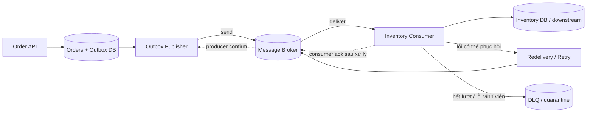
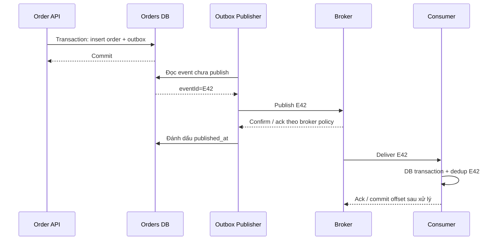

# Độ bền thông điệp, thời hạn lưu và khả năng phục hồi

> **Chương:** Nền tảng nhắn tin  
> **Phạm vi:** `SPRING_BOOT_INTEGRATION` — tổ chức tích hợp hệ thống trong Spring Boot qua HTTP client, cơ sở dữ liệu, cache, broker thông điệp và adapter của Spring Integration. Bài học tập trung vào cấu hình, hợp đồng dữ liệu, giao dịch, lỗi, xử lý trùng lặp, kiểm thử và khả năng quan sát của những luồng trao đổi thông điệp thực tế.

Một hệ thống đặt hàng có thể trả HTTP `201 Created` ngay sau khi lưu đơn, sau đó phát `OrderPlaced` để dịch vụ kho giữ hàng. Nếu broker khởi động lại, producer mất kết nối hoặc consumer chết giữa chừng, điều quan trọng là **công việc nghiệp vụ không biến mất, không bị thực hiện hai lần ngoài ý muốn và có cách khôi phục khi hệ thống hoạt động trở lại**.

Ba khái niệm thường bị trộn lẫn là **độ bền thông điệp (durability)**, **thời hạn lưu (retention/expiration)** và **khả năng phục hồi (recovery)**. Một message đã được lưu bền vững vẫn có thể hết hạn, bị xóa theo retention hoặc bị consumer xác nhận quá sớm. Ngược lại, một message còn trong broker chưa chắc được dịch vụ nhận xử lý thành công. Thiết kế đúng đòi hỏi hiểu cả vòng đời từ transaction nguồn, producer, broker, consumer đến hệ thống đích.

## 1. Mục tiêu học tập

Sau bài này, bạn có thể:

1. Mô tả thời điểm nào một message được coi là gửi thành công, đã được broker chấp nhận, đã có khả năng tồn tại qua sự cố và đã hoàn tất nghiệp vụ.
2. Phân biệt publisher confirm/producer acknowledgment, consumer acknowledgment, replication, disk persistence và transaction.
3. Phân biệt TTL, log retention, backlog retention, compaction, DLQ và retention vì yêu cầu kiểm toán.
4. Chọn cấu hình phù hợp cho RabbitMQ/AMQP, Kafka, JMS provider hoặc Pulsar mà không nhầm các bảo đảm giữa chúng.
5. Thiết kế luồng `database → outbox → broker → consumer` có thể phục hồi sau khi producer, broker hoặc consumer gặp lỗi.
6. Giữ event/command idempotent, kiểm soát retry, redelivery, ordering và việc xử lý message cũ.
7. Xây ma trận lỗi, đo RPO/RTO, kiểm thử restart/failover và giám sát backlog, replication, retention, DLQ.

## 2. Bốn câu hỏi khác nhau về một thông điệp

Giả sử producer gửi `OrderPlaced(eventId=E-42, orderId=O-100)` vào broker. Cần trả lời bốn câu hỏi riêng:

| Câu hỏi | Bằng chứng cần có | Điều bằng chứng **chưa** bảo đảm |
|---|---|---|
| Producer đã gửi? | Lệnh gửi được khởi tạo; kết quả API send/`Future` | Broker có thể chưa nhận hoặc chưa lưu. |
| Broker đã chấp nhận bền vững? | Publisher confirm/producer ack **theo policy persistence/replication đã cấu hình** | Consumer đã cập nhật database hoặc hệ thống đích. |
| Broker còn giữ dữ liệu? | Message còn trong queue/log/backlog; chưa bị ack xóa, hết TTL hay vượt retention | Bản ghi có thể đã được consumer xử lý rồi hoặc sẽ được xử lý đúng. |
| Nghiệp vụ đã hoàn tất? | Transaction lưu trạng thái nghiệp vụ, idempotency marker và quy trình xác nhận | Một broker ack đơn lẻ không chứng minh các tác dụng phụ ngoài DB đã hoàn tất. |



Sơ đồ có hai loại tín hiệu xác nhận khác nhau. **Producer acknowledgment/confirm** liên quan đến việc broker nhận một bản ghi. **Consumer acknowledgment/commit offset** liên quan đến việc consumer đã đi qua một vị trí tiêu thụ hoặc hoàn thành bước nhận. Cả hai chỉ có ý nghĩa khi đặt trong phạm vi cấu hình và transaction cụ thể.

### 2.1. Durability không đồng nghĩa availability

- **Durability:** dữ liệu đã được ghi/replicate ở mức cam kết có thể tồn tại qua loại sự cố được thiết kế để chịu đựng.
- **Availability:** hệ thống vẫn có thể nhận/giao message trong lúc hỏng node, mạng hoặc disk.
- **Recoverability:** có đủ dữ liệu, metadata, backup và quy trình để tiếp tục hoặc tái dựng trạng thái khi dịch vụ phục hồi.

Ví dụ một partition Kafka có replica trên nhiều broker nhưng thiếu số replica đang đồng bộ sẽ có thể **tạm ngừng nhận ghi với `acks=all`**. Đây có thể là hành vi đúng để bảo vệ độ bền. Một hệ thống luôn chấp nhận ghi bằng cách hạ ngưỡng xác nhận có thể tăng khả năng ghi tức thời nhưng làm tăng nguy cơ mất dữ liệu khi failover.

## 3. Vòng đời và ranh giới mất thông điệp

Một luồng tích hợp có nhiều “khoảng trống” giữa các bước:

| Ranh giới | Tình huống lỗi | Hậu quả nếu không thiết kế trước | Cơ chế cần cân nhắc |
|---|---|---|---|
| Database → producer | DB commit đơn hàng rồi ứng dụng chết trước khi publish | Có đơn hàng nhưng không có event | Transactional outbox hoặc quy trình reconciliation. |
| Producer → broker | Gửi message rồi connection timeout, không nhận confirm | Không biết broker đã nhận hay chưa | Retry có ID ổn định và deduplication downstream. |
| Broker lưu/replicate | Broker/node/disk hỏng ngay sau khi nhận | Mất message nếu policy persistence/replication không đủ | Durable storage, replication và ngưỡng confirm phù hợp. |
| Broker → consumer | Message đã giao nhưng consumer chết trước ack | Có thể giao lại; xử lý trùng nếu thiếu bảo vệ | At-least-once, transaction cục bộ, idempotency. |
| Consumer → DB | Ghi DB thành công nhưng chết trước ack/commit offset | Lần sau nhận lại message đã xử lý | Unique business key/processed-event marker. |
| Consumer → HTTP service | Timeout khi gửi lệnh ghi | Không biết bên nhận đã thực hiện hay chưa | Idempotency key, truy vấn trạng thái/đối soát. |
| Broker → retention/expiry | Consumer xử lý quá chậm hoặc tạm dừng dài ngày | Message có thể hết hạn hoặc bị log xóa trước khi tiêu thụ | Retention budget, theo dõi lag/backlog, cách khôi phục khác. |
| DLQ/replay | Phát lại message đã có tác dụng phụ thành công | Thực hiện nghiệp vụ hai lần hoặc ghi lùi trạng thái | Kiểm tra business state, idempotency, version/sequence. |

Không thể loại bỏ hoàn toàn mọi cửa sổ lỗi bằng một cờ `durable=true`. Cần xác định cụ thể **mất dữ liệu ở bước nào thì hậu quả nghiệp vụ là gì** và thiết kế thử nghiệm tương ứng.

## 4. Những cơ chế tạo độ bền thông điệp

### 4.1. Lưu bền vững khác với giữ trong bộ nhớ

Một broker có thể giữ message trong RAM để xử lý nhanh, lưu xuống ổ đĩa, dùng commit log hoặc phân phối message sang nhiều replica. Các lựa chọn cần kiểm tra:

- **Persistence:** message có được ghi vào cơ chế lưu trữ bền của broker hay chỉ giữ trong bộ nhớ?
- **Replication:** bản sao được đồng bộ ra bao nhiêu node/zone? Producer nhận confirm sau khi những thành phần nào ghi thành công?
- **Failover:** broker chọn leader/node mới thế nào, có mất những bản ghi chưa đủ điều kiện commit không?
- **Disk và quota:** khi đầy ổ đĩa, broker chặn producer, từ chối ghi hay bỏ message theo chính sách?
- **Recovery:** khi restart, broker phục hồi queue/log, offset, acknowledgment, subscription và transaction metadata theo semantics nào?

**Bảo đảm của broker luôn có điều kiện.** Persistent message không tự chống được mất toàn bộ ổ đĩa/cluster; replication không thay thế backup/khả năng phục hồi sau xóa nhầm; publisher confirm không hứa nghiệp vụ đã hoàn tất.

### 4.2. Publisher confirm và consumer acknowledgment

Publisher confirm là tín hiệu producer nhận được từ broker, có ý nghĩa tùy broker và độ bền đã cấu hình. Ngay cả khi broker xử lý thành công, **mất tín hiệu confirm trên đường về** khiến producer không biết kết quả. Retry khi đó có thể tạo message trùng.

Consumer ack hoặc commit offset thường được thực hiện **sau khi transaction nghiệp vụ quan trọng đã commit**. Nếu xác nhận trước khi lưu DB rồi consumer chết, broker có thể coi message hoàn tất dù nghiệp vụ chưa được ghi.

Với Kafka, commit offset liên quan đến tiến độ consumer group, còn dữ liệu event nằm trong log tới khi hết hạn retention/compaction. Với RabbitMQ/JMS queue điển hình, message thường được lấy khỏi queue khi được ack/commit thành công (mô hình khác nhau tùy provider). Không áp semantics của Kafka lên queue hay ngược lại.

## 5. So sánh RabbitMQ, Kafka, JMS và Pulsar

Không có một thuộc tính “durable” chung với cùng hành vi giữa mọi nền tảng.

| Nền tảng | Cơ chế lưu và xác nhận | Khi đã tiêu thụ | Thời hạn lưu / cách phục hồi |
|---|---|---|---|
| **RabbitMQ (AMQP 0-9-1)** | Queue cần độ bền; publish message persistent; cân nhắc quorum queue và publisher confirms | Consumer ack làm broker loại message khỏi queue theo mô hình queue | TTL, length limit, DLX, policy của queue; message đã ack thường không còn để đọc lại. |
| **Apache Kafka** | Partition log có replication factor, ISR, producer `acks`, cấu hình topic/broker | Commit offset đánh dấu tiến độ group; record vẫn còn trong log | `retention.ms`/`retention.bytes`, `cleanup.policy=delete/compact`; replay qua offset trong giới hạn log còn dữ liệu. |
| **JMS (ActiveMQ Artemis, IBM MQ...)** | JMS `DeliveryMode.PERSISTENT` cho message; khả năng lưu/replicate phụ thuộc JMS provider | Ack/commit xử lý message theo destination và session | `JMSExpiration`/TTL, DLQ/backout, journal/HA và retention theo provider; JMS API không chuẩn hóa tất cả. |
| **Apache Pulsar** | Persistent topic, ledgers/BookKeeper replication và broker/ack protocol | Durable subscription duy trì cursor và unacked backlog | Message TTL, backlog quota, retention cho message đã ack, chính sách retention/storage theo tenant/namespace/topic. |

Các dòng trên mang tính **mô hình lựa chọn**, không phải bảng bảo đảm cứng của mọi cluster. Ví dụ cấu hình một Kafka topic `replication.factor=3` nhưng producer dùng `acks=0` không tạo cùng độ tin cậy với cấu hình có quorum xác nhận. RabbitMQ có nhiều queue type, mỗi loại có cơ chế lưu và replication khác nhau. Pulsar có non-persistent topic không mang cùng bảo đảm với persistent topic; JMS `DeliveryMode.PERSISTENT` cần được hiểu trong phạm vi HA và lưu trữ của provider.

### 5.1. Khi nào cần queue, khi nào cần log có retention?

**Queue** phù hợp khi các worker cạnh tranh xử lý công việc, message không cần giữ để đọc lại sau khi hoàn thành, và công việc lỗi đi qua redelivery/DLQ. **Log lưu theo retention** phù hợp khi nhiều consumer group đọc độc lập, cần tái xử lý trong khoảng thời gian nhất định hoặc cần dựng lại trạng thái từ chuỗi event.

Không biến điều này thành “RabbitMQ không thể fanout” hoặc “Kafka chỉ dùng được cho event”: cả hai hỗ trợ nhiều pattern. Điểm phân biệt quan trọng là **ngữ nghĩa lưu sau khi tiêu thụ, subscription, thứ tự, replay và chi phí vận hành**.

## 6. RabbitMQ: durable queue, persistent message và confirms

Trong RabbitMQ, **queue durable** và **message persistent** là hai quyết định riêng. Cả hai cần đúng để message được lưu bền theo mô hình queue, nhưng vẫn phải xét loại queue, replication và publisher confirm. Ví dụ Spring AMQP:

```java
import org.springframework.amqp.core.Binding;
import org.springframework.amqp.core.BindingBuilder;
import org.springframework.amqp.core.DirectExchange;
import org.springframework.amqp.core.Queue;
import org.springframework.amqp.core.QueueBuilder;
import org.springframework.context.annotation.Bean;
import org.springframework.context.annotation.Configuration;

@Configuration(proxyBeanMethods = false)
class OrdersRabbitTopology {
    @Bean
    DirectExchange ordersExchange() {
        return new DirectExchange("orders.events", true, false);
    }

    @Bean
    Queue orderCreatedQueue() {
        return QueueBuilder.durable("inventory.order-created")
            .withArgument("x-queue-type", "quorum")
            .build();
    }

    @Bean
    Binding createdBinding(Queue orderCreatedQueue, DirectExchange ordersExchange) {
        return BindingBuilder.bind(orderCreatedQueue)
            .to(ordersExchange)
            .with("order.created");
    }
}
```

`x-queue-type=quorum` minh họa chọn quorum queue; cần kiểm tra cluster thực tế có đủ node, policy và tài nguyên để đáp ứng mục tiêu chịu lỗi. Một queue durable không tự đảm bảo còn dữ liệu nếu chỉ có một bản sao và ổ đĩa vật lý bị mất.

Cấu hình publisher confirms/returns cho ứng dụng Spring Boot:

```yaml
spring:
  rabbitmq:
    publisher-confirm-type: correlated
    publisher-returns: true
    template:
      mandatory: true
```

Trong Spring AMQP, message được chuyển bằng `RabbitTemplate` thường sử dụng delivery mode persistent theo message converter/properties mặc định, nhưng **không nên dựa vào ngầm định khi cần hợp đồng quan trọng**. Có thể đặt tường minh:

```java
import org.springframework.amqp.core.MessageDeliveryMode;
import org.springframework.amqp.rabbit.core.RabbitTemplate;
import org.springframework.stereotype.Service;

@Service
class OrderEventSender {
    private final RabbitTemplate rabbit;

    OrderEventSender(RabbitTemplate rabbit) {
        this.rabbit = rabbit;
    }

    void send(String eventJson) {
        rabbit.convertAndSend(
            "orders.events", "order.created", eventJson,
            message -> {
                message.getMessageProperties()
                    .setDeliveryMode(MessageDeliveryMode.PERSISTENT);
                return message;
            });
    }
}
```

**Quan trọng:** `convertAndSend(...)` hoàn thành không có nghĩa producer đã xử lý đầy đủ confirm và return. Cần đăng ký callback/correlation data, kiểm tra `ack/nack`, handling `returned message` khi không route được và xác định trạng thái publish theo event ID. `mandatory=true` hỗ trợ phát hiện trường hợp không có queue phù hợp, nhưng returned-message handling và publisher confirm cần được phối hợp; confirm không tự chứng minh đã route vào queue nghiệp vụ đúng.

Nếu application chết sau khi broker confirm nhưng trước khi đánh dấu outbox là đã gửi, event sẽ có thể được publish lại. Đó là trường hợp bình thường của thiết kế **at-least-once**; downstream phải idempotent.

### 6.1. RabbitMQ TTL, dead-letter và giới hạn dung lượng

```java
Queue retryQueue = QueueBuilder.durable("inventory.retry")
    .withArgument("x-message-ttl", 60_000) // Giá trị minh họa: 60 giây.
    .withArgument("x-dead-letter-exchange", "orders.events")
    .withArgument("x-dead-letter-routing-key", "order.created")
    .build();
```

Đây là một **retry queue bằng TTL** minh họa; broker có thể chuyển message hết hạn tới DLX sau TTL. Trong production cần tránh vòng lặp retry vô hạn bằng bộ đếm/giới hạn số lần thử và quy trình đưa poison message vào DLQ. Thứ tự expiry cũng có đặc thù queue type, head-of-line và policy; không coi TTL là bộ hẹn giờ chính xác tới mili giây.

Với queue nghiệp vụ, `x-message-ttl` có thể khiến message hết hạn **trước khi consumer kịp xử lý** nếu backlog dài. `x-max-length` và overflow policy cũng có thể khiến message bị loại bỏ hoặc producer bị chặn, tùy cấu hình. Các lựa chọn phải gắn với nhu cầu giữ dữ liệu và cảnh báo sớm.

Trong RabbitMQ, policy/operator policy có thể phù hợp hơn hardcode `x-arguments` khi vận hành. Một số argument có tính bất biến hoặc khó đổi sau khi queue đã tạo, và một cấu hình từ code có thể xung đột với topology được quản trị ở broker. Chọn chủ sở hữu cấu hình rõ ràng.

## 7. Kafka: replication, acknowledgment, retention và replay

Kafka ghi record vào log theo topic partition. Độ bền phụ thuộc replication, trạng thái in-sync replicas, policy broker và producer. Một cấu hình hướng tới độ bền cho một topic quan trọng có thể là:

```properties
# Ví dụ topic/broker, không phải tất cả đều đặt ở application.yml.
# Topic được tạo với replication factor 3 nếu cluster đủ broker.
min.insync.replicas=2
cleanup.policy=delete
retention.ms=604800000
```

Producer Spring Boot:

```yaml
spring:
  kafka:
    producer:
      acks: all
      properties:
        enable.idempotence: true
    consumer:
      enable-auto-commit: false
```

Nếu topic có replication factor 3, `min.insync.replicas=2` và producer `acks=all`, broker yêu cầu mức in-sync tối thiểu để xác nhận ghi theo semantics Kafka. Nếu thiếu số replica đồng bộ, một lệnh ghi có thể thất bại hoặc chờ thay vì được chấp nhận với mức độ bền thấp hơn. Đây là một đánh đổi có chủ đích giữa tính sẵn sàng ghi và bảo vệ dữ liệu.

`enable.idempotence=true` hỗ trợ giảm bản ghi trùng do **producer retry trong phạm vi cơ chế producer và phiên làm việc phù hợp**; nó không loại bỏ trùng lặp nghiệp vụ khi application tạo lại cùng event trong một phiên khác, từ outbox publisher khác hoặc từ replay. Cần một `eventId` ổn định và xử lý trùng ở consumer.

### 7.1. Kafka offset và retention không giống acknowledgment queue

Một Kafka consumer commit offset sau khi cập nhật DB sẽ báo cho group tiến độ tiêu thụ. **Record không bị xóa chỉ vì offset đã commit**; nó tiếp tục được giữ theo retention/compaction và có thể được đọc lại nếu còn trên log.

- `retention.ms` là chính sách lưu theo thời gian đối với log có cleanup `delete`; `retention.bytes` cũng có thể giới hạn theo dung lượng.
- `cleanup.policy=delete` xóa segment cũ theo policy; thời điểm dọn dẹp là theo cơ chế broker, không phải thao tác chính xác từng record ở thời điểm hết hạn.
- `cleanup.policy=compact` giữ một trạng thái gần nhất theo **key** trong phạm vi semantics log compaction; nó không phải cách giữ lịch sử mọi event, và các record cũ vẫn có thể tồn tại trước khi cleaner chạy.
- Có thể kết hợp `delete,compact` nếu cần cả hai chính sách. Tombstone và `delete.retention.ms` có ý nghĩa riêng khi tái dựng trạng thái qua compacted topic.

Một consumer group bị dừng 10 ngày trong khi topic chỉ giữ 7 ngày có nguy cơ **mất phần lịch sử chưa tiêu thụ**. Khi offset cũ không còn, hành vi bắt đầu lại phụ thuộc cấu hình như `auto.offset.reset` và cách ứng dụng xử lý lỗi thiếu offset. Không được tự động reset sang latest rồi coi là đã xử lý xong công việc.

### 7.2. Spring Kafka: commit offset sau transaction nghiệp vụ

Ví dụ một listener dùng manual acknowledgment để kiểm soát thứ tự xử lý (các bean `OrderEvent`, `InventoryProcessor` và deserializer cần được định nghĩa theo ứng dụng):

```java
import org.springframework.kafka.annotation.KafkaListener;
import org.springframework.kafka.support.Acknowledgment;
import org.springframework.stereotype.Component;

@Component
class InventoryKafkaListener {
    private final InventoryProcessor processor;

    InventoryKafkaListener(InventoryProcessor processor) {
        this.processor = processor;
    }

    @KafkaListener(
        topics = "orders.events",
        groupId = "inventory",
        containerFactory = "manualAckFactory")
    void onEvent(OrderEvent event, Acknowledgment acknowledgment) {
        processor.process(event); // @Transactional trên public method của bean khác.
        acknowledgment.acknowledge(); // Sau khi processor đã return/commit DB.
    }
}
```

Container factory được thiết lập tương ứng, ví dụ:

```java
import org.springframework.context.annotation.Bean;
import org.springframework.kafka.config.ConcurrentKafkaListenerContainerFactory;
import org.springframework.kafka.core.ConsumerFactory;
import org.springframework.kafka.listener.ContainerProperties;

@Bean
ConcurrentKafkaListenerContainerFactory<String, OrderEvent> manualAckFactory(
        ConsumerFactory<String, OrderEvent> consumerFactory) {
    var factory = new ConcurrentKafkaListenerContainerFactory<String, OrderEvent>();
    factory.setConsumerFactory(consumerFactory);
    factory.getContainerProperties()
        .setAckMode(ContainerProperties.AckMode.MANUAL_IMMEDIATE);
    return factory;
}
```

Ví dụ minh họa **thứ tự gọi**: service `processor.process(...)` là một bean riêng, method được Spring transaction proxy quản lý và **đã hoàn tất commit DB trước khi trả về**. Không đặt `@Transactional` trên chính method listener rồi gọi `acknowledge()` bên trong nếu điều đó khiến ack xảy ra trước commit thực tế. Với xử lý bất đồng bộ, càng phải chờ công việc nghiệp vụ hoàn tất trước khi xác nhận offset.

Nếu processor throw exception, error handler/container và cơ chế retry/DLT phải được cấu hình nhất quán; snippet trên **chưa** thiết lập retry/DLT. `MANUAL_IMMEDIATE` có semantics cụ thể theo thread và cách container xử lý commit; cần integration test thay vì suy luận từ tên option.

Kafka transaction có thể giúp atomicity trong phạm vi thao tác Kafka như tiêu thụ/xuất record và offset với cơ chế phù hợp, nhưng **không tự biến commit của một database bên ngoài thành một transaction Kafka duy nhất**. Với DB + Kafka, vẫn cần chiến lược outbox/idempotency hoặc phối hợp transaction phù hợp cùng khả năng phục hồi khi commit hai hệ thống không đồng thời.

## 8. JMS: persistent delivery và session transaction

Với Spring JMS, `DeliveryMode.PERSISTENT` thể hiện yêu cầu lưu bền message trong phạm vi JMS provider và cấu hình broker. Để có semantics phát/nhận cụ thể, cần kiểm tra broker thực tế như ActiveMQ Artemis hoặc IBM MQ.

```java
import org.springframework.context.annotation.Bean;
import org.springframework.context.annotation.Configuration;
import org.springframework.jms.core.JmsTemplate;
import jakarta.jms.ConnectionFactory;

@Configuration(proxyBeanMethods = false)
class JmsPublisherConfig {
    @Bean
    JmsTemplate persistentJmsTemplate(ConnectionFactory connectionFactory) {
        var template = new JmsTemplate(connectionFactory);
        template.setExplicitQosEnabled(true);
        template.setDeliveryPersistent(true);
        // TTL không được đặt ở đây nếu event cần sống cho đến khi xử lý.
        return template;
    }
}
```

**Không đánh đồng `DeliveryMode.PERSISTENT` với replication nhiều node hoặc bảo vệ trước mất cả datacenter.** Những mức độ bền đó phụ thuộc journal/HA của JMS provider. Cũng cần kiểm tra `JMSExpiration` hoặc time-to-live: một message persistent vẫn có thể hết hạn trước lúc xử lý.

Với listener dùng local JMS transacted session, việc throw exception để transaction rollback cho phép broker redeliver theo policy. Consumer thành công và commit JMS không chứng minh tất cả tác dụng phụ đã thành công nếu bạn gửi HTTP hoặc ghi DB ngoài transaction JMS. Ngược lại, DB đã commit còn JMS rollback khiến message có thể được giao lại. Cần idempotency ở mức nghiệp vụ.

DLQ/backout và số lần giao tối đa **không được chuẩn hóa như một API chung bởi JMS**. Địa chỉ DLQ, redelivery delay, poisoning policy và metadata khi chuyển message cần cấu hình theo broker; không suy từ tên queue.

## 9. Pulsar: durable subscription, backlog và retention

Pulsar lưu dữ liệu persistent topic qua cơ chế lưu trữ có replication (thường là Apache BookKeeper) và quản lý tiến độ tiêu thụ thông qua subscription. Các yếu tố cần phân biệt:

- **Persistent topic:** dữ liệu gửi đến được lưu theo cơ chế persistent storage; non-persistent topic có bảo đảm khác.
- **Durable subscription:** cursor/progress của subscription được lưu để tiếp tục nhận message sau khi consumer reconnect. Tùy kiểu subscription và cách ack, message chưa được xác nhận tạo backlog.
- **Backlog quota:** giới hạn dữ liệu tồn đọng của subscription/topic; khi vượt ngưỡng, chính sách có thể chặn producer hoặc áp cách xử lý khác tùy cấu hình.
- **TTL:** có thể làm thông điệp hết hạn và đánh dấu không còn cần giao lại theo policy; phải tính đến consumer outage.
- **Retention:** chính sách giữ message **sau khi đã được ack** phục vụ khả năng đọc lại trong giới hạn phù hợp; phân biệt với backlog chưa ack.
- **Dead-letter/retry:** consumer có thể cấu hình cơ chế retry/DLQ tùy client/subscription; semantics và delivery count cần kiểm tra với bản Pulsar đang chạy.

Đừng kết luận “durable subscription giữ tất cả event vô hạn”. Một subscription có backlog quota, topic có policy retention/TTL và storage có hạn; cần xác định giới hạn cụ thể, số consumer, khả năng phục hồi metadata/ledger và tài nguyên BookKeeper.

Một subscription có thể có nhiều kiểu phân phối (`Exclusive`, `Shared`, `Failover`, `Key_Shared`) với đặc điểm thứ tự, load balancing và redelivery khác nhau. Chọn kiểu subscription theo yêu cầu nghiệp vụ, đặc biệt khi một `orderId` không được xử lý song song sai thứ tự.

## 10. TTL, retention, expiry, compaction và DLQ khác nhau thế nào?

Các cơ chế này đều ảnh hưởng “message còn hay mất”, nhưng mục đích và điều kiện khác nhau.

| Cơ chế | Câu hỏi nó trả lời | Ví dụ | Nguy cơ khi dùng sai |
|---|---|---|---|
| **Message TTL / expiration** | Một message còn giá trị để giao sau bao lâu? | Yêu cầu giữ hàng chỉ còn hiệu lực trong 15 phút | Worker tạm dừng 20 phút khiến công việc hết hạn trước khi xử lý. |
| **Log retention** | Dữ liệu log được lưu bao lâu/dung lượng bao nhiêu? | Giữ event Kafka 14 ngày để replay | Consumer lag vượt retention mất lịch sử chưa đọc. |
| **Backlog retention/quota** | Broker được giữ bao nhiêu dữ liệu chưa tiêu thụ? | Pulsar giữ subscription backlog tới giới hạn cấu hình | Vượt quota có thể chặn producer hoặc gây mất khả năng phục vụ. |
| **Log compaction** | Giữ trạng thái theo key cho cách dựng lại state? | Kafka compact theo `productId` | Không còn đủ lịch sử từng thay đổi để audit/event replay. |
| **DLQ/quarantine** | Message xử lý lỗi sẽ được cách ly và điều tra ở đâu? | Order event sai schema đưa DLQ sau retry | DLQ quá đầy, replay lặp vô hạn hoặc retention xóa message lỗi. |
| **Business deadline** | Nghiệp vụ còn chấp nhận xử lý lúc này không? | Không gửi email OTP sau thời hạn xác nhận | Broker còn message nhưng thực hiện đã quá muộn, gây lỗi nghiệp vụ. |
| **Audit retention** | Tổ chức cần giữ chứng cứ nghiệp vụ trong bao lâu? | Lưu lịch sử giao dịch theo yêu cầu tuân thủ | Nhầm broker retention với lưu trữ kiểm toán lâu dài. |

**Thông điệp còn trên broker không có nghĩa còn hợp lệ về nghiệp vụ.** Event `OrderPlaced` có thể phải được lưu để đồng bộ/đối soát, nhưng command `ReserveStockBeforeDeadline` có thể cần bỏ qua hoặc chuyển sang trạng thái hết hạn nếu xử lý muộn.

Với Kafka, `retention.ms` là chính sách log; không tự hiểu `businessDeadline` của từng record. Với RabbitMQ, TTL có thể dẫn tới dead-letter nếu DLX được cấu hình; không nên coi message được chuyển DLQ là “đã xử lý”. Với JMS, expiry queue/DLQ là khả năng phụ thuộc provider. Các chính sách giữ dữ liệu của Pulsar cần phân biệt backlog unacked và retention của message đã được xác nhận.

### 10.1. Chọn thời hạn lưu từ thời gian phục hồi yêu cầu

Ví dụ đơn hàng cần chịu được việc consumer dừng **tối đa 72 giờ** mà không mất lệnh cần xử lý. Retention/log/backlog budget phải lớn hơn khoảng dừng có thể xảy ra **cộng** thời gian khôi phục, bắt kịp backlog và độ trễ vận hành:

```text
Thời gian giữ dữ liệu tối thiểu theo nhu cầu
  > thời gian consumer outage dự kiến
    + thời gian phát hiện và can thiệp
    + thời gian xử lý backlog sau phục hồi
    + biên an toàn
```

Đây là **nguyên tắc lập ngân sách**, không phải công thức thay thế kiểm thử. Nếu topic còn bị giới hạn theo dung lượng, lượng dữ liệu có thể bị xóa sớm hơn mốc thời gian kỳ vọng. Cần tính tốc độ dữ liệu/peak, disk quota, replication overhead và đặc điểm cleanup, không chỉ cài một số ngày.

Ví dụ topic Kafka 7 ngày nhưng workload sinh 100 GB/ngày và có `retention.bytes` quá nhỏ, dữ liệu có thể không tồn tại đủ 7 ngày. Với queue dựa trên ack, không nên coi thời hạn giữ giống log: message còn đến khi tiêu thụ, hết hạn hoặc policy khác xử lý.

## 11. Phục hồi sau sự cố: từ mất xác nhận tới mất cluster

Các sự cố khác nhau yêu cầu hành động khác nhau.

| Sự cố | Trạng thái có thể xảy ra | Cách phục hồi | Điều phải đo |
|---|---|---|---|
| Producer timeout sau gửi | Broker có thể đã nhận dù producer không thấy confirm | Giữ event ID, retry có kiểm soát từ outbox, consumer idempotent | Publish attempt, confirm/timeout, duplicate rate. |
| Broker restart một node | Có thể failover hoặc chờ broker trở lại | Kết nối lại với backoff; bảo đảm storage/replication đúng policy | Broker availability, reconnect time, lost/unavailable partitions/queues. |
| Replica không đủ quorum | Producer write thất bại hoặc bị chặn | Khôi phục replica/cluster; không tự hạ mức durability khi chưa được duyệt | ISR/quorum health, failed writes, lag. |
| Consumer crash trước ack | Message thường được giao lại | Reconsume với transaction và idempotency | Redelivery count, xử lý trùng, duplicate side effects. |
| Poison message | Message luôn làm handler lỗi | Retry hữu hạn, sau đó DLQ/quarantine và sửa nguyên nhân | DLQ depth/age, retry attempts, lỗi theo schema version. |
| Consumer dừng lâu | Backlog tăng; có thể vượt retention/quota | Tăng năng lực consumer, dọn bottleneck, phục hồi từ snapshot/source nếu log đã mất | Backlog age, consumer lag, throughput catch-up. |
| Disk/cluster mất dữ liệu | Một phần message/metadata không thể khôi phục từ replica | Backup/restore, DR hoặc tái tạo từ outbox/source system | RPO/RTO thực tế, số event thiếu, consistency. |
| Replay sai thứ tự | Event cũ có thể ghi lùi trạng thái | Version/sequence guard, đối soát trạng thái hiện tại | Out-of-order, rejected stale updates. |

**Reconnect** chỉ giải quyết kết nối. **Recovery** còn phải tái khẳng định trạng thái nghiệp vụ đúng sau sự cố, đặc biệt khi message đã đi qua HTTP, database hoặc hệ thống thứ ba trước khi lỗi được ghi nhận.

### 11.1. RPO và RTO theo nghiệp vụ

- **RPO (Recovery Point Objective):** lượng dữ liệu/tác vụ tối đa có thể bị mất khi xảy ra sự cố, thường biểu đạt theo thời gian hoặc số event.
- **RTO (Recovery Time Objective):** thời gian mục tiêu để dịch vụ hoặc luồng nghiệp vụ trở lại mức phục vụ đã định.

Ví dụ, một dịch vụ gửi thông báo không quan trọng có thể chấp nhận mất một số notification trong giới hạn nghiệp vụ, nhưng luồng thanh toán thường cần cơ chế lưu và đối soát chặt hơn. Không nói “RPO = 0” chỉ vì `acks=all` nếu chưa xét nguồn event, thời điểm commit DB/outbox, thảm họa mất toàn bộ storage, backup và replication liên vùng.

Kế hoạch DR phải trả lời: **khôi phục broker metadata/queue/topic/consumer offset bằng gì, khôi phục outbox/DB bằng gì, và đối chiếu event nào đã tác động lên dịch vụ ngoài?** Khôi phục một bản snapshot DB cũ có thể tạo chênh lệch với message đã publish từ trước snapshot; cần quy trình reconciliation.

## 12. Transactional outbox: nối khoảng trống DB và broker

Một trong những rủi ro lớn nhất trong Spring Boot integration là thứ tự:

```java
// Không bảo đảm đồng bộ hai hệ thống:
orderRepository.save(order); // Commit database ở thời điểm nào?
brokerPublisher.publish(event); // Publish có thể thất bại sau commit DB.
```

Gắn `@Transactional` cho JDBC/JPA không làm lời gọi broker tự tham gia cùng một transaction. Cách triển khai thường dùng là **outbox**: ghi dữ liệu nghiệp vụ và ý định phát event vào **cùng transaction database**.

```sql
-- Ví dụ PostgreSQL, khởi tạo bảng có định danh sự kiện ổn định.
CREATE TABLE outbox_events (
    event_id UUID PRIMARY KEY,
    aggregate_id VARCHAR(80) NOT NULL,
    event_type VARCHAR(80) NOT NULL,
    payload JSONB NOT NULL,
    created_at TIMESTAMPTZ NOT NULL DEFAULT NOW(),
    published_at TIMESTAMPTZ
);
```

Trong một service Spring có transaction:

```java
import org.springframework.stereotype.Service;
import org.springframework.transaction.annotation.Transactional;

@Service
class OrderCommandService {
    private final OrderRepository orders;
    private final OutboxRepository outbox;

    OrderCommandService(OrderRepository orders, OutboxRepository outbox) {
        this.orders = orders;
        this.outbox = outbox;
    }

    @Transactional
    public OrderReceipt create(CreateOrder command) {
        Order order = orders.save(Order.from(command));
        outbox.save(OutboxEvent.orderPlaced(
            command.eventId(), order.getId(), command.toEventPayload()));
        return new OrderReceipt(order.getId());
    }
}
```

`Order`, `OrderRepository`, `CreateOrder` và `OutboxRepository` là các kiểu nghiệp vụ minh họa. Cần bảo đảm hai repository dùng cùng transaction manager/database, `eventId` được lưu ổn định và có unique constraint phù hợp. Nếu HTTP client retry lệnh tạo đơn, phải có idempotency key/unique constraint nghiệp vụ cho **cả lệnh tạo order**, không chỉ outbox event ID.

Publisher đọc outbox chưa gửi, publish và **chỉ đánh dấu `published_at` sau khi nhận đúng loại confirm thành công**:



**Cửa sổ lặp:** broker đã nhận E42 nhưng publisher chết trước khi cập nhật `published_at`. Lần chạy sau publish E42 lần nữa. Đây là cái giá có chủ đích để tránh mất ý định phát. Consumer cần idempotent.

Nếu có nhiều instance publisher, cần cơ chế claiming/locking phù hợp (chẳng hạn row-level locking và `SKIP LOCKED` khi DB hỗ trợ), tránh hai worker tranh cùng event, và có thể phục hồi record đã claim nhưng worker chết. Đừng giữ transaction DB mở trong thời gian dài chỉ để chờ broker; điều đó chiếm connection/lock và không biến broker thành thành viên transaction DB.

## 13. Consumer idempotency và khôi phục từ redelivery

Broker có thể giao lại message nếu consumer chết sau khi commit DB nhưng trước ack. Để bảo đảm một event **không cập nhật trạng thái nghiệp vụ hai lần**, dùng event ID ổn định và ràng buộc DB:

```sql
CREATE TABLE processed_events (
    consumer_name VARCHAR(80) NOT NULL,
    event_id UUID NOT NULL,
    processed_at TIMESTAMPTZ NOT NULL DEFAULT NOW(),
    PRIMARY KEY (consumer_name, event_id)
);
```

Trong **cùng database transaction** với cập nhật trạng thái:

```sql
-- PostgreSQL: số dòng được thêm là 1 khi lần đầu xử lý.
INSERT INTO processed_events (consumer_name, event_id)
VALUES (:consumer_name, :event_id)
ON CONFLICT DO NOTHING;
```

- Nếu **1 dòng** được thêm, chạy thay đổi nghiệp vụ trong cùng transaction; commit DB thành công rồi mới ack/commit tiến độ tiêu thụ.
- Nếu **0 dòng**, event đã được xử lý bởi consumer tương ứng; kiểm tra trạng thái nếu cần rồi xác nhận message mà không lặp thao tác.
- Nếu thao tác nghiệp vụ thất bại, rollback marker cùng thay đổi trạng thái để lần sau có thể thử lại.

Phải dựa vào unique constraint thực tế khi có cạnh tranh; chuỗi “`SELECT` xem đã có chưa rồi `INSERT`” không đủ ngăn race. Với update có yêu cầu thứ tự, thêm `aggregateVersion`/`sequence` và kiểm tra phiên bản để message cũ không ghi đè trạng thái mới.

**Giới hạn:** marker bảo vệ tác dụng phụ thuộc **cùng transaction database**. Khi consumer gọi một HTTP API bên ngoài, phải truyền idempotency key mà phía nhận thực sự hỗ trợ hoặc ghi trạng thái lệnh và đối soát. Không dùng `processed_events` để tuyên bố exactly-once cho mọi hệ thống.

### 13.1. Retry và DLQ phải có điểm dừng

Lỗi tạm thời như database timeout có thể được retry có giới hạn, backoff và jitter. Lỗi vĩnh viễn như payload hỏng/schema không tương thích thường cần cách ly nhanh. DLQ phải lưu đủ event ID, schema version, correlation ID và nguyên nhân để điều tra.

Không được để **retry lồng nhau** làm nhân số lời gọi xuống hệ thống khác. Nếu broker giao lại 5 lần, listener lại retry HTTP 4 lần mỗi lượt, có thể phát sinh 20 lời gọi cho một event. Với thao tác không idempotent, con số này là 20 cơ hội tạo tác dụng phụ trùng.

Quy trình replay phải xác minh tác dụng phụ hiện có, sửa nguyên nhân lỗi, giữ business/event ID, giới hạn tốc độ và quan sát kết quả. Nếu message đã quá thời hạn nghiệp vụ, có thể cần quyết định bỏ qua hoặc bù trừ thay vì chạy lại nguyên lệnh.

## 14. Theo dõi backlog, retention và sức khỏe broker

Không đủ chỉ đo “consumer có đang chạy hay không”. Một consumer còn sống nhưng chậm hơn producer vẫn có thể khiến log hết retention hoặc queue đầy.

| Nhóm tín hiệu | Cần đo | Vì sao |
|---|---|---|
| Producer | Send/confirm latency, nack/error/timeout, rate retry, message unroutable | Phát hiện mất xác nhận hoặc sai routing. |
| Broker | Disk free, memory, publish rate, replica/ISR/quorum health, unavailable queue/partition | Đo nguy cơ ngừng nhận ghi hoặc suy giảm durability. |
| Consumer | Throughput, error rate, handler latency p95/p99, ack/offset commit failures | Phát hiện xử lý chậm hoặc xác nhận sai. |
| Backlog | Queue depth, Kafka consumer lag, Pulsar backlog, **tuổi message cũ nhất** | Ước lượng nguy cơ vượt thời hạn lưu hoặc business deadline. |
| Retention/expiry | Record bị dọn, message expired, TTL, quota overflow, retention headroom | Phát hiện khả năng mất công việc vì policy lưu. |
| Recovery | Redelivery attempts, DLQ depth/age, replay success/failure | Xác định khối lượng công việc cần xử lý thủ công. |
| Nghiệp vụ | Số đơn pending quá SLA, event ID trùng, trạng thái chênh lệch với nguồn | Phát hiện “message không lỗi” nhưng nghiệp vụ vẫn mắc kẹt. |

Các metric cụ thể phụ thuộc nền tảng, phiên bản Spring, Actuator/Micrometer và exporter của broker. Trước khi đặt alert, xác minh metric thực sự phản ánh partition/queue/topic mong muốn và định nghĩa đơn vị/thời gian.

**Consumer lag theo số bản ghi không đủ để suy ra thời gian bắt kịp** nếu processing cost không đồng đều. Cần kết hợp throughput, tuổi backlog, giờ cao điểm, số partition/consumer có thể chạy song song và latency của database/downstream. Khi backlog tăng do một poison message lặp lại, chỉ tăng thêm consumer có thể không giải quyết được bottleneck.

### 14.1. Retention budget và tốc độ khôi phục

Để lập kế hoạch, có thể tính sơ bộ:

```text
Tốc độ producer: 1.000 message/phút
Consumer outage: 180 phút
Backlog sau outage ≈ 180.000 message

Khi phục hồi:
  producer vẫn gửi 1.000 message/phút
  consumer xử lý 2.500 message/phút
  tốc độ giảm backlog ≈ 1.500 message/phút
  thời gian bắt kịp lý thuyết ≈ 120 phút
```

Ước tính bỏ qua biến động tải, message size, lỗi/retry, partition, lock và downstream. Nhưng nó cho thấy vì sao **retention phải bao phủ cả outage lẫn giai đoạn catch-up**, và vì sao throughput consumer chỉ bằng throughput producer thì backlog sẽ không tự giảm.

## 15. Kiểm thử độ bền và khả năng phục hồi

Unit test có thể kiểm tra validation và retry classification, nhưng **độ bền thực sự phải kiểm chứng với broker và database theo topology gần giống production**. Có thể dùng Testcontainers cho integration test, kết hợp fault injection/chaos test được kiểm soát với cluster phù hợp khi kiểm tra failover.

| Kịch bản | Thao tác mô phỏng | Kỳ vọng |
|---|---|---|
| Producer mất confirm | Broker nhận event nhưng producer mất kết nối trước khi nhận phản hồi | Outbox retry; consumer chỉ áp dụng một tác dụng phụ nghiệp vụ. |
| Broker restart | Gửi message persistent/đã confirm rồi restart broker | Message cần giữ còn tồn tại theo policy đã cấu hình. |
| Mất một broker/replica | Dừng node trong cluster thử nghiệm | Hành vi failover, write availability và durability đúng quorum/ISR policy. |
| Consumer chết trước ack | Ghi DB xong rồi dừng consumer trước ack/offset commit | Message redeliver; DB dedup ngăn ghi trùng. |
| Poison message | Gửi payload sai schema | Retry có điểm dừng; message vào DLQ và không làm nghẽn toàn bộ luồng. |
| Consumer outage > retention | Dừng group lâu hơn thời hạn log | Phát hiện thiếu lịch sử; có runbook tái dựng/đối soát, không “skip silently”. |
| TTL ngắn hơn backlog | Queue tích tụ lâu hơn TTL | Có thông tin expiry/DLQ và hậu quả nghiệp vụ được xử lý rõ. |
| Storage/quota đầy | Giới hạn disk/quota trong môi trường thử nghiệm | Producer/consumer phản ứng theo policy, alert phát trước khi mất dữ liệu. |
| Replay từ DLQ | Replay một lệnh đã từng gây tác dụng phụ | Giữ ID và kiểm tra trạng thái; không duplicate/ghi lùi phiên bản. |
| Khôi phục từ snapshot | Restore trạng thái broker/DB mẫu và đối chiếu outbox | Tìm được chênh lệch, có phương án reconciliation. |

Khi kiểm thử, cần ghi rõ **cấu hình**: số replica, persistence mode, queue/topic type, acknowledgments, TTL/retention, retry policy, phiên bản broker/client và địa điểm fault injection. Test một broker đơn lẻ không chứng minh khả năng chịu mất node trong cluster.

### 15.1. Kiểm thử thứ tự xác nhận với Spring Boot

Một test tích hợp có thể dùng:

1. Tạo order và outbox event trong DB; trước khi publisher chạy, kill process API. Khởi động lại publisher và xác nhận event vẫn được phát.
2. Cho publisher gửi thành công nhưng dừng nó trước khi đánh dấu outbox; chạy lại publisher và xác minh có thể nhận message trùng, nhưng consumer chỉ xử lý nghiệp vụ một lần.
3. Để consumer xử lý DB thành công rồi ngắt kết nối broker trước ack; khởi động lại consumer và xác minh duplicate marker hoạt động.
4. Để consumer không nhận dữ liệu đủ lâu; đo backlog age và kiểm tra retention/expiry trong môi trường thử nghiệm.
5. Tạo message có `businessDeadline` đã quá hạn; kiểm tra consumer ghi nhận trạng thái hết hạn thay vì thực hiện hành động lỗi thời.

Trường hợp quan trọng nhất là **không có mất dữ liệu im lặng**: nếu policy đã chấp nhận cho message hết hạn hoặc log bị dọn, hệ thống phải có số liệu/đường xử lý rõ ràng, không coi kết quả thiếu là “consumer đã xong”.

## 16. Các nhầm lẫn cần tránh

**“Queue durable nghĩa là mọi message đều an toàn.”** Độ bền queue khác persistence của message, replication, xác nhận producer và chính sách storage. Cần xét cùng một bộ cấu hình.

**“Producer gọi send không lỗi là consumer đã xử lý.”** Send, confirm, delivery, ack và transaction nghiệp vụ là các bước khác nhau; một bước thành công không xác nhận bước sau.

**“Persistent message không bao giờ bị xóa.”** TTL, retention, quota, ack thành công và chính sách dọn dữ liệu vẫn có thể làm message không còn trong broker.

**“Kafka commit offset sẽ xóa record.”** Offset ghi nhận tiến độ group; retention/compaction mới quản lý vòng đời record trong log.

**“Kafka `acks=all` là exactly-once xuyên DB và HTTP.”** Acknowledgment có phạm vi của Kafka; database và downstream cần transaction/idempotency/đối soát riêng.

**“RabbitMQ queue và Kafka topic replay giống nhau.”** Queue truyền thống loại message khi ack; log Kafka giữ record theo policy. Khả năng replay và retention khác nhau.

**“DLQ chính là backup.”** DLQ chỉ giữ message lỗi theo policy; không lưu toàn bộ dữ liệu đã ack, không bảo vệ trước mất cluster hoặc xóa nhầm.

**“Consumer online nghĩa là không thể mất message.”** Consumer có thể chậm hơn producer, backlog tăng rồi hết TTL/retention. Cần theo dõi tuổi backlog và budget.

**“Đã có retry thì không cần idempotency.”** Retry và redelivery **tăng khả năng xử lý trùng**; idempotency/unique key bảo vệ kết quả nghiệp vụ.

**“Restart broker xong là đã phục hồi.”** Còn phải đối soát message chưa publish, offsets/subscriptions, tác dụng phụ đã commit và DLQ/replay, đặc biệt sau DR restore.

## 17. Bài thực hành tổng hợp

Hãy xây một luồng `OrderPlaced` trong Spring Boot, dùng một database và **chọn một** trong các nền tảng RabbitMQ, Kafka, JMS provider hoặc Pulsar:

1. Định nghĩa hợp đồng event với `eventId`, `orderId`, `eventType`, `schemaVersion`, `occurredAt` và trường nghiệp vụ cần thiết. Quy định event có được xử lý muộn không.
2. Tạo outbox trong cùng transaction tạo đơn. Lưu event ID ổn định và trạng thái publish để phục hồi.
3. Cấu hình broker theo mục tiêu durability: storage/persistence, replication nếu dùng cluster, producer confirms/acks, retention/TTL/quota. Ghi lại rõ từng giá trị.
4. Tạo publisher có retry/backoff và xử lý xác nhận; mô phỏng mất confirm để chứng minh message có thể bị phát trùng mà không mất ý định publish.
5. Tạo consumer ghi `processed_events` và cập nhật nghiệp vụ trong cùng transaction DB; chỉ ack/commit tiến độ sau khi transaction thành công.
6. Thử consumer crash sau DB commit trước ack; xác nhận không tạo tác dụng phụ trùng.
7. Cấu hình retry hữu hạn, DLQ/quarantine cho poison message; ghi metric về failure, backlog depth/age và replay.
8. Mô phỏng consumer outage, đo thời gian bắt kịp thực tế và so với retention budget; không để backlog bị xóa mà không có cảnh báo.
9. Mô phỏng broker restart hoặc failover trong môi trường thử nghiệm theo topology hiện có, đối chiếu các event đã được broker confirm.
10. Tạo runbook phục hồi khi outbox kẹt, broker thiếu quorum, consumer lag vượt ngân sách hoặc cần replay DLQ, kèm người phụ trách và cách xác nhận nghiệp vụ.

**Điều kiện nghiệm thu:**

- Event tạo từ DB không bị mất chỉ vì publisher dừng sau commit; outbox có thể tiếp tục publish khi hệ thống hồi phục.
- Producer confirm có semantics và lỗi được ghi nhận; khi không rõ kết quả, retry an toàn với event ID ổn định.
- Consumer xử lý một kết quả nghiệp vụ cho một event ID ngay cả khi broker giao nhiều lần.
- Cấu hình retention/TTL phản ánh thời gian gián đoạn và phục hồi đã chọn; có cảnh báo trước khi backlog vượt budget.
- Poison message được cách ly và replay có kiểm soát, không retry vô hạn.
- Các bài test restart, mất confirm, redelivery và backlog có kết quả quan sát được; RPO/RTO được đo và ghi nhận theo phạm vi đã kiểm thử.

## 18. Câu hỏi tự đánh giá

**1. Tại sao một message persistent và queue durable vẫn có thể không hoàn tất nghiệp vụ?**  
Vì broker giữ message chỉ giải quyết một phần vòng đời. Consumer còn có thể chết, xử lý lỗi, ack sớm hoặc hết thời hạn xử lý; các tác dụng phụ DB/HTTP cần transaction, idempotency và đối soát.

**2. Vì sao producer retry sau timeout có thể tạo message trùng?**  
Broker có thể đã lưu message nhưng confirm bị mất trên đường về. Khi producer không biết kết quả, gửi lại cùng event có thể tạo thêm bản ghi; cần event ID ổn định và consumer deduplication.

**3. Kafka commit offset có xóa event khỏi topic không?**  
Không. Event còn trong log theo retention và cleanup policy; commit offset chỉ ghi nhận tiến độ tiêu thụ của consumer group.

**4. Dùng TTL 30 phút cho command cần xử lý nhưng hệ thống cho phép consumer dừng 2 giờ có hợp lý không?**  
Không, trừ khi nghiệp vụ chủ đích coi command hết hạn sau 30 phút và có xử lý bù/trạng thái rõ. Nếu cần bảo đảm xử lý sau 2 giờ gián đoạn, TTL/retention budget phải được thiết kế lại.

**5. `acks=all` và replication factor 3 có bảo đảm không bao giờ mất dữ liệu không?**  
Không tuyệt đối. Mức cam kết phụ thuộc ISR/minimum replicas, broker config, sự cố đồng thời, storage và DR. Nó cũng không khép khoảng trống DB→producer hoặc thay thế backup.

**6. Khi consumer đã commit DB nhưng bị lỗi trước khi ack thì điều gì xảy ra?**  
Broker có thể giao lại message. Consumer phải nhận biết event đã xử lý qua marker/unique key và ack mà không tạo tác dụng phụ lần nữa.

**7. Vì sao DLQ không phải nơi lưu trữ kiểm toán lâu dài?**  
DLQ chỉ chứa message bị cách ly theo policy, có thể chịu TTL/quota/xóa thủ công và không gồm message đã xử lý thành công. Yêu cầu audit cần kho lưu và quy trình quản trị riêng.

**8. Khi broker phục hồi nhưng log đã xóa event chưa tiêu thụ, có thể chỉ reset offset sang latest không?**  
Không nếu event liên quan công việc bắt buộc. Cần phát hiện khoảng trống, tái dựng từ source/outbox/snapshot nếu có, đối soát trạng thái nghiệp vụ rồi mới xác định điểm resume an toàn.

Điều cốt lõi của **độ bền thông điệp, thời hạn lưu và khả năng phục hồi** là đặt đúng ranh giới bảo đảm: producer confirm bảo vệ một bước gửi, persistence/replication bảo vệ dữ liệu trong phạm vi broker, retention quyết định dữ liệu còn để đọc lại bao lâu, còn ack/idempotency/transaction bảo vệ kết quả nghiệp vụ. Khi kết hợp các cơ chế này với outbox, kiểm thử lỗi và giám sát backlog, luồng tích hợp Spring Boot mới có thể phục hồi một cách kiểm chứng được sau sự cố thực tế.
