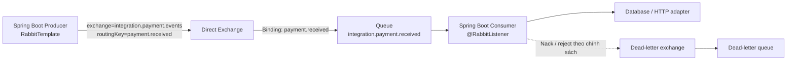
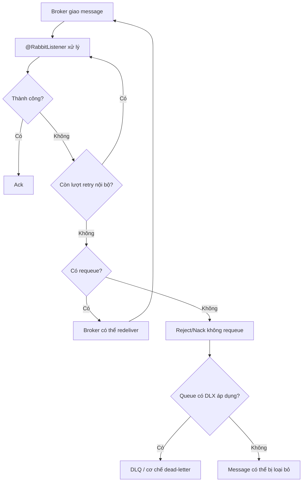

# spring-boot-starter-amqp và cấu hình spring.rabbitmq.*

## 1. Mục tiêu và vị trí của AMQP trong Spring Boot Integration

Khi một ứng dụng Spring Boot cần trao đổi thông điệp với dịch vụ khác theo cách bất đồng bộ, **RabbitMQ** là một lựa chọn broker phổ biến. Thay vì giữ kết nối HTTP chờ hệ thống downstream hoàn tất, ứng dụng có thể gửi thông điệp đến exchange; RabbitMQ định tuyến thông điệp đến queue; một hoặc nhiều consumer tiếp nhận và xử lý.

Trong module **SPRING_BOOT_INTEGRATION**, việc kết nối RabbitMQ cần được xem như một phần của **hợp đồng tích hợp**: cấu hình kết nối, định dạng dữ liệu, khai báo exchange/queue/binding, xác nhận gửi/nhận, xử lý lỗi, retry, chống xử lý trùng và quan sát hoạt động. Hai thành phần trung tâm của bài này là:

- `spring-boot-starter-amqp`: starter cung cấp các dependency cần thiết và kích hoạt khả năng tự cấu hình AMQP của Spring Boot.
- `spring.rabbitmq.*`: nhóm thuộc tính cấu hình cách ứng dụng kết nối RabbitMQ, xuất bản thông điệp, chạy listener và sử dụng connection/channel.

Sau bài này, bạn có thể thêm AMQP vào ứng dụng, hiểu những bean nào Spring Boot cung cấp, chọn thuộc tính phù hợp với luồng tích hợp thực tế và nhận diện các cấu hình có thể gây mất hoặc xử lý lặp thông điệp.

> Phạm vi: Ví dụ giả định Spring Boot sử dụng Spring AMQP với RabbitMQ qua giao thức AMQP 0-9-1. Tên và khả năng hỗ trợ một số thuộc tính có thể thay đổi theo phiên bản Spring Boot/Spring AMQP; khi nâng phiên bản, cần đối chiếu configuration metadata và tài liệu của chính phiên bản đang chạy.

## 2. RabbitMQ, exchange, queue và binding

RabbitMQ không đơn giản là nơi producer ghi trực tiếp vào một queue bất kỳ. Trong mô hình thông dụng của AMQP 0-9-1:

1. **Producer** gửi message tới một **exchange**, cùng với **routing key**.
2. **Exchange** dùng **binding** và loại exchange để quyết định queue nào nhận message.
3. **Queue** lưu các message chưa được hoàn tất xử lý.
4. **Consumer** đăng ký nhận message từ queue và xác nhận xử lý bằng acknowledge hoặc trả lại/từ chối theo chính sách.



| Khái niệm | Vai trò | Điều cần nhớ |
| --- | --- | --- |
| **Exchange** | Nhận message và quyết định định tuyến | Direct dựa vào routing key; fanout phát tới các queue được bind; topic dựa vào pattern |
| **Queue** | Giữ message chờ consumer | Durable queue chỉ giúp định nghĩa queue tồn tại qua restart; cần xét thêm tính bền vững của message và chính sách broker |
| **Binding** | Nối exchange với queue | Có thể khác routing key mà producer gửi, tùy loại exchange |
| **Routing key** | Thông tin hỗ trợ định tuyến | Không phải định danh duy nhất của thông điệp |
| **Ack/Nack** | Kết quả xử lý từ consumer tới broker | Ack là kết thúc một lần giao message; không mặc nhiên chứng minh mọi tác động ngoài broker đã hoàn tất |
| **DLX/DLQ** | Định tuyến và lưu các message không xử lý được theo chính sách | DLQ cần được khai báo và quan sát; chỉ tắt requeue không tự tạo DLQ |

Ví dụ nghiệp vụ: hệ thống thanh toán gửi `payment.received` cho dịch vụ vận chuyển. Nếu dịch vụ vận chuyển đang bảo trì, queue có thể giữ message; nhưng việc tồn tại queue không tự bảo đảm đúng một lần xử lý. Khi mất kết nối quanh thời điểm ack, một message có thể được giao lại và consumer cần xử lý trùng lặp an toàn.

## 3. Thêm spring-boot-starter-amqp

Với dự án Maven dùng Spring Boot parent hoặc BOM quản lý phiên bản:

```xml
<dependency>
    <groupId>org.springframework.boot</groupId>
    <artifactId>spring-boot-starter-amqp</artifactId>
</dependency>
```

Với Gradle:

```groovy
dependencies {
    implementation 'org.springframework.boot:spring-boot-starter-amqp'
}
```

Không tự gán một phiên bản Spring AMQP không tương thích nếu Spring Boot đang quản lý dependency; để BOM phù hợp chọn các phiên bản Spring AMQP, RabbitMQ Java client và các thư viện liên quan.

Starter tích hợp các thành phần phổ biến:

| Thành phần | Công dụng |
| --- | --- |
| `ConnectionFactory` | Tạo/quản lý kết nối và channel tới RabbitMQ |
| `CachingConnectionFactory` | Triển khai connection factory thường được Spring Boot cấu hình và hỗ trợ cache channel |
| `RabbitTemplate` / `AmqpTemplate` | Gửi message, nhận đồng bộ hoặc request/reply khi phù hợp |
| `RabbitAdmin` / `AmqpAdmin` | Khai báo exchange, queue, binding nếu ứng dụng được phép quản lý topology |
| `@RabbitListener` và listener container | Tiêu thụ message bằng callback/method trong Spring bean |
| `MessageConverter` | Chuyển đổi giữa dữ liệu Java và payload AMQP khi đã cấu hình loại converter phù hợp |

Khi các điều kiện tự cấu hình đáp ứng, Spring Boot cung cấp những bean thiết yếu và listener infrastructure. Các bean tự định nghĩa, nhiều connection factory hoặc cấu hình `@EnableRabbit` riêng có thể thay đổi hành vi; hãy kiểm tra application context thực tế trước khi giả định tất cả bean dùng cùng một `ConnectionFactory`.

**Starter không cài đặt hay khởi chạy RabbitMQ server.** Bạn vẫn cần broker RabbitMQ hoạt động, quyền truy cập virtual host, network route và thông tin xác thực đúng. Starter cũng không tự suy ra được exchange, queue, routing key hay hợp đồng payload theo yêu cầu nghiệp vụ.

### Khi nào dùng Spring AMQP và khi nào dùng Spring Integration?

- Spring AMQP với `RabbitTemplate` và `@RabbitListener` phù hợp cho việc gửi/nhận thông điệp trực tiếp.
- Spring Integration có AMQP inbound/outbound adapter hoặc gateway để gắn RabbitMQ vào `MessageChannel`, transformer, router, error channel và các flow nhiều bước.
- Dù chọn cách nào, cấu hình kết nối vẫn cần đồng nhất với broker; tránh tạo hai consumer cho cùng một queue nếu chúng có hành vi xử lý khác nhau hoặc kỳ vọng mỗi consumer đều nhận toàn bộ message.

Bài này tập trung vào starter và nhóm `spring.rabbitmq.*`; không yêu cầu dựng toàn bộ Spring Integration flow.

## 4. Cấu hình kết nối tối thiểu

Ví dụ `application.yml` cho môi trường phát triển có broker ở `localhost:5672`:

```yaml
spring:
  rabbitmq:
    host: ${RABBITMQ_HOST:localhost}
    port: ${RABBITMQ_PORT:5672}
    username: ${RABBITMQ_USERNAME:guest}
    password: ${RABBITMQ_PASSWORD:guest}
    virtual-host: ${RABBITMQ_VHOST:/}
    connection-timeout: 5s
    requested-heartbeat: 30s
```

Đây là ví dụ **local development**. RabbitMQ thường hạn chế tài khoản `guest` kết nối từ xa; trên staging/production phải dùng tài khoản riêng, mật khẩu từ secret manager hoặc biến môi trường, quyền theo virtual host và bảo vệ đường truyền.

Spring Boot hỗ trợ externalized configuration: ví dụ biến môi trường `SPRING_RABBITMQ_HOST` có thể cung cấp giá trị cho `spring.rabbitmq.host` theo relaxed binding. Biểu thức `${RABBITMQ_HOST:localhost}` có nghĩa là dùng `RABBITMQ_HOST` nếu có, nếu không dùng `localhost`. Với môi trường triển khai thực, nên **bỏ giá trị mặc định cho bí mật** và fail sớm khi secret bắt buộc không được cấp.

### Những thuộc tính kết nối cơ bản

| Thuộc tính | Ý nghĩa | Ghi chú |
| --- | --- | --- |
| `spring.rabbitmq.host` | Host broker khi kết nối tới một địa chỉ | Địa chỉ nhìn từ container ứng dụng có thể khác `localhost` |
| `spring.rabbitmq.port` | Cổng AMQP của broker | Cổng AMQP thường là `5672`; cổng quản trị HTTP `15672` không phải cổng AMQP |
| `spring.rabbitmq.addresses` | Danh sách broker endpoint để kết nối | Khi cấu hình địa chỉ đầy đủ, không nên dựa vào `host`/`port` như nguồn chính |
| `spring.rabbitmq.username`, `password` | Thông tin xác thực với broker | Dùng secret; không commit mật khẩu thật |
| `spring.rabbitmq.virtual-host` | Không gian tài nguyên và phân quyền trong broker | Queue/exchange ở các vhost khác nhau là các thực thể khác nhau |
| `spring.rabbitmq.connection-timeout` | Giới hạn thời gian thiết lập kết nối | Không phải thời hạn xử lý business message |
| `spring.rabbitmq.requested-heartbeat` | Chu kỳ heartbeat đề nghị với broker | Cần thống nhất với timeout, network và broker policy |
| `spring.rabbitmq.ssl.enabled` | Bật TLS cho kết nối nếu cấu hình phù hợp | Cần kiểm tra trust, hostname và chứng chỉ phía broker |

Ví dụ kết nối đến một trong nhiều endpoint do hạ tầng cung cấp:

```yaml
spring:
  rabbitmq:
    addresses: ${RABBITMQ_ADDRESSES:mq-a.internal:5672,mq-b.internal:5672}
    username: ${RABBITMQ_USERNAME}
    password: ${RABBITMQ_PASSWORD}
    virtual-host: integration
```

Danh sách endpoint giúp client biết các địa chỉ có thể kết nối; **không** có nghĩa ứng dụng tự tạo RabbitMQ cluster, replicate queue hoặc tự bảo đảm failover không mất thông điệp. Đó là nhiệm vụ của topology và cấu hình broker. Tránh để URI có mật khẩu trong log hoặc URL monitoring.

## 5. Cấu hình xuất bản message bằng RabbitTemplate

Producer thường dùng `RabbitTemplate.convertAndSend(exchange, routingKey, payload)`. Template có thể chuyển đổi đối tượng nhờ `MessageConverter`; khi chưa cấu hình converter JSON phù hợp, đừng mặc định việc truyền một DTO Java sẽ tạo ra JSON đúng hợp đồng đối tác. Ví dụ đầu tiên gửi **String chứa JSON đã được tạo/kiểm tra hợp lệ**.

```java
import org.springframework.amqp.rabbit.core.RabbitTemplate;
import org.springframework.stereotype.Component;

@Component
public class PaymentEventPublisher {

    private final RabbitTemplate rabbitTemplate;

    public PaymentEventPublisher(RabbitTemplate rabbitTemplate) {
        this.rabbitTemplate = rabbitTemplate;
    }

    public void publish(String eventJson) {
        rabbitTemplate.convertAndSend(
            "integration.payment.events",
            "payment.received",
            eventJson
        );
    }
}
```

Thực tế nên chuẩn hóa các trường trong payload như `eventId`, `eventType`, `schemaVersion`, `occurredAt` và mã đối tác; các trường này giúp kiểm tra hợp đồng dữ liệu và xử lý trùng lặp. Chuẩn hóa payload cũng giúp chuyển từ HTTP webhook sang queue mà vẫn nhận diện được cùng một sự kiện nghiệp vụ.

### Publisher confirmations, returns và retry

```yaml
spring:
  rabbitmq:
    publisher-confirm-type: correlated
    publisher-returns: true
    template:
      mandatory: true
      retry:
        enabled: true
        initial-interval: 200ms
        multiplier: 2
        max-interval: 2s
        max-attempts: 3
```

| Thuộc tính | Tác động | Điều dễ hiểu nhầm |
| --- | --- | --- |
| `spring.rabbitmq.publisher-confirm-type: correlated` | Cho phép theo dõi publisher confirm gắn với từng lần gửi qua `CorrelationData` | Confirm cho biết trạng thái phía broker liên quan đến publish; không chứng minh consumer đã xử lý nghiệp vụ |
| `spring.rabbitmq.publisher-returns: true` | Cho phép nhận thông tin message không được định tuyến khi broker trả về | Cần kết hợp `mandatory` và đăng ký callback/quan sát phù hợp |
| `spring.rabbitmq.template.mandatory: true` | Yêu cầu trả về các message không có queue đích theo quy tắc AMQP thích hợp | Không tự định tuyến lại hay lưu message vào queue khác |
| `spring.rabbitmq.template.retry.*` | Cấu hình retry cho hoạt động `RabbitTemplate` khi được hỗ trợ | Không phải retry business-level có outbox; việc gửi lại có thể tạo bản trùng |
| `spring.rabbitmq.template.reply-timeout` | Thời gian chờ reply khi dùng request/reply đồng bộ | Không giới hạn thời gian listener xử lý một message bất đồng bộ |

Để tận dụng xác nhận publish, ứng dụng phải **xử lý kết quả** (callback/future tùy phiên bản API), log theo correlation ID, có chiến lược gửi lại hoặc lưu trạng thái. Chỉ bật hai thuộc tính `publisher-confirm-type` và `publisher-returns` mà không đọc kết quả không tạo ra bảo đảm giao nhận đầu cuối.

Có một khác biệt quan trọng:

- **Publisher confirm:** Broker xác nhận trạng thái xử lý publish ở phía broker.
- **Publisher return:** Broker cho biết message không định tuyến được đến queue trong trường hợp áp dụng `mandatory`.
- **Consumer ack:** Consumer xác nhận với broker rằng một lần giao message đã được xử lý/hoàn tất theo chính sách listener.
- **Hoàn tất nghiệp vụ:** Trạng thái trong database hoặc hệ thống downstream đã được cập nhật đúng. Cần transaction, idempotency và thiết kế luồng thích hợp mới có thể bảo đảm bước này.

Nếu database đã commit nhưng ứng dụng mất kết nối ngay trước ack, RabbitMQ có thể gửi lại cùng sự kiện. Nếu broker đã nhận message nhưng producer gặp timeout trước khi nhận confirm, producer cũng có thể gửi lại. Vì vậy, cần thiết kế **at-least-once + idempotency** như một giả định an toàn trong nhiều luồng tích hợp.

## 6. Cấu hình listener bằng spring.rabbitmq.listener.*

Spring Boot hỗ trợ hai kiểu container listener phổ biến trong Spring AMQP: **simple** và **direct**. Chọn bằng `spring.rabbitmq.listener.type` (trong các phiên bản hỗ trợ thuộc tính này); các thuộc tính bên dưới `simple.*` chỉ áp dụng cho simple container, còn `direct.*` áp dụng cho direct container.

### Simple listener container

```yaml
spring:
  rabbitmq:
    listener:
      type: simple
      simple:
        acknowledge-mode: auto
        concurrency: 2
        max-concurrency: 6
        prefetch: 20
        default-requeue-rejected: false
        retry:
          enabled: true
          max-attempts: 3
          initial-interval: 500ms
          multiplier: 2
          max-interval: 5s
```

| Thuộc tính `spring.rabbitmq.listener.simple.*` | Ý nghĩa | Quy tắc lựa chọn |
| --- | --- | --- |
| `concurrency` | Số consumer ban đầu/đồng thời | Bắt đầu thấp, đo thời gian xử lý, CPU, DB và downstream |
| `max-concurrency` | Ngưỡng consumer tối đa mà simple container có thể tăng lên | Cần tính tải đồng thời lên database/HTTP đối tác |
| `prefetch` | Số message chưa ack có thể được cấp trước trên consumer/channel theo cấu hình | Cao quá dễ khiến một consumer giữ nhiều message và tăng tải bộ nhớ |
| `acknowledge-mode` | Cách broker nhận ack từ listener | `auto`, `manual`, `none` khác nhau về bảo đảm giao nhận |
| `default-requeue-rejected` | Mặc định requeue hay không khi message bị reject/nack do lỗi | Nếu `false`, cần khai báo DLX/DLQ hoặc chấp nhận loại bỏ message |
| `retry.enabled` | Bật retry cho xử lý listener nếu hạ tầng retry phù hợp sẵn có | Xem xét exception nào đáng thử lại và số lần thử |
| `retry.max-attempts` | Tổng số lần xử lý có thể thử trong một chuỗi retry | Không đồng nghĩa tổng số lần redelivery từ broker qua toàn bộ vòng đời |

### Direct listener container

Ví dụ nếu muốn chọn direct container:

```yaml
spring:
  rabbitmq:
    listener:
      type: direct
      direct:
        acknowledge-mode: auto
        consumers-per-queue: 2
        prefetch: 20
        default-requeue-rejected: false
```

Direct container có mô hình quản lý consumer khác simple container: `consumers-per-queue` là cấu hình đáng chú ý, trong khi `simple.concurrency` và `simple.max-concurrency` không phải cách điều khiển chính của direct container. Không sao chép toàn bộ thuộc tính simple sang direct rồi kỳ vọng chúng có tác dụng giống nhau.

### Phân biệt ba chế độ acknowledge

| Chế độ | Ý nghĩa trong Spring AMQP listener | Rủi ro / trường hợp sử dụng |
| --- | --- | --- |
| `AUTO` | **Listener container** gửi ack sau khi method xử lý thành công; có thể reject/nack theo lỗi và cấu hình | Lựa chọn thường gặp. Không được nhầm với tự động ack ngay khi broker giao message |
| `MANUAL` | Code chịu trách nhiệm gọi `basicAck`/`basicNack`/`basicReject` | Phù hợp khi cần điều khiển ack đặc thù; quên ack có thể khiến message tồn đọng unacked |
| `NONE` | Dùng chế độ không cần consumer ack ở phía broker (tương ứng auto-ack của RabbitMQ) | Message có thể mất nếu ứng dụng chết sau khi broker giao mà chưa xử lý xong |

Một sai lầm phổ biến là đọc `acknowledge-mode: auto` như "broker đã ack trước khi xử lý". Trong Spring listener, `AUTO` có ý nghĩa khác `NONE`. Khi chạy listener với `AUTO`, hãy để exception lan ra khi xử lý thất bại; nếu bắt lỗi rồi chỉ ghi log và return bình thường, container có thể xem lần xử lý là thành công và ack.

**Retry nội bộ và redelivery là hai cơ chế khác nhau:** Retry của listener có thể thử lại trong cùng lần giao message. Nếu sau cùng message bị nack/reject và cấu hình cho requeue, broker có thể giao lại, bắt đầu một chuỗi retry mới. Nếu thiếu giới hạn và cơ chế cách ly poison message, việc này tạo vòng lặp lỗi liên tục.

## 7. Khai báo topology: exchange, queue, binding và DLQ

Các thuộc tính `spring.rabbitmq.*` dùng để kết nối và vận hành client; chúng không tự quyết định tên queue, exchange hay binding của nghiệp vụ. Với ứng dụng được phép quản lý topology, có thể định nghĩa các Spring bean tương ứng; `RabbitAdmin` sẽ khai báo chúng khi được cấu hình phù hợp và kết nối broker thành công.

Ví dụ dưới đây dùng **direct exchange** để định tuyến sự kiện thanh toán, đồng thời cấu hình dead-letter exchange/queue cho message không thể xử lý.

```java
import org.springframework.amqp.core.Binding;
import org.springframework.amqp.core.BindingBuilder;
import org.springframework.amqp.core.DirectExchange;
import org.springframework.amqp.core.Queue;
import org.springframework.amqp.core.QueueBuilder;
import org.springframework.context.annotation.Bean;
import org.springframework.context.annotation.Configuration;

@Configuration
public class PaymentAmqpTopology {

    public static final String EXCHANGE = "integration.payment.events";
    public static final String ROUTING_KEY = "payment.received";
    public static final String QUEUE = "integration.payment.received";
    public static final String DLX = "integration.payment.dlx";
    public static final String DLQ = "integration.payment.dlq";
    public static final String DLQ_KEY = "payment.failed";

    @Bean
    DirectExchange paymentExchange() {
        return new DirectExchange(EXCHANGE, true, false);
    }

    @Bean
    Queue paymentQueue() {
        return QueueBuilder.durable(QUEUE)
            .deadLetterExchange(DLX)
            .deadLetterRoutingKey(DLQ_KEY)
            .build();
    }

    @Bean
    Binding paymentBinding(Queue paymentQueue,
                           DirectExchange paymentExchange) {
        return BindingBuilder.bind(paymentQueue)
            .to(paymentExchange)
            .with(ROUTING_KEY);
    }

    @Bean
    DirectExchange deadLetterExchange() {
        return new DirectExchange(DLX, true, false);
    }

    @Bean
    Queue deadLetterQueue() {
        return QueueBuilder.durable(DLQ).build();
    }

    @Bean
    Binding deadLetterBinding(Queue deadLetterQueue,
                              DirectExchange deadLetterExchange) {
        return BindingBuilder.bind(deadLetterQueue)
            .to(deadLetterExchange)
            .with(DLQ_KEY);
    }
}
```

Điểm cần hiểu:

1. Producer gửi `payment.received` vào `integration.payment.events`, exchange định tuyến tới queue chính.
2. Consumer nhận từ `integration.payment.received`.
3. Nếu message bị reject/nack **không requeue** và broker áp dụng dead-letter policy/arguments tương ứng, message đi qua `integration.payment.dlx` tới `integration.payment.dlq`.
4. DLQ cần có quy trình điều tra, cảnh báo, sửa lỗi và phát lại có kiểm soát. DLQ không tự sửa payload sai hay tự bảo đảm giao nhận thành công.

**Ranh giới giữa code và broker:** Trong nhiều hệ thống production, DevOps hoặc đội hạ tầng quản trị queue/exchange bằng IaC hay policy, còn ứng dụng chỉ được phép publish/consume. Khi đó tránh cho ứng dụng tự thay đổi topology ngoài quyền sở hữu. Những tham số queue không tương thích với queue đã tồn tại, ví dụ durable hoặc dead-letter arguments, có thể khiến broker trả lỗi khai báo lại (`PRECONDITION_FAILED`). Với RabbitMQ, cấu hình DLX bằng broker policy thường linh hoạt hơn hardcode `x-arguments` nếu tổ chức muốn thay đổi mà không phải khai báo lại queue.

## 8. Viết consumer bằng @RabbitListener

```java
import org.springframework.amqp.rabbit.annotation.RabbitListener;
import org.springframework.stereotype.Component;

@Component
public class PaymentEventListener {

    @RabbitListener(queues = PaymentAmqpTopology.QUEUE)
    public void onPaymentReceived(String eventJson) {
        // Bước thực tế: kiểm tra schemaVersion và eventId,
        // xử lý idempotency, lưu kết quả/đẩy sang adapter tiếp theo.
        // Nếu xử lý thất bại, ném exception để container xử lý retry.
        if (eventJson == null || eventJson.isBlank()) {
            throw new IllegalArgumentException("Empty payment event");
        }
    }
}
```

Ví dụ chủ ý chỉ minh họa cơ chế nhận; để hoàn chỉnh luồng tích hợp cần bổ sung validate JSON, xử lý nghiệp vụ và kiểm tra chống trùng. Nếu dùng DTO trong tham số listener, phải xác định rõ `MessageConverter`, phiên bản schema và chính sách tương thích payload. Một converter JSON không thay cho kiểm tra hợp đồng nghiệp vụ.

### Cơ chế idempotency

Không giả định RabbitMQ sẽ giao message đúng một lần. Consumer nên định danh sự kiện theo khóa như `(partnerId, eventId)` và có ràng buộc duy nhất ở database hoặc inbox table:

```sql
CREATE TABLE processed_message (
    partner_id    VARCHAR(80) NOT NULL,
    event_id      VARCHAR(128) NOT NULL,
    processed_at  TIMESTAMP NOT NULL DEFAULT CURRENT_TIMESTAMP,
    PRIMARY KEY (partner_id, event_id)
);
```

Một hướng triển khai là ghi dấu xử lý cùng transaction cập nhật dữ liệu nghiệp vụ và chỉ xem lần nhận là thành công sau khi transaction commit. Cần cẩn thận với đánh dấu "đã xử lý" **trước** khi công việc thực sự hoàn tất: nếu công việc sau đó lỗi, lần redelivery có thể bị bỏ qua nhầm. Nếu gọi HTTP ngoài transaction database, hãy dùng state machine, retry có kiểm soát hoặc inbox/outbox phù hợp.

### Khi nào consumer phải ném exception?

- **Lỗi hạ tầng tạm thời:** timeout kết nối DB hoặc HTTP upstream có thể retry theo backoff.
- **Payload không hợp lệ, sai contract, thiếu trường bắt buộc:** thường không có ích khi retry liên tục; cần chuyển sang DLQ, gắn lý do, cảnh báo và xử lý dữ liệu.
- **Lỗi nghiệp vụ có tính ổn định:** cần quy tắc riêng: từ chối, trả kết quả nghiệp vụ, hoặc chuyển sang xử lý thủ công.
- **Đã xử lý trước đó:** trả về thành công theo chiến lược idempotent, không gọi lại hệ thống downstream nếu kết quả đã được xác nhận.

## 9. Retry, requeue, dead letter và xử lý lỗi

Giả sử một message lỗi vì database tạm thời không sẵn sàng:



Các quyết định vận hành:

- Bật retry có **giới hạn và backoff** cho lỗi tạm thời. Retry dày đặc làm tăng áp lực lên database/API đang gặp sự cố.
- Tránh requeue vô hạn đối với poison message. Chọn chính sách retry, DLX, TTL hoặc số lần giao tối đa phù hợp với queue type và broker policy.
- Phân biệt lỗi **unroutable publish** (producer→exchange→queue) với lỗi **consumer processing** (queue→listener); publisher returns giải quyết nhóm đầu, DLQ thường giải quyết nhóm sau.
- Khi muốn trì hoãn retry qua broker, cần topology/queue policy riêng, không nên coi `default-requeue-rejected=true` là delayed retry.
- Với publisher retry hoặc phát lại DLQ, cùng một `eventId` có thể xuất hiện nhiều lần; cơ chế idempotency phải được kiểm tra thực tế.

Không dựa vào `default-requeue-rejected: false` như một "cấu hình an toàn tuyệt đối": nếu queue chưa có DLX hoặc cơ chế lưu trữ lỗi tương đương, message bị từ chối có thể bị loại bỏ. Cần kiểm tra message đi tới DLQ và có thể được truy vết trước khi triển khai.

## 10. Connection/cache, concurrency và throughput

AMQP sử dụng **TCP connection** và **channel**. Tạo connection/channel tùy tiện cho mỗi message là tốn kém. Cơ chế `CachingConnectionFactory` của Spring AMQP có thể tái sử dụng channel; Spring Boot cung cấp các thuộc tính như:

```yaml
spring:
  rabbitmq:
    cache:
      channel:
        size: 25
```

Khi dùng cơ chế cache channel, `size` ảnh hưởng tới số channel nhàn rỗi giữ lại để tái sử dụng; nó **không đơn giản là giới hạn cứng tổng số consumer hay tổng số message đồng thời**. Listener container cũng quản lý channel/consumer theo cơ chế riêng. Chỉ điều chỉnh cache sau khi đo kết nối, channel, thông lượng và tải broker.

Giả sử `concurrency=4` và `prefetch=20`. Trong một cấu hình tiêu thụ điển hình, ứng dụng có thể giữ nhiều message chưa ack hơn số thread thực sự xử lý tại một thời điểm. Hệ quả có thể là:

- Consumer đang xử lý chậm vẫn giữ nhiều message, làm phân phối công việc kém đều.
- Nếu mỗi message làm một request HTTP hoặc transaction SQL, tăng concurrency vượt sức chịu tải của downstream có thể làm **giảm** throughput hữu ích.
- Queue depth thấp không có nghĩa tất cả message đã xử lý: kiểm tra thêm số message **unacked**.

Khi điều chỉnh hiệu năng, đo cả `ready`, `unacked`, consumer count, publish/ack rate, latency xử lý, tỷ lệ retry và giới hạn kết nối của database/HTTP client. Không chọn `prefetch` hoặc `max-concurrency` chỉ dựa trên số lõi CPU.

## 11. Kết nối TLS và tách cấu hình môi trường

Với broker ngoài máy local, nên sử dụng TLS phù hợp hạ tầng. Ví dụ cấu hình cơ bản:

```yaml
spring:
  rabbitmq:
    host: ${RABBITMQ_HOST}
    port: ${RABBITMQ_PORT:5671}
    username: ${RABBITMQ_USERNAME}
    password: ${RABBITMQ_PASSWORD}
    virtual-host: ${RABBITMQ_VHOST}
    ssl:
      enabled: true
```

Việc bật `ssl.enabled` mới là bước đầu. Môi trường production còn phải cấu hình trust store hoặc SSL bundle tương thích phiên bản Spring Boot, xác thực hostname, CA phù hợp và chính sách certificate rotation. Đừng tắt xác thực chứng chỉ để "sửa" lỗi TLS; hãy đối chiếu hostname/certificate chain. TLS cũng không thay thế quyền `configure`, `write`, `read` theo virtual host.

Khi đóng gói bằng Docker/Kubernetes:

- Trong container, `localhost` là chính container đó, không tự trỏ tới RabbitMQ bên ngoài. Dùng service DNS của broker hoặc endpoint do hạ tầng cung cấp.
- Chỉ expose cổng AMQP cho client cần kết nối; cổng HTTP management là luồng quản trị riêng.
- Secret đi qua secret manager/Kubernetes Secret hoặc cơ chế tương đương; không in URL chứa credential vào log.
- Dùng profile hoặc cấu hình bên ngoài cho dev/staging/prod; tránh điều chỉnh trực tiếp file `application.yml` để chuyển môi trường.
- Đặt timeout và health/readiness phù hợp. Nếu broker tạm thời mất kết nối, xác định rõ ứng dụng nên fail startup, chờ reconnect hay suy giảm chức năng theo kiến trúc.

## 12. Kiểm thử tích hợp và quan sát

### Kịch bản kiểm thử nên có

| Kịch bản | Kết quả mong đợi |
| --- | --- |
| Cấu hình đúng host, port, vhost và credentials | Ứng dụng kết nối được, exchange/queue/binding đúng với hợp đồng |
| Publish với routing key hợp lệ | Message đến queue, consumer nhận đúng payload và header |
| Publish tới routing key không có binding | Ứng dụng ghi nhận được publisher return nếu bật `mandatory` và callback |
| Consumer xử lý thành công | Message được ack và không còn trong queue |
| Consumer ném exception tạm thời | Retry theo chính sách, số lần hữu hạn, có log/metric |
| Consumer gặp poison message | Message được cách ly sang DLQ sau khi retry/reject theo chính sách |
| Cùng `eventId` xuất hiện hai lần | Kết quả nghiệp vụ không bị áp dụng hai lần |
| Broker bị ngắt rồi kết nối lại | Ứng dụng phục hồi theo chính sách, không giả định mọi message phát trong lúc mất kết nối đều thành công |
| Thay đổi concurrency/prefetch | Throughput cải thiện hoặc trade-off được đo bằng số liệu |
| Nâng version payload | Consumer cũ/mới xử lý tương thích theo hợp đồng và `schemaVersion` |

Nên dùng **Testcontainers với RabbitMQ thật** cho integration test, thay vì chỉ mock `RabbitTemplate`. Mock hữu ích để kiểm thử logic gọi publish; broker thật mới kiểm chứng được binding, ack, requeue, dead-letter và các vấn đề network/authentication. Chạy test với tên vhost/queue riêng để tránh ảnh hưởng luồng khác.

### Observability

Tối thiểu cần quan sát hai phía:

- **Phía ứng dụng:** số lần publish, confirm/return, exception, retry, thời gian xử lý listener, số sự kiện trùng, lỗi database/downstream; liên kết log bằng `eventId`, `correlationId` và tên queue.
- **Phía broker:** message ready/unacked, publish/deliver/ack rate, consumer count, queue growth, DLQ depth, connection/channel và tình trạng node/cluster.

Spring Boot Actuator và Micrometer có thể cung cấp một phần health/metrics theo dependency và cấu hình đang dùng; RabbitMQ management/monitoring bổ sung chỉ số broker. Các metric phía ứng dụng và broker phải được đọc cùng nhau: publisher confirm thành công chưa chứng minh consumer hoàn tất giao dịch; queue depth bằng 0 chưa chắc không còn message unacked.

Không ghi nguyên payload của thanh toán, thông tin cá nhân hoặc token vào log; ưu tiên ID, tên event, kích thước payload và mã lỗi.

## 13. Những lỗi cấu hình thường gặp

| Triệu chứng | Nguyên nhân có thể | Hướng kiểm tra |
| --- | --- | --- |
| `Connection refused` | Sai host/port, broker chưa khởi động, cổng bị chặn | Kiểm tra DNS/network, port AMQP và broker availability |
| `ACCESS_REFUSED` hoặc lỗi authentication | Sai username/password, vhost hoặc permission | Kiểm tra credential, vhost tồn tại và quyền read/write/configure |
| Publisher gửi không lỗi nhưng consumer không nhận | Sai exchange/routing key/binding, message unroutable | Bật confirm/returns phù hợp, xem topology và metric |
| `PRECONDITION_FAILED` khi khai báo queue | Queue đã tồn tại nhưng thuộc tính/arguments khác | Đối chiếu durable, type, DLX, TTL và policy hiện có |
| Message liên tục redeliver | Lỗi listener, requeue vô hạn, không có đường xử lý poison message | Xem stack trace, retry, requeue, DLQ, x-death/redelivery metadata khi có |
| DLQ trống dù listener lỗi | Có thể không cấu hình DLX, thiếu binding, message còn đang retry/requeue | Kiểm tra queue arguments/policy, routing và điều kiện reject |
| Message bị xử lý hai lần | Producer retry sau timeout, consumer redelivery, mất ack | Dùng khóa idempotency và lưu trạng thái xử lý bền vững |
| Số message unacked tăng | Listener chậm, xử lý treo, prefetch/concurrency không phù hợp | Đo downstream latency, thread, transaction và timeout |
| Ứng dụng chạy local nhưng container không kết nối | `localhost` sai ngữ cảnh network | Dùng địa chỉ broker truy cập được từ container |

Khi gỡ lỗi, nên kiểm tra theo thứ tự: **network/credentials → exchange/queue/binding → publish confirm/return → listener ack/retry → tác động nghiệp vụ**. Thứ tự này giúp khoanh vùng vấn đề mà không thay đổi ngẫu nhiên nhiều thuộc tính cùng lúc.

## 14. Một bộ cấu hình tham khảo có kiểm soát

Ví dụ dưới đây ghép những thuộc tính thường dùng cho một consumer thanh toán có retry ngắn, DLQ đã khai báo theo mục 7 và cần theo dõi kết quả publish. Giá trị chỉ là điểm bắt đầu để thử tải, không phải mức tối ưu mặc định cho mọi hệ thống.

```yaml
spring:
  rabbitmq:
    host: ${RABBITMQ_HOST}
    port: ${RABBITMQ_PORT:5672}
    username: ${RABBITMQ_USERNAME}
    password: ${RABBITMQ_PASSWORD}
    virtual-host: ${RABBITMQ_VHOST}

    connection-timeout: 5s
    requested-heartbeat: 30s

    publisher-confirm-type: correlated
    publisher-returns: true
    template:
      mandatory: true

    listener:
      type: simple
      simple:
        acknowledge-mode: auto
        concurrency: 2
        max-concurrency: 6
        prefetch: 20
        default-requeue-rejected: false
        retry:
          enabled: true
          max-attempts: 3
          initial-interval: 500ms
          multiplier: 2
          max-interval: 5s

    cache:
      channel:
        size: 25
```

Để dùng cấu hình này an toàn, cần bảo đảm:

1. Broker/vhost/tài khoản/permissions tồn tại và broker có topology theo hợp đồng.
2. App có consumer xử lý idempotent, ném lỗi đúng lúc, và DLX/DLQ hoạt động cho trường hợp reject không requeue.
3. Publisher theo dõi confirm và return, phân biệt lỗi định tuyến với lỗi consumer; những message cần bảo đảm gửi từ transaction database có thể dùng transactional outbox.
4. Concurrency và prefetch đã được đo cùng sức chịu tải của downstream; không scale consumer vô hạn.
5. Monitoring có cảnh báo cho DLQ, redelivery, kết nối lỗi và message tồn đọng.
6. Nếu môi trường yêu cầu TLS, cấu hình `spring.rabbitmq.ssl.*` và port/TLS endpoint chính xác, thay vì giữ nguyên kết nối plaintext của ví dụ.

## 15. Bài tập tình huống

Một dịch vụ Spring Boot nhận callback xác nhận thanh toán qua HTTP, ghi trạng thái thanh toán vào PostgreSQL rồi gửi sự kiện sang RabbitMQ để dịch vụ giao hàng xử lý. Sau khi triển khai, đội vận hành ghi nhận: đôi khi có hai bản ghi giao hàng cho một thanh toán; vài sự kiện không tới queue; một số message mắc kẹt ở trạng thái unacked.

Hãy xác định giải pháp theo từng lớp:

1. **Kết nối:** kiểm tra `spring.rabbitmq.host/port/virtual-host`, credential và network giữa ứng dụng với broker.
2. **Định tuyến:** đối chiếu exchange, routing key, binding; bật `publisher-returns` và `template.mandatory` rồi thực sự xử lý callback return.
3. **Độ tin cậy publish:** dùng publisher confirm, cân nhắc outbox để tránh mất sự kiện giữa transaction PostgreSQL và publish RabbitMQ.
4. **Độ tin cậy consumer:** kiểm tra acknowledge mode, exception và retry; cấu hình dead-letter flow cho message không xử lý được.
5. **Trùng lặp:** dùng khóa `(partnerId, eventId)` và transaction/idempotency trong dịch vụ giao hàng, thay vì kỳ vọng broker bảo đảm exactly-once nghiệp vụ.
6. **Unacked:** đo thời gian xử lý, timeout HTTP/DB, `prefetch` và số consumer; xác định listener có bị treo hoặc transaction kéo dài không.
7. **Kiểm thử:** phát lại cùng message, ngắt broker đúng thời điểm publish/ack, gửi routing key sai và tạo payload lỗi cố ý để kiểm chứng toàn bộ đường lỗi.

**Ghi nhớ:** `spring-boot-starter-amqp` đưa các thư viện và bean AMQP vào Spring Boot; `spring.rabbitmq.*` cấu hình **cách client kết nối, gửi và nhận thông điệp**. Tính đúng đắn của hệ thống tích hợp còn phụ thuộc vào topology, hợp đồng dữ liệu, giao dịch, xử lý trùng lặp, chính sách lỗi, kiểm thử và quan sát từ đầu đến cuối.
