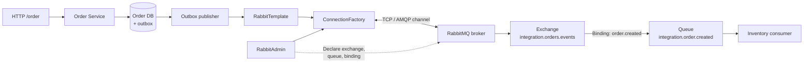
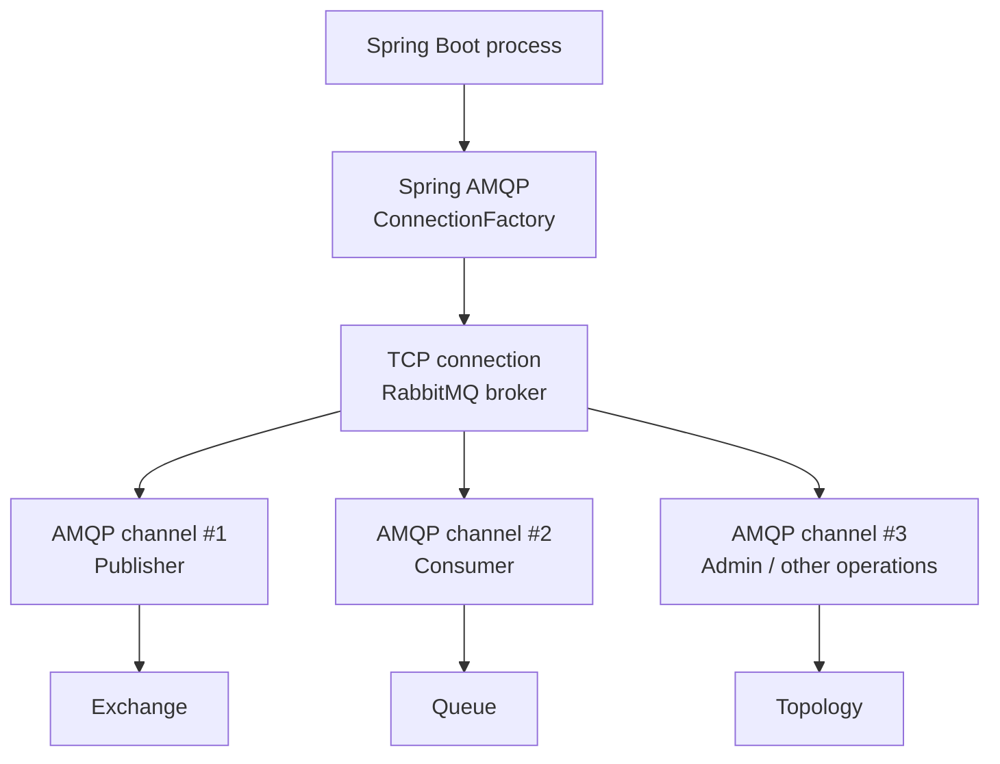
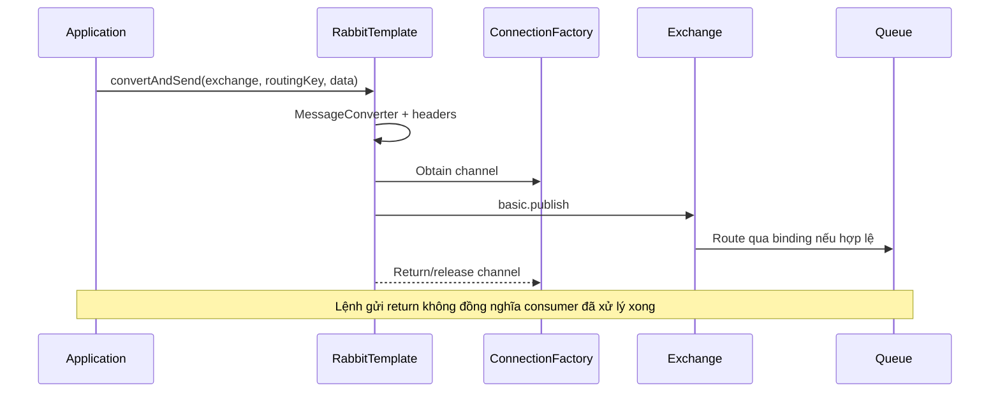
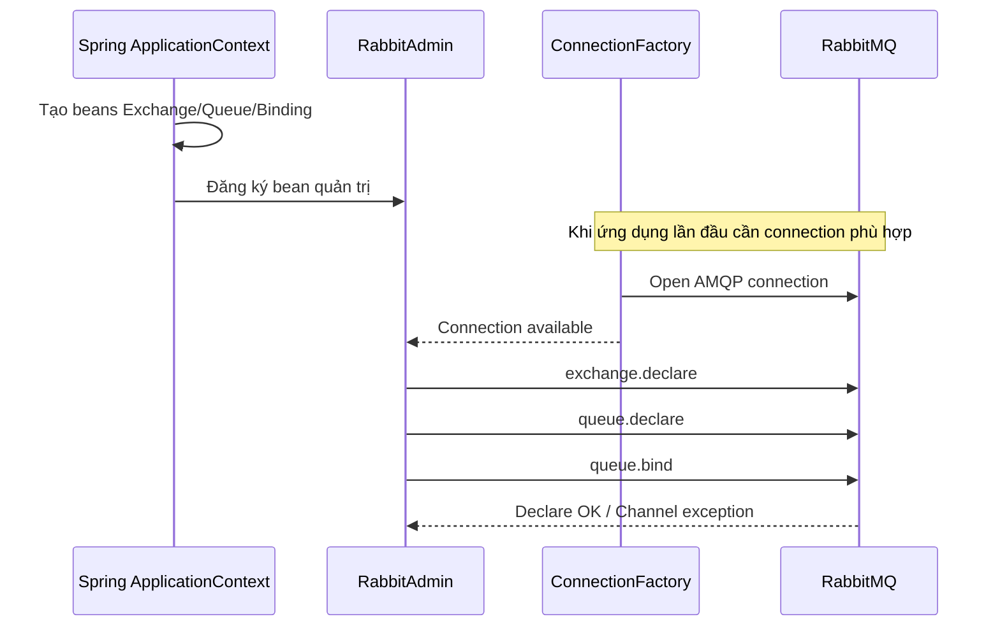
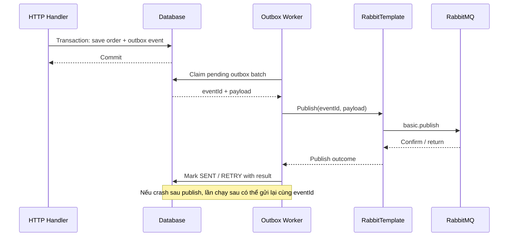

# ConnectionFactory, RabbitTemplate và RabbitAdmin

## 1. Mục tiêu: ba trách nhiệm khác nhau trong một ứng dụng Spring Boot Integration

Trong module **SPRING_BOOT_INTEGRATION**, dịch vụ Spring Boot có thể nhận HTTP request, ghi database, dùng cache để tăng tốc đọc, rồi gửi sự kiện sang broker để hệ thống khác xử lý. Với RabbitMQ qua AMQP 0-9-1, ba thành phần Spring AMQP thường xuất hiện gần nhau là **`ConnectionFactory`**, **`RabbitTemplate`** và **`RabbitAdmin`**.

Cần hiểu chính xác chúng làm gì:

| Thành phần | Trả lời câu hỏi | Trách nhiệm chính | Không tự bảo đảm |
| --- | --- | --- | --- |
| `ConnectionFactory` | Ứng dụng kết nối broker bằng cách nào? | Cung cấp connection/channel, xác thực, cache và vòng đời kết nối | Message đã đến đúng queue hay nghiệp vụ đã hoàn tất |
| `RabbitTemplate` | Ứng dụng gửi hoặc nhận message qua broker thế nào? | Publish, nhận đồng bộ, chuyển đổi payload, request/reply, callbacks | Đúng một lần xử lý, transaction xuyên database và broker |
| `RabbitAdmin` | Exchange, queue, binding được khai báo ở đâu và khi nào? | Gửi lệnh quản trị AMQP, khai báo/xóa/kiểm tra topology | Tự thiết kế routing key, DLQ và quyền sở hữu hạ tầng |

Ba thành phần nằm ở các tầng khác nhau. **Template cần connection factory** để giao tiếp với broker. **Admin cũng cần connection factory**, nhưng chủ yếu dùng để khai báo topology. **Consumer** dùng listener container/channel riêng; `RabbitTemplate` không phải là consumer chạy nền chỉ vì nó có phương thức `receive`.

Sau bài này, bạn có thể:

1. Đọc một cấu hình Spring Boot và nhận ra bean nào được Boot tạo có điều kiện.
2. Phân biệt **TCP connection**, **AMQP channel**, connection/channel cache và xác nhận publish.
3. Dùng `RabbitTemplate` để publish có metadata, xác nhận kết quả và xử lý thông điệp không định tuyến được.
4. Dùng `RabbitAdmin` cùng `Exchange`, `Queue`, `Binding` để khai báo topology có kiểm soát.
5. Tổ chức transaction, retry, idempotency, kiểm thử và quan sát nhằm tránh lỗi khó phát hiện trong luồng tích hợp thực.

> Các ví dụ minh họa Spring Boot với Spring AMQP/RabbitMQ qua AMQP 0-9-1, ưu tiên API phổ biến trong Spring Boot 3.x và Spring AMQP hiện đại. Một số thuộc tính, package và cách cấu hình có thể khác theo phiên bản lớn. Hãy kiểm tra dependency/BOM và tài liệu đúng phiên bản đang dùng khi áp dụng.

## 2. Luồng tổng thể từ HTTP/DB tới RabbitMQ

Ví dụ dịch vụ đơn hàng cần gửi sự kiện `order.created` để dịch vụ kho xử lý:



Một lần xử lý có thể đi qua những bước:

1. HTTP handler kiểm tra hợp đồng dữ liệu và ghi đơn hàng cùng outbox trong transaction database.
2. Một publisher đọc outbox đến hạn, gọi `RabbitTemplate` để gửi sự kiện tới exchange với routing key.
3. `RabbitTemplate` lấy channel qua `ConnectionFactory`, mã hóa nội dung và gửi AMQP basic.publish.
4. Broker dựa trên exchange và binding để định tuyến tới queue.
5. Consumer riêng nhận, xử lý, cập nhật database của mình rồi xác nhận message.
6. Hạ tầng `RabbitAdmin` có thể đã khai báo exchange/queue/binding trước các lần gửi, tùy cách quản trị topology.

Điểm dễ nhầm: `RabbitAdmin` không đứng trong đường xử lý **mỗi** message. Nó tham gia quản trị tài nguyên; sau khi broker có topology phù hợp, các lần publish/consume không cần gửi lệnh declare liên tục.

## 3. Cài dependency và hiểu auto-configuration của Spring Boot

### Maven

Nếu dự án dùng Spring Boot parent hoặc BOM:

```xml
<dependency>
    <groupId>org.springframework.boot</groupId>
    <artifactId>spring-boot-starter-amqp</artifactId>
</dependency>
```

### Gradle

```groovy
dependencies {
    implementation 'org.springframework.boot:spring-boot-starter-amqp'
}
```

Starter mang vào Spring AMQP, Spring Rabbit và RabbitMQ Java client theo dependency management của Spring Boot. Đối với ứng dụng có nhiều module, dependency phải nằm ở **runtime classpath của module chạy**, không chỉ ở module chứa một interface hoặc trong `testImplementation`.

Khi đủ điều kiện, Spring Boot dùng nhóm thuộc tính `spring.rabbitmq.*` để cấu hình:

- `ConnectionFactory` của Spring AMQP, thông thường là `CachingConnectionFactory`.
- `RabbitTemplate` cho publish/receive hoặc giao tiếp AMQP kiểu request/reply.
- `AmqpAdmin` với implementation `RabbitAdmin` khi chức năng khai báo động được bật.
- Các thành phần listener nếu dự án dùng `@RabbitListener` và infrastructure phù hợp.

Đây là **auto-configuration có điều kiện**. Nếu tự đăng ký một `ConnectionFactory` hoặc `RabbitTemplate`, bean mặc định có thể không được tạo do `@ConditionalOnMissingBean`. Nếu có nhiều connection factory mà không có một ứng viên rõ ràng, template/admin mặc định có thể không xuất hiện do điều kiện lựa chọn bean. Để xác định lý do, dùng Conditions Evaluation Report hoặc `/actuator/conditions` với quyền truy cập thích hợp.

**Starter không cài RabbitMQ server**, không tự quyết định exchange/queue/binding theo bài toán nghiệp vụ, và cũng không tự biến thao tác ghi DB + gửi broker thành một transaction duy nhất.

## 4. ConnectionFactory: kết nối khác với channel

Giao thức AMQP 0-9-1 sử dụng **TCP connection** tới broker và các **channel** logic nằm trong connection đó. Một channel hỗ trợ các thao tác như publish, consume, declare; nhiều channel có thể cùng chia sẻ một kết nối TCP.



Trong Spring AMQP:

- `org.springframework.amqp.rabbit.connection.ConnectionFactory` là abstraction phía Spring. Đừng nhầm với `com.rabbitmq.client.ConnectionFactory` của RabbitMQ Java client ở tầng thấp hơn.
- `CachingConnectionFactory` thường được Spring Boot cấu hình, có thể cache/reuse channel và quản lý connection theo chế độ cache đã chọn.
- `RabbitTemplate` và `RabbitAdmin` nhận một Spring AMQP `ConnectionFactory`, không trực tiếp quản lý từng socket TCP trong nghiệp vụ.
- Listener container cũng sử dụng connection factory nhưng có vòng đời channel/consumer đặc thù, không tương đương với việc gọi `RabbitTemplate.receive()`.

### 4.1. Cấu hình một broker local

Ví dụ `application.yml` cho môi trường phát triển:

```yaml
spring:
  rabbitmq:
    host: ${RABBITMQ_HOST:localhost}
    port: ${RABBITMQ_PORT:5672}
    username: ${RABBITMQ_USERNAME:guest}
    password: ${RABBITMQ_PASSWORD:guest}
    virtual-host: ${RABBITMQ_VHOST:/}
    connection-timeout: 5s
    requested-heartbeat: 30s
```

Các giá trị `guest` chỉ phù hợp demo local; RabbitMQ thường hạn chế tài khoản `guest` đăng nhập từ xa. Trong staging/production, dùng tài khoản riêng cho mỗi ứng dụng, secrets bên ngoài mã nguồn và phân quyền theo vhost.

| Thuộc tính | Vai trò | Lưu ý |
| --- | --- | --- |
| `spring.rabbitmq.host` | Host broker | `localhost` trong container trỏ tới chính container |
| `spring.rabbitmq.port` | Cổng AMQP | `5672` thường dùng cho AMQP plaintext; `15672` là cổng HTTP management |
| `spring.rabbitmq.addresses` | Nhiều địa chỉ endpoint để client thử kết nối | Chọn đúng cú pháp và chính sách cluster của phiên bản client |
| `spring.rabbitmq.username`, `password` | Thông tin xác thực | Không ghi secret vào log hoặc repository |
| `spring.rabbitmq.virtual-host` | Không gian queue/exchange/binding và quyền | Cùng tên queue ở hai vhost là hai tài nguyên khác nhau |
| `spring.rabbitmq.connection-timeout` | Timeout lập kết nối | Khác timeout chờ phản hồi nghiệp vụ |
| `spring.rabbitmq.requested-heartbeat` | Chu kỳ heartbeat đề nghị khi thương lượng với broker | Không thay thế timeout từng message |
| `spring.rabbitmq.ssl.enabled` | Bật TLS khi endpoint hỗ trợ | Vẫn phải xác thực certificate/hostname và cấu hình trust đúng |

Cấu hình `addresses` chỉ cung cấp các endpoint có thể kết nối; nó không tự biến các RabbitMQ node rời rạc thành cluster, cũng không bảo đảm queue replication. Topology/HA của broker cần được vận hành riêng.

### 4.2. Kết nối khi nào được mở?

Tùy hành vi của app và auto-configuration, bean `CachingConnectionFactory` có thể tồn tại trước khi có socket thực sự. Socket thường được tạo khi một thao tác đầu tiên cần broker, ví dụ `RabbitAdmin` khai báo, publisher gửi message hoặc listener container bắt đầu tiêu thụ.

Vì vậy:

- Ứng dụng **start thành công** không chứng minh RabbitMQ reachable trong mọi trường hợp.
- Tài khoản truy cập vhost sai có thể chỉ lộ lỗi khi ứng dụng mở connection.
- Nếu broker bị restart, phải xem log recovery/reconnect và các message chưa được xác nhận gửi.
- Khi thay cấu hình host/credential, đừng cho rằng connection đang mở tự chuyển sang thông tin mới nếu không tái cấu hình/reconnect phù hợp.

Khi cần health check thực, kiểm tra kết nối/khả năng thực hiện thao tác thích hợp ở môi trường đó, đồng thời cân nhắc failure mode: một broker gián đoạn ngắn có khiến toàn bộ HTTP API không sẵn sàng hay chỉ khiến luồng publish tạm dừng?

## 5. CachingConnectionFactory và channel cache

Tạo TCP connection và AMQP channel cho từng message sẽ tạo tải không cần thiết lên ứng dụng/broker. `CachingConnectionFactory` giúp tái sử dụng tài nguyên khi nhiều thao tác gửi nhận xảy ra.

Cấu hình tham khảo:

```yaml
spring:
  rabbitmq:
    cache:
      channel:
        size: 25
        checkout-timeout: 2s
```

### Hiểu đúng các tham số

- `spring.rabbitmq.cache.channel.size` là kích thước cache channel mục tiêu. Khi checkout timeout **không được đặt/không bật**, đây không mặc nhiên là giới hạn cứng tổng số channel đang được sử dụng; các channel vượt cache có thể được tạo rồi đóng khi trả về.
- Khi `channel.checkout-timeout` được cấu hình dương, `channel.size` tham gia giới hạn số channel có thể được checkout trên một connection trong chế độ cache tương ứng; thread có thể phải chờ hoặc gặp timeout nếu không lấy được channel.
- `spring.rabbitmq.cache.connection.mode` và `spring.rabbitmq.cache.connection.size` tác động tới việc cache connection nếu chọn chế độ thích hợp. Đổi chế độ cần kiểm thử vì số connection/channel và cơ chế khai báo topology có thể thay đổi.
- Channel phục vụ publisher, listener và admin có cách lấy/trả khác nhau; đừng suy số lượng consumer tối đa chỉ từ `cache.channel.size`.

Ví dụ một ứng dụng tăng số consumer RabbitMQ từ 2 lên 20 và vẫn có nhiều publisher đồng thời. Nếu cấu hình giới hạn channel quá thấp, thread chờ channel có thể tăng latency hoặc thất bại. Nếu không giới hạn và tải vượt thiết kế, broker có thể đạt giới hạn channel/connection. Cần điều chỉnh dựa trên throughput, lượng consumer, số kết nối, CPU, memory và metric của broker.

**Không bật đồng thời nhiều cơ chế tự phục hồi connection độc lập mà không hiểu chúng phối hợp ra sao.** Spring AMQP có cơ chế quản lý/reconnect riêng; nếu can thiệp trực tiếp vào automatic recovery của RabbitMQ Java client, cần kiểm chứng với phiên bản Spring AMQP đang dùng.

## 6. RabbitTemplate: các thao tác chính và vòng đời của một message

`RabbitTemplate` là API cấp cao của Spring AMQP để gửi/nhận AMQP message. Nó sử dụng `ConnectionFactory` được inject và một `MessageConverter` để biến đối tượng Java thành payload hoặc ngược lại.

| Nhóm API | Dùng khi nào? | Lưu ý |
| --- | --- | --- |
| `send(exchange, routingKey, Message)` | Tự kiểm soát bytes và message properties | Cần tự chuẩn bị payload chính xác |
| `convertAndSend(exchange, routingKey, object)` | Gửi Java object qua converter | Converter mặc định không tự biến mọi DTO thành JSON |
| `receive(queue)` | Nhận đồng bộ một message | Có thể trả `null` nếu không có message |
| `receiveAndConvert(queue)` | Nhận và áp dụng message converter | Không phải một listener chạy nền |
| `convertSendAndReceive(...)` | RPC/request-reply | Cần reply routing, timeout và giới hạn số request đồng thời |
| `setConfirmCallback(...)` | Nhận kết quả publisher confirm | Phải bật confirm phù hợp ở connection factory |
| `setReturnsCallback(...)` | Xử lý message không được route tới queue | Cần publisher returns và mandatory khi áp dụng |

Một lần `RabbitTemplate.convertAndSend` thường diễn ra theo sơ đồ:



Một điểm quan trọng: `convertAndSend` trả về `void` ở các overload gửi một chiều thông dụng. Khi method trở về bình thường, đó **không phải** bằng chứng end-to-end rằng consumer đã ghi database thành công. Độ tin cậy publish cần publisher confirms/returns, chính sách retry và lưu trạng thái nghiệp vụ riêng.

## 7. Ví dụ publish sự kiện với MessagePostProcessor

Giả sử dịch vụ đơn hàng phát JSON với `eventId` có thể dùng để chống xử lý trùng. Hợp đồng mẫu:

```json
{
  "eventId": "evt-1001",
  "eventType": "order.created",
  "schemaVersion": 1,
  "orderId": "ORD-501",
  "occurredAt": "2026-11-21T03:00:00Z"
}
```

Publisher:

```java
import org.springframework.amqp.core.MessageDeliveryMode;
import org.springframework.amqp.core.MessageProperties;
import org.springframework.amqp.rabbit.core.RabbitTemplate;
import org.springframework.stereotype.Component;

@Component
public class OrderEventPublisher {

    private static final String EXCHANGE = "integration.orders.events";
    private static final String ROUTING_KEY = "order.created";

    private final RabbitTemplate rabbitTemplate;

    public OrderEventPublisher(RabbitTemplate rabbitTemplate) {
        this.rabbitTemplate = rabbitTemplate;
    }

    public void publish(String eventId, String eventJson) {
        rabbitTemplate.convertAndSend(
            EXCHANGE,
            ROUTING_KEY,
            eventJson,
            message -> {
                MessageProperties props = message.getMessageProperties();
                props.setMessageId(eventId);
                props.setContentType(MessageProperties.CONTENT_TYPE_JSON);
                props.setDeliveryMode(MessageDeliveryMode.PERSISTENT);
                props.setHeader("schemaVersion", 1);
                return message;
            }
        );
    }
}
```

Trong ví dụ này, `eventJson` là **chuỗi JSON đã được ứng dụng serialize/validate**. `MessagePostProcessor` chạy sau bước convert, nên có thể gắn content type, message ID và header. Nếu dùng DTO Java, cần cấu hình JSON converter được hỗ trợ bởi phiên bản Spring AMQP để tránh gửi một định dạng ngoài mong đợi.

Phân biệt rõ:

- `MessageProperties.messageId` có thể giúp truy vết một event, nhưng broker không tự dùng nó để loại bản trùng.
- `MessageDeliveryMode.PERSISTENT` cho biết message được đánh dấu persistent; độ bền còn phụ thuộc queue durable, kiểu queue, xác nhận từ broker, cấu hình lưu trữ và tình huống sự cố.
- `schemaVersion` là metadata của hợp đồng payload; consumer phải kiểm tra các phiên bản được hỗ trợ.
- `routingKey` điều khiển routing qua exchange; nó không thay cho định danh sự kiện.

Không truyền trực tiếp dữ liệu cá nhân, access token hoặc payload nhạy cảm qua header/log nếu không thực sự cần. Header vẫn được gửi tới bên nhận và có thể xuất hiện trong công cụ quản trị broker.

## 8. MessageConverter: từ Java object đến bytes

Mặc định `RabbitTemplate` thường sử dụng `SimpleMessageConverter`. Với `String`, converter có thể tạo bytes của văn bản; với `byte[]`, nó sử dụng bytes; với đối tượng Java theo cơ chế hỗ trợ, có thể đi qua Java serialization. **Không nên coi Java serialization là hợp đồng tích hợp lâu dài giữa các service** vì rủi ro bảo mật, tương thích class/version và phụ thuộc ngôn ngữ.

| Hợp đồng dữ liệu | Cách làm phù hợp | Điều cần kiểm tra |
| --- | --- | --- |
| JSON giữa các service | JSON converter được hai phía hỗ trợ hoặc JSON string/bytes đã kiểm tra | Charset, MIME type, field name, schema version |
| Binary/Protobuf | Converter/serializer chuyên dụng | Schema registry/version, MIME type |
| Text đơn giản | `String` với charset xác định | Không nhầm content type với JSON |
| Java object nội bộ | Converter được quản trị rõ | Tránh ràng buộc người nhận vào Java serialization |
| Message header phục vụ routing/tracing | `MessagePostProcessor` | Header name, tương thích kiểu dữ liệu, security |

Ví dụ khi muốn app quản lý một converter JSON: đăng ký một bean `MessageConverter` phù hợp với **đúng phiên bản Spring AMQP** và bảo đảm nó được dùng cho cả template và listener nếu hai phía dùng DTO. Trong một số phiên bản, API/class converter Jackson chuyển thế hệ; hãy kiểm tra Spring AMQP reference của phiên bản thực tế trước khi sao chép tên class của một release cũ.

Một lỗi thường gặp: producer gửi `application/json` và JSON object, consumer đọc bằng `String` hoặc ngược lại rồi báo lỗi conversion. Cần ghi nhận cả **bytes thực tế**, `contentType`, headers và chữ ký method listener. Việc thay đổi converter có thể là breaking change cho dữ liệu đang còn trong queue, nên cần test với message phiên bản cũ.

## 9. Publisher confirms và publisher returns: hai tín hiệu khác nhau

RabbitMQ có hai cơ chế cần hiểu khi publish đáng tin cậy:

1. **Publisher confirm**: broker phản hồi về việc xử lý publish theo cơ chế confirm của AMQP extension. Một confirm `ack` **không** chứng minh consumer đã hoàn tất business transaction.
2. **Publisher return**: khi bật `mandatory`, message không route được tới queue có thể được broker trả lại với thông tin exchange, routing key và mã lỗi. Một publish có thể có **confirm ACK và đồng thời có return** vì exchange đã nhận publish nhưng không tìm được queue phù hợp.

Cấu hình Spring Boot:

```yaml
spring:
  rabbitmq:
    publisher-confirm-type: correlated
    publisher-returns: true
    template:
      mandatory: true
```

Để những thuộc tính này có giá trị vận hành, ứng dụng phải **quan sát và xử lý kết quả**. Chỉ bật property mà không có callback, correlation hoặc workflow lưu trạng thái vẫn có thể dẫn tới mất sự kiện khó phát hiện.

| Kết quả | Ý nghĩa có thể kết luận | Việc tiếp theo |
| --- | --- | --- |
| Confirm ACK, không có return | Broker đã xử lý publish theo cơ chế confirm; không thấy tín hiệu unroutable tương ứng | Cập nhật trạng thái publish theo thiết kế, vẫn cần consumer idempotency |
| Confirm ACK, **có return** | Exchange đã chấp nhận lệnh publish nhưng không định tuyến được tới queue | Sửa topology/routing và lưu message để retry có kiểm soát |
| Confirm NACK hoặc lỗi channel | Broker từ chối/không xác nhận publish thành công | Phân loại lỗi, kiểm tra broker, quyết định retry |
| Timeout/chết connection trước confirm | Producer chưa biết publish đã được chấp nhận hay chưa | Không mặc định an toàn khi gửi lại; dùng event ID và deduplication |

### 9.1. Theo dõi bằng CorrelationData

Một cách điển hình trong các phiên bản Spring AMQP hỗ trợ `CorrelationData.getFuture()` là gắn correlation ID cho từng lệnh publish:

```java
import org.springframework.amqp.rabbit.connection.CorrelationData;
import org.springframework.amqp.rabbit.core.RabbitTemplate;
import org.springframework.stereotype.Component;

@Component
public class ConfirmedOrderPublisher {

    private final RabbitTemplate rabbitTemplate;

    public ConfirmedOrderPublisher(RabbitTemplate rabbitTemplate) {
        this.rabbitTemplate = rabbitTemplate;
    }

    public void publish(String eventId, String json) {
        CorrelationData correlation = new CorrelationData(eventId);

        rabbitTemplate.convertAndSend(
            "integration.orders.events",
            "order.created",
            json,
            correlation
        );

        correlation.getFuture().whenComplete((confirm, error) -> {
            if (error != null) {
                // Ghi nhận lỗi confirm theo eventId; không mất record cần retry.
                return;
            }
            if (!confirm.isAck()) {
                // Xử lý NACK; xem confirm.getReason() nếu API hỗ trợ.
                return;
            }

            if (correlation.getReturned() != null) {
                // Publish được broker confirm nhưng message bị trả về:
                // lưu trạng thái UNROUTABLE và điều tra routing/binding.
                return;
            }

            // ACK, không có returned message: cập nhật trạng thái
            // gửi theo policy của ứng dụng.
        });
    }
}
```

Đây là **khung logic** để minh họa callback, chưa phải publisher có bảo đảm dữ liệu bền vững. Production cần cơ chế thread-safe để liên kết `eventId` với bản ghi outbox, cập nhật kết quả/attempt trong DB và xử lý timeout khi chưa nhận được confirm. Không phụ thuộc vào việc callback sẽ luôn chạy trước khi process crash. Trên phiên bản Spring AMQP khác, hãy đối chiếu API future/callback và khả năng đọc returned message từ `CorrelationData`.

Một cách khác là đăng ký tập trung `RabbitTemplate.ConfirmCallback` và `ReturnsCallback`. Cần một chủ sở hữu callback rõ ràng trên mỗi template; không để nhiều bean khác nhau liên tục gọi `setConfirmCallback` rồi ghi đè handler của nhau.

### 9.2. Lỗi không định tuyến

Một publisher gửi tới exchange tồn tại với routing key không có binding phù hợp:

```text
Exchange: integration.orders.events
Routing key: order.paid
Binding hiện có: order.created -> integration.order.created
Result: không có queue phù hợp cho order.paid
```

Nếu `mandatory=true` và returns được kích hoạt, broker có thể trả message; nếu không bật, message không route được có thể bị loại bỏ mà producer chỉ nhìn thấy một lời gọi gửi thành công. Với **exchange không tồn tại**, broker thường phản hồi bằng channel exception, khác với kịch bản exchange tồn tại nhưng không route được.

Cũng không nên xem "không có return" là tuyệt đối chứng minh consumer nhận được message: broker có thể đang gặp sự cố, kết nối mất hoặc chưa có confirm. Phải xét **cặp kết quả confirm + return**, cùng trạng thái retry và thời hạn quan sát.

## 10. RabbitTemplate nhận đồng bộ và request/reply

Mặc dù producer thường dùng `convertAndSend`, `RabbitTemplate` còn có các thao tác nhận và request/reply.

### 10.1. Nhận đồng bộ

```java
import java.util.concurrent.TimeUnit;
import org.springframework.amqp.core.Message;
import org.springframework.amqp.rabbit.core.RabbitTemplate;

Message message = rabbitTemplate.receive(
    "integration.order.created",
    TimeUnit.SECONDS.toMillis(2)
);

if (message == null) {
    // Không có message trong khoảng thời gian chờ.
}
```

Đây chỉ là một ví dụ sử dụng API (giả định `rabbitTemplate` đã được inject). `receive` thực hiện một thao tác nhận đồng bộ; nó không thay cho `@RabbitListener` khi cần consumer liên tục, quản lý concurrency, retry, ack và message processing.

**Không để test hoặc công cụ quản trị gọi `receive()` trên queue production đang được listener dùng**, vì thao tác này có thể lấy một message mà consumer nghiệp vụ đáng lẽ phải xử lý.

### 10.2. Request/reply kiểu RPC

```java
Object reply = rabbitTemplate.convertSendAndReceive(
    "integration.inventory.rpc",
    "inventory.check",
    "{\"sku\":\"SKU-001\"}"
);
```

Thao tác này gửi yêu cầu và chờ phản hồi qua cơ chế request/reply của Spring AMQP. Cần xác định:

- Queue/route tiếp nhận request và responder nào sẽ gửi reply.
- Timeout, payload converter và mapping lỗi thành kết quả nghiệp vụ.
- Quản lý correlation ID, concurrency, reply-to, quyền queue và trường hợp responder không trả lời.
- Trong trường hợp timeout, caller không thể tự suy ra server chưa xử lý request.

Có thể cấu hình thời gian chờ reply cho template theo phiên bản Spring Boot, chẳng hạn `spring.rabbitmq.template.reply-timeout: 3s`. RPC qua queue có ích trong một số bài toán, nhưng một luồng HTTP request có thể bị block chờ RabbitMQ reply sẽ chịu latency và timeout kép. Nếu dịch vụ chỉ cần event notification, dùng publish một chiều và theo dõi kết quả tách biệt thường đơn giản hơn.

## 11. RabbitAdmin: ai chịu trách nhiệm khai báo exchange, queue và binding?

Một message chỉ được định tuyến đúng khi **topology** tương thích đã tồn tại:

- **Exchange** nhận publish và áp dụng quy tắc định tuyến.
- **Queue** giữ những message cần được consumer xử lý.
- **Binding** nối exchange với queue bằng routing key/pattern.
- Có thể cần thêm dead-letter exchange/queue, policy, queue type hoặc permission.

Trong Spring AMQP, `AmqpAdmin` là abstraction quản trị; `RabbitAdmin` là implementation cụ thể sử dụng RabbitMQ. Bạn có thể inject `AmqpAdmin` trong code để giảm phụ thuộc vào implementation.

Spring Boot thường tạo `RabbitAdmin` khi có một connection factory phù hợp và chức năng dynamic admin được bật (thuộc tính `spring.rabbitmq.dynamic` mặc định thường bật). Admin không tự thiết kế tên exchange/queue. Ứng dụng cần định nghĩa các `Declarable` bean như `Queue`, `Exchange`, `Binding` hoặc gọi API admin rõ ràng.

### 11.1. Cách 1: khai báo topology bằng Spring beans

Ví dụ direct exchange và durable queue:

```java
import org.springframework.amqp.core.Binding;
import org.springframework.amqp.core.BindingBuilder;
import org.springframework.amqp.core.DirectExchange;
import org.springframework.amqp.core.Queue;
import org.springframework.amqp.core.QueueBuilder;
import org.springframework.context.annotation.Bean;
import org.springframework.context.annotation.Configuration;

@Configuration(proxyBeanMethods = false)
public class OrderAmqpTopology {

    public static final String EXCHANGE =
        "integration.orders.events";
    public static final String QUEUE =
        "integration.order.created";
    public static final String ROUTING_KEY =
        "order.created";

    @Bean
    DirectExchange orderExchange() {
        return new DirectExchange(EXCHANGE, true, false);
    }

    @Bean
    Queue orderQueue() {
        return QueueBuilder.durable(QUEUE).build();
    }

    @Bean
    Binding orderBinding(
            Queue orderQueue,
            DirectExchange orderExchange) {

        return BindingBuilder.bind(orderQueue)
            .to(orderExchange)
            .with(ROUTING_KEY);
    }
}
```

Khi một `RabbitAdmin` phù hợp được bật và có quyền quản trị, các declarable beans có thể được khai báo với broker khi connection được thiết lập. Các declaration có ý nghĩa **idempotent khi định nghĩa không đổi**: khai báo lại cùng queue/exchange với thuộc tính tương thích thường ổn. Nếu cùng tên queue nhưng thay `durable`, queue type hoặc `x-arguments` không tương thích, broker có thể trả `PRECONDITION_FAILED` và đóng channel.

**Không xóa queue production để “sửa” `PRECONDITION_FAILED` nếu chưa biết dữ liệu còn chờ.** Cần so sánh định nghĩa hiện tại với code và có quy trình migration/topology thay thế có kiểm soát.

### 11.2. Cách 2: nhóm declaration bằng Declarables

Nếu muốn tổ chức một nhóm tài nguyên chung:

```java
import org.springframework.amqp.core.Binding;
import org.springframework.amqp.core.BindingBuilder;
import org.springframework.amqp.core.Declarables;
import org.springframework.amqp.core.DirectExchange;
import org.springframework.amqp.core.Queue;
import org.springframework.amqp.core.QueueBuilder;
import org.springframework.context.annotation.Bean;

@Bean
Declarables orderDeclarables() {
    DirectExchange exchange =
        new DirectExchange("integration.orders.events", true, false);
    Queue queue =
        QueueBuilder.durable("integration.order.created").build();
    Binding binding = BindingBuilder.bind(queue)
        .to(exchange)
        .with("order.created");
    return new Declarables(exchange, queue, binding);
}
```

Đây là **một cách thay thế** cho ba bean ở mục trước. Đừng cùng lúc đăng ký cả hai cách nếu mục đích chỉ là một topology; tuy việc khai báo lại cùng định nghĩa có thể hợp lệ, nó gây trùng lặp ownership và khó bảo trì.

### 11.3. Cách 3: khai báo tường minh qua AmqpAdmin

Phù hợp khi có tính năng quản trị được phân quyền cần tạo queue động:

```java
import org.springframework.amqp.core.AmqpAdmin;
import org.springframework.amqp.core.BindingBuilder;
import org.springframework.amqp.core.DirectExchange;
import org.springframework.amqp.core.Queue;
import org.springframework.amqp.core.QueueBuilder;
import org.springframework.stereotype.Service;

@Service
public class PartnerQueueProvisioner {

    private final AmqpAdmin admin;

    public PartnerQueueProvisioner(AmqpAdmin admin) {
        this.admin = admin;
    }

    public void provision(String trustedPartnerCode) {
        // trustedPartnerCode phải được validate và quản trị trước đó.
        String queueName =
            "integration.partner." + trustedPartnerCode;

        DirectExchange exchange =
            new DirectExchange("integration.partner.events", true, false);
        Queue queue = QueueBuilder.durable(queueName).build();

        admin.declareExchange(exchange);
        admin.declareQueue(queue);
        admin.declareBinding(
            BindingBuilder.bind(queue)
                .to(exchange)
                .with("partner." + trustedPartnerCode)
        );
    }
}
```

Ví dụ này tập trung vào API quản trị. Ở production phải có owner cho vòng đời queue: tạo khi nào, xóa khi nào, làm gì với message tồn đọng, quota số queue, kiểm soát tên do input tạo ra, concurrency khi nhiều replica cùng tạo và quyền `configure` trên broker. Đừng mở một API công khai cho phép người dùng tạo queue/exchange tùy ý.

## 12. RabbitAdmin khai báo tài nguyên vào lúc nào?

Đây là điểm thường gây hiểu nhầm. Khai báo `@Bean Queue` trong Spring **không đồng nghĩa lệnh declare được gửi ngay ở thời điểm tạo bean Java**. `RabbitAdmin` thường đăng ký logic quản trị với connection factory, rồi tự khai báo tài nguyên khi connection phù hợp được mở. Nếu broker tắt lúc startup, hành vi lỗi/khởi tạo còn phụ thuộc thứ tự mở connection và cấu hình admin.



Vì vậy:

- Một publisher có thể gửi lần đầu trước khi mọi external dependency thực sự ổn định nếu hệ thống triển khai không có readiness phù hợp.
- Admin có thể khai báo lại các tài nguyên sau khi kết nối được thiết lập lại, tùy cấu hình và loại resource.
- Nếu có nhiều `RabbitAdmin`/`ConnectionFactory`, cần chỉ rõ admin nào chịu trách nhiệm với từng nhóm `Declarable`. Nếu không, có thể khai báo topology ở sai broker/vhost.
- Khi topology do IaC/đội hạ tầng quản trị, có thể chủ động **tắt việc ứng dụng tự khai báo**; đừng cho mọi service quyền `configure` chỉ để publish message.
- Các lệnh `declare*` cần channel quản trị hoạt động, credential có quyền; chỉ có quyền `write` để publish chưa chắc đủ để declare exchange/queue.

Hãy quyết định rõ một trong hai mô hình chủ đạo:

| Mô hình | Đội chịu trách nhiệm topology | Đặc điểm |
| --- | --- | --- |
| **App-managed topology** | Ứng dụng khai báo bean qua RabbitAdmin | Thuận tiện dev/test, code và topology liên kết, nhưng cần quyền configure và quy trình migration queue |
| **Infrastructure-managed topology** | IaC/policy/đội vận hành broker | Phân quyền chặt và kiểm soát thay đổi, ứng dụng chỉ publish/consume với hợp đồng đã công bố |

Không nên để cả hai phía tùy tiện thay queue arguments ở những thời điểm khác nhau. Các **RabbitMQ policies** có thể phù hợp hơn hardcode x-arguments cho những cấu hình cần vận hành tập trung, tùy loại policy/queue.

## 13. Trường hợp dead-letter và queue arguments

Khi consumer từ chối message không requeue, dead-letter exchange (DLX) có thể nhận message nếu queue được cấu hình đúng. Có thể khai báo DLX và DLQ bằng `RabbitAdmin` giống các exchange/queue/binding khác.

Ví dụ topology logic:

```text
Producer -> [integration.orders.events]
                 |
             order.created
                 v
     [integration.order.created] -- reject/nack, requeue=false -->
                  |
                  v
     [integration.orders.dlx] -- order.failed --> [integration.order.dlq]
```

Cần phân biệt:

- `RabbitAdmin` chỉ giúp **khai báo** DLX/DLQ/binding.
- Listener container / consumer chịu trách nhiệm ack/nack/reject theo hành vi xử lý.
- Broker quyết định dead-letter routing dựa trên queue arguments/policy.
- Một message bị reject khi queue không có DLX áp dụng có thể bị loại bỏ, dù bạn đã bật `default-requeue-rejected=false` bên Spring Boot.
- DLQ cần cơ chế cảnh báo, điều tra và phát lại có kiểm soát, nhất là với dữ liệu sai hợp đồng hoặc sự cố downstream kéo dài.

Đừng dùng DLQ như một kho lưu trữ vĩnh viễn không giám sát. Khi phát lại, giữ `eventId` ổn định để consumer xử lý trùng; tránh tạo message mới mang ID khác cho cùng một tác động nghiệp vụ mà không có lý do.

## 14. Nhiều ConnectionFactory trong cùng ứng dụng

Một service tích hợp có thể kết nối **hai RabbitMQ brokers/vhosts**: một cho sự kiện đơn hàng nội bộ, một cho đối tác. Khi đó, việc chỉ inject `RabbitTemplate` theo kiểu có thể gây nhầm môi trường.

Mô hình lý tưởng:

```text
Internal ConnectionFactory
  -> Internal RabbitTemplate
  -> Internal RabbitAdmin
  -> Internal Listener Container

Partner ConnectionFactory
  -> Partner RabbitTemplate
  -> Partner RabbitAdmin
  -> Partner Listener Container
```

Nguyên tắc triển khai:

1. Tạo và đặt tên bean kết nối theo đối tác/broker một cách rõ ràng, bind properties riêng từ externalized configuration.
2. Mỗi `RabbitTemplate` được tạo với đúng `ConnectionFactory`.
3. Nếu app được phép khai báo topology, mỗi `RabbitAdmin` phải có quyền và phạm vi declarations riêng.
4. Listener container factory hoặc `@RabbitListener(containerFactory = "...")` cần chỉ đúng connection factory của queue.
5. Dùng `@Qualifier` hoặc `@Primary` **có chủ đích**; hiểu rằng một số auto-configuration yêu cầu có single candidate.

Ví dụ dựng template riêng khi connection factory đối tác đã được cấu hình:

```java
import org.springframework.amqp.rabbit.connection.ConnectionFactory;
import org.springframework.amqp.rabbit.core.RabbitTemplate;
import org.springframework.beans.factory.annotation.Qualifier;
import org.springframework.context.annotation.Bean;
import org.springframework.context.annotation.Configuration;

@Configuration(proxyBeanMethods = false)
public class PartnerRabbitTemplateConfiguration {

    @Bean("partnerRabbitTemplate")
    RabbitTemplate partnerRabbitTemplate(
            @Qualifier("partnerConnectionFactory")
            ConnectionFactory partnerConnectionFactory) {

        return new RabbitTemplate(partnerConnectionFactory);
    }
}
```

Đây là ví dụ **thêm một template**, giả định bean `partnerConnectionFactory` đã tồn tại. Nếu định nghĩa `RabbitTemplate` thủ công, cần tự kiểm tra converter, template retry, mandatory, publisher callbacks và cấu hình khác mà Boot thường áp dụng cho template mặc định. Không để template chỉ có kết nối nhưng thiếu các chính sách gửi quan trọng.

### RabbitAdmin và quyền sở hữu declaration

Với nhiều admin dùng các `ConnectionFactory` khác nhau, cần tránh để cả hai admin cùng cố gắng tự khai báo **mọi** `Queue`/`Exchange` bean tìm thấy trong context. Spring AMQP có cơ chế giới hạn admin chịu trách nhiệm với `Declarable`, ví dụ khai báo các admin áp dụng cho resource. Cần đối chiếu API `setAdminsThatShouldDeclare`, `shouldDeclare` và `explicitDeclarationsOnly` theo phiên bản sử dụng.

Hệ quả nếu không giới hạn: queue dành cho vhost A có thể bị khai báo ở vhost B, routing khác kỳ vọng hoặc xảy ra lỗi quyền configure. Với broker do hạ tầng quản trị, nên chỉ để admin đọc/kiểm tra khi cần hoặc tắt auto-declaration theo chính sách.

## 15. Publish và database transaction: vì sao cần outbox?

Một luồng phổ biến là HTTP handler ghi đơn hàng vào PostgreSQL rồi gọi `RabbitTemplate`:

```java
@Transactional
public void createOrder(CreateOrderRequest request) {
    orderRepository.save(request.toEntity());
    rabbitTemplate.convertAndSend(
        "integration.orders.events",
        "order.created",
        request.toEventJson()
    );
}
```

Ví dụ này **có khoảng hở nhất quán**. `@Transactional` thường quản lý transaction database; publish RabbitMQ không tự được commit atomically cùng SQL transaction. Có thể xảy ra:

- Database commit thành công nhưng app crash trước khi gửi hoặc trước khi nhận confirm.
- Broker nhận message nhưng transaction database rollback, consumer nhận sự kiện cho một đơn hàng không tồn tại.
- Broker đã nhận message nhưng producer timeout/chết trước confirm, lần retry có thể gửi trùng.
- HTTP client retry request sau timeout, làm phát hai sự kiện nếu không có khóa idempotency ở API.

Không thể sửa hoàn toàn bằng cách chỉ tăng retry của `RabbitTemplate` hay bật publisher confirms. Confirm là bằng chứng của **broker publish**, không phải một cam kết phân tán đồng thời với database.

### Transactional outbox

Một thiết kế bền vững hơn:



Với thiết kế này:

1. Request HTTP ghi business data + outbox trong **cùng local transaction**.
2. Worker lấy các bản ghi outbox cần gửi bằng claim/lease/lock khi có nhiều instance.
3. Worker publish với `CorrelationData(eventId)` và theo dõi confirm/returns.
4. Worker cập nhật trạng thái gửi hoặc `nextAttemptAt` để retry có giới hạn.
5. Consumer có khóa `(sourceSystem, eventId)` và ghi dấu xử lý cùng business transaction để **không áp dụng side effect hai lần**.

Như vậy, khi có sự cố, dữ liệu outbox giúp hệ thống phục hồi và quan sát; RabbitMQ và người nhận vẫn có thể thấy **at-least-once delivery**. Exactly-once business effect là thuộc tính phải xây dựng ở lớp nghiệp vụ, không do một `ConnectionFactory` hoặc `RabbitTemplate` đơn lẻ mang lại.

## 16. Retry và các lớp lỗi khác nhau

Không phải mọi lỗi đều nên retry giống nhau:

| Lớp lỗi | Ví dụ | Cách tiếp cận |
| --- | --- | --- |
| Kết nối | Broker offline, DNS sai, TLS handshake, permission vhost | Sửa cấu hình/khả dụng; retry có backoff cho lỗi tạm thời |
| Publish/confirm | NACK, connection mất trước ACK, timeout confirm | Ghi trạng thái `UNKNOWN/RETRY`, dùng event ID ổn định |
| Routing | Exchange tồn tại nhưng không có binding; return | Sửa exchange/routing key/binding; không retry nóng vô hạn |
| Topology declare | `PRECONDITION_FAILED`, thiếu quyền configure | Sửa định nghĩa/permission; không làm mất queue đang có dữ liệu |
| Serialization | MessageConverter lỗi với DTO | Sửa contract/codec; không gửi lại cùng payload lỗi vô hạn |
| Consumer | Exception xử lý, DB timeout, poison message | Listener retry, nack/DLX, idempotency và DLQ theo chính sách |
| Nghiệp vụ | Đơn hàng bị từ chối theo luật tồn kho | Thông báo trạng thái nghiệp vụ; retry chỉ khi có quy tắc rõ |

Spring Boot có các thuộc tính `spring.rabbitmq.template.retry.*` cho retry thao tác template. Chúng có thể hữu ích cho lỗi tạm thời, nhưng khi lệnh publish đã tới broker mà producer chưa biết kết quả, **retry có thể tạo message trùng**. Không dùng template retry thay cho outbox/deduplication.

Một `RabbitAdmin` không chịu trách nhiệm tự retry business publish; các lỗi declare cần được xử lý ở quản trị topology/deployment. Nếu ứng dụng không đủ quyền tạo queue, việc retry declare hàng ngàn lần không giải quyết vấn đề.

## 17. Quyền broker và bảo mật

RabbitMQ thường phân quyền theo virtual host với các nhóm thao tác `configure`, `write` và `read`. Hãy cấp quyền phù hợp với từng vai trò:

| Vai trò ứng dụng | Nhu cầu điển hình | Gợi ý phân quyền |
| --- | --- | --- |
| Producer chỉ gửi event | Gửi vào exchange xác định | `write` với regex/phạm vi phù hợp; hạn chế configure |
| Consumer chỉ nhận | Tiêu thụ queue xác định | `read` với regex/phạm vi phù hợp |
| Topology provisioner | Tạo exchange/queue/binding theo thiết kế | Có quyền configure và các quyền liên quan theo lệnh |
| Observer/diagnostic | Xem metric/quản trị qua interface phù hợp | Tài khoản/quyền quản trị tách biệt nếu cần |

Broker permissions còn phụ thuộc thao tác cụ thể và loại exchange/queue; bảng chỉ là định hướng least privilege. Đừng cấp quyền quản trị toàn vhost chỉ để gửi một event.

Kết nối production nên dùng TLS khi qua mạng không tin cậy; cấu hình có thể bắt đầu từ:

```yaml
spring:
  rabbitmq:
    host: ${RABBITMQ_HOST}
    port: ${RABBITMQ_PORT:5671}
    username: ${RABBITMQ_USERNAME}
    password: ${RABBITMQ_PASSWORD}
    virtual-host: ${RABBITMQ_VHOST}
    ssl:
      enabled: true
```

Bật TLS thôi chưa đủ: cần trust store/SSL bundle phù hợp, xác thực hostname, certificate rotation và broker TLS endpoint đúng. Không vô hiệu hóa xác thực chứng chỉ chỉ để kết nối được.

Log có thể ghi tên exchange, queue, routing key, correlation ID, event ID và mã lỗi; tránh log password, bearer token hoặc toàn bộ payload chứa dữ liệu cá nhân.

## 18. Kiểm thử các thành phần với broker thực

Một unit test mock `RabbitTemplate` có thể kiểm tra publisher gọi đúng tên exchange/routing key, nhưng không kiểm chứng binding, quyền broker, confirm, return hay hành vi declare.

Khi dùng Testcontainers hoặc một RabbitMQ test broker cô lập, nên có các test:

| Kịch bản | Điều cần kiểm chứng |
| --- | --- |
| Kết nối đúng | `ConnectionFactory` dùng host, port, vhost, credentials và TLS dự kiến |
| App-managed topology | `RabbitAdmin` khai báo đúng exchange/queue/binding, không lỗi declare |
| Publish route hợp lệ | `RabbitTemplate` đưa message vào đúng queue |
| Publish route không hợp lệ | Return được ghi nhận nếu bật mandatory/returns |
| Publish confirm | Correlation ID gắn đúng kết quả ACK/NACK; timeout được xử lý |
| Queue có thuộc tính khác code | Kiểm thử phát hiện `PRECONDITION_FAILED` hoặc chính sách migration |
| Broker mất kết nối | Reconnect và retry không làm mất dấu trạng thái outbox |
| Message trùng | Consumer không áp dụng business effect lặp lại |
| DLQ | Poison message được cách ly và có đường replay phù hợp |
| Hai connection factories | Mỗi template/admin thao tác trên đúng broker/vhost |

### Ví dụ kiểm thử routing vào một queue riêng

Đoạn test giả định Spring test context đã có `RabbitTemplate`, `AmqpAdmin` và kết nối tới broker test. Nó tạo tài nguyên tên ngẫu nhiên để tránh can thiệp vào queue dùng chung:

```java
import static org.assertj.core.api.Assertions.assertThat;

import java.nio.charset.StandardCharsets;
import java.util.UUID;
import org.junit.jupiter.api.Test;
import org.springframework.amqp.core.AmqpAdmin;
import org.springframework.amqp.core.BindingBuilder;
import org.springframework.amqp.core.DirectExchange;
import org.springframework.amqp.core.Message;
import org.springframework.amqp.core.Queue;
import org.springframework.amqp.core.QueueBuilder;
import org.springframework.amqp.rabbit.core.RabbitTemplate;
import org.springframework.beans.factory.annotation.Autowired;
import org.springframework.boot.test.context.SpringBootTest;

@SpringBootTest
class RabbitInfrastructureIT {

    @Autowired
    RabbitTemplate template;

    @Autowired
    AmqpAdmin admin;

    @Test
    void publishesToExpectedQueue() {
        String suffix = UUID.randomUUID().toString();
        String exchangeName = "it.orders." + suffix;
        String queueName = "it.order.created." + suffix;
        DirectExchange exchange =
            new DirectExchange(exchangeName, false, true);
        Queue queue = QueueBuilder.nonDurable(queueName).autoDelete().build();

        admin.declareExchange(exchange);
        admin.declareQueue(queue);
        admin.declareBinding(
            BindingBuilder.bind(queue)
                .to(exchange)
                .with("order.created")
        );

        try {
            template.convertAndSend(
                exchangeName,
                "order.created",
                "{\"eventId\":\"it-1\"}"
            );

            Message received = template.receive(queueName, 5000);
            assertThat(received).isNotNull();
            String json = new String(
                received.getBody(),
                StandardCharsets.UTF_8
            );
            assertThat(json).contains("it-1");
        } finally {
            admin.deleteQueue(queueName);
            admin.deleteExchange(exchangeName);
        }
    }
}
```

Đây là test cho **routing và cơ chế khai báo**, không chứng minh confirm/return hoặc exactly-once. Vì dùng resource AMQP thật, nó cần broker test đang hoạt động, permission configure và dependency test đúng. Trong các test có listener chạy đồng thời, dùng queue riêng như trên để tránh listener “ăn” message trước `receive`. Cần cô lập test parallel và dọn tài nguyên nếu test bị hủy giữa chừng.

Đối với publish confirm/return, nên bổ sung test bất đồng bộ có thời hạn và chờ callback xác nhận, đồng thời có test với exchange tồn tại nhưng routing key không có binding. Tránh viết test chỉ khẳng định `convertAndSend` không ném exception rồi gọi là “đã giao thành công”.

## 19. Quan sát và xử lý sự cố thực tế

Nhóm tín hiệu quan trọng:

- **Kết nối:** host/vhost, trạng thái connection/channel, reconnect, handshake/authentication errors, heartbeat timeout.
- **Publisher:** số lệnh publish, latency confirm, ACK/NACK/timeout, returned/unroutable, số bản ghi outbox pending/retry.
- **Topology:** lỗi declare, quyền configure, thiếu exchange/binding, queue type/durable mismatch.
- **Consumer:** ready/unacked, redelivery, số consumer, latency xử lý, retry và DLQ depth.
- **Nghiệp vụ:** số event đã chuyển giao thực sự, số event trùng, thời gian từ HTTP commit đến downstream success.

Spring Boot Actuator/Micrometer và RabbitMQ management metrics có thể cung cấp một phần số liệu tùy dependency, quyền và cấu hình. Không mặc định Spring AMQP tự phát tất cả metric cần thiết; có thể cần instrument publisher callbacks, outbox worker và consumer riêng.

### Các lỗi thường gặp

| Triệu chứng | Nguyên nhân có thể | Kiểm tra ưu tiên |
| --- | --- | --- |
| `No qualifying bean of type RabbitTemplate` | Thiếu starter, bean auto-config bị loại, nhiều candidate | Runtime classpath, Conditions Evaluation Report, `@Qualifier` |
| `Connection refused` | Sai host/port, broker chưa chạy, network/firewall | Địa chỉ từ pod/container, cổng AMQP, DNS |
| `ACCESS_REFUSED` | Sai credential/vhost/permission | Tài khoản, quyền `configure/write/read`, virtual host |
| `PRECONDITION_FAILED` | Declare queue/exchange trùng tên nhưng khác attributes | So loại queue, durable, autoDelete, DLX args và policy |
| Publisher không lỗi nhưng không thấy message | Routing key không bind, mandatory không bật, message vào queue khác | Exchange, binding, publisher returns, queue metrics |
| Confirm ACK nhưng business consumer không xử lý | ACK là phản hồi publish, không phải consumer completion | Queue ready/unacked, listener error, DLQ |
| Message đôi khi trùng | Publish retry sau timeout, redelivery sau crash | Correlation/event ID, outbox, deduplication |
| RabbitAdmin không khai báo tài nguyên | Admin disabled, declaration không được phát hiện, thiếu quyền/connection | `spring.rabbitmq.dynamic`, declarable beans, admin logs |
| Channel bị đóng khi admin declare | Thuộc tính queue không tương thích hoặc broker từ chối | Channel exception code, topology hiện tại |
| Nhiều broker bị khai báo sai queue | Multiple admins cùng thấy declarables | Qualifier, admin ownership, connection factory |
| Throughput thấp, nhiều channel timeout | Cache/checkout hoặc downstream/consumer quá tải | Channel cache, listener concurrency, broker limits |
| RPC trả null hoặc timeout | Không có reply, route sai, responder chậm | Reply timeout, correlation ID, responder logs |

Khi điều tra, đi theo chuỗi **connection → topology → publish → confirm/return → consumer → business state**. Mỗi tầng có tín hiệu khác nhau; không nên sửa mọi thuộc tính `spring.rabbitmq.*` cùng lúc để tìm may mắn.

## 20. Bảng quyết định: khi nào tự định nghĩa bean?

| Nhu cầu | Lựa chọn ưu tiên | Khi nào cần bean custom? |
| --- | --- | --- |
| Một RabbitMQ broker, cấu hình chuẩn | `spring.rabbitmq.*` + auto-config | Khi cần factory/template khác defaults |
| Publish JSON theo contract | Template từ Boot, cấu hình converter/serialization rõ | Khi muốn shared converter, headers hoặc callbacks riêng |
| Gửi có confirm và xử lý return | Thuộc tính publisher + correlation/callback | Khi cần publisher policy/audit/outbox integration |
| Khai báo topology cùng code | `Queue`/`Exchange`/`Binding` beans với RabbitAdmin | Nếu cần phân tách admin hoặc orchestration đặc biệt |
| Topology do IaC quản lý | Ứng dụng chỉ publish/consume | Có thể tắt admin tự khai báo, không cần quyền configure |
| Hai broker/vhost độc lập | ConnectionFactory + template/admin/listener có tên rõ | Thường cần cấu hình bean thủ công và qualifiers |
| Message business cần exactly-once effect | Outbox + consumer idempotency + transaction | Bean custom đơn lẻ không giải quyết vấn đề này |

### Những anti-pattern nên tránh

1. **Cấp `RabbitAdmin` toàn quyền cho mọi ứng dụng:** khó kiểm soát thay đổi queue/policy và tăng bề mặt rủi ro.
2. **Gọi `admin.declareQueue` mỗi lần publish:** thêm network overhead và làm mờ quyền sở hữu topology.
3. **Xem `convertAndSend` return như ACK nghiệp vụ:** dẫn tới mất/trùng sự kiện không được phát hiện.
4. **Dùng cùng template mutable để đổi exchange/routing key toàn cục theo request:** khiến các luồng ảnh hưởng lẫn nhau; truyền exchange/routing key trong từng lời gọi hoặc dùng service publisher có cấu hình cố định.
5. **Dựa vào auto-config để tự tạo tất cả queue:** Boot không tự biết topology nghiệp vụ chỉ từ tên queue trong listener.
6. **Tăng `cache.channel.size` tùy tiện:** cần đo số channel thực tế và checkout timeout trước.
7. **Tự tắt publisher confirms để “tăng hiệu năng” mà không có cơ chế bảo vệ:** có thể làm mất khả năng xác nhận message bền vững.
8. **Tạo `RabbitTemplate` custom nhưng quên converter, mandatory hoặc callbacks:** ứng dụng chạy được nhưng hành vi publish thay đổi.
9. **Tắt `default-requeue-rejected` mà không có DLQ:** poison message có thể bị loại bỏ không quan sát.
10. **Làm producer và consumer giả định exactly-once:** idempotency phải được kiểm chứng bằng test crash/retry.

## 21. Checklist trước khi phát hành

- [ ] Dự án có đúng `spring-boot-starter-amqp` ở runtime classpath, không trộn dependency version trái BOM.
- [ ] Kết nối dùng đúng broker/vhost, credential, TLS, network route và quyền `read/write/configure` phù hợp.
- [ ] `ConnectionFactory` và cache được kiểm chứng qua số connection/channel thực tế; timeout hợp lý.
- [ ] Mỗi `RabbitTemplate` gửi tới đúng exchange/routing key và có converter/metadata theo schema version.
- [ ] Publisher confirm/return được **xử lý** và gắn được với event ID; không đánh dấu business success chỉ dựa vào lời gọi gửi.
- [ ] Exchange/queue/binding/DLX thuộc quyền sở hữu rõ; `RabbitAdmin` được bật/tắt theo mô hình app-managed hoặc IaC.
- [ ] Không có queue declaration mismatch khi triển khai lên broker đã có dữ liệu; thay đổi topology có migration plan.
- [ ] Nếu có nhiều broker, tất cả template/admin/listener dùng đúng connection factory và qualifier.
- [ ] Luồng HTTP → database → broker có outbox hoặc chiến lược khôi phục tương đương; consumer xử lý trùng.
- [ ] Retry có giới hạn và phân biệt lỗi connection, routing, payload, consumer; DLQ có cảnh báo.
- [ ] Integration tests dùng broker thật và kiểm tra routing/confirm/return; quan sát đủ app + broker metrics.

## 22. Tình huống tự đánh giá

Một ứng dụng nhận thông báo thanh toán qua HTTP, lưu PostgreSQL rồi publish sự kiện sang RabbitMQ. Sau khi thêm bean `RabbitTemplate` thủ công, hệ thống gặp những vấn đề:

- Publish đôi lúc không có exception nhưng không thấy event ở queue.
- Khi broker restart, một số event xuất hiện hai lần.
- Bản triển khai mới bị `PRECONDITION_FAILED` vì queue đã tồn tại với arguments khác.
- Dev bật `spring.rabbitmq.publisher-confirm-type=correlated` nhưng không có log ACK/NACK.
- Các queue của broker đối tác đôi khi bị ứng dụng nội bộ tự khai báo.

Cách phân tích:

1. **ConnectionFactory:** kiểm tra broker/vhost tương ứng, channel cache, trạng thái reconnect, credential và quyền.
2. **RabbitTemplate:** kiểm tra custom template có dùng đúng connection factory, message converter, mandatory và publisher config hay không.
3. **Routing:** bật publisher returns thích hợp, đối chiếu exchange/routing key/binding; message không route được khác với broker không nhận publish.
4. **Confirm:** thêm correlation ID và code xử lý confirm future/callback, cập nhật outbox theo ACK/NACK/return. Chỉ bật property không tự xuất log.
5. **Trùng lặp:** giữ event ID ổn định khi retry và xử lý idempotent ở consumer; publisher timeout trước confirm tạo trạng thái chưa biết.
6. **Topology:** đối chiếu queue attributes với broker; thay đổi qua một kế hoạch migration, không xóa queue có dữ liệu chỉ để tránh lỗi.
7. **Nhiều admin:** phân chia connection factory và phạm vi `Declarable` theo broker; dùng qualifier/ownership phù hợp.
8. **Kiểm thử:** mô phỏng routing key sai, broker restart, message redelivery, admin permission bị thu hồi và các lần gửi trùng để xác nhận hành vi thực.

**Ghi nhớ:** `ConnectionFactory` quản lý **kết nối và channel**, `RabbitTemplate` cung cấp **API gửi/nhận và callback publish**, còn `RabbitAdmin` quản lý **khai báo topology**. Trong Spring Boot Integration, việc kết hợp đúng ba thành phần phải đi cùng hợp đồng dữ liệu, transaction, idempotency, retry, kiểm thử và quan sát thì luồng tích hợp mới vận hành đáng tin cậy.
