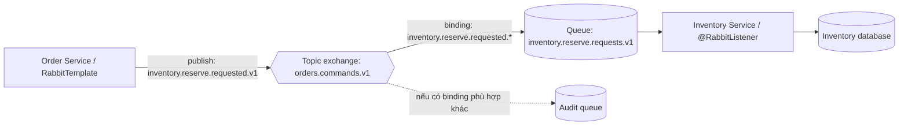
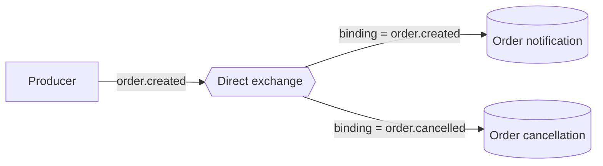
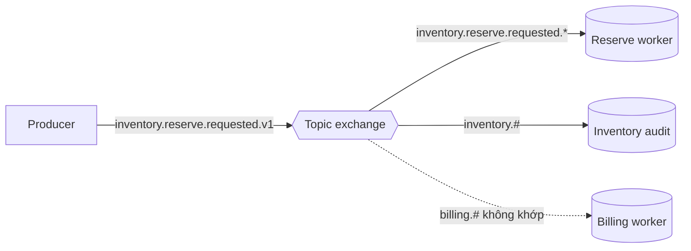
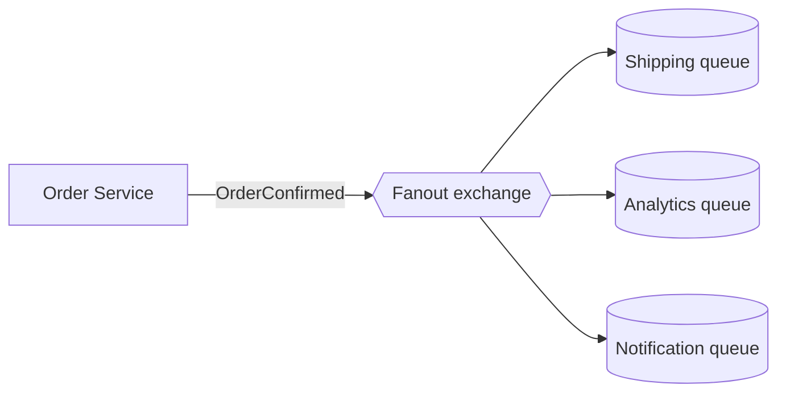
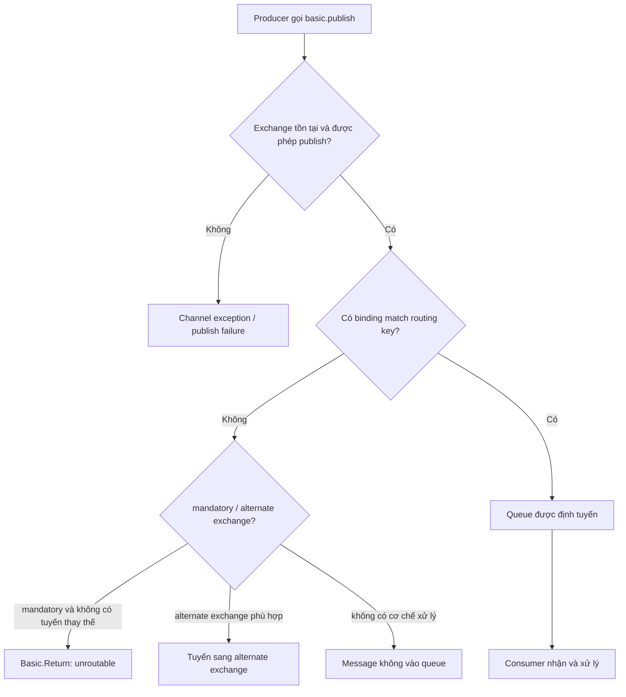

# Khai báo exchange, queue, binding và routing key

## 1. Vì sao phải thiết kế topology trước khi gửi message?

Trong giao tiếp HTTP, client thường biết URL của service nhận. Với RabbitMQ và giao thức AMQP 0-9-1, producer **không bắt buộc biết queue nào sẽ nhận thông điệp**. Thay vào đó, producer công bố message tới một **exchange**, cung cấp **routing key**; broker dùng các **binding** để xác định message phải được chuyển tới những **queue** nào.

Cách tách biệt này giúp cùng một hợp đồng message có thể phục vụ các tình huống khác nhau: một yêu cầu giữ hàng cần đi tới một hàng đợi xử lý; một sự kiện xác nhận đơn có thể được gửi tới nhiều dịch vụ; hoặc một loại sự kiện cần được phân tuyến theo nhóm nghiệp vụ. Nếu khai báo sai exchange, queue, binding hay routing key, producer có thể nhận xác nhận publish mà consumer **không nhận được message nào**.

Bài thuộc chương **RabbitMQ và AMQP** trong module **SPRING_BOOT_INTEGRATION**. Module tổ chức tích hợp Spring Boot qua HTTP client, cơ sở dữ liệu, cache, broker thông điệp và adapter của Spring Integration, với trọng tâm **cấu hình, hợp đồng dữ liệu, giao dịch, xử lý lỗi, xử lý trùng lặp, kiểm thử và quan sát luồng tích hợp**. Vì thế, topology cần được xem là một phần của **hợp đồng tích hợp** chứ không chỉ là vài tên chuỗi trong file YAML.

Sau bài học, bạn có thể:

- Giải thích quan hệ giữa **producer → exchange → binding → queue → consumer** và ý nghĩa routing key.
- Phân biệt **direct**, **topic**, **fanout**, **headers** và **default exchange**, đặc biệt ký tự đại diện trong topic.
- Khai báo exchange, queue và binding bằng Spring AMQP với cấu hình có thể tái sử dụng.
- Thiết kế tên destination, durability, dead-letter routing, idempotency và cách tiến hóa topology.
- Phát hiện lỗi **unroutable**, topology drift và sai quyền; kiểm thử routing bằng RabbitMQ thật.

> **Phạm vi phiên bản:** Ví dụ dùng Java 17+, Spring Boot 3.2+ cùng Spring AMQP thuộc BOM của phiên bản Boot tương ứng, giao tiếp bằng **AMQP 0-9-1**. RabbitMQ cũng hỗ trợ các protocol và cơ chế khác, nhưng phần này không trộn AMQP 1.0 hoặc RabbitMQ Streams vào semantics của exchange/binding AMQP 0-9-1. API/configuration cụ thể có thể thay đổi khi nâng cấp; cần xác minh phiên bản thực trước khi triển khai.

### Tình huống xuyên suốt: Order Service yêu cầu Inventory giữ hàng

Order Service gửi command `ReserveStockRequested` có routing key `inventory.reserve.requested.v1`. Inventory Service nhận lệnh từ queue `inventory.reserve.requests.v1`. Sau này có thể bổ sung queue audit với binding khác mà không cần đổi producer.



Producer gửi tới **exchange**; listener đọc từ **queue**. Exchange không phải nơi consumer gọi trực tiếp để lấy message. Muốn message đến queue thì exchange phải định tuyến qua binding hoặc cơ chế định tuyến đặc biệt của broker.

## 2. Bốn thành phần cốt lõi của topology

| Thành phần | Mục đích | Ví dụ |
|---|---|---|
| **Exchange** | Nhận message do producer publish, quyết định phân tuyến dựa trên loại exchange và các binding | `orders.commands.v1` |
| **Queue** | Giữ message đang chờ consumer, theo cấu hình lưu trữ, thời hạn và kiểu queue | `inventory.reserve.requests.v1` |
| **Binding** | Quan hệ nối exchange tới queue (hoặc exchange khác) kèm điều kiện routing tùy loại exchange | `orders.commands.v1` → queue, key `inventory.reserve.requested.*` |
| **Routing key** | Chuỗi producer gửi kèm khi publish; exchange dùng nó theo quy tắc riêng | `inventory.reserve.requested.v1` |

Hợp đồng của một lệnh có thể mô tả chính xác:

```text
Exchange:     orders.commands.v1       (topic, durable)
Routing key:  inventory.reserve.requested.v1
Queue:        inventory.reserve.requests.v1  (durable)
Binding key:  inventory.reserve.requested.*
Consumer:     Inventory Service
```

Chuỗi `inventory.reserve.requested.v1` có **bốn từ** tách bằng dấu chấm. Topic exchange dùng ký tự `*` để khớp **đúng một từ** và `#` để khớp **không hoặc nhiều từ**. Do đó binding `inventory.reserve.requested.*` khớp `inventory.reserve.requested.v1`, nhưng **không** khớp `inventory.reserve.requested` hoặc `inventory.reserve.requested.v1.retry`.

### 2.1. Những gì xảy ra khi publish?

1. Producer mở connection/channel và publish message tới exchange theo tên đã chọn.
2. Broker tìm exchange tương ứng trong **virtual host** mà connection đã đăng nhập.
3. Exchange đánh giá binding phù hợp theo loại exchange và routing key/header.
4. Message được định tuyến tới không, một hoặc nhiều queue. Nếu nhiều binding cùng đưa một message vào **cùng một queue**, broker không tạo nhiều bản sao chỉ vì có nhiều binding phù hợp giữa cặp exchange/queue đó.
5. Consumer lấy message từ queue, xử lý và ack/nack theo chế độ đã cấu hình.

Message đã được broker chấp nhận **không đồng nghĩa đã tới consumer hay đã được ghi vào database của consumer**. Cần phân biệt publisher confirm, publisher return, consumer acknowledgment và transaction nghiệp vụ.

### 2.2. Virtual host là ranh giới không gian tên

RabbitMQ virtual host (vhost) cô lập không gian exchange/queue/binding và quyền truy cập. Hai ứng dụng cùng publish tên exchange nhưng ở **hai vhost khác nhau** sẽ không tự trao đổi message. Vì vậy tên exchange/queue, vhost, credential và permission cần thống nhất trong hợp đồng triển khai.

## 3. Chọn loại exchange theo nhu cầu routing

### 3.1. Direct exchange — khớp chính xác

Direct exchange định tuyến message khi **routing key bằng binding key**. Một routing key có thể khớp nhiều queue được bind cùng key, khi đó mỗi queue có thể nhận một bản.



Gửi `order.created` sẽ đi vào `Order notification`, không vào queue có binding `order.cancelled`. Direct exchange phù hợp các lệnh/event có routing key hữu hạn và không cần pattern.

### 3.2. Topic exchange — khớp mẫu có dấu chấm

Topic exchange chia routing key thành các từ bằng dấu chấm; binding key có hai wildcard:

- `*`: khớp **đúng một từ**.
- `#`: khớp **không hoặc nhiều từ**.

| Binding key | Routing key cần xét | Khớp? | Lý do |
|---|---|---|---|
| `inventory.reserve.requested.*` | `inventory.reserve.requested.v1` | Có | `*` khớp một từ `v1` |
| `inventory.reserve.requested.*` | `inventory.reserve.requested` | Không | Thiếu từ cuối |
| `inventory.reserve.requested.*` | `inventory.reserve.requested.v1.retry` | Không | Dư một từ |
| `inventory.#` | `inventory.reserve.requested.v1` | Có | `#` khớp nhiều từ phía sau |
| `inventory.#` | `inventory` | Có | `#` có thể khớp không từ nào |
| `*.reserve.*.v1` | `inventory.reserve.requested.v1` | Có | Hai wildcard khớp mỗi cái một từ |
| `inventory.reserve.requested.v2` | `inventory.reserve.requested.v1` | Không | Version khác nhau |



Topic exchange phù hợp khi muốn phân tuyến theo domain, action, nhóm tenant (nếu bảo đảm được giới hạn quyền) hoặc version. Tuy nhiên wildcard rộng như `#` có thể khiến queue nhận số lượng sự kiện lớn hơn mong muốn, làm tăng tải và rủi ro lộ dữ liệu nếu binding/vhost/ACL không được kiểm soát.

### 3.3. Fanout exchange — phát đến mọi queue được bind

Fanout exchange **bỏ qua routing key khi quyết định tuyến**, gửi một bản message đến mỗi queue được bind phù hợp. Dùng khi một event cần được nhiều hệ thống độc lập nhận:



Fanout không có nghĩa mỗi **consumer instance** đều nhận một bản. Nếu Shipping chạy nhiều replica cùng đọc **một queue**, các replica là competing consumers; mỗi message thường chỉ có một replica nhận tại một thời điểm. Muốn mỗi dịch vụ nhận một bản riêng, phải có queue riêng cho từng dịch vụ.

### 3.4. Headers exchange — chọn theo header

Headers exchange có thể định tuyến dựa trên thuộc tính header và điều kiện khớp như `x-match=all` hoặc `x-match=any` trong binding arguments. Nó phù hợp khi chính sách dựa vào metadata nhiều chiều hơn là một key có thứ bậc.

Lưu ý đây là **binding arguments**, không phải wildcard của topic exchange. Khi chỉ cần một danh mục action rõ ràng, direct/topic thường dễ kiểm tra và vận hành hơn; không nên chọn headers chỉ để tránh thiết kế routing key.

### 3.5. Default exchange — trường hợp đặc biệt

RabbitMQ có **default exchange** (direct exchange không tên, ký hiệu tên rỗng `""`). Một queue được bind ngầm với exchange này bằng routing key **đúng bằng tên queue**. Ví dụ:

```java
rabbitTemplate.convertAndSend(
        "", "inventory.reserve.requests.v1", command);
```

Cách này giúp gửi thẳng đến queue theo tên nhưng khiến producer phụ thuộc vào tên queue của consumer. Khi muốn tách hợp đồng publish khỏi topology tiêu thụ và hỗ trợ nhiều binding/consumer, **exchange có tên riêng** thường phù hợp hơn.

## 4. Đặt tên topology và chọn durability

Một quy ước dễ hiểu:

- Exchange mang ý nghĩa domain/hợp đồng, chẳng hạn `orders.commands.v1` hoặc `orders.events.v1`.
- Routing key mô tả hành động/sự kiện, chẳng hạn `inventory.reserve.requested.v1`.
- Queue phản ánh **consumer + công việc + phiên bản**, như `inventory.reserve.requests.v1`. Một event cho nhiều nhóm tiêu thụ thường có queue riêng cho mỗi nhóm.
- Binding thể hiện “consumer này muốn nhận những sự kiện/lệnh nào”, không phải việc producer gọi trực tiếp consumer.

### 4.1. Durable, auto-delete và exclusive

| Thuộc tính | Áp dụng | Ý nghĩa quan trọng |
|---|---|---|
| Durable exchange | Exchange | Khai báo exchange được duy trì qua khởi động lại broker theo cơ chế phù hợp |
| Durable queue | Queue | Metadata của queue được duy trì qua restart |
| Persistent message | Publish delivery mode | Yêu cầu lưu message bền; cần kết hợp queue durable và broker persistence |
| Auto-delete | Exchange/queue tùy loại | Xóa theo lifecycle khi điều kiện auto-delete thỏa, không phù hợp queue nghiệp vụ cần bền |
| Exclusive queue | Queue | Chỉ connection khai báo có quyền dùng; thường phục vụ reply/tạm thời, không phù hợp queue worker dùng chung |
| Queue type | Queue | Classic, quorum hoặc kiểu khác theo khả năng RabbitMQ và yêu cầu HA |

**Durable queue không tự đảm bảo message bền:** message còn phải được publish theo delivery mode thích hợp, broker cần storage/persistence và phải xem xét publisher confirm, chính sách HA/replication. Ngược lại, `exclusive` hay `autoDelete` có thể phù hợp cho queue tạm thời, nhưng nếu dùng nhầm cho command queue sẽ dẫn đến mất topology lúc connection đóng.

### 4.2. Classic queue và quorum queue

RabbitMQ có nhiều kiểu queue. **Quorum queue** dựa trên cơ chế replication/consensus, thường thích hợp cho workload cần độ tin cậy cao; **classic queue** có đặc tính vận hành và giới hạn riêng. Chọn theo phiên bản RabbitMQ, SLA, khả năng lưu trữ, throughput và mô hình HA; không mặc định mọi loại queue hỗ trợ giống nhau về priority, TTL/expiry, max-length hoặc redelivery behavior.

Queue type là thuộc tính quan trọng của queue đã tồn tại. **Không đổi queue type hoặc các thuộc tính không tương thích trực tiếp trên queue production bằng một lần deploy code**; cần kế hoạch tạo queue mới, chuyển binding/consumer, drain/replay và đảm bảo không mất message.

## 5. Thiết lập Spring Boot và khai báo topology bằng Spring AMQP

### 5.1. Thêm starter phù hợp

Với Maven và parent/BOM của Spring Boot:

```xml
<dependencies>
    <dependency>
        <groupId>org.springframework.boot</groupId>
        <artifactId>spring-boot-starter-amqp</artifactId>
    </dependency>
    <dependency>
        <groupId>org.springframework.boot</groupId>
        <artifactId>spring-boot-starter-test</artifactId>
        <scope>test</scope>
    </dependency>
</dependencies>
```

`spring-boot-starter-amqp` đưa Spring Rabbit và hạ tầng RabbitMQ vào ứng dụng. Spring Boot thường tự cấu hình `ConnectionFactory`, `RabbitTemplate`, listener container factory và `RabbitAdmin` theo classpath/properties. `RabbitAdmin` có thể khai báo những topology bean thích hợp khi có kết nối, nếu cơ chế auto-declaration được bật.

### 5.2. Kết nối RabbitMQ

```yaml
# application.yml — ví dụ môi trường local
spring:
  rabbitmq:
    host: ${RABBIT_HOST:localhost}
    port: ${RABBIT_PORT:5672}
    username: ${RABBIT_USERNAME}
    password: ${RABBIT_PASSWORD}
    virtual-host: ${RABBIT_VHOST:/}
    publisher-confirm-type: correlated
    publisher-returns: true
    template:
      mandatory: true
    listener:
      simple:
        acknowledge-mode: auto
        prefetch: 20
        concurrency: 2
        max-concurrency: 6
```

Ví dụ dùng cổng `5672` cho RabbitMQ AMQP không mã hóa khi chạy local. Production cần AMQPS/TLS với CA và hostname verification theo chính sách. Không commit password, URL chứa secret hoặc private key. Tài khoản của Order và Inventory nên có quyền riêng theo vhost/exchange/queue, không dùng user quản trị.

`publisher-confirm-type: correlated` và `publisher-returns: true` là các phần cấu hình quan sát việc publish; **chúng không tự xử lý lỗi ứng dụng** nếu code chưa đăng ký callback/chờ confirm theo hợp đồng. `template.mandatory: true` yêu cầu broker trả về message không được route tới queue (khi exchange tồn tại nhưng không khớp binding và không có cơ chế định tuyến thay thế). Nếu thiếu exchange, lỗi là tình huống khác (channel/exception), không phải một return bình thường.

### 5.3. Khai báo exchange, queue và binding có tên ổn định

Ví dụ dùng **topic exchange** cho command và **direct exchange** riêng cho DLQ. Queue chính có một dead-letter exchange để chuyển message được từ chối không requeue hoặc hết hạn (tùy broker/policy).

```java
// RabbitTopologyConfiguration.java — imports rút gọn
@Configuration(proxyBeanMethods = false)
public class RabbitTopologyConfiguration {
    public static final String COMMAND_EXCHANGE =
            "orders.commands.v1";
    public static final String COMMAND_ROUTING_KEY =
            "inventory.reserve.requested.v1";
    public static final String COMMAND_BINDING_PATTERN =
            "inventory.reserve.requested.*";
    public static final String COMMAND_QUEUE =
            "inventory.reserve.requests.v1";

    public static final String DEAD_LETTER_EXCHANGE =
            "orders.commands.dlx.v1";
    public static final String DEAD_LETTER_ROUTING_KEY =
            "inventory.reserve.dead.v1";
    public static final String DEAD_LETTER_QUEUE =
            "inventory.reserve.dead.v1";

    @Bean
    Declarables reservationTopology() {
        TopicExchange commands = ExchangeBuilder
                .topicExchange(COMMAND_EXCHANGE)
                .durable(true)
                .build();
        DirectExchange deadLetter = ExchangeBuilder
                .directExchange(DEAD_LETTER_EXCHANGE)
                .durable(true)
                .build();

        Queue requests = QueueBuilder
                .durable(COMMAND_QUEUE)
                .deadLetterExchange(DEAD_LETTER_EXCHANGE)
                .deadLetterRoutingKey(DEAD_LETTER_ROUTING_KEY)
                .build();

        Queue failed = QueueBuilder
                .durable(DEAD_LETTER_QUEUE)
                .build();

        Binding commandBinding = BindingBuilder
                .bind(requests)
                .to(commands)
                .with(COMMAND_BINDING_PATTERN);

        Binding deadLetterBinding = BindingBuilder
                .bind(failed)
                .to(deadLetter)
                .with(DEAD_LETTER_ROUTING_KEY);

        return new Declarables(
                commands,
                deadLetter,
                requests,
                failed,
                commandBinding,
                deadLetterBinding
        );
    }
}
```

Các type chính:

| Type | Package |
|---|---|
| `Declarables`, `Queue`, `TopicExchange`, `DirectExchange`, `Binding`, `QueueBuilder`, `ExchangeBuilder`, `BindingBuilder` | `org.springframework.amqp.core` |
| `@Configuration`, `@Bean` | `org.springframework.context.annotation` |
| `RabbitTemplate` | `org.springframework.amqp.rabbit.core` |
| `@RabbitListener` | `org.springframework.amqp.rabbit.annotation` |
| `Jackson2JsonMessageConverter` | `org.springframework.amqp.support.converter` |

**Ý nghĩa từng đối tượng:**

1. `commands` là **topic exchange** bền có tên xác định.
2. `requests` là **durable queue**. Khi bị dead-letter, message có thể được định tuyến tới `deadLetter` bằng key `inventory.reserve.dead.v1`.
3. `commandBinding` nối `requests` với `commands` theo pattern `inventory.reserve.requested.*`.
4. `deadLetterBinding` nối queue xử lý lỗi với DLX theo **exact key** vì DLX ở đây là direct exchange.
5. `Declarables` gom các đối tượng để Spring Rabbit admin biết cần khai báo những gì. Nó **không phải** nơi lưu message trong JVM.

Khi ứng dụng khởi tạo và RabbitAdmin active, các exchange/queue/binding này có thể được declare trên broker. Tuy nhiên **việc khai báo không nhất thiết chạy trước mọi lỗi khác**: broker có thể chưa sẵn sàng, user thiếu quyền, hoặc một queue tồn tại với arguments khác. Cần xác minh kết quả trên broker và có quy trình deploy topology rõ ràng.

Một dự án cũng có thể khai báo các `@Bean` riêng cho `Queue`/`Exchange`/`Binding`. `Declarables` hữu ích khi muốn nhóm topology và tránh việc tạo nhiều bean đồng loại bị inject nhầm vào producer/listener; lựa chọn nào cũng phải bảo đảm tên, durable flag và arguments thống nhất.

### 5.4. Điều gì xảy ra nếu hai ứng dụng cùng khai báo một topology?

RabbitMQ declaration thường **idempotent khi thông số tương đương**. Nhưng nếu một app khai báo queue `inventory.reserve.requests.v1` với durable=true, app khác khai báo cùng tên với durable=false hoặc dead-letter arguments khác, broker có thể trả `PRECONDITION_FAILED` và đóng channel.

Vì thế topology nên có **một nguồn sự thật**: infrastructure as code, deployment chart, RabbitMQ definitions hoặc một module cấu hình được cả producer và consumer thống nhất. Chỉ cho app tự declare nếu có quyền và theo quy trình đã chốt. Tùy thiết kế tổ chức, có thể cho consumer sở hữu khai báo queue/binding, còn producer chỉ biết exchange và routing key.

### 5.5. Cách thêm queue độc lập mà không sửa producer

Nếu Analytics muốn nhận mọi lệnh inventory để lập báo cáo, tạo queue `analytics.inventory.audit.v1` và binding `inventory.#` trên cùng topic exchange. Producer vẫn công bố `inventory.reserve.requested.v1` như trước.

```java
Queue audit = QueueBuilder
        .durable("analytics.inventory.audit.v1")
        .build();
Binding auditBinding = BindingBuilder.bind(audit)
        .to(commands)
        .with("inventory.#");
```

Đây chỉ là **đoạn bổ sung minh họa**, cần được đưa vào cấu hình topology thực của dịch vụ sở hữu queue. Không cho các dịch vụ nhận dữ liệu mà chúng không được cấp quyền: dùng vhost, permissions, exchange design và giới hạn routing key phù hợp.

## 6. Gửi và nhận message theo topology đã khai báo

### 6.1. Hợp đồng JSON nên có version và operation ID

```json
{
  "schemaVersion": 1,
  "operationId": "reserve-O-1001",
  "orderId": "O-1001",
  "sku": "SKU-42",
  "quantity": 2
}
```

```java
// ReserveStockRequested.java
public record ReserveStockRequested(
        int schemaVersion,
        String operationId,
        String orderId,
        String sku,
        int quantity
) {}
```

Routing key cho biết **message nên đến queue nào**; nó **không thay thế hợp đồng payload**. Một message không hợp lệ hoặc có version không được hỗ trợ vẫn có thể được exchange route đúng, rồi fail ở consumer khi deserialize/validate.

### 6.2. Converter JSON

```java
@Configuration(proxyBeanMethods = false)
class RabbitMessageConfiguration {
    @Bean
    Jackson2JsonMessageConverter rabbitMessageConverter() {
        return new Jackson2JsonMessageConverter();
    }
}
```

Trong dòng Spring AMQP tương ứng với Boot 3.x, bean message converter có thể được Spring Boot áp dụng cho RabbitTemplate và các listener factory do Boot auto-configure khi dùng cấu hình thông thường. Nếu bạn tự tạo `RabbitTemplate`/listener factory riêng hoặc có nhiều converter, phải gắn converter đúng cách.

JSON thường thuận tiện hơn Java object serialization cho hợp đồng liên dịch vụ, nhưng vẫn cần quy định encoding, required field, enum/unknown values, kiểm tra kích thước message và chính sách tương thích ngược. Không tin tưởng dữ liệu chỉ vì message đến từ broker nội bộ.

### 6.3. Publisher dùng exchange và routing key

```java
// ReserveStockPublisher.java — imports rút gọn
@Service
public class ReserveStockPublisher {
    private final RabbitTemplate template;

    public ReserveStockPublisher(RabbitTemplate template) {
        this.template = template;
    }

    public void publish(ReserveStockRequested command) {
        if (command.operationId() == null
                || command.operationId().isBlank()) {
            throw new IllegalArgumentException(
                    "operationId không được rỗng");
        }

        template.convertAndSend(
                RabbitTopologyConfiguration.COMMAND_EXCHANGE,
                RabbitTopologyConfiguration.COMMAND_ROUTING_KEY,
                command,
                message -> {
                    message.getMessageProperties()
                            .setMessageId(command.operationId());
                    message.getMessageProperties()
                            .setHeader("schemaVersion", command.schemaVersion());
                    return message;
                }
        );
    }
}
```

Lệnh `convertAndSend(exchange, routingKey, payload)` publish tới **exchange**, không phải queue. Trong ví dụ, routing key `inventory.reserve.requested.v1` sẽ khớp binding `inventory.reserve.requested.*`.

`messageId` được đặt từ operation ID để thuận tiện truy vết, nhưng **message ID, correlation ID hay broker delivery tag không phải cơ chế exactly-once**. Consumer vẫn phải có unique constraint/idempotency key ở database. Nếu producer gửi sai routing key, request có thể bị unroutable ngay cả khi `convertAndSend` không ném lỗi đồng bộ.

### 6.4. Consumer đọc queue, không đọc exchange

```java
// ReserveStockListener.java — imports rút gọn
@Component
public class ReserveStockListener {
    private final ReservationApplicationService service;

    public ReserveStockListener(ReservationApplicationService service) {
        this.service = service;
    }

    @RabbitListener(queues =
            RabbitTopologyConfiguration.COMMAND_QUEUE)
    public void handle(ReserveStockRequested command) {
        if (command.schemaVersion() != 1
                || command.operationId() == null
                || command.operationId().isBlank()
                || command.sku() == null
                || command.sku().isBlank()
                || command.quantity() <= 0) {
            throw new InvalidReservationCommandException(
                    "ReserveStockRequested không hợp lệ");
        }
        service.reserve(command);
    }
}
```

Ví dụ giả định đã có `ReservationApplicationService` và `InvalidReservationCommandException` thuộc application/domain layer. `@RabbitListener` lấy message từ queue đã khai báo; nó **không nhận tham số routing key để định tuyến message**. Routing key chỉ tham gia bước exchange → binding trước khi message vào queue.

`spring.rabbitmq.listener.simple.acknowledge-mode=auto` nghĩa là Spring listener container tự ack khi callback hoàn tất và xử lý reject/nack khi có lỗi theo cấu hình container, **không phải AMQP auto-ack/noAck**. Nếu callback ném exception, hành vi requeue/retry cụ thể còn phụ thuộc `defaultRequeueRejected`, retry advice và loại exception; phải đặt chính sách rõ ràng để tránh vòng requeue vô hạn.

### 6.5. Cùng một queue với nhiều listener không phải fanout

Hai instance Inventory cùng dùng `@RabbitListener(queues="inventory.reserve.requests.v1")` là các **competing consumers**. Thông thường mỗi message được giao cho một consumer tại một thời điểm; nếu chưa ack hoặc consumer chết, broker có thể redeliver. Không suy luận mỗi replica đều nhận message. Muốn gửi cùng event đến hai loại xử lý khác nhau, cần **hai queue** với binding phù hợp.

## 7. Vì sao publish thành công nhưng queue không nhận message?

Đây là lỗi đặc trưng khi học topology: producer gửi message không báo lỗi ngay, nhưng số lượng message trong queue không tăng. Cần phân biệt từng chặng:



### 7.1. Ba loại tín hiệu không được nhầm

| Tín hiệu | Ai tạo | Nó chứng minh điều gì? | Nó **không** chứng minh điều gì? |
|---|---|---|---|
| **Publisher confirm** | Broker tới producer | Broker xác nhận việc publish đã được xử lý/chấp nhận theo semantics và cấu hình broker | Consumer đã nhận, database đã commit hoặc message đã được xử lý nghiệp vụ |
| **Publisher return** | Broker tới producer khi routing thất bại theo `mandatory`, có điều kiện | Message không được định tuyến tới queue trong điều kiện áp dụng | Một message đã route được có thể được consumer xử lý thành công |
| **Consumer ack/nack** | Consumer tới broker | Consumer/container thông báo chấp nhận hoặc từ chối delivery | Transaction SQL/HTTP bên ngoài đã atomic với ack |

Với `publisher-confirm-type: correlated`, code có thể tạo `CorrelationData` và xử lý completion của confirm; với `publisher-returns: true`/`mandatory: true`, xử lý returned message (callback hoặc thông tin returned trên correlation data tùy Spring AMQP version). Một bản tin có thể được **confirm ack nhưng vẫn bị return vì unroutable**. Đừng coi confirm ack là cam kết đã vào đúng queue.

Ví dụ minh họa producer **thực sự kiểm tra** confirm và returned message, dùng API `CorrelationData` của Spring AMQP 3.x (imports rút gọn):

```java
public void publishAndCheck(ReserveStockRequested command)
        throws InterruptedException, ExecutionException, TimeoutException {
    CorrelationData correlation =
            new CorrelationData(command.operationId());

    rabbitTemplate.convertAndSend(
            RabbitTopologyConfiguration.COMMAND_EXCHANGE,
            RabbitTopologyConfiguration.COMMAND_ROUTING_KEY,
            command,
            correlation
    );

    CorrelationData.Confirm confirm = correlation
            .getFuture()
            .get(5, TimeUnit.SECONDS);

    if (!confirm.isAck()) {
        throw new IllegalStateException(
                "Broker từ chối publish: " + confirm.getReason());
    }
    if (correlation.getReturned() != null) {
        throw new IllegalStateException(
                "Message không route được tới queue");
    }
}
```

Để hoạt động đúng, RabbitMQ client phải bật **correlated publisher confirms**, publisher returns và `mandatory` như YAML ở trên; API cụ thể của `CorrelationData` phải tương thích phiên bản Spring AMQP đang dùng. Spring AMQP xử lý returned message gắn vào correlation data trước khi hoàn tất confirm Future trong điều kiện cấu hình hỗ trợ. Đoạn mã dùng `get(5, TimeUnit.SECONDS)` nên **chặn luồng gọi**, chỉ phù hợp ở tầng blocking; ứng dụng WebFlux cần xử lý Future/callback bất đồng bộ và deadline thay vì chặn Reactor event loop. Nếu bị ngắt, code gọi bên ngoài nên bảo toàn interrupt flag và có chính sách ghi nhận trạng thái chưa xác định.

Ngay cả khi confirm ack và không có returned message, code **không được suy luận consumer đã xử lý thành công**. Nó chỉ kiểm tra bước publish/routing theo semantics broker; nếu lệnh tạo tác động nghiệp vụ, trạng thái cuối phải được xác nhận qua result event hoặc API tra cứu kết quả.

Trong code thực, một publisher cần xử lý được: exchange không tồn tại, lỗi socket/broker, confirm nack/timeout, returned message và việc gửi lại có thể tạo bản tin trùng. Với message đến từ database transaction, transactional outbox giúp có điểm ghi bền cho các trạng thái đó.

### 7.2. Checklist tìm lỗi unroutable

1. Producer có đang kết nối đúng **vhost** và broker cluster không?
2. Exchange `orders.commands.v1` có tồn tại, đúng loại `topic`, user có quyền write?
3. Routing key thực do producer gửi có chính xác `inventory.reserve.requested.v1` không? Có dư dấu chấm, sai version hoặc thay đổi chữ hoa/thường không?
4. Exchange có binding tới queue `inventory.reserve.requests.v1` không? Binding key đã là `inventory.reserve.requested.*` hay tên bị nhầm?
5. Queue có thật và user consumer có quyền read không? Có cơ chế auto-delete/exclusive khiến queue biến mất?
6. Nếu queue tồn tại nhưng message count bằng 0, consumer có đang lấy và ack ngay không? Quan sát **ready** và **unacked**, cùng consumer metrics.
7. Callback publisher confirm/return đã được cấu hình và log/metric đủ để phát hiện không route?

RabbitMQ Management UI/API cho phép kiểm tra exchanges, queues, bindings, queue depth và consumer count theo vhost. Dùng chúng để đối chiếu với sơ đồ topology đã thiết kế; không chỉ đọc log producer.

## 8. Dead-letter exchange, retry và poison message

### 8.1. Dead-letter cũng là routing

Trong cấu hình mục 5, queue chính có hai arguments:

```text
x-dead-letter-exchange    = orders.commands.dlx.v1
x-dead-letter-routing-key = inventory.reserve.dead.v1
```

Khi broker dead-letter một message, broker publish nó vào **dead-letter exchange** với routing key đã xác định; exchange này vẫn phải có **binding đúng** tới DLQ, ở đây là:

```text
Exchange: orders.commands.dlx.v1  (direct)
Routing:  inventory.reserve.dead.v1
Queue:    inventory.reserve.dead.v1
Binding:  inventory.reserve.dead.v1
```

Như vậy DLQ không phải một vùng lưu trữ “tự xuất hiện” sau khi đặt tên. Nếu DLX/binding sai hoặc đích không dùng được, message dead-letter có thể không được xử lý như kỳ vọng. Cần kiểm tra thực tế việc dead-letter theo loại queue và chính sách broker; với quorum queue có những lựa chọn an toàn hơn cho dead-lettering nhưng cũng cần cấu hình riêng.

### 8.2. Khi nào broker dead-letter?

Các trường hợp có thể bao gồm:

- Consumer từ chối hoặc nack message với `requeue=false`.
- Message hết hạn theo TTL và bị loại khỏi queue theo cơ chế RabbitMQ.
- Queue vượt giới hạn chiều dài theo policy.
- Với quorum queue, message có thể bị dead-letter khi vượt delivery limit nếu được cấu hình.

**Không phải mọi exception ở `@RabbitListener` đều ngay lập tức đưa message tới DLQ.** Với container có `defaultRequeueRejected=true`, lỗi có thể làm message requeue và xuất hiện lại liên tục. Cần thiết kế finite retry + backoff, phân biệt lỗi tạm thời và lỗi vĩnh viễn.

| Tình huống | Loại | Hướng xử lý |
|---|---|---|
| PostgreSQL tạm mất kết nối | Transient | Retry có giới hạn với backoff; sau ngưỡng chuyển DLQ/đối soát |
| Message JSON không parse được | Permanent/contract | Đưa DLQ/quarantine và cảnh báo |
| `schemaVersion` không được hỗ trợ | Permanent | Không requeue vô hạn, có runbook nâng cấp/replay |
| Hết hàng | Kết quả nghiệp vụ | Lưu `REJECTED`, phát result, ack message |
| Lệnh trùng `operationId` đã xử lý | Idempotent duplicate | Đọc kết quả cũ, không trừ hàng lại, ack |
| SQL deadlock/serialization conflict | Có thể transient | Thử lại transaction mới có giới hạn |

Ở Spring AMQP, consumer có thể ném `AmqpRejectAndDontRequeueException` cho loại lỗi xác định là không nên requeue. Nhưng các lỗi converter đôi khi xảy ra **trước khi method listener được gọi**, nên vẫn cần kiểm tra error handler/container và broker DLX. Việc thiết kế retry cần xét quy tắc ack/nack của listener factory chứ không chỉ catch exception trong service.

### 8.3. Sử dụng policy hay x-arguments?

RabbitMQ hỗ trợ áp chính sách như TTL, dead-letter exchange hoặc queue length qua policy; Spring `QueueBuilder.deadLetterExchange(...)` tạo **queue arguments** trong declaration. Nhiều cấu hình operator thay đổi thường phù hợp đặt **policy tại broker** để tránh tạo x-arguments khó thay đổi trên queue đã tồn tại.

Không khai báo cùng một rule DLX bằng hai nguồn cấu hình mâu thuẫn. Nếu muốn chuyển từ x-arguments sang policy, cần kế hoạch migration và test behavior theo phiên bản broker. Các thay đổi `x-queue-type`, durable flag hoặc đặc tính queue không tương thích thường không thể “sửa tại chỗ” bằng redeclare cùng tên.

### 8.4. Retry queue và delay

Một chiến lược phổ biến: message lỗi tạm thời đi sang **retry queue** có TTL rồi dead-letter lại exchange/queue gốc. Cách này cần binding/routing riêng, định nghĩa số lần thử (ví dụ qua metadata và trạng thái nghiệp vụ) và giới hạn tránh **vòng lặp vô tận**. Không đặt dead-letter vòng tròn giữa hai queue mà không giới hạn retry.

Một số RabbitMQ deployment sử dụng plugin/delayed-message exchange; các cơ chế delay này **không mặc nhiên có trong mọi broker**. Chọn cơ chế được phép và kiểm thử lúc broker restart, message hết hạn, queue đầy và consumer downtime.

Khi DLQ tăng, không replay ồ ạt. Cần phân loại nguyên nhân, xác minh payload/operation ID, trạng thái database, version contract và có thao tác replay an toàn, kèm audit.

## 9. Tính nhất quán: routing đúng vẫn có thể xử lý trùng

AMQP 0-9-1 và Spring AMQP không cung cấp một giao dịch ACID chung giữa RabbitMQ, PostgreSQL, Redis và HTTP. Nếu Inventory đã ghi database rồi bị crash **trước khi ack**, broker có thể redeliver lệnh; nếu Order Service đã publish nhưng chưa nhận confirm, việc thử lại có thể gửi message hai lần.

```mermaid
sequenceDiagram
    participant O as Order Service
    participant R as RabbitMQ
    participant I as Inventory Listener
    participant D as Database
    O->>R: Publish command(operationId)
    R->>I: Deliver
    I->>D: Transaction: giữ hàng + commit
    D-->>I: Thành công
    Note over I,R: Listener crash trước ack
    R->>I: Redelivery cùng operationId
    I->>D: Kiểm tra unique operationId
    D-->>I: Đã xử lý; không trừ thêm
    I-->>R: Ack
```

Một bản ghi nghiệp vụ nên có **operation ID duy nhất theo logical command** và unique constraint tại database:

```sql
CREATE TABLE reservation_request (
    operation_id VARCHAR(100) PRIMARY KEY,
    order_id VARCHAR(100) NOT NULL,
    sku VARCHAR(80) NOT NULL,
    quantity BIGINT NOT NULL CHECK (quantity > 0),
    status VARCHAR(24) NOT NULL
);
```

Khi nhận lệnh:

1. Xác thực schema/version/quantity/tenant.
2. Tìm hoặc chèn `operationId` trong database theo transaction và unique constraint.
3. Nếu đã xử lý trước đó, trả về kết quả đã lưu mà **không trừ tồn kho lần nữa**.
4. Nếu là lệnh mới, thực hiện cập nhật tồn kho atomically và ghi trạng thái `RESERVED` hoặc `REJECTED`.
5. Ghi outbox kết quả vào cùng transaction SQL nếu cần phát event; ack message khi xử lý/ghi trạng thái hoàn tất theo policy.

**Transactional outbox** ở producer cho phép Order lưu `Order=PENDING` và message cần phát trong cùng transaction SQL. Worker outbox publish vào exchange theo routing key; sau khi nhận confirm/đối soát thích hợp, mới đánh dấu bản ghi đã gửi. Dù vậy crash giữa publish và đánh dấu có thể gây gửi lặp, vì vậy consumer vẫn cần idempotency.

Trong các hệ thống có nhiều transaction manager, `@Transactional` không tự động enlist tất cả connection của RabbitMQ, SQL và cache. Không kết luận “message đúng binding” đồng nghĩa một quy trình nghiệp vụ đã thực thi exactly-once.

## 10. Kiểm thử exchange, queue, binding và routing key với RabbitMQ thật

### 10.1. Vì sao mock publisher chưa đủ?

Một unit test dùng Mockito xác minh `rabbitTemplate.convertAndSend(exchange, key, payload)` giúp bắt lỗi truyền sai tham số ở producer, nhưng không chứng minh:

- Exchange được declare trên đúng vhost, đúng loại `topic` và queue thực sự tồn tại.
- Binding pattern có khớp routing key mà producer gửi hay không.
- RabbitMQ trả message unroutable theo `mandatory`.
- DLX xử lý đúng routing key và dead-letter vào đúng queue.
- Queue type, durability, quyền truy cập, TLS và transaction của consumer hoạt động theo cấu hình.

Vì vậy nên có ít nhất một **integration test với broker thực**. Có thể chạy RabbitMQ riêng trong CI hoặc dùng Testcontainers với image đã pin phiên bản và được tổ chức phê duyệt.

### 10.2. Dependency Testcontainers

Ngoài `spring-boot-starter-amqp` và `spring-boot-starter-test`:

```xml
<dependency>
    <groupId>org.springframework.boot</groupId>
    <artifactId>spring-boot-testcontainers</artifactId>
    <scope>test</scope>
</dependency>
<dependency>
    <groupId>org.testcontainers</groupId>
    <artifactId>junit-jupiter</artifactId>
    <scope>test</scope>
</dependency>
<dependency>
    <groupId>org.testcontainers</groupId>
    <artifactId>rabbitmq</artifactId>
    <scope>test</scope>
</dependency>
```

Spring Boot 3.2+ có cơ chế `@ServiceConnection` cung cấp connection details từ RabbitMQ Testcontainer khi test dependency phù hợp. Nếu không dùng `@ServiceConnection`, có thể đăng ký `spring.rabbitmq.host`, `port`, `username` và `password` bằng `@DynamicPropertySource`.

### 10.3. Test routing thành công qua broker

```java
// RabbitTopologyIT.java — imports/static imports rút gọn
@SpringBootTest(properties = {
    "spring.rabbitmq.listener.simple.auto-startup=false",
    "spring.rabbitmq.publisher-confirm-type=correlated",
    "spring.rabbitmq.publisher-returns=true",
    "spring.rabbitmq.template.mandatory=true"
})
@Testcontainers
class RabbitTopologyIT {
    @Container
    @ServiceConnection
    static RabbitMQContainer broker =
            new RabbitMQContainer("rabbitmq:3.13-management");

    @Autowired
    RabbitTemplate rabbitTemplate;

    @Autowired
    AmqpAdmin rabbitAdmin;

    @BeforeEach
    void cleanQueue() {
        rabbitAdmin.purgeQueue(
                RabbitTopologyConfiguration.COMMAND_QUEUE, true);
    }

    @Test
    void routesMessageWhenTopicBindingMatches() {
        ReserveStockRequested command = new ReserveStockRequested(
                1, "op-it-42", "O-42", "SKU-42", 2);

        rabbitTemplate.convertAndSend(
                RabbitTopologyConfiguration.COMMAND_EXCHANGE,
                RabbitTopologyConfiguration.COMMAND_ROUTING_KEY,
                command);

        Message message = rabbitTemplate.receive(
                RabbitTopologyConfiguration.COMMAND_QUEUE, 5_000);

        assertNotNull(message);
        String json = new String(
                message.getBody(), StandardCharsets.UTF_8);
        assertTrue(json.contains("\"operationId\":\"op-it-42\""));
        assertTrue(json.contains("\"sku\":\"SKU-42\""));
    }
}
```

Mã mẫu sử dụng `org.springframework.amqp.core.AmqpAdmin`/`Message`, `RabbitTemplate`, `org.testcontainers.containers.RabbitMQContainer`, `org.testcontainers.junit.jupiter.Container`/`Testcontainers`, `org.springframework.boot.testcontainers.service.connection.ServiceConnection` và JUnit 5.

Trong test, `@SpringBootTest` tạo các bean topology, `RabbitAdmin` khai báo theo cấu hình và RabbitMQ container nhận publish thật. `spring.rabbitmq.listener.simple.auto-startup=false` tránh listener chạy tranh message với test; nếu có custom listener factory, cần xác minh chúng cũng tôn trọng cờ startup. Queue test phải được cô lập với test song song, không purge queue đang dùng bởi ứng dụng hoặc nhóm kiểm thử khác.

**Kết quả được kiểm chứng** là exchange, binding, queue và payload hoạt động với một broker test. Test vẫn chưa chứng minh TLS, HA, DLX hoặc độ tin cậy qua broker restart; phải có ca riêng cho những điều đó.

### 10.4. Test routing key không khớp

Với exchange `orders.commands.v1` chỉ có binding `inventory.reserve.requested.*`, routing key `billing.invoice.created.v1` sẽ không khớp queue `inventory.reserve.requests.v1`. Để phát hiện lỗi này tốt hơn, test nên đăng ký cơ chế publisher return/confirm hoặc dùng `CorrelationData` theo API của Spring AMQP phiên bản đang chạy, thay vì chỉ chờ queue rỗng.

Ví dụ một kiểm tra ở tầng contract:

```java
@Test
void wrongRoutingKeyIsNotDeliveredToReserveQueue() {
    rabbitTemplate.convertAndSend(
            RabbitTopologyConfiguration.COMMAND_EXCHANGE,
            "billing.invoice.created.v1",
            new ReserveStockRequested(
                    1, "op-unroutable", "O-99", "SKU-42", 2));

    Message delivered = rabbitTemplate.receive(
            RabbitTopologyConfiguration.COMMAND_QUEUE, 1_000);
    assertNull(delivered);
}
```

Đây là **negative routing test**, phù hợp khi queue test đã được purge, không có listener và không có binding bổ sung bất ngờ. Để chứng minh **producer đã nhận được tín hiệu unroutable**, phải kiểm tra `Basic.Return`/Spring return callback với `mandatory=true` và xác nhận rằng exchange không có alternate-exchange nào nhận message theo cấu hình. Chỉ `assertNull` chưa kiểm tra được toàn bộ hành vi return.

### 10.5. Kiểm thử DLX và topology drift

Test DLX nên gửi một message tới queue chính, chủ động reject/nack với `requeue=false` qua consumer/test channel hoặc kích hoạt expiry có kiểm soát, rồi xác minh message xuất hiện ở `inventory.reserve.dead.v1`. Nếu chỉ gọi trực tiếp `convertAndSend` vào DLX, test mới kiểm tra **DLX binding**, chưa kiểm tra source queue thực sự **dead-letter** message.

Một số bài test cần bổ sung:

| Bài test | Điều cần assert |
|---|---|
| Binding đúng | Key `inventory.reserve.requested.v1` vào queue chính |
| Binding sai | Không vào queue chính; publisher return khi điều kiện phù hợp |
| Fanout | Một publish đến nhiều queue khác nhau đã bind |
| Topic wildcard | `*` khớp một từ, `#` khớp không hoặc nhiều từ |
| Queue durable | Metadata vẫn tồn tại sau restart theo cấu hình |
| Message persistent | Message còn sau restart an toàn theo giả định test |
| Dead-letter | Nack `requeue=false` dẫn đến DLX → DLQ đúng |
| Queue declaration mâu thuẫn | Broker trả lỗi tương đương `PRECONDITION_FAILED` |
| Permission | Producer/consumer thiếu quyền thì thao tác bị từ chối |
| Duplicate command | Một operation ID lặp không gây ghi database lần hai |

Test với image RabbitMQ test cùng họ/major version production sẽ giảm lệch semantics, nhưng không thay thế việc kiểm tra cấu hình HA, TLS, policy hay quyền trên môi trường staging.

## 11. Bảo mật, triển khai và thay đổi topology

### 11.1. Bảo mật connection và vhost

Mỗi service cần được cấp đúng quyền trên vhost/exchange/queue:

- **Producer Order:** quyền publish vào `orders.commands.v1`, không phải quyền tùy ý đọc mọi queue.
- **Consumer Inventory:** quyền consume queue `inventory.reserve.requests.v1`; quyền declare topology chỉ khi app sở hữu tác vụ đó.
- **Service vận hành:** quyền quản trị queue/binding/DLX tách biệt nếu chính sách tổ chức yêu cầu.
- **Network:** AMQPS/TLS, certificate tin cậy và hostname verification; hạn chế cổng broker cho những client thực sự cần.

Nếu cần TLS, cấu hình `spring.rabbitmq.ssl.enabled` và trust material/hostname verification theo phiên bản Spring Boot và RabbitMQ Java client. Ví dụ định hướng:

```yaml
# application-prod.yml (trích đoạn ý tưởng)
spring:
  rabbitmq:
    host: ${RABBIT_HOST}
    port: 5671
    username: ${RABBIT_USERNAME}
    password: ${RABBIT_PASSWORD}
    ssl:
      enabled: true
      trust-store: ${RABBIT_TRUSTSTORE}
      trust-store-password: ${RABBIT_TRUSTSTORE_PASSWORD}
```

Ví dụ này chưa bao quát toàn bộ xác minh tên máy chủ, loại keystore hay mTLS; cần kiểm chứng ở client/broker phiên bản đang dùng, bật hostname verification và xác nhận certificate SAN khớp endpoint. Không thay TLS bằng một VPN không được phê duyệt hoặc tắt xác minh chứng chỉ để bỏ lỗi kết nối.

### 11.2. Topology là hạ tầng có phiên bản

Thay đổi một binding có thể lập tức thay đổi nhóm nhận message, kể cả khi code producer không sửa gì. Nên quản lý topology bằng cấu hình được review, có phiên bản và kế hoạch rollback:

1. Xác định ai là **owner** của exchange, queue, binding, DLX và quyền truy cập.
2. Đặt contract về exchange, loại exchange, routing key, schema message và cách tiến hóa.
3. Kiểm tra thay đổi trên RabbitMQ test/staging, đặc biệt các wildcard và unroute cases.
4. Với thay đổi phá vỡ tương thích, tạo exchange/queue mới (`v2`), bind song song hoặc migrate từng bước; không đổi tại chỗ kiểu queue/arguments không tương thích.
5. Theo dõi queue depth và backlog; chỉ drain/delete queue cũ khi chắc chắn không còn message cần xử lý.
6. Có runbook khi `PRECONDITION_FAILED`, DLQ tăng, binding bị xóa hoặc publish return bất thường.

**Ví dụ nâng version:** Producer ban đầu gửi `inventory.reserve.requested.v1`; consumer mới cần schema `v2`. Nếu thay key sang `v2` trong khi binding hiện chỉ nhận `*.v1`, message sẽ trở thành unroutable. Triển khai consumer/binding mới trước hoặc song song, chạy contract tests, rồi mới chuyển producer. Version ở routing key và trong payload cần có chính sách tương thích nhất quán, không mặc định version route bao hàm mọi thay đổi DTO.

### 11.3. Quan sát chính xác đường định tuyến

| Điểm quan sát | Metric/log gợi ý |
|---|---|
| Producer | Publish attempts, confirms ack/nack/timeout, returns/unroutable, tên exchange và mẫu routing key |
| Broker | Exchanges/bindings, queue depth, ready/unacked, consumer count, queue age, memory/disk alarms |
| Listener | Throughput, processing latency, retries, reject/nack, error rate |
| Dead-letter | DLQ depth, reason, tuổi message, số message cần replay |
| Business | Số lệnh `RESERVED`/`REJECTED`, duplicate operation ID, pending outbox |
| Availability | TCP/TLS connection failures, heartbeat, reconnect, broker cluster health |

Spring Boot Actuator/Micrometer có thể ghi metric phía ứng dụng nếu được cấu hình instrumentation phù hợp; RabbitMQ có Management API/console và exporter tùy triển khai. Không khẳng định tất cả metric đã tự sinh chỉ vì thêm starter AMQP. Khi dùng metric label, tránh order ID, message ID, SKU, user ID hoặc routing key chứa giá trị biến động lớn; ưu tiên tên exchange/queue/operation dạng hữu hạn.

Để truy vết một message, kết hợp **operation ID** (business correlation), message headers, trace context nếu đã cấu hình propagation, log của producer/consumer và metric broker. Không log credentials, token, nội dung payload nhạy cảm hoặc private key.

## 12. Các lỗi thường gặp và cách chẩn đoán

| Hiện tượng | Nguyên nhân có thể | Hướng xử lý |
|---|---|---|
| Producer publish nhưng queue trống | Routing key không match binding | Kiểm tra type/topic pattern, publisher return, bindings theo vhost |
| Lỗi `NOT_FOUND` khi publish | Exchange sai tên/vhost hoặc chưa được declare | Kiểm tra thứ tự deploy topology và tên exchange |
| Lỗi `PRECONDITION_FAILED` khi startup | Queue/exchange đã có nhưng thuộc tính/arguments không tương đương | So sánh declaration thực, migration thay vì redeclare xung đột |
| Queue biến mất khi connection đóng | Dùng `exclusive`/`autoDelete` nhầm | Dùng durable non-exclusive queue cho worker |
| Message mất sau broker restart | Durability/delivery mode/persistence/HA không đúng | Kiểm tra các lớp độ bền và test restart |
| Consumer nhận message không mong đợi | Binding topic `#` quá rộng hoặc thiếu phân vùng quyền | Thu hẹp binding, kiểm tra ACL và ownership |
| Hai replica cùng không thấy cùng một event | Cùng đọc một queue, competing consumer | Nếu muốn fanout, tạo queue riêng cho mỗi nhóm |
| Message lỗi quay lại vô hạn | Exception + requeue mặc định, thiếu retry limit | Thiết kế finite retry, DLQ, phân loại lỗi |
| DLQ không nhận message | Không có DLX/binding, routing key sai, policy chồng chéo | Kiểm tra source arguments, DLX và binding, thực nghiệm nack |
| Cùng một lệnh trừ kho nhiều lần | Redelivery/retry nhưng không lưu operation ID | Unique constraint + idempotent handler + outbox |
| Connection được nhưng không khai báo queue | User không có configure permission hoặc admin disabled | Kiểm tra vhost ACL, RabbitAdmin và quy trình IaC |
| TLS handshake lỗi | CA/SAN/mTLS sai, cổng TLS không đúng | Sửa trust/certificate, không tắt xác minh |

## 13. Bài thực hành tự kiểm tra

### Bài tập 1 — Thiết kế topology mới

Một hệ thống có ba nhóm xử lý:

- Inventory cần nhận mọi command `inventory.reserve.requested.v1`.
- Audit cần nhận mọi message bắt đầu bằng `inventory.`.
- Billing chỉ muốn nhận `billing.payment.requested.v1`.

Hãy thiết kế một **topic exchange**, ba queue và ba binding sao cho publisher chỉ cần gửi message tới một exchange. Kiểm tra cả trường hợp message có key `inventory.reserve.requested.v1.retry`: với pattern `inventory.reserve.requested.*` thì Inventory **không** nhận, nhưng Audit với `inventory.#` vẫn có thể nhận.

### Bài tập 2 — Thay routing key và kiểm tra publish return

Đổi key ở publisher thành `inventory.reserve.request.v1` trong khi binding vẫn là `inventory.reserve.requested.*`. Dự đoán queue nào nhận message. Bật mandatory return và kiểm tra callback/event tương ứng; xác minh publisher confirm ack **không đủ** để kết luận message đã route thành công.

### Bài tập 3 — Thử DLQ và xử lý lặp

Publish một command hợp lệ rồi buộc consumer từ chối `requeue=false`. Kiểm tra DLX/queue và thông tin redelivery. Replay lại cùng `operationId` sau khi database đã ghi reservation, xác minh số lượng tồn kho không giảm lần hai.

### Câu hỏi tự kiểm tra

1. Tại sao producer gửi tới exchange chứ không trực tiếp gửi tới listener?
2. Exchange, queue, binding và routing key khác nhau về trách nhiệm như thế nào?
3. Direct exchange khác topic exchange ở quy tắc khớp routing key?
4. Binding `inventory.*` và `inventory.#` khớp những routing key nào?
5. Vì sao fanout đến hai queue không đồng nghĩa gửi một bản riêng cho mỗi replica cùng đọc một queue?
6. Default exchange có ý nghĩa gì và tại sao dùng exchange có tên giúp giảm coupling?
7. Durable queue, persistent message và publisher confirm giải quyết ba lớp bảo đảm nào?
8. `PRECONDITION_FAILED` thường xảy ra lúc nào khi deploy cùng tên queue?
9. Producer confirm ack có chứng minh consumer đã xử lý message hay không?
10. Làm thế nào để phát hiện một message unroutable thay vì im lặng mất đường đi?
11. Dead-letter exchange có phải tự động lưu message không cần binding?
12. Vì sao một routing key đúng vẫn không bảo đảm xử lý đúng một lần về mặt nghiệp vụ?

**Ghi nhớ:** RabbitMQ AMQP định tuyến message theo đường **producer → exchange → binding → queue → consumer**. **Direct** khớp key chính xác; **topic** dùng `*`/`#`; **fanout** phát tới các queue đã bind; **headers** xét header; **default exchange** dùng tên queue làm routing key. Trong Spring Boot, khai báo topology bằng `ExchangeBuilder`, `QueueBuilder`, `BindingBuilder` và `Declarables` để cấu hình rõ ràng. Một topology production đáng tin cậy còn cần version/ownership, durability, publisher confirm và return, DLX, idempotency, TLS, kiểm thử bằng broker thật và quan sát cả đường routing lẫn kết quả nghiệp vụ.
