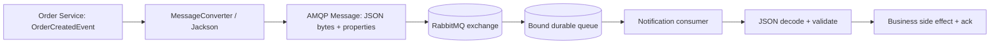
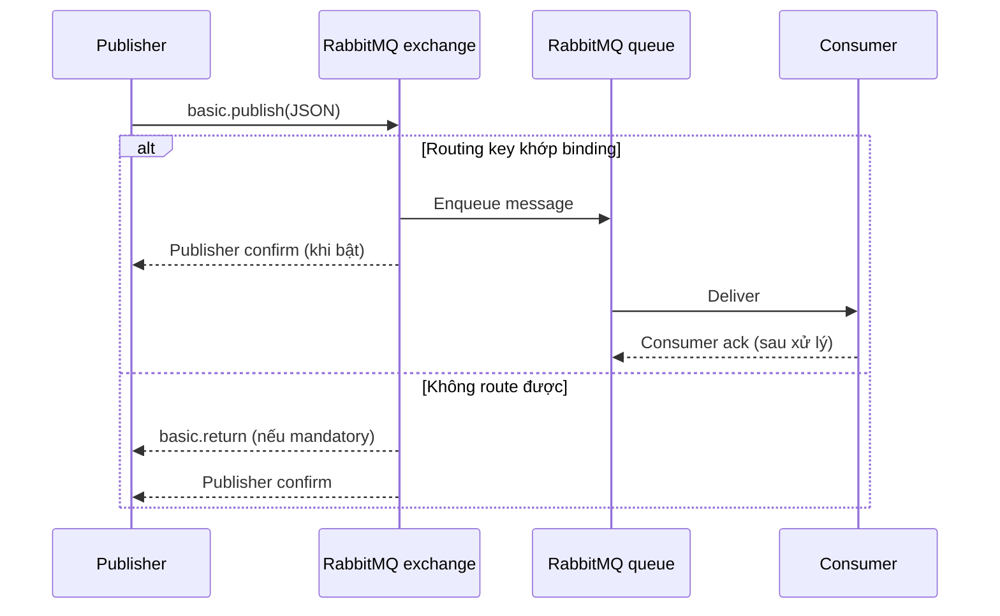
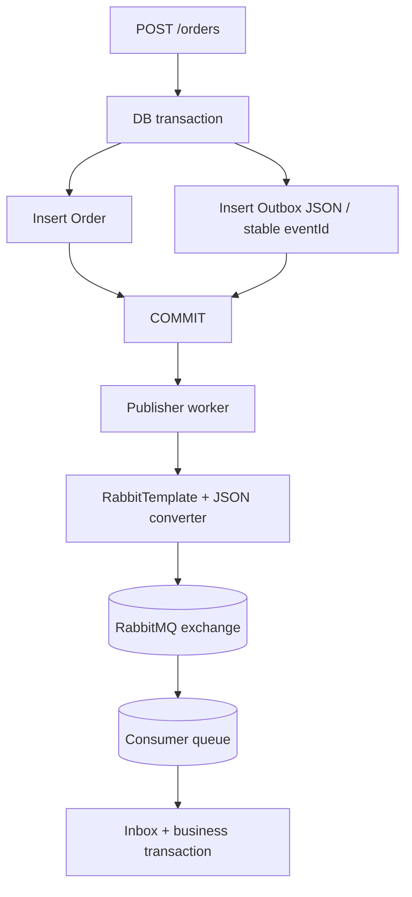

# Gửi dữ liệu và chuyển đổi thông điệp JSON

## 1. Vì sao gửi một object Java chưa chắc đã gửi JSON?

Trong mô-đun **SPRING_BOOT_INTEGRATION**, ứng dụng Spring Boot kết nối HTTP client, database, cache, message broker và các adapter của Spring Integration. RabbitMQ thường được dùng để tách các xử lý không cần hoàn thành trong cùng HTTP request, chẳng hạn Order Service tạo đơn hàng rồi phát sự kiện cho Notification Service, Inventory Service và hệ thống báo cáo.

Một nhầm lẫn rất phổ biến là viết:

```java
rabbitTemplate.convertAndSend(
    "orders.events",
    "order.created",
    new OrderCreatedEvent("evt-1024", "ord-1024", java.time.Instant.parse("2026-11-21T04:00:00Z"), 1)
);
```

rồi kết luận “đã gửi JSON”. **`convertAndSend(...)` chỉ yêu cầu `MessageConverter` hiện tại chuyển một object sang AMQP message**; định dạng thực tế phụ thuộc converter. Nếu chưa cấu hình JSON converter, client có thể từ chối kiểu object, gửi chuỗi/byte array theo cơ chế mặc định hoặc thực hiện một dạng serialization khác. Tên phương thức không bảo đảm JSON, và việc broker nhận được message không bảo đảm consumer giải mã được.

Để gửi dữ liệu JSON đáng tin cậy, cần thống nhất **bốn lớp**:

1. **Hợp đồng nghiệp vụ:** payload chứa field nào, định dạng và phiên bản ra sao?
2. **Serialization:** object Java được chuyển thành bytes JSON bằng converter hoặc `ObjectMapper` nào?
3. **Định tuyến AMQP:** message đi tới exchange nào, với routing key nào và được bind vào queue nào?
4. **Phân phối và xử lý:** producer kiểm tra publish result ra sao; consumer decode, ack, retry, dedupe và ghi trạng thái thế nào?



**Phạm vi phiên bản:** ví dụ theo Spring Boot 3.x và Spring AMQP 3.x, sử dụng `Jackson2JsonMessageConverter` của Spring AMQP. Ở các dòng Spring AMQP mới hơn, tên API Jackson converter có thể thay đổi; hãy đối chiếu dependency và tài liệu chính xác của phiên bản dự án. Ví dụ Spring Boot chạy Java 17+ và RabbitMQ broker được provision riêng.

## 2. Một Message AMQP gồm payload bytes và metadata

Trong Spring AMQP, `org.springframework.amqp.core.Message` biểu diễn body dưới dạng **`byte[]`** cùng một `MessageProperties`. Nó không giống hoàn toàn với `org.springframework.messaging.Message<T>` mà Spring Integration sử dụng giữa các endpoint nội bộ.

```text
Spring AMQP Message
├── body: byte[]
│   └── UTF-8 JSON, ví dụ {"eventId":"evt-1024", ...}
└── MessageProperties
    ├── contentType: application/json
    ├── contentEncoding: UTF-8
    ├── deliveryMode: PERSISTENT
    ├── correlationId: req-80a7
    ├── messageId: evt-1024 (nếu producer tự đặt)
    └── headers: eventType, schemaVersion, eventId, ...
```

RabbitMQ broker chủ yếu định tuyến và lưu **bytes + AMQP properties**; broker không tự xác nhận JSON hợp schema của tổ chức. Việc chuyển bytes thành Java object xảy ra trong producer/consumer hoặc Spring Integration adapter.

| Khái niệm | Tầng sở hữu | Chức năng |
| --- | --- | --- |
| `OrderCreatedEvent` | Ứng dụng | Business contract của sự kiện |
| `ObjectMapper` | Jackson / ứng dụng | Encode/decode JSON |
| `MessageConverter` | Spring AMQP | Chuyển object ↔ AMQP `Message` |
| `RabbitTemplate` | Spring AMQP client | Publish qua RabbitMQ |
| `MessageProperties` | Spring AMQP / AMQP | Content type, header, delivery mode |
| Exchange | RabbitMQ | Nhận publish và tìm binding phù hợp |
| Binding + routing key | RabbitMQ | Quyết định queue đích |
| Queue | RabbitMQ | Giữ message cho consumer |
| `@RabbitListener` | Spring AMQP | Nhận message, chuyển đổi và gọi handler |

**Đừng lấy `MessageProperties.messageId` hoặc Spring `MessageHeaders.ID` làm idempotency ID một cách tự động.** Tốt nhất business event có `eventId` riêng, được tạo một lần và giữ nguyên khi retry hoặc republish.

## 3. Chuẩn bị dependency, kết nối và topology RabbitMQ

### 3.1. Maven / Gradle

Với Spring Boot Maven BOM:

```xml
<dependency>
    <groupId>org.springframework.boot</groupId>
    <artifactId>spring-boot-starter-amqp</artifactId>
</dependency>
```

Gradle:

```groovy
dependencies {
    implementation("org.springframework.boot:spring-boot-starter-amqp")
}
```

Starter này cung cấp Spring AMQP và RabbitMQ Java client, **không khởi động RabbitMQ server**. Để phát triển có thể chạy broker qua Docker Compose hoặc Testcontainers; production nên dùng broker được quản lý, với account và quyền hạn riêng.

Cấu hình kết nối local minh họa:

```yaml
spring:
  rabbitmq:
    host: localhost
    port: 5672
    username: ${RABBITMQ_USERNAME:devuser}
    password: ${RABBITMQ_PASSWORD:devpass}
    virtual-host: /
    connection-timeout: 5s
    requested-heartbeat: 30s
```

Thông tin username/password chỉ là ví dụ cho môi trường local. Đừng dùng chúng làm credentials production hoặc commit secret thật. `connection-timeout` là timeout thiết lập kết nối, không phải deadline toàn bộ nghiệp vụ hay thời gian chờ consumer xử lý xong. Một message publish và một HTTP request là hai vòng đời khác nhau.

Nếu dùng Spring Boot Docker Compose service connections hoặc Testcontainers `@ServiceConnection`, endpoint được cung cấp bởi connection details có thể ưu tiên hơn `spring.rabbitmq.host`/`port`. Khi ứng dụng kết nối nhầm broker, kiểm tra chính bean connection factory và cấu hình/runtime profile.

### 3.2. Exchange, queue và binding phải rõ ràng

Ví dụ Topic Exchange nhận sự kiện đơn hàng:

```java
import org.springframework.amqp.core.Binding;
import org.springframework.amqp.core.BindingBuilder;
import org.springframework.amqp.core.Queue;
import org.springframework.amqp.core.QueueBuilder;
import org.springframework.amqp.core.TopicExchange;
import org.springframework.context.annotation.Bean;
import org.springframework.context.annotation.Configuration;
import org.springframework.amqp.rabbit.annotation.EnableRabbit;

@Configuration
@EnableRabbit
public class OrderAmqpTopology {

    public static final String EXCHANGE = "orders.events";
    public static final String ROUTING_KEY = "order.created";
    public static final String NOTIFICATION_QUEUE =
        "notification.order-created";

    @Bean
    TopicExchange orderEventsExchange() {
        return new TopicExchange(EXCHANGE, true, false);
    }

    @Bean
    Queue notificationOrderCreatedQueue() {
        return QueueBuilder.durable(NOTIFICATION_QUEUE).build();
    }

    @Bean
    Binding notificationOrderCreatedBinding(
            Queue notificationOrderCreatedQueue,
            TopicExchange orderEventsExchange) {
        return BindingBuilder
            .bind(notificationOrderCreatedQueue)
            .to(orderEventsExchange)
            .with(ROUTING_KEY);
    }
}
```

`TopicExchange` có thể định tuyến nhiều pattern và nhiều queue; binding trên chỉ mô tả **một consumer queue** cho Notification Service. Trong kiến trúc event-driven, Inventory Service có thể có queue riêng bind cùng routing key, thay vì hai service tranh nhau tiêu thụ từ cùng một queue khi đều cần xử lý mỗi event.

Khi Spring AMQP `RabbitAdmin` được cấu hình và cho phép auto-declare, các bean `Exchange`, `Queue`, `Binding` có thể được khai báo lên broker; trong production có thể để một quy trình hạ tầng quản lý topology. **Khai báo trong Spring context không có nghĩa broker luôn đã tạo thành công**: sai quyền, precondition mismatch (ví dụ queue đã tồn tại với durability khác) hoặc broker không sẵn sàng đều có thể làm declare thất bại.

## 4. Phân biệt RabbitTemplate.send và convertAndSend

### 4.1. send: ứng dụng đã có AMQP Message

`send(...)` nhận `org.springframework.amqp.core.Message` với `byte[]` body và `MessageProperties` đã được chuẩn bị.

```java
byte[] body = """
    {"eventId":"evt-1024","orderId":"ord-1024","schemaVersion":1}
    """.getBytes(java.nio.charset.StandardCharsets.UTF_8);

org.springframework.amqp.core.MessageProperties properties =
    new org.springframework.amqp.core.MessageProperties();

properties.setContentType("application/json");
properties.setContentEncoding("UTF-8");

org.springframework.amqp.core.Message amqpMessage =
    new org.springframework.amqp.core.Message(body, properties);

rabbitTemplate.send(
    "orders.events",
    "order.created",
    amqpMessage
);
```

Ở đây **caller chịu trách nhiệm** body thật sự là JSON và metadata đúng. RabbitTemplate không lấy DTO để serialize vì caller đã cung cấp AMQP Message.

### 4.2. convertAndSend: template nhờ converter

```java
OrderCreatedEvent event =
    new OrderCreatedEvent("evt-1024", "ord-1024", java.time.Instant.parse("2026-11-21T04:00:00Z"), 1);

rabbitTemplate.convertAndSend(
    "orders.events",
    "order.created",
    event
);
```

Spring AMQP gọi `MessageConverter.toMessage(...)` để chuyển object thành AMQP message, rồi gửi nó. Nếu đã cấu hình Jackson JSON converter phù hợp, body là JSON bytes. Nếu converter khác, nội dung có thể khác.

| Tiêu chí | `send` | `convertAndSend` |
| --- | --- | --- |
| Tham số message | AMQP `Message` | Java object hoặc kiểu converter chấp nhận |
| Ai encode payload? | Caller đã encode | `MessageConverter` |
| Kiểm soát body bytes | Trực tiếp | Qua converter |
| Kiểm soát content type | Caller đặt | Converter thường đặt, có thể hậu xử lý |
| Phù hợp | Wire contract đặc thù, pre-serialized JSON | DTO Java với converter thống nhất |
| Rủi ro | Quên encoding/metadata, JSON sai | Nghĩ mặc định converter luôn tạo JSON |

**Khi nào nên dùng cách nào?** Với một Spring Boot service có DTO rõ và consumer cùng hệ sinh thái, `convertAndSend` cùng JSON converter phù hợp và dễ tái sử dụng. Với hợp đồng đa ngôn ngữ chặt chẽ, yêu cầu payload bytes ổn định hoặc cần kiểm soát metadata trước khi gửi, `send` sau khi serialize tường minh bằng `ObjectMapper` là một lựa chọn tốt.

## 5. Vì sao default converter không đồng nghĩa JSON?

Trong Spring AMQP, `SimpleMessageConverter` có các cách xử lý tùy kiểu payload, thường hỗ trợ `String`, `byte[]` và những object `Serializable` theo cơ chế phù hợp. Điều đó dẫn tới hai hiểu nhầm:

1. Gửi một `String` chứa JSON thường cho body có nội dung chuỗi đó, **nhưng không bảo đảm** message mang đúng `contentType=application/json` hay contract đã được validate.
2. Gửi một DTO Java bất kỳ không đồng nghĩa tự động Jackson serialize nó thành JSON. Nếu object không được converter hỗ trợ, có thể gặp `MessageConversionException`; nếu được Java serialization xử lý, payload sẽ không phải JSON liên ngôn ngữ.

Ví dụ không nên dùng làm sự kiện liên service:

```java
// Nội dung phụ thuộc converter thực tế; không thể suy ra JSON.
rabbitTemplate.convertAndSend(
    "orders.events",
    "order.created",
    new OrderCreatedEvent("evt-1024", "ord-1024", java.time.Instant.parse("2026-11-21T04:00:00Z"), 1)
);
```

Mã trên **chỉ trở thành gửi JSON theo ý định** khi RabbitTemplate đang dùng JSON converter hoặc object đã được encode theo giao thức đã công bố.

Đặc biệt tránh Java native serialization làm wire format giữa các service: nó gắn vào classpath/type Java, khó version hóa và có rủi ro deserialization nếu dữ liệu không tin cậy. JSON cũng cần validation và giới hạn kích thước, nhưng ít phụ thuộc class Java hơn nếu thiết kế schema độc lập.

## 6. Cấu hình Jackson2JsonMessageConverter trong Spring Boot

### 6.1. DTO sự kiện cho hợp đồng JSON

Định nghĩa payload nhỏ, bất biến, có ID và phiên bản:

```java
package example.integration.orders;

import java.time.Instant;

public record OrderCreatedEvent(
        String eventId,
        String orderId,
        Instant occurredAt,
        int schemaVersion
) {}
```

Ví dụ JSON được kỳ vọng:

```json
{
  "eventId": "evt-1024",
  "orderId": "ord-1024",
  "occurredAt": "2026-11-21T04:00:00Z",
  "schemaVersion": 1
}
```

`occurredAt` là thời gian **sự kiện nghiệp vụ**; không được tạo lại theo từng lần publish retry. `eventId` phục vụ chống trùng và đối soát, cũng phải ổn định. `schemaVersion` không phải biến tự tăng sau mỗi attempt, mà thay đổi khi hợp đồng sự kiện tiến hóa.

### 6.2. Khai báo converter bean

```java
package example.integration.orders;

import com.fasterxml.jackson.databind.ObjectMapper;
import org.springframework.amqp.support.converter.Jackson2JsonMessageConverter;
import org.springframework.amqp.support.converter.MessageConverter;
import org.springframework.context.annotation.Bean;
import org.springframework.context.annotation.Configuration;

@Configuration
public class RabbitJsonConfiguration {

    @Bean
    MessageConverter jsonMessageConverter(ObjectMapper objectMapper) {
        return new Jackson2JsonMessageConverter(objectMapper);
    }
}
```

Với Spring Boot 3.x và Spring AMQP 3.x, khi bean `MessageConverter` phù hợp có trong context, Boot có thể áp converter đó cho `RabbitTemplate` và container factory listener tự cấu hình. **Nếu ứng dụng tự tạo `RabbitTemplate`, nhiều converter beans hoặc custom listener factory, phải gắn converter rõ ràng**; không suy ra bean converter sẽ tự được mọi custom component sử dụng.

Nhờ dùng `ObjectMapper` của Boot, các thiết lập Jackson phù hợp trong context (ví dụ xử lý `Instant` và các module được đăng ký) có thể được tái sử dụng. Nhưng hãy kiểm tra object mapper thực sự có module cần thiết và output JSON đúng contract; không giả định mọi object time hoặc custom Java type đều encode giống nhau qua mọi phiên bản.

### 6.3. Vì sao cùng converter cần ở cả producer và consumer?

Producer phải chuyển `OrderCreatedEvent` thành bytes, consumer phải chuyển bytes về DTO phù hợp. Nếu producer dùng Jackson JSON mà listener vẫn dùng converter không hiểu content type/metadata, handler có thể nhận `byte[]` hoặc conversion failure.

Một quy tắc triển khai:

- Có **một cấu hình converter được công bố** cho đường đi phù hợp.
- Verify bean `RabbitTemplate.getMessageConverter()` và listener container factory đang dùng.
- Viết integration test gửi event qua broker, không chỉ test `ObjectMapper.writeValueAsString(...)`.
- Với service viết ngôn ngữ khác Java, test JSON schema thực tế, không dựa vào class metadata của Spring.

Không để nhiều converter có cùng trách nhiệm nhưng không có `@Qualifier` hoặc chính sách chọn tường minh.

## 7. Producer: gửi DTO JSON với headers có chủ đích

Một producer đơn giản:

```java
package example.integration.orders;

import org.springframework.amqp.rabbit.core.RabbitTemplate;
import org.springframework.stereotype.Component;

@Component
public class OrderEventPublisher {

    private final RabbitTemplate rabbit;

    public OrderEventPublisher(RabbitTemplate rabbit) {
        this.rabbit = rabbit;
    }

    public void publish(OrderCreatedEvent event, String correlationId) {
        rabbit.convertAndSend(
            OrderAmqpTopology.EXCHANGE,
            OrderAmqpTopology.ROUTING_KEY,
            event,
            message -> {
                var properties = message.getMessageProperties();
                properties.setHeader("eventType", "OrderCreated");
                properties.setHeader(
                    "schemaVersion", event.schemaVersion()
                );
                properties.setHeader("eventId", event.eventId());
                properties.setCorrelationId(correlationId);
                properties.setMessageId(event.eventId());
                return message;
            }
        );
    }
}
```

Callback `MessagePostProcessor` trên đường `convertAndSend` cho phép bổ sung AMQP properties **sau khi converter đã tạo message** và trước khi publish. Tùy converter, nó có thể đã ghi thêm type metadata; nếu muốn một wire contract nhất quán xuyên Java/Python/Go, cần xác định header allowlist và cách consumer sử dụng class/type headers.

**Chú ý phân biệt:** `setMessageId(event.eventId())` thể hiện lựa chọn của **ứng dụng**, không phải RabbitMQ tự cấp một business event ID. Broker không dùng `messageId` này để tự dedupe; consumer vẫn cần kho xử lý trùng.

### 7.1. Không tạo event ID bên trong mỗi attempt

Sai:

```java
// SAI về idempotency khi publish retry:
void retryPublish(OrderEntity order) {
    String eventId = java.util.UUID.randomUUID().toString();
    rabbit.convertAndSend(
        "orders.events",
        "order.created",
        new OrderCreatedEvent(
            eventId,
            order.getId(),
            Instant.now(),
            1
        )
    );
}
```

Nếu cùng business event được thử lại, đoạn trên tạo ID khác mỗi lần, khiến consumer không thể biết là một sự kiện lặp.

Đúng: cấp ID và `occurredAt` khi tạo outbox record hoặc logical event; mỗi lần retry đọc lại cùng payload/version từ outbox.

## 8. Tự serialize bằng ObjectMapper rồi RabbitTemplate.send

Trong hệ thống giao tiếp đa ngôn ngữ, đôi khi đội ngũ muốn **không phụ thuộc vào Java class metadata** trong wire message. Khi đó có thể encode JSON tường minh:

```java
package example.integration.orders;

import com.fasterxml.jackson.core.JsonProcessingException;
import com.fasterxml.jackson.databind.ObjectMapper;
import java.nio.charset.StandardCharsets;
import org.springframework.amqp.core.Message;
import org.springframework.amqp.core.MessageDeliveryMode;
import org.springframework.amqp.core.MessageProperties;
import org.springframework.amqp.rabbit.core.RabbitTemplate;
import org.springframework.stereotype.Component;

@Component
public class RawJsonOrderPublisher {

    private final RabbitTemplate rabbit;
    private final ObjectMapper mapper;

    public RawJsonOrderPublisher(
            RabbitTemplate rabbit,
            ObjectMapper mapper) {
        this.rabbit = rabbit;
        this.mapper = mapper;
    }

    public void publish(OrderCreatedEvent event)
            throws JsonProcessingException {

        byte[] json = mapper.writeValueAsBytes(event);

        MessageProperties props = new MessageProperties();
        props.setContentType(MessageProperties.CONTENT_TYPE_JSON);
        props.setContentEncoding(StandardCharsets.UTF_8.name());
        props.setDeliveryMode(MessageDeliveryMode.PERSISTENT);
        props.setMessageId(event.eventId());
        props.setHeader("eventType", "OrderCreated");
        props.setHeader("schemaVersion", event.schemaVersion());

        rabbit.send(
            OrderAmqpTopology.EXCHANGE,
            OrderAmqpTopology.ROUTING_KEY,
            new Message(json, props)
        );
    }
}
```

Lợi ích:

- Body được encode bằng `ObjectMapper` được kiểm soát.
- Producer đặt `contentType=application/json`, encoding và metadata.
- Không buộc phía nhận hiểu `__TypeId__` chứa tên class Java.
- Dễ dùng JSON Schema hoặc test payload bytes trực tiếp.

Đổi lại, ứng dụng phải tự đảm bảo schema/metadata đầy đủ và deserialize an toàn ở consumer. **Đừng gọi `convertAndSend` thêm một lần lên AMQP `Message` đã serialize nếu chỉ muốn gửi thẳng body**; dùng `send` đúng abstraction.

### 8.1. Vì sao contentType và charset quan trọng?

`application/json` nói cho consumer biết body là JSON, còn `UTF-8` xác định cách chuyển bytes thành text trong trường hợp có xử lý encoding. Nếu body JSON hợp lệ nhưng `contentType` sai hoặc thiếu, converter phía nhận có thể xử lý payload như text/octet-stream và không map thành DTO như mong đợi.

Đừng để object mapper chuyển `Instant` thành một kiểu dữ liệu khác hợp đồng (ví dụ số epoch thay cho chuỗi ISO-8601) chỉ vì một cấu hình môi trường khác. Snapshot/contract test body JSON là cách chặn sai lệch này.

## 9. RabbitListener: giải mã JSON thành DTO

Một listener nhận object rõ kiểu:

```java
package example.integration.notifications;

import example.integration.orders.OrderCreatedEvent;
import example.integration.orders.OrderAmqpTopology;
import org.springframework.amqp.rabbit.annotation.RabbitListener;
import org.springframework.stereotype.Component;

@Component
public class OrderCreatedListener {

    private final NotificationService notifications;

    public OrderCreatedListener(NotificationService notifications) {
        this.notifications = notifications;
    }

    @RabbitListener(
        queues = OrderAmqpTopology.NOTIFICATION_QUEUE
    )
    public void handle(OrderCreatedEvent event) {
        notifications.handleOrderCreated(event);
    }
}
```

`NotificationService` do ứng dụng triển khai. Ví dụ giả định listener factory đã dùng JSON converter thích hợp, DTO được chia sẻ hợp đồng hoặc class tương đương có mapping JSON tương thích, và queue đã được provision.

Spring AMQP listener adapter có thể dùng **kiểu tham số method** để suy ra target type khi chuyển JSON thành object, tùy container/adapter/converter configuration. Nếu method nhận `Object` hoặc một interface chung, type inference có thể không đủ; lúc đó type headers hoặc explicit type mapper sẽ quan trọng hơn.

**Chú ý failure modes:**

- Body là JSON hợp cú pháp nhưng thiếu field bắt buộc: Jackson có thể tạo object với field null/default tùy cài đặt; cần **bean validation/business validation** riêng.
- Body không phải JSON hoặc type mismatch: conversion error có thể xảy ra **trước khi method listener được gọi**, nên `try/catch` bên trong handler không bắt được.
- Consumer chưa biết `schemaVersion=2`: không được âm thầm hiểu nhầm thành v1; đưa message vào error policy/DLQ/quarantine.
- Một exception từ handler có thể dẫn tới redelivery theo container/requeue policy. Cần kiểm tra đúng acknowledgment và error handling thay vì giả định một lần giao tương đương một lần xử lý.

### 9.1. Kiểm tra dữ liệu đầu vào trong handler

```java
public void handle(OrderCreatedEvent event) {
    if (event == null
            || event.eventId() == null
            || event.eventId().isBlank()
            || event.orderId() == null
            || event.schemaVersion() != 1) {
        throw new IllegalArgumentException(
            "Unsupported or invalid OrderCreated event"
        );
    }

    notifications.handleOrderCreated(event);
}
```

Đoạn trên minh họa validation domain; thực tế có thể dùng Jakarta Bean Validation cùng error classification riêng. Poison message **không nên được requeue vô hạn**. Với schema không hỗ trợ, nên cách ly để điều tra hoặc có chiến lược backward compatibility.

## 10. Header kiểu dữ liệu __TypeId__: tiện trong Java nhưng cần kiểm soát

`Jackson2JsonMessageConverter` có thể sử dụng **type metadata** trong AMQP headers, thường gặp header `__TypeId__` cùng các type headers liên quan. Khi producer/consumer đều là Spring Java và mapping phù hợp, cơ chế này hỗ trợ khôi phục Java type.

Tuy nhiên đây **không phải tiêu chuẩn JSON schema giữa các ngôn ngữ**. Ví dụ type ID là fully-qualified Java class name có thể không tồn tại ở service khác hoặc thay đổi khi refactor package.

| Cách xác định type | Điểm mạnh | Rủi ro |
| --- | --- | --- |
| Type suy ra từ method `@RabbitListener(OrderCreatedEvent)` | DTO rõ ở consumer | Không áp dụng cho mọi handler generic |
| Type headers của Spring AMQP | Tiện khi nhiều Java payload types | Gắn vào tên class/config, cần trust rules |
| Logical type ID `OrderCreated` + schema version | Ổn định hơn giữa ngôn ngữ | Cần registry/mapping tường minh |
| Event envelope có `eventType` trong JSON | Wire contract tự mô tả | Consumer phải validate/route từ envelope |
| Topic/routing key cố định mỗi event type | Phân loại theo hạ tầng | Vẫn cần schema version và validation |

Khi nhận message từ nguồn không tin cậy, **không cho phép deserialize tùy ý mọi Java class chỉ dựa trên type header do bên gửi điều khiển**. Hạn chế trusted packages, dùng DTO allowlist, kiểm tra headers có thể bị giả mạo và không bật polymorphic default typing rộng trong Jackson khi không cần.

Với hệ đa ngôn ngữ hoặc event lâu dài, ưu tiên logical event type + version trong contract. Có thể vẫn dùng converter Jackson trong nội bộ, nhưng không xem `__TypeId__` là business event schema.

### 10.1. Thống nhất nơi đặt eventType và schemaVersion

Có thể chọn một envelope:

```json
{
  "eventId": "evt-1024",
  "eventType": "OrderCreated",
  "schemaVersion": 1,
  "occurredAt": "2026-11-21T04:00:00Z",
  "data": {
    "orderId": "ord-1024"
  }
}
```

Nếu vừa ghi `schemaVersion` trong header, vừa ghi trong body, cần xác định bên nào là **source of truth** và kiểm tra hai giá trị không mâu thuẫn. Trong nhiều kiến trúc, body là hợp đồng bền vững, header chỉ tối ưu filtering/routing.

## 11. Không nhầm JSON hợp cú pháp với JSON hợp hợp đồng

Một JSON parser có thể đọc được:

```json
{
  "eventId": "evt-1024",
  "orderId": null,
  "schemaVersion": 999
}
```

Nhưng đây có thể là message **không hợp lệ nghiệp vụ**: `orderId` null và version chưa hỗ trợ. Cần phân biệt:

1. **Syntax validation:** body đúng cú pháp JSON và encoding.
2. **Schema validation:** field bắt buộc, kiểu dữ liệu, enum, format, version.
3. **Semantic validation:** quan hệ field, trạng thái business và tenant/user permissions.
4. **Idempotency validation:** event này đã được xử lý trước hay chưa.
5. **Authorization/trust:** producer có quyền gửi loại event này hay không.

Một converter thành công ở bước 1–2 (về mặt Java mapping) không tự hoàn tất các bước 3–5. Event từ broker không nên được tin hoàn toàn chỉ vì đến từ một queue nội bộ; tài khoản publisher và phân quyền vhost/exchange vẫn cần quản trị.

### 11.1. Cách thiết kế schema evolution

| Thay đổi | Đánh giá thường gặp | Lưu ý |
| --- | --- | --- |
| Thêm field optional có default rõ | Có thể backward-compatible | Consumer cũ cần chấp nhận unknown fields |
| Thêm field bắt buộc không có default | Dễ breaking | Cần nâng consumer/trước khi producer gửi |
| Đổi kiểu `orderId` từ String sang Number | Breaking | Cần version/migration |
| Đổi tên `orderId` thành `id` | Có thể breaking | Giai đoạn song song hoặc mapping tương thích |
| Thêm enum mới | Có thể breaking với switch exhaustive | Consumer phải định nghĩa unknown value |
| Đổi nghĩa `quantity` từ item sang pack | Breaking về semantics dù JSON vẫn hợp lệ | Phải phát hành contract mới |

**Không dùng việc “deserialize thành công” làm bằng chứng tương thích hợp đồng.** Cần provider/consumer contract tests và chiến lược xử lý message v1 còn tồn tại trong queue sau khi triển khai v2.

## 12. Publisher confirms và returns: publish thành công có nghĩa gì?

`RabbitTemplate.convertAndSend(...)` thường trả về `void`. Gọi method không ném exception **không đủ** để khẳng định message đã tới queue, được lưu bền vững hoặc consumer đã xử lý thành công.

Tách ba câu hỏi:

- **Publisher confirm:** broker đã phản hồi chấp nhận (ACK) hay từ chối (NACK) publish ở mức được bảo đảm bởi cấu hình?
- **Publisher return:** message đã tới exchange nhưng **không định tuyến được vào queue** khi bật mandatory publishing?
- **Consumer acknowledgment:** consumer/container báo message đã được xử lý theo ack policy? Đây là giai đoạn sau, độc lập với publisher confirm.



### 12.1. Bật confirm/return trong Spring Boot

```yaml
spring:
  rabbitmq:
    publisher-confirm-type: correlated
    publisher-returns: true
    template:
      mandatory: true
```

Ý nghĩa:

- `publisher-confirm-type: correlated` bật đường confirm có correlation data để liên hệ publish attempt với event/outbox.
- `publisher-returns: true` cho phép broker gửi thông tin returned message khi không định tuyến được, trong điều kiện phù hợp.
- `template.mandatory: true` yêu cầu basic.return cho message không route được, thay vì broker âm thầm bỏ message theo hành vi mặc định.

Nếu publish tới **exchange không tồn tại**, lỗi có thể thuộc đường channel/confirm và khác tình huống exchange tồn tại nhưng không có binding khớp. Nếu một exchange có alternate exchange, đường routing/return còn phụ thuộc topology; phải kiểm tra từng tình huống thực tế.

### 12.2. CorrelationData theo event ID

```java
import org.springframework.amqp.rabbit.connection.CorrelationData;

CorrelationData correlation =
    new CorrelationData(event.eventId());

rabbitTemplate.convertAndSend(
    "orders.events",
    "order.created",
    event,
    message -> {
        message.getMessageProperties()
            .setHeader("eventId", event.eventId());
        return message;
    },
    correlation
);
```

`CorrelationData` giúp đối chiếu broker confirm với publish attempt; không phải consumer inbox. Nếu event được retry, hãy lưu attempt riêng khi cần, nhưng **event ID nghiệp vụ phải ổn định**.

Ví dụ đăng ký callbacks tại một điểm duy nhất:

```java
import org.springframework.amqp.rabbit.core.RabbitTemplate;
import org.springframework.stereotype.Component;

@Component
public class RabbitPublishSignals {

    public RabbitPublishSignals(RabbitTemplate template) {
        template.setConfirmCallback((correlation, ack, cause) -> {
            String eventId =
                correlation == null ? null : correlation.getId();
            // ack=true chỉ là publisher confirm; ghi nhận trạng thái
            // publish theo eventId và quan sát NACK/cause.
        });

        template.setReturnsCallback(returned -> {
            // ReturnedMessage chứa metadata publish không route được.
            // Ghi lỗi routing cho outbox/ops và cảnh báo.
        });
    }
}
```

Đoạn callback minh họa **vị trí nhận tín hiệu**, không phải một hệ thống outbox hoàn chỉnh. Vì callback có thể được gọi ở luồng khác, việc cập nhật trạng thái DB cần thread-safety và error handling rõ. `RabbitTemplate` có vị trí callback chung; nhiều component tùy tiện gọi `setConfirmCallback(...)` có thể ghi đè policy của nhau. Chỉ một nơi chịu trách nhiệm theo dõi publisher signals, hoặc dùng chiến lược future/correlation được thiết kế tập trung.

**Publisher confirm ACK không chứng minh consumer đã hoàn thành, và không tự tạo exactly-once**. Nếu broker nhận publish nhưng producer mất confirm, publisher có thể gửi lại; consumer phải deduplicate.

## 13. Durable queue, persistent message và acknowledgement là ba thứ khác nhau

Một queue `durable` có thể tồn tại qua broker restart theo cơ chế hỗ trợ, nhưng **chưa tự có nghĩa mọi message trong đó đã được lưu bền vững**. Khi yêu cầu độ bền:

1. Declare **durable queue** và exchange/binding phù hợp.
2. Publish message với **persistent delivery mode**.
3. Dùng publisher confirm/return để nhận diện publish được broker xử lý ra sao.
4. Chọn RabbitMQ topology/quorum queues, disk/memory policy và cluster strategy theo SLA.
5. Thiết kế outbox và idempotent consumer vì publish và DB transaction không nguyên tử.

Ví dụ trong đường `send(...)` thủ công:

```java
MessageProperties properties = new MessageProperties();
properties.setContentType(MessageProperties.CONTENT_TYPE_JSON);
properties.setDeliveryMode(MessageDeliveryMode.PERSISTENT);
```

Delivery mode thường được cấu hình phù hợp ở converter/template, nhưng nên kiểm tra **message thực tế** và broker settings. Quorum queue, classic queue, mirrored strategy và RabbitMQ version có những bảo đảm khác nhau; không thể khẳng định “PERSISTENT + durable queue = tuyệt đối không mất dữ liệu” cho mọi failure mode.

### 13.1. AUTO acknowledgment không phải tự động commit business transaction

Với Spring AMQP listener container ở acknowledge mode `AUTO` phổ biến, container thường ack khi listener xử lý thành công; nếu listener ném exception, container/error handler quyết định reject/requeue/dead-letter theo cấu hình.

Nếu consumer đã commit PostgreSQL rồi JVM chết **trước khi ACK**, broker có thể redeliver và side effect bị chạy lại. Do đó cần unique business event ID và inbox:

```text
Receive event evt-1024
BEGIN DB transaction
  INSERT inbox(consumer_name, event_id) UNIQUE
  Nếu đã có: kết thúc an toàn, không lặp side effect
  Nếu mới: áp dụng thay đổi dữ liệu
COMMIT
ACK broker theo listener container
```

Để xử lý notification/email thật, DB inbox và provider email không có cùng transaction. Phải có notification state, provider idempotency hoặc đối soát; **không tuyên bố exactly-once tuyệt đối khi side effect ngoài DB**.

## 14. Consumer errors: conversion failure, business failure và poison message

Phân biệt giai đoạn lỗi:

| Giai đoạn | Ví dụ | Đường xử lý phù hợp |
| --- | --- | --- |
| AMQP delivery | Connection/channel bị mất | Client reconnect, broker redelivery và quan sát |
| JSON parse | Body bị cắt, cú pháp JSON sai | Conversion error, reject/DLQ/quarantine |
| Java type mapping | Type ID không tin cậy hoặc class không tồn tại | Sửa mapping hoặc cách ly message |
| Schema validation | Field bắt buộc null, version không hỗ trợ | Non-retryable, DLQ và contract alert |
| Business handling | Database deadlock, HTTP 503 | Retry bounded + backoff khi an toàn |
| Authorization | Producer không được phép gửi event | Security incident; không retry nóng |
| Commit/ack gap | DB commit nhưng ACK mất | Redelivery, inbox/idempotency |
| Serialization ở producer | `ObjectMapper` không encode được DTO | Lỗi trước publish; fail request/job/outbox có kiểm soát |

**Lỗi JSON conversion có thể phát sinh trước khi method `@RabbitListener` bắt đầu chạy.** Đặt `try/catch` trong handler không đủ; cần container error handler và dead-letter policy cho message có lỗi ở tầng listener adapter.

### 14.1. Tránh vòng requeue vô hạn

Ví dụ cấu hình local minh họa:

```yaml
spring:
  rabbitmq:
    listener:
      simple:
        acknowledge-mode: auto
        default-requeue-rejected: false
        prefetch: 20
```

`default-requeue-rejected: false` khiến nhiều message bị reject sau lỗi không được trả lại queue nguồn theo hành vi phổ biến của container, **nhưng chỉ cấu hình này không tự tạo DLQ**. Muốn message có nơi điều tra, queue phải có dead-letter exchange và binding phù hợp hoặc dùng chính sách quản lý của broker.

### 14.2. Một topology DLQ minh họa

```java
@Bean
org.springframework.amqp.core.DirectExchange deadLetterExchange() {
    return new org.springframework.amqp.core.DirectExchange(
        "orders.dlx", true, false
    );
}

@Bean
org.springframework.amqp.core.Queue orderCreatedDlq() {
    return org.springframework.amqp.core.QueueBuilder
        .durable("notification.order-created.dlq")
        .build();
}

@Bean
org.springframework.amqp.core.Binding orderCreatedDlqBinding(
        org.springframework.amqp.core.DirectExchange deadLetterExchange,
        org.springframework.amqp.core.Queue orderCreatedDql) {
    return org.springframework.amqp.core.BindingBuilder
        .bind(orderCreatedDql)
        .to(deadLetterExchange)
        .with("notification.failed");
}
```

Đây là **đoạn bổ sung của một cấu hình topology**, không phải bản thay thế nguyên vẹn cho `OrderAmqpTopology` ở mục 3. Để message từ queue nguồn đi vào DLQ, queue nguồn còn phải được **declare với dead-letter exchange** `orders.dlx` và dead-letter routing key `notification.failed`, ví dụ:

```java
@Bean
org.springframework.amqp.core.Queue notificationOrderCreatedQueue() {
    return org.springframework.amqp.core.QueueBuilder
        .durable("notification.order-created")
        .deadLetterExchange("orders.dlx")
        .deadLetterRoutingKey("notification.failed")
        .build();
}
```

**Dùng bean trên để thay thế định nghĩa queue nguồn ở mục 3, không tạo hai bean cho cùng queue với arguments khác nhau.** Nếu queue cũ đã tồn tại với arguments khác, RabbitMQ có thể từ chối redeclare do inequivalent arg; cần migration topology hoặc sử dụng broker policy theo vận hành.

DLQ không phải “nơi lưu vĩnh viễn mọi thứ”: cần retention, giới hạn kích thước, alert và công cụ reprocess có kiểm soát. Retry lỗi vĩnh viễn ngay trong queue chính có thể làm message hợp lệ bị kẹt.

## 15. Transactional outbox: tách ghi database khỏi gửi JSON

Giả sử Order Service làm:

```text
@Transactional
  INSERT orders
  rabbitTemplate.convertAndSend(OrderCreatedEvent)
COMMIT DATABASE
```

Dù code đặt trong method `@Transactional`, PostgreSQL và RabbitMQ **không mặc nhiên tham gia cùng một distributed transaction**. Có hai failure windows:

- Broker nhận event nhưng database rollback → consumer thấy event của order không tồn tại.
- Database commit nhưng process crash trước publish → downstream không biết có order mới.

Với sự kiện quan trọng, dùng **transactional outbox**:



Ví dụ cấu trúc outbox:

```sql
CREATE TABLE integration_outbox (
    event_id VARCHAR(64) PRIMARY KEY,
    event_type VARCHAR(100) NOT NULL,
    schema_version INTEGER NOT NULL,
    payload_json TEXT NOT NULL,
    status VARCHAR(20) NOT NULL,
    attempts INTEGER NOT NULL DEFAULT 0,
    created_at TIMESTAMP WITH TIME ZONE NOT NULL
);
```

`payload_json` có thể dùng PostgreSQL `jsonb` nếu phù hợp, nhưng cần cân nhắc canonical representation/serialization. Một outbox publisher nên lưu **payload và version ổn định** trước publish; khi retry không lấy entity hiện tại rồi tái tạo một sự kiện có nội dung khác nhưng giữ event ID cũ.

### 15.1. Publisher status và confirm

Trình tự minh họa:

1. Đọc những outbox events `PENDING` theo lease/lock nếu có nhiều worker.
2. Lấy payload JSON/version từ row đã commit.
3. Publish với correlation data gắn `eventId` và theo dõi confirm/return.
4. Chỉ cập nhật trạng thái “sent” theo tiêu chí đã được tổ chức định nghĩa; return/unroutable phải được coi là failure.
5. Nếu status chưa chắc chắn, retry **cùng eventId**; consumer inbox ngăn side effect lặp.
6. Hết retry budget → `FAILED`/parking queue và cảnh báo, có quy trình reprocess.

**Không chuyển outbox sang SENT ngay sau khi gọi `convertAndSend` mà chưa có tín hiệu đã được broker chấp nhận theo hợp đồng**. Ngược lại, ngay cả có confirm ACK, publisher có thể crash trước update status → publish trùng là điều cần thiết kế trước.

## 16. Bảo mật, schema và hiệu năng của JSON messages

### 16.1. Không gửi JPA entity trực tiếp lên broker

JPA entity thường chứa lazy proxies, internal IDs, circular relationships và field không thuộc hợp đồng event. Khi Jackson serialize, có thể xảy ra:

- LazyInitializationException hoặc query không chủ đích.
- Payload quá lớn, chứa PII/token.
- Schema thay đổi theo entity refactor.
- Mối quan hệ vòng gây lỗi serialization.
- Version serialization không đồng bộ giữa consumer cũ và mới.

Thay vào đó, ánh xạ entity sang **event DTO bất biến** được thiết kế riêng. Payload nên có business event ID, timestamp, schema version và trường cần thiết, không chứa toàn bộ snapshot hệ thống nếu consumer không cần.

### 16.2. Header allowlist

Không tự forward mọi HTTP headers vào AMQP:

- `Authorization`/cookies chứa credentials có thể bị lộ.
- `replyChannel`/`errorChannel` của Spring Integration có thể là object nội bộ không serializable.
- Headers tự do từ caller có thể spoof `eventType` hoặc ảnh hưởng routing.
- Trên broker, headers nhiều hoặc dài tạo overhead/bị giới hạn.

Chọn những header thực sự cần như `eventId`, `eventType`, `schemaVersion`, `correlationId`/trace context được kiểm soát. Không tin type IDs từ nguồn không tin cậy; cấu hình user/vhost/exchange permissions theo nguyên tắc least privilege.

### 16.3. JSON dễ đọc nhưng vẫn có chi phí

So với định dạng binary như Avro/Protobuf, JSON thường có overhead về kích thước và parse. Đối với throughput lớn:

- Giữ payload nhỏ, tránh lồng object khổng lồ.
- Dùng batch publish/consumer theo cơ chế phù hợp **mà không mất ack/idempotency**.
- Giám sát message size, RabbitMQ memory/disk alarms và queue depth.
- Cấu hình prefetch, consumer concurrency và backpressure dựa trên DB/HTTP downstream capacity.
- Nếu message chứa tài liệu hoặc file lớn, cân nhắc object storage + reference/metadata thay vì gửi toàn bộ file qua RabbitMQ.
- Đặt JSON parsing limits và validate dữ liệu trước khi cấp phát/ghi DB.

**Không tăng consumer concurrency chỉ để che database đang quá tải**. Nếu 100 consumer cùng ghi một bảng với constraint/index nóng, throughput có thể giảm và redelivery tăng.

## 17. Kiểm thử converter và đường đi qua RabbitMQ

### 17.1. Unit test: JSON converter thật sự tạo body JSON

```java
import static org.assertj.core.api.Assertions.assertThat;

import com.fasterxml.jackson.databind.ObjectMapper;
import org.junit.jupiter.api.Test;
import org.springframework.amqp.core.Message;
import org.springframework.amqp.core.MessageProperties;
import org.springframework.amqp.support.converter.Jackson2JsonMessageConverter;

class OrderJsonConverterTest {

    @Test
    void convertsEventToJsonBytes() throws Exception {
        ObjectMapper mapper = new ObjectMapper()
            .findAndRegisterModules();

        Jackson2JsonMessageConverter converter =
            new Jackson2JsonMessageConverter(mapper);

        OrderCreatedEvent event = new OrderCreatedEvent(
            "evt-1024",
            "ord-1024",
            java.time.Instant.parse("2026-11-21T04:00:00Z"),
            1
        );

        Message encoded =
            converter.toMessage(event, new MessageProperties());

        assertThat(encoded.getMessageProperties().getContentType())
            .isEqualTo("application/json");

        var json = mapper.readTree(encoded.getBody());
        assertThat(json.get("eventId").asText())
            .isEqualTo("evt-1024");
        assertThat(json.get("schemaVersion").asInt())
            .isEqualTo(1);
        assertThat(json.get("orderId").asText())
            .isEqualTo("ord-1024");
    }
}
```

Test này chứng minh **converter đã tạo JSON và đúng vài field quan trọng**, nhưng không chứng minh broker routing, publisher confirms, consumer ack hoặc schema compatibility đầy đủ. Dùng test contract có fixture phiên bản cũ để kiểm tra khi thay đổi event DTO.

### 17.2. Integration test với Testcontainers RabbitMQ

Trong Spring Boot 3.x có hỗ trợ `@ServiceConnection`, bạn có thể dùng RabbitMQContainer cho integration test. Dependency phù hợp gồm Testcontainers JUnit Jupiter, RabbitMQ module, `spring-boot-testcontainers` và `spring-boot-starter-test`.

Cấu trúc test:

```java
import static org.assertj.core.api.Assertions.assertThat;

import com.fasterxml.jackson.databind.ObjectMapper;
import org.junit.jupiter.api.Test;
import org.springframework.amqp.core.Message;
import org.springframework.amqp.core.Queue;
import org.springframework.amqp.core.QueueBuilder;
import org.springframework.amqp.rabbit.core.RabbitTemplate;
import org.springframework.beans.factory.annotation.Autowired;
import org.springframework.boot.test.context.SpringBootTest;
import org.springframework.boot.test.context.TestConfiguration;
import org.springframework.boot.testcontainers.service.connection.ServiceConnection;
import org.springframework.context.annotation.Bean;
import org.springframework.context.annotation.Import;
import org.testcontainers.containers.RabbitMQContainer;
import org.testcontainers.junit.jupiter.Container;
import org.testcontainers.junit.jupiter.Testcontainers;

@Testcontainers
@SpringBootTest
@Import(RabbitJsonRoundTripTest.TestTopology.class)
class RabbitJsonRoundTripTest {

    @Container
    @ServiceConnection
    static RabbitMQContainer rabbit =
        new RabbitMQContainer("rabbitmq:3.13-management");

    @Autowired
    RabbitTemplate template;

    @Autowired
    ObjectMapper mapper;

    @Test
    void publishesAndReceivesJsonBody() throws Exception {
        String queue = "orders.json.roundtrip.test";

        OrderCreatedEvent event = new OrderCreatedEvent(
            "evt-test-1",
            "ord-test-1",
            java.time.Instant.parse("2026-11-21T04:00:00Z"),
            1
        );

        template.convertAndSend("", queue, event);

        Message received = template.receive(queue, 5000);

        assertThat(received).isNotNull();
        assertThat(received.getMessageProperties().getContentType())
            .isEqualTo("application/json");

        var json = mapper.readTree(received.getBody());
        assertThat(json.get("eventId").asText())
            .isEqualTo("evt-test-1");
    }

    @TestConfiguration(proxyBeanMethods = false)
    static class TestTopology {
        @Bean
        Queue jsonRoundTripQueue() {
            return QueueBuilder
                .durable("orders.json.roundtrip.test")
                .build();
        }
    }
}
```

Test giả định `RabbitJsonConfiguration` cung cấp converter trong application context và `RabbitAdmin`/cơ chế declaration đã tạo queue trước lúc publish. Dùng queue chuyên biệt **không có listener cạnh tranh**. Nếu có listener chung tiêu thụ cùng queue, test có thể không nhận message và bị flaky; hãy cách ly topology bằng test profile/project/broker.

**Đừng khẳng định test trên kiểm tra publisher confirms:** nó mới kiểm tra message đi qua broker tới queue cùng body/content type. Confirm/return, unroutable routing, dead-letter, redelivery, duplicate consumption và permission failures cần các test riêng.

### 17.3. Bảng ca kiểm thử bắt buộc

| Case | Kiểm tra |
| --- | --- |
| DTO hợp lệ | JSON bytes, UTF-8, content type, schemaVersion |
| Consumer cùng Java package khác | Không phụ thuộc class name cụ thể trong wire contract |
| Consumer không phải Java | Decode JSON theo schema, không cần hiểu `__TypeId__` |
| JSON field thiếu/null/sai kiểu | Validation báo đúng lỗi, không gây side effect |
| Producer thêm field optional | Backward compatibility theo contract |
| Producer tăng schemaVersion | Consumer v1 có cách phân loại rõ |
| Routing key sai | Mandatory return/unroutable handling hoạt động |
| Exchange không tồn tại | Publish error/negative confirm được quan sát |
| Broker restart lúc publish | Publisher biết trạng thái không chắc, retry cùng eventId |
| Consumer commit rồi mất ACK | Event bị redeliver nhưng không lặp side effect |
| Handler luôn ném lỗi | Retry bounded và DLQ, không requeue vô hạn |
| JSON conversion fail trước handler | Container error handler xử lý poison message |
| Outbox publisher bị crash | Không mất event đã commit, có thể republish an toàn |
| Payload rất lớn | Giới hạn kích thước, memory, consumer throughput |
| Credential không đủ quyền | Lỗi được phân loại; không retry nóng mãi |

## 18. Observability và xử lý sự cố trong production

Để điều tra một event đi từ Order Service sang Notification Service, nên ghi **một correlation story rõ**:

```text
Order DB commit
  eventId=evt-1024 / orderId=ord-1024
  ↓
Outbox PENDING → publisher attempt=1
  ↓
RabbitTemplate publish(JSON, exchange=orders.events,
                       routingKey=order.created)
  ↓
Publisher confirm ACK / Returned? [có hoặc không]
  ↓
Queue notification.order-created
  ↓
Consumer deserialize + schema validate
  ↓
Inbox dedupe + business side effect
  ↓
Container ACK / recovery / DLQ
```

Các metric hữu ích:

- Producer publish attempts, confirm ACK/NACK, return/unroutable counts.
- Outbox pending count, oldest pending age, failed rows.
- Exchange routing/queue ingress, ready/unacked message counts.
- Consumer parse/schema error rate, handler latency và retry/DLQ rate.
- Consumer completion rate theo event type/schema version.
- Idempotency duplicate-detected count và inbox conflict rate.
- DB/HTTP/Redis downstream failures ảnh hưởng handler.
- Kích thước message và thời gian serialize/deserialize ở workload lớn.

**Không dùng eventId hoặc orderId làm metric label** vì cardinality cao. Dùng trong logs/traces có giới hạn lưu trữ và redaction; không in raw payload/headers chứa PII, token hoặc secrets.

### 18.1. Các lỗi thường gặp

| Triệu chứng | Nguyên nhân khả dĩ | Hướng xử lý |
| --- | --- | --- |
| `MessageConversionException` lúc publish | Converter không hỗ trợ DTO | Kiểm tra `RabbitTemplate` converter thực tế |
| Queue nhận body binary không phải JSON | Default serialization không phải Jackson | Cấu hình Jackson converter hoặc `send` với JSON bytes |
| JSON body đúng nhưng listener nhận byte[] | Content type/converter listener không đúng | Kiểm tra container factory và content type |
| `__TypeId__` không resolve được class | Producer và consumer khác package/version | Target type từ listener, logical type mapping hoặc envelope |
| DTO có `Instant` serialize lỗi | ObjectMapper thiếu time module/config | Dùng mapper Boot, test JSON format |
| Producer không lỗi nhưng consumer không thấy event | Routing key/binding sai, unroutable | Publisher returns + kiểm tra topology |
| Producer ACK nhưng consumer chưa chạy | Confirm không phải consumer acknowledgment | Theo dõi ready/unacked và consumer metrics |
| Queue bị declare lỗi inequivalent arg | Queue cũ khác durable/DLX/arguments | Migration topology hoặc broker policy |
| Message lặp sau reconnect | Confirm/ack bị mất, producer/consumer retry | Stable eventId + outbox/inbox |
| Poison JSON requeue mãi | Thiếu classification/DLQ | Non-retryable conversion error, quarantine |
| Consumer bị kẹt khi gọi HTTP | Timeout/retry không giới hạn | Deadline, backoff, prefetch/concurrency |
| JSON chứa dữ liệu bí mật trong DLQ | Forward quá nhiều fields/headers | Masking, least privilege, retention và access policy |
| Test converter xanh nhưng production fail | Không test routing/consumer/real broker | Thêm Testcontainers và contract tests |

### 18.2. Checklist trước khi phát hành

- [ ] Sự kiện có `eventId` ổn định, `eventType`, `schemaVersion` và payload contract rõ?
- [ ] RabbitTemplate dùng đúng `MessageConverter`, không suy ra JSON chỉ từ tên `convertAndSend`?
- [ ] `contentType=application/json`, encoding và JSON `Instant` format đã được kiểm thử?
- [ ] Exchange, queue, binding/routing key và permission đã provision đúng?
- [ ] Producer và consumer kiểm thử JSON round-trip qua broker thật?
- [ ] Không dùng Java class/type header làm hợp đồng duy nhất giữa service?
- [ ] Có publisher confirms/returns và cơ chế ghi nhận trạng thái không chắc chắn?
- [ ] Queue/message durability và broker policy đáp ứng SLA đã công bố?
- [ ] Không publish trực tiếp trong DB transaction rồi xem là atomic; có outbox khi cần?
- [ ] Consumer có inbox/idempotency cho redelivery sau commit?
- [ ] Lỗi parse/schema, lỗi transient và lỗi vĩnh viễn được phân loại, retry có giới hạn, DLQ hợp lệ?
- [ ] Có quan sát queue lag, outbox backlog, retry/DLQ và completion, không chỉ “publish method returned”?

**Kết luận:** gửi dữ liệu qua RabbitMQ là quá trình **serialize object thành body bytes, gắn AMQP properties, định tuyến qua exchange/binding tới queue, rồi deserialize và xử lý ở consumer**. `RabbitTemplate.send` phù hợp khi bạn đã có AMQP `Message`; `convertAndSend` cần một `MessageConverter` được cấu hình rõ, chẳng hạn `Jackson2JsonMessageConverter`, để thực sự gửi JSON từ DTO. Trong Spring Boot Integration, độ tin cậy còn đòi hỏi event ID ổn định, schema version, publisher confirms/returns, outbox/inbox, retry/DLQ, kiểm thử broker thật và khả năng quan sát end-to-end. Không bước nào trong số đó được bảo đảm chỉ bằng việc gọi `convertAndSend(...)` thành công.
