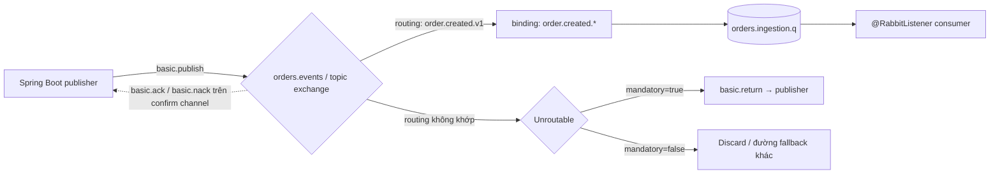
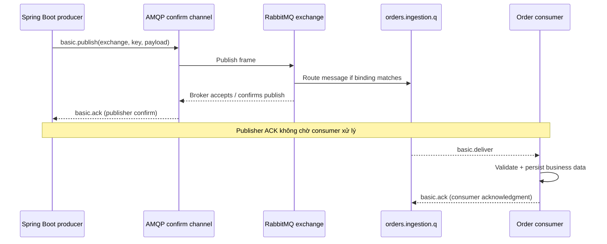
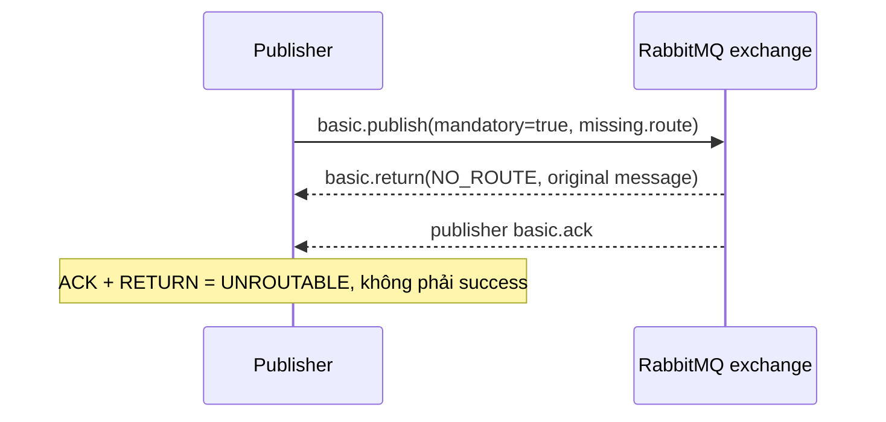
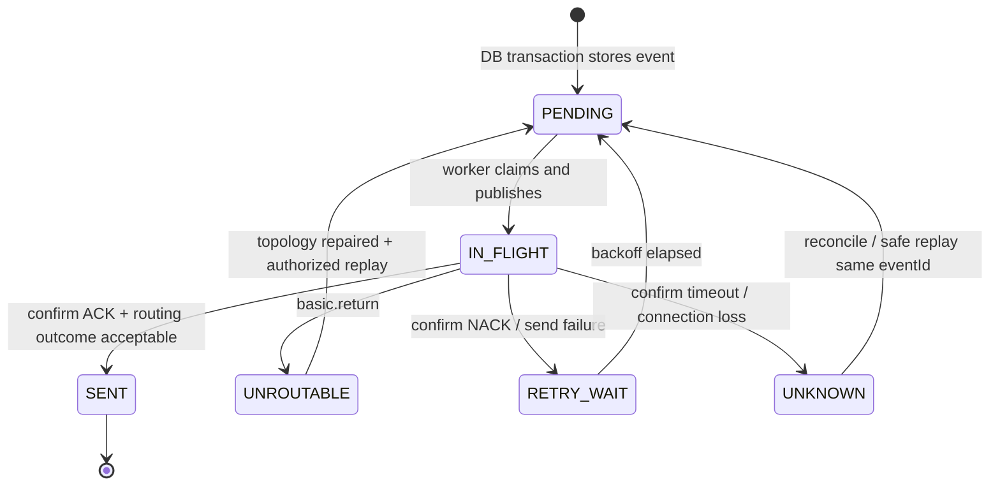
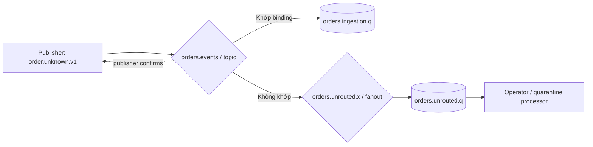
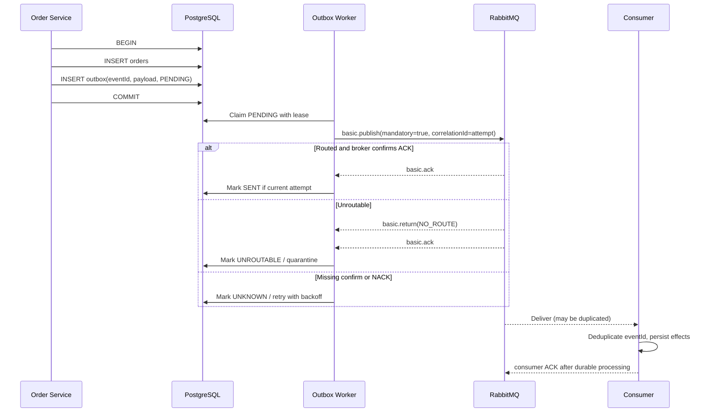
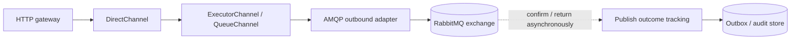
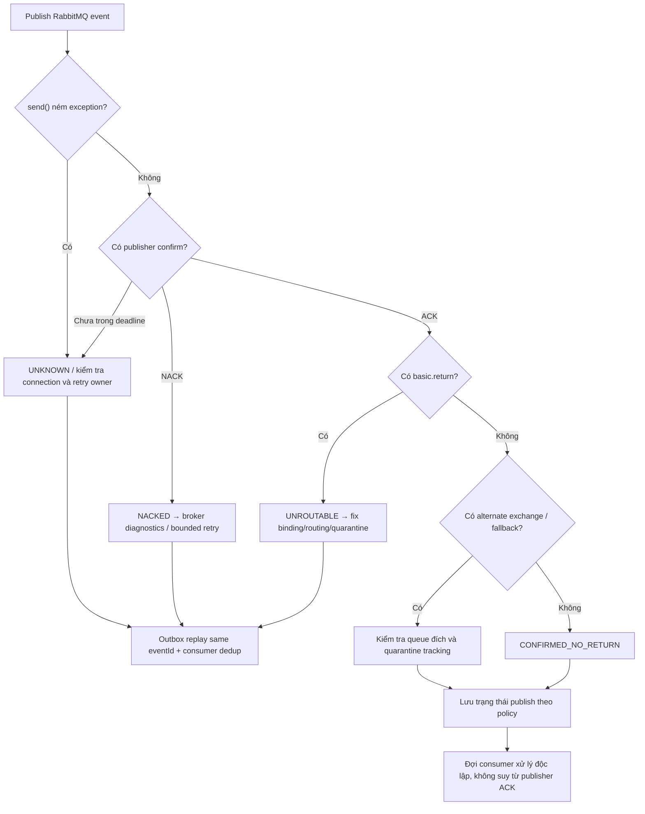

# Publisher confirms, returns và thông điệp không được định tuyến

> **Chương:** RabbitMQ và AMQP  
> **Module:** SPRING_BOOT_INTEGRATION — tổ chức tích hợp hệ thống Spring Boot qua HTTP client, cơ sở dữ liệu, cache, broker thông điệp và adapter Spring Integration; chú trọng quản lý cấu hình, hợp đồng dữ liệu, lỗi, xử lý trùng lặp, kiểm thử và quan sát luồng tích hợp thực tế.

## 1. Bài toán: RabbitTemplate.send() không chứng minh người nhận đã có message

Một dịch vụ đặt hàng ghi đơn vào PostgreSQL, sau đó gửi sự kiện `OrderCreated` tới RabbitMQ. Trong code:

```java
rabbitTemplate.convertAndSend(
        "orders.events", "order.created.v1", event);
```

Lời gọi không ném exception **không đồng nghĩa** message đã tới queue mong đợi, được lưu bền vững hay được consumer xử lý. Có ít nhất bốn tình huống rất khác nhau:

1. Exchange nhận message, định tuyến đến một hoặc nhiều queues; broker gửi **publisher confirm ACK**.
2. Exchange tồn tại nhưng **không có binding nào khớp routing key**. Nếu `mandatory=false` và không có đường đi dự phòng, broker có thể bỏ message trong khi publisher vẫn nhận confirm ACK.
3. `mandatory=true`, message không thể định tuyến: broker gửi **`basic.return`** (thông tin trả về) và vẫn có thể gửi **confirm ACK** vì broker đã xử lý thao tác publish ở exchange.
4. Đường truyền bị ngắt sau khi client gửi message nhưng trước khi nhận publisher confirm: **không biết chắc** broker đã nhận/lưu message hay chưa.

Nếu mã nghiệp vụ chỉ bắt exception từ `convertAndSend()` rồi ghi `sent=true`, hệ thống có thể mất sự kiện mà không phát hiện. Nếu ngược lại, cứ timeout là tạo message mới với event ID mới, consumer có thể xử lý trùng.

### 1.1. Mục tiêu học tập

Sau bài này, bạn có thể:

1. Giải thích đường đi **publisher → exchange → binding → queue → consumer** và những điểm message có thể thất lạc.
2. Phân biệt **publisher confirms** (broker xác nhận publish) với **publisher returns** (thông tin không định tuyến được) và **consumer acknowledgments**.
3. Cấu hình Spring Boot/RabbitMQ cho `publisher-confirm-type=correlated`, `publisher-returns=true` và `template.mandatory=true`.
4. Dùng `RabbitTemplate` và `CorrelationData` để phân loại ACK/NACK, returned message, send exception và timeout/chưa có confirm.
5. Xử lý thông điệp không được định tuyến bằng kiểm tra topology, binding, alternate exchange, quarantine và replay có kiểm soát.
6. Thiết kế **transactional outbox**, stable event ID, retry và idempotent consumer, tránh hiểu nhầm ACK là exactly-once.
7. Kiểm thử routing và publisher confirms/returns với RabbitMQ Testcontainers, đồng thời xây metrics, alerts và runbook.

### 1.2. Ba câu hỏi phải trả lời độc lập

| Câu hỏi | Tín hiệu phù hợp | Không chứng minh được |
| --- | --- | --- |
| Broker đã xử lý publish trên channel chưa? | **Publisher confirm ACK/NACK** | Có consumer nhận, đọc hoặc commit nghiệp vụ |
| Message có được định tuyến tới queue nào không? | **`basic.return`** khi mandatory và không có route; topology/fallback monitoring | ACK của consumer; queue thực sự là queue *dự định* nếu có fallback |
| Consumer đã xử lý thành công chưa? | **Consumer ACK**, kết quả nghiệp vụ, inbox/audit/metrics | Publisher confirm ACK không cung cấp kết quả xử lý cuối |

Ngay cả consumer ACK cũng chỉ có ý nghĩa theo **đúng thời điểm ứng dụng ACK**. Nếu listener ACK trước khi commit DB hoặc gửi HTTP downstream, consumer ACK không chứng minh mọi side effect đã hoàn tất.

## 2. AMQP routing: exchange khác queue

RabbitMQ nhận message gửi vào **exchange** cùng **routing key**. Exchange đánh giá **bindings** để chuyển message tới queue(s) tương ứng. Producer thông thường **không publish trực tiếp vào queue** (trừ khi dùng default exchange và routing key bằng queue name).



Đường nét xác nhận publish quay về publisher **không đi qua consumer**. Nếu exchange tìm thấy nhiều queues phù hợp, một publish có thể được route tới nhiều nơi; confirms vẫn phản ánh publish trên channel, không phải một ACK riêng cho mỗi consumer.

### 2.1. Bốn kiểu exchange phổ biến

| Exchange | Cách quyết định route | Ví dụ |
| --- | --- | --- |
| **Direct** | Routing key khớp binding key theo đúng giá trị | `billing.paid` |
| **Topic** | Pattern với `*` (một segment), `#` (0 hoặc nhiều segments) | `order.*.v1` khớp `order.created.v1` |
| **Fanout** | Gửi tới mọi queue được bind, bỏ qua routing key | Broadcast configuration event |
| **Headers** | Dựa vào message headers/binding arguments | Route theo thuộc tính không đặt trong key |

Trong bài này dùng **topic exchange** tên `orders.events` với routing key `order.created.v1`. Một queue có thể được bind bằng `order.*.v1` hoặc khóa cụ thể `order.created.v1`; nếu publisher gửi nhầm `orders.created.v1` (thừa chữ *s*) mà không có binding khớp, message trở thành **unroutable** dù JSON hoàn toàn hợp lệ.

### 2.2. Những trường hợp cần phân biệt

| Tình trạng | Publisher confirms | Publisher returns (mandatory) | Ý nghĩa |
| --- | --- | --- | --- |
| Exchange tồn tại, binding khớp queue | Thường ACK khi broker đã chấp nhận | Không return | Có đường route theo topology tại thời điểm publish |
| Exchange tồn tại, không queue nào khớp, không alternate route | **Có thể ACK** | `basic.return` khi mandatory | Exchange đã xử lý publish nhưng không có đích |
| Queue đã có message nhưng không có consumer online | Có thể ACK | Không return | **Có queue**; consumer offline không phải unroutable |
| Exchange không tồn tại | Lỗi channel/protocol, thường channel đóng | Không coi đây là `NO_ROUTE` return thông thường | Topology sai/không được khai báo |
| Exchange tồn tại, alternate exchange nhận fallback | Theo publish/broker rules | Hành vi phụ thuộc topology alternate; không mặc định return | Fallback nhận message, nhưng chưa chắc đúng destination nghiệp vụ |
| Queue nhận message rồi hết TTL hoặc vào DLX | Publisher confirm đã có từ trước | Không tạo publisher return muộn | Đây là vấn đề **sau routing**, phải giám sát queue/DLX |

**Nút thắt quan trọng:** “không có consumer đang chạy” **không đồng nghĩa** “không được định tuyến”. Một message nằm trong durable queue hoàn toàn có thể được consumer xử lý sau, miễn topology, persistence và khả năng khôi phục phù hợp.

### 2.3. Default exchange không miễn kiểm tra routing

Default exchange là direct exchange với tên rỗng `""`; RabbitMQ tự tạo binding của mỗi queue theo tên queue. Publish với routing key là queue name có thể tới queue tương ứng. Nếu tên queue sai hoặc queue không tồn tại, message vẫn có thể bị unroute. Không dựa vào default exchange để bỏ mandatory/returns hoặc bỏ kiểm tra queue provisioning.

### 2.4. Declare topology là một phần của hợp đồng

Một producer xuất bản `order.created.v1` cần thống nhất với consumer:

- Tên, loại và độ bền của exchange.
- Tên queue(s), loại queue (classic/quorum) và trạng thái durable.
- Routing key chính xác, binding pattern, vhost.
- Các arguments như alternate exchange, dead-letter exchange, TTL, queue length/overflow.
- Quyền `configure/write/read` phù hợp trên RabbitMQ user/vhost.

Đừng cho rằng “exchange và queue đều xuất hiện trong RabbitMQ UI” là đủ. **Binding** có thể thiếu, nằm ở vhost khác hoặc bị đổi sau deploy. Vận hành phải kiểm tra topology như một phần của release/rollback contract.

## 3. Publisher confirms: xác nhận từ broker chứ không từ consumer

Publisher confirms là cơ chế RabbitMQ cho broker gửi ACK hoặc NACK về **publisher channel ở chế độ confirm** sau khi broker xử lý publish. Đây là cơ chế cho biết broker đã chấp nhận/không chấp nhận một publish theo semantics của broker, thay vì chỉ biết client đã ghi bytes vào socket.

### 3.1. Timeline của publisher confirm



`basic.ack` từ broker dành cho **publisher confirm** và `basic.ack` từ **consumer acknowledgment** đều dùng tên AMQP gần giống, nhưng xuất hiện trên **những luồng/channels, trách nhiệm và thời điểm khác nhau**. Không đặt tên biến `processedSuccessfully` chỉ vì publisher nhận confirm.

### 3.2. ACK, NACK và “không có confirm”

| Tín hiệu | Có thể kết luận | Hành động gợi ý |
| --- | --- | --- |
| **Confirm ACK** | Broker đã xác nhận thao tác publish theo semantics channel/broker | Còn phải xét `basic.return` và yêu cầu durability |
| **Confirm NACK** | Broker không xác nhận thành công publish đó | Đánh dấu lỗi và đánh giá retry cùng eventId theo policy |
| **Không nhận confirm trước deadline** | Kết quả publish **chưa xác định** | Giữ outbox pending/unknown, đối soát/retry idempotent |
| **Client send exception** | Client/channel/connection không hoàn tất thao tác như dự định | Không suy chắc broker chưa nhận bytes; phân loại và lưu để recovery |

Với network failure, publisher có thể gửi thành công nhưng mất ACK trên đường về. **Retry có thể dẫn tới duplicate publish**, do đó logic consumer phải chịu được at-least-once và publisher cần stable event identity.

### 3.3. Confirm ACK có bảo đảm dữ liệu sống qua restart broker?

Mức bền vững phụ thuộc **durable exchange/queue, delivery mode, loại queue và chính sách broker**. Một publisher confirm với message được lưu đúng vào **durable queue** và publish dưới chế độ **persistent** giúp tăng bảo đảm dữ liệu, nhưng không biến toàn hệ thống thành exactly-once. RabbitMQ có các semantics khác nhau cho classic/quorum queues, replication/leader failover và storage failure.

| Thuộc tính | Ý nghĩa | Nếu thiếu |
| --- | --- | --- |
| Exchange durable | Exchange definition tồn tại qua broker restart theo cấu hình | Binding/topology có thể không còn như mong đợi |
| Queue durable | Queue definition bền vững | Queue transient có thể biến mất |
| Message persistent | Yêu cầu broker lưu message bền vững theo cơ chế queue | Transient message có thể mất khi broker restart |
| Publisher confirms | Biết broker phản hồi ACK/NACK cho publish attempt | Socket write thành công vẫn không cho kết quả broker |
| Quorum/HA policy | Bảo vệ trước một số dạng node failure theo quorum semantics | Một broker/node đơn lẻ vẫn là điểm lỗi |
| Consumer ACK đúng sau xử lý | Hạn chế mất dữ liệu do ACK sớm | Message có thể bị xóa trước khi business DB commit |

**Đừng đồng nhất** publisher confirms với consumer acknowledgments hoặc xác thực end-to-end. Publisher ACK chỉ giúp điều phối gửi, không chứng minh event đã được xử lý tại DB downstream.

### 3.4. Publisher confirms là bất đồng bộ

RabbitMQ có thể xác nhận nhiều publishes trên channel theo các sequence numbers, và thời điểm confirms không nhất thiết khớp thời điểm application thread gọi `send(...)`. Spring AMQP cung cấp `CorrelationData` để liên kết một confirm với **publish attempt** cụ thể.

Trong application có concurrency, không nên tự dùng một biến global `lastAck=true` hoặc gán ACK dựa vào thứ tự callback. Khi publish 100 messages, kết quả của mỗi attempt phải được gắn với correlation ID và metadata riêng.

## 4. Publisher returns: phát hiện message không được định tuyến

RabbitMQ gửi `basic.return` cho publisher khi message không thể được route theo điều kiện **`mandatory=true`** trong topology tương ứng. Return chứa thông tin publish bị trả về; nó **không phải NACK**, và cũng không phải dead-letter của consumer.

### 4.1. mandatory flag thay đổi gì?

```text
Exchange orders.events exists
Bindings:
  order.created.v1 -> orders.ingestion.q

Publish routing key = order.unknown.v1

mandatory=false:
  exchange accepts publish
  no matched queue -> may discard
  publisher confirm may still ACK
  no basic.return to alert application

mandatory=true:
  exchange accepts publish
  no matched queue -> basic.return (often NO_ROUTE, code 312)
  publisher confirm may still ACK
  application must mark attempt UNROUTABLE, not SUCCESS
```

`basic.return` thường có:

- `replyCode`, ví dụ **312** (`NO_ROUTE`).
- `replyText`, ví dụ `NO_ROUTE`.
- `exchange` và `routingKey` của publish.
- Message/payload và headers gốc, cần xử lý bảo mật cẩn thận.

Không đưa toàn bộ returned message payload lên log/metrics: nó có thể chứa thông tin đơn hàng, khách hàng hoặc dữ liệu tài chính.

### 4.2. Return có thể đến trước confirm ACK

Khi một publish vừa unroutable vừa được broker xác nhận xử lý ở exchange, trình tự có thể là:



Spring AMQP với **correlated publisher confirms + publisher returns** có cơ chế liên kết returned message với `CorrelationData`. Trong luồng Spring RabbitTemplate hỗ trợ này, returned message được gán vào correlation data **trước khi future confirm được hoàn tất**. Vì vậy bạn có thể xét `correlationData.getReturned()` khi xử lý future confirm, thay vì ra quyết định success ngay khi thấy `isAck() == true`.

**Quy tắc:** ACK của broker nghĩa là confirm được xử lý; để biết attempt có route hay không, phải xét **cả RETURN** nếu mandatory được bật. Không được đánh dấu outbox SENT chỉ dựa vào `confirm.isAck()`.

### 4.3. Return khác Dead Letter Queue

| Cơ chế | Khi nào xảy ra? | Vị trí message | Ai quan sát? |
| --- | --- | --- | --- |
| **Publisher return** | Publish không có route đủ điều kiện, có mandatory và không được fallback phù hợp | Chưa vào queue đích | Publisher, `ReturnsCallback` / `CorrelationData.getReturned()` |
| **Dead-lettering** | Message **đã vào queue**, sau đó bị reject/nack với requeue=false, TTL expire, queue overflow hoặc điều kiện DLX phù hợp | Từ queue gốc chuyển qua DLX/queue lỗi | Consumer/queue operators, DLQ monitoring |
| **Alternate exchange** | Exchange gốc không route được, chuyển sang exchange dự phòng nếu cấu hình | Đến fallback topology nếu có route | Broker topology, fallback queue consumer |
| **Consumer requeue** | Consumer nack/reject và yêu cầu requeue | Quay lại queue/được redeliver theo broker policy | Consumer/queue metrics |

Một ứng dụng chỉ quan sát DLQ sẽ không tự phát hiện **message bị bỏ do không có route** trước khi vào queue. Ngược lại, mandatory return không giúp phát hiện record bị consumer reject nhiều phút sau.

### 4.4. Nếu exchange không tồn tại thì sao?

Publish tới một **exchange không tồn tại** là protocol/topology error, thường dẫn tới channel exception/closure. Đây **không phải** loại unroutable thông thường của một exchange tồn tại nhưng không có binding. Client có thể báo lỗi qua channel/connection và publisher confirm có thể không về đúng như bạn kỳ vọng.

Không xử lý “exchange missing” bằng cách chờ mã return `NO_ROUTE`. Cần kiểm tra declare exchange, vhost, quyền user, startup ordering và topology contract. Tương tự, `ACCESS_REFUSED` không phải lỗi rate limit nên retry vô hạn.

## 5. Ghép confirms và returns thành kết quả có ý nghĩa

Một publisher đáng tin cậy cần phân biệt **trạng thái attempt** với **trạng thái event nghiệp vụ**. Một event có thể được gửi nhiều attempts sau network failure, nhưng vẫn giữ **một event ID logic**.

### 5.1. Ma trận outcome ở phía publisher

| Confirm | Returned message | Đã xảy ra điều gì? | Kết luận cho attempt |
| --- | --- | --- | --- |
| **ACK** | Không thấy return, mandatory và confirms/returns đã cấu hình đúng | Broker xác nhận, không báo unroutable ở đường publish này | `CONFIRMED_NO_RETURN`; có thể đánh dấu publish ACK theo policy |
| **ACK** | Có `NO_ROUTE` hoặc return tương ứng | Exchange xử lý publish nhưng không tìm thấy route phù hợp | **`UNROUTABLE`**, không coi là published-success |
| **NACK** | Không có | Broker không xác nhận publish thành công | **`NACKED`** |
| **NACK** | Có | Hai tín hiệu không thành công; cần giữ ngữ cảnh | **`NACKED`** và ghi nhận return để điều tra |
| **Chưa có** | Có return | Đã nhận tín hiệu không định tuyến, nhưng confirm chưa hoàn tất | **`UNROUTABLE / CONFIRM_PENDING`** theo state machine |
| **Chưa có** | Không có | Chưa biết broker đã nhận chưa, hoặc kênh mất kết nối | **`UNKNOWN`**, không gán `LOST` hay `SENT` |
| **Send exception** | Không xác định | Client gặp lỗi trước/giữa publish; có thể đã truyền một phần | **`UNKNOWN/FAILED_TO_SEND`** theo chứng cứ, cần recovery |

**Nhãn `CONFIRMED_NO_RETURN` có chủ đích.** Nó mạnh hơn “không ném exception” nhưng yếu hơn “consumer đã xử lý”. Nếu exchange có alternate exchange, binding ngoài dự kiến hoặc message bị TTL/DLX về sau, không thể suy ra từ publisher ACK rằng **queue nghiệp vụ mong đợi** đã xử lý sự kiện.

### 5.2. Những giới hạn của trạng thái “ACK và không return”

Để coi `ACK + no return` là thành công ở **ranh giới phát message**, cần có điều kiện:

1. Broker bật publisher confirms và ứng dụng thực sự chờ **confirm của attempt tương ứng**.
2. `mandatory=true` hoặc có cơ chế kiểm chứng routing tương đương.
3. Publisher returns được bật và correlation không bị bỏ lỡ.
4. Exchange/queue/binding đúng vhost, deployment version và contract.
5. Delivery mode, queue type và durability phù hợp SLA.
6. Kết quả được lưu bền vững nếu producer JVM có thể chết ngay sau callback.

Nếu thay đổi một trong các điều kiện, `confirm ACK` vẫn có thể đúng theo protocol, nhưng điều ứng dụng tưởng là “đã đến đích” có thể sai.

### 5.3. Event ID khác publish attempt ID

```text
Business event:
  eventId   = evt-order-42-created-v1       // Stable across retries
  orderId   = order-42
  eventType = OrderCreated

Rabbit publish attempt #1:
  correlationId = evt-order-42-created-v1/attempt-1
  result        = UNKNOWN (connection lost)

Rabbit publish attempt #2:
  correlationId = evt-order-42-created-v1/attempt-2
  result        = CONFIRMED_NO_RETURN

Consumer:
  deduplication key = evt-order-42-created-v1
```

Correlation ID giúp ghép confirm/return với **một attempt**. Event ID giúp chống trùng **giữa các attempts**. Không phát sinh event ID mới chỉ vì cần retry publish: đó sẽ là **một sự kiện logic khác** đối với consumer.

### 5.4. Trạng thái trong outbox

Một ví dụ state machine cho message cần publish:



Trạng thái thực tế có thể cần thêm `FAILED_PERMANENT`, `QUARANTINED`, `DEAD_LETTERED` và `RECONCILE_REQUIRED`. Quan trọng nhất: **không biến UNKNOWN thành FAILED chắc chắn rồi phát event ID mới**, không biến UNROUTABLE thành SENT chỉ vì broker đã confirm ACK.

## 6. Cấu hình Spring Boot để nhận đủ tín hiệu

Các ví dụ dưới đây nhắm **Java 17+, Spring Boot 3.2–3.5 và Spring AMQP 3.x** (Spring Framework 6.x). Nếu sử dụng Spring Boot 4.x/Spring AMQP 4.x hoặc các driver khác, cần đối chiếu API/config properties theo BOM tương ứng; không trộn version Spring jars tùy ý.

### 6.1. Dependency

```groovy
// build.gradle — dự án đã áp dụng Spring Boot Gradle plugin/BOM.
dependencies {
    implementation 'org.springframework.boot:spring-boot-starter-amqp'
    testImplementation 'org.springframework.boot:spring-boot-starter-test'
}
```

Starter AMQP cấu hình hạ tầng RabbitMQ (connection factory, `RabbitTemplate` và listener support khi đủ điều kiện). Không cần đưa Kafka hoặc WebFlux vào classpath để dùng publisher confirms của RabbitMQ.

### 6.2. application.yml: ba cấu hình cần đi cùng nhau

```yaml
spring:
  rabbitmq:
    host: ${RABBITMQ_HOST:localhost}
    port: ${RABBITMQ_PORT:5672}
    virtual-host: ${RABBITMQ_VHOST:/}
    username: ${RABBITMQ_USERNAME}
    password: ${RABBITMQ_PASSWORD}

    publisher-confirm-type: correlated
    publisher-returns: true
    template:
      mandatory: true
```

| Cấu hình | Tác dụng | Nếu thiếu |
| --- | --- | --- |
| `publisher-confirm-type: correlated` | Bật publisher confirms có correlation data/future theo message | Không thể dựa vào future confirm cho từng attempt |
| `publisher-returns: true` | Cho phép xử lý returned messages từ broker | Unroutable may not be surfaced như bạn mong đợi |
| `template.mandatory: true` | Yêu cầu broker trả về message không định tuyến được theo semantics tương ứng | Message có thể bị drop nếu không route, trong khi confirm vẫn ACK |

**Không nhầm** `spring.rabbitmq.publisher-confirm-type` với consumer manual acknowledgment. Listener property `spring.rabbitmq.listener.simple.acknowledge-mode` điều khiển consumer; nó **không bật publisher confirms**.

Nếu ứng dụng có **nhiều `RabbitTemplate` beans**, cần xác nhận producer thật dùng bean nào và các settings trên có được áp dụng hay không. Một `RabbitTemplate` khởi tạo thủ công bằng `new` có thể bỏ qua Boot template customizers, publisher returns, serializer và observation. Có thể dùng builder/configurer thích hợp, nhưng không tạo thêm template khi chỉ cần inject bean mặc định.

### 6.3. Quản lý kết nối và TLS

Với broker thực tế:

- Chọn `vhost`/user có quyền tối thiểu: publish exchange, declare topology nếu ứng dụng được phép, read queue chỉ ở consumer.
- Dùng TLS khi đường kết nối yêu cầu; không tắt certificate verification để bỏ qua lỗi handshake.
- Cấu hình connection recovery/heartbeat và giới hạn connection/channel theo khả năng broker.
- Xác minh queue/exchange đã được tạo trước khi publish lưu lượng thật, nhất là khi phân quyền không cho producer `configure`.
- Không hard-code username/password, raw routing identifiers chứa PII hoặc credentials trong log.

Trong nhiều cluster, broker management endpoint và AMQP endpoint có thể khác nhau. Dashboard RabbitMQ hiển thị queue tồn tại chưa chứng minh application đang kết nối **đúng vhost**.

## 7. Khai báo exchange, queue, binding như một hợp đồng

Ví dụ Spring AMQP sau cho phép publisher gửi `order.created.v1` vào queue `orders.ingestion.q`:

```java
import org.springframework.amqp.core.Binding;
import org.springframework.amqp.core.BindingBuilder;
import org.springframework.amqp.core.Queue;
import org.springframework.amqp.core.QueueBuilder;
import org.springframework.amqp.core.TopicExchange;
import org.springframework.context.annotation.Bean;
import org.springframework.context.annotation.Configuration;

@Configuration(proxyBeanMethods = false)
public class OrderRabbitTopology {
    public static final String EXCHANGE = "orders.events";
    public static final String QUEUE = "orders.ingestion.q";
    public static final String ROUTING_KEY = "order.created.v1";

    @Bean
    TopicExchange ordersExchange() {
        return new TopicExchange(EXCHANGE, true, false);
    }

    @Bean
    Queue ordersIngestionQueue() {
        return QueueBuilder.durable(QUEUE).build();
    }

    @Bean
    Binding ordersCreatedBinding(
            Queue ordersIngestionQueue,
            TopicExchange ordersExchange) {
        return BindingBuilder.bind(ordersIngestionQueue)
                .to(ordersExchange)
                .with(ROUTING_KEY);
    }
}
```

Trong ứng dụng Spring Boot có `RabbitAdmin`/`AmqpAdmin` phù hợp, các `Declarable` beans có thể được tự declare khi connection được thiết lập. Tuy nhiên **không giả định** auto-declaration chắc chắn thành công: broker có thể trả `PRECONDITION_FAILED` nếu cùng tên exchange đã tồn tại với loại/durability/arguments khác, hoặc tài khoản thiếu quyền `configure`.

**Production migration:** tránh thay trực tiếp thuộc tính immutable của exchange/queue đang tồn tại như đổi type hoặc một số arguments. Thường cần tạo topology mới có version, chuyển bindings/consumers và dọn cũ theo runbook. Không xóa queue đang có message chỉ để làm application startup thành công.

### 7.1. Hợp đồng routing key có version

```text
Event type: OrderCreated
Event schema version: v1
Routing key: order.created.v1
Exchange: orders.events
Primary queue: orders.ingestion.q
Dead-letter policy: defined for consumer failures, not publisher returns
```

Khi provider nâng sang `order.created.v2`, có thể tạo binding mới và hỗ trợ song song v1/v2 trong rollout. Nếu producer đổi routing key trước khi queue được bind, publisher confirms có thể vẫn ACK nhưng returns báo **NO_ROUTE**. Đây là sự cố deploy order/contract, không phải lỗi JSON serialization.

### 7.2. Test binding không chỉ kiểm tra tên queue

Hai hệ thống có thể cùng có exchange `orders.events` và queue `orders.ingestion.q`, nhưng:

- Exchange được tạo `direct` trong khi consumer mong `topic`.
- Binding dùng `orders.created.v1` thay vì `order.created.v1`.
- Producer gửi vào `/dev` còn queue nằm ở `/prod`.
- Exchange có alternate route và message đi vào quarantine thay vì queue chính.
- Queue được bind nhưng bị policy TTL/overflow làm message bị drop/dead-letter rất sớm.

Contract test phải xác nhận **một publish với routing key cụ thể thực sự được route tới queue mong đợi**, đồng thời xác nhận routing key sai được nhận diện.

### 7.3. Vì sao không tạo queue trong publish hot path?

Để writer `RabbitTemplate` tự tạo exchange/queue/binding ở mỗi publish là kiến trúc khó quản lý:

- Tăng RPC tới broker và độ trễ.
- Nguy cơ race giữa instances khác versions.
- Producer có thể cần quyền `configure` rộng hơn mức cần thiết.
- Sai topology bị che giấu bởi việc publisher tự sửa trạng thái broker.

Ưu tiên IaC/declarables có kiểm soát và kiểm tra readiness/topology trước khi bật publisher. Nếu hệ thống thật sự tạo queue động theo tenant, phải có lifecycle, quota, security và cleanup rõ ràng.

## 8. RabbitTemplate + CorrelationData: theo dõi một publish attempt

Một integration publisher cần gửi JSON có event ID và nhận kết quả **bất đồng bộ**. Không nên giữ thread HTTP chờ broker trong thời gian dài chỉ vì muốn biết RabbitMQ đã ACK; nếu nghiệp vụ yêu cầu durable delivery, một **outbox worker** có thể xử lý callbacks rồi cập nhật state.

### 8.1. Event DTO với định danh ổn định

```java
// OrderCreatedEvent.java
import java.time.Instant;

public record OrderCreatedEvent(
        String eventId,
        String orderId,
        String customerId,
        Instant occurredAt,
        int schemaVersion) {
}
```

Trong ví dụ:

- `eventId` đại diện **một sự kiện nghiệp vụ**, giữ nguyên khi retry.
- `orderId` là aggregate key để consumer dedup/ordering theo yêu cầu.
- `schemaVersion` cho phép consumers kiểm tra hợp đồng dữ liệu.
- `occurredAt` là timestamp sự kiện, **không phải thời điểm mỗi lần retry**.
- `attemptId` **không nằm trong event DTO** vì đó là metadata của một lượt gửi, có thể thay đổi mỗi lần.

Đối với payload JSON gửi ra broker, dùng DTO dành riêng cho event; không serialize trực tiếp JPA entity chứa lazy references, secret hoặc cấu trúc database nội bộ.

### 8.2. Định nghĩa kết quả publish có thể xử lý được

```java
// PublishStatus.java
public enum PublishStatus {
    CONFIRMED_NO_RETURN,
    UNROUTABLE,
    NACKED,
    UNKNOWN
}
```

```java
// PublishAttemptResult.java
public record PublishAttemptResult(
        String eventId,
        String attemptId,
        PublishStatus status,
        Integer returnCode,
        String errorCode) {
}
```

Các status ở đây là **mô hình nội bộ của ứng dụng**, không phải các tên trạng thái AMQP chính thức. Phần `errorCode` chỉ lưu mã chẩn đoán an toàn, không lưu raw exception message, body JSON hoặc routing key có thể chứa thông tin nhạy cảm.

### 8.3. Gửi message persistent và chờ CorrelationData future

```java
// OrderCreatedRabbitPublisher.java
import com.fasterxml.jackson.core.JsonProcessingException;
import com.fasterxml.jackson.databind.ObjectMapper;
import java.util.Objects;
import java.util.concurrent.CompletableFuture;
import org.springframework.amqp.AmqpException;
import org.springframework.amqp.core.Message;
import org.springframework.amqp.core.MessageDeliveryMode;
import org.springframework.amqp.core.MessageProperties;
import org.springframework.amqp.core.ReturnedMessage;
import org.springframework.amqp.rabbit.connection.CorrelationData;
import org.springframework.amqp.rabbit.core.RabbitTemplate;
import org.springframework.stereotype.Component;

@Component
public class OrderCreatedRabbitPublisher {
    private final RabbitTemplate rabbitTemplate;
    private final ObjectMapper mapper;

    public OrderCreatedRabbitPublisher(
            RabbitTemplate rabbitTemplate,
            ObjectMapper mapper) {
        this.rabbitTemplate = rabbitTemplate;
        this.mapper = mapper;
    }

    public CompletableFuture<PublishAttemptResult> publish(
            OrderCreatedEvent event,
            String attemptId) throws JsonProcessingException {

        Objects.requireNonNull(event, "event");
        if (event.eventId() == null || event.eventId().isBlank()
                || attemptId == null || attemptId.isBlank()) {
            throw new IllegalArgumentException(
                    "eventId and attemptId are required");
        }

        MessageProperties props = new MessageProperties();
        props.setContentType(MessageProperties.CONTENT_TYPE_JSON);
        props.setDeliveryMode(MessageDeliveryMode.PERSISTENT);
        props.setMessageId(event.eventId());
        props.setHeader("eventId", event.eventId());
        props.setHeader("schemaVersion", event.schemaVersion());

        byte[] body = mapper.writeValueAsBytes(event);
        Message message = new Message(body, props);

        CorrelationData correlation = new CorrelationData(attemptId);
        CompletableFuture<PublishAttemptResult> outcome =
                new CompletableFuture<>();

        try {
            rabbitTemplate.send(
                    OrderRabbitTopology.EXCHANGE,
                    OrderRabbitTopology.ROUTING_KEY,
                    message,
                    correlation);
        } catch (AmqpException sendFailure) {
            // Không thể suy chắc broker đã/ chưa nhận publish.
            outcome.complete(new PublishAttemptResult(
                    event.eventId(), attemptId,
                    PublishStatus.UNKNOWN,
                    null, "SEND_FAILURE"));
            return outcome;
        }

        correlation.getFuture().whenComplete((confirm, error) -> {
            if (error != null || confirm == null) {
                outcome.complete(new PublishAttemptResult(
                        event.eventId(), attemptId,
                        PublishStatus.UNKNOWN,
                        null, "CONFIRM_ERROR"));
                return;
            }

            if (!confirm.isAck()) {
                outcome.complete(new PublishAttemptResult(
                        event.eventId(), attemptId,
                        PublishStatus.NACKED,
                        null, "BROKER_NACK"));
                return;
            }

            ReturnedMessage returned = correlation.getReturned();
            if (returned != null) {
                outcome.complete(new PublishAttemptResult(
                        event.eventId(), attemptId,
                        PublishStatus.UNROUTABLE,
                        returned.getReplyCode(),
                        "RETURNED"));
                return;
            }

            outcome.complete(new PublishAttemptResult(
                    event.eventId(), attemptId,
                    PublishStatus.CONFIRMED_NO_RETURN,
                    null, null));
        });

        return outcome;
    }
}
```

Đây là ví dụ minh họa theo **Spring AMQP 3.x với `CorrelationData.getFuture()` trả `CompletableFuture<CorrelationData.Confirm>`**. Nó giả định Spring Boot đã inject `RabbitTemplate` đang dùng `publisher-confirm-type=correlated`, returns enabled và mandatory. Nếu một cấu hình bị thiếu, không nên dùng outcome `CONFIRMED_NO_RETURN` như bằng chứng route an toàn.

**Ba chi tiết rất quan trọng:**

1. `rabbitTemplate.send(...)` chỉ khởi phát publish. `outcome` hoàn tất khi **confirm future** nhận kết quả; gọi `send` không ném exception không được xem là ACK.
2. Với confirm ACK, code **kiểm tra `correlation.getReturned()` trước khi đánh dấu thành công**. Spring hỗ trợ ghép return vào correlation data trước khi hoàn tất confirm future trong cấu hình tương ứng.
3. `outcome` có thể **không hoàn tất trong thời gian hữu hạn** nếu confirm không về. Production cần timeout watchdog/deadline ở worker hoặc tracking store để đưa attempt sang `UNKNOWN` và xử lý lại. Không coi việc không có callback sau N giây là NACK.

Ở callback confirm, chỉ làm công việc nhẹ, không query PostgreSQL chậm hoặc gọi HTTP blocking trực tiếp trên thread xử lý callback. Hãy chuyển state update tới executor/worker do ứng dụng quản lý hoặc cơ chế outbox có giới hạn tải và chống mất trạng thái khi JVM chết.

### 8.4. Xử lý JSON serialization error trước khi gửi

`mapper.writeValueAsBytes(...)` có thể ném `JsonProcessingException` **trước khi send**. Đây là lỗi xây payload/schema phía producer và thường không nên retry nguyên input vô hạn. Ví dụ method khai báo `throws JsonProcessingException` để caller phân biệt với `AmqpException` và broker confirm.

Nếu serialize thất bại, **không** tạo “send attempt thành công”; nên đưa event vào trạng thái `FAILED_PERMANENT` hoặc quarantine để sửa code/data contract. Với outbox, có thể serialize event khi ghi intent vào DB, đảm bảo payload thực sự tồn tại trước khi worker bắt đầu publish.

### 8.5. Tại sao future confirm không tự là một delivery guarantee?

`CompletableFuture<PublishAttemptResult>` là **trạng thái trong bộ nhớ JVM**. Nếu process chết sau khi broker ACK nhưng trước khi result được ghi vào database, một future đã hoàn tất không cứu được tiến độ ứng dụng. Đối với event bắt buộc giao:

- Lưu event/payload/eventId bền vững **trước khi publish**.
- Theo dõi attempt ID riêng để map ACK/RETURN/NACK.
- Khi ACK+route phù hợp, cập nhật outbox state bền vững.
- Nếu chết/mất confirm, replay cùng event ID và consumer dedup.

Không giữ một HTTP request đồng bộ mở vô thời hạn chờ `CompletableFuture.join()`. Nếu API cần phản hồi xác nhận phát event, định nghĩa **timeout/deadline** và phân biệt “broker confirmed” với “event đã được business consumer xử lý”.

## 9. ReturnsCallback và ConfirmCallback: khi nào cần?

Spring AMQP có các callbacks cấp `RabbitTemplate` ngoài future của `CorrelationData`:

- `RabbitTemplate.ConfirmCallback` cho thông tin confirm ACK/NACK kèm correlation data.
- `RabbitTemplate.ReturnsCallback` nhận một `ReturnedMessage` khi message bị trả về.
- `CorrelationData.getFuture()` cho xử lý confirm **theo từng publish attempt** và `getReturned()` cho thông điệp returned gắn với attempt đó trong cấu hình phù hợp.

### 9.1. Một callback cấp template cho toàn bộ publisher

```java
// Fragment cấu hình trên RabbitTemplate DÙNG CHUNG của ứng dụng:
rabbitTemplate.setReturnsCallback(returned -> {
    int replyCode = returned.getReplyCode();
    String replyText = returned.getReplyText();
    String exchange = returned.getExchange();
    String routingKey = returned.getRoutingKey();

    // Ghi metric: partner=rabbitmq, outcome=unroutable,
    // replyCode=replyCode. Tránh log raw payload/headers.
    recordUnroutableMetric(replyCode, exchange);
});
```

Đây là **fragment**, giả định `rabbitTemplate` và `recordUnroutableMetric(...)` đã được định nghĩa. Callback nhận tất cả returns của template, không phải một callback riêng mỗi publish. Các template callbacks kiểu này thường chỉ có **một registration được sở hữu rõ**; không để nhiều beans tùy tiện gọi `setReturnsCallback(...)` rồi overwrite nhau.

Để xây business outcome per event, **ưu tiên ghép với correlation data**. Callback tổng có thể hữu ích cho metric/diagnostic, nhưng nó không thay yêu cầu cập nhật đúng outbox event.

### 9.2. ConfirmCallback truyền thống

```java
// Fragment thay thế cho phần xử lý confirm qua CorrelationData future:
rabbitTemplate.setConfirmCallback(
        (correlationData, ack, cause) -> {
            String attemptId = correlationData == null
                    ? "unknown" : correlationData.getId();

            if (!ack) {
                recordPublisherNack(attemptId);
            } else if (correlationData != null
                    && correlationData.getReturned() != null) {
                recordUnroutableAttempt(attemptId);
            } else {
                recordPublisherAck(attemptId);
            }
        });
```

Các `recordPublisher*` trong fragment là hàm service/metrics minh họa; không phải API của Spring. Chỉ có **một confirm callback per template**, nên hãy chọn mô hình quản lý rõ thay vì vừa đăng ký callbacks rải rác vừa cập nhật trạng thái outbox ở nhiều nơi. Khi dùng `CorrelationData.getFuture()`, phần logic confirm per attempt thường không cần đăng ký thêm `ConfirmCallback`.

### 9.3. Đừng để callback xử lý chậm

Callbacks xử lý trên hạ tầng messaging client. Nếu callback bị block bởi JDBC write, HTTP call, sleep/retry dài hoặc disk I/O:

- ACK/RETURN khác có thể bị chậm xử lý.
- Bộ nhớ giữ futures/correlation state tăng.
- Thread pool có thể bị nghẽn và làm chậm throughput.
- Một exception không được xử lý trong callback có thể phá báo cáo kết quả.

Nên cập nhật in-memory outcome thật nhẹ và chuyển nhiệm vụ IO sang worker bounded, có durable state và timeout recovery. **Không** đưa event payload lớn vào MDC hay metric labels trên callback.

## 10. Unroutable không phải duplicate, NACK hay consumer reject

Một ví dụ RabbitMQ điển hình:

```text
exchange: orders.events (topic)
binding:  order.created.v1 -> orders.ingestion.q
publish:  routingKey = order.cancelled.v1

Result:
  Exchange exists: YES
  Binding match:  NO
  Mandatory:      TRUE
  basic.return:   NO_ROUTE
  confirm:        ACK possible

Next action:
  Fix routing key/binding OR quarantine event.
  Do NOT mark as SENT solely because confirm ACKed.
```

Một số nguyên nhân:

| Nhóm lỗi | Ví dụ | Hành động |
| --- | --- | --- |
| **Sai routing key** | Producer gửi `orders.created.v1` thay cho `order.created.v1` | Sửa schema/routing contract, regression test |
| **Binding chưa được declare** | Consumer deployment chưa tạo binding | Khôi phục topology, kiểm tra deploy ordering |
| **Sai vhost** | Producer ghi vào `/tenantA`, queue ở `/tenantB` | Xác minh namespace và credentials |
| **Sai exchange type** | `direct` thay vì `topic` | Migration topology có version; tránh thay bừa trên broker |
| **Không có queue đích** | Queue bị xóa hoặc auto-delete | Khôi phục queue theo SLA; xem policy/permissions |
| **Routing pattern quá hẹp** | Binding `order.created.v1` không khớp `order.created.v2` | Thỏa thuận versioning, dual bindings |
| **Alternate exchange** | Event được chuyển sang quarantine queue | Theo dõi fallback và tạo runbook re-drive |
| **Quyền/configuration** | User không declare được binding | Sửa quyền/IaC, không retry publish mù |

**Không sửa sự cố bằng cách “bật mandatory=false”** chỉ để hết nhận returned events. Điều đó có thể che giấu data loss. Với một event bắt buộc, giải pháp đúng là sửa đường route hoặc lưu/quarantine durable state cho tới khi có thể replay.

## 11. Alternate exchange: fallback khi không route được

RabbitMQ hỗ trợ **alternate exchange (AE)**: khi exchange gốc không route được message vào queue theo bindings, broker có thể chuyển message sang một exchange khác do cấu hình `alternate-exchange`. Đây là cách thiết kế một đường nhận các event **không khớp route chính** thay vì bỏ message.



### 11.1. Mẫu khai báo một alternate exchange

```java
import java.util.Map;
import org.springframework.amqp.core.Binding;
import org.springframework.amqp.core.BindingBuilder;
import org.springframework.amqp.core.FanoutExchange;
import org.springframework.amqp.core.Queue;
import org.springframework.amqp.core.QueueBuilder;
import org.springframework.amqp.core.TopicExchange;
import org.springframework.beans.factory.annotation.Qualifier;
import org.springframework.context.annotation.Bean;
import org.springframework.context.annotation.Configuration;

@Configuration(proxyBeanMethods = false)
public class OrderRabbitAlternateTopology {

    @Bean("ordersExchange")
    TopicExchange ordersExchangeWithAlternate() {
        return new TopicExchange(
                "orders.events",
                true,
                false,
                Map.of("alternate-exchange", "orders.unrouted.x"));
    }

    @Bean("unroutedExchange")
    FanoutExchange unroutedExchange() {
        return new FanoutExchange(
                "orders.unrouted.x", true, false);
    }

    @Bean("unroutedQueue")
    Queue unroutedQueue() {
        return QueueBuilder.durable("orders.unrouted.q").build();
    }

    @Bean
    Binding unroutedQueueBinding(
            @Qualifier("unroutedQueue") Queue queue,
            @Qualifier("unroutedExchange") FanoutExchange exchange) {
        return BindingBuilder.bind(queue).to(exchange);
    }
}
```

**Đây là một cấu hình thay thế/minh họa, không chạy đồng thời với định nghĩa `ordersExchange()` ở mục 7 nếu cùng tên exchange nhưng arguments khác nhau.** Broker có thể từ chối re-declare một exchange tồn tại với arguments không tương thích. Nếu dùng AE thật, cập nhật topology/IaC theo version, khai báo/giám sát queue fallback và giữ binding đến `orders.ingestion.q` theo hợp đồng.

### 11.2. AE không giống basic.return hay dead-letter exchange

Nếu alternate exchange **nhận và định tuyến được** message, publish có thể hoàn tất mà không có `basic.return` dù binding gốc không khớp. Vì vậy:

- **ACK + không return** không bảo đảm message nằm trong **queue chính** khi có AE.
- Fallback queue phải được coi là **quarantine/unrouted workload**, có người sở hữu, metric, retention và re-drive policy.
- Không để event ở fallback queue vô thời hạn rồi báo xuất bản thành công tới business workflow.
- Không coi AE là cơ chế xử lý lỗi từ consumer; một message đã vào queue chính rồi bị reject/expire được điều khiển bằng **dead-lettering**, không phải return lúc publish.

Nếu fallback cũng không thể route hoặc bị policy drop, hiệu ứng trả về/retention phải được kiểm chứng theo **broker version và topology thực**. Một AE định cấu hình sai không tự tạo guarantee dữ liệu bền vững; cần integration test và broker monitoring.

### 11.3. Re-drive từ fallback an toàn

1. Đọc eventId, schema version, exchange/routing metadata và lý do quarantine.
2. Sửa topology hoặc mapping routing key bằng thay đổi đã được review.
3. Re-publish **cùng business event ID**, tạo attempt correlation ID mới.
4. Theo dõi confirm/return mới, tránh vòng lặp từ exchange gốc quay lại fallback.
5. Consumer deduplicate event ID trước khi ghi dữ liệu.
6. Ghi audit ai đã re-drive, số attempts và kết quả; không log payload nhạy cảm.

Nếu event cần xử lý theo đúng thứ tự so với các events mới, re-drive một event cũ có thể gây đảo thứ tự; consumer phải kiểm tra aggregate version/sequence hoặc có chiến lược replay theo business semantics.

## 12. Transactional outbox: không mất event khi process chết

Publisher confirms giúp biết broker đã phản hồi, **không giải quyết khoảng trống giữa PostgreSQL commit và RabbitMQ publish**. Giả sử Spring service ghi order và gọi `RabbitTemplate.send(...)`:

```text
1. PostgreSQL COMMIT order
2. JVM crashes
3. RabbitMQ event was never published
```

Đổi thứ tự cũng chưa chắc an toàn:

```text
1. RabbitMQ ACKs OrderCreated
2. PostgreSQL transaction rolls back
3. Consumer receives event about order that does not exist
```

**Transactional outbox** đưa business change và **ý định phát event** vào **cùng một SQL transaction**, sau đó worker publish ra broker.

### 12.1. Luồng DB + outbox + publisher confirms



Mục tiêu là **at-least-once delivery với khả năng phục hồi**, không phải exactly-once xuyên PostgreSQL và RabbitMQ. Nếu worker chết sau confirm ACK nhưng trước khi cập nhật `SENT`, outbox có thể phát lại message. Consumer cần idempotent write.

### 12.2. Schema outbox minh họa

```sql
CREATE TABLE order_outbox (
    event_id          VARCHAR(120) PRIMARY KEY,
    aggregate_id      VARCHAR(120) NOT NULL,
    event_type        VARCHAR(80) NOT NULL,
    exchange_name     VARCHAR(120) NOT NULL,
    routing_key       VARCHAR(120) NOT NULL,
    payload_json      JSONB NOT NULL,
    status            VARCHAR(30) NOT NULL,
    attempt_count     INTEGER NOT NULL DEFAULT 0,
    current_attempt   VARCHAR(160),
    lease_expires_at  TIMESTAMPTZ,
    next_attempt_at   TIMESTAMPTZ,
    last_error_code   VARCHAR(80),
    created_at        TIMESTAMPTZ NOT NULL DEFAULT CURRENT_TIMESTAMP,
    updated_at        TIMESTAMPTZ NOT NULL DEFAULT CURRENT_TIMESTAMP,
    version           BIGINT NOT NULL DEFAULT 0,
    CONSTRAINT order_outbox_status_check
      CHECK (status IN (
        'PENDING', 'IN_FLIGHT', 'SENT',
        'UNKNOWN', 'RETRY_WAIT', 'UNROUTABLE',
        'QUARANTINED'))
);

CREATE INDEX order_outbox_claim_idx
    ON order_outbox (status, next_attempt_at, created_at);
```

Đây là **schema nghiệp vụ minh họa**, không phải DDL bắt buộc của Spring AMQP. Trong hệ thống thật, cần migration, tenant isolation, retention, payload schema/version, kích thước message, max attempts, optimistic locking và cơ chế khai thác lease đầy đủ.

### 12.3. Claim batch với lease, không giữ SQL transaction qua network

Ý tưởng PostgreSQL:

```sql
-- Trong một transaction NGẮN: chọn và claim những events đến hạn.
SELECT event_id, payload_json, exchange_name, routing_key
FROM order_outbox
WHERE status IN ('PENDING', 'RETRY_WAIT', 'UNKNOWN')
  AND (next_attempt_at IS NULL OR next_attempt_at <= CURRENT_TIMESTAMP)
ORDER BY created_at
LIMIT 50
FOR UPDATE SKIP LOCKED;

-- Sau khi claim, cập nhật status=IN_FLIGHT, current_attempt,
-- lease_expires_at, attempt_count và COMMIT.
-- Gọi RabbitMQ SAU KHI transaction claim đã commit.
```

Đoạn SQL mô tả **bước chọn** trong transaction; implementation production phải thực hiện update claim/lease trước khi commit, xử lý lease expiry và cách tranh chấp giữa nhiều workers. Không để một transaction giữ row locks trong lúc chờ broker confirms hoặc retry backoff.

### 12.4. Update outbox phải ràng buộc attempt

Một late ACK của attempt #1 có thể đến sau khi lease hết hạn và attempt #2 đã được phát. Không cho callback cũ ghi đè trạng thái mới:

```sql
UPDATE order_outbox
   SET status = 'SENT',
       last_error_code = NULL,
       updated_at = CURRENT_TIMESTAMP,
       version = version + 1
 WHERE event_id = :event_id
   AND current_attempt = :attempt_id
   AND status = 'IN_FLIGHT';
```

`:event_id` và `:attempt_id` là **named parameters** cho JDBC/SQL client hỗ trợ, không phải cú pháp native PostgreSQL khi paste trực tiếp vào `psql`. Nếu `rowsUpdated=0`, callback có thể đã **stale**; không tự sửa state bằng một UPDATE không có điều kiện.

Nếu confirm ACK + return, ghi `UNROUTABLE`/quarantine thay vì `SENT`. Nếu NACK, ghi `RETRY_WAIT` với reason code, budget và backoff. Nếu connection chết/confirm timeout, ghi `UNKNOWN` rồi replay **cùng event ID** khi policy cho phép.

### 12.5. Idempotent consumer không phải tùy chọn

Consumer phải có một key đã xử lý:

```sql
CREATE TABLE processed_message (
    consumer_name   VARCHAR(120) NOT NULL,
    event_id        VARCHAR(120) NOT NULL,
    processed_at    TIMESTAMPTZ NOT NULL DEFAULT CURRENT_TIMESTAMP,
    PRIMARY KEY (consumer_name, event_id)
);
```

Trong **một transaction business DB**, thử ghi `(consumer_name,event_id)` vào inbox/processed table và thực hiện business state update. Unique constraint giúp chống hai listener cạnh tranh cùng event. Chỉ ACK RabbitMQ **sau khi database commit thành công**; nếu message bị redeliver, đọc inbox và ACK lại an toàn.

**Cẩn trọng:** nếu consumer gọi external HTTP, phát email hoặc dùng nhiều databases, một transaction local không tự bảo vệ những side effects đó. Cần thêm outbox/saga/reconciliation/idempotency ở từng ranh giới tương ứng.

## 13. Retry, timeout và lỗi broker: không làm mất hay nhân đôi sự kiện

### 13.1. Retry từ ứng dụng khác retry của Rabbit client

| Tầng | Thường retry cái gì? | Rủi ro |
| --- | --- | --- |
| RabbitMQ Java client / connection recovery | Thiết lập lại connection/channels | Publish trước khi mất connection có thể đã tới broker nhưng confirm không về |
| `RabbitTemplate` retry interceptor (nếu bật) | Các lời gọi gửi bị exception theo policy | Có thể lặp publish khi outcome chưa chắc chắn |
| Outbox publisher worker | Event có NACK/UNKNOWN/UNROUTABLE sau fix | Duplicate publish có thể xảy ra, cần stable eventId |
| Spring Retry / scheduler / HTTP request | Gọi lại toàn business operation | Nếu tạo eventId mới, sinh duplicate business events |
| RabbitMQ consumer | Redelivery/requeue sau listener failure | Có thể xử lý lại cùng event; cần inbox/dedup |

**Một tầng sở hữu retry logic** cần có tổng budget, thời gian chờ, exponential backoff + jitter, cách phân loại lỗi permanent/transient và số attempts tối đa. Không để RabbitTemplate, service, Spring Batch và scheduler cùng retry vô hạn.

### 13.2. Tình huống nào nên tự động retry?

| Tình huống | Phân loại | Hành động |
| --- | --- | --- |
| Broker tạm mất kết nối | Có thể tạm thời, result unknown | Chờ recovery, replay cùng eventId, giới hạn lưu lượng |
| Broker trả publisher NACK | Publish chưa được xác nhận | Retry có giới hạn sau khi phân loại lý do |
| Không có confirm trước deadline | **Unknown** | Lưu pending/reconcile; phát lại cùng eventId khi an toàn |
| `basic.return(NO_ROUTE)` | Topology/routing mismatch, thường permanent cho cùng config | Quarantine, sửa exchange/binding/routing key trước khi retry |
| Exchange không tồn tại | Configuration/deploy ordering error | Khôi phục topology/permission; không retry dồn dập |
| Access refused / bad credentials | Authorization/configuration error | Dừng publish, alert, sửa quyền/secret |
| JSON serialization failure | Payload/schema lỗi | Fail/quarantine, sửa code/contract |
| Queue overflow, broker disk/memory alarm | Backpressure/queue policy | Theo dõi broker alarms, giới hạn publisher và retry budget |
| Consumer reject sau khi đã route | Consumer processing failure | Quan sát DLQ/inbox và retry của consumer, **không phải publisher return** |

Một 404 ở RabbitMQ channel (exchange không tồn tại) khác HTTP 404 của RestClient. Đừng trộn error taxonomy của AMQP với HTTP chỉ vì cùng là số mã.

### 13.3. Confirm timeout không phải NACK

Giả sử worker đặt deadline 5 giây cho attempt:

```text
12:00:00.000  publisher sends evt-42/attempt-1
12:00:00.025  broker enqueues persistent message
12:00:00.030  broker publishes ACK to network
12:00:00.031  network connection drops
12:00:05.000  application confirm deadline exceeded

Correct state: UNKNOWN (not confirmed to application)
Incorrect:    DEFINITELY_LOST or DEFINITELY_SENT
```

Nếu ứng dụng retry với **cùng eventId**, consumer có thể thấy hai bản publish nhưng chỉ áp dụng business effect một lần. Nếu mỗi retry sinh eventId khác, inbox không còn nhận ra duplicate.

**Watchdog timeout:** tránh gọi `future.get()` không timeout trong worker hoặc `join()` trên callback thread. Có thể dùng deadline/timeout scheduler quản lý attempts và chuyển `IN_FLIGHT → UNKNOWN` khi quá hạn, rồi giải phóng lease. Một confirm muộn chỉ được cập nhật nếu `current_attempt` vẫn khớp.

### 13.4. Channel transactions khác publisher confirms

AMQP channel transactions (`tx.select/tx.commit`) và publisher confirms (`confirm.select`) là **hai mô hình điều khiển khác nhau trên channel**; không dùng chúng như hai lớp xác nhận độc lập cho cùng một channel. Trong Spring AMQP, `RabbitTemplate.channelTransacted=true` không tương đương với publisher confirm, và không được cấu hình vô thức để “tăng độ tin cậy” của publisher confirm.

Ngay cả RabbitMQ channel transaction cũng **không tạo distributed XA transaction với PostgreSQL**. Nếu DB và broker phải phối hợp, outbox là mô hình phổ biến; chọn XA/distributed coordinator chỉ khi hệ thống có hạ tầng, hỗ trợ resource và khả năng vận hành phù hợp.

### 13.5. Return, ACK và backpressure không cùng một vấn đề

Nếu broker đang chịu tải lớn:

- Producer có thể không nhận confirm nhanh do queue durability/persistence/replication load.
- Broker có thể áp dụng flow control, resource alarms hoặc từ chối connection/channel operations.
- Queue có thể chịu max length/overflow policy; cần xác minh ảnh hưởng tới confirms trong RabbitMQ version thực.
- Consumer lag có thể tăng dù publisher vẫn ACK đều.

Do đó, quan sát đồng thời **confirm latency**, **confirm timeout/NACK**, **return rate**, **queue depth**, **ready/unacked messages**, **disk alarms** và **consumer lag**. Không chỉ nhìn “số message publisher gửi mỗi giây”.

### 13.6. Không làm nghẽn broker bằng re-drive không giới hạn

Một binding bị thiếu có thể khiến 100.000 events vào quarantine. Sau khi sửa binding, nếu re-drive tất cả cùng lúc:

- Consumer queue tăng đột biến và vượt memory/TTL/queue length.
- Broker disk/quorum replication có thể bị quá tải.
- Các events cũ có thể về sai thứ tự so với events mới.
- Nếu consumer không idempotent, dễ nhân đôi business effects.

Re-drive theo batch có rate limit, checkpoint, max in-flight, audit và dừng khi broker alarms hoặc consumer errors tăng. Nếu event có aggregate sequence, consumer nên kiểm tra version/order hoặc có quy trình xử lý event cũ an toàn.

## 14. Kiểm thử publisher confirms/returns với RabbitMQ thật

Một unit test mock `RabbitTemplate.send(...)` không thể chứng minh broker có trả `basic.return` khi thiếu binding hay trả confirm ACK theo routing thật. Với Spring Boot, dùng **RabbitMQ Testcontainers** cho kiểm thử giao thức AMQP, exchange, queue và binding trong môi trường độc lập.

### 14.1. Test dependencies

```groovy
dependencies {
    implementation 'org.springframework.boot:spring-boot-starter-amqp'
    testImplementation 'org.springframework.boot:spring-boot-starter-test'
    testImplementation 'org.springframework.boot:spring-boot-testcontainers'
    testImplementation 'org.testcontainers:junit-jupiter'
    testImplementation 'org.testcontainers:rabbitmq'
}
```

Ví dụ theo dòng Spring Boot 3.x/Testcontainers hỗ trợ `org.testcontainers:rabbitmq`, với version do Boot BOM quản lý nếu tương thích. Cần Docker/container runtime; test không được kết nối vào RabbitMQ production hoặc xóa queue đang phục vụ nghiệp vụ thật.

### 14.2. Một integration test class với broker và topology riêng

```java
// PublisherConfirmReturnIntegrationTest.java
import java.nio.charset.StandardCharsets;
import java.util.UUID;
import java.util.concurrent.TimeUnit;
import org.junit.jupiter.api.BeforeEach;
import org.junit.jupiter.api.Test;
import org.springframework.amqp.core.BindingBuilder;
import org.springframework.amqp.core.DirectExchange;
import org.springframework.amqp.core.Message;
import org.springframework.amqp.core.Queue;
import org.springframework.amqp.rabbit.connection.CorrelationData;
import org.springframework.amqp.core.AmqpAdmin;
import org.springframework.amqp.rabbit.core.RabbitTemplate;
import org.springframework.beans.factory.annotation.Autowired;
import org.springframework.boot.test.context.SpringBootTest;
import org.springframework.boot.testcontainers.service.connection.ServiceConnection;
import org.testcontainers.containers.RabbitMQContainer;
import org.testcontainers.junit.jupiter.Container;
import org.testcontainers.junit.jupiter.Testcontainers;

import static org.assertj.core.api.Assertions.assertThat;

@Testcontainers
@SpringBootTest(properties = {
        "spring.rabbitmq.publisher-confirm-type=correlated",
        "spring.rabbitmq.publisher-returns=true",
        "spring.rabbitmq.template.mandatory=true"
})
class PublisherConfirmReturnIntegrationTest {
    private static final String EXCHANGE = "test.confirm.events";
    private static final String QUEUE = "test.confirm.orders.q";

    @Container
    @ServiceConnection
    static final RabbitMQContainer rabbit =
            new RabbitMQContainer("rabbitmq:4.1-management");

    @Autowired AmqpAdmin admin;
    @Autowired RabbitTemplate template;

    @BeforeEach
    void declareTestTopology() {
        DirectExchange exchange =
                new DirectExchange(EXCHANGE, true, false);
        Queue queue = new Queue(QUEUE, true);

        admin.declareExchange(exchange);
        admin.declareQueue(queue);
        admin.declareBinding(
                BindingBuilder.bind(queue)
                        .to(exchange)
                        .with("order.created.v1"));
        admin.purgeQueue(QUEUE, false);
    }

    @Test
    void confirmAckAndNoReturnForRoutedMessage()
            throws Exception {
        CorrelationData correlation =
                new CorrelationData(UUID.randomUUID().toString());

        template.convertAndSend(
                EXCHANGE, "order.created.v1",
                "order-42-created", correlation);

        CorrelationData.Confirm confirm =
                correlation.getFuture().get(15, TimeUnit.SECONDS);

        assertThat(confirm.isAck()).isTrue();
        assertThat(correlation.getReturned()).isNull();

        Message received = template.receive(QUEUE, 5_000);
        assertThat(received).isNotNull();
        assertThat(new String(received.getBody(),
                StandardCharsets.UTF_8))
                .isEqualTo("order-42-created");
    }

    @Test
    void confirmAckCanCoexistWithUnroutableReturn()
            throws Exception {
        CorrelationData correlation =
                new CorrelationData(UUID.randomUUID().toString());

        template.convertAndSend(
                EXCHANGE, "order.unknown.v1",
                "event-without-binding", correlation);

        CorrelationData.Confirm confirm =
                correlation.getFuture().get(15, TimeUnit.SECONDS);

        assertThat(confirm.isAck()).isTrue();
        assertThat(correlation.getReturned()).isNotNull();
        assertThat(correlation.getReturned().getReplyCode())
                .isEqualTo(312); // AMQP NO_ROUTE
        assertThat(correlation.getReturned().getRoutingKey())
                .isEqualTo("order.unknown.v1");
    }
}
```

Các điều kiện để test có ý nghĩa:

1. Project có Spring Boot application/config được scan trong `@SpringBootTest`, một `RabbitTemplate` do Boot quản lý và `RabbitAdmin` hoạt động.
2. `@ServiceConnection` cung cấp RabbitMQ connection details từ container; không hard-code localhost:5672.
3. Test dùng **exchange/queue riêng** không có application listener cạnh tranh lấy message. Nếu app có listener toàn cục, cần cấu hình tắt listener cho queue test hoặc cô lập context.
4. Test container image/tag phải phù hợp môi trường CI, Docker runtime và RabbitMQ version mục tiêu; `rabbitmq:4.1-management` là **ví dụ cụ thể**, không phải yêu cầu mọi dự án phải dùng version đó.
5. Các publisher settings phải được áp dụng vào **đúng `CachingConnectionFactory` và `RabbitTemplate`** đang dùng trong test. Nếu test vô tình inject một custom template không mandatory, nhánh return có thể không xuất hiện.

Test thứ hai chứng minh điểm khó nhất: **broker confirm ACK không có nghĩa message route được**. Exchange không có binding cho `order.unknown.v1`, nên mandatory publish được returned. Nếu `mandatory=false`, producer có thể thấy confirm ACK mà **không nhận return**; cần kiểm thử riêng khi review cấu hình.

### 14.3. Test topology đổi giữa deploy

Nên có các cases:

| Case | Cấu hình test | Kỳ vọng |
| --- | --- | --- |
| Binding đúng | `order.created.v1` bound tới queue | ACK + không return + message có trong queue |
| Binding thiếu | Publish `order.unknown.v1` | Return NO_ROUTE khi mandatory và exchange phù hợp |
| Mandatory tắt | Không có binding, mandatory=false | ACK có thể vẫn tới, không nên suy success |
| Exchange chưa tồn tại | Publish vào tên exchange chưa declare | Channel exception/closure; **không** coi như NO_ROUTE thường |
| Alternate exchange đúng | Exchange fallback nhận message | Kiểm tra fallback queue, không suy primary queue đã nhận |
| Alternate exchange lỗi | Fallback topology thiếu/sai | Phát hiện/quarantine/alert theo broker behavior |
| Quorum/durable queue | Persistent message + confirm | Kiểm tra durability và broker failover theo SLA |
| Consumer offline | Queue tồn tại nhưng không consumer | Message vẫn route được; không có publisher return |
| Consumer reject → DLX | Message đã vào queue | Quan sát DLQ thay vì publisher return |
| Concurrent publisher sends | Nhiều correlation IDs khác nhau | ACK/return không bị ghép nhầm attempt |

### 14.4. Kiểm thử NACK và missing confirms

Không nên xây test mong broker **luôn tạo NACK** trong trường hợp bình thường: RabbitMQ publisher NACK tương đối hiếm và liên quan broker failure conditions. Cần:

- **Unit test** phần phân loại kết quả ACK/NACK/returned/timeout với test doubles, không phụ thuộc broker ngẫu nhiên NACK.
- **Chaos/integration test** cô lập cho connection drop sau publish, restart broker hoặc thay đổi network; assert state `UNKNOWN` và replay same eventId.
- **Contract test** outbox worker: stale ACK của attempt cũ không cập nhật state của attempt mới.
- **Consumer integration test**: hai deliveries cùng eventId chỉ tạo **một** business side effect.

Đừng gọi `Thread.sleep(5000)` rồi kết luận “không có ACK” nếu test thực sự đang đợi một future chưa hoàn tất. Sử dụng deadline, latches/condition await có timeout rõ và tách test protocol khỏi test timing/recovery.

### 14.5. Kiểm tra durability, không chỉ routing

Một integration test message đã có trong queue không chứng minh queue sống qua broker restart. Với yêu cầu durability cao, test riêng:

1. Exchange/queue durable với message delivery mode persistent.
2. Broker đã confirm ACK theo queue type/policy.
3. Restart/failover một node trong môi trường **có topology tương đương production**.
4. Kiểm tra message còn có thể được consumer đọc sau recovery.
5. Kiểm tra duplicate, thứ tự và publisher replay.

Quorum queues có yêu cầu resource/quorum khác classic queues; không chạy thử destructive failover trên broker dùng chung production.

## 15. Observability: đo đúng publisher và routing health

Một metric “messages_sent_total” tăng mỗi khi gọi `RabbitTemplate.send()` **không phản ánh số message broker đã confirm**. Cần phân biệt attempted, confirmed, returned, nack, timeout/unknown và business delivered.

### 15.1. Metric nên có ở producer

| Tín hiệu | Ý nghĩa | Dùng để cảnh báo gì? |
| --- | --- | --- |
| `publish_attempt_total` | Số attempt client đã thử gửi | Tốc độ gửi và retry amplification |
| `publisher_confirm_ack_total` | Số attempts được broker ACK | Broker tiếp nhận, chưa chứng minh route đích |
| `publisher_confirm_nack_total` | Số broker NACK | Broker failures hoặc policy liên quan |
| `publisher_return_total` | Số message được `basic.return` | Binding/routing mismatch |
| `publisher_confirm_latency_seconds` | Thời gian từ send tới confirm | Persistence/replication/network congestion |
| `publisher_confirm_timeout_total` | Không có kết quả trước deadline | Outcome unknown, cần recovery |
| `publish_unroutable_total` | Attempts có returned message/NO_ROUTE | Topology contract broken |
| `publish_inflight_attempts` | Correlation futures đang chờ | Backpressure/connection health |
| `outbox_pending_total` | Events chưa publish | Năng lực xử lý backlog |
| `outbox_oldest_age_seconds` | Event lâu nhất chưa được xác nhận/giải quyết | SLA phát sự kiện |
| `outbox_unknown_total` | Events không có kết quả chắc chắn | Nguy cơ replay/duplicate |
| `outbox_quarantined_total` | Events chưa thể route/serialize | Cần người xử lý |

**Không** gom `ACK + RETURN` vào `confirmed_success_total`. Nếu mục tiêu là số **events đã route theo contract**, dùng một metric outcome riêng có kiểm chứng cả confirm và return. Trong hệ thống có AE, cần bổ sung số events bị chuyển tới fallback queue.

### 15.2. Broker và consumer metrics phải được nhìn cùng nhau

| RabbitMQ signal | Chỉ báo |
| --- | --- |
| Exchange publish in/out rates | Chênh lệch giữa publish và route; không thể suy một publish luôn bằng một queue message |
| Queue messages ready | Backlog chưa delivery tới consumer |
| Queue messages unacknowledged | Đã delivery nhưng consumer chưa ACK |
| Consumer count / consumer capacity | Có consumer/đủ năng lực xử lý không |
| Return/no-route rate | Routing key/binding/topology issue |
| Disk/memory alarms và blocked connections | Broker resource pressure |
| Queue type, leader/quorum health | Durability/failover readiness |
| DLQ depth và oldest message | Consumer reject/expiry chứ không phải publisher NO_ROUTE |
| Alternate exchange queue depth | Unroutable được gửi vào fallback thay vì queue chính |

Một queue tồn tại nhưng consumer count = 0 có thể tiếp tục nhận messages, nên publisher confirm vẫn ACK. Trong trường hợp này **không chẩn đoán sai thành publisher routing failure**. Ngược lại, queue không có binding có thể không nhận message ngay cả khi có consumer đang chờ.

### 15.3. Cardinality và quyền riêng tư

Metric labels phù hợp: `component=orderPublisher`, `exchange=orders.events`, `routingFamily=order.created`, `outcome=UNROUTABLE`, `replyCode=312`, `environment=staging`.

Tránh dùng làm labels: `eventId`, `orderId`, `attemptId`, full routing key chứa tenant/customer ID, raw JSON, message body, token hoặc raw exception text. Những dữ liệu này gây high-cardinality và có thể lộ PII.

Khi log:

```text
traceId=8f25...redacted
component=orderRabbitPublisher
eventType=OrderCreated
exchange=orders.events
routingFamily=order.created
outcome=UNROUTABLE
amqpReplyCode=312
attemptNumber=2
confirmLatencyMs=41
payloadSizeBytes=682
brokerVhost=/orders
```

Đây là log minh họa, không phải đầu ra tự động của Spring. Nếu vận hành cần biết event nào phải re-drive, tìm trong **outbox theo eventId có phân quyền** thay vì đưa raw ID và payload vào metrics toàn cục.

### 15.4. Bật observation ở đâu?

Spring Boot Actuator/Micrometer có thể instrument RabbitTemplate và Rabbit listener tùy BOM, observability configuration và exporter được bật. **Không mặc định** toàn bộ signals ở bảng trên tự sinh chỉ vì đã thêm `spring-boot-starter-amqp`.

Thực hành:

1. Xác minh Spring Boot management/observation được cấu hình và exporters hoạt động.
2. Đo thời gian publisher confirm bằng timer/histogram trong lớp theo dõi attempts.
3. Tăng counters từ outcome **sau khi đã ghép ACK và RETURN**, không chỉ từ send invocation.
4. Đo outbox pending/unknown/quarantined và độ trễ oldest pending dựa trên DB.
5. Kết hợp RabbitMQ management metrics: queue depths, consumers, alarms, rates, topology/fallback queues.
6. Thử alert trong staging bằng routing key sai và broker tạm unavailable.

### 15.5. Các alert gắn với hành động

| Alert | Dấu hiệu | Hành động ưu tiên |
| --- | --- | --- |
| Unroutable suddenly > 0 | Binding/version/routing contract bị phá | Kiểm tra exchange, vhost, routing key và deploy mới |
| Confirm latency p99 tăng | Broker I/O, replication, network, flow control | Kiểm tra resource alarms và queue type |
| Confirm timeout/UNKNOWN backlog tăng | Connection hoặc ACK bị mất | Kiểm tra network, worker lease, replay policy |
| NACK rate tăng | Broker xử lý publish không thành công | Quan sát logs/alarms, giới hạn retry |
| Quarantine AE queue tăng | Event lệch routing, fallback hoạt động | Phân loại và re-drive sau sửa binding |
| Primary queue depth tăng, consumer count=0 | Routing đúng nhưng consumer offline | Khôi phục consumer, không thay publisher routing |
| DLQ depth tăng | Consumer lỗi/reject/TTL | Điều tra consumer, không chữa bằng mandatory flag |
| Outbox oldest age vượt SLA | Worker không đẩy events kịp | Kiểm tra claim, confirms, RabbitMQ và publish rate |
| Correlation in-flight tăng không giảm | Missing confirms, callback nghẽn hoặc pool limit | Kiểm tra watchdog, futures, blocked connection |

Ngưỡng cụ thể phải dựa trên SLO và baseline thật; đừng áp một con số “5 NACK mỗi phút” cho mọi hệ thống bất kể lưu lượng.

## 16. Runbook: từ triệu chứng đến nguyên nhân

### 16.1. Ma trận lỗi thường gặp

| Triệu chứng | Nguyên nhân khả dĩ | Điều tra/khắc phục |
| --- | --- | --- |
| `send()` không lỗi nhưng queue rỗng | mandatory=false hoặc không có binding | Bật confirms+returns+mandatory; kiểm tra route |
| Confirm ACK nhưng event không có trong primary queue | Unroutable/AE/quá trình sau routing | Xem return, fallback queue, topology và queue policies |
| `basic.return(NO_ROUTE)` liên tục | Sai routing key/binding/vhost | Dừng retry ồ ạt, sửa topology, re-drive eventId cũ |
| Publisher confirm NACK | Broker không xác nhận publish | Broker logs, alarms, retry budget và state |
| Không có confirm/timeout | Connection drop, blocked broker, callback nghẽn | Đặt UNKNOWN, kiểm tra pool/alarms, recovery |
| Exchange not found | Exchange chưa declare hoặc sai vhost | Kiểm tra IaC/RabbitAdmin, quyền, startup ordering |
| PRECONDITION_FAILED khi declare | Exchange/queue cùng tên nhưng khác type/arguments | Migration topology có version, không xóa dữ liệu tùy tiện |
| ACCESS_REFUSED | Quyền configure/write/read hoặc credentials sai | Secret/vhost/permissions, fail-fast |
| Message vào fallback nhưng publisher báo sent | AE che route mismatch | Theo dõi AE queue; sửa định nghĩa thành công |
| Queue có messages ready nhưng consumer offline | Consumer down/capacity thiếu | Khôi phục consumers, kiểm tra listener config |
| Messages unacked tăng | Consumer block hoặc chưa ACK | Consumer thread dump, DB waits, ack policy |
| DLQ tăng nhưng publisher không return | Consumer reject/TTL/overflow sau routing | DLX consumer runbook, không nhầm với NO_ROUTE |
| Events bị nhân đôi sau retry | Mất confirm, eventId đổi mỗi attempt hoặc consumer thiếu inbox | Stable eventId, outbox, dedup |
| Outbox SENT nhưng downstream DB chưa cập nhật | Publisher confirm không phải consumer completion | Consumer metrics, queue, inbox và event handlers |
| CorrelationData future chưa complete | Không bật correlated confirms, broker/network issue | Kiểm tra properties và đúng RabbitTemplate/ConnectionFactory |
| Returned callback không được gọi | mandatory=false, returns disabled hoặc AE nhận fallback | Kiểm tra ba config, topology và returned correlation |
| Producer JVM OOM sau broker outage | Futures/in-flight/retry queue không có giới hạn | Bounded concurrency, watchdog, disk-backed outbox |

### 16.2. Điều tra khi message bị báo NO_ROUTE

1. Lấy `eventId` từ outbox/tracking store, `attemptId`, exchange name, routing key và broker vhost; tránh log raw payload.
2. Xác nhận **exchange tồn tại và đúng type** trong vhost đang kết nối.
3. Liệt kê bindings của exchange và so khớp routing key (topic `*`/`#` hoặc direct exact).
4. Kiểm tra queue lifecycle: durable, auto-delete/exclusive, có bị xóa khi consumer disconnect không.
5. Kiểm tra AE/fallback: event có thực sự vào quarantine queue hay bị drop.
6. Xác nhận order deploy: producer có bắt đầu gửi v2 trước khi consumer/bindings hỗ trợ v2 không.
7. Sửa cấu hình/IaC, kiểm thử publish một event canary không chứa dữ liệu nhạy cảm.
8. Re-drive events bị ảnh hưởng cùng eventId, giới hạn tốc độ, quan sát confirms/returns và consumer dedup.
9. Đối soát số events outbox cần gửi, số được route, số trong quarantine, số consumer áp dụng business state.

Không tự thay exchange type hoặc xóa queue khi đang có message chỉ để “hết NO_ROUTE”. Đổi topology cần được review với người sở hữu consumer và chính sách retention.

### 16.3. Điều tra khi có ACK nhưng consumer không xử lý

Đầu tiên xác minh đây có thật là **publisher ACK+no return**:

- Nếu mandatory disabled, ACK không loại trừ message bị drop khi unroutable.
- Nếu AE nhận fallback, primary consumer có thể không nhìn thấy message.
- Nếu queue có message nhưng consumer count = 0, vấn đề ở consumer availability.
- Nếu queue unacked cao, listener có thể đang xử lý chậm/blocked.
- Nếu DLQ cao, consumer có thể đã reject/expire.
- Nếu consumer ACK sớm nhưng database không commit, lỗi nằm ở **consumer transaction/ack boundary**.

Publisher không nên phát lại mọi ACKed event chỉ vì ứng dụng chưa thấy business state update; nếu consumer đang xử lý đúng nhưng chậm, replay vô tội vạ có thể nhân đôi tải. Chọn reconciliation theo event ID và consumer inbox trước.

### 16.4. Điều tra khi mất confirm

1. Kiểm tra configured `publisher-confirm-type=correlated` trên **ConnectionFactory đang dùng**.
2. Kiểm tra `RabbitTemplate` thật được inject; một bean template custom có thể không mang đúng cấu hình Boot.
3. Kiểm tra connection recovery, channel closes, RabbitMQ resource alarms, network reset và broker restart.
4. Kiểm tra time spent in confirm callbacks, số in-flight futures và executor/pool saturation.
5. Đánh dấu attempt chưa có confirm là `UNKNOWN` thay vì `NACKED` hoặc `SENT`.
6. Với durable outbox, replay cùng eventId sau backoff/reconciliation; consumer phải chống trùng.
7. Theo dõi stale confirm từ attempt cũ và dùng điều kiện `current_attempt` khi cập nhật DB.

Nếu broker ACK bị mất, không có API universal nào cho producer hỏi “publish attempt seq N đã được lưu chưa?” trên một connection hoàn toàn mới rồi phân biệt chính xác. **Idempotent replay** là chiến lược phục hồi thực dụng.

### 16.5. Không “sửa” bằng cách vô hiệu hóa safeguards

Các anti-pattern cần tránh:

- Đổi `mandatory=true` thành `false` chỉ để giảm `NO_ROUTE`.
- Bỏ `publisher-confirm-type=correlated` rồi coi `send()` không exception là success.
- Bắt mọi `AmqpException` và bỏ event.
- Retry cùng event với eventId mới, không có dedup consumer.
- Dùng return callback để xem consumer đã ACK.
- Gọi `future.get()` không thời hạn trong HTTP request hoặc listener callback thread.
- Ghi outbox `SENT` trước broker confirm hoặc chỉ dựa vào ACK mà không xét return.
- Mặc định alternate exchange có nghĩa sự kiện đã vào queue nghiệp vụ chính.
- Xóa quarantine/DLQ để giảm dashboard backlog mà không có audit/re-drive.
- Ghi raw payload/headers chứa PII vào logs hoặc metric labels.

## 17. Tích hợp với Spring Integration AMQP

Trong hệ thống tích hợp, producer không nhất thiết gọi `RabbitTemplate` trực tiếp từ service. Một Spring Integration flow có thể nhận message từ HTTP gateway, transformer hoặc poller, sau đó dùng AMQP outbound adapter để gửi tới RabbitMQ.

### 17.1. Outbound adapter vẫn phải có publisher guarantees

Ví dụ Spring Integration DSL (Spring Integration 6.x):

```groovy
// build.gradle — thêm nếu ứng dụng dùng Spring Integration AMQP.
dependencies {
    implementation 'org.springframework.boot:spring-boot-starter-integration'
    implementation 'org.springframework.integration:spring-integration-amqp'
    implementation 'org.springframework.boot:spring-boot-starter-amqp'
}
```

```java
import org.springframework.amqp.rabbit.core.RabbitTemplate;
import org.springframework.context.annotation.Bean;
import org.springframework.context.annotation.Configuration;
import org.springframework.integration.amqp.dsl.Amqp;
import org.springframework.integration.dsl.IntegrationFlow;

@Configuration(proxyBeanMethods = false)
class OrdersOutboundFlowConfiguration {
    @Bean
    IntegrationFlow ordersOutboundFlow(
            RabbitTemplate rabbitTemplate) {
        return IntegrationFlow
                .from("ordersOutboundChannel")
                .handle(Amqp.outboundAdapter(rabbitTemplate)
                        .exchangeName("orders.events")
                        .routingKey("order.created.v1"))
                .get();
    }
}
```

Đây là **flow minh họa**: channel sender, message conversion, header propagation và error/retry policy cần được cấu hình theo hợp đồng ứng dụng. Khi dùng outbound adapter, thao tác handler “gửi xong” **không tự chứng minh** broker confirm ACK hay consumer hoàn tất.

Nếu nghiệp vụ cần per-event durable publisher confirms và returns, có thể:

1. Giữ `RabbitTemplate` đã bật correlated confirms/returns/mandatory.
2. Dùng outbox worker/tracking service được thiết kế riêng như mục 8 và 12.
3. Liên kết Spring Integration message ID với **event ID**, nhưng không trộn lẫn message framework ID (thay đổi qua transforms/retries) với business event identity bất biến.
4. Xử lý publisher confirms/returns ở **đúng API adapter/template**; không suy rằng mọi exception đều đi qua cùng `errorChannel`.
5. Kiểm thử một flow chạy thật có binding đúng và routing key sai, cùng điều kiện restart/replay.

### 17.2. Vì sao errorChannel không thay publisher returns?

Trong Spring Integration, một `errorChannel` có thể nhận những lỗi được framework chuyển thành error messages, ví dụ handler exception ở flow phù hợp. Nhưng một `basic.return(NO_ROUTE)` không nhất thiết là Java exception phát ra trong stack của thread gọi `handle(...)`; nó có thể được xử lý qua **RabbitTemplate returns callback** sau đó.

Do đó, một flow chỉ khai báo `errorChannel` mà không cấu hình `publisher-returns` và `mandatory` **không bảo đảm phát hiện unroutable publish**.

### 17.3. Boundary của asynchronous channels



Qua `ExecutorChannel` hoặc `QueueChannel`, xử lý có thể chuyển thread/transaction scope. HTTP request trả `202 Accepted` lúc message đã được xếp hàng nội bộ không có nghĩa RabbitMQ đã xác nhận. Nếu cần trả một receipt sau broker confirm, phải định nghĩa SLA/deadline, trạng thái `PENDING/UNKNOWN` và cách tra cứu kết quả về sau.

## 18. Bài tập, checklist và câu hỏi tự kiểm tra

### 18.1. Cây quyết định khi một publish kết thúc hoặc bị timeout



**Điểm cần nhớ:** ngay cả nhánh `CONFIRMED_NO_RETURN` cũng chỉ là kết quả **phía publisher**. Một publisher không nên dùng nó để tuyên bố “đơn đã được xử lý” ở service downstream.

### 18.2. Bài tập thực hành: công bố OrderCreated có khả năng phục hồi

**Bối cảnh:** Spring Boot service nhận `POST /orders`, ghi order vào PostgreSQL và cần phát `OrderCreated` cho một dịch vụ giao vận. RabbitMQ dùng topic exchange `orders.events`, queue `orders.ingestion.q` và binding `order.created.v1`.

Thực hiện:

1. Tạo queue/exchange/binding bằng IaC hoặc Spring AMQP declarables; xác nhận đúng vhost.
2. Bật `publisher-confirm-type=correlated`, `publisher-returns=true` và `template.mandatory=true`.
3. Tạo event JSON có `eventId` ổn định, `orderId` và `schemaVersion`; gửi message persistent.
4. Với mỗi lần gửi, tạo `CorrelationData(attemptId)` riêng và quan sát future confirm.
5. Phân loại: ACK không return, ACK + `NO_ROUTE`, NACK, send exception, confirm timeout.
6. Cố tình gửi sai routing key `order.unknown.v1`; xác minh **có thể ACK nhưng vẫn returned**.
7. Cố tình tắt mandatory trong một test riêng; quan sát việc mất tín hiệu return và giải thích rủi ro.
8. Cấu hình alternate exchange + fallback queue; xác minh event sai route vào fallback chứ không vào primary queue, và producer ACK không chứng minh primary delivery.
9. Tạo bảng outbox ghi cùng transaction PostgreSQL với order; worker claim có lease, gửi publish rồi cập nhật trạng thái sau confirm/return.
10. Mô phỏng worker crash sau RabbitMQ ACK nhưng trước outbox `SENT`; replay cùng eventId và consumer dùng inbox unique key.
11. Mô phỏng broker connection reset khi đang chờ confirm; đánh dấu `UNKNOWN`, không xóa outbox event.
12. Mô phỏng thiếu binding sau deployment; alert `unroutable_total`, sửa topology, re-drive có rate limit và audit.
13. Thử consumer offline: publisher vẫn có thể route vào queue; xác minh ready depth tăng thay vì nhận return.
14. Thử consumer reject và DLX; chứng minh đây là đường lỗi **sau routing**, khác `basic.return`.
15. Đo confirm latency, returns, NACK, missing confirms, outbox oldest age, fallback queue và consumer lag.

**Tiêu chí nghiệm thu:** một event bắt buộc không bị đánh dấu `SENT` chỉ vì `send()` trả về; trường hợp ACK + RETURN được phát hiện; tất cả outcomes UNKNOWN có đường recovery; không nhân đôi business effect khi publish bị phát lại.

### 18.3. Checklist trước khi deploy

- [ ] Đã xác định đúng exchange, exchange type, vhost, routing key, queue và bindings theo contract?
- [ ] Queue/exchange durability, message persistence và HA/quorum policy đáp ứng SLA?
- [ ] Publisher có `publisher-confirm-type=correlated` trên connection factory thực?
- [ ] Returns đã bật và `mandatory=true` trên template thực sự được publisher dùng?
- [ ] Mỗi publish attempt dùng correlation ID riêng; event ID nghiệp vụ ổn định qua retries?
- [ ] Có kiểm tra `confirm.isAck()` **và** `CorrelationData.getReturned()` khi quyết định publish thành công?
- [ ] Không coi confirm ACK là consumer ACK hoặc business processing complete?
- [ ] Có phân loại `NACK`, `NO_ROUTE`, send exception và confirm timeout/UNKNOWN khác nhau?
- [ ] Không dùng `channelTransacted` như giải pháp thay publisher confirms?
- [ ] Nếu alternate exchange được bật, có fallback queue, monitoring, retention và re-drive owner?
- [ ] Không nhầm publisher return với DLX/dead-letter của consumer?
- [ ] Có durable outbox hoặc cơ chế tương đương cho message không được phép mất sau DB commit?
- [ ] Outbox retry giữ nguyên eventId, thay attemptId; callback muộn không ghi đè current attempt?
- [ ] Consumer có unique inbox/eventId và ACK sau khi business effect được commit?
- [ ] Retry có max attempts, backoff/jitter, deadline, lease và rate limit?
- [ ] Có test binding đúng, binding thiếu, mandatory off, AE, consumer offline và broker failover?
- [ ] Có metric confirm latency, ACK/NACK, returns, UNKNOWN, primary/fallback queue depth, outbox backlog?
- [ ] Không log payload/PII/credentials hoặc đưa eventId/attemptId vào metric labels?
- [ ] Có runbook sửa topology và re-drive khi `NO_ROUTE` hoặc missing confirms?

### 18.4. Câu hỏi tự kiểm tra

1. Khi `RabbitTemplate.send()` không ném exception, có thể khẳng định broker đã ghi message bền vững không? Vì sao?
2. Publisher confirm ACK khác consumer ACK về actor, thời điểm và điều được xác nhận thế nào?
3. Vì sao một message không có binding phù hợp vẫn có thể nhận publisher confirm ACK?
4. `mandatory=true` thay đổi hành vi của unroutable message ra sao?
5. `basic.return(NO_ROUTE)` khác `basic.nack` thế nào?
6. Nếu publisher nhận **ACK + RETURN**, trạng thái nghiệp vụ nên là `SENT` hay `UNROUTABLE`?
7. Khi một queue không có consumer online nhưng vẫn tồn tại và bound đúng, có nên nhận `NO_ROUTE` không?
8. Khi exchange không tồn tại, có thể mong nhận `NO_ROUTE` như khi binding không khớp không?
9. Vì sao `publisher-returns=true` chưa đủ nếu template không bật mandatory?
10. `CorrelationData.getFuture()` và `CorrelationData.getReturned()` phục vụ hai thông tin gì?
11. Tại sao phải phân biệt `eventId` với `attemptId`?
12. Confirm timeout có chứng minh message đã bị mất trên broker không?
13. Vì sao alternate exchange làm ACK + không return **không bảo đảm** event ở primary queue?
14. Publisher returns khác consumer DLQ ở thời điểm nào trong lifecycle message?
15. `RabbitTemplate.channelTransacted=true` có thay thế publisher confirms và tạo SQL+AMQP atomic commit không?
16. Nếu DB commit, publisher ACK và worker crash trước khi mark SENT, sẽ xảy ra điều gì khi retry?
17. Tại sao consumer cần inbox/dedup ngay cả khi publisher confirms hoạt động hoàn hảo?
18. Testcontainers có thể chứng minh routing/return gì mà unit mock không chứng minh được?
19. Vì sao không nên block trong confirm callback hoặc tăng retry vô hạn khi broker chậm?
20. Trong Spring Integration flow có errorChannel, vì sao vẫn cần thiết kế riêng cho publisher returns?

**Ghi nhớ:** **Publisher confirms** cho biết RabbitMQ đã xác nhận hoặc không xác nhận publish attempt; **publisher returns** cho biết một publish mandatory không route được theo topology; **consumer acknowledgments** phản ánh việc consumer ACK delivery theo chính sách của consumer. Ba tín hiệu **không thể thay thế nhau**. Trong Spring Boot, cần ghép `CorrelationData` confirm với returned message, bật mandatory, quản lý topology và alternate exchange, lưu outbox bền vững, retry cùng eventId, kiểm thử routing thật và giám sát backlog. **ACK không đồng nghĩa đã đến đúng queue hoặc được consumer xử lý.**

### Tài liệu tham khảo

- [RabbitMQ — Consumer Acknowledgements and Publisher Confirms](https://www.rabbitmq.com/docs/confirms)
- [RabbitMQ — Publishers](https://www.rabbitmq.com/docs/publishers)
- [RabbitMQ — Exchanges](https://www.rabbitmq.com/docs/exchanges)
- [RabbitMQ — Alternate Exchanges](https://www.rabbitmq.com/docs/ae)
- [RabbitMQ — Dead Letter Exchanges](https://www.rabbitmq.com/docs/dlx)
- [RabbitMQ — Queues](https://www.rabbitmq.com/docs/queues)
- [RabbitMQ — Reliability Guide](https://www.rabbitmq.com/docs/reliability)
- [Spring AMQP — RabbitTemplate, Publisher Confirms and Returns](https://docs.spring.io/spring-amqp/reference/amqp/template.html)
- [Spring AMQP — Configuring the Underlying Client Connection Factory](https://docs.spring.io/spring-amqp/reference/amqp/connections.html)
- [Spring AMQP — Testing](https://docs.spring.io/spring-amqp/reference/testing.html)
- [Spring Boot 3.5 — AMQP Messaging](https://docs.spring.io/spring-boot/3.5/reference/messaging/amqp.html)
- [Spring Integration — AMQP Support](https://docs.spring.io/spring-integration/reference/amqp.html)
