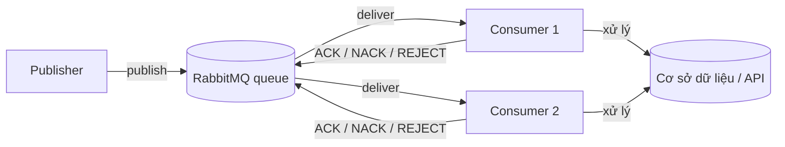
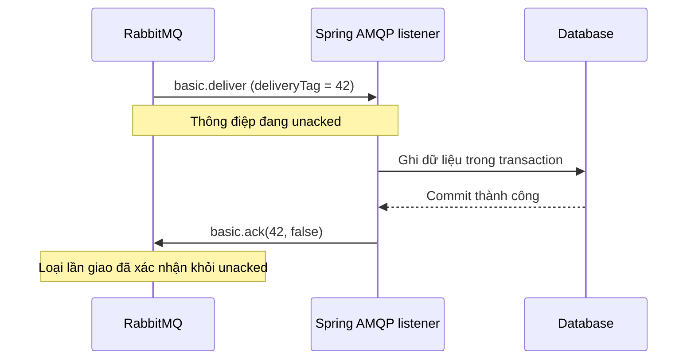

# Acknowledgement, prefetch và số consumer đồng thời

## 1. Ba cơ chế cùng quyết định cách một ứng dụng tiêu thụ thông điệp

Trong tích hợp hệ thống với **Spring Boot, Spring AMQP và RabbitMQ**, một ứng dụng thường nhận sự kiện từ hàng đợi, kiểm tra dữ liệu, cập nhật cơ sở dữ liệu hoặc gọi một dịch vụ khác rồi mới kết thúc xử lý. Ba lựa chọn ảnh hưởng trực tiếp đến độ tin cậy và tốc độ của luồng này:

- **Acknowledgement (ACK):** xác định thời điểm consumer báo cho RabbitMQ rằng một lần giao thông điệp đã được xử lý xong, hoặc báo xử lý thất bại.
- **Prefetch:** giới hạn số thông điệp đã giao nhưng chưa được ACK mà broker có thể giữ ở mỗi consumer.
- **Số consumer đồng thời:** quyết định có bao nhiêu luồng tiêu thụ độc lập cùng lấy việc từ một queue.

Ví dụ, dịch vụ xử lý đơn hàng nhận `OrderCreated` từ queue `orders.process`. Nếu dịch vụ ACK trước khi ghi đơn hàng, một lần crash sau ACK có thể làm mất việc cần làm. Nếu ACK sau khi transaction cơ sở dữ liệu đã commit, crash ở khoảng giữa commit và ACK có thể khiến cùng sự kiện được giao lại. Nếu tăng prefetch quá cao trong khi xử lý chậm, thông điệp có thể bị giữ ở những consumer đang bận, khiến việc phân phối không đều. Nếu tăng số consumer quá nhiều, cơ sở dữ liệu hoặc API phía sau có thể bị quá tải.



**Phân biệt hai loại xác nhận:** consumer acknowledgement xác nhận *lần giao từ RabbitMQ đến consumer*; publisher confirm xác nhận *broker đã tiếp nhận bản tin do publisher gửi*. Hai cơ chế giải quyết hai chặng khác nhau và không thay thế nhau. Việc queue có bền vững (`durable`) hoặc message được publish ở chế độ persistent cũng không đồng nghĩa với việc consumer đã xử lý thành công.

## 2. Vòng đời của một thông điệp: ready, unacked và ACK

Khi một message còn chờ được giao, nó thường được tính vào **`messages_ready`**. Khi broker giao message cho một consumer có cơ chế xác nhận thủ công, message chuyển sang trạng thái **`messages_unacknowledged`** (thường gọi là *unacked*). Broker tiếp tục giữ trách nhiệm với lần giao đó đến khi nhận xác nhận hợp lệ hoặc kênh/kết nối của consumer đóng.



Mỗi lần giao gắn với **delivery tag** do RabbitMQ cấp theo phạm vi **channel**, không phải ID nghiệp vụ của sự kiện. Tag `42` ở channel A không thể dùng để ACK một lần giao ở channel B. Khi RabbitMQ phát lại một message, lần giao mới có thể mang delivery tag khác. Vì vậy, không lưu delivery tag vào cơ sở dữ liệu để làm khóa chống trùng lặp; hãy dùng `eventId`, `messageId` hoặc khóa nghiệp vụ ổn định do hệ thống phát sự kiện quy định.

### 2.1. Các thao tác xác nhận ở mức AMQP

| Thao tác | Ý nghĩa | Hệ quả thông thường |
| --- | --- | --- |
| `basicAck(tag, false)` | Xác nhận đúng một lần giao thành công | RabbitMQ loại message đó khỏi trạng thái unacked; lần giao này hoàn tất. |
| `basicNack(tag, false, true)` | Xử lý chưa thành công và yêu cầu `requeue` | Broker đưa message trở lại để có thể giao tiếp; có thể bị giao lại rất sớm. |
| `basicNack(tag, false, false)` | Xử lý thất bại và không requeue | Message đi tới dead-letter exchange (DLX) nếu đã cấu hình, nếu không sẽ bị loại bỏ. |
| `basicReject(tag, false)` | Từ chối một lần giao và không requeue | Tương tự nhánh không requeue ở trên, nhưng `basicReject` chỉ xử lý một message. |
| `basicAck(tag, true)` | ACK nhiều lần giao còn unacked có tag đến `tag` trên cùng channel | Có thể ACK cả những việc chưa xử lý xong; cần đặc biệt cẩn thận. |

Tham số `multiple` của `basicAck`/`basicNack` là tham số dành cho *nhiều delivery tag*. Trong các listener xử lý từng message, thường dùng `multiple = false`. Nếu một channel được chia sẻ cho nhiều luồng rồi các luồng tự ACK không có phối hợp, ACK trùng hoặc ACK nhầm có thể gây lỗi giao thức như **`PRECONDITION_FAILED - unknown delivery tag`**, làm channel đóng và những lần giao chưa ACK có thể bị phát lại.

Khi consumer hoặc channel mất kết nối trước khi RabbitMQ nhận ACK, các message còn unacked sẽ đủ điều kiện được **redeliver** cho consumer khác hoặc cho consumer sau khi kết nối lại. Cờ `redelivered` cho biết RabbitMQ *có thể đã giao message trước đó*, không cho biết transaction nghiệp vụ đã hoàn tất hay chưa.

### 2.2. Các chế độ acknowledgement trong Spring AMQP

| `AcknowledgeMode` | Ai gửi ACK? | Khi nào phù hợp? | Điểm cần chú ý |
| --- | --- | --- | --- |
| `AUTO` | **Spring listener container** ACK sau khi xử lý listener đồng bộ thành công | Lựa chọn phổ biến cho handler đồng bộ, dễ quản lý | Đây **không phải** AMQP `autoAck=true`; nếu handler bắt lỗi rồi trả về bình thường, container có thể xem là thành công và ACK. |
| `MANUAL` | **Mã ứng dụng** gọi `basicAck`/`basicNack`/`basicReject` | Cần tự quyết định thời điểm xác nhận, kết hợp kết quả nghiệp vụ hoặc xử lý bất đồng bộ có kiểm soát | Phải xử lý rõ mọi nhánh hoàn tất và lỗi; đừng để delivery nằm unacked vô hạn. |
| `NONE` | Broker coi message đã được xác nhận khi giao (`autoAck=true` ở mức AMQP) | Chỉ nên cân nhắc khi mất một message cũng chấp nhận được | Nếu consumer crash sau khi nhận, broker không còn chờ ACK để phát lại. QoS prefetch dựa trên unacked không còn là cơ chế chặn tương ứng. |

Với `AUTO`, khi listener ném exception, container sẽ xử lý reject/NACK theo cấu hình và loại exception. Mặc định requeue hay không còn phụ thuộc `defaultRequeueRejected` và các exception điều khiển requeue. **Không nên tự gọi `channel.basicAck()` trong listener đang để `AUTO`** vì container cũng có thể ACK, dẫn đến xác nhận trùng. Trong `MANUAL`, mã nghiệp vụ chịu trách nhiệm xác nhận từng delivery; việc `throw` exception rồi kỳ vọng một hành vi ACK/NACK cố định ở mọi phiên bản/cấu hình là không an toàn.

### 2.3. ACK và ranh giới giao dịch nghiệp vụ

Hãy xét ba thời điểm khác nhau:

1. **Lỗi trước khi commit:** nếu chưa ACK, message có thể được thử lại hoặc chuyển DLQ. Phải phân loại lỗi để quyết định có thử lại không.
2. **Commit thành công nhưng ACK chưa tới broker:** RabbitMQ có thể giao lại sau lỗi kết nối. Consumer phải nhận ra đây là sự kiện đã áp dụng để tránh cộng tiền, tạo đơn hoặc gửi lệnh hai lần.
3. **ACK trước khi hoàn tất công việc:** nếu tiến trình dừng sau ACK, RabbitMQ sẽ không tự giao lại lần xử lý đó. Đây là lỗi thiết kế khi nghiệp vụ yêu cầu không mất việc.

Một thứ tự an toàn cho handler đồng bộ là: **nhận message → kiểm tra → xử lý idempotent → commit các thay đổi cần thiết → ACK**. Thứ tự này hướng tới khả năng xử lý *at least once*; nó không tạo giao dịch nguyên tử giữa RabbitMQ và cơ sở dữ liệu. Nếu còn side effect ở hệ thống khác, cân nhắc **transactional outbox**, API đích hỗ trợ idempotency key hoặc cách hòa giải dữ liệu sau lỗi.

## 3. Prefetch: giới hạn thông điệp đang được giữ bởi consumer

Trong AMQP, `basic.qos` khai báo prefetch count. Với cách dùng phổ biến của RabbitMQ là `global=false`, RabbitMQ áp dụng giới hạn **theo consumer**. Ví dụ đặt `prefetch = 8` nghĩa là broker có thể giao trước tối đa tám message chưa ACK cho mỗi consumer đủ điều kiện. Một message có thể đang được xử lý, những message còn lại đã tới consumer nhưng đang chờ xử lý.

```text
Queue: 100 messages ready
                 prefetch = 3 cho mỗi consumer
                            ┌────────────────────────┐
RabbitMQ ── deliver ───────▶│ Consumer A: [x][ ][ ]   │  3 unacked
         └─────────────────▶│ Consumer B: [x][ ][ ]   │  3 unacked
                            └────────────────────────┘
                         [x] đang xử lý, [ ] đã nhận và chờ
```

Nếu Consumer A chưa ACK thì RabbitMQ không tiếp tục cấp thêm message vượt mức prefetch của A, ngay cả khi queue còn việc. Consumer B vẫn có thể nhận nếu còn hạn mức riêng. Giới hạn áp dụng cho **message chưa xác nhận**, không phải kích thước byte và cũng không nhất thiết là số tác vụ đang chạy song song trong ứng dụng.

Nếu consumer xử lý lần lượt từng message trên một luồng, `prefetch = 20` **không** khiến consumer xử lý đồng thời 20 message. Nó cho phép nhiều delivery đang chờ sẵn để giảm khoảng trống do giao nhận qua mạng. Số công việc thực sự chạy cùng lúc còn phụ thuộc số consumer và mô hình xử lý của listener.

### 3.1. Chọn giá trị prefetch theo đặc tính tải

| Cấu hình | Lợi ích | Đổi lại |
| --- | --- | --- |
| `prefetch = 1` | Giữ ít message tại mỗi consumer, dễ phân phối lại công việc khi consumer xử lý chậm, ít message chờ khi consumer chết | Có thể tốn thêm lượt giao nhận và giảm thông lượng nếu đường truyền/ACK có độ trễ đáng kể. |
| `prefetch` vừa phải, ví dụ `8–20` | Tạo sẵn một lượng việc đủ dùng, thường phù hợp listener đồng bộ có thời gian xử lý tương đối ổn định | Tăng số message unacked và bộ nhớ sử dụng ở consumer. |
| `prefetch` rất lớn | Có thể hữu ích trong một số bài toán xử lý nhanh, thông lượng cao đã đo kiểm | Dễ giữ quá nhiều việc ở consumer chậm, gây mất cân bằng và tăng thời gian chờ. |
| `prefetch = 0` | Không áp hạn mức theo cấu hình QoS này trong trường hợp thông thường | Có nguy cơ nhận không kiểm soát; loại queue hoặc chính broker có thể đặt ràng buộc riêng. |

Các số trong bảng chỉ là **điểm bắt đầu để thử tải**, không phải giá trị chuẩn cho mọi ứng dụng. Ví dụ nếu một message chứa payload lớn hoặc handler tốn nhiều RAM, `prefetch=20` có thể đã quá cao. Nếu message rất nhỏ, xử lý nhanh và RTT đến broker đáng kể, prefetch nhỏ có thể khiến consumer không có việc để làm trong khi queue còn message.

RabbitMQ có các khác biệt thực thi về prefetch so với cách diễn đạt QoS theo channel trong AMQP. Đặc biệt, thiết lập `global=true` có thể tạo giới hạn chia sẻ ở phạm vi channel và làm thay đổi hành vi khi nhiều consumer sử dụng chung channel. Trong Spring AMQP, hãy ưu tiên cách cấu hình container thông thường và đo số lượng unacked thực tế trước khi tùy biến `basicQos` trực tiếp.

## 4. Số consumer đồng thời: khả năng xử lý thực sự

**Consumer concurrency** là số consumer cùng đăng ký nhận dữ liệu từ một queue. Trong mô hình listener đồng bộ thông thường, mỗi consumer thực hiện một handler tại một thời điểm; tăng consumer từ 2 lên 4 có thể tạo thêm năng lực xử lý song song, nếu CPU và các hệ thống phụ thuộc còn tài nguyên.

Trong **`SimpleRabbitListenerContainerFactory` / `SimpleMessageListenerContainer`** của Spring AMQP:

- `concurrentConsumers` / `concurrency`: số consumer khởi đầu/tối thiểu.
- `maxConcurrentConsumers` / `max-concurrency`: giới hạn trên để container có thể tăng consumer tùy theo hoạt động của hàng đợi; đây không phải số consumer luôn luôn hoạt động.
- `prefetchCount` / `prefetch`: số message chưa xác nhận tối đa trên mỗi consumer theo cấu hình thường dùng.

Trong **`DirectRabbitListenerContainerFactory` / `DirectMessageListenerContainer`**, tham số quan trọng là **`consumersPerQueue`**. Không mặc nhiên dùng `concurrency`/`max-concurrency` của simple container để suy luận về direct container: hai kiểu container có cách quản lý consumer khác nhau.

### 4.1. Mối quan hệ giữa prefetch và concurrency

Với một queue, giả sử mỗi consumer có cùng prefetch `P`, đang có `C` consumer hoạt động, mỗi consumer được cấp channel và hạn mức như thông thường:

\[
\text{Số message unacked tối đa xấp xỉ} \leq P \times C
\]

Chẳng hạn, `prefetch = 8` và `concurrency = 4` cho phép **tối đa khoảng 32 message** đã giao nhưng chưa ACK ở bốn consumer của ứng dụng đó. Nếu triển khai hai replica, mỗi replica đang chạy bốn consumer cùng đọc một queue, khả năng giữ thông điệp tăng thành khoảng **64 unacked**. Giá trị thực tế có thể thấp hơn khi queue thiếu việc, giới hạn riêng có hiệu lực hoặc container chưa tăng tới mức cấu hình.

**Không nhầm `P × C` với số công việc chạy song song.** Với listener đồng bộ xử lý tuần tự trên mỗi consumer, số handler chạy cùng lúc thường gần `C`, trong khi `P × C` chỉ phản ánh hạn mức delivery đang chờ xác nhận. Nếu mỗi message cần trung bình 200 ms và handler không bị nghẽn tài nguyên khác, một consumer có trần lý thuyết khoảng 5 message/giây; bốn consumer có trần khoảng 20 message/giây. Đó là ước tính đơn giản, còn thông lượng thực phải đo vì độ trễ DB/API, retry, network và tranh chấp tài nguyên có thể chi phối.

### 4.2. Vì sao không tăng consumer vô hạn?

Tăng consumer có thể làm số kết nối đến DB, số request đến HTTP API, lượng bộ nhớ sử dụng hoặc số luồng chờ lock tăng theo. Khi nút nghẽn thực tế là database connection pool hoặc rate limit của dịch vụ đích, tăng concurrency đôi khi **làm giảm** thông lượng vì timeout và retry tăng.

Hãy tính **tổng consumer của tất cả replica**, không chỉ một instance. Ví dụ ba pod, mỗi pod tối đa sáu consumer, có thể tạo đến 18 consumer đồng thời cho queue. Nếu mỗi handler chiếm một kết nối database, phải kiểm tra sức chứa connection pool ở từng pod và giới hạn kết nối tổng phía database. Cũng cần theo dõi cách nhiều queue được bind vào cùng listener container vì số consumer và prefetch khi đó không còn suy ra đơn giản từ ví dụ một queue.

### 4.3. Thứ tự thông điệp

Khi nhiều consumer cùng đọc một queue, message có thể **hoàn tất theo thứ tự khác thứ tự được giao**. Một message chậm ở Consumer A có thể hoàn tất sau message kế tiếp ở Consumer B. Requeue/redelivery còn làm thứ tự quan sát thay đổi. Nếu một nhóm sự kiện bắt buộc xử lý tuần tự, cần thiết kế thứ tự theo **khóa nghiệp vụ** (ví dụ phân luồng theo `accountId` đến từng queue/partition có một consumer xử lý tuần tự), hoặc sử dụng cơ chế phiên bản và kiểm soát trạng thái. Chỉ đặt `prefetch = 1` trong khi vẫn có nhiều consumer không đảm bảo thứ tự xử lý toàn cục.

## 5. Cấu hình trong Spring Boot

### 5.1. Phương án A: để Spring container tự ACK khi xử lý thành công

Với listener đồng bộ đơn giản, có thể dùng chế độ `AUTO` để giảm lượng mã quản lý ACK:

```yaml
spring:
  rabbitmq:
    listener:
      simple:
        acknowledge-mode: auto
        prefetch: 8
        concurrency: 3
        max-concurrency: 6
        default-requeue-rejected: false
```

```java
@Component
public class OrderCreatedListener {
    private final OrderService orderService;

    public OrderCreatedListener(OrderService orderService) {
        this.orderService = orderService;
    }

    @RabbitListener(queues = "orders.process")
    public void onMessage(byte[] body) {
        orderService.processIdempotently(body); // trả về sau khi commit
    }
}
```

Ở ví dụ này, container ACK khi phương thức `onMessage` trả về bình thường. Nếu `processIdempotently` ném exception, listener container xử lý nhánh lỗi. Đặt `default-requeue-rejected: false` khiến các message bị reject sau xử lý lỗi **không** tự requeue; chúng chỉ tới DLQ nếu queue đã được cấu hình DLX tương ứng. Nếu muốn retry, cần chủ động thiết kế cơ chế retry có giới hạn và backoff, không nên coi DLQ hoặc broker sẽ tự cung cấp retry trì hoãn.

Điểm dễ sai: khi listener bắt `Exception` rồi chỉ ghi log, phương thức trả về thành công và container có thể ACK message dù nghiệp vụ chưa được xử lý. Nếu dùng `AUTO`, hãy để lỗi thực sự cần xử lý lại được truyền tới container hoặc sử dụng cơ chế error handler/recoverer có chủ đích. Một listener khởi chạy tác vụ bất đồng bộ rồi trả về ngay cũng cần thiết kế khác, vì ACK có thể diễn ra trước khi tác vụ đó hoàn thành.

### 5.2. Phương án B: tự quyết định ACK trong chế độ `MANUAL`

Khi phải phân biệt dữ liệu lỗi vĩnh viễn, lỗi phụ thuộc hệ thống và trường hợp đã xử lý thành công, cấu hình:

```yaml
spring:
  rabbitmq:
    listener:
      simple:
        acknowledge-mode: manual
        prefetch: 8
        concurrency: 3
        max-concurrency: 6
```

Ví dụ sau dùng `ObjectMapper` đọc sự kiện, ghi nghiệp vụ theo cách idempotent rồi ACK. Trong ví dụ này, message không thể giải mã được sẽ bị từ chối; lỗi từ hệ thống xử lý sẽ được chuyển theo đường không requeue, để đội vận hành điều tra hoặc thực hiện retry có kiểm soát từ DLQ.

```java
import com.fasterxml.jackson.core.JsonProcessingException;
import com.fasterxml.jackson.databind.ObjectMapper;
import com.rabbitmq.client.Channel;
import java.io.IOException;
import org.springframework.amqp.rabbit.annotation.RabbitListener;
import org.springframework.amqp.support.AmqpHeaders;
import org.springframework.messaging.handler.annotation.Header;
import org.springframework.stereotype.Component;

@Component
public class OrderConsumer {
    private final ObjectMapper mapper;
    private final OrderProcessor processor;

    public OrderConsumer(ObjectMapper mapper, OrderProcessor processor) {
        this.mapper = mapper;
        this.processor = processor;
    }

    @RabbitListener(queues = "orders.process")
    public void consume(byte[] body, Channel channel,
                        @Header(AmqpHeaders.DELIVERY_TAG) long tag)
            throws IOException {
        final OrderCreated event;
        try {
            event = mapper.readValue(body, OrderCreated.class);
        } catch (JsonProcessingException invalidPayload) {
            channel.basicReject(tag, false);  // Không requeue; dùng DLX nếu có
            return;
        }

        try {
            processor.applyIdempotently(event); // Hoàn tất commit trước khi trả về
        } catch (Exception processingFailure) {
            channel.basicNack(tag, false, false); // Đẩy sang DLX nếu có
            return;
        }

        channel.basicAck(tag, false); // Chỉ ACK sau khi nghiệp vụ thành công
    }
}

record OrderCreated(String eventId, String orderId) {}

interface OrderProcessor {
    void applyIdempotently(OrderCreated event);
}
```

`OrderProcessor` là hợp đồng nghiệp vụ minh họa; bản triển khai phải là Spring bean, dùng transaction thích hợp và đảm bảo `applyIdempotently` chỉ trả về sau khi các thay đổi cần thiết đã commit. Cần cấu hình DLX/DLQ trước khi áp dụng chiến lược `requeue=false`; nếu thiếu, message bị reject có thể bị loại bỏ. Trong môi trường thật cần log `eventId`, nguyên nhân lỗi và metric, nhưng tránh đưa dữ liệu nhạy cảm nguyên văn vào log.

Lưu ý ba vấn đề quan trọng của ví dụ:

- `IOException` khi gửi ACK/NACK không chứng minh broker đã nhận hay chưa nhận frame. Không thử ACK một delivery đã có thể được xác nhận bằng cách đoán trạng thái; hãy để cơ chế khôi phục kết nối và **idempotency** giải quyết khả năng phát lại.
- `basicNack(tag, false, true)` có thể phù hợp với một số lỗi tạm thời ngắn, nhưng requeue ngay nhiều lần dễ tạo **vòng lặp retry nóng**. Nên dùng số lần thử giới hạn, thời gian chờ, DLQ hoặc tuyến retry riêng.
- Không đồng thời để nhiều luồng tự ACK delivery tag trên một channel nếu chưa có cơ chế phối hợp. Đặc biệt tránh `multiple=true` trong xử lý song song không được kiểm soát.

### 5.3. Nếu dùng direct listener container

Một cấu hình tương ứng về ý tưởng nhưng dùng container loại `direct` có dạng:

```yaml
spring:
  rabbitmq:
    listener:
      type: direct
      direct:
        acknowledge-mode: auto
        prefetch: 8
        consumers-per-queue: 3
```

`consumers-per-queue` là số consumer cho **mỗi queue** đối với direct container. Chỉ chọn một kiểu container cho listener thực tế và đặt thuộc tính trong nhánh cấu hình của kiểu đó; không trộn `simple.concurrency` với direct rồi cho rằng các thuộc tính sẽ cùng có hiệu lực.

## 6. Thiết kế chống trùng lặp đi cùng ACK

Ngay cả khi ACK sau commit, trường hợp commit đã thành công nhưng kết nối RabbitMQ bị ngắt vẫn khiến message có thể được giao lại. Một cách xử lý phổ biến là lưu `eventId` vào bảng chống trùng lặp với ràng buộc duy nhất **trong cùng transaction** với thao tác nghiệp vụ:

```sql
-- Bảng minh họa; kiểu dữ liệu tùy hệ quản trị CSDL.
CREATE TABLE processed_event (
    consumer_name VARCHAR(100) NOT NULL,
    event_id      VARCHAR(100) NOT NULL,
    PRIMARY KEY (consumer_name, event_id)
);
```

Quy trình khái niệm:

1. Bắt đầu database transaction.
2. Thử `INSERT` cặp `(consumer_name, event_id)`. Nếu đã tồn tại, coi đây là sự kiện trùng đã được xử lý và kết thúc transaction thành công.
3. Nếu ghi mới, áp dụng cập nhật nghiệp vụ trong **chính transaction đó**.
4. Commit; sau khi commit thành công, trả về cho listener để ACK.

Việc kiểm tra rồi insert tách rời không đủ khi nhiều consumer chạy song song; cần ràng buộc unique và thao tác nguyên tử (`INSERT ... ON CONFLICT DO NOTHING` hoặc cơ chế tương đương tùy database). Khi có tác dụng phụ bên ngoài database, một transaction database riêng không thể làm cho ACK RabbitMQ và lời gọi HTTP cùng nguyên tử; cần thêm thiết kế như outbox và idempotency ở dịch vụ đích.

## 7. Quy trình chỉnh prefetch và concurrency bằng số liệu

Giả sử dịch vụ có hai pod, mỗi pod `concurrency=3`, `prefetch=10`. Khi cả sáu consumer đều hoạt động, tổng hạn mức giao mà chưa ACK khoảng **60 message**. Nếu mỗi message mất 300 ms để xử lý đồng bộ, trần thông lượng đơn giản về phía handler là `6 / 0,3 = 20 message/giây` khi không có nút nghẽn khác. Việc nâng prefetch từ 10 lên 100 không khiến con số 20 tự tăng mười lần. Ngược lại, nâng concurrency có thể giúp khi phía DB/API vẫn còn dư năng lực, nhưng phải đo thử.

Một cách hiệu chỉnh có kiểm soát:

1. **Xác định mục tiêu**: tốc độ nhận vào, tốc độ xử lý, độ trễ P95/P99, lượng queue backlog chấp nhận được, sức chứa DB/API và yêu cầu thứ tự.
2. **Bắt đầu với mức hữu hạn**: ví dụ prefetch 5–10 và số consumer phù hợp với tài nguyên của một pod; đây chỉ là cấu hình xuất phát để kiểm thử.
3. **Đo dưới tải ổn định và tải đột biến**: throughput, queue lag, thời gian xử lý, lỗi timeout, retry và số message unacked.
4. **Chỉnh từng yếu tố**: nếu có thời gian trống do giao nhận, thử tăng prefetch; nếu handler đang bận và hệ thống đích còn khả năng, thử tăng consumer; nếu DB/API đã nghẽn, giảm áp lực và xử lý nút nghẽn trước.
5. **Kiểm tra failover**: dừng một consumer/pod khi còn message unacked, quan sát redelivery, thời gian phục hồi, tính idempotent và DLQ. Lặp thử với sự cố tại thời điểm vừa commit nhưng chưa ACK.

### 7.1. Đọc metric RabbitMQ để tìm nút nghẽn

| Quan sát | Điều có thể đang xảy ra | Việc cần kiểm tra |
| --- | --- | --- |
| `messages_ready` tăng liên tục, các consumer đang bận | Tốc độ đến lớn hơn tốc độ xử lý | Thời gian handler, DB/API, số consumer thực tế, CPU, rate limit. |
| `messages_unacknowledged` cao và giữ lâu | Consumer đã nhận nhưng chưa ACK; có thể đang xử lý chậm hoặc giữ trước nhiều message | Prefetch, duration của handler, deadlock, connection pool, luồng bị treo. |
| `messages_ready` cao nhưng unacked thấp | Consumer không lấy được việc như kỳ vọng | Số consumer, kết nối/channel, consumer bị pause/cancel, lỗi listener hoặc giới hạn broker. |
| Tỷ lệ `redeliver` tăng mạnh | Message bị giao lại nhiều lần | Vòng lặp requeue, crash/restart, lỗi nghiệp vụ lặp lại, chính sách retry. |
| DLQ tăng | Có message bị từ chối/đã hết lượt thử hoặc hết hạn theo thiết kế | Loại lỗi, số lượng message cùng nguyên nhân, quy trình khắc phục và replay. |

Các metric nên quan sát cùng nhau: **ready**, **unacked**, **consumer count**, tốc độ publish/deliver/ack/redeliver, độ trễ xử lý, lỗi, DLQ và tài nguyên hệ thống đích. Một số lượng unacked cao là tín hiệu cần tìm hiểu, không tự nó chứng minh có lỗi: với prefetch lớn, nhiều message có thể chỉ đang nằm trong bộ đệm hợp lệ.

## 8. Những lỗi thường gặp và cách tránh

| Lỗi thiết kế hoặc cấu hình | Hậu quả | Cách xử lý |
| --- | --- | --- |
| ACK trước khi commit nghiệp vụ | Có thể mất việc sau crash | Commit thành công rồi mới ACK; dùng idempotency để chịu redelivery. |
| Tin rằng `AUTO` là broker tự ACK lúc giao | Hiểu sai thời điểm xác nhận | `AUTO` là container ACK khi listener đồng bộ thành công; `NONE` mới tương ứng auto-ack ở broker. |
| Catch exception rồi trả về bình thường trong `AUTO` | Message lỗi có thể được ACK | Phân loại lỗi và báo cho container/error handler đúng cách. |
| `basicNack(..., requeue=true)` vô hạn | Retry nóng, CPU và network tăng, message không tiến triển | Retry có backoff/giới hạn, DLQ và cơ chế replay. |
| `prefetch` quá cao với payload lớn | Nhiều unacked, giữ việc lệch, tăng RAM | Hạ prefetch, đo phân phối và thời gian chờ. |
| Nhân `prefetch × concurrency` để suy ra thread xử lý | Ước lượng thông lượng sai | Phân biệt message đang chờ ACK với handler chạy đồng thời. |
| Tăng consumer mà bỏ qua số replica | Vượt khả năng DB/API phía sau | Tính tổng consumer toàn deployment và giới hạn tài nguyên chung. |
| Giả định nhiều consumer vẫn giữ thứ tự xử lý | Cập nhật sai trình tự sự kiện | Phân vùng theo khóa hoặc thiết kế logic có version/idempotency. |
| NACK/REJECT không requeue nhưng chưa có DLX | Message có thể bị loại bỏ vĩnh viễn | Thiết lập DLX/DLQ, giám sát và quy trình xử lý lại trước khi vận hành. |

## 9. Checklist áp dụng cho một luồng tích hợp

Trước khi đưa listener RabbitMQ vào vận hành, hãy trả lời được các câu hỏi sau:

1. Handler xử lý đồng bộ và trả về sau khi kết thúc nghiệp vụ, hay còn tạo công việc bất đồng bộ?
2. Dùng `AUTO`, `MANUAL` hay `NONE`; ai chịu trách nhiệm ACK và mọi nhánh lỗi đi đâu?
3. Điểm commit nghiệp vụ nằm ở đâu; đã xử lý được việc broker phát lại sau commit nhưng trước ACK chưa?
4. Message nào được thử lại, message nào phải vào DLQ; đã có giới hạn retry, backoff và quy trình replay chưa?
5. Prefetch là bao nhiêu trên **mỗi consumer**; nếu mỗi message lớn/chậm thì tổng unacked có an toàn không?
6. Tổng consumer tính trên mọi pod là bao nhiêu; connection pool, CPU và API phía sau chịu được mức đó không?
7. Có yêu cầu thứ tự theo khách hàng/tài khoản/đơn hàng không; concurrency có phá vỡ giả định đó không?
8. Đã đo `ready`, `unacked`, `redeliver`, `ack rate`, độ trễ xử lý và DLQ khi chạy thử tải và khi một consumer chết chưa?

**Kết nối ba cơ chế:** acknowledgement quyết định mức độ an toàn khi một lần giao kết thúc; prefetch quyết định lượng message broker có thể gửi trước khi nhận xác nhận; concurrency quyết định mức độ song song thực tế. Với luồng tích hợp Spring Boot, hãy chọn điểm ACK theo ranh giới nghiệp vụ, đảm bảo idempotency trước khi tăng tốc, rồi hiệu chỉnh prefetch và consumer bằng số liệu vận hành.
