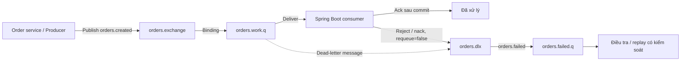
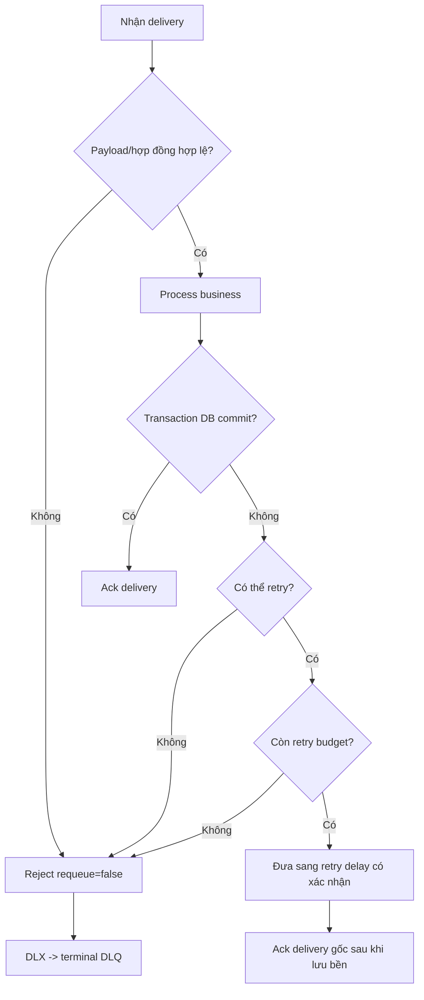
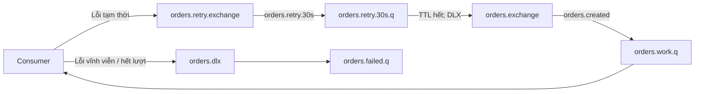
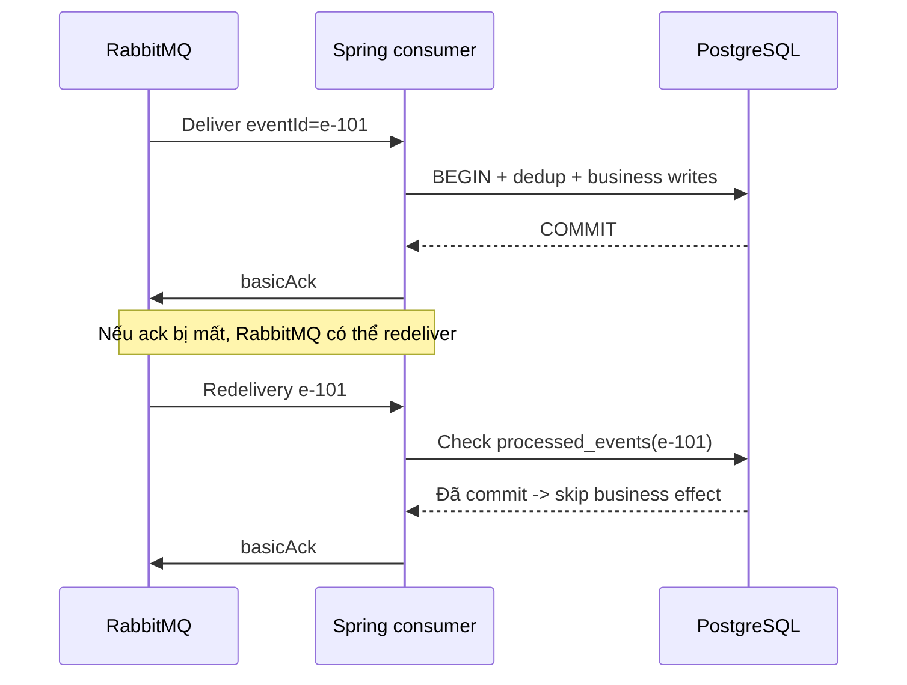
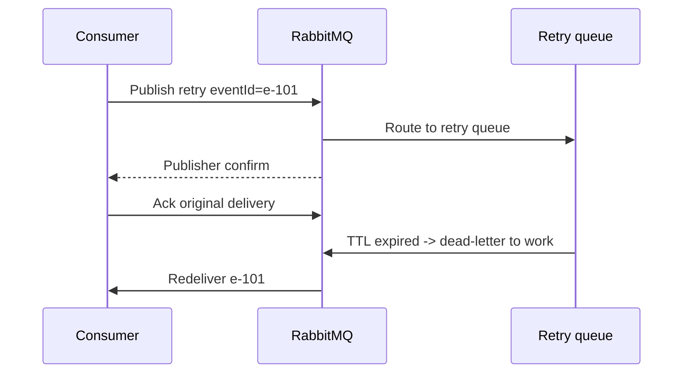
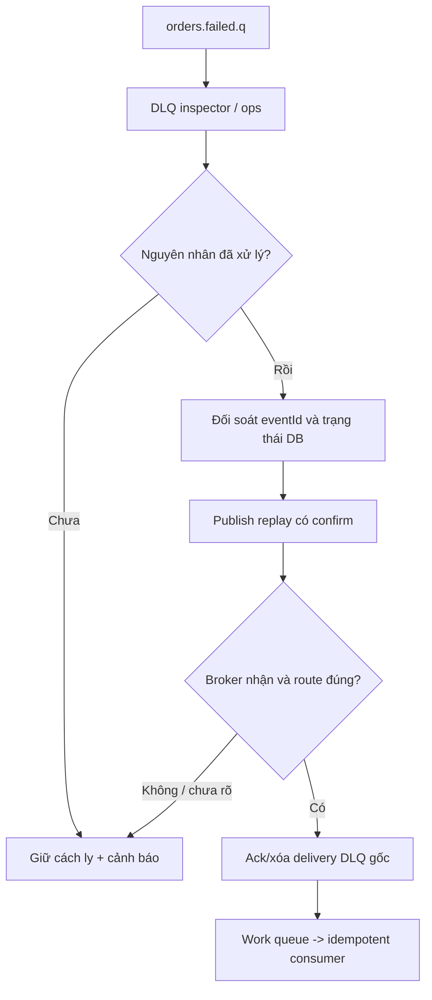
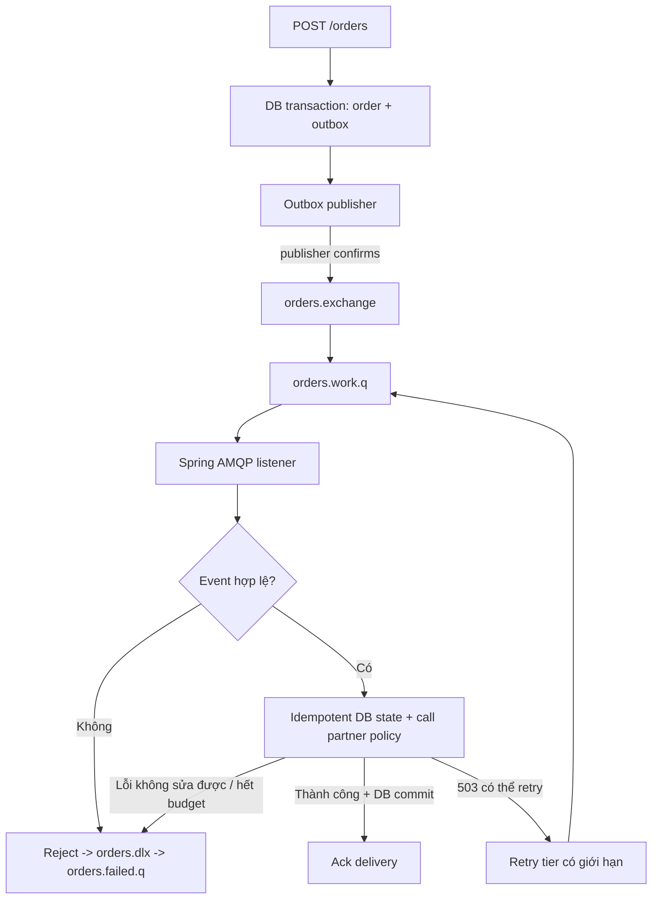

# Dead-letter exchange và chính sách xử lý sau khi thất bại

Trong hệ thống tích hợp Spring Boot, RabbitMQ thường nhận các sự kiện hoặc command từ HTTP API, cơ sở dữ liệu và các service khác. Một consumer có thể gặp lỗi tạm thời vì DB mất kết nối, bị đối tác HTTP giới hạn tốc độ, hoặc gặp dữ liệu không hợp lệ dù đã thử nhiều lần. Nếu trả thông điệp lỗi liên tục về cùng hàng đợi, consumer có thể rơi vào vòng lặp nóng; nếu xác nhận thành công khi nghiệp vụ chưa hoàn tất, thông điệp có thể bị mất khỏi luồng xử lý.

**Dead-letter exchange (DLX)** là cơ chế RabbitMQ dùng để định tuyến lại message từ một queue khi message bị *dead-lettered*. **Dead-letter queue (DLQ)** là queue nhận những message đó sau khi exchange định tuyến; DLQ không phải một loại queue đặc biệt của giao thức. DLX hỗ trợ xây dựng chính sách retry có độ trễ, cách ly dữ liệu lỗi, điều tra nguyên nhân và replay. Nhưng DLX **không tự đảm bảo retry có giới hạn, chống trùng, độ bền xuyên mọi sự cố hay phục hồi nghiệp vụ thành công**.

Bài thuộc chương **RabbitMQ và AMQP** trong mô-đun `SPRING_BOOT_INTEGRATION`. Mục tiêu là thiết kế luồng xử lý thất bại thực tế với Spring Boot/Spring AMQP, có hợp đồng dữ liệu, transaction DB, idempotency, chính sách lỗi, quan sát và kiểm thử. Ví dụ dưới đây dùng RabbitMQ, Spring Boot, Spring AMQP và PostgreSQL; các giá trị TTL, số lần retry và tên queue chỉ là minh họa.

## 1. Từ exchange đến queue và đường đi của message lỗi

RabbitMQ thường định tuyến message bằng **exchange → binding → queue**. Producer publish vào exchange với routing key; exchange quyết định queue đích theo loại exchange và binding. Consumer nhận delivery từ queue rồi quyết định ack hoặc nack/reject dựa trên kết quả xử lý.



**Dead-lettering diễn ra ở broker theo chính sách của queue nguồn.** Consumer gửi `basic.reject` hoặc `basic.nack` với `requeue=false` thì RabbitMQ có thể chuyển message sang DLX đã cấu hình. Nếu queue không có DLX, hoặc DLX không định tuyến tới queue nào, không được mặc định rằng message vẫn được giữ lại an toàn.

| Thành phần | Vai trò |
| --- | --- |
| `orders.exchange` | Exchange producer gửi sự kiện nghiệp vụ vào |
| `orders.work.q` | Queue consumer xử lý bình thường |
| `orders.dlx` | Exchange nhận message bị dead-letter từ queue nguồn |
| `orders.failed.q` | Queue bền vững để cách ly message lỗi sau khi được DLX định tuyến |
| Routing key `orders.failed` | Giá trị dùng cho binding từ DLX tới DLQ trong ví dụ |
| `basic.ack` | Xác nhận delivery đã được xử lý theo hợp đồng consumer |
| `basic.reject`/`basic.nack` | Từ chối delivery, có thể yêu cầu requeue hoặc dead-letter |

Các điểm quan trọng cần phân biệt:

- **DLX là exchange**, không phải queue; một DLX có thể định tuyến tới nhiều queue bằng binding.
- **DLQ là queue nhận**, có thể là classic hoặc quorum queue tùy nhu cầu. Tên `*.dlq` chỉ là quy ước đặt tên.
- **Publisher confirm** cho biết producer publish được broker xác nhận theo cấu hình, khác hoàn toàn với **consumer acknowledgement** của một delivery.
- **Message bị dead-lettered** chưa có nghĩa hệ thống đã sửa lỗi hoặc nghiệp vụ đã hoàn tất; đó là việc chuyển trạng thái vận hành.

## 2. Khi nào RabbitMQ đưa một message sang dead-letter exchange?

Các nguyên nhân được RabbitMQ hỗ trợ bao gồm:

| Tình huống | Trigger | `x-death.reason` thường gặp | Lưu ý |
| --- | --- | --- | --- |
| Consumer từ chối và không requeue | `basic.reject(deliveryTag, false)` hoặc `basic.nack(tag, false, false)` | `rejected` | Phải cấu hình DLX trên **queue nguồn** |
| Message hết hạn trong queue | TTL theo message hoặc queue | `expired` | TTL gắn với **thời gian lưu trong queue**, không phải hạn xử lý nghiệp vụ |
| Queue vượt giới hạn độ dài | Policy `max-length`/`max-length-bytes` với overflow thích hợp | `maxlen` | Hành vi phụ thuộc loại queue, overflow policy và version |
| Quorum queue vượt giới hạn giao lại | `delivery-limit` của quorum queue | `delivery_limit` | Có thể dùng để cách ly poison message sau redelivery quá nhiều |

Một delivery **không tự dead-letter** chỉ vì business method ném exception. Spring AMQP listener container phải quyết định ack/nack/reject/requeue theo cấu hình hoặc error handler. Với auto acknowledgement, framework thường ack khi listener hoàn tất thành công và xử lý exception theo chính sách container. Với manual acknowledgement, ứng dụng phải tự ack/nack đúng thời điểm.

### 2.1. `requeue=true` khác `requeue=false`

```text
basicAck(tag, false)
  -> delivery được xác nhận; không đi DLX

basicReject(tag, true) / basicNack(tag, false, true)
  -> broker requeue delivery; có thể được giao lại rất sớm

basicReject(tag, false) / basicNack(tag, false, false)
  -> delivery không requeue; dead-letter nếu queue có DLX
```

Lệnh `basic.nack` có tham số `multiple`; dùng `multiple=false` khi chỉ muốn thao tác với một delivery. Delivery tag có phạm vi **channel RabbitMQ**, không tái sử dụng để ack trên channel khác. Việc channel/connection đóng khi có delivery chưa ack thường dẫn đến requeue/redelivery theo cơ chế RabbitMQ; khi đó phải tính đến việc handler có thể đã commit DB trước khi mất kết nối.

**Không chọn `requeue=true` cho mọi lỗi.** Với lỗi payload sai schema hoặc một đơn hàng vi phạm invariant vĩnh viễn, consumer sẽ nhận lại cùng dữ liệu và lỗi ngay, tiêu tốn CPU, network, log và có thể làm đói message hợp lệ phía sau.

### 2.2. TTL tạo dead-letter, nhưng không phải bộ lập lịch chính xác

TTL của message trong queue là thời gian sống trước khi nó không còn hợp lệ trong queue đó. Khi message hết hạn, broker có thể dead-letter nó sang DLX. Với một số kiểu queue và cấu hình, message hết hạn chưa được loại bỏ ngay tức thì nếu nó nằm phía sau các message khác; **không dùng TTL làm đồng hồ hẹn giờ chính xác đến mili giây**.

TTL của **queue** khác với TTL của **message**:

- `x-message-ttl` (hoặc policy `message-ttl`) giới hạn thời gian message chờ trong queue.
- `x-expires` (hoặc policy tương ứng) nói đến thời gian queue không được sử dụng trước khi có thể bị xóa; không dùng nó làm thời gian delay của message.
- TTL do producer đặt qua expiration property và TTL do queue áp dụng có thể cùng tồn tại; cần hiểu thời điểm message hết hạn theo điều kiện hiệu lực sớm hơn.

Nếu một retry queue có TTL 30 giây, điều đó biểu thị *khoảng chờ xấp xỉ* trước khi message được dead-letter quay về queue xử lý, không phải cam kết message sẽ được giao lại đúng 30 giây.

## 3. Khai báo topology DLX và DLQ trong Spring Boot

Ứng dụng sử dụng `spring-boot-starter-amqp`, trong đó có Spring AMQP/RabbitMQ support. Ví dụ Gradle:

```gradle
dependencies {
    implementation 'org.springframework.boot:spring-boot-starter-amqp'
    implementation 'org.springframework.boot:spring-boot-starter-jdbc'
    runtimeOnly 'org.postgresql:postgresql'
}
```

Thiết kế tối thiểu:

```text
orders.exchange (direct)
  orders.created -> orders.work.q

orders.work.q:
  dead-letter-exchange = orders.dlx
  dead-letter-routing-key = orders.failed

orders.dlx (direct)
  orders.failed -> orders.failed.q
```

Ví dụ Spring AMQP Java configuration:

```java
@Configuration(proxyBeanMethods = false)
public class OrdersRabbitTopology {
    public static final String EVENTS_EXCHANGE = "orders.exchange";
    public static final String WORK_QUEUE = "orders.work.q";
    public static final String DLX = "orders.dlx";
    public static final String FAILED_QUEUE = "orders.failed.q";

    @Bean
    DirectExchange ordersExchange() {
        return new DirectExchange(EVENTS_EXCHANGE, true, false);
    }

    @Bean
    DirectExchange ordersDeadLetterExchange() {
        return new DirectExchange(DLX, true, false);
    }

    @Bean
    Queue ordersWorkQueue() {
        return QueueBuilder.durable(WORK_QUEUE)
                .deadLetterExchange(DLX)
                .deadLetterRoutingKey("orders.failed")
                .build();
    }

    @Bean
    Queue ordersFailedQueue() {
        return QueueBuilder.durable(FAILED_QUEUE).build();
    }

    @Bean
    Binding workBinding(
            @Qualifier("ordersWorkQueue") Queue ordersWorkQueue,
            @Qualifier("ordersExchange") DirectExchange ordersExchange) {
        return BindingBuilder.bind(ordersWorkQueue)
                .to(ordersExchange).with("orders.created");
    }

    @Bean
    Binding deadLetterBinding(
            @Qualifier("ordersFailedQueue") Queue ordersFailedQueue,
            @Qualifier("ordersDeadLetterExchange")
                    DirectExchange ordersDeadLetterExchange) {
        return BindingBuilder.bind(ordersFailedQueue)
                .to(ordersDeadLetterExchange).with("orders.failed");
    }
}
```

Các import cần thiết: `org.springframework.amqp.core.DirectExchange`, `Queue`, `QueueBuilder`, `Binding`, `BindingBuilder`; `org.springframework.beans.factory.annotation.Qualifier` cùng `@Configuration` và `@Bean`. Chú ý `@Qualifier` khi có nhiều bean cùng kiểu `Queue` hoặc `DirectExchange`. Ví dụ khai báo **classic durable queue** theo cách thông thường. `RabbitAdmin` của Spring có thể declare những bean này khi ứng dụng có kết nối và quyền tương ứng; cần kiểm chứng vhost, credentials, queue type và hiện trạng topology.

### 3.1. Queue durable không đồng nghĩa mọi message được lưu bền

`durable=true` giúp queue definition sống qua broker restart. Độ bền message còn phụ thuộc **delivery mode** (persistent), loại queue, xác nhận từ broker, replication và cấu hình RabbitMQ. Producer nên publish với delivery mode phù hợp và sử dụng **publisher confirms** khi yêu cầu không mất sự kiện; một lời gọi `RabbitTemplate.convertAndSend(...)` trả về chưa chứng minh message đã được lưu bền.

Đối với dữ liệu cần chống mất khi node hỏng, cân nhắc quorum queues và cấu hình cluster phù hợp. Một queue durable classic trên một node đơn lẻ không tự mang bảo đảm chịu được hỏng node. Khi muốn chuyển queue classic sang quorum, cần đánh giá migration/khả năng tương thích; không đổi queue type của queue tồn tại chỉ bằng việc deploy lại bean có arguments khác.

### 3.2. Vì sao production thường cấu hình DLX bằng policy?

Ví dụ trên đặt `x-dead-letter-exchange` và `x-dead-letter-routing-key` trong **queue arguments**. Cách này dễ học, nhưng arguments của queue tồn tại thường không thể thay đổi tùy tiện mà không xóa/redeclare hoặc migration; RabbitMQ có thể từ chối khai báo không tương thích bằng lỗi `PRECONDITION_FAILED`.

Với topology vận hành thật, RabbitMQ khuyến khích cấu hình các giá trị DLX qua **policy** để điều chỉnh linh hoạt:

```bash
rabbitmqctl set_policy orders-dlx "^orders\\.work\\.q$" \
  '{"dead-letter-exchange":"orders.dlx","dead-letter-routing-key":"orders.failed"}' \
  --apply-to queues
```

Đây là cú pháp minh họa trên shell hỗ trợ dấu tiếp dòng `\`; cần quyền quản trị và chọn đúng vhost khi dùng. Nếu dùng policy, **bỏ các dòng `.deadLetterExchange(...)`/`.deadLetterRoutingKey(...)` khỏi khai báo queue** để policy là nguồn điều khiển; x-arguments do client chỉ định thường có ưu tiên cao hơn user policy. Một policy không thể sửa mọi loại thuộc tính bất biến của queue.

Đảm bảo user RabbitMQ có quyền phù hợp để declare/bind và để định tuyến dead-letter. Cần kiểm tra quyền truy cập đối với DLX và routing topology khi thiết lập queue; cấu hình thiếu quyền hay binding có thể làm message không đi được tới DLQ như dự kiến.

## 4. Phân loại lỗi trước khi chọn ack, retry hoặc DLQ

Một lỗi xử lý không phải lúc nào cũng có cùng cách khắc phục. Chính sách nên dựa trên **nguyên nhân** và **tác động nghiệp vụ**, không chỉ dựa trên việc có exception.

| Nhóm lỗi | Ví dụ | Hành động gợi ý |
| --- | --- | --- |
| **Không thể retry nếu giữ nguyên dữ liệu** | JSON sai schema, enum không hỗ trợ, thiếu trường bắt buộc, mã đối tác không hợp lệ | Reject `requeue=false` để vào terminal DLQ; lưu nguyên nhân và phối hợp sửa |
| **Lỗi nghiệp vụ có thể chờ trạng thái thay đổi** | Đơn hàng chưa được tạo, quan hệ phụ thuộc chưa sẵn sàng | Retry có delay và deadline; nếu quá hạn thì DLQ |
| **Lỗi hạ tầng tạm thời** | DB timeout, HTTP 503, mất kết nối Redis, broker tạm nghẽn | Retry có giới hạn, backoff/jitter, giảm concurrency |
| **Lỗi hợp đồng hoặc cấu hình** | Sai credential, exchange thiếu binding, transformer không tương thích | Dừng/đưa DLQ; cảnh báo sửa cấu hình, tránh retry nóng |
| **Lỗi chưa rõ đã commit hay chưa** | DB commit xong nhưng consumer mất kết nối trước ack | Cho phép redelivery, consumer idempotent đối soát bằng event ID |
| **Lỗi bất thường không phân loại** | Runtime exception, bug trong handler | Giới hạn số lần thử; đưa DLQ với metadata đủ điều tra |



Điểm khó trong sơ đồ là bước **đưa sang retry delay rồi ack message gốc**: publish sang retry queue và ack delivery gốc không mặc nhiên là một giao dịch nguyên tử. Nếu publish thành công nhưng ack mất, message có thể được xử lý hai lần. Nếu ack quá sớm rồi publish thất bại, message có thể bị mất. Phần tiếp theo làm rõ thiết kế an toàn theo mức bảo đảm cần đạt.

## 5. Chọn chiến lược retry: ngay tại consumer, qua retry queue hay chuyển thẳng DLQ?

Không phải mọi lỗi đều cần gửi message sang queue khác. Có ba lựa chọn chính:

| Chiến lược | Cách hoạt động | Ưu điểm | Hạn chế |
| --- | --- | --- | --- |
| Retry ngắn trong consumer | Thử lại handler vài lần với backoff trước khi ack/nack delivery | Đơn giản, phù hợp lỗi chớp nhoáng | Giữ consumer slot; retry dài sẽ cản thông lượng |
| Retry có delay qua queue riêng | Publish message vào retry queue; sau TTL DLX chuyển về work queue | Giải phóng consumer trong thời gian chờ | Cần bảo đảm publish và ack, giới hạn attempt, tránh vòng lặp |
| Chuyển thẳng terminal DLQ | Reject/nack `requeue=false` để RabbitMQ dead-letter | Cách ly poison message và lỗi vĩnh viễn | Cần người/cơ chế sửa, replay, theo dõi tồn đọng |

Một chính sách thực tế có thể là: kiểm tra payload trước, retry trong process hai lần cho lỗi kết nối rất ngắn, sau đó đưa vào retry queue 30 giây rồi 5 phút với số lượt tối đa, cuối cùng đưa vào terminal DLQ khi vượt ngân sách hoặc gặp lỗi không thể tự sửa. Con số phải dựa vào SLA, thời gian phục hồi downstream và khả năng chịu tải, không phải mặc định của RabbitMQ.

### 5.1. Bounded retry trong Spring AMQP

Nếu chỉ cần thử lại ngắn ngay trên listener, có thể cấu hình container **AUTO acknowledge** và Spring Retry advice. Ví dụ minh họa cho Spring AMQP có `RetryInterceptorBuilder`:

```java
@Configuration(proxyBeanMethods = false)
public class OrdersListenerConfiguration {

    @Bean("ordersAutoAckListenerFactory")
    SimpleRabbitListenerContainerFactory ordersListenerFactory(
            ConnectionFactory connectionFactory) {

        SimpleRabbitListenerContainerFactory factory =
                new SimpleRabbitListenerContainerFactory();
        factory.setConnectionFactory(connectionFactory);
        factory.setAcknowledgeMode(AcknowledgeMode.AUTO);
        factory.setDefaultRequeueRejected(false);
        factory.setPrefetchCount(10);
        factory.setAdviceChain(
                RetryInterceptorBuilder.stateless()
                        .maxAttempts(3)
                        .backOffOptions(500, 2.0, 2000)
                        .recoverer(new RejectAndDontRequeueRecoverer())
                        .build());
        return factory;
    }
}
```

Các import: `org.springframework.amqp.rabbit.config.SimpleRabbitListenerContainerFactory`, `RetryInterceptorBuilder`, `org.springframework.amqp.rabbit.connection.ConnectionFactory`, `org.springframework.amqp.rabbit.retry.RejectAndDontRequeueRecoverer` và `org.springframework.amqp.core.AcknowledgeMode`. Tùy Spring Boot/Spring AMQP, cần dependency Spring Retry phù hợp; kiểm tra dependency graph thực tế.

Với listener khai báo:

```java
@RabbitListener(
        queues = "orders.work.q",
        containerFactory = "ordersAutoAckListenerFactory")
public void onOrder(OrderCreatedEvent event) {
    orderProcessor.processOnce(event);
}
```

`orderProcessor.processOnce` phải commit nghiệp vụ bền vững **trước khi** method listener trả thành công. Nếu handler tiếp tục ném exception sau tối đa ba lượt thử, `RejectAndDontRequeueRecoverer` khiến delivery bị từ chối để broker dead-letter theo cấu hình. `maxAttempts(3)` trong ví dụ tính cả lần thử đầu tiên, không phải ba lần retry bổ sung.

Đây là chính sách đơn giản; nó sẽ thử lại cả nhiều lỗi không thể phục hồi nếu không thêm phân loại exception. Trong hệ thống thực, cấu hình retry policy theo nguyên nhân hoặc loại lỗi dữ liệu và chuyển poison message sang DLQ ngay. Một exception do converter ném **trước khi Java listener được gọi** có thể đi qua error handler của container, không nằm trong nhánh `try/catch` của method; cần integration test cả trường hợp đó.

**Không phối hợp mẫu AUTO ack này với việc tự gọi `channel.basicAck(...)` trong cùng listener.** Nếu cần kiểm soát delivery thủ công, chuyển sang cấu hình MANUAL tương ứng ở phần 6.

### 5.2. Kiến trúc retry có delay bằng TTL và DLX

Một topology phổ biến cho retry 30 giây:



Retry queue không có consumer xử lý nghiệp vụ. Nó giữ message một thời gian rồi dead-letter về work exchange khi TTL hết. Queue nguồn `orders.work.q` vẫn có DLX đến **terminal DLQ**; khi có lỗi tạm thời, consumer phải chủ động tạo message retry theo quy tắc đã định thay vì reject trực tiếp vào terminal DLQ.

Ví dụ Java DSL bổ sung vào topology:

```java
@Bean
DirectExchange ordersRetryExchange() {
    return new DirectExchange("orders.retry.exchange", true, false);
}

@Bean
Queue ordersRetry30SecondsQueue() {
    return QueueBuilder.durable("orders.retry.30s.q")
            .ttl(30_000)
            .deadLetterExchange("orders.exchange")
            .deadLetterRoutingKey("orders.created")
            .build();
}

@Bean
Binding ordersRetry30SecondsBinding(
        @Qualifier("ordersRetry30SecondsQueue")
                Queue ordersRetry30SecondsQueue,
        @Qualifier("ordersRetryExchange")
                DirectExchange ordersRetryExchange) {
    return BindingBuilder.bind(ordersRetry30SecondsQueue)
            .to(ordersRetryExchange)
            .with("orders.retry.30s");
}
```

Đây là **các bean bổ sung** cùng `@Configuration` hoặc một class config riêng; các import giống mục 3. Tên bean riêng tránh va chạm với work/failed topology. Nếu muốn vận hành TTL/DLX bằng RabbitMQ policy, bỏ `ttl(...)`/`deadLetterExchange(...)`/`deadLetterRoutingKey(...)` khỏi queue arguments và cung cấp policy tương ứng.

**Không có giới hạn attempt tự động trong topology trên.** Nếu consumer cứ publish về retry queue khi lỗi, message có thể đi vòng vô hạn. Ứng dụng phải sở hữu retry budget, ví dụ lưu số lượt thử và deadline trong bảng workflow/DB theo `eventId`; hoặc dùng header retry do hệ thống tin cậy tạo và chuyển tiếp nhất quán qua mọi lượt. Không tin tuyệt đối header đếm số lần do producer bên ngoài tùy ý đặt.

### 5.3. Vì sao không dùng một retry queue với TTL khác nhau cho từng message?

Giả sử queue có hai message: đầu queue có TTL 10 phút, message phía sau có TTL 1 giây. Tùy kiểu queue và cơ chế expiration, message phía sau có thể không được dead-letter ngay khi hết hạn vì chưa đến vị trí được kiểm tra. Đây là vấn đề *head-of-line blocking*.

Với retry dựa vào TTL, dễ dự đoán hơn khi dùng **nhiều queue với TTL cố định** (ví dụ 30 giây, 5 phút, 30 phút). Nếu cần lịch retry chính xác theo từng message, cân nhắc một scheduler có trạng thái bền vững hoặc plugin/cơ chế delayed delivery được môi trường triển khai hỗ trợ và kiểm thử. Plugin delayed-message exchange không phải chức năng luôn có sẵn chỉ vì đã cài RabbitMQ.

### 5.4. Tránh chu trình dead-letter vô hạn

Nếu một retry queue dead-letter quay về work queue, consumer cần biết khi nào **chuyển sang terminal DLQ**. Đường retry bị cấu hình sai còn có thể tạo chu trình exchange/queue không có tiến triển. RabbitMQ có cơ chế phát hiện một số dead-letter cycles và có thể loại bỏ message tùy điều kiện, nhưng không nên dựa vào nó làm retry policy.

Hãy kiểm tra đường đi:

```text
orders.work.q --[explicit retry publish]--> orders.retry.30s.q
orders.retry.30s.q --[TTL expired]-------> orders.work.q
orders.work.q --[reject, no requeue]----> orders.failed.q
```

Quy tắc “hết lượt” phải được kiểm tra **trước** khi republish vào retry queue. Đừng thiết lập TTL và DLX của terminal DLQ quay về work queue một cách tự động: điều đó biến queue điều tra thành một vòng retry khó kiểm soát.

## 6. Manual acknowledgement và giao dịch nghiệp vụ

Ví dụ sau dùng **manual ack**, chủ động chuyển exception nghiệp vụ không thể sửa hoặc lỗi cần xử lý tiếp sang terminal DLQ. Đây là **phương án khác** với `ordersAutoAckListenerFactory` ở mục 5.1, không gắn đồng thời hai cơ chế ack lên một listener.

```yaml
spring:
  rabbitmq:
    host: localhost
    port: 5672
    listener:
      simple:
        acknowledge-mode: manual
        prefetch: 10
```

Ví dụ DTO:

```java
public record OrderCreatedEvent(
        UUID eventId,
        String orderId,
        BigDecimal amount,
        String currency) {
}
```

Ví dụ listener:

```java
@Component
public class OrdersConsumer {
    private final OrderEventProcessor processor;

    public OrdersConsumer(OrderEventProcessor processor) {
        this.processor = processor;
    }

    @RabbitListener(queues = "orders.work.q", ackMode = "MANUAL")
    public void consume(
            OrderCreatedEvent event,
            Channel channel,
            @Header(AmqpHeaders.DELIVERY_TAG) long tag)
            throws IOException {

        try {
            processor.processOnce(event);
        } catch (InvalidOrderEventException permanent) {
            channel.basicReject(tag, false);
            return;
        } catch (RuntimeException other) {
            // Bài ví dụ: chuyển sang terminal DLQ để điều tra;
            // bounded retry/delay ở mục 5 là policy bổ sung.
            channel.basicNack(tag, false, false);
            return;
        }

        // Chỉ ack sau khi service nghiệp vụ đã commit.
        channel.basicAck(tag, false);
    }
}
```

Các import gồm `com.rabbitmq.client.Channel`, `java.io.IOException`, `org.springframework.amqp.rabbit.annotation.RabbitListener`, `org.springframework.amqp.support.AmqpHeaders` và `org.springframework.messaging.handler.annotation.Header`. `InvalidOrderEventException`, `OrderEventProcessor` là kiểu do ứng dụng định nghĩa. Cần cấu hình JSON converter tương thích `OrderCreatedEvent` nếu producer gửi JSON; Spring không tự hiểu mọi kiểu payload tùy ý khi thiếu converter đúng.

Điểm cốt lõi: `processor.processOnce(event)` thực thi trên bean khác và **commit giao dịch DB trước khi trả về**. Nếu SQL thất bại trước commit, listener có thể reject hoặc áp dụng retry. Nếu DB đã commit nhưng `basicAck` không tới broker vì connection lỗi, message có thể được giao lại. Consumer phải xử lý duplicate **như tình huống bình thường**, kể cả khi listener dùng manual ack đúng thứ tự.

Khi `channel.basicAck`/`basicNack` tự nó ném lỗi I/O, trạng thái broker có thể không xác định. Không gọi lại ack với delivery tag cũ trên một channel đã đóng. Khi kết nối phục hồi, broker sẽ điều phối lại các delivery chưa được xác nhận theo ngữ nghĩa của queue.

### 6.1. Ack sau commit, không ack trước



Ack sớm rồi mới ghi DB nguy hiểm: nếu consumer chết sau ack và trước DB commit, broker có thể coi message đã hoàn tất trong khi hiệu ứng nghiệp vụ bị mất. Đối với dữ liệu quan trọng, phải thực hiện **DB commit trước ack** và bảo vệ chống lặp bằng unique constraint/idempotency.

### 6.2. Dedupe trong cùng transaction DB

Ví dụ PostgreSQL:

```sql
CREATE TABLE processed_events (
    consumer_name VARCHAR(100) NOT NULL,
    event_id UUID NOT NULL,
    processed_at TIMESTAMPTZ NOT NULL DEFAULT NOW(),
    PRIMARY KEY (consumer_name, event_id)
);

CREATE TABLE order_projection (
    order_id VARCHAR(120) PRIMARY KEY,
    amount NUMERIC(18, 2) NOT NULL,
    currency CHAR(3) NOT NULL
);
```

Ví dụ xử lý idempotent:

```java
@Service
public class OrderEventProcessor {
    private final JdbcTemplate jdbc;

    public OrderEventProcessor(JdbcTemplate jdbc) {
        this.jdbc = jdbc;
    }

    @Transactional
    public void processOnce(OrderCreatedEvent event) {
        validateContract(event);

        int inserted = jdbc.update(
                """
                INSERT INTO processed_events (consumer_name, event_id)
                VALUES (?, ?)
                ON CONFLICT (consumer_name, event_id) DO NOTHING
                """,
                "order-projection",
                event.eventId());
        if (inserted == 0) {
            return; // Event này đã được xử lý và commit.
        }

        jdbc.update(
                """
                INSERT INTO order_projection (order_id, amount, currency)
                VALUES (?, ?, ?)
                ON CONFLICT (order_id) DO NOTHING
                """,
                event.orderId(), event.amount(), event.currency());
    }
}
```

`validateContract` là hàm do dự án xây dựng để kiểm tra event ID, schema, amount, currency và invariant; `@Transactional` của service phải được Spring áp dụng thông qua bean/proxy, với `JdbcTemplate` cùng transaction manager. Nếu việc ghi projection lỗi, cả marker trong `processed_events` cũng rollback. Nếu DB commit xong nhưng ack bị mất, bản giao lại không insert marker mới và không thực thi SQL nghiệp vụ lần nữa.

**Giới hạn của ví dụ:** `ON CONFLICT(order_id) DO NOTHING` chỉ bảo vệ khỏi insert hai row, nhưng không xác minh hai payload có cùng giá trị. Khi cùng `eventId` hoặc `orderId` xuất hiện với payload khác, hệ thống production phải so sánh fingerprint/semantic fields, phát hiện xung đột hoặc áp dụng version/ordering policy đã định. Không âm thầm bỏ qua một event mới hợp lệ chỉ vì nó cập nhật cùng order ID.

Nếu xử lý event còn gọi HTTP, gửi email hoặc publish broker, transaction DB không rollback được side effect đó. Ghi outbox event/command trong cùng DB transaction rồi cho relay gửi sau commit; consumer ở đích cũng phải idempotent.

### 6.3. Conversion failure và error handler của container

Nếu converter không deserialize được JSON, method `consume(...)` có thể **chưa được gọi**. Lỗi xảy ra trong tầng Spring AMQP, nên `catch (InvalidOrderEventException)` trong listener không thể bắt nó. Cần kiểm tra `ConditionalRejectingErrorHandler`, converter, retry advice và `defaultRequeueRejected` theo phiên bản Spring AMQP đang dùng; các lỗi fatal có thể được reject không requeue. Luôn test một payload JSON thật bị lỗi schema và xác nhận nó đi đúng terminal DLQ, không quay vòng mãi trong work queue.

## 7. Đưa message vào retry queue: publish confirm và khoảng kết quả không rõ

Khi consumer muốn retry sau 30 giây, nó có thể publish bản sao của message đến `orders.retry.exchange`. Hãy giữ **cùng business `eventId`**, thêm attempt/deadline theo hệ thống tin cậy và chỉ ack delivery gốc sau khi đã biết request retry được broker tiếp nhận theo chính sách.

```yaml
spring:
  rabbitmq:
    publisher-confirm-type: correlated
    publisher-returns: true
    template:
      mandatory: true
```

Đây là cấu hình ví dụ cho publisher confirms và returned messages ở Spring AMQP. Nếu exchange không có binding phù hợp, một message có thể được broker **confirm ack** nhưng vẫn **return vì không route được** khi `mandatory=true`. Do đó để quyết định ack delivery gốc, cần kiểm tra cả confirm và tình trạng returned message, cùng kiểu queue/persistence thực tế.

Chuỗi xử lý cần thiết:

1. Consumer phát hiện lỗi tạm thời và kiểm tra retry budget theo `eventId`.
2. Tạo message retry có **event ID cũ**, định danh lần thử và một routing key tới retry queue.
3. Publish rồi chờ hoặc quan sát publisher confirm và returned message; nếu publish thất bại/không chắc chắn, không được ack như đã chuyển công việc thành công.
4. Khi broker đã xác nhận publish retry đến routing đúng, consumer ack delivery gốc.
5. TTL hết trong retry queue, RabbitMQ dead-letter về work queue để consumer xử lý lại.



**Vẫn có một khoảng không xác định:** nếu publish retry thành công nhưng consumer crash trước khi ack delivery gốc, cả bản cũ và bản retry có thể được giao. Đây là **at-least-once** và là lý do cần idempotency; không thể “sửa” chỉ bằng việc đổi thứ tự ack/publish.

Nếu broker publish không có xác nhận trong thời gian định trước, không tự kết luận retry đã thất bại hoàn toàn. Có thể yêu cầu consumer dừng/pause, để channel đóng và broker redeliver bản gốc, hoặc dùng trạng thái retry/outbox bền vững ở DB. Requeue ngay lập tức trong vòng lỗi broker có thể tạo hot loop; cần giám sát và giảm tải.

Khi đòi hỏi điều phối publish retry và ack rất chặt, hãy xem xét **transactional outbox trong DB nghiệp vụ** hoặc mô hình queue/workflow có record bền vững thay vì giả định hai thao tác AMQP là một transaction phân tán. Publisher confirms cũng không nói consumer đích đã commit nghiệp vụ.

## 8. Đọc metadata dead-letter và theo dõi số lần xử lý

RabbitMQ có thể bổ sung header **`x-death`** khi message đi qua cơ chế dead-letter. Header này chứa danh sách các thông tin về lần chết, có thể được gộp theo **queue và reason**, với số lần, exchange/routing-key và metadata thời gian tùy phiên bản broker. Một số phiên bản còn mang các header như `x-first-death-queue`, `x-first-death-exchange` và `x-first-death-reason`.

Ví dụ dữ liệu minh họa:

```text
x-death:
  - queue: orders.retry.30s.q
    reason: expired
    count: 2
    exchange: orders.retry.exchange
  - queue: orders.work.q
    reason: rejected
    count: 1
    exchange: orders.exchange
```

Không giả định mọi consumer nhìn thấy cùng thứ tự/kiểu Java của `x-death`: RabbitMQ và Spring AMQP có thể chuyển đổi header khi deserialization. `x-death` **không phải** số lần handler Java đã chạy, không phải ID nghiệp vụ và không chứa stack trace lỗi Spring.

### 8.1. Kiểm tra header an toàn

```java
@Component
public class FailedOrderInspection {

    public Map<String, Object> describe(Message message) {
        MessageProperties properties = message.getMessageProperties();
        return Map.of(
                "messageId",
                String.valueOf(properties.getMessageId()),
                "xDeath",
                String.valueOf(properties.getHeaders().get("x-death")));
    }
}
```

Imports: `org.springframework.amqp.core.Message`, `org.springframework.amqp.core.MessageProperties`, `java.util.Map`. Ví dụ chỉ minh họa nơi đọc metadata, **không** parse thành retry count, không chứa message body và không nên dùng như payload HTTP trả cho người dùng. Để xác định lỗi nghiệp vụ, ứng dụng cần lưu log/event audit riêng có `eventId`, consumer name, error category và thời gian attempt.

Các tín hiệu khác cũng dễ nhầm:

- `redelivered=true` cho biết broker gắn cờ khả năng delivery đã từng được gửi, **không** cho số lần xử lý chính xác.
- Với **quorum queue**, `x-delivery-count` có thể phản ánh các lần delivery thất bại/giao lại và tham gia cơ chế `delivery-limit`. Không dùng nó như counter chung cho mọi classic queue hoặc cho cả hệ thống.
- Khi ứng dụng **republish một message mới** vào retry exchange, bản publish mới có thể mang bộ headers khác; phải xác định có preserve metadata nào và không để client bên ngoài điều khiển logic retry bằng header tự đặt.
- Một message có thể qua nhiều queue với nhiều lý do dead-letter; cộng mọi `x-death.count` mà không hiểu phạm vi có thể làm sai số lần xử lý nghiệp vụ.

### 8.2. Nên lưu attempt ở đâu?

| Nguồn thông tin | Điểm mạnh | Giới hạn |
| --- | --- | --- |
| `x-death` | Broker gắn khi dead-letter, có queue/reason | Không phản ánh tất cả lần gọi handler hoặc republish |
| `x-delivery-count` (quorum) | Hữu ích cho delivery limit/quorum redelivery | Chỉ phản ánh phạm vi broker/queue phù hợp |
| Header ứng dụng `retry-attempt` | Dễ truyền qua các retry tier | Cần nguồn tin cậy, validation, bảo đảm giữ qua republish |
| Bảng `message_attempts` theo `eventId` | Bền vững, dùng được khi đổi queue/broker | Cần transaction, lưu trữ và cleanup |

Với workflow quan trọng cần retry budget xuyên restart và qua nhiều tầng, lưu `eventId`, attempt, deadline, trạng thái và lỗi cuối trong DB là lựa chọn dễ đối soát. Nếu chỉ cần tách lỗi bằng một broker queue, `x-death` đủ làm tín hiệu quan sát nhưng không nên là cơ sở duy nhất cho các invariant tài chính.

## 9. Quorum queue: delivery-limit và độ tin cậy khi dead-letter

Quorum queue dùng cơ chế replication và có chính sách khác classic queue ở nhiều khía cạnh. Đối với poison message, quorum queue hỗ trợ **delivery limit**: khi message bị giao lại vượt giới hạn theo cơ chế được broker tính, nó có thể bị dead-letter sang DLX đã cấu hình hoặc bị loại bỏ nếu không có đường dead-letter hợp lệ.

Ví dụ **policy minh họa** trên môi trường có quorum queue:

```bash
rabbitmqctl set_policy orders-quorum-limit "^orders\\.work\\.q$" \
  '{"delivery-limit":5,"dead-letter-exchange":"orders.dlx","dead-letter-routing-key":"orders.failed"}' \
  --apply-to quorum_queues
```

Phạm vi `--apply-to` và các policy keys cần kiểm tra với phiên bản RabbitMQ triển khai; nếu queue là **classic queue**, policy áp dụng riêng cho quorum không có tác dụng. Khi thay kiểu queue đã tồn tại, phải lập kế hoạch migration. Không nên đặt delivery limit quá thấp nếu consumer hay gặp lỗi kết nối trước ack nhưng nghiệp vụ đã commit; số lần broker delivery thất bại và số lần business handler thất bại không đồng nhất.

### 9.1. Dead-lettering cũng có ranh giới tin cậy

Khi RabbitMQ dead-letter một message, broker thực hiện thao tác publish nội bộ đến DLX. **Cơ chế dead-letter nội bộ không phải transaction phân tán nguyên tử giữa mọi queue.** Nếu exchange đích không tồn tại, routing key không match binding, queue đích không còn, hoặc cluster mất khả năng ghi, vẫn có nguy cơ message không được lưu ở nơi mong muốn.

Với một số cấu hình classic queue hoặc chiến lược dead-letter mặc định, thao tác republish không cung cấp bảo đảm publisher confirm đầy đủ tới queue đích trước khi loại bỏ khỏi queue nguồn. Trên các phiên bản RabbitMQ hỗ trợ, **quorum queue có tùy chọn at-least-once dead-lettering** để giữ bản nguồn cho đến khi việc dead-letter đến các đích được xác nhận theo cơ chế broker. Tính năng này có điều kiện cấu hình cụ thể và đánh đổi tài nguyên:

- Queue nguồn cần là quorum queue; phải có DLX và đường route hợp lệ.
- Cần chọn chính sách dead-letter strategy, overflow mode và các điều kiện mà phiên bản RabbitMQ yêu cầu; ví dụ các phiên bản hỗ trợ dùng `dead-letter-strategy=at-least-once` và `overflow=reject-publish` trong policy.
- Broker phải còn khả năng giữ/republish các message chưa được xác nhận; nếu DLQ đích không sẵn sàng, backlog ở nguồn có thể tăng, chiếm bộ nhớ/disk và ảnh hưởng khả năng nhận thêm message.
- At-least-once **có thể tạo duplicate** khi publish/confirm bị gián đoạn; consumer vẫn phải idempotent.

Không đánh đồng `durable queue`, `persistent message`, `publisher confirm` và **at-least-once dead-lettering**: chúng bảo vệ ở các ranh giới khác nhau. Nếu yêu cầu không mất dữ liệu nghiêm ngặt, phải thử fault injection theo đúng queue type và policy đang dùng, không chỉ xác nhận rằng một message bình thường đã tới DLQ.

### 9.2. DLQ cũng cần đủ dung lượng và chính sách lưu giữ

DLQ chứa message lỗi, trong đó có thể có payload lớn hoặc dữ liệu nhạy cảm. Cần chọn loại queue, replication, TTL/retention, `max-length`, overflow policy và quyền truy cập theo yêu cầu. Một DLQ hết dung lượng hoặc cấu hình tự xóa message quá sớm có thể làm mất bằng chứng điều tra. Nếu đặt TTL cho terminal DLQ, phải biết rõ message hết hạn sẽ đi đâu và vì sao được phép xóa.

Không tái sử dụng DLQ chung cho mọi tenant và mọi loại sự kiện khi cần kiểm soát quyền truy cập hoặc retention khác nhau. Có thể chia DLQ theo domain/consumer, nhưng nhiều queue hơn cũng tăng chi phí quản trị; lựa chọn theo mức độ cách ly nghiệp vụ.

## 10. Vận hành terminal DLQ: giữ, phân loại, sửa và replay

Một terminal DLQ là **vùng cách ly**, không phải nơi tự động xử lý xong sự cố. Người vận hành cần biết vì sao message đến đây, bản nào đã được xử lý trước đó, có thể sửa payload hay cấu hình, và việc replay có gây side effect trùng hay không.

Một quy trình xử lý:

1. **Phát hiện:** cảnh báo có message mới trong terminal DLQ hoặc `oldest_age` vượt SLA.
2. **Nhận diện:** xem event ID, source exchange/queue, thời điểm, lý do dead-letter, schema version, tenant và correlation ID đã xác thực. Che dữ liệu cá nhân và secret.
3. **Phân loại:** lỗi schema/dữ liệu vĩnh viễn, thiếu dependency tạm thời, cấu hình routing, lỗi code, hoặc trạng thái không rõ đã commit.
4. **Sửa nguyên nhân:** deploy handler tương thích, bổ sung mapping, sửa resource bị thiếu, đối soát trạng thái DB/HTTP đích.
5. **Replay có kiểm soát:** gửi lại cùng **business event ID**, ghi audit replay ID/operator/reason; chỉ ack/xóa bản DLQ sau khi bản gửi lại được lưu ở đích theo chính sách.
6. **Xác minh:** theo dõi message ở work queue, trạng thái consumer và kết quả nghiệp vụ; đóng incident khi invariant đã đúng.



Không tạo một `@RabbitListener(queues="orders.failed.q")` chỉ để log rồi trả về bình thường nếu mục tiêu là giữ message để điều tra: container có thể auto-ack và **xóa** message khỏi DLQ. Nếu muốn consumer tự động phân loại, phải ghi bản sao/quarantine record vào kho bền vững trước khi ack và có chính sách retry cho chính thao tác lưu đó.

### 10.1. Replay không nhất thiết là gửi lại payload nguyên xi

Nếu lỗi đến từ schema v1 đã bị bỏ hỗ trợ, việc phát lại cùng bytes có thể vẫn lỗi. Quy trình replay có thể cần sửa mapping hoặc chuyển dữ liệu sang schema mới, nhưng **không sửa ý nghĩa nghiệp vụ âm thầm**:

- Lưu bản gốc/metadata trong kho được phân quyền để có audit.
- Tạo bản đã chuyển đổi kèm `schemaVersion` mới, giữ event ID khi vẫn là cùng sự kiện logic; nếu là một hành động sửa chữa mới, tạo ID mới và liên kết tới event gốc theo hợp đồng.
- Kiểm tra payload fingerprint/tenant/aggregate ID, không dùng cùng event ID cho hai nội dung nghiệp vụ không tương đương.
- Kiểm tra idempotency ở DB đích trước khi replay các message có khả năng đã commit một phần.
- Giới hạn tốc độ replay để không làm quá tải DB, HTTP API hoặc consumer vốn đang phục hồi.

Nếu dùng RabbitMQ Management UI hoặc công cụ redrive, cần biết thao tác đó **consume**, **publish** hay **copy** message; hành vi ack/xóa gốc và xác nhận gửi lại phải được kiểm chứng, không suy ra từ tên nút “requeue”.

### 10.2. Replay và thứ tự sự kiện

Một sự kiện `OrderCreated(version=1)` có thể bị DLQ trong khi `OrderPaid(version=2)` đã được xử lý. Khi replay version 1, consumer không được “lùi” trạng thái đơn về mới tạo. Với những aggregate cần thứ tự, bổ sung version/sequence và kiểm soát chuyển trạng thái hợp lệ; một DLQ retry sau nhiều phút có thể làm message đến trễ so với dòng thời gian ban đầu.

RabbitMQ không tự đảm bảo thứ tự xử lý nghiệp vụ xuyên nhiều consumer, requeue, retry queue và replay. Đừng dựa vào FIFO của một queue để suy ra toàn bộ luồng từ nhiều exchange/queue vẫn có thứ tự tuyệt đối.

## 11. Nhận diện lỗi thường gặp khi cấu hình DLX

| Triệu chứng | Nguyên nhân đáng kiểm tra | Hành động |
| --- | --- | --- |
| Consumer lỗi mãi, DLQ trống | Container đang requeue mặc định, không reject false | Kiểm tra ack mode, retry advice và `defaultRequeueRejected` |
| Message biến mất khỏi work queue nhưng không vào DLQ | DLX/binding/routing key sai, destination không tồn tại, policy không áp dụng | Kiểm tra topology thực tế, vhost, permissions và broker logs |
| RabbitMQ đóng channel với `PRECONDITION_FAILED` | Queue đã tồn tại với arguments khác (ví dụ thêm DLX qua code) | Dùng policy hoặc migration đúng, không redeclare mâu thuẫn |
| Message cứ đi giữa work và retry | Thiếu max attempts/deadline hoặc metadata retry sai | Áp dụng retry budget và terminal route |
| TTL đã qua nhưng retry chưa trở lại | Head-of-line expiration, queue type/config, consumer/route không sẵn sàng | Kiểm tra queue depth, DLX binding, TTL và thời gian broker xử lý |
| DLQ đầy nhanh | Downstream hỏng kéo dài hoặc poison messages tăng | Giới hạn upstream, cảnh báo, tăng năng lực xử lý theo chính sách |
| Log báo đã gửi lại nhưng target không nhận | Publish chưa có confirms, returned message, queue routing sai | Bật confirms/returns và xác minh đích |
| DB có dữ liệu trùng sau redelivery | Consumer thiếu idempotency/unique constraint | Commit DB trước ack và chống trùng theo event ID |
| Không thấy stack trace trong `x-death` | Header do broker tạo chỉ ghi metadata dead-letter | Ghi error details ở log/audit có correlation |
| DLQ giữ message cũ nhưng replay gây lỗi schema | Consumer hoặc schema đã đổi | Version hóa hợp đồng, biến đổi có kiểm soát |

Điều tra nên bắt đầu bằng **queue nguồn và policy thực tế**, tiếp đến đường route của DLX, sau đó mới xét converter/handler và quyền truy cập. Các cấu hình mà ứng dụng *nghĩ* mình đã declare có thể khác topology mà broker đang thực sự lưu, đặc biệt khi tồn tại policy, operator policy hoặc queue đã được tạo từ phiên bản trước.

## 12. Ví dụ tổng hợp: từ HTTP tạo đơn đến xử lý lỗi trong RabbitMQ

Giả sử hệ thống nhận `POST /orders`, ghi đơn hàng trong PostgreSQL rồi phát `OrderCreated` cho dịch vụ giao vận. Consumer có thể gọi HTTP đối tác để chuẩn bị vận đơn. Có ba loại lỗi khác nhau:

1. **Event không hợp lệ:** thiếu `orderId` hoặc `amount` âm. Không retry; chuyển terminal DLQ và lưu lý do.
2. **HTTP đối tác trả 503 hoặc rate-limit:** retry với delay và deadline, tránh giữ một consumer thread chờ lâu hoặc requeue nóng.
3. **Đối tác có thể đã tạo vận đơn nhưng HTTP response bị mất:** tra trạng thái theo idempotency key, không gửi tạo vận đơn lần nữa một cách mù quáng.



**Không thực thi HTTP gọi đối tác bên trong một transaction SQL kéo dài nếu có thể tránh.** Một mô hình an toàn hơn là consumer ghi trạng thái workflow/command cùng transaction với `processed_events`, ack sau commit; worker riêng lấy command bền vững và gọi HTTP với idempotency key, sau đó cập nhật kết quả. Khi mất response, worker đối soát với đối tác. Như vậy ack RabbitMQ không bị phụ thuộc vào mạng HTTP kéo dài, đồng thời DB giữ được trách nhiệm phục hồi.

### 12.1. Hợp đồng tối thiểu của một message

```json
{
  "eventId": "f0e9df83-9b01-44a7-9abd-70d1caa3fc19",
  "eventType": "OrderCreated",
  "schemaVersion": 1,
  "tenantId": "tenant-42",
  "orderId": "ord-317",
  "amount": 250000,
  "currency": "VND",
  "occurredAt": "2026-11-21T10:00:00Z"
}
```

Event ID phải được tạo một lần khi ghi outbox và giữ nguyên qua publish retry, dead-letter và replay của **cùng một sự kiện logic**. `tenantId` cần được kiểm tra tại ranh giới tin cậy, không chỉ tin header của producer bất kỳ. Schema version giúp consumer xác định transformer thích hợp. `occurredAt` là thời điểm nghiệp vụ, không tự dùng làm deadline retry nếu không có hợp đồng.

Khi workflow phát nhiều event cho cùng đơn (`OrderCreated`, `OrderPaid`, `OrderCancelled`), không dedupe tất cả bằng `orderId`: phải dùng event ID và version/transition rules để tránh bỏ qua các sự kiện hợp lệ.

### 12.2. Tránh “thành công giả” khi route sang DLQ

Khi listener gọi `basicReject(tag, false)` và broker chấp nhận lệnh, ứng dụng mới biết **delivery không tiếp tục trong work queue theo quyết định đó**; nó chưa có bằng chứng độc lập rằng người vận hành đã nhìn thấy message trong terminal DLQ, và còn phụ thuộc cơ chế DLX/durability. Nếu dữ liệu cần độ bền nghiêm ngặt, dùng queue topology đáng tin cậy, cấu hình quorum at-least-once dead-lettering nơi phù hợp, theo dõi count/age và kiểm thử failure của DLQ đích.

Việc message đã tới DLQ cũng không có nghĩa HTTP API gọi ban đầu phải trả lỗi. Nếu hệ thống nhận command qua outbox và ACK request HTTP sau khi lưu bền, kết quả của consumer là workflow bất đồng bộ; API có thể trả operation ID và endpoint theo dõi trạng thái. Hợp đồng phải nói rõ khi nào một operation được coi là **accepted**, **processing**, **completed** hay **failed**, tách khỏi việc consumer ack message.

## 13. Kiểm thử topology và fault injection

Unit test handler kiểm tra validation và mapping là cần thiết, nhưng **không chứng minh** RabbitMQ đã dead-letter đúng queue, áp dụng TTL đúng, hay client nhận publisher confirm. Nên có integration test với RabbitMQ thực (ví dụ Testcontainers) và DB phù hợp để kiểm tra cả topology/ack/transaction.

| Tình huống kiểm thử | Kỳ vọng |
| --- | --- |
| Producer publish event hợp lệ vào `orders.exchange` | Work queue nhận được và consumer commit nghiệp vụ rồi ack |
| Payload hợp lệ về JSON nhưng sai invariant | Listener reject không requeue; message đến `orders.failed.q` |
| Payload sai JSON/converter | Container error handler phân loại đúng; không kẹt vòng requeue nóng |
| `basicNack(tag,false,true)` với consumer luôn lỗi | Test thể hiện nguy cơ hot loop; production policy phải tránh |
| `basicNack(tag,false,false)` với DLX hợp lệ | Message đi theo binding tới DLQ |
| Work queue không có DLX/route sai | Phát hiện đường mất message, topology validation/cảnh báo thất bại |
| Retry queue TTL 30 giây | Message cuối cùng quay về work queue theo policy, không xem như mốc thời gian chính xác |
| Hết retry budget | Không tiếp tục vòng retry; chuyển terminal DLQ |
| Một event được publish/replay hai lần | Unique constraint và transaction DB chỉ tạo side effect một lần |
| DB commit rồi consumer crash trước ack | RabbitMQ có thể redeliver; consumer phát hiện duplicate và ack |
| Producer retry khi publisher confirm bị mất | Consumer vẫn idempotent với cùng event ID |
| Retry publish success nhưng ack message gốc thất bại | Có thể xuất hiện hai bản; không tạo hai kết quả nghiệp vụ |
| Queue DLQ đích bị mất/unavailable | Phát hiện broker dead-letter failure và tác động lên retention theo queue type |
| Quorum queue vượt `delivery-limit` | Theo đúng policy chuyển tới DLQ và gắn metadata phù hợp |
| Nhiều instance consumer | Không có side effect trùng khi hai delivery cùng event ID cạnh tranh |
| DLQ replay sau khi sửa schema | Replay hoàn tất, audit có actor/reason, không xóa mất bản trước khi publish được xác nhận |

### 13.1. Ví dụ test reject đến DLQ

Giả sử `validateContract(...)` trong `OrderEventProcessor` ném `InvalidOrderEventException` khi `amount < 0`, producer và listener dùng cùng JSON message converter:

```java
@Test
void invalidOrderEventEndsUpInFailedQueue() {
    OrderCreatedEvent bad = new OrderCreatedEvent(
            UUID.randomUUID(),
            "order-invalid-42",
            new BigDecimal("-100.00"),
            "VND");

    rabbitTemplate.convertAndSend(
            "orders.exchange",
            "orders.created",
            bad);

    Message dead = rabbitTemplate.receive(
            "orders.failed.q", 10_000);

    assertThat(dead).isNotNull();
    assertThat(dead.getMessageProperties().getHeaders())
            .containsKey("x-death");
}
```

`rabbitTemplate` là bean Spring AMQP được test inject; `@Test` và `assertThat` thuộc thư viện test tương ứng. Test cần RabbitMQ đang chạy, đúng topology, listener consumer đã được start và queue test được cách ly để không nhận message từ lần chạy trước. Trong integration test riêng, việc `receive` lấy message khỏi terminal DLQ có thể chấp nhận; **không** dùng pattern này như một DLQ inspector production nếu cần giữ dữ liệu.

Test này xác nhận routing cơ bản. Để chứng minh dedup, cần kiểm tra database sau khi gửi cùng `eventId` hai lần. Để chứng minh transaction, dùng fault injection sau DB commit nhưng trước ack hoặc trước consumer trả về. Để chứng minh DLX reliability, phải mô phỏng đích không sẵn sàng và kiểm tra broker behavior theo đúng loại queue/policy đang chạy.

### 13.2. Test broker và client theo cấu hình thực tế

Thử độc lập các tình huống:

- Exchange/queue bị xóa, binding sai, user thiếu permission và publisher `mandatory` nhận returned message.
- Consumer mất connection giữa transaction DB và ack.
- Retry queue chờ TTL, đổi routing key và đưa về work queue.
- Poison message lặp khi worker restart; kiểm tra giới hạn retry vẫn giữ qua restart.
- Quorum DLQ unavailable, nguồn quorum queue có cấu hình at-least-once dead-lettering; theo dõi backlog và duplicate.
- Một message schema không còn tương thích khi triển khai phiên bản mới.
- Producer/consumer đa phiên bản cùng chạy trong quá trình rolling deployment.

Không cần chạy các bài kill-node nặng trong mỗi unit test, nhưng nên có một nhóm reliability/integration tests chạy định kỳ và khi đổi broker/topology. Khi nâng RabbitMQ hoặc Spring AMQP, kiểm tra lại cấu hình, semantics của delivery limit, x-death và error handler theo phiên bản thực tế.

## 14. Quan sát và cảnh báo DLX/DLQ trong production

Một hệ thống có DLQ nhưng không có cảnh báo hoặc người chịu trách nhiệm xử lý thì vẫn đang **âm thầm tích lỗi**. Nên đo:

| Nhóm chỉ số | Ví dụ metric hoặc dữ liệu cần lấy | Ý nghĩa |
| --- | --- | --- |
| Work queue | `messages_ready`, `messages_unacknowledged`, consumer count | Backlog, consumer treo hoặc thiếu năng lực |
| Dead-letter | Số message đi DLX theo nguyên nhân, routing failures | Đột biến lỗi hoặc topology không đúng |
| Terminal DLQ | `messages_ready`, tuổi message cũ nhất, tốc độ vào/ra | SLA xử lý lỗi và năng lực điều tra |
| Retry tier | Depth, tuổi message, số lần attempt theo event ID | Lỗi tạm thời kéo dài, vòng retry |
| Consumer | Ack/nack/reject/requeue count, processing latency | Phát hiện hot loop và saturation |
| Producer | Confirm ack/nack, returned/unroutable, publish latency | Mất route hoặc broker không ổn định |
| Business | Processed/deduplicated events, DB errors, reconciliation backlog | Biết message đã tạo hiệu ứng nghiệp vụ chưa |
| Broker capacity | Disk/memory alarms, blocked connections, queue limits | Độ bền và khả năng tiếp nhận khi DLQ tồn đọng |

Tên metric cụ thể phụ thuộc RabbitMQ Management/Prometheus exporter và Spring Boot Micrometer instrumentation. Không giả định mọi số liệu trên đều tự có mà không bật plugin/instrumentation. Tạo dashboard theo **vhost, queue, consumer group/role và loại lỗi**, nhưng hạn chế nhãn cardinality cao như event ID hoặc customer ID.

Log xử lý nên có `eventId`, `correlationId`, `queue`, `consumerName`, `attempt`, `failureCategory`, thời điểm và quyết định `ACK/RETRY/DLQ`. Không log Bearer token, thông tin thẻ, địa chỉ người dùng hoặc toàn bộ payload nhạy cảm. Khi cần điều tra nội dung lỗi, dùng kho cách ly có phân quyền và retention.

### 14.1. Runbook cho DLQ tăng nhanh

1. Xác định queue đang tăng, độ tuổi và nhóm reason `rejected/expired/delivery_limit/maxlen`; kiểm tra producer/consumer deployment gần nhất.
2. Kiểm tra work queue có hot requeue hay không; xem có lỗi converter/schema hoặc resource phụ thuộc mất kết nối.
3. Kiểm tra DLX, binding, queue type và policy thực tế trên broker; phát hiện route thiếu hoặc queue đích không sẵn sàng.
4. Nếu lỗi tạm thời toàn hệ thống, hạn chế tốc độ gửi/consumer và bảo vệ DB/API downstream; không replay ồ ạt khi dependency chưa khỏe.
5. Nếu lỗi dữ liệu, phân nhóm theo schema/version/event ID, sửa producer/consumer/mapper; giữ record để đối soát.
6. Replay theo batch nhỏ có audit và publisher confirms; theo dõi tỷ lệ thành công và những message quay lại DLQ.
7. Sau khi ổn định, kiểm tra unique constraints, side effect nghiệp vụ và số message tồn đọng; cập nhật cảnh báo và regression tests.

## 15. Những hiểu nhầm cần tránh

| Nhận định sai | Cách hiểu đúng |
| --- | --- |
| “DLX là một queue để cất message lỗi.” | DLX là exchange; DLQ là queue nhận message qua binding. |
| “Bất kỳ exception nào trong `@RabbitListener` cũng tự đến DLQ.” | Container/ack policy quyết định reject/requeue; queue còn phải có DLX. |
| “`basicNack(requeue=true)` sẽ đợi rồi mới retry.” | Nó có thể được giao lại rất nhanh, tạo hot loop. |
| “Có TTL retry queue nghĩa là có giới hạn số lần thử.” | TTL chỉ tạo delay; attempt budget phải được thiết kế riêng. |
| “`x-death.count` bằng số lần gọi handler.” | Nó đếm sự kiện dead-letter theo queue/reason, không phải mọi lần xử lý. |
| “Quorum `delivery-limit` áp dụng cho mọi classic queue.” | Đây là khả năng của quorum queue theo phiên bản/cấu hình hỗ trợ. |
| “Queue durable thì dead-letter không thể mất.” | Cần xem loại queue, persistence, routing, confirms và dead-letter strategy. |
| “Publisher confirm ack nghĩa là consumer đã commit.” | Producer acknowledgement và consumer acknowledgement khác nhau. |
| “DB commit + ack RabbitMQ tạo exactly-once.” | Ack có thể mất; cần consumer idempotent khi redelivery. |
| “Message ở DLQ là đã được xử lý xong.” | Nó đang chờ điều tra, sửa lỗi, replay hoặc quyết định bỏ có audit. |
| “Replay chỉ cần đổi routing key và gửi lại.” | Cần giữ event ID, kiểm tra schema, trạng thái nghiệp vụ, xác nhận publish và ack bản gốc đúng thứ tự. |
| “Một queue đã tồn tại có thể đổi DLX arguments bằng code bất kỳ.” | Có thể gặp `PRECONDITION_FAILED`; policy hoặc migration cần được quản lý. |

## 16. Checklist áp dụng DLX và chính sách xử lý sau lỗi

1. **Topology:** exchange nguồn, work queue, DLX, terminal DLQ và các binding/routing key đều có trên đúng vhost chưa?
2. **Dead-letter conditions:** container đã phân biệt ack, nack, reject và `requeue=false`; queue TTL, overflow, quorum delivery limit có tác động đúng chưa?
3. **Error policy:** lỗi vĩnh viễn được đưa DLQ ngay; lỗi tạm thời có delay, retry budget, deadline và backoff không?
4. **Không mất công việc:** publish vào retry queue có confirms/returns; ack delivery gốc sau khi lưu bền, có xử lý trạng thái không xác định không?
5. **DB consistency:** business writes và dedup marker cùng transaction; ack sau commit; consumer chịu được redelivery/duplicate không?
6. **Broker durability:** queue type, persistent delivery, publisher confirms, replication và dead-letter strategy có đáp ứng mức mất dữ liệu chấp nhận không?
7. **Metadata:** event ID ổn định, schema version, correlation ID, retry count và `x-death` có được dùng đúng vai trò không?
8. **Poison messages:** conversion failure, dữ liệu sai, timeout và các lỗi không thể sửa có đường quarantine rõ, tránh hot loop không?
9. **Replay:** có quy trình điều tra/sửa/đối soát, publisher confirms, audit, giới hạn tốc độ và giữ nguyên business event ID không?
10. **Quan sát:** có cảnh báo DLQ depth/age, retry backlog, nack/requeue rate, unroutable messages, broker capacity và lỗi nghiệp vụ không?
11. **Kiểm thử:** đã chạy Testcontainers/broker thực để xác minh reject → DLQ, TTL → retry, publish confirm mất, DB commit trước ack, đa instance và fault injection chưa?

**Kết quả cần đạt:** RabbitMQ DLX cung cấp đường đi rõ ràng cho message bị từ chối, hết TTL hoặc vượt giới hạn theo chính sách queue. Spring Boot consumer phân loại lỗi rồi áp dụng retry có giới hạn hoặc chuyển terminal DLQ; các thao tác DB được commit trước acknowledgement và có idempotency để chịu được redelivery. Vận hành thành công đòi hỏi quan sát DLQ, đối soát trạng thái nghiệp vụ và replay có kiểm soát, vì **dead-lettering là cơ chế định tuyến khi lỗi chứ không thay thế transaction, chống trùng hoặc quy trình khôi phục**.
