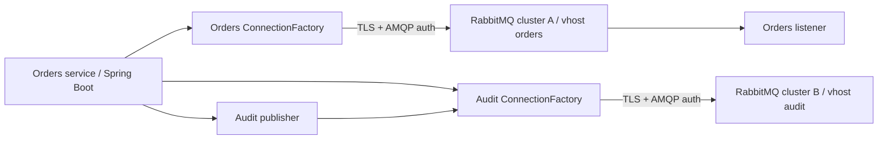

# SSL, xác thực và kết nối nhiều broker theo cấu hình

## 1. Bài toán kết nối RabbitMQ an toàn trong Spring Boot Integration

Trong **Spring Boot Integration**, một ứng dụng thường không chỉ gọi HTTP API hay truy cập database mà còn gửi và nhận message để tách các bước xử lý. Chẳng hạn service đơn hàng nhận sự kiện từ RabbitMQ của hệ thống thương mại, ghi dữ liệu và phát sự kiện kiểm toán tới một RabbitMQ khác do bộ phận an ninh quản lý. Hai hệ thống có thể khác **hostname**, **virtual host**, **tài khoản**, **CA tin cậy**, **chứng thư client**, **quyền exchange/queue** và **chính sách retry**.

Nếu cấu hình tất cả bằng một `ConnectionFactory` hoặc coi chứng thư TLS là đủ để đăng nhập RabbitMQ, ứng dụng có thể:

- Không xác thực được khi broker yêu cầu user/password hoặc cơ chế `EXTERNAL`.
- Gửi message sang **sai cluster hoặc sai virtual host**.
- Tin tưởng chứng thư không hợp lệ do vô hiệu hóa hostname verification.
- Khai báo queue/exchange ở nhầm broker lúc khởi động.
- Khi một broker mất kết nối, vô tình làm cả hai luồng ngừng hoạt động.
- Retry lệnh publish gây message trùng dù đã có publisher confirm.

**Mục tiêu:** thiết kế rõ ràng **transport TLS**, **xác thực AMQP**, **phân quyền**, **định tuyến từng broker**, **quản lý kết nối** và **kiểm thử tích hợp**. Kết quả cần bảo toàn hợp đồng message, transaction, xử lý lỗi và idempotency cho từng luồng.



Hai connection factory tương ứng **hai miền kết nối độc lập**, không phải chỉ hai tên cho cùng một cấu hình mặc định.

## 2. Phân biệt TLS, AMQP authentication và authorization

Khi client kết nối RabbitMQ bằng AMQPS, có nhiều lớp kiểm tra:

| Lớp | Câu hỏi cần trả lời | Ví dụ |
| --- | --- | --- |
| **TCP / địa chỉ** | Client có tới đúng host và port không? | `rabbit.orders.internal:5671` |
| **TLS server authentication** | Server có chứng thư hợp lệ, được CA tin cậy và đúng hostname không? | SAN chứa `rabbit.orders.internal` |
| **TLS client authentication (mTLS)** | Broker có yêu cầu và xác minh chứng thư client không? | Client gửi certificate + private key |
| **AMQP SASL authentication** | RabbitMQ xác định người dùng AMQP là ai? | `PLAIN`/`AMQPLAIN` với user-password hoặc `EXTERNAL` với cert |
| **AMQP authorization** | User được phép làm gì trong vhost? | Quyền `configure`, `write`, `read` trên tài nguyên |
| **Message contract** | Payload và routing có đúng quy ước nghiệp vụ không? | Exchange, routing key, headers, event ID |

**TLS không đồng nghĩa với đã đăng nhập AMQP.** Client có thể bắt tay TLS thành công, sau đó bị từ chối vì user/password không đúng, virtual host không được phép hoặc broker chưa cấu hình cơ chế `EXTERNAL`. Tương tự, đăng nhập AMQP thành công chưa bảo đảm user có quyền publish vào exchange hoặc consume từ queue.

### 2.1. Một chiều TLS so với mTLS

- **TLS một chiều:** client xác minh chứng thư server; broker thường tiếp tục xác thực AMQP bằng username/password hoặc cơ chế được cấu hình.
- **mTLS:** broker còn xác minh chứng thư client. Điều này chứng minh client sở hữu private key của identity đã cấp; việc ánh xạ sang AMQP user/quyền là bước cấu hình riêng.

Trong môi trường nội bộ, **5672** thường dùng AMQP không TLS và **5671** thường dùng AMQP qua TLS. Đây là **quy ước cổng**, không phải luật bắt buộc. Port thực tế tùy listener của broker, load balancer và network policy; đừng suy ra kết nối an toàn chỉ vì dùng port 5671.

### 2.2. Chuỗi chứng thư và hostname verification

Khi xác minh server, cần kiểm tra:

1. Chuỗi chứng thư của server tới CA được ứng dụng tin cậy.
2. Thời hạn và mục đích sử dụng chứng thư phù hợp.
3. DNS hostname đang kết nối khớp Subject Alternative Name (SAN).
4. Broker hoặc proxy cấp đúng intermediate và hỗ trợ TLS protocol/cipher suite được phép.

Không bật `trust-all` hoặc vô hiệu hóa hostname verification để khắc phục lỗi `PKIX path building failed`. Biện pháp đúng là sửa CA bundle, certificate chain, SAN, đồng hồ hệ thống hoặc hostname cấu hình.

## 3. Trường hợp một RabbitMQ broker: cấu hình Spring Boot chuẩn

Với **một logical RabbitMQ broker/cluster**, Spring Boot có thể auto-configure connection factory, RabbitTemplate và listener factory từ `spring.rabbitmq.*`:

```yaml
spring:
  rabbitmq:
    host: rabbit.orders.internal
    port: 5671
    virtual-host: /orders
    username: ${ORDERS_RABBIT_USER}
    password: ${ORDERS_RABBIT_PASSWORD}
    ssl:
      enabled: true
      trust-store: file:/etc/ssl/rabbit/orders-truststore.p12
      trust-store-password: ${ORDERS_TRUSTSTORE_PASSWORD}
      trust-store-type: PKCS12
      validate-server-certificate: true
      verify-hostname: true
    listener:
      simple:
        acknowledge-mode: auto
        prefetch: 20
        concurrency: 2
        max-concurrency: 4
```

**Giải thích cấu hình:**

- `host` và `port` chỉ một endpoint. Với nhiều node của **cùng cluster**, có thể dùng `spring.rabbitmq.addresses` như danh sách địa chỉ kết nối thay thế.
- `virtual-host` là namespace logic của RabbitMQ; user cần được cấp quyền trong vhost đó. `/orders` không phải URL path HTTP.
- `username/password` là credential của cơ chế AMQP phù hợp; giá trị nên đến từ secret manager hoặc môi trường, không ghi literal trong Git.
- `ssl.enabled: true` yêu cầu kết nối TLS; truststore được dùng để xác minh chứng thư server.
- `validate-server-certificate` và `verify-hostname` thể hiện rõ chính sách không chấp nhận server giả mạo; cần xác minh khả năng hỗ trợ và tên property đúng phiên bản Boot đang dùng.
- `listener.simple.acknowledge-mode: auto` là **Spring AMQP AUTO**: container gửi ACK sau khi listener xử lý thành công. Nó **khác** broker auto-ack/no-ack; exception có thể làm message bị reject/requeue tùy chính sách.
- `prefetch` và concurrency điều chỉnh lượng message in-flight; không tự đảm bảo mỗi message chỉ được xử lý một lần.

Tùy phiên bản Spring Boot, một số thuộc tính SSL/timeout và cách lựa chọn client thư viện nền có thể thay đổi. Cần kiểm tra metadata cấu hình của **phiên bản được triển khai**, không trộn cấu hình tham khảo từ nhiều thế hệ Spring Boot.

### 3.1. Khi dùng mTLS với PKCS#12

Nếu broker yêu cầu client certificate, bổ sung identity keystore cho client:

```yaml
spring:
  rabbitmq:
    ssl:
      enabled: true
      key-store: file:/etc/ssl/rabbit/orders-client.p12
      key-store-password: ${ORDERS_KEYSTORE_PASSWORD}
      key-store-type: PKCS12
      trust-store: file:/etc/ssl/rabbit/orders-truststore.p12
      trust-store-password: ${ORDERS_TRUSTSTORE_PASSWORD}
      trust-store-type: PKCS12
      validate-server-certificate: true
      verify-hostname: true
```

**KeyStore** ở đây chứa private key và certificate chain của client, còn **TrustStore** chứa CA để xác minh server. Không dùng cùng một file cho hai mục đích chỉ vì cách đó “dễ cấu hình”, trừ khi đã được thiết kế và kiểm tra an toàn. Quyền truy cập private key nên tối thiểu; có kế hoạch cấp lại, rotation và thu hồi.

Nếu broker dùng client certificate chỉ để xác thực lớp TLS nhưng vẫn yêu cầu username/password AMQP, phải cung cấp cả hai. Nếu broker ánh xạ certificate sang user AMQP qua `EXTERNAL`, cách thiết lập SASL lại khác (phần sau).

## 4. Xác thực AMQP: user/password, EXTERNAL và phân quyền vhost

### 4.1. Username/password

RabbitMQ thường hỗ trợ `PLAIN` hoặc `AMQPLAIN` cho xác thực AMQP. Với TLS hợp lệ, credential được bảo vệ trên đường truyền. Không log password, không đưa connection URL chứa password vào exception/metric và không gắn quyền administrator cho tài khoản runtime.

Phân quyền tối thiểu có thể khác nhau theo vai trò:

| Vai trò ứng dụng | Quyền cần thiết | Không nên tự động cấp |
| --- | --- | --- |
| Producer | `write` trên exchange đích và quyền liên quan tới luồng publish | Quyền configure/xóa mọi queue |
| Consumer | `read` trên queue đích | Quyền publish vào tất cả exchanges |
| Topology provisioner | `configure` cần thiết để khai báo queue, exchange và binding | Quyền quản trị toàn broker không giới hạn |
| Health/monitor | Quyền quan sát theo API hoặc account riêng | Runtime user có quyền cấu hình hạ tầng |

Quy tắc RabbitMQ cho `configure`, `write`, `read` còn phụ thuộc exchange, queue và thao tác AMQP cụ thể. Test bằng đúng account và vhost của ứng dụng; kết nối thành công không chứng minh có đủ ACL cho mọi operation.

### 4.2. SASL EXTERNAL khi dùng client certificate

Đối với cơ chế `EXTERNAL`, RabbitMQ phải được cấu hình để **chấp nhận EXTERNAL** và ánh xạ danh tính certificate tới user AMQP theo chính sách của broker (ví dụ cơ chế xác thực client certificate). Chỉ bật mTLS ở listener TLS **không tự kích hoạt EXTERNAL**.

Với RabbitMQ Java client, khái niệm cấu hình:

```java
import com.rabbitmq.client.ConnectionFactory;
import com.rabbitmq.client.DefaultSaslConfig;
import javax.net.ssl.SSLContext;

ConnectionFactory nativeFactory = new ConnectionFactory();
nativeFactory.setHost("rabbit.orders.internal");
nativeFactory.setPort(5671);
nativeFactory.setVirtualHost("/orders");
nativeFactory.useSslProtocol(sslContext);
nativeFactory.enableHostnameVerification();
nativeFactory.setSaslConfig(DefaultSaslConfig.EXTERNAL);
```

`sslContext` là một `SSLContext` đã được tạo từ key/trust material hợp lệ, có client private key khi mTLS yêu cầu. Đoạn trên chỉ minh họa lựa chọn SASL; không phải ví dụ độc lập đầy đủ, và cần hạ tầng broker đã bật EXTERNAL. Với user/password thông thường, đừng chuyển sang EXTERNAL chỉ vì đang dùng port 5671.

### 4.3. Phân biệt lỗi handshake và lỗi AMQP authentication

| Lỗi quan sát | Lớp cần điều tra trước |
| --- | --- |
| `SSLHandshakeException`, `PKIX path building failed` | CA/truststore, chain, SAN, TLS protocol |
| `CertificateExpiredException` | Certificate hết hạn hoặc clock sai |
| `bad_certificate`, `certificate_required` | Client certificate, CA ở broker, mTLS policy |
| `ACCESS_REFUSED - Login was refused` | SASL mechanism, username/password, vhost permission |
| Channel bị đóng với `ACCESS_REFUSED` khi publish/consume | Quyền `configure/write/read` hoặc tài nguyên sai |
| `NOT_FOUND - no exchange/queue` | Topology sai broker/vhost hoặc chưa provision |

Đọc nguyên nhân gốc từ log client và broker; không retry vô hạn lỗi credential sai. Sau khi xác thực lại, vẫn phải xác minh các luồng có thể publish/consume và xử lý message đúng.

## 5. Nhiều node trong một cluster khác nhiều broker độc lập

Đây là khác biệt cấu hình **quan trọng nhất** khi một hệ thống có nhiều địa chỉ RabbitMQ:

| Mô hình | Ý nghĩa | ConnectionFactory |
| --- | --- | --- |
| Nhiều **node trong cùng RabbitMQ cluster** | Nhiều địa chỉ vào **cùng logical broker**, các node chia sẻ metadata cluster; queue placement/replication tùy loại queue | Thường dùng **một ConnectionFactory** với danh sách địa chỉ |
| Hai **cluster độc lập** | Mỗi cluster có vhost, user, topology, message và trạng thái độc lập | Cần **hai ConnectionFactory**, thường hai RabbitTemplate/listener factory |
| Một cluster, **hai virtual host** với quyền tách biệt | Hai namespace AMQP khác nhau, mỗi connection chọn một vhost khi thiết lập | Thường cũng cần **hai ConnectionFactory** nếu một app dùng cả hai |
| Broker có nhiều **load balancer endpoint** | Cùng logical broker phía sau LB | Có thể một ConnectionFactory tới endpoint LB, nhưng phải kiểm tra DNS/TLS/SNI |

Ví dụ khi các host thuộc **cùng cluster**:

```yaml
spring:
  rabbitmq:
    addresses: rabbit-a-1.internal:5671,rabbit-a-2.internal:5671
    virtual-host: /orders
    username: ${ORDERS_RABBIT_USER}
    password: ${ORDERS_RABBIT_PASSWORD}
    ssl:
      enabled: true
      verify-hostname: true
```

Danh sách `addresses` giúp client có nhiều điểm kết nối tới cùng hệ thống khi thiết lập/reconnect; nó **không** tự đồng bộ message giữa hai cluster độc lập, không bảo đảm round-robin từng message và không thay thế topology replication. Mọi hostname trong danh sách phải có certificate hợp lệ với tên được client dùng.

**Không** nhập địa chỉ cluster Orders và cluster Audit vào cùng `spring.rabbitmq.addresses` rồi mong Spring phân biệt message theo exchange. Nếu hai cluster đều có exchange `events`, publish có thể đi tới sai hệ thống khi reconnect.

## 6. Hai broker riêng: thiết kế cấu hình có định danh rõ ràng

Giả sử ứng dụng cần:

- **orders**: consume sự kiện đơn hàng từ RabbitMQ A, vhost `/orders`.
- **audit**: publish sự kiện kiểm toán sang RabbitMQ B, vhost `/audit`.

Ở ví dụ này, ta **tự khai báo đầy đủ** hai `CachingConnectionFactory` và các template/listener tương ứng, không phụ thuộc Spring Boot tự tạo thêm một default factory. Khi đã khai báo một bean connection factory tùy biến, auto-configuration của Boot có thể **back off** đối với default factory; vì thế mô hình “cứ khai báo factory thứ hai rồi dùng factory mặc định” thường gây lỗi cấu hình.

### 6.1. application.yml với hai namespace độc lập

Ví dụ áp dụng cho dòng Spring Boot hỗ trợ **SSL bundles** (Spring Boot 3.1+). Các file CA cần được mount từ nguồn được tin cậy:

```yaml
spring:
  ssl:
    bundle:
      pem:
        orders-rabbit:
          truststore:
            certificate: file:/etc/ssl/rabbit/orders-ca.pem
        audit-rabbit:
          truststore:
            certificate: file:/etc/ssl/rabbit/audit-ca.pem

integration:
  rabbitmq:
    orders:
      host: rabbit.orders.internal
      port: 5671
      virtual-host: /orders
      username: ${ORDERS_RABBIT_USER}
      password: ${ORDERS_RABBIT_PASSWORD}
      ssl-bundle: orders-rabbit
    audit:
      host: rabbit.audit.internal
      port: 5671
      virtual-host: /audit
      username: ${AUDIT_RABBIT_USER}
      password: ${AUDIT_RABBIT_PASSWORD}
      ssl-bundle: audit-rabbit
```

`spring.ssl.bundle.pem.*.truststore.certificate` chỉ cung cấp CA tin cậy cho server verification. Nếu broker yêu cầu **client certificate**, bổ sung `keystore.certificate` và `keystore.private-key` cho bundle tương ứng, bảo vệ private key và kiểm chứng client identity khi bắt tay TLS:

```yaml
spring:
  ssl:
    bundle:
      pem:
        audit-rabbit:
          keystore:
            certificate: file:/etc/ssl/rabbit/audit-client.crt
            private-key: file:/etc/ssl/rabbit/audit-client.key
          truststore:
            certificate: file:/etc/ssl/rabbit/audit-ca.pem
```

Cấu hình mTLS ở trên **thay thế/bổ sung phần bundle audit tương ứng**, không nên lặp định nghĩa cùng key YAML trong một file thật. Secret và khóa riêng không nên được nhúng vào container image hoặc repository.

### 6.2. Bind cấu hình theo broker

Để tránh nhầm orders/audit và hỗ trợ validate tại startup, định nghĩa hai record tương ứng:

```java
import org.springframework.boot.context.properties.ConfigurationProperties;

interface RabbitTarget {
    String host();
    int port();
    String username();
    String password();
    String virtualHost();
    String sslBundle();
}

@ConfigurationProperties(prefix = "integration.rabbitmq.orders")
record OrdersRabbitTarget(
        String host, int port, String username, String password,
        String virtualHost, String sslBundle) implements RabbitTarget {}

@ConfigurationProperties(prefix = "integration.rabbitmq.audit")
record AuditRabbitTarget(
        String host, int port, String username, String password,
        String virtualHost, String sslBundle) implements RabbitTarget {}
```

Đây là cách dùng constructor binding của record trong Spring Boot 3.x. Hai record nên đặt ở phạm vi package phù hợp, dùng `@EnableConfigurationProperties` hoặc `@ConfigurationPropertiesScan` để đăng ký. Khi đưa vào production, cần kiểm tra bắt buộc host, port, vhost và tên bundle bằng bean validation hoặc code startup, **không dùng record `toString()` để log** vì mặc định nó in cả trường password.

### 6.3. Khởi tạo hai connection factory với TLS kiểm tra hostname

```java
import com.rabbitmq.client.ConnectionFactory;
import org.springframework.boot.context.properties.EnableConfigurationProperties;
import org.springframework.boot.ssl.SslBundles;
import org.springframework.context.annotation.Bean;
import org.springframework.context.annotation.Configuration;
import org.springframework.context.annotation.Primary;
import org.springframework.amqp.rabbit.connection.CachingConnectionFactory;

@Configuration(proxyBeanMethods = false)
@EnableConfigurationProperties({
        OrdersRabbitTarget.class, AuditRabbitTarget.class
})
class RabbitBrokerConfiguration {

    @Bean("ordersConnectionFactory")
    @Primary
    CachingConnectionFactory ordersConnectionFactory(
            OrdersRabbitTarget target, SslBundles bundles) throws Exception {
        return create(target, bundles);
    }

    @Bean("auditConnectionFactory")
    CachingConnectionFactory auditConnectionFactory(
            AuditRabbitTarget target, SslBundles bundles) throws Exception {
        return create(target, bundles);
    }

    private CachingConnectionFactory create(
            RabbitTarget target, SslBundles bundles) throws Exception {

        ConnectionFactory nativeFactory = new ConnectionFactory();
        nativeFactory.setHost(target.host());
        nativeFactory.setPort(target.port());
        nativeFactory.setVirtualHost(target.virtualHost());
        nativeFactory.setUsername(target.username());
        nativeFactory.setPassword(target.password());
        nativeFactory.useSslProtocol(
                bundles.getBundle(target.sslBundle()).createSslContext());
        nativeFactory.enableHostnameVerification();

        // Spring AMQP quản lý recovery của connection riêng.
        nativeFactory.setAutomaticRecoveryEnabled(false);

        return new CachingConnectionFactory(nativeFactory);
    }
}
```

**Tại sao cần từng dòng:**

1. `host/port/vhost/user/password` được lấy từ **đúng cấu hình** của broker tương ứng.
2. `SslBundles.getBundle(...).createSslContext()` tạo TLS context từ CA và (nếu có) identity PEM đã cấu hình.
3. `enableHostnameVerification()` yêu cầu kiểm tra hostname ở lớp RabbitMQ Java client, không chỉ tin CA.
4. `setAutomaticRecoveryEnabled(false)` tránh chồng cơ chế automatic recovery native của RabbitMQ Java client với cơ chế quản lý connection/listener của Spring AMQP. Cần xác minh hành vi recovery theo phiên bản thư viện thật.
5. `@Primary` giúp các dependency không gắn qualifier chọn orders factory theo chủ ý; với mỗi luồng quan trọng vẫn nên dùng `@Qualifier` để không nhầm broker.

Mẫu này được minh họa trên Spring Boot 3.x với SSL bundles và RabbitMQ Java client tương thích. Nếu dùng Spring Boot cũ hơn hoặc có yêu cầu `EXTERNAL`, truststore PKCS#12, certificate pinning, proxy hay connection settings đặc thù, phải điều chỉnh rõ ràng. Không dùng `useSslProtocol()` không truyền context với giả định nó sẽ xác minh mọi certificate theo chính sách production.

### 6.4. Hai RabbitTemplate và hai listener container factory

```java
import org.springframework.amqp.rabbit.core.RabbitTemplate;
import org.springframework.amqp.rabbit.connection.CachingConnectionFactory;
import org.springframework.amqp.rabbit.config.SimpleRabbitListenerContainerFactory;
import org.springframework.beans.factory.annotation.Qualifier;
import org.springframework.context.annotation.Bean;
import org.springframework.context.annotation.Configuration;

@Configuration(proxyBeanMethods = false)
class BrokerEndpointsConfiguration {

    @Bean("ordersRabbitTemplate")
    RabbitTemplate ordersRabbitTemplate(
            @Qualifier("ordersConnectionFactory") CachingConnectionFactory cf) {
        return new RabbitTemplate(cf);
    }

    @Bean("auditRabbitTemplate")
    RabbitTemplate auditRabbitTemplate(
            @Qualifier("auditConnectionFactory") CachingConnectionFactory cf) {
        return new RabbitTemplate(cf);
    }

    @Bean("ordersListenerFactory")
    SimpleRabbitListenerContainerFactory ordersListenerFactory(
            @Qualifier("ordersConnectionFactory") CachingConnectionFactory cf) {
        SimpleRabbitListenerContainerFactory factory =
                new SimpleRabbitListenerContainerFactory();
        factory.setConnectionFactory(cf);
        factory.setConcurrentConsumers(2);
        factory.setMaxConcurrentConsumers(4);
        factory.setPrefetchCount(20);
        return factory;
    }
}
```

Với `@RabbitListener`, chỉ định container factory của đúng broker:

```java
import org.springframework.amqp.rabbit.annotation.RabbitListener;
import org.springframework.stereotype.Component;

@Component
class OrdersEventConsumer {
    @RabbitListener(
            id = "ordersEventConsumer",
            queues = "orders.events",
            containerFactory = "ordersListenerFactory")
    public void onOrderEvent(String payload) {
        // Validate schema/eventId rồi xử lý idempotent.
        // Khi thành công, container ACK theo policy được cấu hình.
    }
}
```

Đăng ký `@EnableRabbit` trong một class `@Configuration` nếu dự án chưa có cơ chế kích hoạt annotation-driven listener phù hợp; kiểm tra configuration thực tế của Spring Boot. Nếu có consumer ở broker Audit, tạo **auditListenerFactory** riêng và gắn rõ tên, thay vì dựa vào default factory.

Với Java `String` payload và converter mặc định, các ví dụ trên chỉ minh họa định tuyến. Khi dùng JSON DTO, phải cấu hình **message converter tương thích** trên template và listener tương ứng: `contentType`, charset, headers `__TypeId__` nếu có, allowlist type và version event; không mặc định hai broker có cùng hợp đồng payload.

### 6.5. Không để bean mặc định vô tình chọn nhầm broker

Khi có hai `ConnectionFactory` và hai `RabbitTemplate`:

- Injection theo type không có qualifier có thể mơ hồ, hoặc bị `@Primary` chuyển sang broker không định dùng.
- `RabbitListenerContainerFactory` mặc định có thể dùng connection factory khác với listener bạn tưởng.
- Auto-configuration của Spring Boot có thể không tạo bean default vì đã phát hiện bean người dùng tự định nghĩa.
- Một `RabbitAdmin` mặc định có thể tìm thấy các declarable bean và khai báo topology ở nơi không mong muốn.

Đặt tên bean theo logical target, dùng `@Qualifier` tại mọi integration boundary và viết test xác nhận **template A thực sự tạo kết nối tới broker A**.

## 7. Provision topology đúng nơi: RabbitAdmin và declarables

Exchange, queue và binding không tồn tại “toàn hệ thống”; chúng thuộc **một virtual host trên một broker/cluster cụ thể**. Nếu ứng dụng kết nối hai broker, việc tự động khai báo topology phải có chủ sở hữu rõ ràng.

Đối với môi trường có topology do platform team quản lý, tài khoản ứng dụng có thể chỉ có `read/write` và **không có `configure`**. Khi đó không nên bật auto-declaration rồi xem `ACCESS_REFUSED` là lỗi broker. Nếu ứng dụng sở hữu topology, cần cố định RabbitAdmin nào được phép khai báo từng tài nguyên.

```java
import org.springframework.amqp.core.Binding;
import org.springframework.amqp.core.BindingBuilder;
import org.springframework.amqp.core.DirectExchange;
import org.springframework.amqp.core.Queue;
import org.springframework.amqp.rabbit.connection.CachingConnectionFactory;
import org.springframework.amqp.rabbit.core.RabbitAdmin;
import org.springframework.beans.factory.annotation.Qualifier;
import org.springframework.context.annotation.Bean;
import org.springframework.context.annotation.Configuration;

@Configuration(proxyBeanMethods = false)
class AuditTopologyConfiguration {
    @Bean("auditAdmin")
    RabbitAdmin auditAdmin(
            @Qualifier("auditConnectionFactory") CachingConnectionFactory cf) {
        RabbitAdmin admin = new RabbitAdmin(cf);
        admin.setExplicitDeclarationsOnly(true);
        return admin;
    }

    @Bean
    DirectExchange auditEventsExchange(
            @Qualifier("auditAdmin") RabbitAdmin admin) {
        DirectExchange exchange = new DirectExchange("audit.events", true, false);
        exchange.setAdminsThatShouldDeclare(admin);
        return exchange;
    }

    @Bean
    Queue auditNotificationsQueue(
            @Qualifier("auditAdmin") RabbitAdmin admin) {
        Queue queue = new Queue("audit.notifications", true);
        queue.setAdminsThatShouldDeclare(admin);
        return queue;
    }

    @Bean
    Binding auditBinding(
            Queue auditNotificationsQueue,
            DirectExchange auditEventsExchange,
            @Qualifier("auditAdmin") RabbitAdmin admin) {
        Binding binding = BindingBuilder.bind(auditNotificationsQueue)
                .to(auditEventsExchange)
                .with("audit.created");
        binding.setAdminsThatShouldDeclare(admin);
        return binding;
    }
}
```

`setExplicitDeclarationsOnly(true)` giúp RabbitAdmin chỉ khai báo những `Declarable` được chỉ định thuộc admin đó. Cấu hình này có ý nghĩa khi **có nhiều RabbitAdmin**; nếu không, một admin có thể cố khai báo tất cả các exchange/queue/binding bean nhìn thấy trong context.

Các ví dụ dùng queue/exchange durable nhưng **chưa cấu hình DLX, TTL hay chính sách quorum/classic**. Trong production, queue type, dead-lettering, retention, retry và ownership phải được xác định trước. Không tự tạo lại queue có thuộc tính khác với queue đã tồn tại; RabbitMQ có thể trả `PRECONDITION_FAILED` khi khai báo lệch arguments.

## 8. Định tuyến message và giới hạn giao dịch giữa hai broker

Publisher cần chỉ định đúng RabbitTemplate:

```java
import org.springframework.amqp.rabbit.core.RabbitTemplate;
import org.springframework.beans.factory.annotation.Qualifier;
import org.springframework.stereotype.Service;

@Service
class AuditPublisher {
    private final RabbitTemplate auditTemplate;

    AuditPublisher(
            @Qualifier("auditRabbitTemplate") RabbitTemplate auditTemplate) {
        this.auditTemplate = auditTemplate;
    }

    public void publish(String eventJson) {
        auditTemplate.convertAndSend(
                "audit.events", "audit.created", eventJson);
    }
}
```

Ví dụ này giả định body JSON là chuỗi đã được validate/serialize ở tầng trước. `convertAndSend` trả về sau khi gửi theo API template; **không tự chứng minh broker đã persist message, đã route tới queue hay consumer đã xử lý**. Khi cần độ tin cậy cao phải kết hợp confirms/returns, outbox và idempotency.

### 8.1. Publisher confirms và returns không phải ACK của consumer

- **Publisher confirm:** broker xác nhận xử lý publish ở phía producer theo semantics của RabbitMQ và cấu hình queue/replication.
- **Publisher return:** khi `mandatory` được bật, message không route được tới queue có thể được trả về (nếu broker/đường gửi phù hợp).
- **Consumer ACK:** consumer đã xử lý delivery theo chính sách acknowledgement, diễn ra sau đó và ở luồng khác.

Với factory và template tự khai báo, những tính năng này cần được **cấu hình trên đúng bean**, không giả định `spring.rabbitmq.publisher-confirm-type` hay `publisher-returns` tự áp dụng cho mọi factory custom:

```java
import org.springframework.amqp.rabbit.connection.CachingConnectionFactory;
import org.springframework.amqp.rabbit.core.RabbitTemplate;

void enablePublisherReliability(
        CachingConnectionFactory cf, RabbitTemplate template) {
    cf.setPublisherConfirmType(
            CachingConnectionFactory.ConfirmType.CORRELATED);
    cf.setPublisherReturns(true);
    template.setMandatory(true);

    template.setConfirmCallback((correlation, ack, cause) -> {
        // Đánh dấu kết quả confirm theo ID công việc; nack cần xử lý riêng.
    });
    template.setReturnsCallback(returned -> {
        // Message không route được; ghi nhận và xử lý lại có kiểm soát.
    });
}
```

Đây là **minh họa cách cấu hình**, không phải cơ chế outbox hoàn chỉnh. Các callback phải được thiết lập khi khởi tạo bean, trước khi publish. Không gọi hàm này muộn khi factory đang có kết nối và in-flight messages. Cần xác minh khả năng correlation của callback, xử lý timeout/unknown outcome và bền vững hóa trạng thái publish ở database nghiệp vụ.

### 8.2. Gửi hai broker không có transaction nguyên tử mặc định

Nếu service phải gửi cùng sự kiện đến Orders và Audit, không có một `@Transactional` JDBC thông thường nào khiến hai broker commit hoặc rollback cùng lúc. Sự cố có thể xảy ra khi **A đã nhận nhưng B chưa nhận**, hoặc B nhận mà client timeout không biết kết quả. Không giải quyết bằng cách gọi `ordersTemplate.convertAndSend` rồi `auditTemplate.convertAndSend` trong một `try/catch` và tuyên bố exactly-once.

Mô hình chắc chắn hơn:

1. Trong **một transaction DB**, lưu thay đổi nghiệp vụ và hai outbox entry theo logical target.
2. Worker riêng cho mỗi broker đọc outbox của mình, publish với `eventId` ổn định và quan sát confirm/return.
3. Đánh dấu `SENT` khi đã có bằng chứng đủ mạnh theo hợp đồng; lỗi/unknown outcome giữ khả năng retry/reconcile.
4. Bên nhận dedup theo `eventId` hoặc khóa nghiệp vụ. Một sự kiện có thể được publish lại sau crash.

Ngay cả với quorum queue và publisher confirms, các hệ thống phía ngoài như HTTP API hay database của consumer không tự tham gia một transaction thống nhất. Hãy thiết kế theo khả năng at-least-once và idempotency.

## 9. Consumer reliability, ACK, prefetch và retry

### 9.1. Spring AMQP `AUTO` khác broker auto-ack

| Acknowledge mode | Cách vận hành | Rủi ro/điều kiện |
| --- | --- | --- |
| `AcknowledgeMode.AUTO` | Spring listener container ACK khi listener thành công, xử lý reject/nack khi lỗi theo cấu hình | Cần biết `defaultRequeueRejected`, retry và error handler |
| `AcknowledgeMode.MANUAL` | Listener gọi ACK/NACK/REJECT thông qua channel khi thích hợp | Phải xử lý mọi đường hoàn tất/lỗi; không ACK trước khi commit nghiệp vụ |
| `AcknowledgeMode.NONE` | Broker auto-ack/no-ack delivery theo semantics tương ứng | Có thể mất message nếu consumer crash sau khi nhận nhưng trước khi xử lý |

Ví dụ manual ACK (chỉ dùng khi listener factory đã cấu hình `AcknowledgeMode.MANUAL`):

```java
import com.rabbitmq.client.Channel;
import org.springframework.amqp.core.Message;
import org.springframework.amqp.rabbit.annotation.RabbitListener;
import java.io.IOException;

class ManualOrderConsumer {
    @RabbitListener(
            queues = "orders.events",
            containerFactory = "ordersManualListenerFactory")
    public void consume(Message message, Channel channel) throws IOException {
        long deliveryTag = message.getMessageProperties().getDeliveryTag();
        try {
            // Validate, xử lý idempotent, commit dữ liệu trước khi ACK.
            process(message);
            channel.basicAck(deliveryTag, false);
        } catch (PermanentPayloadException invalid) {
            channel.basicReject(deliveryTag, false); // DLX nếu đã cấu hình.
        } catch (Exception transientError) {
            channel.basicNack(deliveryTag, false, true);
        }
    }
}
```

`ordersManualListenerFactory`, `process(...)` và `PermanentPayloadException` là thành phần minh họa cần hiện thực/cấu hình riêng; đoạn code chưa phải class chạy độc lập. Với lỗi tạm thời, requeue ngay lập tức có thể tạo **hot loop**. Trong production hãy cân nhắc retry có backoff, delayed retry queue hoặc DLQ, cùng giới hạn số lần thử. Khi container dùng manual ACK, đảm bảo chỉ một đường ACK/NACK thắng và không ACK trước khi transaction DB đã commit.

### 9.2. Prefetch và concurrency phải tính theo tổng số replica

Nếu mỗi pod có `concurrentConsumers=4` và `prefetch=20`, một pod có thể giữ khoảng **80 delivery unacked** ở trạng thái tối đa theo điều kiện broker/client. Với năm pod, tổng in-flight có thể đáng kể so với năng lực database/HTTP API.

Tăng prefetch giúp giảm round-trip trong một số trường hợp, nhưng cũng có thể:

- Để message chờ ở client lâu hơn, tăng độ trễ của hàng ưu tiên.
- Dồn message vào consumer chậm, giảm công bằng.
- Tạo nhiều redelivery khi pod crash hoặc broker reconnect.
- Làm cạn connection pool DB/HTTP khi concurrency tăng.

Không tăng đồng thời concurrency và prefetch chỉ để “xóa backlog” khi downstream đang lỗi 429/503. Theo dõi message rate **hoàn tất nghiệp vụ**, consumer lag/queue depth, unacked, retry và DLQ.

## 10. Secret rotation, certificate rotation và kết nối lại

RabbitMQ connection và channel thường sống lâu. Khi secret/certificate được thay trong secret manager hoặc Kubernetes volume, **JVM không tự động thay SSLContext của những connection đã tạo** nếu ứng dụng không có cơ chế reload.

Quy trình đổi an toàn khi broker hỗ trợ song song credential:

1. Cấp username/password mới hoặc certificate mới, cài quyền tương ứng trên đúng vhost.
2. Nếu đổi CA, phân phối trust bundle **có CA cũ và mới** đến tất cả client trước khi server chuyển leaf certificate.
3. Cho broker chấp nhận cả identity cũ và mới trong cửa sổ chuyển đổi; xác minh certificate chain, hostname và ACL.
4. Rolling restart hoặc tạo lại factory/connection/listener theo cơ chế đã kiểm chứng; bắt buộc thử **handshake và AMQP login mới**.
5. Kiểm tra publish/consume thực tế, message rate, queue depth, redelivery và business idempotency.
6. Sau khi không còn client phụ thuộc credential cũ, thu hồi credential/cert cũ rồi tiếp tục quan sát.

Nếu **private key bị lộ**, không duy trì overlap dài chỉ để tránh gián đoạn. Cần ưu tiên thu hồi theo kế hoạch xử lý sự cố, có thể tạm ngừng riêng luồng chịu ảnh hưởng rồi phục hồi an toàn.

### 10.1. Phân biệt readiness và broker consumer

Pod Kubernetes `NotReady` thường không được route HTTP traffic qua Service, nhưng listener RabbitMQ trong pod vẫn có thể chạy và consume message. Khi cần tạm dừng luồng trước migration hoặc rotation, hãy điều khiển **RabbitListenerEndpointRegistry/container lifecycle** riêng, drain message đang xử lý và kiểm tra redelivery. Readiness HTTP **không phải** công tắc stop consumer.

### 10.2. Đừng dùng native auto recovery chồng với Spring AMQP

RabbitMQ Java client có cơ chế automatic recovery riêng; Spring AMQP cũng quản lý kết nối và listener container. Nếu bật cả hai mà không xác minh rõ trách nhiệm, có thể gặp trạng thái recovery khó dự đoán, duplicate consumers hoặc topology declarations trùng. Với `CachingConnectionFactory` do Spring quản lý, nên nhất quán với mô hình recovery của Spring AMQP và kiểm thử broker restart, mất mạng, TLS certificate thay đổi.

## 11. Kiểm thử: hai broker, hai TLS identity và đúng routing

### 11.1. Test cấu hình ở cấp context

Với test Spring Boot có hai connection factory, tối thiểu phải xác minh:

- Tồn tại `ordersConnectionFactory` và `auditConnectionFactory` là **hai bean khác nhau**.
- `ordersRabbitTemplate` dùng đúng orders factory, `auditRabbitTemplate` dùng đúng audit factory.
- `ordersListenerFactory` tạo listener dùng orders factory; listener audit (nếu có) dùng audit factory.
- `RabbitAdmin` có declarable đúng logical target, không tạo queue/exchange của Orders trong Audit.
- Cấu hình thiếu CA, thiếu password hoặc vhost sai phải **không âm thầm fallback** sang broker mặc định.

Test cấu hình **không thay thế** test kết nối TLS với broker thật, vì tạo `ConnectionFactory` có thể chưa mở TCP connection.

### 11.2. Testcontainers với hai RabbitMQ độc lập

Trong integration test, có thể khởi tạo **hai RabbitMQ container riêng biệt** rồi cấu hình host/port động cho cả hai. Cần tạo dữ liệu/queue riêng, và assert:

1. Gửi `OrderCreated` vào broker A, consumer Orders nhận đúng một logical event hoặc dedup nếu redelivery.
2. Gửi event `AuditCreated` qua `auditRabbitTemplate`, message có mặt ở broker B.
3. Kiểm tra broker A **không có** audit exchange/queue nếu thiết kế yêu cầu tách biệt.
4. Restart broker B, xác minh publisher audit có recovery và không ảnh hưởng sai tới consumer Orders.
5. Mô phỏng auth failure riêng trên B: A tiếp tục xử lý nếu nghiệp vụ không phụ thuộc B trực tiếp.
6. Kiểm tra topology và permissions bằng đúng runtime user/vhost.

Nếu cần kiểm tra TLS/mTLS, tạo CA, server certificate có SAN hợp lệ và client certificate trong **test fixture được quản lý an toàn**, bật TLS listeners tương đương production. RabbitMQContainer mặc định trên cổng AMQP thường không có cấu hình TLS như production; test hai container không TLS chỉ chứng minh routing/logic, **không chứng minh SSL**.

### 11.3. Bộ tình huống bảo mật và sự cố

| Tình huống | Kết quả cần có |
| --- | --- |
| CA tin cậy, SAN khớp, user/vhost đúng | TLS + AMQP auth thành công |
| CA sai hoặc certificate hết hạn | Handshake bị từ chối; không bật trust-all |
| DNS alias không nằm trong SAN | Hostname verification chặn kết nối |
| Broker yêu cầu mTLS nhưng client không có key | Handshake bị từ chối |
| Broker không bật `EXTERNAL` nhưng client chọn EXTERNAL | AMQP authentication thất bại |
| User đúng nhưng thiếu quyền read/write | Operation bị từ chối; lỗi được phân loại |
| Broker Audit mất mạng | Orders không bị đổi hướng tới Audit |
| Exchange không có binding phù hợp | Mandatory publish return được quan sát |
| Broker nhận publish nhưng client mất confirm | Retry/reconcile theo eventId; không tuyên bố “chưa gửi” |
| Consumer crash sau DB commit trước ACK | Redelivery không tạo side effect trùng |
| Chứng thư/secret được rotate | Connection mới dùng credential đúng, không mất khả năng xử lý không cần thiết |

### 11.4. Kiểm tra TLS từ môi trường tương đương ứng dụng

Có thể dùng `openssl` để quan sát chứng thư của server:

```bash
openssl s_client \
  -connect rabbit.orders.internal:5671 \
  -servername rabbit.orders.internal \
  -verify_hostname rabbit.orders.internal \
  -verify_return_error \
  -CAfile orders-ca.pem
```

Lệnh này chỉ kiểm tra TLS handshake theo cấu hình OpenSSL, **không chứng minh AMQP login hay ACL thành công**. Ngoài ra Java truststore và RabbitMQ Java client có cấu hình riêng; cần test chính ứng dụng với `SSLContext` thực tế. Không sử dụng file CA lạ do lỗi log đề xuất hoặc tắt xác minh chứng thư để “thông” kết nối.

## 12. Quan sát hai broker trong production

| Chỉ số/tín hiệu | Phân tách thế nào | Khi tăng bất thường |
| --- | --- | --- |
| TLS handshake failures | Theo logical broker/hostname | CA/SAN/certificate/protocol vấn đề |
| AMQP authentication/authorization failures | Theo logical broker/vhost/user alias | Secret, SASL hoặc ACL sai |
| Connection/channels/reconnect | Theo từng ConnectionFactory | Network outage, recovery loop |
| Publish confirms nack/timeout | Theo RabbitTemplate/broker | Broker publish path hoặc trạng thái chưa rõ |
| Publisher returns (unroutable) | Theo exchange/routing key hợp lệ | Binding, vhost, topology không đúng |
| Queue ready/unacked/redelivery/DLQ | Theo broker/vhost/queue | Worker chậm, crash, hot retry |
| Listener active/consumers | Theo listener container factory | Listener chưa start, auth hoặc queue missing |
| End-to-end business success | Theo luồng xử lý, eventId/correlation ID | Lỗi downstream dù AMQP còn hoạt động |

Không đặt password, raw token, private key hoặc cả connection URL chứa secret vào log. Metric tag chỉ dùng logical broker name, vhost/exchange được allowlist; tránh tag mỗi `eventId` làm bùng cardinality.

Một log hữu ích có thể ghi `integration=orders-inbound`, `broker=orders`, `eventId=...`, `attempt=...` và thời điểm retry. Khi một message được redeliver, liên kết trace và idempotency marker để phân biệt **nhận lại cùng event** với **một event mới**.

## 13. Các lỗi cấu hình phổ biến

| Triệu chứng | Nguyên nhân có thể | Hướng kiểm tra |
| --- | --- | --- |
| `PKIX path building failed` | CA chưa tin hoặc thiếu intermediate | Truststore/bundle, chain server |
| `No subject alternative names matching` | Hostname sai SAN | DNS/SNI, SAN trên certificate |
| `bad_certificate` khi bật mTLS | Client cert/key sai hoặc CA của broker không tin | Keystore, clientAuth, cert chain phía broker |
| `ACCESS_REFUSED - Login was refused` | Sai user/password, vhost, SASL | Broker auth log, secret, vhost policy |
| Login thành công nhưng publish fail | Thiếu quyền write hoặc exchange sai | ACL của runtime user trong vhost |
| `NOT_FOUND` cho queue/exchange | Sai broker/vhost hoặc chưa provision topology | Queue/exchange tồn tại ở cluster nào |
| `PRECONDITION_FAILED` khi declare | Queue/exchange arguments không khớp hiện có | Type, durability, auto-delete, DLX args |
| Listener Audit nghe Orders | Thiếu `containerFactory` hoặc nhầm qualifier | Bean wiring, listener factory được dùng |
| Template A publish sang B | Factory bean bị chọn theo `@Primary` | Injection theo tên và integration test |
| Một cluster fail khiến hệ thống “chuyển” sang cluster khác | Trộn địa chỉ độc lập trong `addresses` | Tách ConnectionFactory/target |
| Message gửi xong nhưng không tới queue | Routing key/binding sai, không bật mandatory returns | Binding + publisher return |
| Publisher confirm ACK nhưng nghiệp vụ vẫn mất | Confirm không phải consumer ACK, thiếu processing transaction | Outbox/idempotency, ACK boundary |
| Rotation xong mà kết nối mới vẫn dùng cert cũ | `SSLContext`/connection cache chưa reload | Tạo lại factory/connection, test TLS mới |
| Backlog tăng sau tăng prefetch | Downstream chậm, nhiều unacked | Concurrency, pool, retry, rate limit |

## 14. Runbook: tách kết nối Audit mà không gián đoạn Orders

**Bối cảnh:** đơn hàng đang được consume từ cluster Orders, nhưng cluster Audit phải đổi CA và credential. Hai cluster độc lập; không được làm listener Orders mất connection hoặc gửi dữ liệu sang nhầm Audit.

1. **Kiểm kê:** xác nhận tên `ordersConnectionFactory`, `auditConnectionFactory`, template/listener và tài nguyên exchange/queue của từng cluster.
2. **Phân phối CA mới:** cho trust bundle Audit tin CA cũ và mới trong thời gian chuyển đổi khi có thể; giữ nguyên cấu hình Orders.
3. **Cấp identity mới:** tạo account hoặc client cert Audit mới, gán đúng quyền trong `/audit`, kiểm tra kết nối và ACL bằng canary.
4. **Chuyển riêng Audit:** rolling restart các pod hoặc refresh connection factory đã được kiểm thử; theo dõi xác thực AMQP và publisher confirms/returns trên Audit.
5. **Giữ Orders hoạt động:** kiểm tra listener Orders, prefetch/unacked, DLQ và tỷ lệ xử lý đơn hàng. Không hạ readiness toàn ứng dụng nếu nghiệp vụ và kiến trúc cho phép tạm giữ sự kiện audit trong outbox.
6. **Đối soát dữ liệu:** kiểm tra những audit event ở trạng thái `PENDING/UNKNOWN`, retry cùng eventId và tránh tạo side effect trùng.
7. **Thu hồi credential cũ:** chỉ sau khi chứng minh mọi connection Audit đã dùng identity mới, rồi tiếp tục quan sát một cửa sổ ổn định.
8. **Hậu kiểm:** cập nhật runbook, secret references, certificate expiry monitoring và bài test broker độc lập.

Khi yêu cầu nghiệp vụ là **mọi đơn hàng bắt buộc có audit đồng bộ trước khi xác nhận**, không được tự ý tiếp tục Orders trong lúc Audit unavailable; phải dừng/tạm nhận theo hợp đồng dữ liệu, hoặc thiết kế transactional outbox để giữ audit bền vững trước khi xác nhận đơn.

## 15. Checklist trước khi đưa vào vận hành

1. Đã phân biệt một **RabbitMQ cluster nhiều node** với **nhiều cluster/vhost độc lập** chưa?
2. Mỗi broker có host/port/vhost, user, ACL, CA/truststore và client identity tách riêng chưa?
3. TLS kiểm tra certificate chain và hostname; có tránh `trust-all`/hostname verification disabled không?
4. Nếu dùng mTLS, broker có cần `EXTERNAL` không? Đã phân biệt xác thực TLS với SASL AMQP và quyền trong vhost chưa?
5. Các secret/password/private key có được lấy từ nguồn an toàn và không xuất hiện trong log/record `toString()` không?
6. Có tạo đúng `ConnectionFactory` cho từng broker và không vô tình trông chờ Boot tạo default factory khi đã custom bean không?
7. `RabbitTemplate`, listener container factory và `RabbitAdmin` có được gắn `@Qualifier`/tên cụ thể đúng broker không?
8. Exchange, queue, binding có được tạo đúng vhost và chỉ bởi admin có quyền, tránh cross-declaration không?
9. Publisher confirm/return, mandatory routing, consumer ACK và retry có được thiết kế riêng theo broker không?
10. Transaction, outbox và eventId có xử lý được tình huống publish một broker thành công nhưng broker khác chưa rõ kết quả không?
11. Prefetch/concurrency có được tính theo tổng số replica và năng lực HTTP/DB/cache downstream không?
12. Có kiểm thử TLS CA sai/SAN sai, mTLS thiếu certificate, AMQP login/ACL fail, broker restart và reconnect chưa?
13. Có integration test hai broker độc lập chứng minh message không đi nhầm cluster/vhost và topology không bị khai báo chéo chưa?
14. Khi rotate secret/CA, có thiết kế overlap, reload SSLContext/connection, canary, rollback và xác minh kết nối mới không?
15. Dashboard có tách các lỗi TLS, auth, quyền, topology, publisher confirms, consumer redelivery và kết quả nghiệp vụ theo từng broker chưa?

**Điểm cần nhớ:** Bảo mật RabbitMQ không chỉ là bật `ssl.enabled`; còn phải **xác minh chứng thư, xác thực AMQP, cấp quyền đúng vhost** và điều phối kết nối. Với nhiều broker độc lập, ứng dụng Spring Boot cần **ConnectionFactory, RabbitTemplate, listener factory và RabbitAdmin được gắn đích rõ ràng**. Kết hợp kiểm thử TLS thật, phân biệt lỗi bảo mật với lỗi topology và dùng outbox/idempotency để đảm bảo luồng tích hợp vẫn an toàn khi broker đứt kết nối, retry hoặc luân chuyển credential.
