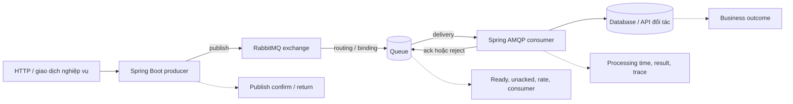

# Quan sát hàng đợi, consumer và độ trễ xử lý với RabbitMQ trong Spring Boot

## 1. Bài toán quan sát một luồng AMQP

Trong một hệ thống tích hợp Spring Boot, producer có thể nhận đơn hàng từ HTTP API, ghi database rồi phát sự kiện lên RabbitMQ. Một hoặc nhiều consumer dùng Spring AMQP (@RabbitListener) tiếp nhận thông điệp, gọi dịch vụ đối tác, cập nhật trạng thái và xác nhận (acknowledge) với broker. Hệ thống có thể vẫn báo HTTP 200 và kết nối RabbitMQ còn hoạt động, nhưng đơn hàng bị xử lý muộn nhiều phút hoặc liên tục được giao lại.

**Quan sát RabbitMQ phải trả lời đồng thời ba câu hỏi:**

1. **Hàng đợi có đang tích tụ công việc?** Bao nhiêu message sẵn sàng, bao nhiêu đã giao nhưng chưa được xác nhận, tốc độ vào và hoàn tất thế nào?
2. **Consumer có thực sự làm việc và hoàn tất đúng không?** Có bao nhiêu consumer, có bị chặn bởi database/API ngoài, có lỗi, retry, redelivery hoặc dead-letter không?
3. **Một sự kiện mất bao lâu từ lúc phát sinh đến khi xử lý xong?** Thời gian chờ, thời gian chạy handler và thời gian toàn luồng phải được phân biệt.

Các phép đo này cần kết hợp **metrics từ broker RabbitMQ**, **metrics/traces từ ứng dụng Spring Boot** và **tín hiệu nghiệp vụ** (số đơn được cập nhật đúng trạng thái, số sự kiện còn tồn đọng). Chỉ nhìn số message trong queue chưa đủ để xác nhận tích hợp khỏe mạnh.

### Sơ đồ luồng và điểm đo



Trong ví dụ trên, tín hiệu `publish confirm`, `message delivered`, `handler success` và `business completed` là những mốc khác nhau; không được đánh đồng một mốc với mốc khác.

## 2. Hiểu trạng thái của message trước khi đọc biểu đồ

| Khái niệm | Ý nghĩa thực tế | Điều không thể kết luận riêng từ số liệu |
|---|---|---|
| **Ready** | Message còn nằm trong queue, sẵn sàng được giao cho consumer | Không chứng minh consumer đã lỗi; có thể đơn giản là tải đến theo đợt |
| **Unacked** | Message đã được giao đến consumer nhưng broker chưa nhận ack | Không mặc nhiên là treo: consumer có thể đang xử lý, hoặc prefetch đã nhận trước |
| **Total messages** | Tổng ready và unacked của queue theo cách broker báo cáo | Không phản ánh message đã xử lý thành công hoặc đã dead-letter khỏi queue |
| **Consumers** | Số consumer đăng ký trên queue tại thời điểm đo | Có consumer không đồng nghĩa có thông lượng xử lý hữu ích |
| **Publish / deliver / ack rates** | Tốc độ message vào, được giao, được xác nhận | Deliver có thể gồm giao lại, publish và ack không cùng một định nghĩa |
| **Redeliveries** | Message bị giao lại do requeue/kênh đóng hoặc các nguyên nhân tương ứng | Không phải mọi lần retry đều tạo redelivery ở broker; retry nội bộ trong handler có thể không tăng chỉ số này |
| **DLQ/DLX** | Message được dead-letter đến đích khác khi cấu hình và điều kiện phù hợp | Một message xuất hiện trong DLQ không đồng nghĩa đã được khắc phục |

RabbitMQ phân biệt `messages_ready` và `messages_unacknowledged` (thường gọi ngắn là `unacked`). Với manual acknowledgement, ứng dụng phải ack/nack/reject rõ ràng; với Spring AMQP `AcknowledgeMode.AUTO`, listener container thường ack sau khi phương thức xử lý hoàn tất bình thường và xử lý ngoại lệ theo chính sách của container. **Ack chỉ báo broker đã nhận xác nhận**, không tự chứng minh tác vụ nghiệp vụ cuối cùng có hiệu lực bền vững.

Ví dụ consumer đặt `prefetch=50` và có 4 consumer đang hoạt động thì tối đa có thể có khoảng 200 delivery chưa ack trên những consumer đó, tùy trạng thái kênh, cách thiết lập prefetch và cách phân phối. Unacked cao cần đọc cùng tốc độ ack, thời gian xử lý và số consumer.

## 3. Chỉ số cần thu thập ở ba lớp

### 3.1. Broker: áp lực hàng đợi và sức khỏe kết nối

| Nhóm | Chỉ số cần theo dõi | Câu hỏi vận hành |
|---|---|---|
| Queue depth | Ready, unacked, tổng số message theo queue | Hàng đang chờ hay đang được xử lý? |
| Message flow | Publish, deliver, ack, redeliver, reject/dead-letter rate | Công việc đến nhanh hơn hoàn tất bao nhiêu? |
| Consumer | Số consumer, consumer capacity (nếu RabbitMQ xuất metric) | Có đủ năng lực nhận/xử lý không? |
| Connection/channel | Số connection/channel, churn, channel closure, lỗi xác thực | Consumer hoặc publisher có kết nối ổn định không? |
| Resource pressure | Memory/disk alarm, flow control, dung lượng đĩa, CPU, network | Broker có đang giảm khả năng nhận/giao message không? |
| Queue policy | TTL, length limit, overflow, DLX, queue type | Message có thể biến mất/được chuyển hướng do chính sách không? |

Có thể dùng **RabbitMQ Management UI/API** để xem queue, channel, connection và tốc độ message; với giám sát tập trung, dùng plugin **rabbitmq_prometheus** để xuất metrics sang Prometheus/Grafana. Một số chỉ số được tổng hợp mặc định; muốn breakdown theo từng queue có thể cần chế độ per-object/detailed metrics tùy phiên bản và endpoint exporter. Luôn kiểm tra tên metric, nhãn và chi phí thu thập trên RabbitMQ thực tế trước khi viết dashboard.

### 3.2. Ứng dụng: chất lượng xử lý của listener

Spring Boot cần bổ sung tối thiểu các chỉ số sau:

- **Processing duration:** thời gian từ lúc listener bắt đầu xử lý cho đến lúc phương thức xử lý trả về hoặc ném lỗi.
- **Outcome:** số lần xử lý thành công/thất bại, phân tách theo tên queue và nhóm lỗi có số lượng hữu hạn.
- **Retry:** lần thử lại trong ứng dụng, loại lỗi nghiệp vụ hay lỗi tạm thời; không suy retry ứng dụng từ redelivery của broker.
- **Dependency latency:** thời gian gọi database, HTTP client, cache hoặc adapter Spring Integration mà handler phụ thuộc.
- **In-flight work:** số công việc đang chạy trong consumer (nếu có điểm đo đáng tin cậy), số task còn đợi executor và saturation.
- **Publish outcome:** xác nhận của broker, message không route được, timeout hoặc lỗi gửi, khi cần bảo đảm producer đẩy message tới đích phù hợp.

Không gắn `messageId`, `orderId`, URL động hoặc nội dung payload vào tag của metrics. Những giá trị có số lượng lớn làm tăng cardinality, gây áp lực lên Prometheus và chi phí lưu trữ. Dùng log/tracing có kiểm soát để truy vết từng thông điệp.

### 3.3. Nghiệp vụ: tiến độ thực sự

Đặt một chỉ số nghiệp vụ cho bước hoàn tất thật: số đơn đã được đồng bộ sang đối tác, số callback thành công, số bản ghi còn trạng thái `PENDING` quá hạn hoặc số giao dịch đối soát lệch. Queue có thể cạn trong khi listener **ack quá sớm**, xóa dữ liệu sai hoặc bỏ qua công việc; số liệu nghiệp vụ giúp phát hiện khoảng trống đó.

## 4. Phân biệt các loại độ trễ

Đối với một message, nên định nghĩa rõ các mốc thời gian:

- **t0 — tạo sự kiện:** lúc hệ thống nghiệp vụ ghi nhận sự kiện cần phát.
- **t1 — producer gửi:** lúc ứng dụng bắt đầu publish đến exchange.
- **t2 — broker nhận và route:** mốc xác nhận phía broker (không phải lúc consumer nhận).
- **t3 — listener bắt đầu:** lúc consumer nhận quyền xử lý một delivery.
- **t4 — listener hoàn tất:** lúc code nghiệp vụ kết thúc, trước hoặc gần thao tác ack tùy chế độ.
- **t5 — kết quả nghiệp vụ bền vững:** ví dụ transaction commit hoặc bên đối tác đã chấp nhận yêu cầu.

| Tên độ trễ | Công thức xấp xỉ | Ý nghĩa |
|---|---|---|
| Publish latency | `t2 - t1` | Thời gian gửi và broker xác nhận; cần publisher confirm để có mốc đáng tin cậy |
| Delivery/queue age | `t3 - t1` | Thời gian từ publish đến lúc listener bắt đầu, gồm mạng, routing, chờ queue, prefetch/chờ phía client |
| Processing latency | `t4 - t3` | Thời gian chạy handler; thường đo bằng timer monotonic trong ứng dụng |
| End-to-end latency | `t5 - t0` | Thời gian từ sự kiện nghiệp vụ đến trạng thái cuối có thể kiểm chứng |

RabbitMQ không tự cung cấp một phép đo end-to-end chuẩn cho toàn bộ logic ứng dụng. Một timestamp do producer gắn vào AMQP header thường được dùng để ước lượng “message age” tại consumer, nhưng **không phải queue wait thuần túy**. Chênh lệch đồng hồ giữa producer và consumer, publish retry, prefetch, giao lại và downtime có thể làm sai lệch phép đo. Nếu dùng timestamp xuyên máy, cần đồng bộ đồng hồ và ghi rõ ý nghĩa metric.

Khi có retry hay redelivery, message có thể giữ timestamp gốc; vì vậy age tăng qua nhiều lần thử. Điều đó hữu ích để đo độ trễ người dùng cảm nhận, nhưng nên đo riêng `attempt duration`, `retry count` và `time to completion` để phân tích nguyên nhân.

## 5. Cấu hình Spring Boot để quan sát

Ví dụ cho ứng dụng dùng Spring Boot Actuator, Micrometer, Spring AMQP và Prometheus:

```yaml
# application.yml
spring:
  rabbitmq:
    addresses: ${RABBITMQ_ADDRESSES}
    username: ${RABBITMQ_USERNAME}
    password: ${RABBITMQ_PASSWORD}
    listener:
      simple:
        acknowledge-mode: auto
        concurrency: 2
        max-concurrency: 8
        prefetch: 20

app:
  rabbit:
    orders-queue: orders.events

management:
  endpoints:
    web:
      exposure:
        include: health,info,prometheus
  metrics:
    tags:
      application: order-integration
    distribution:
      percentiles-histogram:
        app.rabbit.consumer.processing: true
        app.rabbit.message.age: true
```

Cần có các dependency tương ứng, điển hình là `spring-boot-starter-amqp`, `spring-boot-starter-actuator` và `micrometer-registry-prometheus`. Với `/actuator/prometheus`, chỉ số custom sẽ xuất hiện sau khi meter được sử dụng và scrape thành công. Phải giới hạn quyền truy cập endpoint quản trị/metrics theo chính sách hệ thống.

Những giá trị `concurrency` và `prefetch` ở trên **chỉ minh họa**, không phải cấu hình tối ưu cho mọi workload. Số listener, mức song song, độ nặng database/API và giới hạn tài nguyên bên ngoài quyết định năng lực xử lý. Tăng concurrency không có tác dụng nếu bottleneck là database pool hoặc rate limit của đối tác.

### Cơ chế Observation và tracing

Với Spring AMQP phiên bản hỗ trợ Micrometer Observation, có thể bật observation trên `RabbitTemplate` và listener container, chẳng hạn qua API `setObservationEnabled(true)` khi khởi tạo bean/factory. Trong ứng dụng dùng Spring Boot, cần tích hợp điều này với các bean và customizer đang được auto-configure, tránh tạo bean mới làm mất các thiết lập về converter, retry hoặc callback.

Observation kết hợp metrics, traces và ngữ cảnh phân tán, giúp quan sát bước publish, consume và các span gọi HTTP/DB. Tracing chỉ có giá trị xuyên producer–consumer khi context được truyền và giải mã đúng qua header, đồng thời có exporter/collector và sampling phù hợp. Tên metric/span cụ thể thay đổi theo phiên bản Spring AMQP, Micrometer và cấu hình instrument; hãy kiểm tra output thực tế. Khi đã bật observation, cần rà soát metric timer tự động và timer tự định nghĩa để không cộng đôi số liệu.

## 6. Đo thời gian chờ gần đúng và thời gian chạy consumer

Ví dụ có producer gửi JSON lên exchange `orders.exchange`, routing key `orders.created`. Producer gắn timestamp tại thời điểm gửi:

```java
@Service
public class OrderEventPublisher {
    private final RabbitTemplate rabbitTemplate;

    public OrderEventPublisher(RabbitTemplate rabbitTemplate) {
        this.rabbitTemplate = rabbitTemplate;
    }

    public void publish(String eventJson) {
        rabbitTemplate.convertAndSend(
                "orders.exchange",
                "orders.created",
                eventJson,
                message -> {
                    message.getMessageProperties().setHeader(
                            "app-published-at-ms",
                            System.currentTimeMillis()
                    );
                    return message;
                }
        );
    }
}
```

Đây là thời gian **phía client trước khi publish**, không phải timestamp broker khẳng định message đã được lưu an toàn. Để xác nhận broker đã nhận publish hoặc phát hiện message không được route đến queue, cần cấu hình publisher confirms và publisher returns phù hợp, đồng thời xét cả các trường hợp timeout hoặc chưa biết kết quả.

Consumer đo hai chỉ số tách biệt: age khi vào listener và duration của chính handler.

```java
@Component
public class ObservedOrderListener {
    private final MeterRegistry registry;
    private final OrderProcessor processor;

    public ObservedOrderListener(MeterRegistry registry, OrderProcessor processor) {
        this.registry = registry;
        this.processor = processor;
    }

    @RabbitListener(queues = "${app.rabbit.orders-queue}")
    public void consume(Message message) {
        Timer.Sample sample = Timer.start(registry);
        String outcome = "success";

        Object raw = message.getMessageProperties()
                .getHeaders()
                .get("app-published-at-ms");

        if (raw instanceof Number sentAt) {
            long ageMs = System.currentTimeMillis() - sentAt.longValue();
            if (ageMs >= 0) {
                Timer.builder("app.rabbit.message.age")
                        .description("Thoi gian tu publish den khi listener bat dau")
                        .tag("queue", "orders.events")
                        .publishPercentileHistogram()
                        .register(registry)
                        .record(ageMs, TimeUnit.MILLISECONDS);
            }
        }

        try {
            processor.process(message.getBody());
        } catch (RuntimeException ex) {
            outcome = "failure";
            throw ex;
        } finally {
            sample.stop(
                    Timer.builder("app.rabbit.consumer.processing")
                            .description("Thoi gian xu ly trong listener")
                            .tag("queue", "orders.events")
                            .tag("outcome", outcome)
                            .publishPercentileHistogram()
                            .register(registry)
            );
        }
    }
}
```

Ví dụ giả định ứng dụng đã có `OrderProcessor` với phương thức `process(byte[])` thực hiện logic nghiệp vụ và ném `RuntimeException` khi thất bại. Các import JDK, Spring AMQP, Micrometer và Spring stereotype phải được khai báo phù hợp. Code minh họa mặc định listener dùng chế độ ack tự động của container.

Giải thích số liệu:

- `app.rabbit.message.age`: khoảng từ timestamp producer đến **thời điểm listener bắt đầu**; không đo thời gian xử lý phía listener và không tự xác nhận đã hoàn tất nghiệp vụ.
- `app.rabbit.consumer.processing`: thời gian chạy method handler (success/failure). Đây chưa chắc là thời gian đến khi broker nhận ack, hoặc thời gian commit ở một hệ thống ngoài.
- `outcome` có hai giá trị hữu hạn; cần thêm nhóm kết quả khác (ví dụ `skipped`) nếu nghiệp vụ định nghĩa rõ. Không thêm tag theo nội dung exception động.
- Với header thiếu/sai kiểu hoặc đồng hồ lệch khiến age âm, ví dụ bỏ qua mẫu đo. Trong sản phẩm thực tế, nên đếm số mẫu bị loại để nhận biết lỗi instrument.
- Timer phân phối histogram giúp tính p95/p99 từ các bucket tại Prometheus; histogram tốn dung lượng nên chỉ bật trên nhóm metric quan trọng và cân nhắc số series theo nhãn.

**Lưu ý transaction và ack:** nếu `processor.process(...)` thực hiện side effect và sau đó handler ném lỗi, RabbitMQ có thể giao lại tùy cấu hình retry, error handler và requeue. Vì vậy consumer cần idempotency theo định danh nghiệp vụ, transaction phù hợp và chính sách DLQ; không dựa vào số lần chạy handler để suy số đơn đã hoàn tất.

## 7. Tính thông lượng, backlog và thời gian hoàn tất ước lượng

Giả sử một queue nhận trung bình 100 message/giây nhưng consumer chỉ xác nhận 80 message/giây trong 5 phút. Trong điều kiện đơn giản không có redelivery và số liệu rate tương thích, ready backlog tăng khoảng:

```text
Backlog tăng = (arrival rate - completion rate) × thời gian
             = (100 - 80) × 300
             = 6.000 messages
```

Nếu tốc độ ack được nâng lên 140 message/giây trong khi publish vẫn là 100 message/giây, tốc độ giảm backlog ròng là khoảng 40 message/giây và cần gần 150 giây để giải phóng 6.000 message đó. Đây chỉ là **ước lượng khi lưu lượng và khả năng xử lý tương đối ổn định**; các trường hợp batch publish, retry, DLX, ưu tiên message, prefetch hoặc thời gian xử lý phân tán rộng cần đánh giá kỹ hơn.

Một số công thức và trực giác:

- `backlog delta ≈ arrival rate − completion rate`. Dùng để xem xu hướng; publisher, ack và redelivery không luôn đếm cùng “đơn vị công việc”.
- `throughput thực = số công việc hoàn tất đúng/đơn vị thời gian`. Đối chiếu broker ack rate với số liệu nghiệp vụ khi một message có thể bị xử lý nhiều lần.
- `consumer load` tăng khi mỗi handler tốn nhiều thời gian hơn hoặc khi dependency chậm; throughput tăng bằng cách cải thiện handler, tăng consumer trong khả năng chịu tải hoặc chia workload phù hợp.
- **Little's Law** (`L = λ × W`) chỉ có ích khi hệ thống tương đối ổn định, cách đếm công việc nhất quán và không có tích tụ tăng mãi; không tự suy “p95 chờ queue” bằng cách chia một snapshot depth cho một tốc độ ack tức thời.

Đặt SLO theo nghiệp vụ, ví dụ: “95% sự kiện đơn hàng hoàn tất đồng bộ trong 5 giây từ khi tạo, với tải thiết kế”. Sau đó phân bổ ngân sách độ trễ cho publish, queue/delivery, xử lý và API phụ thuộc; chọn ngưỡng cảnh báo theo SLO và lưu lượng thực tế thay vì một số messages_ready cố định cho tất cả queue.

## 8. Dashboard và cảnh báo có khả năng hành động

Một dashboard vận hành nên có ba vùng nhất quán với nhau:

| Vùng dashboard | Biểu đồ nên đặt cạnh nhau | Câu hỏi |
|---|---|---|
| Queue & broker | Ready/unacked, publish/ack/redelivery rate, consumer count, broker alarms | Hàng có tăng và do thiếu năng lực hay mất kết nối? |
| Consumer & phụ thuộc | Processing p50/p95/p99, success/failure rate, HTTP/DB latency, active threads/pool | Consumer chậm ở bước nào? |
| Chất lượng nghiệp vụ | Tuổi sự kiện ở listener, end-to-end latency, số công việc quá hạn, DLQ size, retry count | Người dùng có đang bị ảnh hưởng hay thất thoát tiến độ? |

Ví dụ truy vấn PromQL cho histogram custom đã cấu hình ở trên (tên metric phải được xác nhận qua `/actuator/prometheus`):

```promql
histogram_quantile(
  0.95,
  sum by (le) (
    rate(app_rabbit_consumer_processing_seconds_bucket{
      queue="orders.events", outcome="success"
    }[5m])
  )
)
```

Truy vấn này tính p95 thời gian **xử lý handler thành công**, theo giây, trong cửa sổ 5 phút. Nếu gom nhiều instance, tổng hợp các bucket theo `le` và giữ những nhãn thực sự cần phân biệt; không lấy trung bình của các p95 từng instance. Tên metric do Prometheus chuẩn hóa có thể khác khi instrument/config thay đổi.

Một số điều kiện cảnh báo thực tế:

1. **Queue có ready backlog liên tục nhưng consumer count bằng 0:** có thể listener không chạy, lỗi kết nối, cấu hình tên queue sai hoặc autoscaling đã về 0. Chỉ áp dụng khi queue được kỳ vọng luôn có consumer.
2. **Ready backlog tăng liên tục và ack rate thấp hơn publish rate:** công việc tích tụ; cảnh báo theo xu hướng trong khoảng đủ dài thay vì alert mọi đợt traffic ngắn.
3. **Unacked duy trì cao, ack gần bằng 0, processing latency tăng:** handler hoặc dependency có thể bị treo, slow query, hết connection pool hoặc manual ack bị bỏ quên.
4. **Redelivery, retry và DLQ tăng:** khả năng poison message, xử lý không idempotent, lỗi hợp đồng dữ liệu hoặc lỗi phụ thuộc kéo dài.
5. **Broker memory/disk alarms hoặc blocked connections:** producer có thể bị chặn; cần đọc cùng connection state và tài nguyên node.
6. **End-to-end p95 vượt SLO hoặc tuổi công việc quá hạn:** cảnh báo chất lượng người dùng cuối kể cả khi broker chưa cạn tài nguyên.

Cảnh báo cần có mức độ nghiêm trọng, thời gian duy trì, owner, đường dẫn dashboard và runbook. Có thể dùng 5–10 phút làm cửa sổ khởi đầu cho nhiều tín hiệu xu hướng, nhưng thời gian và ngưỡng cuối phải dựa trên SLO, tần suất xử lý và đặc thù queue; với sự kiện rất nhạy cảm, có thể cần cửa sổ ngắn hơn.

### Health check không thay thế tiến độ xử lý

`/actuator/health` có thể xác nhận khả năng truy cập RabbitMQ khi bật health indicator tương ứng, nhưng kết nối khỏe không chứng minh consumer còn ack hoặc logic nghiệp vụ thành công. Một health indicator quá đơn giản không phát hiện backlog và poison message; ngược lại, không nên biến mọi độ trễ queue thành trạng thái “unhealthy” khiến bộ điều phối liên tục restart pod và làm lỗi nặng thêm. Kết hợp readiness/liveness với dashboard và alert về xử lý thực tế.

## 9. Khoanh vùng sự cố theo mẫu số liệu

### Tình huống A — Ready tăng, không có consumer

**Dấu hiệu:** số message sẵn sàng tăng, `consumers=0`, ack rate rất thấp hoặc bằng 0.

Kiểm tra trạng thái deployment/pod, lỗi authentication/TLS, routing tới queue đúng, quyền `consume`, listener startup, container factory, cấu hình `autoStartup` và các connection/channel bị đóng. Nếu có autoscaling theo queue depth, kiểm tra độ trễ scale-up và metric adapter. Không chỉ “tăng replica” khi tất cả replica đều không kết nối được.

### Tình huống B — Ready tăng, consumer có nhưng xử lý chậm

**Dấu hiệu:** consumers lớn hơn 0, processing p95 tăng, ack rate không bắt kịp publish.

Xem thời gian gọi database, HTTP client và các integration adapter; kiểm tra thread pool, database connection pool, timeout, retry nội bộ và rate limit. Tăng concurrency từng bước nếu dependency chịu được. Mỗi consumer mới có thể làm nghẽn database/đối tác nếu bottleneck ở phía sau; benchmark phải đo cả response time, timeout và tác động ngược.

### Tình huống C — Unacked cao, ready thấp

**Dấu hiệu:** broker đã giao message, nhưng ack trì trệ. Khi prefetch lớn, một phần message có thể đang chờ trong bộ đệm của client nên không còn tính là ready.

Kiểm tra handler treo, thread dump, slow query, lời gọi mạng không đặt timeout, deadlock, quy tắc ack/nack trong chế độ manual và thời gian sống của channel. Nếu consumer ngắt kết nối khi còn unacked, broker có thể requeue rồi redeliver. Giảm prefetch khi bài toán cần fairness hoặc xử lý mất nhiều thời gian, song tránh giảm vô căn cứ khiến throughput suy giảm.

### Tình huống D — Producer báo gửi thành công nhưng consumer không nhận

Xác minh exchange type, routing key, binding, tên queue, virtual host và quyền publisher. **Publisher confirm** báo broker xác nhận publish theo cơ chế confirm, nhưng không tự chứng minh message đã được route đến queue mong muốn hay consumer đã hoàn tất. Với publish dạng `mandatory` và publisher returns, có thể phát hiện message không route được; cần kiểm tra chiến lược xác nhận, callback và cách ứng dụng xử lý các trạng thái này. Cũng xem chính sách TTL, max-length/overflow và dead-letter khi message rời khỏi queue.

### Tình huống E — Redelivery hoặc DLQ tăng

Đọc ngoại lệ ứng dụng, `x-death` headers do broker cung cấp khi dead-letter (nếu có), loại message lỗi và những lần thử tương ứng. Phân biệt lỗi tạm thời (timeout, 503) với lỗi không thể phục hồi (schema không hợp lệ). Thiết kế retry có giới hạn, backoff và đường DLQ để tránh vòng lặp requeue vô hạn. Với nhiều lần nhận lại, đảm bảo idempotency để không ghi đơn hai lần, trừ tiền hai lần hoặc gửi thông báo lặp.

### Tình huống F — Broker bị chặn, mọi đồ thị tốc độ sụt giảm

Kiểm tra memory alarm, disk free alarm, connection blocked, queue growth, tốc độ lưu trữ và network; đối chiếu log node và báo cáo broker. Thêm consumer không giải quyết triệt để khi broker đang bị hạn chế tài nguyên hoặc publisher bị chặn bởi alarm; cần xử lý nguyên nhân hạ tầng và kiểm soát tốc độ tải.

## 10. Tracing, correlation và log khi điều tra một message

Một trace hữu ích thường liên kết được HTTP request ban đầu, thao tác DB/outbox, publish, listener và call sang hệ thống ngoài. Khi luồng chạy qua RabbitMQ, thời gian truyền không đồng bộ tạo khoảng trống mà một HTTP trace thông thường không tự giải thích được.

Nên ghi log có cấu trúc ở các mốc phát/nhận/hoàn tất với thông tin vừa đủ:

```json
{
  "event": "rabbit-consume-completed",
  "environment": "staging",
  "queue": "orders.events",
  "result": "success",
  "attempt": 1,
  "duration_ms": 42,
  "correlation_id": "trace-safe-id"
}
```

`correlation_id` cần được tạo/quản lý theo quy định của ứng dụng và tránh vô tình mã hóa dữ liệu cá nhân. Không ghi payload toàn bộ, địa chỉ khách hàng, token, mật khẩu hay số thẻ vào log và trace. Với sampling trace, không giả định mọi message đều có trace; metrics aggregate phải độc lập với việc một trace có được lấy mẫu hay không.

Khi có redelivery hoặc retry, có thể có nhiều delivery cho cùng một message/correlation. Nên ghi nhận attempt, `redelivered` flag của delivery và trạng thái nghiệp vụ idempotency để phân biệt xử lý lần đầu và lần sau. Chú ý `redelivered=false` không chứng minh chưa từng chạy handler ở mọi tình huống, nhất là khi ứng dụng tự retry bên trong.

## 11. Kịch bản kiểm thử để tin vào phép đo

Một bộ integration test thực tế có thể dùng RabbitMQ Testcontainers cùng Spring Boot Test và stub HTTP để kiểm chứng instrument lẫn hành vi:

| Kịch bản | Tác động có chủ đích | Tín hiệu cần quan sát |
|---|---|---|
| Luồng thành công | Publish một sự kiện hợp lệ | Handler thành công, ack tiến lên, kết quả DB đúng |
| Phụ thuộc chậm | Stub HTTP trả chậm trong giới hạn | Processing p95/age tăng đúng bản chất, timeout rõ ràng |
| Phụ thuộc lỗi | Stub trả 503 hoặc ngắt kết nối | Failure và retry tăng, không mất tín hiệu lỗi |
| Consumer ngừng | Tạm dừng/stop listener trong test | Ready backlog tăng, consumer count giảm; khởi động lại thì drain |
| Message lỗi vĩnh viễn | Payload sai schema | Chuyển DLQ theo chính sách, không lặp vô hạn |
| Duplicate delivery | Cố ý gửi lại cùng business key | Xử lý idempotent; metric attempt không bị nhầm với số đơn thành công |
| Tải cao có kiểm soát | Publish thành đợt lớn | Đo consumer throughput, backlog drain và tác động lên dependency |

Đối với test chạy nhiều instance, so sánh kết quả aggregate trên Prometheus/Grafana với số bản ghi nghiệp vụ và số message đã gửi. Kiểm tra cả lỗi instrument: header thiếu, clock skew, dữ liệu age quá lớn và metric label phát sinh không kiểm soát. Không chạy phép thử tải hay poison message trực tiếp trên queue production.

## 12. Quy trình vận hành đề xuất

1. **Lập danh mục queue theo nghiệp vụ:** producer, exchange/routing key, consumer owner, dữ liệu được xử lý, DLQ và kỳ vọng độ trễ.
2. **Xác định SLI/SLO:** tỷ lệ hoàn tất, publish success, processing p95/p99, tuổi sự kiện và số công việc quá hạn; làm rõ điểm bắt đầu/kết thúc.
3. **Thu thập metrics từ RabbitMQ và Spring Boot:** kiểm tra nhãn theo queue, replica, môi trường và phiên bản exporter; kiểm tra tính nhất quán của tốc độ.
4. **Thiết kế dashboard và alert:** đặt backlog bên cạnh throughput, unacked bên cạnh latency, DLQ bên cạnh lỗi; thêm runbook và owner.
5. **Thử kịch bản lỗi:** dừng consumer, tăng độ trễ HTTP, tạo duplicate và thử phục hồi; xác minh cảnh báo phản ánh đúng sự cố.
6. **Đánh giá định kỳ:** tối ưu concurrency/prefetch, đặt thời hạn lưu số liệu và xem lại ngưỡng cảnh báo theo tải, SLO và độ trưởng thành của luồng tích hợp.

### Checklist trước khi coi một luồng “quan sát được”

- [ ] Xác định rõ queue, exchange, routing key, owner và nơi nhận dead-letter.
- [ ] Có biểu đồ ready, unacked, publish/ack rate, số consumer và broker alarms.
- [ ] Có timer xử lý handler và chỉ số latency từ producer đến consumer với giới hạn đo được ghi rõ.
- [ ] Có số liệu hoàn tất nghiệp vụ, retry, redelivery và DLQ để đối chiếu broker.
- [ ] Correlation/trace xuyên bước bất đồng bộ khi công nghệ hỗ trợ; metrics vẫn hoạt động khi trace bị sampling.
- [ ] Có cảnh báo theo xu hướng hoặc SLO cùng runbook; đã kiểm chứng trong môi trường thử nghiệm.
- [ ] Không dùng secret, nội dung message hoặc ID có cardinality cao làm nhãn metric.

## 13. Tổng kết

Trong **SPRING_BOOT_INTEGRATION**, RabbitMQ và AMQP là một phần của luồng tích hợp có nhiều adapter: HTTP client, database, cache và các thành phần Spring Integration. Để quan sát đúng, cần nối ba góc nhìn: **broker đang giữ và giao bao nhiêu công việc**, **consumer đang xử lý với tốc độ và lỗi nào**, **nghiệp vụ mất bao lâu để thực sự hoàn tất**. Khi tách rõ ready/unacked, publish/ack, queue age, processing duration, retry và end-to-end latency, đội ngũ có thể khoanh vùng nghẽn ở RabbitMQ, ứng dụng hay phụ thuộc bên ngoài và khắc phục có bằng chứng thay vì chỉ tăng số consumer.
