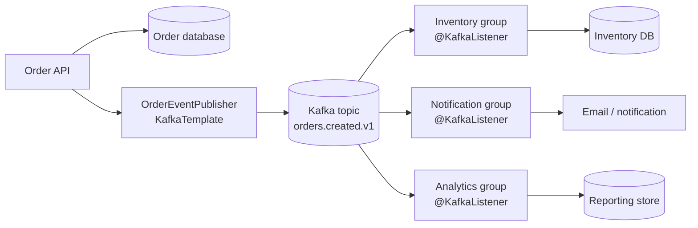
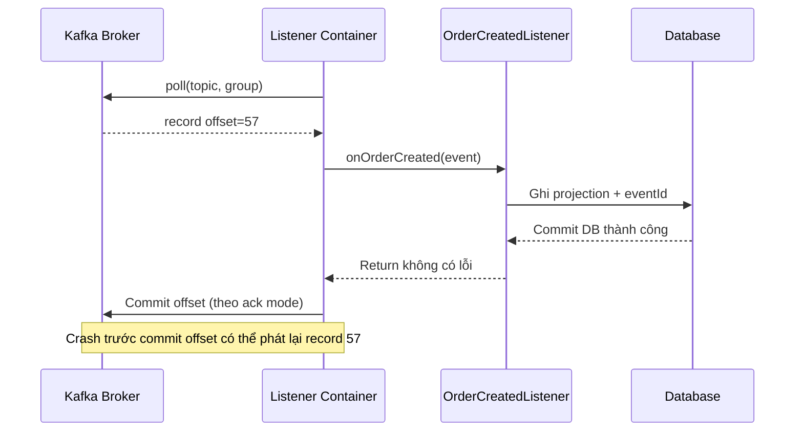
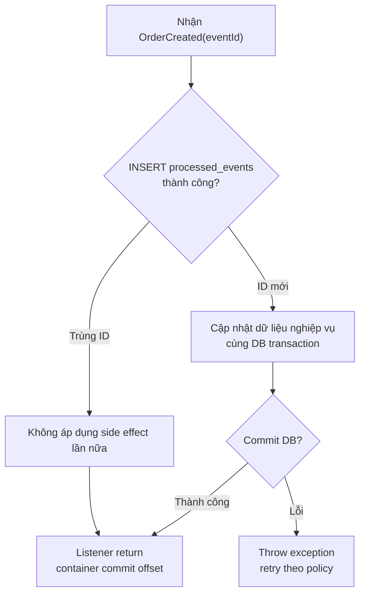
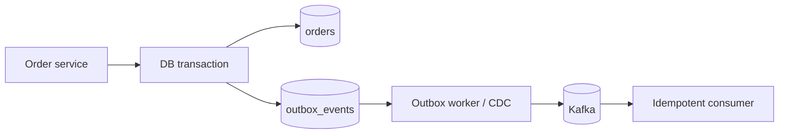

# Tích hợp `spring-kafka` và cấu hình `spring.kafka.*`

## 1. Mục tiêu và bối cảnh

Trong một hệ thống có nhiều dịch vụ, HTTP phù hợp với những thao tác cần phản hồi trực tiếp, còn Apache Kafka phù hợp để truyền **sự kiện** hoặc **lệnh bất đồng bộ** giữa các thành phần có nhịp xử lý khác nhau. Ví dụ, sau khi `order-service` xác nhận một đơn hàng, hệ thống cần cập nhật tồn kho, gửi thông báo và tạo dữ liệu báo cáo. Nếu các thao tác đều là lời gọi HTTP đồng bộ, một dịch vụ chậm hoặc ngừng hoạt động có thể kéo dài thời gian phản hồi của luồng đặt hàng.

Trong module **SPRING_BOOT_INTEGRATION**, mục tiêu là tổ chức tích hợp hệ thống trong Spring Boot qua HTTP client, cơ sở dữ liệu, cache, broker thông điệp và các adapter của Spring Integration. Bài này tập trung vào **Apache Kafka với Spring for Apache Kafka (`spring-kafka`)**: cấu hình producer/consumer bằng `spring.kafka.*`, định nghĩa hợp đồng sự kiện, quản lý offset, xử lý lỗi và thông điệp trùng lặp, kiểm thử cùng quan sát luồng xử lý.

Sau bài học, bạn có thể:

1. Giải thích cách topic, partition, consumer group và offset ảnh hưởng đến luồng sự kiện.
2. Khai báo dependency, `application.yml` và các bean Kafka do Spring Boot tự cấu hình.
3. Dùng `KafkaTemplate` để gửi và `@KafkaListener` để nhận sự kiện có kiểu.
4. Phân biệt retry của producer, retry của listener, idempotency và Kafka transaction.
5. Thiết kế đường đi của sự kiện khi có lỗi deserialize, lỗi nghiệp vụ, gửi trùng hoặc database transaction thất bại.
6. Xây dựng kiểm thử tích hợp và chỉ số quan sát cần thiết trước khi vận hành.

> **Phạm vi phiên bản:** Phần mã chạy mẫu hướng tới **Java 17+, Spring Boot 3.x và Spring Kafka 3.x** (chẳng hạn Boot 3.5). Spring Boot 4.x/Spring Kafka 4.x có thay đổi API và tên một số serializer/deserializer JSON; cần đối chiếu tài liệu phiên bản đang dùng, không trộn mã giữa hai thế hệ. Phần cuối có liên kết tài liệu chính thức.

## 2. Kafka giải quyết vấn đề gì trong Spring Boot?

Kafka lưu các **record** trong topic; topic được chia thành partition. Producer gửi record có key/value và các header tùy chọn. Broker phân phối record vào partition; consumer trong một group đọc record và quản lý vị trí đọc bằng offset.



Hai consumer cùng **group-id** chia nhau các partition để xử lý cùng một luồng công việc; hai consumer thuộc **group khác nhau** có thể xử lý cùng sự kiện độc lập. Record đã được đọc không bị xóa chỉ vì một consumer xử lý xong: khả năng đọc lại phụ thuộc chính sách retention của topic và offset của group.

### 2.1. Từ vựng cần thống nhất

| Khái niệm | Ý nghĩa thực tế |
| --- | --- |
| Broker / cluster | Nơi lưu và cung cấp các partition của topic. |
| Topic | Tên luồng record, ví dụ `orders.created.v1`. |
| Partition | Đơn vị lưu trữ có thứ tự offset riêng; quyết định khả năng song song và thứ tự cục bộ. |
| Record key | Dùng cho phân vùng và định tuyến; thường là mã aggregate như `orderId`. |
| Record value | Payload sự kiện; nên có schema, version và định danh sự kiện. |
| Header | Metadata ngoài payload như trace ID, content type, schema version theo quy ước. |
| Offset | Vị trí một record trong một partition; **không phải** ID nghiệp vụ toàn cục. |
| Consumer group | Các instance phối hợp để phân chia partition và theo dõi committed offset. |
| Rebalance | Phân phối lại partition khi member/partition thay đổi; record có thể được phát lại. |
| Retention | Chính sách giữ dữ liệu trên broker, độc lập với tiến độ xử lý của consumer. |

**Thứ tự chỉ được đảm bảo trong cùng một partition.** Nếu mọi sự kiện của `orderId=ORD-42` dùng cùng key, chúng thường đi cùng partition theo partitioner hiện hành và giữ thứ tự trong partition đó. Không hứa thứ tự toàn topic hoặc giữa các key/partition; thay đổi số partition cũng có thể làm key ánh xạ sang partition khác cho các record gửi sau.

### 2.2. Kafka và các thành phần tích hợp khác

- **HTTP client:** dùng khi cần ngay dữ liệu trả về hoặc yêu cầu đồng bộ; có thể kết hợp HTTP để truy vấn trạng thái sau khi nhận sự kiện.
- **Database:** giữ trạng thái nghiệp vụ và có transaction nội bộ; commit database không tự động commit Kafka message.
- **Cache:** tăng tốc đọc, nhưng vẫn cần chiến lược invalidation/update khi có sự kiện.
- **Spring Integration:** có Kafka inbound/outbound channel adapter để chuyển message qua các integration flow; nếu chỉ gửi/nhận Kafka trực tiếp, `KafkaTemplate` và `@KafkaListener` thường đơn giản hơn.

## 3. Cài đặt thư viện và auto-configuration

Trong Spring Boot 3.x, thêm `spring-kafka`; quản lý phiên bản thông qua dependency management/BOM của Spring Boot. Khi có thư viện trên classpath, Boot tạo nhiều thành phần mặc định dựa trên `spring.kafka.*` như `KafkaTemplate`, `ProducerFactory`, `ConsumerFactory`, `KafkaAdmin` và `KafkaListenerContainerFactory`. Chỉ định nghĩa bean riêng khi cần điều chỉnh ngoài cấu hình mặc định.

```xml
<!-- pom.xml: ứng dụng dùng Spring Boot parent/BOM 3.x -->
<dependency>
    <groupId>org.springframework.kafka</groupId>
    <artifactId>spring-kafka</artifactId>
</dependency>

<dependency>
    <groupId>org.springframework.kafka</groupId>
    <artifactId>spring-kafka-test</artifactId>
    <scope>test</scope>
</dependency>

<dependency>
    <groupId>org.springframework.boot</groupId>
    <artifactId>spring-boot-starter-test</artifactId>
    <scope>test</scope>
</dependency>
```

Với Spring Boot 4.x, cách đóng gói starter và thư viện serializer có thể khác; hãy lấy dependency tương ứng từ BOM và tài liệu phiên bản cụ thể. Trong bài sẽ dùng tên lớp `JsonSerializer` và `JsonDeserializer` của Spring Kafka 3.x; Spring Kafka 4.x dùng các lớp `JacksonJsonSerializer` và `JacksonJsonDeserializer` theo tài liệu mới.

**Luồng khởi động cơ bản:**

1. Boot bind `spring.kafka.*` vào `KafkaProperties` và cấu hình client Kafka.
2. `KafkaTemplate` dùng producer factory để publish record.
3. Với `@KafkaListener`, Spring tạo listener container, dùng consumer factory để poll record và gọi method tương ứng.
4. Nếu có `NewTopic` bean và quyền tạo topic, `KafkaAdmin` có thể tạo topic khi khởi động. Môi trường production thường quản lý topic bằng hạ tầng/CI/CD.

Không cần tự viết vòng lặp `KafkaConsumer.poll()` khi sử dụng `@KafkaListener`; container quản lý polling, assignment, offset và vòng đời consumer.

## 4. Cấu hình `spring.kafka.*` trong `application.yml`

### 4.1. Các nhóm thuộc tính

| Nhóm | Ví dụ | Mục đích |
| --- | --- | --- |
| Chung | `spring.kafka.bootstrap-servers`, `spring.kafka.client-id` | Địa chỉ cluster và tên client. |
| Producer | `spring.kafka.producer.acks`, `retries`, `key-serializer`, `value-serializer` | Gửi record và chuyển đổi Java → bytes. |
| Consumer | `spring.kafka.consumer.group-id`, `auto-offset-reset`, `enable-auto-commit`, deserializer | Cách consumer tham gia group và đọc record. |
| Listener | `spring.kafka.listener.ack-mode`, `concurrency`, `type` | Hành vi của container chạy `@KafkaListener`. |
| Admin | `spring.kafka.admin.*` | Hành vi admin client, quản lý topic. |
| Template | `spring.kafka.template.default-topic` | Topic mặc định cho lời gọi `sendDefault(...)`, nếu muốn dùng. |
| Bảo mật | `spring.kafka.security.protocol`, `spring.kafka.ssl.*` | Kết nối TLS/SASL theo cấu hình cluster. |
| Kafka Streams | `spring.kafka.streams.*` | Chỉ cần khi sử dụng Kafka Streams. |
| Native Kafka properties | `spring.kafka.properties[...]`, `producer.properties[...]`, `consumer.properties[...]` | Truyền cấu hình không có trường riêng trong `KafkaProperties`. |

Các thuộc tính ở cấp chung áp dụng rộng cho các client; cấu hình cụ thể theo producer/consumer/admin có thể ghi đè giá trị chung. Dùng ký pháp ngoặc vuông và đặt trong dấu nháy cho **key có dấu chấm** trong YAML, chẳng hạn `"[enable.idempotence]"`, để binder giữ nguyên key thay vì diễn giải thành cấu trúc con.

### 4.2. Cấu hình phát sinh cho ví dụ

Giả sử một ứng dụng mẫu vừa publish vừa subscribe sự kiện `OrderCreatedEvent`. Trong kiến trúc thật, publisher thường nằm tại `order-service` và subscriber nằm trong dịch vụ tiêu thụ khác; khi đó từng ứng dụng chỉ cần cấu hình phù hợp với vai trò của mình.

```yaml
spring:
  application:
    name: order-kafka-integration
  kafka:
    bootstrap-servers: ${KAFKA_BOOTSTRAP_SERVERS:localhost:9092}
    client-id: ${spring.application.name}

    producer:
      key-serializer: org.apache.kafka.common.serialization.StringSerializer
      value-serializer: org.springframework.kafka.support.serializer.JsonSerializer
      acks: all
      retries: 5
      properties:
        "[enable.idempotence]": true
        "[spring.json.add.type.headers]": false
        "[delivery.timeout.ms]": 120000

    consumer:
      group-id: ${KAFKA_CONSUMER_GROUP:inventory-projection-v1}
      auto-offset-reset: earliest
      enable-auto-commit: false
      key-deserializer: org.apache.kafka.common.serialization.StringDeserializer
      value-deserializer: org.springframework.kafka.support.serializer.ErrorHandlingDeserializer
      properties:
        "[spring.deserializer.value.delegate.class]": org.springframework.kafka.support.serializer.JsonDeserializer
        "[spring.json.value.default.type]": com.example.orders.integration.kafka.OrderCreatedEvent
        "[spring.json.use.type.headers]": false
        "[spring.json.trusted.packages]": com.example.orders.integration.kafka
        "[max.poll.interval.ms]": 300000

    listener:
      ack-mode: record
      concurrency: 3

app:
  kafka:
    topics:
      order-created: ${ORDER_CREATED_TOPIC:orders.created.v1}
```

> **Điều kiện áp dụng:** Đổi package `com.example.orders.integration.kafka` theo tên package thực của record. Với topic có nhiều loại event, cấu hình một `value.default.type` duy nhất như trên không đủ; khi đó cần message converter, type mapping/schema registry hoặc phân tách topic/consumer rõ ràng. `spring.kafka.*` thuộc Spring Boot, còn `app.kafka.topics.*` là khóa ứng dụng **tự định nghĩa**, giúp tránh hard-code tên topic.

#### Giải nghĩa những dòng dễ nhầm

- `bootstrap-servers` là danh sách địa chỉ **bootstrap** để khám phá cluster. Client còn cần kết nối được tới địa chỉ broker quảng bá qua `advertised.listeners`; đi qua Docker/Kubernetes/VPN có thể lỗi dù bootstrap kết nối ban đầu được.
- `acks: all` yêu cầu xác nhận theo cơ chế của Kafka và leader/ISR. Để đạt độ bền mong muốn, còn cần cấu hình broker/topic như replication factor và `min.insync.replicas`; chỉ cấu hình client chưa đủ.
- `enable.idempotence=true` kết hợp `acks=all`, retry và giới hạn in-flight phù hợp giúp tránh ghi trùng do **producer tự retry**. Nó không chặn một ứng dụng gửi cùng sự kiện hai lần bằng hai lời gọi logic độc lập.
- `retries: 5` là số lần Kafka producer có thể thử lại khi gửi lỗi có khả năng phục hồi. Ngoài ra phải xét `delivery.timeout.ms`; timeout tổng có thể kết thúc việc gửi trước khi dùng hết retries.
- `spring.json.add.type.headers=false` không gắn tên class Java vào header JSON; consumer trong ví dụ dùng một type cố định và tự xác định hợp đồng.
- `ErrorHandlingDeserializer` bọc delegate `JsonDeserializer` để chuyển lỗi deserialize thành thông tin mà listener container/error handler có thể xử lý. Nếu dùng `JsonDeserializer` trực tiếp, lỗi ở giai đoạn poll có thể làm luồng hồi phục khó kiểm soát hơn.
- `trusted.packages` phải giới hạn package được cho phép thay vì `*`. Đừng dùng type header từ nguồn không tin cậy như một cơ chế chọn class tùy ý.
- `auto-offset-reset: earliest` chỉ quyết định điểm bắt đầu khi group **không có offset hợp lệ**; đổi từ `latest` sang `earliest` không tự động tua lại group đã commit offset.
- `enable-auto-commit: false` cho phép listener container quản lý commit theo `ack-mode`. Với `ack-mode: record`, container commit tiến độ sau khi listener xử lý record thành công theo cơ chế container; lỗi và recovery có thể thay đổi tiến độ commit.
- `concurrency: 3` cho phép tối đa ba consumer trong cùng listener container. Nếu topic chỉ có một partition, tăng concurrency không giúp một group xử lý partition đó đồng thời.

### 4.3. Dùng file cấu hình theo môi trường

Giữ phần cấu hình chung trong `application.yml`, còn endpoint, timeout, bảo mật và quy mô cụ thể ở secret manager, environment variables hoặc profile phù hợp. Ví dụ:

```yaml
# application-prod.yml: minh họa SASL_SSL, tùy nhà cung cấp Kafka
spring:
  kafka:
    bootstrap-servers: ${KAFKA_BOOTSTRAP_SERVERS}
    security:
      protocol: SASL_SSL
    properties:
      "[sasl.mechanism]": PLAIN
      "[sasl.jaas.config]": 'org.apache.kafka.common.security.plain.PlainLoginModule required username="${KAFKA_USERNAME}" password="${KAFKA_PASSWORD}";'
```

Chỉ dùng cấu hình trên khi cluster thật sự yêu cầu SASL/PLAIN qua TLS; môi trường khác có thể dùng SCRAM, OAuth, mTLS hoặc IAM. Secret phải được quản lý trong hệ thống cấp phát bí mật, không commit mật khẩu thật hoặc log toàn bộ giá trị JAAS. Cấu hình truststore/keystore phải đồng bộ với chính sách TLS của cụm Kafka.

## 5. Hợp đồng sự kiện: key, payload, version

Ví dụ API đặt hàng đã hoàn tất tạo đơn và phát event:

```json
{
  "eventId": "evt-2026-00042",
  "schemaVersion": 1,
  "orderId": "ORD-42",
  "totalAmount": 125000,
  "occurredAt": "2026-11-20T09:12:00Z"
}
```

DTO Java, đặt trong file `OrderCreatedEvent.java`:

```java
package com.example.orders.integration.kafka;

import java.math.BigDecimal;

public record OrderCreatedEvent(
    String eventId,
    int schemaVersion,
    String orderId,
    BigDecimal totalAmount,
    String occurredAt
) {}
```

Các trường có vai trò khác nhau:

| Trường | Vai trò |
| --- | --- |
| `eventId` | Định danh duy nhất của **lần phát sinh sự kiện logic**, dùng để chống xử lý lặp. |
| `schemaVersion` | Giúp consumer giải thích cấu trúc dữ liệu và chiến lược tương thích. |
| `orderId` | Aggregate key, thường dùng làm **Kafka record key** để giữ thứ tự cục bộ cho một đơn. |
| `totalAmount` | Dữ liệu nghiệp vụ; dùng kiểu phù hợp để không mất độ chính xác tiền tệ. |
| `occurredAt` | Thời điểm sự kiện xảy ra theo ISO-8601/UTC; không đồng nhất với Kafka log append time. |

**Hợp đồng wire là cam kết giữa các dịch vụ**, không phải Java class nội bộ. Đổi tên field, đổi kiểu hoặc bỏ field có thể làm subscriber cũ lỗi; hãy áp chính sách version, thêm field tương thích ngược, kiểm thử schema và quy định thời gian hỗ trợ phiên bản cũ. Khi có nhiều ngôn ngữ/runtime hoặc quy mô lớn, cân nhắc JSON Schema, Avro/Protobuf với schema registry và chính sách compatibility.

Hợp đồng cũng cần mô tả cách xử lý event đến muộn, event trùng và event mất thứ tự. `eventId` phục vụ dedup, còn `orderId` phục vụ partitioning; chúng không thay thế nhau.

## 6. Producer: gửi sự kiện bằng `KafkaTemplate`

Spring Boot tạo `KafkaTemplate` khi producer factory được cấu hình. Service gửi event:

```java
package com.example.orders.integration.kafka;

import java.util.concurrent.CompletableFuture;
import org.springframework.beans.factory.annotation.Value;
import org.springframework.kafka.core.KafkaTemplate;
import org.springframework.kafka.support.SendResult;
import org.springframework.stereotype.Component;

@Component
public class OrderEventPublisher {
    private final KafkaTemplate<String, OrderCreatedEvent> kafkaTemplate;
    private final String topic;

    public OrderEventPublisher(
        KafkaTemplate<String, OrderCreatedEvent> kafkaTemplate,
        @Value("${app.kafka.topics.order-created}") String topic
    ) {
        this.kafkaTemplate = kafkaTemplate;
        this.topic = topic;
    }

    public CompletableFuture<SendResult<String, OrderCreatedEvent>> publish(
        OrderCreatedEvent event
    ) {
        // Cùng orderId thường đi cùng partition nếu partitioner/số partition ổn định.
        return kafkaTemplate.send(topic, event.orderId(), event);
    }
}
```

Từ Spring Kafka 3.x, `KafkaTemplate.send(...)` trả về `CompletableFuture<SendResult<K,V>>`. Lời gọi trả future **không có nghĩa là broker đã ghi nhận record**. Caller phải xử lý kết quả bất đồng bộ:

```java
publisher.publish(event).whenComplete((result, error) -> {
    if (error != null) {
        // Ghi nhận thất bại, đưa vào cơ chế retry/outbox/đối soát.
        // Không âm thầm bỏ lỗi; không log toàn bộ payload nhạy cảm.
    } else {
        var metadata = result.getRecordMetadata();
        // Quan sát topic, partition, offset và latency gửi.
    }
});
```

Đoạn callback minh họa trách nhiệm của caller; `event` và `publisher` là các biến ở luồng gọi thực tế. Để chờ xác nhận đồng bộ có thể dùng `future.get(timeout, TimeUnit.SECONDS)`, nhưng tránh block thread request khi không cần thiết. Một exception phát sinh ngay tại `send(...)` (ví dụ lỗi cấu hình) cũng phải được phân loại riêng với exception hoàn tất future.

### 6.1. Gửi thông điệp với metadata

Khi cần trace ID, source service hoặc event type, dùng `ProducerRecord`:

```java
import java.nio.charset.StandardCharsets;
import org.apache.kafka.clients.producer.ProducerRecord;
import org.apache.kafka.common.header.internals.RecordHeader;

ProducerRecord<String, OrderCreatedEvent> record =
    new ProducerRecord<>(
        "orders.created.v1",
        event.orderId(),
        event
    );
record.headers().add(
    new RecordHeader("event-type", "OrderCreated".getBytes(StandardCharsets.UTF_8))
);
record.headers().add(
    new RecordHeader("correlation-id", correlationId.getBytes(StandardCharsets.UTF_8))
);
kafkaTemplate.send(record);
```

Ở đây `event`, `correlationId` và `kafkaTemplate` do caller cung cấp. Không đưa mật khẩu/token hoặc dữ liệu cá nhân không cần thiết vào header; Kafka record thường được lưu trong nhiều hệ thống log và có thể được replay.

### 6.2. Tạo topic cho development

Với KafkaAdmin được Boot cấu hình, một bean `NewTopic` cho phép tạo topic nếu chưa tồn tại:

```java
import org.apache.kafka.clients.admin.NewTopic;
import org.springframework.beans.factory.annotation.Value;
import org.springframework.context.annotation.Bean;
import org.springframework.context.annotation.Configuration;
import org.springframework.kafka.config.TopicBuilder;

@Configuration(proxyBeanMethods = false)
public class KafkaTopicConfiguration {

    @Bean
    NewTopic orderCreatedTopic(
        @Value("${app.kafka.topics.order-created}") String topicName
    ) {
        // Demo một broker local: replication factor = 1.
        return TopicBuilder.name(topicName)
            .partitions(3)
            .replicas(1)
            .build();
    }
}
```

Khi chạy production, topic cần retention, replication factor, `min.insync.replicas`, ACL, cleanup policy và partition count được quản lý có kiểm soát. Không copy `replicas(1)` từ demo vào production; trên cluster cần phù hợp số broker và yêu cầu độ bền. `NewTopic` không phải cơ chế thay đổi mọi policy của topic đang tồn tại, cũng không thay thế IaC.

## 7. Consumer: nhận record bằng `@KafkaListener`

Listener sau nhận đúng kiểu `OrderCreatedEvent` vì consumer đã dùng JSON deserializer và type mặc định của ví dụ:

```java
package com.example.orders.integration.kafka;

import org.slf4j.Logger;
import org.slf4j.LoggerFactory;
import org.springframework.kafka.annotation.KafkaListener;
import org.springframework.kafka.support.KafkaHeaders;
import org.springframework.messaging.handler.annotation.Header;
import org.springframework.stereotype.Component;

@Component
public class OrderCreatedListener {
    private static final Logger log =
        LoggerFactory.getLogger(OrderCreatedListener.class);

    @KafkaListener(topics = "${app.kafka.topics.order-created}")
    public void onOrderCreated(
        OrderCreatedEvent event,
        @Header(KafkaHeaders.RECEIVED_KEY) String recordKey
    ) {
        if (!event.orderId().equals(recordKey)) {
            throw new IllegalArgumentException("Kafka key không khớp orderId");
        }

        // Demo: thay bằng service ghi trạng thái có transaction + dedup.
        log.info(
            "Nhận OrderCreated eventId={} orderId={}",
            event.eventId(),
            event.orderId()
        );
    }
}
```

Với Spring Boot 3.x auto-configuration đầy đủ, `@KafkaListener` có thể chạy với factory mặc định và `spring.kafka.listener.*`; chỉ cần `@EnableKafka` khi ứng dụng tự cấu hình/không có hạ tầng listener phù hợp. Để tách nhiều group hoặc xử lý event nhiều loại, có thể chỉ rõ `groupId`, `containerFactory` và deserializer/converter cho từng listener.

### 7.1. Poll, offset và acknowledgment

Một consumer poll các record từ broker, chạy handler và commit offset để ghi nhận tiến độ của **group**. Đây là cơ chế quản lý vị trí đọc, không phải một transaction bao gồm mọi side effect trong database hay HTTP API bên ngoài.



| Chế độ | Hành vi khái quát | Khi dùng |
| --- | --- | --- |
| `record` | Commit tiến độ sau mỗi record được xử lý thành công theo container. | Thực hành phổ biến với từng record độc lập. |
| `batch` | Commit sau khi toàn bộ record của một poll được xử lý theo container. | Giảm số commit; đơn vị phát lại có thể lớn hơn. |
| `manual` | Ứng dụng gọi `Acknowledgment.acknowledge()`, container quản lý thời điểm commit. | Cần điều khiển tiến độ có chủ đích. |
| `manual_immediate` | Ứng dụng ack, có thể commit ngay trên consumer thread tùy cách gọi. | Cần kiểm soát kỹ thread và điều kiện commit. |

**Đừng commit/ack trước khi side effect quan trọng hoàn tất**, nếu hợp đồng yêu cầu không bỏ mất xử lý. `AckMode.RECORD` không xóa bỏ cửa sổ lỗi: business transaction có thể đã commit nhưng offset chưa commit. Vì vậy mặc định phải thiết kế consumer **idempotent** để chịu phát lại.

### 7.2. Những giá trị vận hành cần điều chỉnh

- `group-id` cố định theo ứng dụng/chức năng xử lý. Hai nhóm độc lập có tiến độ riêng. Thay group-id có thể khiến consumer đọc lại một phần hoặc toàn bộ retained data nếu `auto-offset-reset=earliest`.
- `concurrency` và số partition quyết định giới hạn song song trong **một group**. Số instance × concurrency lớn hơn số partition thường tạo consumer không được giao partition.
- `max.poll.interval.ms` là giới hạn thời gian giữa các lần poll; listener xử lý quá lâu có thể làm consumer bị coi là không còn tiến triển và rebalance.
- `max.poll.records` giúp giới hạn kích thước batch từ một poll, nhưng không thay thế việc tối ưu thời gian xử lý của từng record.
- Nếu một event gây gọi HTTP chậm hoặc thao tác DB nặng, cân nhắc timeout, bulkhead, batching và tách công việc để listener không giữ partition quá lâu.
- Với batch listener, cần hiểu rõ record nào đã xử lý thành công trước khi retry/ack; không thể áp nguyên logic `record` cho batch mà không xét lại lỗi từng phần.

## 8. Serialization, deserialization và bảo vệ hợp đồng dữ liệu

Kafka chỉ lưu bytes. Serializer chuyển Java object thành bytes ở producer; deserializer chuyển bytes thành value ở consumer. Có ba nhóm lựa chọn:

| Cách làm | Khi phù hợp | Rủi ro cần quản trị |
| --- | --- | --- |
| `StringSerializer/StringDeserializer` | Payload văn bản hoặc JSON thô có xử lý riêng. | Phải tự parse, validate schema và version. |
| `JsonSerializer/JsonDeserializer` (Spring Kafka 3.x) | Sự kiện JSON rõ kiểu, tích hợp Java nhanh. | Thay đổi DTO, type headers và trusted packages. |
| Avro/Protobuf + Schema Registry | Nhiều dịch vụ/ngôn ngữ, cần schema evolution chặt. | Registry availability, compatibility policy, quản lý schema ID. |

Trong YAML mẫu, `spring.json.use.type.headers=false` và `spring.json.value.default.type` ràng buộc consumer vào `OrderCreatedEvent`. Ưu điểm: không phụ thuộc vào fully qualified class name do producer phát. Nhược điểm: một consumer config như vậy không thể diễn giải một topic tùy tiện chứa nhiều loại object.

### 8.1. Xử lý payload hỏng

Một record có JSON sai cú pháp hoặc field không thể parse sẽ lỗi trước khi method `@KafkaListener` được gọi. Nếu không có xử lý ở tầng deserializer, listener không thể dùng `try/catch` trong method để bắt lỗi đó.

`ErrorHandlingDeserializer` có thể chuyển thông tin lỗi vào header cho container/error handler để recovery. Khi gửi record lỗi deserialize sang **dead-letter topic (DLT)**, payload gốc có thể trở thành `byte[]`; producer dành cho DLT phải hỗ trợ serialize cả DTO hợp lệ bị lỗi nghiệp vụ và bytes thô bị lỗi deserialize. DLT dùng `JsonSerializer` đơn thuần có thể không giải quyết đúng trường hợp raw bytes.

Với dữ liệu từ nhiều team hoặc đối tác, hãy định nghĩa rõ: schema được phép, xử lý field thừa/thiếu, version, khóa idempotency, và bước quarantine khi schema không thể giải mã. Không dùng `trusted.packages: "*"` như một cách sửa nhanh lỗi cấu hình.

## 9. Retry, dead-letter topic và lỗi nghiệp vụ

Phân biệt **retry khi gửi** của producer với **retry khi xử lý** ở consumer:

| Lỗi | Nơi phát sinh | Chính sách thường dùng |
| --- | --- | --- |
| Broker tạm mất kết nối | Producer | Kafka producer retry trong thời hạn delivery timeout. |
| Validation payload không thể khắc phục | Deserializer/listener | Đưa DLT hoặc quarantine; retry vô hạn không ích lợi. |
| Database timeout tạm thời | Listener | Retry có giới hạn với backoff và giám sát. |
| Dịch vụ HTTP bên ngoài trả 429/503 | Listener | Retry có kiểm soát, backoff và giới hạn tổng thời gian. |
| Vi phạm quy tắc nghiệp vụ | Listener | Phân loại không retry; phản hồi qua event trạng thái hoặc DLT theo hợp đồng. |
| Lỗi mã nguồn tái diễn trên mọi record | Listener | Cảnh báo; tránh tạo vòng lặp xử lý vô hạn và làm nghẽn partition. |

Spring Kafka cung cấp `DefaultErrorHandler` để phân loại exception và cấu hình backoff. Ví dụ đơn giản:

```java
import org.springframework.context.annotation.Bean;
import org.springframework.context.annotation.Configuration;
import org.springframework.kafka.listener.DefaultErrorHandler;
import org.springframework.util.backoff.FixedBackOff;

@Configuration(proxyBeanMethods = false)
public class KafkaListenerErrorConfiguration {

    @Bean
    DefaultErrorHandler kafkaErrorHandler() {
        // Hai lần thử lại sau lần xử lý ban đầu, cách nhau 1 giây.
        DefaultErrorHandler handler =
            new DefaultErrorHandler(new FixedBackOff(1_000L, 2L));

        // Ví dụ lỗi dữ liệu vĩnh viễn: retry không thay đổi kết quả.
        handler.addNotRetryableExceptions(IllegalArgumentException.class);
        return handler;
    }
}
```

Vì Boot tự liên kết `CommonErrorHandler` bean với listener factory mặc định, cách khai báo trên tác động đến các listener dùng factory đó. **Đây chỉ là cấu hình minh họa retry**: khi hết retry, recoverer mặc định có thể ghi log và bỏ qua record. Với thông điệp nghiệp vụ quan trọng, phải định nghĩa recovery bền vững, chẳng hạn DLT có cảnh báo và quy trình xử lý lại.

### 9.1. DLT khi hết lần thử

`DeadLetterPublishingRecoverer` có thể gửi record hỏng đến một topic riêng, đi kèm thông tin về topic/partition/offset gốc và exception. Ví dụ lõi cấu hình:

```java
// Trích đoạn: dltTemplate phải là KafkaTemplate đã cấu hình riêng cho DLT.
// Tùy dữ liệu có thể cần serializer cho cả DTO và byte[].
DeadLetterPublishingRecoverer recoverer =
    new DeadLetterPublishingRecoverer(
        dltTemplate,
        (record, error) -> new TopicPartition(
            record.topic() + ".DLT",
            record.partition()
        )
    );

DefaultErrorHandler handler =
    new DefaultErrorHandler(recoverer, new FixedBackOff(1_000L, 2L));
handler.addNotRetryableExceptions(IllegalArgumentException.class);
```

Đây là **đoạn minh họa**, không phải một cấu hình bean hoàn chỉnh: `dltTemplate` cần được khai báo với producer factory, key/value serializers và bảo mật phù hợp; các import cần có gồm `org.springframework.kafka.listener.DeadLetterPublishingRecoverer` và `org.apache.kafka.common.TopicPartition`. DLT `orders.created.v1.DLT` phải tồn tại và có đủ partition nếu resolver giữ nguyên partition gốc. Trong ứng dụng thực, thay bean `DefaultErrorHandler` ở ví dụ trước bằng bean tạo từ recoverer này.

Một recovery hợp lệ cần trả lời:

1. Record vào DLT có giữ payload, key, trace ID và nguyên nhân đủ để chẩn đoán không?
2. Ai theo dõi số lượng DLT, phân loại lỗi và quyết định replay hoặc sửa dữ liệu?
3. Replay có đảm bảo idempotency, không ghi trùng hoặc gây đảo thứ tự không?
4. Trường hợp ghi DLT cũng lỗi thì có bị coi là “đã xử lý xong” sai lệch không?
5. Các exception headers có chứa stack trace/payload nhạy cảm cần hạn chế truy cập hay retention không?

> **Lưu ý:** DLT không tự bảo đảm thông điệp được xử lý thành công. Nó là một nhánh quản lý lỗi cần ownership, cảnh báo và quy trình sửa/replay có kiểm soát. `@RetryableTopic` là lựa chọn khác cho retry không chặn, nhưng cần đánh giá thay đổi thứ tự, số topic và tương tác với Kafka transaction trước khi dùng.

## 10. Duplicate, giao dịch và “exactly once”

Kafka consumer thường được thiết kế với giả định **at-least-once processing**: một record có thể đến lại sau rebalance, crash, timeout hoặc việc commit offset thất bại. Producer bật idempotence chỉ giúp chống một số dạng lặp do retransmission của chính Kafka producer; nó **không** ngăn hai lần gọi phương thức `publish` tạo ra hai event logic giống nhau.

### 10.1. Chống xử lý lặp ở consumer

Một phương án đơn giản là bảng `processed_events` với khóa duy nhất theo tên consumer và event ID:

```sql
CREATE TABLE processed_events (
    consumer_name VARCHAR(100) NOT NULL,
    event_id VARCHAR(100) NOT NULL,
    processed_at TIMESTAMP NOT NULL,
    PRIMARY KEY (consumer_name, event_id)
);
```

Trong **cùng database transaction** với cập nhật nghiệp vụ:

1. Thử ghi `(consumer_name, event_id)` vào bảng dedup bằng ràng buộc UNIQUE/PRIMARY KEY.
2. Nếu đã tồn tại, coi event là đã xử lý và thoát thành công mà không áp dụng side effect lần nữa.
3. Nếu ghi marker thành công, cập nhật projection/inventory rồi commit chung một transaction.
4. Chỉ sau khi xử lý thành công thì listener mới trả về để container quản lý commit offset.

Không tách thao tác “kiểm tra tồn tại” và “ghi marker” thành hai transaction độc lập vì sẽ có race condition giữa các consumer. Với side effect ra bên ngoài (gửi email, gọi HTTP), bản ghi dedup trong database chưa đủ đảm bảo không gửi lặp; cần idempotency key phía nhận, transactional outbox hoặc cơ chế khác tương ứng.



### 10.2. Kafka transaction không phải distributed transaction với database

Thuộc tính:

```yaml
spring:
  kafka:
    producer:
      transaction-id-prefix: ${KAFKA_TX_PREFIX:orders-instance-a-}
    consumer:
      properties:
        "[isolation.level]": read_committed
```

Khi `spring.kafka.producer.transaction-id-prefix` được cấu hình trong Boot 3.x, Boot có thể tự tạo `KafkaTransactionManager`. Kafka transaction cho phép nhóm các lần ghi Kafka và trong các luồng consume-process-produce phù hợp, phối hợp offset với record đầu ra trong Kafka. Consumer `read_committed` tránh đọc record thuộc Kafka transaction đã bị abort.

Tuy nhiên:

- Kafka transaction không làm database của `order-service` và Kafka broker trở thành một ACID transaction duy nhất.
- Transactional ID prefix cần tránh xung đột giữa các instance đang chạy; trong ví dụ placeholder `orders-instance-a-` chỉ minh họa và phải được cấp theo từng instance.
- Kafka transactions/consumer offset mang lại các bảo đảm cụ thể **trong Kafka** và điều kiện cấu hình tương ứng; các thao tác gửi HTTP/email hoặc ghi database bên ngoài vẫn có thể trùng.
- Bật transaction có tác động lên throughput, luồng lỗi và vận hành; chỉ bật khi bài toán thực sự cần.

### 10.3. Transactional outbox cho luồng database → Kafka

Nếu nghiệp vụ cập nhật đơn hàng trong database rồi gọi `KafkaTemplate.send(...)` ngay, tồn tại hai trường hợp khó:

| Thứ tự | Tình huống lỗi | Rủi ro |
| --- | --- | --- |
| Commit DB rồi gửi Kafka | App crash trước publish | Đã có đơn nhưng không có event. |
| Gửi Kafka rồi commit DB | DB rollback sau khi Kafka đã nhận | Consumer thấy event của đơn chưa tồn tại. |

**Transactional outbox** khắc phục bằng cách ghi thay đổi đơn hàng **và** một hàng outbox trong **cùng transaction database**. Một worker/CDC connector đọc outbox và publish Kafka, sau đó đánh dấu đã gửi theo chính sách. Publisher vẫn có thể publish lại khi crash; consumer cần dedup bằng `eventId`.



Thiết kế này nối được trách nhiệm của Kafka với cơ sở dữ liệu, cache, HTTP và các adapter tích hợp mà không mặc định rằng các hệ thống dùng chung transaction manager.

## 11. Bảo mật, cấu hình nâng cao và vận hành

### 11.1. Thực hành cấu hình quan trọng

| Mục tiêu | Thuộc tính / hành động | Lưu ý |
| --- | --- | --- |
| Xác định cluster | `spring.kafka.bootstrap-servers` | Kiểm tra DNS, advertised listeners và route mạng. |
| Giảm mất dữ liệu | Producer `acks=all`, idempotence; broker có ISR/replication phù hợp | Chỉ một client flag không đủ. |
| Điều khiển batching | `producer.properties[linger.ms]`, `batch.size` | Tăng throughput có thể tăng latency. |
| Giới hạn thời gian gửi | `producer.properties[delivery.timeout.ms]` | Phải phù hợp `request.timeout.ms` và `linger.ms`. |
| Tối ưu poll | `consumer.properties[max.poll.interval.ms]`, `max.poll.records` | Xử lý record chậm có thể gây rebalance. |
| Bảo vệ dữ liệu | TLS/SASL, ACL, key/secret rotation | Không đưa credential trong log hay source. |
| Quản trị topic | Partition, replication, retention, quota, ACL | Chủ sở hữu topic và dữ liệu phải rõ ràng. |
| Xử lý schema | Versioning, schema registry, compatibility tests | Không coupling với tên class Java qua mạng. |
| Giảm ảnh hưởng sự cố | Backoff, DLT, circuit breaker khi gọi HTTP từ consumer | Không retry vô hạn làm nghẽn partition. |

### 11.2. Quan sát producer, consumer và broker

Ngoài log lỗi, nên đo:

- **Producer:** tốc độ gửi, latency từ `send` đến ack, số lần retry, timeout, lỗi serialize và số event còn trong outbox.
- **Consumer:** số record xử lý/giây, thời gian xử lý p95/p99, tỷ lệ lỗi, số lần retry, consumer lag theo group và partition.
- **Broker/topic:** số partition, ISR/under-replicated partitions, storage/retention, controller/broker availability và quota.
- **Recovery:** số record vào DLT, tuổi record chưa xử lý, số lần replay thất bại, tỷ lệ lỗi schema theo version.

Micrometer/Actuator và tracing có thể gắn observation cho `KafkaTemplate` và listener container tùy phiên bản/configuration. Truyền trace/correlation ID qua headers theo convention; không lấy `orderId`/`eventId` làm tag metric nhiều giá trị vì làm tăng cardinality. Khi log, ưu tiên eventId, topic, partition, offset, group và lỗi đã được lược bỏ dữ liệu nhạy cảm.

## 12. Kiểm thử tích hợp với Kafka thật hoặc embedded broker

Unit test mock `KafkaTemplate` kiểm tra logic chọn topic, key và payload, nhưng không kiểm được serialization, routing broker hay offset. Kiểm thử tích hợp nên chạy producer/consumer thực với môi trường Kafka cách ly.

### 12.1. Ví dụ `@EmbeddedKafka`

`spring-kafka-test` cung cấp `@EmbeddedKafka` để tạo broker cho test. Với Spring Kafka 3.x, Boot có thể bind bootstrap address do broker phát sinh:

```java
package com.example.orders.integration.kafka;

import static org.assertj.core.api.Assertions.assertThat;

import java.math.BigDecimal;
import java.util.concurrent.TimeUnit;
import org.junit.jupiter.api.Test;
import org.springframework.beans.factory.annotation.Autowired;
import org.springframework.boot.test.context.SpringBootTest;
import org.springframework.kafka.core.KafkaTemplate;
import org.springframework.kafka.test.context.EmbeddedKafka;

@SpringBootTest(properties = {
    "app.kafka.topics.order-created=orders.created.it",
    "spring.kafka.consumer.group-id=inventory-projection-test"
})
@EmbeddedKafka(
    topics = "orders.created.it",
    partitions = 3,
    bootstrapServersProperty = "spring.kafka.bootstrap-servers"
)
class OrderKafkaIntegrationTest {

    @Autowired
    KafkaTemplate<String, OrderCreatedEvent> kafkaTemplate;

    @Test
    void publishOrderCreatedToBroker() throws Exception {
        OrderCreatedEvent event = new OrderCreatedEvent(
            "evt-test-42",
            1,
            "ORD-42",
            new BigDecimal("125000"),
            "2026-11-20T09:12:00Z"
        );

        var result = kafkaTemplate
            .send("orders.created.it", event.orderId(), event)
            .get(10, TimeUnit.SECONDS);

        assertThat(result.getRecordMetadata().topic())
            .isEqualTo("orders.created.it");
        assertThat(result.getRecordMetadata().partition())
            .isBetween(0, 2);
    }
}
```

Đây là **smoke test publish**: nó xác nhận producer serialize và broker acknowledge record, nhưng chưa chứng minh consumer xử lý thành công. Trong test consumer, cần chờ trạng thái nghiệp vụ hoặc tín hiệu từ listener bằng polling/await với deadline; tránh `Thread.sleep` cố định gây flaky test. Khi môi trường CI cần phản ánh mạng, auth, broker version, transaction và DLT gần production hơn, dùng Kafka chạy qua Testcontainers hoặc cụm test thật.

### 12.2. Bộ test tối thiểu theo hợp đồng

1. **Producer:** gửi key=`orderId`, đúng topic, schema JSON và metadata cần thiết; khi future thất bại phải có đường xử lý.
2. **Consumer:** parse record và update trạng thái; cùng `eventId` gửi hai lần chỉ áp dụng side effect một lần.
3. **Offset/restart:** sau khi xử lý thành công và commit, restart consumer trong cùng group không xử lý lại ngoài dự kiến; crash trước commit cho phép replay an toàn.
4. **Lỗi deserialize:** raw bytes sai schema đi vào DLT/quarantine mà không làm listener kẹt vĩnh viễn.
5. **Lỗi tạm thời:** exception database/HTTP được retry đúng số lần, đúng backoff; khi hết retry record được recovery theo thiết kế.
6. **Lỗi không retry:** validation violation không lặp vô hạn; có bằng chứng và luồng xử lý nghiệp vụ.
7. **Outbox:** commit DB thành công nhưng publisher tạm dừng vẫn publish được sau khi khôi phục; replay không tạo tác dụng phụ lặp.
8. **Môi trường thực:** xác minh ACL/TLS, advertised listeners, partition count, DLT topic, retention và metrics/alerting.

## 13. Lỗi thường gặp và cách chẩn đoán

| Hiện tượng | Nguyên nhân khả dĩ | Hướng kiểm tra |
| --- | --- | --- |
| Kết nối bootstrap được nhưng gửi/đọc timeout | `advertised.listeners` trỏ địa chỉ broker không truy cập được | Kiểm tra broker metadata, Docker/K8s/DNS/firewall. |
| `@KafkaListener` không nhận bản tin | Sai topic/group, offset đã ở cuối, chưa assign partition, auth ACL | Kiểm tra group lag/assignment, topic tồn tại, ACL, `auto-offset-reset`. |
| Consumer nhận `JsonDeserializer` error | Type header không hợp lệ, package sai, JSON/schema lệch | Kiểm tra class, `trusted.packages`, type config và dữ liệu trên topic. |
| Producer future thất bại | Timeout, quota, authorization, serializer hoặc broker lỗi | Kiểm tra exception gốc, client metrics và broker log. |
| Cùng đơn bị cập nhật hai lần | At-least-once delivery, thiếu dedup | Thiết kế `eventId` và unique constraint cùng transaction side effect. |
| Consumer lag tăng liên tục | Listener chậm, partition thiếu, downstream quá tải hoặc retry lặp | So throughput với lag, phân loại thời gian từng stage, tăng partition có kế hoạch. |
| Rebalance liên tục | Consumer xử lý lâu hơn `max.poll.interval.ms`, vấn đề heartbeat hoặc deploy churn | Đo thời gian xử lý, phân tích member và cấu hình poll. |
| DLT không publish được | DLT thiếu partition/quyền hoặc serializer không hỗ trợ bytes | Kiểm tra topic, ACL, template DLT, recovered record metadata. |
| Commit database rồi mất event | Gửi Kafka bên ngoài cùng DB transaction | Dùng outbox và retry publisher. |
| Bật Kafka transaction nhưng vẫn trùng email | Transaction không bao phủ hệ thống email | Thiết kế idempotency cho side effect ngoài Kafka. |

## 14. Quy trình triển khai một luồng Kafka trong dự án

1. **Chốt hợp đồng sự kiện:** event name, schema, version, key, ownership, retention, thông tin bảo mật, replay policy.
2. **Chọn bảo đảm nghiệp vụ:** chấp nhận at-least-once, cách chống trùng, khi nào cần outbox hoặc Kafka transaction.
3. **Khai báo `spring.kafka.*`:** bootstrap, auth, serializers, group-id, offset strategy, acks, timeout, concurrency.
4. **Tách lớp tích hợp:** producer/consumer nằm ở adapter; business service giữ luật nghiệp vụ; DTO event riêng với JPA entity.
5. **Định nghĩa recovery:** phân loại lỗi, retry/backoff, DLT, owner và cơ chế replay.
6. **Kiểm thử:** xác minh wire format, key/partition, broker ack, consumer side effect, duplicate và crash/restart.
7. **Vận hành:** theo dõi lag/error/DLT, giới hạn metric tags, kiểm soát secret và policy topic.

**Câu hỏi tự kiểm tra:**

- Vì sao `spring.kafka.consumer.auto-offset-reset=earliest` không làm một group đã có committed offset đọc lại mọi record?
- Vì sao `producer.properties[enable.idempotence]=true` chưa đủ để loại bỏ mọi event trùng?
- Nếu topic có 3 partition nhưng `listener.concurrency=10`, có bao nhiêu consumer trong cùng group có thể nhận partition của topic đó cùng lúc?
- Lỗi deserialize xảy ra trước `@KafkaListener` được xử lý bằng cơ chế nào?
- Vì sao transaction giữa database và Kafka nên cân nhắc outbox, ngay cả khi Kafka producer đã bật transaction?
- Khi retry record sang DLT, ai có trách nhiệm xử lý tiếp và làm sao đảm bảo replay không gây side effect trùng?

## 15. Tài liệu tham khảo

- [Spring Boot 3.5 — Apache Kafka Support](https://docs.spring.io/spring-boot/3.5/reference/messaging/kafka.html): auto-configuration, `KafkaTemplate`, `@KafkaListener`, `KafkaProperties`, transaction, embedded Kafka.
- [Spring Boot hiện hành — Apache Kafka Support](https://docs.spring.io/spring-boot/reference/messaging/kafka.html): đối chiếu những thay đổi ở các phiên bản Boot mới.
- [Spring Kafka — Sending Messages](https://docs.spring.io/spring-kafka/reference/kafka/sending-messages.html): `KafkaTemplate` và `CompletableFuture<SendResult>`.
- [Spring Kafka — Handling Exceptions](https://docs.spring.io/spring-kafka/reference/kafka/annotation-error-handling.html): `DefaultErrorHandler`, `DeadLetterPublishingRecoverer`, retry và DLT.
- [Spring Kafka 3.3 — Serialization, Deserialization and Message Conversion](https://docs.spring.io/spring-kafka/reference/3.3/kafka/serdes.html): `JsonSerializer`/`JsonDeserializer` của thế hệ 3.x, type headers và trusted packages.
- [Apache Kafka — Documentation](https://kafka.apache.org/documentation/): partitions, producer/consumer configuration, delivery semantics, broker và topic.
