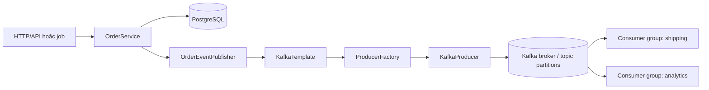
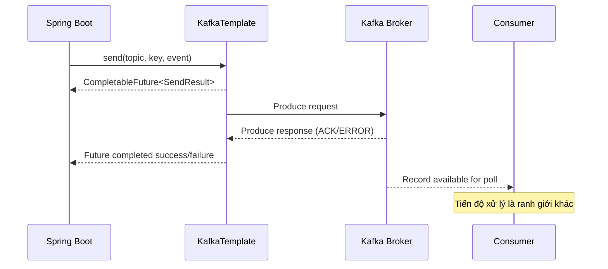
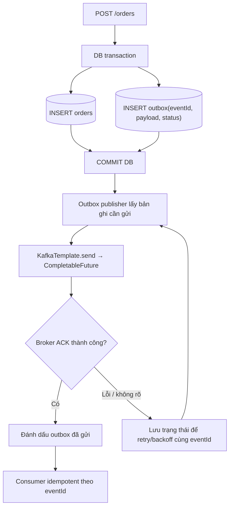

# KafkaTemplate, ProducerFactory và gửi thông điệp bất đồng bộ

> **Chương:** Apache Kafka  
> **Phạm vi:** SPRING_BOOT_INTEGRATION — tổ chức tích hợp HTTP client, cơ sở dữ liệu, cache, broker thông điệp và các adapter Spring Integration; quản lý cấu hình, hợp đồng dữ liệu, giao dịch, lỗi, chống trùng lặp, kiểm thử và quan sát những luồng tích hợp thực tế.

## 1. Bài toán: Spring Boot gửi sự kiện tới Kafka như thế nào?

Một dịch vụ đặt hàng nhận HTTP `POST /orders`, lưu đơn vào PostgreSQL và cần thông báo `OrderCreated` cho dịch vụ giao hàng, báo cáo và kiểm soát tồn kho. Thay vì gọi trực tiếp cả ba dịch vụ rồi chờ phản hồi, hệ thống có thể phát sự kiện lên **Apache Kafka**. Những consumer khác nhau xử lý theo tiến độ của từng *consumer group*.

Ở phía producer của Spring for Apache Kafka có hai đối tượng chính:

- **`ProducerFactory<K, V>`** chịu trách nhiệm tạo và quản lý `KafkaProducer<K, V>` từ cấu hình kết nối, serializer, authentication và các client properties. Implementation thường dùng là `DefaultKafkaProducerFactory`.
- **`KafkaTemplate<K, V>`** cung cấp API Spring thuận tiện để gửi `ProducerRecord` hoặc payload đến Kafka. Từ **Spring Kafka 3.0+**, các phương thức `send(...)` trả về `CompletableFuture<SendResult<K, V>>` để xử lý kết quả bất đồng bộ.

Mối quan hệ:



**Điểm phân biệt quan trọng:** `KafkaTemplate.send(...)` khởi tạo thao tác gửi và trả về future; điều đó **không đồng nghĩa broker đã ghi nhận thành công**. Cần đợi future hoàn tất để biết broker phản hồi thế nào. Ngay cả khi gửi thành công, kết quả chỉ xác nhận **ghi vào Kafka theo cấu hình producer/broker**, không chứng minh một consumer đã xử lý xong nghiệp vụ.

### 1.1. Mục tiêu học tập

Sau bài này, bạn có thể:

1. Đưa Spring Kafka starter vào ứng dụng Boot đúng dòng phiên bản.
2. Phân biệt vai trò của `KafkaTemplate`, `ProducerFactory` và `KafkaProducer`.
3. Cấu hình broker, serializer, `acks`, idempotence, timeout, batching và authentication phù hợp.
4. Gửi message bất đồng bộ, dùng `CompletableFuture` để trả receipt hoặc xử lý lỗi.
5. Thiết kế message key, event contract, ordering, retry và idempotency.
6. Giải thích transaction Kafka, transactional outbox và ranh giới với transaction DB.
7. Kiểm thử producer và quan sát failure, latency, throughput, backlog outbox.

## 2. Những khái niệm Kafka cần trước khi viết code

| Khái niệm | Ý nghĩa trong luồng producer | Lưu ý thiết kế |
| --- | --- | --- |
| **Broker/cluster** | Cung cấp nơi lưu và truy xuất log sự kiện phân tán | Cần bootstrap servers, quyền truy cập và TLS/SASL phù hợp |
| **Topic** | Luồng sự kiện logic, chẳng hạn `orders.created` | Tên, cấu hình retention và schema là hợp đồng hạ tầng |
| **Partition** | Chuỗi record có offset tăng dần trong một topic | Chỉ có thứ tự **trong một partition**, không có thứ tự toàn topic nhiều partition |
| **Record key** | Dùng để chọn partition theo cơ chế partitioner | Key ổn định như `orderId` giúp các record cùng đơn thường đi cùng partition |
| **Value** | Payload được serialize thành bytes | Schema version, khả năng tương thích và dữ liệu nhạy cảm cần quản lý |
| **Headers** | Metadata tuỳ chọn kèm record | Event ID, correlation ID, content type; không lưu secret |
| **Offset** | Vị trí record trong một partition | Receipt gửi thành công có thể trả topic/partition/offset |
| **Producer acknowledgment** | Broker phản hồi thao tác gửi tùy `acks` | Khác hoàn toàn với consumer commit offset |
| **Consumer group** | Nhóm consumer chia việc đọc partition | Producer không biết từng nhóm đã xử lý xong hay chưa |

Khi có nhiều partition, hai sự kiện `OrderCreated` và `OrderCancelled` của cùng `orderId` nên có **cùng key ổn định** nếu cần xử lý có thứ tự theo đơn. Tuy nhiên, thứ tự còn phụ thuộc thời điểm phát sự kiện, số lần thử, số producer, thay đổi partition count và cách downstream xử lý. Đừng xem key là cơ chế đảm bảo thứ tự toàn hệ thống.

### 2.1. “Bất đồng bộ” ở ba tầng khác nhau

**Tầng 1 — API producer:** `send(...)` trả về future để caller không phải chờ kết quả trong lời gọi gửi thông thường. Tuy nhiên, việc serialize hoặc đợi metadata/buffer trong `send` vẫn có thể chiếm thời gian trên thread gọi, tùy client/config.

**Tầng 2 — Broker:** sau khi producer nhận acknowledgment thành công, record được Kafka tiếp nhận theo chế độ `acks` và trạng thái cụm broker; đây là ranh giới tin cậy của producer.

**Tầng 3 — Consumer:** có thể xử lý muộn, thất bại hoặc nhận lại record. Kafka producer không thể xác nhận “đã giao hàng” chỉ bằng `SendResult`.



Đừng dùng một Future chưa hoàn tất như bằng chứng record đã được ghi. Cũng không nên gửi rồi bỏ Future trong một luồng bắt buộc bảo đảm sự kiện.

## 3. Starter và tương thích phiên bản

Trong **Spring Boot 3.x**, cách đơn giản để thêm producer Kafka:

```groovy
// build.gradle; dự án đã áp dụng Spring Boot plugin/BOM
dependencies {
    implementation 'org.springframework.kafka:spring-kafka'
    testImplementation 'org.springframework.boot:spring-boot-starter-test'
    testImplementation 'org.springframework.kafka:spring-kafka-test'
}
```

Trong hệ sinh thái Spring Boot 3.x, `spring-kafka` là dependency chính thức được Boot tự cấu hình; không cần tự xây một starter cho tác vụ producer thông thường. Ở **Spring Boot 4.x**, các starter có thể được tổ chức lại; chẳng hạn `org.springframework.boot:spring-boot-starter-kafka` là artifact cần đối chiếu theo tài liệu của dòng Boot đang dùng. Vì vậy:

- **Chọn theo BOM/đúng phiên bản Boot**, tránh cài một phiên bản Spring Kafka tùy ý từ tài liệu khác dòng.
- Code minh họa trong bài sử dụng **Java 17+ / Spring Boot 3.x / Spring Kafka 3.x**. Spring Kafka **2.x** có API future cũ kiểu `ListenableFuture`, nên không thể sao chép nguyên các ví dụ `CompletableFuture` sang đó.
- Khi nâng cấp Boot/Spring Kafka, đối chiếu riêng client Kafka, serializer, API callback, transaction và behavior auto-configuration.

Maven tương đương (Boot 3.x có dependency management):

```xml
<dependency>
    <groupId>org.springframework.kafka</groupId>
    <artifactId>spring-kafka</artifactId>
</dependency>
```

**Không cần `@EnableKafka` để dùng `KafkaTemplate` gửi message.** Annotation này liên quan tới hạ tầng Kafka listener khi dùng consumer annotation; producer chỉ cần các bean và cấu hình producer phù hợp.

## 4. Spring Boot tạo ProducerFactory và KafkaTemplate ra sao?

Khi Spring Kafka có trên classpath, Boot kiểm tra các điều kiện auto-configuration và các bean người dùng đã cung cấp. Trong cấu hình phổ biến, Boot xây:

| Bean | Chức năng | Khi cần tự tùy biến |
| --- | --- | --- |
| `KafkaProperties` | Bind `spring.kafka.*` từ môi trường | Cấu hình endpoint, serializer, security và properties |
| `DefaultKafkaProducerFactory<?, ?>` | Tạo producer client từ properties, quản lý producer cache khi phù hợp | Cần producer factory riêng theo đối tác/cluster hoặc serializer tùy chỉnh |
| `KafkaTemplate<?, ?>` | Bao bọc factory với API gửi của Spring | Cần template riêng, interceptor/observation hay multiple clusters |
| `KafkaTransactionManager<?, ?>` | Quản lý Kafka transaction khi đủ điều kiện | Giao dịch trong Kafka, không tự ghép atomic với SQL |

Việc một bean có được tạo hay không phụ thuộc classpath, properties, điều kiện như `@ConditionalOnMissingBean` và các cấu hình khác. Khi ứng dụng tự khai báo `ProducerFactory` hoặc `KafkaTemplate`, bean mặc định tương ứng của Boot **có thể nhường chỗ**. Cần kiểm tra số lượng và kiểu bean khi có nhiều producer/config.

Để kiểm tra vì sao một bean không tồn tại:

1. Kiểm tra dependency tree: `spring-kafka` và kafka-clients có đúng không?
2. Kiểm tra `spring.kafka.bootstrap-servers`, serializer class và biến môi trường.
3. Xem ứng dụng đã định nghĩa bean tùy chỉnh khiến mặc định không xuất hiện chưa.
4. Khởi chạy với `--debug` và đọc *Conditions Evaluation Report*.
5. Khi bean có mặt, thử gửi một record trong môi trường test; **bean tồn tại không chứng minh broker kết nối được**.

### 4.1. Quan hệ type generic

`KafkaTemplate<String, OrderCreatedEvent>` dùng `ProducerFactory<String, OrderCreatedEvent>` tương ứng ở mức Java API. Serializer **quyết định byte dữ liệu thực sự** gửi tới broker; generic type không có tác dụng tự chọn serializer JSON/Avro.

Ví dụ cấu hình `StringSerializer` cho key, `JsonSerializer` cho value thường phù hợp khi tất cả producer/consumer đã thống nhất JSON contract. Với tích hợp đa ngôn ngữ hoặc cần schema evolution nghiêm ngặt, cân nhắc Avro/Protobuf và schema registry theo hạ tầng của tổ chức, thay vì phụ thuộc type headers Java nội bộ.

## 5. Cấu hình kết nối và độ tin cậy producer

Ví dụ `application.yml` cho **môi trường phát triển**:

```yaml
app:
  kafka:
    orders-topic: ${ORDERS_TOPIC:orders.created}

spring:
  kafka:
    bootstrap-servers: ${KAFKA_BOOTSTRAP_SERVERS:localhost:9092}
    producer:
      key-serializer: org.apache.kafka.common.serialization.StringSerializer
      value-serializer: org.springframework.kafka.support.serializer.JsonSerializer
      acks: all
      retries: 3
      properties:
        "[enable.idempotence]": true
        "[max.in.flight.requests.per.connection]": 5
        "[delivery.timeout.ms]": 120000
        "[request.timeout.ms]": 30000
        "[linger.ms]": 5
        "[batch.size]": 16384
```

Các placeholder `${...}` lấy cấu hình từ môi trường; `localhost` chỉ phù hợp khi ứng dụng thật sự chạy cùng network namespace với broker. Khi deploy bằng container/Kubernetes, sử dụng địa chỉ broker có thể truy cập qua mạng và kiểm tra `advertised.listeners` của cluster. Giá trị trên **chỉ để minh họa trade-off**, không phải cấu hình tối ưu cho mọi SLA.

### 5.1. Ý nghĩa những thông số quan trọng

| Property | Mục đích | Điểm cần hiểu |
| --- | --- | --- |
| `bootstrap.servers` | Địa chỉ để khởi tạo kết nối và lấy metadata cluster | Không đủ nếu broker quảng cáo địa chỉ không truy cập được |
| `key.serializer` / `value.serializer` | Chuyển đối tượng thành byte | Producer/consumer phải thống nhất schema và encoding |
| `acks=all` | Leader đợi xác nhận từ các replica trong ISR theo cấu hình broker | Hiệu quả phụ thuộc replication factor và `min.insync.replicas` |
| `enable.idempotence=true` | Tránh ghi trùng do producer retry trong phạm vi cơ chế idempotent producer | Không chống mọi nghiệp vụ publish lại cùng event |
| `retries` | Số lần Kafka client có thể retry lỗi gửi đủ điều kiện | Còn bị ràng buộc bởi `delivery.timeout.ms` |
| `max.in.flight.requests.per.connection` | Giới hạn request chưa ACK trên một kết nối | Phải tương thích điều kiện idempotence; giá trị tối đa 5 với idempotent producer hiện đại |
| `delivery.timeout.ms` | Giới hạn thời gian hoàn tất một record từ lúc send vào producer tới thành công/thất bại | Bao gồm batching/metadata/retries theo client |
| `request.timeout.ms` | Chờ phản hồi broker cho một request | Phối hợp với broker và `delivery.timeout.ms` |
| `linger.ms` | Chờ gom record để batch khi thích hợp | Tăng throughput nhưng có thể tăng latency |
| `batch.size` | Kích thước batch mục tiêu theo partition | Không đồng nghĩa luôn gửi đúng kích thước này |
| `buffer.memory` / `max.block.ms` | Giới hạn buffer và thời gian chờ metadata/buffer trong send | API send “async” vẫn có khả năng chặn tạm thời |

Với phiên bản Kafka client hiện đại, một số giá trị mặc định đã thay đổi theo dòng release. Hãy **kiểm tra cấu hình hiệu lực thực tế** và đo tải thay vì dựa vào defaults nhớ từ tài liệu của bản cũ.

### 5.2. Security và môi trường

Kafka sản xuất thường yêu cầu TLS/SASL, ví dụ `SASL_SSL`, SCRAM, OAuthBearer hoặc mTLS tùy cluster. Spring Boot cho phép truyền properties client dưới `spring.kafka.properties.*` hoặc cấu hình producer cụ thể. Những tham số SASL, truststore/keystore và secret phải được cấp từ secret manager hoặc biến môi trường an toàn, không hard-code vào source hay xuất ra log.

Các trường hợp dễ nhầm:

- Có thể kết nối bootstrap broker nhưng không gửi được vì `advertised.listeners` dẫn tới hostname nội bộ không truy cập được.
- TCP kết nối được nhưng không có ACL `WRITE`/`DESCRIBE` trên topic; retry vô hạn không giải quyết quyền truy cập.
- Producer thành công ở dev nhưng lỗi serialization/size/timeout ở prod do schema, quota, `max.request.size` và broker config khác nhau.
- Việc bật compression hoặc batching phải được đo cùng CPU, network, payload và SLA, không lựa chọn theo cảm tính.

## 6. Khi nào cần tự định nghĩa ProducerFactory?

**Ưu tiên auto-configuration của Boot** nếu chỉ cần một cluster và thay đổi các producer properties chuẩn. Tự tạo `ProducerFactory` khi thực sự có nhu cầu như nhiều cluster, serializer đặc thù hoặc quản lý producer theo domain.

Một ví dụ tối giản để hiểu quan hệ giữa factory và template:

```java
import java.util.HashMap;
import java.util.Map;
import org.apache.kafka.clients.producer.ProducerConfig;
import org.apache.kafka.common.serialization.StringSerializer;
import org.springframework.context.annotation.Bean;
import org.springframework.context.annotation.Configuration;
import org.springframework.kafka.core.DefaultKafkaProducerFactory;
import org.springframework.kafka.core.KafkaTemplate;
import org.springframework.kafka.core.ProducerFactory;
import org.springframework.kafka.support.serializer.JsonSerializer;

@Configuration
class OrderProducerConfiguration {

    @Bean
    ProducerFactory<String, OrderCreatedEvent> orderProducerFactory() {
        Map<String, Object> config = new HashMap<>();
        config.put(ProducerConfig.BOOTSTRAP_SERVERS_CONFIG, "localhost:9092");
        config.put(ProducerConfig.KEY_SERIALIZER_CLASS_CONFIG,
                StringSerializer.class);
        config.put(ProducerConfig.VALUE_SERIALIZER_CLASS_CONFIG,
                JsonSerializer.class);
        config.put(ProducerConfig.ACKS_CONFIG, "all");
        config.put(ProducerConfig.ENABLE_IDEMPOTENCE_CONFIG, true);
        return new DefaultKafkaProducerFactory<>(config);
    }

    @Bean
    KafkaTemplate<String, OrderCreatedEvent> orderKafkaTemplate(
            ProducerFactory<String, OrderCreatedEvent> factory) {
        return new KafkaTemplate<>(factory);
    }
}
```

Trong ví dụ giải thích này, `localhost:9092` được đặt trực tiếp cho dễ thấy. **Không sao chép y nguyên vào production**: nếu bạn tự tạo factory, các properties được Boot bind cho producer (TLS, SASL, timeout, observability, v.v.) **không tự xuất hiện** trong `Map` thủ công này. Khi triển khai thật, bind những thuộc tính đó theo cách nhất quán với `KafkaProperties` và cơ chế SSL bundle/cấu hình Boot của đúng phiên bản, hoặc dùng customizer để bổ sung vào factory mặc định.

**Một lưu ý về back off:** bean `ProducerFactory` tự khai báo có thể khiến Boot không tạo factory mặc định. Nếu hệ thống còn muốn dùng nhiều factory và template, phải đặt tên bean, dùng `@Qualifier` hoặc `@Primary` rõ ràng, tránh ambiguity khi inject generic type. Không đánh đồng generic type Java với việc Boot tự chọn đúng cluster.

### 6.1. Lifecycle và thread-safety

- `KafkaTemplate` thông thường được dùng như **singleton, thread-safe** khi producer factory được cấu hình phù hợp; không tạo một `KafkaProducer` mới trên từng HTTP request.
- `DefaultKafkaProducerFactory` có thể dùng shared producer và caching theo mode; nó quản lý vòng đời producers. Đừng tự `close()` producer được framework quản lý sau mỗi lần gửi.
- Producer có I/O thread riêng và callback có thể được thực thi trên luồng nội bộ của client hoặc luồng hoàn tất future. Không đặt tác vụ blocking, gọi API chậm hoặc transaction DB dài bên trong callback.
- Khi cần nhiều cluster hoặc cài đặt serializer khác biệt, mô hình hóa riêng `KafkaTemplate`/factory cho từng kết nối và đặt tên rõ ràng.

## 7. Ví dụ gửi sự kiện bất đồng bộ bằng KafkaTemplate

Ví dụ sau giả định ứng dụng Boot 3.x đã cấu hình `spring.kafka.*` như phần trước. Topic `orders.created` đã được cấp phát và ứng dụng có quyền ghi. Để tách tích hợp khỏi nghiệp vụ, định nghĩa một hợp đồng event có ID ổn định rồi inject `KafkaTemplate` vào publisher.

### 7.1. Hợp đồng dữ liệu và receipt

```java
// OrderCreatedEvent.java
import java.time.Instant;
import java.util.UUID;

public record OrderCreatedEvent(
        UUID eventId,
        String orderId,
        Instant occurredAt,
        int schemaVersion) {
}
```

```java
// PublicationReceipt.java
public record PublicationReceipt(
        String topic,
        int partition,
        long offset) {
}
```

`eventId` là **ID của sự kiện logic**, dùng lại khi publish retry sau lỗi hoặc khi một outbox record được xử lý nhiều lần. `orderId` đóng vai trò **record key** để các record cùng đơn thường đi vào một partition. `schemaVersion` giúp consumer xử lý thay đổi payload có kiểm soát. Một ứng dụng thực tế còn có thể bổ sung loại event, correlation ID, tenant và các trường nghiệp vụ được chuẩn hóa.

### 7.2. Publisher trả future cho lớp gọi

```java
// OrderEventPublisher.java
import java.nio.charset.StandardCharsets;
import java.util.Objects;
import java.util.concurrent.CompletableFuture;
import org.apache.kafka.clients.producer.ProducerRecord;
import org.apache.kafka.common.header.internals.RecordHeader;
import org.springframework.beans.factory.annotation.Value;
import org.springframework.kafka.core.KafkaTemplate;
import org.springframework.kafka.support.SendResult;
import org.springframework.stereotype.Service;

@Service
public class OrderEventPublisher {
    private final KafkaTemplate<String, OrderCreatedEvent> template;
    private final String topic;

    public OrderEventPublisher(
            KafkaTemplate<String, OrderCreatedEvent> template,
            @Value("${app.kafka.orders-topic}") String topic) {
        this.template = template;
        this.topic = topic;
    }

    public CompletableFuture<PublicationReceipt> publish(
            OrderCreatedEvent event) {
        Objects.requireNonNull(event, "event");
        Objects.requireNonNull(event.eventId(), "event.eventId");
        if (event.orderId() == null || event.orderId().isBlank()) {
            return CompletableFuture.failedFuture(
                    new IllegalArgumentException("orderId is required"));
        }

        ProducerRecord<String, OrderCreatedEvent> record =
                new ProducerRecord<>(topic, event.orderId(), event);
        record.headers().add(new RecordHeader(
                "event-id",
                event.eventId().toString()
                        .getBytes(StandardCharsets.UTF_8)));

        try {
            return template.send(record)
                    .thenApply(result -> {
                        var metadata = result.getRecordMetadata();
                        return new PublicationReceipt(
                                metadata.topic(),
                                metadata.partition(),
                                metadata.offset());
                    });
        } catch (RuntimeException synchronousFailure) {
            return CompletableFuture.failedFuture(synchronousFailure);
        }
    }
}
```

Giải thích những chi tiết quan trọng:

1. `new ProducerRecord<>(topic, event.orderId(), event)` đặt key và value rõ ràng. Kafka producer chọn partition bằng partitioner phù hợp; không phụ thuộc thứ tự HTTP request để suy ra thứ tự Kafka.
2. Header `event-id` dùng UTF-8 nhất quán. Không đưa secret, bearer token hoặc payload nhạy cảm không cần thiết vào header.
3. `template.send(record)` có thể trả future ngay khi record được chấp nhận vào quy trình gửi; **receipt chỉ được tạo khi future hoàn tất thành công**.
4. `SendResult.getRecordMetadata()` cung cấp topic, partition và offset của record được xác nhận. Đây **không phải trạng thái xử lý của downstream**.
5. Catch synchronous failure bảo vệ caller trước lỗi xảy ra ngay trong lời gọi gửi (ví dụ một số lỗi serialization, lấy metadata hoặc buffer). Các lỗi hoàn tất bất đồng bộ được phản ánh qua future; cả hai đều không được âm thầm bỏ qua.

Trong code thực, nên kiểm tra schema version, null/empty field, giới hạn kích thước message và các quy tắc hợp đồng trước khi gửi. Không nên coi event chứa cùng `orderId` là cùng một event: một đơn có thể sinh nhiều event hợp lệ với các `eventId` khác nhau.

### 7.3. Phản hồi HTTP sau khi Kafka đã xác nhận

Nếu API thực sự yêu cầu trả HTTP chỉ khi broker đã chấp nhận message, Spring MVC có thể trả `CompletableFuture` như một kết quả bất đồng bộ:

```java
import java.util.concurrent.CompletableFuture;
import org.springframework.http.ResponseEntity;
import org.springframework.web.bind.annotation.PostMapping;
import org.springframework.web.bind.annotation.RequestBody;
import org.springframework.web.bind.annotation.RequestMapping;
import org.springframework.web.bind.annotation.RestController;

@RestController
@RequestMapping("/demo/events")
public class OrderEventsController {
    private final OrderEventPublisher publisher;

    public OrderEventsController(OrderEventPublisher publisher) {
        this.publisher = publisher;
    }

    @PostMapping("/orders")
    public CompletableFuture<ResponseEntity<PublicationReceipt>> publish(
            @RequestBody OrderCreatedEvent event) {
        return publisher.publish(event)
                .thenApply(receipt ->
                        ResponseEntity.accepted().body(receipt));
    }
}
```

Với Spring MVC, kiểu trả về future cho phép framework xử lý kết quả async của request. **HTTP 202 chỉ được tạo sau khi future hoàn tất thành công**, không phải ngay lúc `send()` trả về. Nếu future thất bại, cần một `@RestControllerAdvice`/exception mapping thống nhất để trả mã lỗi phù hợp; ví dụ không định nghĩa toàn bộ contract HTTP vì tập trung vào producer.

Endpoint trên **chỉ là bản demo**, chưa tạo đơn hay lưu database. Ứng dụng thực tế phải tạo event sau khi chấp nhận thao tác nghiệp vụ và quyết định rõ bảo đảm nhất quán với database; không cho bên ngoài giả mạo `eventId` hoặc nội dung domain event mà không validation/auth.

### 7.4. Dùng callback để quan sát, không để chạy nghiệp vụ nặng

Có thể theo dõi kết quả mà không chờ:

```java
CompletableFuture<PublicationReceipt> future = publisher.publish(event);

future.whenComplete((receipt, failure) -> {
    if (failure == null) {
        // Ghi metric gửi thành công theo topic/partition.
        // Không coi đây là consumer đã xử lý xong.
        log.info("Kafka publish OK topic={} partition={} offset={}",
                receipt.topic(), receipt.partition(), receipt.offset());
    } else {
        // Ghi mã lỗi/metric để recovery hoặc outbox xử lý.
        log.error("Kafka publish failed eventId={}", event.eventId(), failure);
    }
});
```

Đoạn minh họa giả định đã có biến `event`, `log` (logger của lớp) và publisher. `whenComplete` không phải điểm phù hợp để gọi HTTP chậm hoặc chạy transaction DB lâu: callback có thể chạy trên luồng I/O hoặc luồng hoàn tất future. Nếu cần recovery bền vững, ghi trạng thái vào outbox hoặc đẩy công việc sang executor/worker riêng được quản lý.

**Một callback quan sát không thay thế cơ chế xử lý lỗi:** nếu không có ai nhận và xử lý failure, message có thể bị mất về mặt nghiệp vụ dù log hiển thị lỗi. Future không tự biến công việc thành durable background job.

## 8. Gửi bất đồng bộ cần xử lý lỗi theo giai đoạn

Mỗi lần gửi có một số điểm thất bại khác nhau; phân biệt chúng quyết định retry hay đối soát:

| Giai đoạn | Tín hiệu có thể thấy | Có thể khẳng định chưa ghi broker? | Phục hồi |
| --- | --- | --- | --- |
| Validate event trước khi gửi | `IllegalArgumentException`, DTO thiếu field | Có, nếu chưa gọi template | Sửa dữ liệu hoặc từ chối nghiệp vụ; không retry cùng input |
| Serialize/construct record | Serializer exception, schema không hợp lệ | Thường chưa gửi record đó | Sửa schema/serializer; phân loại lỗi vĩnh viễn |
| Lấy metadata/cấp phát buffer | Timeout, metadata unavailable, buffer exhausted | Tùy điểm lỗi, cần xem client semantics | Giảm tải, kiểm tra cluster, retry giới hạn an toàn |
| Broker xử lý yêu cầu | Authorization, invalid topic, insufficient replicas, quota | Phụ thuộc loại lỗi/ACK | Sửa quyền/cấu hình hoặc retry có ngân sách |
| Broker đã ghi nhưng response bị mất | Timeout/uncertain delivery | **Không** | Idempotency, event ID, đối soát và consumer chống trùng |
| Future thành công | `SendResult`, `RecordMetadata` | Broker đã xác nhận theo `acks` | Đánh dấu producer thành công; consumer vẫn độc lập |

### 8.1. Những lỗi nên ưu tiên phân loại

- **Lỗi vĩnh viễn/cấu hình:** sai serializer, contract không tương thích, topic không tồn tại khi không tự tạo, authorization failure, authentication sai, `RecordTooLargeException` nếu payload vượt giới hạn. Retry ngay với cùng config thường vô ích.
- **Lỗi có thể tạm thời:** broker mất kết nối, leader chưa sẵn sàng, thiếu replica tạm thời, quota/throttling, producer buffer bị bão hòa. Có thể cân nhắc retry khi còn deadline và tính an toàn rõ ràng.
- **Kết quả chưa rõ:** timeout sau khi gửi, mất xác nhận broker. Không kết luận message chưa được broker nhận; đừng phát **một event logic mới** với ID mới để “thử lại”.
- **Từ chối nghiệp vụ:** đơn không tồn tại, đã hủy, vượt hạn mức… thường phát sinh ở service trước khi publish hoặc ở consumer sau khi đọc; đó là quyết định domain, không phải Kafka producer transport error.

Tránh xử lý mọi `Exception` bằng `send()` thêm lần nữa ngay trong `whenComplete`: retry của Kafka client, retry của ứng dụng và redelivery downstream có thể nhân số lần gửi và tạo retry storm.

### 8.2. Hai loại retry khác nhau

**Client-level retry:** Kafka producer tự retry một số lỗi gửi theo các cấu hình `retries`, `delivery.timeout.ms`, `retry.backoff.ms` và idempotence. Khi đã bật producer idempotence theo điều kiện phù hợp, broker có cơ chế phát hiện duplicate request do cùng producer session retry.

**Application-level retry:** ứng dụng quyết định gọi `KafkaTemplate.send(...)` lại sau khi future failed, hoặc retry một bản ghi outbox. Đây có thể là một **lần publish logic mới ở tầng producer**, dù payload và event ID giống nhau. Idempotent producer **không bảo đảm deduplicate mọi lần publish của ứng dụng**, đặc biệt qua restart hoặc producer session khác.

Do đó, ở tầng ứng dụng hãy giữ `eventId` cố định, kiểm soát tổng số attempts và dùng **idempotent consumer**. Khi có outbox, publisher có thể thử gửi bản ghi outbox cũ, nhưng consumer phải xử lý được bản ghi xuất hiện nhiều lần.

### 8.3. Không chặn luồng không cần thiết

```java
// Không nên làm việc này trong mỗi HTTP request để "chờ cho chắc":
PublicationReceipt receipt = publisher.publish(event).join();
```

`join()` chặn luồng gọi và ném `CompletionException` nếu future thất bại. Trong MVC đôi lúc ranh giới đồng bộ là chấp nhận được nếu có deadline và thread đủ, nhưng không còn lợi thế trả future. Trong WebFlux/Netty event loop, tránh `join()` hoặc `get()` vì làm nghẽn event loop.

Nếu một service dùng reactive API, có thể chuyển future sang `Mono`:

```java
import reactor.core.publisher.Mono;

Mono<PublicationReceipt> result =
        Mono.fromFuture(() -> publisher.publish(event));
```

Supplier của `Mono.fromFuture(...)` giúp **hoãn gọi producer tới khi subscribe**; publisher vẫn phải xử lý cancellation và lifetime theo yêu cầu. Ví dụ cần Spring WebFlux/Reactor trên classpath, không bắt buộc với ứng dụng Kafka imperative. Reactor pipeline không biến Kafka client thành một transaction end-to-end với database.

### 8.4. Quản lý số future đang chờ

Trả về future không có nghĩa có thể tạo vô hạn message trong bộ nhớ. Khi HTTP traffic tăng nhanh hơn Kafka có thể ghi, producer buffer, queue và callback chờ có thể tạo áp lực RAM hoặc làm `max.block.ms` hết hạn.

Nên áp dụng:

1. Giới hạn số sự kiện *in-flight* tới mỗi Kafka cluster/topic theo tải đo được.
2. Dùng cơ chế backpressure, bounded queue/bulkhead hoặc outbox để tránh nhận vô hạn.
3. Thực hiện retry có jitter và ngân sách tổng, không cho nhiều tầng cùng retry độc lập.
4. Chấp nhận rằng nếu yêu cầu HTTP bị hủy nhưng record đã gửi tới Kafka, việc hủy future **không nhất thiết thu hồi message**.
5. Theo dõi buffer exhaustion, send latency, delivery timeout và retry exhausted.

## 9. Key, partition, ordering và message contract

Kafka không tự hiểu nghiệp vụ đặt hàng. Producer phải thống nhất với consumer về **topic**, **record key**, **schema** và **ngữ nghĩa của sự kiện**.

### 9.1. Chọn record key theo thứ tự cần bảo toàn

Giả sử chuỗi sự kiện:

```text
OrderCreated(orderId=O-42)
OrderPaid(orderId=O-42)
OrderCancelled(orderId=O-42)
```

Nếu dùng `orderId` làm key trên cùng topic, partitioner thường ánh xạ cùng key vào cùng partition trong điều kiện số partition và chiến lược partitioning ổn định. Kafka giữ thứ tự log trong **một partition**. Tuy nhiên:

- Không có bảo đảm thứ tự **giữa các partition**.
- Nhiều producer và nhiều thao tác ứng dụng có thể phát sự kiện theo thời gian khác nhau với thứ tự nghiệp vụ thực.
- Tăng số partition hoặc thay đổi partitioner có thể làm ánh xạ key thay đổi.
- Consumer xử lý song song hoặc có retry/DLT vẫn có thể làm side effect xảy ra khác thứ tự đã đọc.

Nếu bắt buộc thứ tự theo từng đơn, cần thiết kế ngay từ service: một thứ tự sự kiện nguồn đáng tin cậy, key cố định, concurrency phù hợp và kiểm soát phiên bản/trạng thái khi áp dụng sự kiện.

### 9.2. Hợp đồng dữ liệu và schema evolution

Các trường tối thiểu nên có trong event:

| Field | Mục đích |
| --- | --- |
| `eventId` | Nhận diện một lần thay đổi nghiệp vụ; giúp consumer chống trùng |
| `eventType` | Phân biệt loại sự kiện khi cùng topic chứa nhiều loại |
| `schemaVersion` | Quản lý thay đổi cấu trúc payload |
| `aggregateId` / `orderId` | Nhận diện thực thể miền và có thể làm Kafka key |
| `occurredAt` | Thời điểm sự kiện xảy ra theo nguồn |
| `correlationId` | Liên kết HTTP → DB → Kafka → consumer khi trace |

Với `JsonSerializer` của Spring Kafka, serializer có thể đưa metadata type Java vào headers theo cấu hình mặc định của phiên bản. Điều đó thuận tiện khi producer/consumer đều là ứng dụng Spring, nhưng **không nên xem tên class Java là schema hợp đồng công khai** cho hệ thống nhiều ngôn ngữ.

Khi triển khai integration liên hệ thống, chọn JSON + schema/validation thống nhất hoặc Avro/Protobuf với schema registry tùy yêu cầu. Thử các nhánh *producer mới → consumer cũ* và *producer cũ → consumer mới* trước khi tăng `schemaVersion`.

### 9.3. Topic/partition/offset không thay thế eventId

Kafka record được xác định bởi *topic, partition, offset*. Nếu một bản ghi outbox được gửi thành công nhưng producer không nhận ACK, cùng event có thể được gửi lại ở offset khác. Dùng offset để chống xử lý trùng sẽ **không phát hiện** hai record khác offset nhưng cùng `eventId`.

Consumer nên dùng khóa chống trùng như cặp `(consumerName, eventId)` trong database, ghi nhận và xử lý side effect trong cùng đơn vị giao dịch khi có thể.

## 10. Transaction Kafka và ranh giới với database

### 10.1. Producer idempotence khác Kafka transaction

| Cơ chế | Mục tiêu | Không tự bảo đảm |
| --- | --- | --- |
| `enable.idempotence=true` | Tránh record trùng do producer retry bên trong Kafka protocol trong điều kiện được hỗ trợ | Trùng event do ứng dụng publish lại với producer session khác |
| Kafka transaction | Gộp nhiều thao tác Kafka producer trong một transaction; trong luồng Kafka-to-Kafka có thể phối hợp offset theo thiết kế | Atomic commit với database hoặc HTTP service bên ngoài |
| Transactional outbox | Ghi thay đổi DB và ý định publish trong một transaction DB | Event chỉ xuất hiện một lần tuyệt đối trên Kafka |
| Idempotent consumer | Không lặp side effect khi cùng event được đọc lại | Tự sửa được lỗi schema/hợp đồng hoặc transaction nguồn |

### 10.2. Bật transaction producer khi cần

Với Spring Boot 3.x, có thể cấu hình prefix transaction ID:

```yaml
spring:
  kafka:
    producer:
      transaction-id-prefix: order-publisher-${INSTANCE_ID:local}-
```

Boot có thể thiết lập transactional producer factory và `KafkaTransactionManager` khi điều kiện phù hợp. Prefix phải **tránh trùng giữa các instance chạy đồng thời** để không gây fencing transaction của nhau. Consumer đọc record trong transaction cần dùng `isolation.level=read_committed` nếu chỉ muốn nhận các record đã commit; cách commit offset cũng cần phù hợp mô hình consume-process-produce.

Gửi trong một Kafka transaction bằng Spring Kafka:

```java
import org.springframework.kafka.core.KafkaTemplate;

public class TransactionalKafkaPublisher {
    private final KafkaTemplate<String, OrderCreatedEvent> template;

    public TransactionalKafkaPublisher(
            KafkaTemplate<String, OrderCreatedEvent> template) {
        this.template = template;
    }

    public void publishTwo(OrderCreatedEvent first, OrderCreatedEvent second) {
        template.executeInTransaction(operations -> {
            operations.send("orders.created", first.orderId(), first);
            operations.send("orders.created", second.orderId(), second);
            return null;
        });
    }
}
```

Khi factory được cấu hình transaction, `executeInTransaction(...)` mở Kafka transaction, thực hiện các thao tác và commit hoặc abort theo kết quả. **Không bao cả JDBC transaction một cách tự động**. Nếu ứng dụng còn dùng `@Transactional` cho JPA, đừng giả định việc có hai transaction manager tạo ra phân tán 2PC/atomic commit; cần mô tả rõ thứ tự commit và các cửa sổ crash.

### 10.3. Tình huống DB → Kafka và transactional outbox

Mẫu gửi trực tiếp dễ gặp:

```text
BEGIN SQL TRANSACTION
  INSERT orders(...)
COMMIT

kafkaTemplate.send("orders.created", event)
```

Nếu tiến trình crash sau khi commit SQL nhưng trước khi gửi/nhận ACK, DB có đơn còn Kafka có thể chưa có event. Đổi thứ tự gửi trước commit SQL cũng có rủi ro consumer thấy event về một đơn sau đó bị rollback.

**Transactional outbox** giải quyết khả năng phục hồi:



Các chi tiết cần có trong triển khai thực tế:

1. Ghi `orders` và `outbox` trong **cùng DB transaction**.
2. Worker chọn/lấy quyền xử lý bản ghi outbox có kiểm soát khi có nhiều instance.
3. Đánh dấu `SENT` **sau** khi future gửi Kafka hoàn tất thành công.
4. Nếu ACK bị mất nhưng broker đã ghi, worker có thể gửi lại. Giữ **cùng eventId**, và consumer có unique constraint/inbox chống trùng.
5. Theo dõi bản ghi outbox còn chờ lâu, số attempts, lỗi permanent (serializer/schema) và cách khôi phục thủ công.

Outbox tạo hành vi thực dụng gần với **at-least-once publish** khi worker phục hồi đúng, không phải lời hứa “exactly once across SQL + Kafka”. Nếu hệ thống thực sự cần bảo đảm mạnh hơn, phải kiểm chứng toàn bộ giao thức end-to-end và tính tương thích của các resource tham gia.

## 11. Kiểm thử producer từ API đến Kafka

### 11.1. Chọn mức kiểm thử

| Mức | Công cụ | Mục tiêu | Hạn chế |
| --- | --- | --- | --- |
| Unit | Mockito cho `KafkaTemplate`, fake future | Verify topic/key/header, chuyển `SendResult` thành receipt, phản hồi lỗi | Không chạy Kafka producer thật |
| Spring context | `@SpringBootTest` với bean/test config phù hợp | Kiểm tra binding properties và inject producer | Bean tồn tại không bảo đảm gửi broker thành công |
| Integration | `@EmbeddedKafka` hoặc Kafka Testcontainers | Gửi/nhận thật, serializer, topic, ACK, partition/key | Tốn tài nguyên hơn unit |
| End-to-end | HTTP → DB/outbox → Kafka → consumer | Crash/replay, idempotency, timeout, transaction, trace | Cần dựng nhiều dependency và mô phỏng lỗi |

### 11.2. Integration test gửi thật với Embedded Kafka

Thêm `spring-kafka-test` trong test dependencies; với Spring Boot 3.x và JUnit 5 có thể dùng:

```java
import java.time.Instant;
import java.util.UUID;
import java.util.concurrent.TimeUnit;
import org.junit.jupiter.api.Test;
import org.springframework.beans.factory.annotation.Autowired;
import org.springframework.boot.test.context.SpringBootTest;
import org.springframework.kafka.test.context.EmbeddedKafka;

import static org.assertj.core.api.Assertions.assertThat;

@SpringBootTest(properties = {
        "app.kafka.orders-topic=orders.created"
})
@EmbeddedKafka(
        partitions = 1,
        topics = "orders.created",
        bootstrapServersProperty = "spring.kafka.bootstrap-servers")
class OrderKafkaPublisherIntegrationTest {

    @Autowired
    OrderEventPublisher publisher;

    @Test
    void publishCompletesWithBrokerMetadata() throws Exception {
        OrderCreatedEvent event = new OrderCreatedEvent(
                UUID.randomUUID(), "order-123", Instant.now(), 1);

        PublicationReceipt receipt = publisher.publish(event)
                .get(10, TimeUnit.SECONDS);

        assertThat(receipt.topic()).isEqualTo("orders.created");
        assertThat(receipt.partition()).isZero();
        assertThat(receipt.offset()).isGreaterThanOrEqualTo(0L);
    }
}
```

Ví dụ trên kiểm tra **broker ACK và metadata**, chưa assert consumer thực sự nhận đúng JSON. Nếu muốn kiểm tra contract, tạo test consumer với serializer/deserializer phù hợp rồi `poll` record, so sánh key, event ID, schema và headers. Với test có JSON headers type của Spring, kiểm tra consumer tương thích theo cấu hình.

`@EmbeddedKafka` dựng Kafka broker cho test và điều chỉnh bootstrap property; không dùng broker production chung cho test. Có thể chọn Kafka Testcontainers nếu cần môi trường gần cluster triển khai, nhiều broker, security hoặc behavior failover riêng. Trong CI cần runtime tương ứng.

### 11.3. Các trường hợp kiểm thử quan trọng

1. Gửi đúng topic, key = `orderId`, payload có `eventId`/`schemaVersion`, header `event-id` đúng UTF-8.
2. `CompletableFuture` hoàn tất thành công: receipt chứa topic/partition/offset, API trả 202 **sau** ACK.
3. Future hoàn tất lỗi: hệ thống không trả HTTP 202 giả, ghi mã lỗi và giữ trạng thái để retry/outbox nếu có.
4. Serialization lỗi: không retry vô hạn, phải sửa payload/schema.
5. Broker chậm/mất kết nối: bounded timeout, không tích lũy future vô hạn.
6. Broker ghi được nhưng ACK thất lạc: worker retry cùng `eventId`, consumer không làm side effect hai lần.
7. Hai event liên tiếp cùng key đi đúng partition trong điều kiện số partition ổn định; kiểm tra xử lý thứ tự cần thiết.
8. DB commit xong rồi process crash trước publish: outbox còn record để worker phục hồi.
9. Khi bật Kafka transaction: consumer `read_committed` chỉ thấy record commit, không thấy record aborted.

**Không viết test giả chỉ đếm số lần gọi `send()` rồi xem như đã chứng minh Kafka hoạt động.** Unit test dùng để chứng minh contract của publisher; integration test mới chứng minh serializer, ACK và broker thực.

## 12. Quan sát đường đi producer và khôi phục khi sự cố

Một hệ thống phát sự kiện cần nhìn thấy trạng thái từ **request → publisher → broker → outbox/consumer**, thay vì chỉ log “send called”.

### 12.1. Nên đo những metric nào?

| Nhóm | Dữ liệu cần theo dõi | Ý nghĩa |
| --- | --- | --- |
| **Application** | Số event tạo, số publish success/failure, attempts và latency future | Có xảy ra mất sự kiện hoặc retry bất thường không? |
| **Producer client** | Record-send-rate, request-latency, retry-rate, bufferpool-wait, record-error-rate | Producer có nghẽn network, broker hoặc buffer không? |
| **Broker/topic** | Under-replicated partitions, ISR, produce errors, quota/throttling | Có thể đáp ứng `acks=all` và SLA không? |
| **Outbox** | Số record pending, tuổi record cũ nhất, retries/exhausted, status phân loại | Có record chưa publish thành công đang tồn không? |
| **Consumer** | Consumer lag, duplicate count, side-effect failures, DLT backlog | Broker đã nhận nhưng downstream có xử lý tốt không? |
| **Trace/log** | `eventId`, `orderId` khi được phép, topic, partition, offset, correlation ID | Có thể lần theo một sự kiện qua nhiều service không? |

Spring Kafka có cơ chế Micrometer observation/metrics tùy phiên bản và cấu hình registry, producer listener, interception. Spring Boot Actuator có thể tích hợp observation/export khi ứng dụng cấu hình đúng. **Không giả định tất cả producer/broker metric tự xuất hiện** chỉ bằng thêm dependency: phải bật registry/instrumentation và kiểm tra dữ liệu thật trong hệ thống giám sát.

Tránh gắn `eventId`, `orderId` hoặc payload thành **metric label** cho mọi record vì cardinality lớn; chúng phù hợp hơn ở log/tracing có kiểm soát. Không log password, token, full payload nhạy cảm hoặc cấu hình SASL.

### 12.2. Một log đủ ngữ cảnh nhưng không gây rò rỉ

Ví dụ log thành công nên có:

```text
action=kafka_publish
status=success
topic=orders.created
partition=2
offset=12031
eventType=OrderCreated
correlationId=req-6c22
durationMs=48
```

Log thất bại cần ghi exception class, mã lỗi phù hợp và attempts; tránh thông báo gây hiểu lầm “not published” khi thực ra đã timeout **sau** khi broker ghi. Với trường hợp không rõ kết quả, dùng nhãn như `OUTCOME_UNKNOWN` hoặc `RECONCILE_REQUIRED` và giữ event trong outbox để kiểm chứng/retry đúng chính sách.

### 12.3. Chẩn đoán nhanh các lỗi thường gặp

| Triệu chứng | Nguyên nhân có thể | Hướng điều tra |
| --- | --- | --- |
| Không inject được `KafkaTemplate` | Thiếu Spring Kafka dependency, auto-configuration không match, nhiều template trùng kiểu | Dependency tree, bean definitions, `--debug` |
| Connection timeout dù bootstrap host đúng | `advertised.listeners` không truy cập được, ACL/TLS/SASL, DNS hoặc firewall | Kiểm tra địa chỉ broker quảng cáo, network và credential |
| Future hoàn tất `SerializationException` | Serializer sai type, payload/schema lỗi | Kiểm tra serializer, DTO, type headers và contract |
| Producer gửi `TimeoutException` | Broker/ISR chậm, metadata không sẵn sàng, buffer/queue đầy, `delivery.timeout.ms` | Xem producer metrics, broker logs, timeout và throughput |
| Gửi lỗi permission | ACL `WRITE`/`DESCRIBE`, auth config sai | Kiểm tra quyền, không retry mù |
| Offset có nhưng consumer không thấy | Khác topic/group, offset policy, deserialize lỗi, `read_committed` và transaction chưa commit | Kiểm tra consumer config và contract độc lập |
| Cùng event được consumer xử lý hai lần | Application publish lại, outbox retry, consumer replay | Giữ eventId, inbox/unique constraint |
| p99 latency tăng khi batch size/linger cao | Batching, broker throttle hoặc connection saturation | Đo send-to-ACK latency cùng pool/buffer/quota |
| Kafka transaction bị fencing | Transactional ID trùng hoặc producer cũ bị thay | Kiểm tra prefix/instance ID, restart và transaction logs |

Để phân tích auto-configuration trong phát triển:

```bash
java -jar app.jar --debug
```

Sau khi xác minh bean đã tồn tại, cần gửi thử tới **broker test đúng cấu hình** để tách lỗi Spring context khỏi lỗi transport. Tránh dùng topic production làm phép thử ngẫu nhiên.

## 13. Bài tập thực hành: gửi event đặt hàng đáng tin cậy

**Đề bài:** một ứng dụng Spring Boot nhận đơn, ghi `orders` trong PostgreSQL và phát `OrderCreated` lên Kafka. Yêu cầu: khi Kafka chậm/mất kết nối hoặc app crash giữa DB commit và publish, không làm mất ý định phát event; khi event được phát lại, consumer không xử lý trùng.

Các bước triển khai:

1. Chọn phiên bản Spring Boot 3.x và để BOM quản lý `spring-kafka`. Cấu hình broker, serializer, topic, `acks=all` và timeout phù hợp.
2. Tạo `OrderCreatedEvent(eventId, orderId, occurredAt, schemaVersion)`; dùng `orderId` làm Kafka key, `eventId` để chống trùng.
3. Định nghĩa `KafkaTemplate<String, OrderCreatedEvent>` và publisher trả `CompletableFuture<PublicationReceipt>`; không bỏ qua kết quả future.
4. Ghi bản ghi `orders` và `outbox` trong cùng transaction SQL; dùng worker publish outbox và đánh dấu `SENT` **sau khi ACK thành công**.
5. Xử lý lỗi đúng nhóm: sai schema/auth -> sửa, broker unavailable -> retry có ngân sách, timeout với outcome chưa rõ -> retry cùng `eventId`/đối soát.
6. Tạo consumer có unique constraint trên `(consumer_name, event_id)`, ghi business side effect và key chống trùng trong cùng transaction.
7. Dùng Embedded Kafka/Testcontainers để thử trường hợp ACK thành công, broker unavailable, app crash, publish lặp và consumer redelivery.
8. Đo số outbox pending, tuổi record lâu nhất, send-to-ACK latency, retry và duplicate count.

### 13.1. Câu hỏi tự kiểm tra

1. `ProducerFactory` và `KafkaTemplate` khác nhau về trách nhiệm ra sao? Khi nào cần khai báo factory thủ công?
2. Vì sao `CompletableFuture<SendResult<...>>` trả về từ `send` chưa đồng nghĩa broker đã ghi message?
3. Broker đã ACK thành công thì có thể suy ra consumer `shipping-service` đã giao hàng chưa? Vì sao?
4. `acks=all`, `min.insync.replicas` và replication factor liên quan nhau thế nào?
5. Producer idempotence ngăn kiểu duplicate nào và **không** ngăn duplicate nào?
6. Vì sao key = `orderId` giúp giữ thứ tự trong partition nhưng không bảo đảm thứ tự toàn hệ thống?
7. Callback `whenComplete` chạy query SQL lâu có thể gây vấn đề gì?
8. Vì sao dùng `send(...).join()` trong WebFlux event loop là rủi ro?
9. Sau SQL commit mà Kafka ACK bị mất, transactional outbox và `eventId` giúp phục hồi thế nào?
10. Test chỉ assert `offset >= 0` chứng minh được gì và chưa chứng minh điều gì về event contract?

**Ghi nhớ:** `ProducerFactory` quyết định cấu hình/vòng đời producer; `KafkaTemplate` cung cấp API gửi tiện lợi; `CompletableFuture` là ranh giới **xác nhận kết quả bất đồng bộ**, không phải bảo đảm nghiệp vụ end-to-end. Độ tin cậy thực tế cần kết hợp **acks, serializer/schema, key/ordering, idempotence, bounded retry, transactional outbox, idempotent consumer, kiểm thử và quan sát**.

### Tài liệu tham khảo

- [Spring for Apache Kafka — Sending Messages](https://docs.spring.io/spring-kafka/reference/kafka/sending-messages.html)
- [Spring for Apache Kafka — Transactions](https://docs.spring.io/spring-kafka/reference/kafka/transactions.html)
- [Spring for Apache Kafka — Serialization, Deserialization, and Message Conversion](https://docs.spring.io/spring-kafka/reference/kafka/serdes.html)
- [Spring for Apache Kafka — Testing Applications](https://docs.spring.io/spring-kafka/reference/testing.html)
- [Spring Boot — Apache Kafka Support](https://docs.spring.io/spring-boot/reference/messaging/kafka.html)
- [Apache Kafka — Producer Configs](https://kafka.apache.org/documentation/#producerconfigs)
