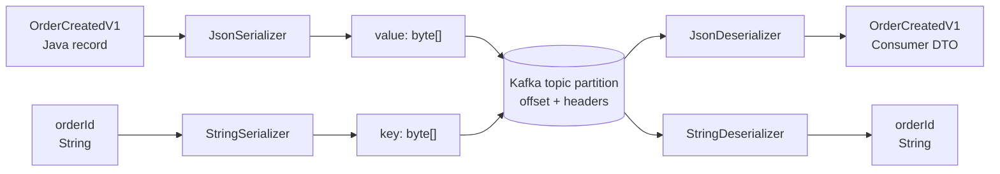
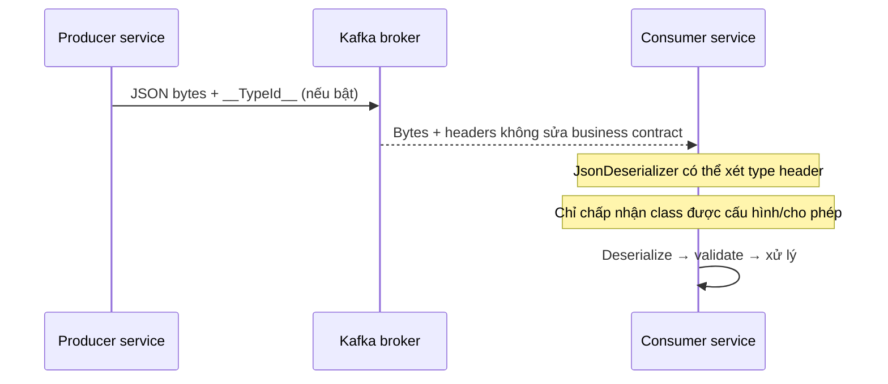
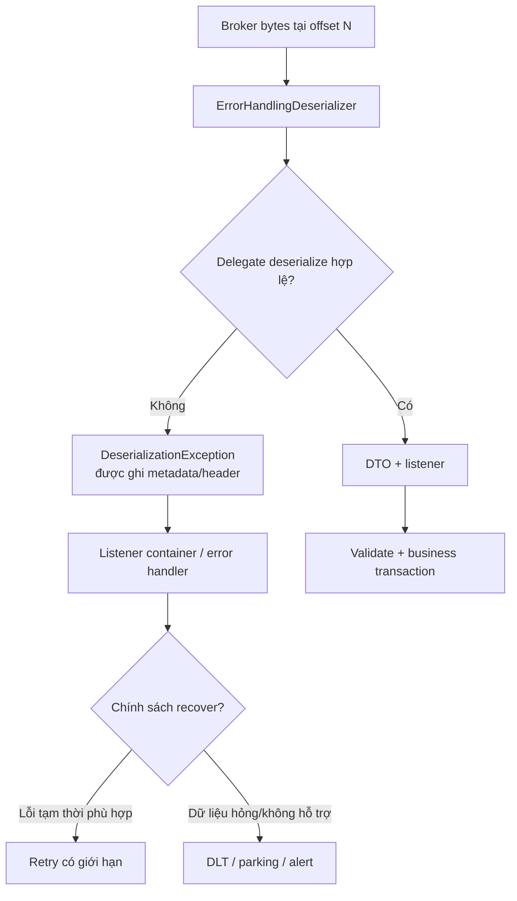
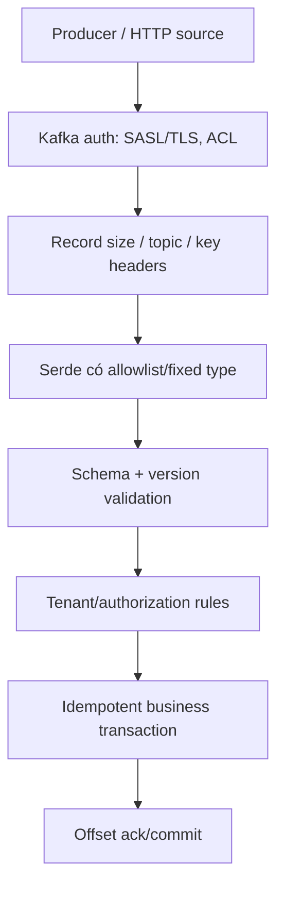

# Serializer, deserializer và kiểm soát kiểu dữ liệu được tin cậy

## 1. Vì sao định dạng message là một ranh giới tích hợp quan trọng?

Trong hệ thống tích hợp Spring Boot, một service có thể nhận HTTP request, ghi PostgreSQL, xuất sự kiện `OrderCreated` tới Apache Kafka; một service khác nhận sự kiện, cập nhật trạng thái thanh toán và ghi kết quả ra broker. Các bên **không trao đổi trực tiếp Java object** qua Kafka. Kafka lưu và truyền **byte arrays** cho key/value; producer và consumer phải thống nhất cách biến dữ liệu thành byte rồi khôi phục thành kiểu dữ liệu nghiệp vụ.

Một producer có thể tạo ra message hợp lệ với nó nhưng không thể đọc ở consumer vì:

- Producer dùng JSON còn consumer đang cấu hình `StringDeserializer`, `ByteArrayDeserializer` hoặc một format khác.
- Type header mang tên lớp Java ở service phát, trong khi service nhận không có lớp đó.
- Consumer dùng `JsonDeserializer` nhưng package trong type header không được tin cậy.
- JSON có hình dạng mới hoặc thiếu field bắt buộc so với hợp đồng dữ liệu.
- Message chứa dữ liệu hỏng, quá lớn hoặc vượt giới hạn xử lý, khiến consumer không deserialize được.
- Handler làm side effect thành công nhưng message được giao lại do offset chưa commit, gây xử lý trùng.

**Serializer/deserializer** quyết định ý nghĩa byte payload ở ranh giới Kafka; **kiểm soát kiểu dữ liệu được tin cậy** quyết định có cho dữ liệu từ broker tác động tới việc chọn **Java class nào** để khởi tạo hay không. Trong module **SPRING_BOOT_INTEGRATION**, cần kết hợp nội dung này với quản lý cấu hình, hợp đồng dữ liệu, lỗi, transaction, idempotency, kiểm thử và quan sát luồng HTTP → database → broker.

### Mục tiêu học tập

Sau bài này, bạn có thể:

1. Phân biệt Kafka key serializer, value serializer, deserializer, byte payload và message headers.
2. Dùng String/byte[]/JSON serde phù hợp với hợp đồng dữ liệu.
3. Cấu hình `JsonSerializer`, `JsonDeserializer`, `spring.json.value.default.type`, `spring.json.use.type.headers` và `spring.json.trusted.packages` trong Spring Boot.
4. Hiểu vì sao `trusted.packages=*` hoặc tin Java type header của đối tác là thiết kế rủi ro.
5. Sử dụng `ErrorHandlingDeserializer` và Spring Kafka error handler để xử lý dữ liệu không deserialize được, tránh poison-pill loop.
6. Thiết kế schema evolution, định danh sự kiện, DLT, retry, kiểm thử dữ liệu không tin cậy và quy trình vận hành.

> **Phạm vi phiên bản:** phần Java và cấu hình minh họa **Spring Boot 3.x**, **Spring for Apache Kafka 3.x**, Java 17+ và Kafka Java client do Spring Boot BOM quản lý. Trên Spring Kafka 4.x / Spring Boot 4, tên API Jackson serializer/deserializer có thể khác; cần xem tài liệu migration cho đúng bản. Các địa chỉ, topic và tên class dưới đây dùng để minh họa, không khẳng định đã tồn tại trong dự án.

## 2. Kafka truyền bytes; Java type là lựa chọn của ứng dụng

Mô hình một record:



Trước khi Kafka broker ghi record, producer chuyển key/value thành bytes bằng serializer tương ứng. Khi poll về, consumer sử dụng deserializer để chuyển bytes thành giá trị trả cho Spring Kafka listener. Broker **không xác thực business schema** hoặc kiểm tra các Java class của hai service; broker chủ yếu xử lý bytes, partition, offset, headers và những thuộc tính giao thức.

Một Kafka record thường có:

| Phần | Ví dụ | Trách nhiệm |
| --- | --- | --- |
| Topic | `orders.events.v1` | Phân loại kênh dữ liệu; cần ACL và chính sách quản trị |
| Partition | `2` | Đơn vị phân phối và thứ tự trong partition |
| Offset | `1042` | Vị trí record trong partition, không phải business event ID |
| Key bytes | bytes UTF-8 của `ORD-123` | Điều phối partition theo partitioner; không tự chống trùng |
| Value bytes | bytes UTF-8 của một JSON object | Nội dung sự kiện theo hợp đồng |
| Headers | `event-type`, `schema-version`, trace ID hoặc Spring type headers | Metadata có thể do producer gửi; **không tự đáng tin** |
| Timestamp | CreateTime/LogAppendTime tùy topic/broker | Hỗ trợ vận hành/retention; không thay business timestamp |

**Kafka key không đồng nghĩa với primary key của dữ liệu nghiệp vụ.** Cùng một key có thể có nhiều record theo thời gian. Cần business event ID/idempotency key độc lập nếu side effect chỉ được thực hiện một lần.

### 2.1. Serialization, deserialization và validation khác nhau

- **Serialization:** `OrderCreatedV1` → bytes để gửi qua Kafka.
- **Deserialization:** bytes → `OrderCreatedV1` theo schema/type mà consumer được phép.
- **Validation:** kiểm tra `schemaVersion`, `eventId`, `orderId`, số tiền và quy tắc nghiệp vụ.
- **Authorization:** xác minh producer/service có quyền gửi, và consumer có quyền xử lý nghiệp vụ tương ứng.
- **Idempotency:** chống xử lý hiệu ứng nghiệp vụ lặp khi broker hoặc ứng dụng retry/redeliver.

Một JSON hoàn toàn hợp lệ cú pháp vẫn có thể sai hợp đồng hoặc độc hại, ví dụ `totalMinor=-10000000` hoặc `orderId` thuộc tenant khác. Deserializer **không thay** validation và authorization.

## 3. Chọn serde: String, byte[] hay dữ liệu có schema?

Kafka có sẵn nhiều serializer/deserializer cho kiểu phổ biến; Spring Kafka bổ sung các công cụ cho JSON và message conversion.

| Định dạng | Producer serializer | Consumer deserializer | Khi phù hợp |
| --- | --- | --- | --- |
| String UTF-8 | `StringSerializer` | `StringDeserializer` | Sự kiện dạng chuỗi hoặc JSON được ứng dụng parse chủ động |
| Raw bytes | `ByteArraySerializer` | `ByteArrayDeserializer` | Binary format, dữ liệu được giải mã bởi ứng dụng/SDK |
| JSON DTO | `JsonSerializer` của Spring Kafka | `JsonDeserializer` của Spring Kafka | Hợp đồng JSON rõ, mapping DTO được kiểm soát |
| Avro/Protobuf/JSON Schema + Registry | Serde tương ứng của nhà cung cấp | Serde cùng format/registry | Cần tiến hóa schema có kiểm soát và chia sẻ hợp đồng liên dịch vụ |
| Custom format | Serializer implement `Serializer<T>` | Deserializer implement `Deserializer<T>` | Định dạng đặc thù khi có lý do kỹ thuật rõ |

Không thể chỉ thay class deserializer mà không đổi hợp đồng. Một service phát Avro binary sẽ không tự trở thành JSON hợp lệ vì bên nhận chuyển sang `JsonDeserializer`.

### 3.1. Khi nào nên dùng StringDeserializer cho JSON?

Nếu consumer là ranh giới bảo mật nghiêm ngặt, có thể đọc **JSON dạng chuỗi** trước rồi:

1. Kiểm tra kích thước và version/type từ danh sách cố định.
2. Chọn **DTO đích theo code**, không lấy tên Java class từ message.
3. Parse bằng `ObjectMapper` với cấu hình rõ.
4. Validate DTO rồi mới gọi business service.

Cách này tách cơ chế tiêu thụ Kafka khỏi hợp đồng dữ liệu, thuận tiện khi một topic chứa nhiều loại event hoặc cần lưu raw payload để điều tra. Đổi lại bạn phải tự xây routing, validation, error handling và test.

Nếu topic chứa **một loại DTO duy nhất**, `JsonDeserializer` với fixed target type và bỏ qua type headers là lựa chọn đơn giản, ít nhập nhằng.

## 4. Hợp đồng sự kiện mẫu

Giả sử team định nghĩa event `OrderCreatedV1`:

```json
{
  "eventId": "evt-8b2d",
  "schemaVersion": 1,
  "orderId": "ORD-123",
  "totalMinor": 129900,
  "occurredAt": "2026-11-21T08:00:00Z"
}
```

Quy ước:

| Trường | Ý nghĩa | Yêu cầu |
| --- | --- | --- |
| `eventId` | Định danh duy nhất của **sự kiện**, dùng cho idempotency | Không rỗng, có ràng buộc uniqueness ở nơi ghi receipt |
| `schemaVersion` | Version của hợp đồng payload | Phù hợp danh sách phiên bản consumer chấp nhận |
| `orderId` | Định danh aggregate/order, có thể dùng làm Kafka key | Không rỗng và phù hợp quy tắc miền |
| `totalMinor` | Số tiền trong đơn vị nhỏ nhất để tránh lỗi floating point | Không âm, kiểm tra giới hạn miền |
| `occurredAt` | Thời điểm nghiệp vụ theo ISO-8601 UTC | Parse/validate độc lập với Kafka timestamp |

Java record tương ứng:

```java
// src/main/java/example/integration/kafka/event/OrderCreatedV1.java
package example.integration.kafka.event;

public record OrderCreatedV1(
        String eventId,
        int schemaVersion,
        String orderId,
        long totalMinor,
        String occurredAt) {
}
```

Đoạn code dùng `String occurredAt` để giảm dependency trong ví dụ. Trong ứng dụng thật, có thể dùng `Instant` với Jackson Java Time support và quy ước múi giờ rõ ràng. **Java record type không phải schema đã được broker công bố**; tên field, kiểu JSON, version và compatibility phải được thỏa thuận giữa các team.

### 4.1. Đừng truyền JPA entity trực tiếp

Không nên serializing `@Entity Order` để gửi Kafka:

- Entity có lazy relationship, proxy Hibernate hoặc field nội bộ không dành cho consumer.
- Thay đổi database model có thể vô tình làm thay đổi schema event.
- Tên Java package/lớp có thể rò vào type header và tạo coupling giữa hai service.
- Một field nhạy cảm trong entity có nguy cơ bị phát ra broker ngoài hợp đồng.

Thay vào đó, map từ entity/command sang **immutable event DTO** chỉ chứa những field đã được duyệt.

## 5. Dependency Spring Boot và chiến lược version

Với Maven dùng Spring Boot parent/BOM:

```xml
<!-- pom.xml: phần dependencies -->
<dependency>
    <groupId>org.springframework.kafka</groupId>
    <artifactId>spring-kafka</artifactId>
</dependency>
<dependency>
    <groupId>org.springframework.boot</groupId>
    <artifactId>spring-boot-starter-test</artifactId>
    <scope>test</scope>
</dependency>
<dependency>
    <groupId>org.springframework.kafka</groupId>
    <artifactId>spring-kafka-test</artifactId>
    <scope>test</scope>
</dependency>
```

Gradle:

```groovy
dependencies {
    implementation 'org.springframework.kafka:spring-kafka'
    testImplementation 'org.springframework.boot:spring-boot-starter-test'
    testImplementation 'org.springframework.kafka:spring-kafka-test'
}
```

Trong Spring Boot 3.x, `spring-kafka` là dependency tích hợp tiêu chuẩn; không cần thêm một starter Kafka giả định. Boot auto-configures `KafkaTemplate`, producer/consumer factories và listener container theo điều kiện tương ứng. Các dependency được Boot BOM quản lý thường không cần khai báo version riêng; khi override Spring Kafka/Kafka clients phải kiểm tra tương thích.

> **Tính độc lập của ví dụ:** file cấu hình và code bên dưới minh họa một ứng dụng producer **và** consumer dùng cùng hợp đồng Java. Hai microservice thật không cần dùng cùng một JAR chứa DTO; cần bảo đảm **wire format/hợp đồng** tương thích. Consumer có thể ánh xạ JSON vào DTO riêng trong package riêng.

## 6. Cấu hình producer: String key và JSON value

```yaml
# application.yml — ví dụ cho broker cục bộ; production cần TLS/SASL/ACL
spring:
  kafka:
    bootstrap-servers: ${KAFKA_BOOTSTRAP_SERVERS:localhost:9092}
    producer:
      key-serializer: org.apache.kafka.common.serialization.StringSerializer
      value-serializer: org.springframework.kafka.support.serializer.JsonSerializer
      properties:
        spring.json.add.type.headers: false

integration:
  kafka:
    topic: orders.events.v1
```

Giải thích:

1. Key Java `String` được chuyển thành bytes bằng `StringSerializer`.
2. Value Java `OrderCreatedV1` được `JsonSerializer` chuyển sang JSON bytes.
3. `spring.json.add.type.headers: false` yêu cầu serializer **không đính kèm thông tin Java type** theo cơ chế Spring JSON type headers.
4. Consumer phải có contract/config đủ để biết nên parse bytes đó thành kiểu gì, ví dụ `spring.json.value.default.type`.

### 6.1. Vì sao chủ động tắt Java type headers?

Mặc định, Spring Kafka `JsonSerializer` có thể thêm type information headers. Điều này thuận tiện khi hai ứng dụng Spring Kafka chia sẻ class hoặc có type mapping tương thích, nhưng gây coupling với package:

```text
Producer Java type:
  com.shop.orders.api.OrderCreatedEvent

Consumer Java type:
  com.billing.integration.events.OrderCreatedV1
```

Hai lớp có thể cùng hợp đồng JSON nhưng **khác tên class**. Nếu consumer dựa vào header mang tên lớp producer, nó có thể cố load một lớp không tồn tại hoặc từ chối do package chưa tin cậy.

Khi một topic chỉ chứa một loại sự kiện và đã có schema contract rõ, **bỏ type headers, cố định target DTO ở consumer** thường giảm coupling và làm ranh giới tin cậy rõ hơn.

Không hiểu `add.type.headers=false` là “tắt kiểm tra schema”: validation vẫn phải được thực hiện ở consumer. Nó chỉ dừng gửi metadata Java type do serializer thêm vào.

## 7. Cấu hình consumer: cố định type và bỏ qua header không tin cậy

Ví dụ consumer cho topic `orders.events.v1` chỉ chấp nhận `OrderCreatedV1`.

```yaml
spring:
  kafka:
    consumer:
      group-id: billing-orders-v1
      auto-offset-reset: earliest
      key-deserializer: org.apache.kafka.common.serialization.StringDeserializer
      value-deserializer: org.springframework.kafka.support.serializer.ErrorHandlingDeserializer
      properties:
        spring.deserializer.value.delegate.class: org.springframework.kafka.support.serializer.JsonDeserializer
        spring.json.value.default.type: example.integration.kafka.event.OrderCreatedV1
        spring.json.use.type.headers: false
        spring.json.trusted.packages: example.integration.kafka.event
    listener:
      ack-mode: record
```

Đây là điểm thực hành trung tâm của bài:

- `value-deserializer`: lớp ngoài `ErrorHandlingDeserializer` để có đường xử lý an toàn hơn cho lỗi deserialize (mục 11).
- `spring.deserializer.value.delegate.class`: delegate thực sự chuyển JSON bytes thành DTO.
- `spring.json.value.default.type`: **kiểu đích do ứng dụng cấu hình**, không do người gửi message tự chọn.
- `spring.json.use.type.headers=false`: **không cho type header của record quyết định lớp đích**.
- `spring.json.trusted.packages`: giới hạn package được tin khi cơ chế giải quyết type có sử dụng danh tính class; đặt hẹp như một lớp phòng vệ bổ sung.
- `ack-mode: record`: cơ chế ack/commit của container sau mỗi record được xử lý theo chính sách container; **không phải cam kết exactly-once qua JDBC/Kafka**.

Khi đã dùng **fixed target** và bỏ qua type header, tính an toàn chính đến từ lựa chọn DTO trong cấu hình. `trusted.packages` không phải cơ chế validation JSON và không tự bảo vệ khỏi mọi gadget/mapping rủi ro nếu ứng dụng tự bật polymorphic deserialization.

### 7.1. Cấu hình producer và consumer ở hai project

Trong cùng một ứng dụng demo, có thể đặt các nhánh `producer` và `consumer` trong một `spring.kafka`:

```yaml
spring:
  kafka:
    bootstrap-servers: ${KAFKA_BOOTSTRAP_SERVERS:localhost:9092}
    producer:
      key-serializer: org.apache.kafka.common.serialization.StringSerializer
      value-serializer: org.springframework.kafka.support.serializer.JsonSerializer
      properties:
        spring.json.add.type.headers: false
    consumer:
      group-id: billing-orders-v1
      key-deserializer: org.apache.kafka.common.serialization.StringDeserializer
      value-deserializer: org.springframework.kafka.support.serializer.ErrorHandlingDeserializer
      properties:
        spring.deserializer.value.delegate.class: org.springframework.kafka.support.serializer.JsonDeserializer
        spring.json.value.default.type: example.integration.kafka.event.OrderCreatedV1
        spring.json.use.type.headers: false
        spring.json.trusted.packages: example.integration.kafka.event
    listener:
      ack-mode: record
```

Trong hệ thống thật, `orders-service` cần producer config còn `billing-service` cần consumer config; không yêu cầu hai dự án chứa cả hai nhánh.

### 7.2. Code producer qua `KafkaTemplate`

```java
// OrderEventPublisher.java
package example.integration.kafka;

import example.integration.kafka.event.OrderCreatedV1;
import java.util.concurrent.CompletableFuture;
import org.springframework.beans.factory.annotation.Value;
import org.springframework.kafka.core.KafkaTemplate;
import org.springframework.kafka.support.SendResult;
import org.springframework.stereotype.Component;

@Component
public class OrderEventPublisher {

    private final KafkaTemplate<String, OrderCreatedV1> kafkaTemplate;
    private final String topic;

    public OrderEventPublisher(
            KafkaTemplate<String, OrderCreatedV1> kafkaTemplate,
            @Value("${integration.kafka.topic:orders.events.v1}") String topic) {
        this.kafkaTemplate = kafkaTemplate;
        this.topic = topic;
    }

    public CompletableFuture<SendResult<String, OrderCreatedV1>> publish(
            OrderCreatedV1 event) {
        // Cùng orderId sẽ được partitioner định tuyến nhất quán
        // trong phạm vi cấu hình partitioning tương ứng.
        return kafkaTemplate.send(topic, event.orderId(), event);
    }
}
```

Trong Spring Kafka 3.x, `KafkaTemplate.send(...)` trả về `CompletableFuture`. Producer có thể log/quan sát completion callback và xử lý lỗi. **Method `publish` trả về future không đồng nghĩa broker đã xác nhận ghi record**. Khi ứng dụng cần bảo đảm event sẽ được gửi sau DB commit, cân nhắc transactional outbox thay vì gọi gửi không kiểm soát từ controller.

### 7.3. Code consumer và bước validation

```java
// OrderEventsConsumer.java
package example.integration.kafka;

import example.integration.kafka.event.OrderCreatedV1;
import org.apache.kafka.clients.consumer.ConsumerRecord;
import org.springframework.kafka.annotation.KafkaListener;
import org.springframework.stereotype.Component;

@Component
public class OrderEventsConsumer {

    private final OrderEventsProcessor processor;

    public OrderEventsConsumer(OrderEventsProcessor processor) {
        this.processor = processor;
    }

    @KafkaListener(
            topics = "${integration.kafka.topic:orders.events.v1}",
            groupId = "${spring.kafka.consumer.group-id}")
    public void onRecord(ConsumerRecord<String, OrderCreatedV1> record) {
        OrderCreatedV1 event = record.value();
        if (event == null) {
            throw new IllegalArgumentException(
                    "Expected OrderCreatedV1, received null/tombstone");
        }
        if (record.key() == null ||
                !record.key().equals(event.orderId())) {
            throw new IllegalArgumentException("Kafka key/orderId mismatch");
        }
        processor.processIdempotently(event);
    }
}
```

Validator/service ví dụ:

```java
// OrderEventsProcessor.java
package example.integration.kafka;

import example.integration.kafka.event.OrderCreatedV1;
import org.springframework.stereotype.Service;
import org.springframework.transaction.annotation.Transactional;

@Service
public class OrderEventsProcessor {

    private final InboxRepository inbox;
    private final BillingRepository billing;

    public OrderEventsProcessor(
            InboxRepository inbox, BillingRepository billing) {
        this.inbox = inbox;
        this.billing = billing;
    }

    @Transactional
    public void processIdempotently(OrderCreatedV1 event) {
        if (event.schemaVersion() != 1 ||
                event.eventId() == null || event.eventId().isBlank() ||
                event.orderId() == null || event.orderId().isBlank() ||
                event.totalMinor() < 0) {
            throw new IllegalArgumentException(
                    "Invalid OrderCreatedV1 contract");
        }

        // tryInsertReceipt phải dùng unique constraint trên eventId
        // và cùng DB transaction với thao tác ghi billing.
        if (!inbox.tryInsertReceipt(event.eventId())) {
            return; // event đã được xử lý hoặc đã ghi nhận trước đó
        }
        billing.applyOrderCreated(event);
    }
}
```

`InboxRepository` và `BillingRepository` là các abstraction do ứng dụng triển khai. Đoạn trên minh họa **ranh giới giao dịch**, không định nghĩa SQL/DDL cụ thể. Phương thức `tryInsertReceipt` phải xử lý concurrency/race bằng unique constraint và transaction database, không dùng một check-then-insert ngoài transaction.

Lưu ý phân biệt hai nhóm lỗi:

- JSON sai format/type không thể parse → **deserialization exception** trước listener.
- DTO parse được nhưng `schemaVersion` sai, `eventId` rỗng hoặc `totalMinor` âm → **validation/business exception** bên trong listener.

Hai nhóm có đường xử lý lỗi khác nhau; cần tổ chức DLT và retry tương ứng.

## 8. Type headers của Spring Kafka

Khi `JsonSerializer` thêm type metadata, Spring Kafka có thể sử dụng các header nội bộ để cho consumer biết class đích. Một số header quen thuộc như `__TypeId__`, `__KeyTypeId__` và thông tin kiểu collection/map. Những header này là **protocol metadata của Spring Kafka**, không phải tiêu chuẩn chung mà Kafka broker bắt buộc hiểu.



### 8.1. Các property quan trọng

| Property | Phạm vi | Ý nghĩa |
| --- | --- | --- |
| `spring.json.add.type.headers` | `JsonSerializer` | Có thêm metadata Java type khi serialize hay không |
| `spring.json.use.type.headers` | `JsonDeserializer` | Có dùng type header để chọn lớp đích hay không |
| `spring.json.value.default.type` | Value deserializer | Kiểu value mặc định/được chọn khi không dựa vào header |
| `spring.json.key.default.type` | Key JSON deserializer | Kiểu key tương ứng khi key cũng là JSON |
| `spring.json.trusted.packages` | `JsonDeserializer` | Những package được tin trong cơ chế giải quyết class từ type metadata |
| `spring.json.type.mapping` | Serializer/deserializer | Ánh xạ token type sang class Java thay vì dùng FQCN trực tiếp |
| `spring.json.remove.type.headers` | `JsonDeserializer` | Có loại bỏ type metadata sau khi sử dụng hay không |

Các key `spring.json.*` ở đây được cấu hình trong `spring.kafka.producer.properties` hoặc `spring.kafka.consumer.properties`, **không phải** một nhánh tùy ý `spring.json` ở root của application YAML.

### 8.2. Vì sao không nên phụ thuộc FQCN xuyên service?

Giả sử producer gửi header `__TypeId__=com.shop.orders.OrderCreated`. Consumer mới dùng Java class `com.billing.events.OrderCreatedV1`. Hai service có thể nhất trí schema JSON nhưng vẫn không tương thích ở tầng **Java class name**.

Khi hợp đồng dài hạn là JSON, tên class và tên package là chi tiết implementation của mỗi service, có thể refactor độc lập. Đặt `schemaVersion` trong payload hoặc dùng schema registry/topic convention sẽ ổn định hơn việc gắn chặt vào FQCN của producer.

### 8.3. Khi nào có thể dùng type headers?

Một topic chứa nhiều loại message mà producer và consumer **cùng kiểm soát** có thể sử dụng type headers để tiện giải quyết DTO. Dù vậy:

- Chỉ tin các package/class thực sự được cho phép.
- Prefer **type mapping token** thay cho tên Java class công khai nếu các service có package khác nhau.
- Validate schema và event type độc lập với metadata Java.
- Không cho input bên ngoài tự chọn tên class hoặc config classloader.
- Có test header giả mạo/khác type trước khi triển khai.

## 9. `spring.json.trusted.packages`: ranh giới cần hiểu chính xác

Khi `JsonDeserializer` cần chuyển type identifier từ header thành Java class, Spring Kafka có cơ chế giới hạn package được tin. Mặc định thường có hỗ trợ các package cơ bản như `java.util` và `java.lang` theo API/phiên bản; **DTO ứng dụng không mặc nhiên được tin chỉ vì có trên classpath**. Phải định nghĩa allowlist có chủ đích khi dùng header-driven type.

Ví dụ package hẹp:

```yaml
spring:
  kafka:
    consumer:
      properties:
        spring.json.trusted.packages: example.integration.kafka.event
```

**Không khuyến nghị**:

```yaml
spring:
  kafka:
    consumer:
      properties:
        # RỦI RO: mọi package được tin cho cơ chế type lookup
        spring.json.trusted.packages: "*"
```

### 9.1. Vì sao dấu `*` nguy hiểm?

Nếu consumer đọc dữ liệu từ topic có nhiều nguồn phát hoặc một producer bị xâm nhập, message header có thể do đối tượng không đáng tin cung cấp. Cấu hình trust mọi package làm rộng tập các lớp có thể được giải quyết từ type metadata và làm giảm ranh giới kiểm soát kiểu.

Điều đó **không đồng nghĩa** rằng mọi JSON chứa một tên class bất kỳ luôn dẫn đến thực thi mã tùy ý: khả năng tấn công phụ thuộc thư viện, cấu hình Jackson, API deserializer, class hiện diện và nhiều điều kiện khác. Tuy nhiên, “trust all” loại bỏ một lớp phòng vệ không cần thiết và tạo phụ thuộc vào sự an toàn của toàn bộ classpath.

### 9.2. Trusted packages không phải giải pháp duy nhất

Một cấu hình an toàn hơn cho topic một loại event:

```yaml
spring:
  kafka:
    consumer:
      properties:
        spring.json.use.type.headers: false
        spring.json.value.default.type: example.integration.kafka.event.OrderCreatedV1
        spring.json.trusted.packages: example.integration.kafka.event
```

Ở đây:

1. Ứng dụng chọn `OrderCreatedV1` từ config đáng tin.
2. Header `__TypeId__` không thể ép consumer chọn một class khác.
3. Allowlist package bổ sung ranh giới nếu chiến lược type lookup thay đổi.
4. Handler vẫn phải validate dữ liệu, version, tenant, phạm vi và idempotency.

Chỉ đặt `trusted.packages` mà **vẫn dùng type headers tùy ý** không mạnh bằng một hợp đồng cố định có validation.

### 9.3. Jackson polymorphic deserialization là chủ đề riêng

`JsonDeserializer` của Spring Kafka có thể sử dụng Jackson để tạo object. Nếu trong ứng dụng có cấu hình `ObjectMapper` bật polymorphic default typing rất rộng, một package allowlist ở tầng type header **không tự chứng minh** mọi đường tạo object trong Jackson đều an toàn.

Nguyên tắc:

- Không bật default typing không giới hạn cho payload không tin cậy.
- Ưu tiên DTO cố định, sealed types hoặc explicit subtype mappings được kiểm soát.
- Cập nhật Jackson/Spring Kafka theo bản vá bảo mật tương thích.
- Giới hạn kích thước record, độ sâu dữ liệu và kiểm tra JSON field theo hợp đồng.
- Không coi **type header** hoặc **`@class` field trong payload** là chứng cứ danh tính producer.

## 10. Type mapping: giảm coupling nhưng không thay validation

Nếu một topic thực sự mang nhiều loại sự kiện, có thể ánh xạ token ngắn sang class Java ở mỗi bên.

Producer:

```yaml
spring:
  kafka:
    producer:
      value-serializer: org.springframework.kafka.support.serializer.JsonSerializer
      properties:
        spring.json.add.type.headers: true
        spring.json.type.mapping: orderCreatedV1:com.shop.orders.events.OrderCreatedV1
```

Consumer:

```yaml
spring:
  kafka:
    consumer:
      value-deserializer: org.springframework.kafka.support.serializer.ErrorHandlingDeserializer
      properties:
        spring.deserializer.value.delegate.class: org.springframework.kafka.support.serializer.JsonDeserializer
        spring.json.use.type.headers: true
        spring.json.type.mapping: orderCreatedV1:com.billing.events.OrderCreatedV1
        spring.json.trusted.packages: com.billing.events
```

Như vậy một token `orderCreatedV1` có thể được giải quyết thành **hai Java classes khác nhau** ở hai service, miễn cùng JSON contract. Đây là **phương án thay thế** cho chiến lược fixed type của mục 7, không phải cấu hình nên trộn không kiểm soát.

Các lưu ý:

- Producer và consumer phải thống nhất token, wire format và semantics.
- Chỉ khai báo token/type được phép trong config; không dùng class name từ dữ liệu bên ngoài.
- Type mapping không bảo đảm semantic compatibility của schema.
- Type headers do producer gửi vẫn phải được xem là **input không tin cậy**; kiểm soát ACL, version và validation.
- Nếu topic đã có record cũ không chứa header hoặc chứa FQCN, cần kế hoạch chuyển đổi/fallback hợp lệ.

**Lựa chọn thường đơn giản hơn:** topic một event type → dùng fixed DTO và `use.type.headers=false`. Topic nhiều event types → cân nhắc routing bằng `eventType`/`schemaVersion` trong envelope JSON hoặc schema registry, không dựa duy nhất vào Java metadata.

## 11. Khi deserializer lỗi: poison pill có thể làm consumer kẹt

Một lỗi deserialize xảy ra trong quá trình `KafkaConsumer.poll()`, **trước khi** method `@KafkaListener` được gọi. Ví dụ producer lỡ gửi String `not-json` vào topic JSON:

```text
offset=10: JSON hợp lệ
offset=11: bytes không phải JSON
offset=12: JSON hợp lệ
```

Nếu consumer cấu hình trực tiếp `JsonDeserializer` mà không có lớp xử lý phù hợp, lỗi tại offset 11 có thể khiến poll/consumer container không tạo được record bình thường để đưa cho listener. Một số error handler không thể xử lý theo cách giống exception từ listener; consumer có thể gặp vòng lỗi lặp lại ở offset đó.



### 11.1. `ErrorHandlingDeserializer` làm gì?

Spring Kafka cung cấp `org.springframework.kafka.support.serializer.ErrorHandlingDeserializer` làm **wrapper** cho delegate thực:

- Gọi delegate, ví dụ `JsonDeserializer`.
- Nếu delegate thành công, trả dữ liệu đã deserialize.
- Nếu delegate lỗi, giữ thông tin lỗi (bao gồm nguyên nhân và raw bytes theo cơ chế tương ứng) trong header deserialization exception để Spring Kafka listener container/error handler có thể nhận diện.
- Có thể dùng cơ chế recovery/dead letter; **không tự bảo đảm DLT đã được cấu hình**.

Chính vì lỗi xảy ra **trước listener**, `try/catch` chỉ đặt bên trong `@KafkaListener` không thể bắt mọi trường hợp poison pill ở bước deserialize.

### 11.2. Bao cả key và value khi cần

Nếu cả Kafka key cũng là nguồn dữ liệu chưa được kiểm soát, có thể dùng wrapper cho cả hai:

```yaml
spring:
  kafka:
    consumer:
      key-deserializer: org.springframework.kafka.support.serializer.ErrorHandlingDeserializer
      value-deserializer: org.springframework.kafka.support.serializer.ErrorHandlingDeserializer
      properties:
        spring.deserializer.key.delegate.class: org.apache.kafka.common.serialization.StringDeserializer
        spring.deserializer.value.delegate.class: org.springframework.kafka.support.serializer.JsonDeserializer
        spring.json.value.default.type: example.integration.kafka.event.OrderCreatedV1
        spring.json.use.type.headers: false
        spring.json.trusted.packages: example.integration.kafka.event
```

Với key là `StringDeserializer`, lỗi parse key UTF-8 hiếm khi được phát hiện như lỗi cú pháp JSON vì nhiều chuỗi bytes có thể được giải mã thành String theo charset behavior; wrapper vẫn hữu ích nếu key deserializer có thể throw exception. Cần kiểm thử lỗi **cả key và value** nếu dùng serializer đặc thù.

### 11.3. Lỗi decode không phải lỗi cần retry vô hạn

Một payload sai JSON thường sẽ **không trở thành hợp lệ** sau vài giây. Retry cùng bytes lặp đi lặp lại chỉ giữ partition, tăng lag và tiêu tốn CPU. Cần chiến lược riêng:

1. Phân loại `RecordDeserializationException`/`DeserializationException` qua cơ chế Spring Kafka.
2. Có DLT/parking topic cho dữ liệu không thể xử lý, với quyền publish và retention phù hợp.
3. Lưu thông tin đủ để điều tra: topic/partition/offset gốc, event ID nếu đọc được, error category, timestamp và raw bytes được quản lý an toàn.
4. Xác định khi nào offset được coi là đã recover theo error handler/commit policy.
5. Replay sau khi sửa consumer/schema với idempotency, không replay mù vào luồng tạo side effect.

**Không log trọn raw payload trong mọi exception** vì có thể chứa thông tin cá nhân hoặc dữ liệu nhạy cảm.

## 12. Spring Kafka error handler và DLT: thiết kế đúng producer

Spring Kafka có `DefaultErrorHandler` và `DeadLetterPublishingRecoverer` để xử lý lỗi từ listener hoặc deserialization theo cấu hình container. Tuy nhiên, **DLT publisher cũng cần serializer phù hợp**.

Ví dụ cấu trúc bean (chưa phải cấu hình DLT producer hoàn chỉnh):

```java
// KafkaErrorHandlerConfiguration.java
package example.integration.kafka;

import org.apache.kafka.common.TopicPartition;
import org.springframework.context.annotation.Bean;
import org.springframework.context.annotation.Configuration;
import org.springframework.kafka.core.KafkaTemplate;
import org.springframework.kafka.listener.DefaultErrorHandler;
import org.springframework.kafka.listener.DeadLetterPublishingRecoverer;
import org.springframework.util.backoff.FixedBackOff;

@Configuration(proxyBeanMethods = false)
public class KafkaErrorHandlerConfiguration {

    @Bean
    DefaultErrorHandler kafkaErrorHandler(
            KafkaTemplate<Object, Object> deadLetterTemplate) {

        var recoverer = new DeadLetterPublishingRecoverer(
                deadLetterTemplate,
                (record, exception) -> new TopicPartition(
                        record.topic() + ".DLT",
                        -1 // để producer chọn partition cho DLT
                ));

        // Hai lần retry, với khoảng nghỉ 1 giây, trước khi recover.
        return new DefaultErrorHandler(
                recoverer, new FixedBackOff(1_000L, 2L));
    }
}
```

**Đây là skeleton để minh họa chính sách, không được sao chép nguyên rồi coi là pipeline production đã hoàn chỉnh.** Bean `KafkaTemplate<Object, Object>` dành cho dead letter phải được ứng dụng cung cấp hoặc cấu hình tương thích. Nếu auto-configured template dùng `JsonSerializer` duy nhất, việc gửi raw `byte[]` của record bị deserialize lỗi **có thể không được ghi đúng nguyên bytes**.

Trong Spring Kafka, recoverer có thể publish **raw bytes** cho lỗi deserialize vì DTO không tồn tại; với lỗi business listener, value có thể vẫn là **DTO**. Do đó DLT producer thường cần serializer theo kiểu payload, ví dụ `DelegatingByTypeSerializer` với:

```text
byte[].class          → ByteArraySerializer
OrderCreatedV1.class  → JsonSerializer
(những kiểu hợp lệ khác theo whitelist)
```

Hoặc tách đường publish DLT để **đưa tất cả record về một envelope bytes có schema rõ**, rồi dùng `ByteArraySerializer`. Chọn một chiến lược, test trên broker thật cả raw malformed value và DTO hợp lệ lỗi nghiệp vụ.

### 12.1. Chính sách cho `DefaultErrorHandler`

| Loại lỗi | Có nên retry cùng record? | Recovery gợi ý |
| --- | --- | --- |
| JSON hỏng / không parse được | Thông thường không | DLT với raw bytes và metadata, cảnh báo |
| Type header không được tin cậy | Không, trừ khi lỗi cấu hình tạm thời được sửa | Reject/DLT, kiểm tra producer và ACL |
| Version event không hỗ trợ | Thường không tự khỏi | Parking/DLT, phối hợp nâng consumer/contract |
| DB timeout tạm thời | Có, **hữu hạn** | Backoff, giữ offset chưa commit/route retry |
| Partner API 429/503 | Có theo chính sách và `Retry-After` | Retry có giới hạn; không giữ partition vô hạn |
| Lỗi nghiệp vụ không thể xử lý | Không hoặc cần can thiệp | DLT/đường nghiệp vụ riêng, không retry nóng |
| Crash sau DB commit trước offset commit | Broker có thể giao lại | Inbox/idempotency, không xem là lỗi dữ liệu |

Số lần retry, offset commit và behavior của error handler **phụ thuộc ack mode, transaction mode, batch/record listener và cấu hình cụ thể**. Không mặc định “FixedBackOff(1000,2) = chạy đúng ba lần handler” trong mọi tình huống deserialize/batch/rebalance mà không test.

### 12.2. DLT không phải nơi bỏ qua mọi vấn đề

Một DLT cần chính sách vận hành:

- Topic và partitioning phù hợp; cùng partition với nguồn nếu muốn giữ mapping, hoặc chọn partition qua producer khi khác cấu hình.
- ACL cho recoverer publish, retention/quota và kiểm soát số byte.
- Dashboard tỷ lệ DLT theo topic, error reason và tuổi record.
- Replay có phê duyệt, chống trùng và version mapping rõ.
- Không đưa exception stacktrace, token và dữ liệu nhạy cảm vào metric labels/log công khai.

Nếu recoverer publish DLT thất bại, lỗi không được phép bị coi là “đã xử lý an toàn” một cách mặc định. Cần xác minh hành vi commit offset/error handler khi DLT publish lỗi và cách cảnh báo trường hợp đó.

## 13. Ranh giới tin cậy nhiều lớp

Một thiết kế tốt không chỉ nhìn `trusted.packages`. Kafka producer có thể đã được SASL xác thực nhưng payload vẫn sai do bug hoặc hệ thống phát bị xâm nhập.



| Ranh giới | Biện pháp | Không giải quyết |
| --- | --- | --- |
| Kết nối broker | TLS, hostname verification, SASL/mTLS và ACL | JSON field đúng hay không |
| Kafka record | Giới hạn kích thước, quota, topic policy, key/header rules | Kiểu Java an toàn nếu tự tin headers |
| Deserializer | Fixed DTO, type whitelist, error handling | Validation ngữ nghĩa nghiệp vụ |
| Contract | Schema/version compatibility, required fields, validation | Đã từng xử lý eventId chưa |
| Nghiệp vụ | Tenant check, authorization, DB constraint | Kết nối TCP/broker có an toàn chưa |
| Delivery | Offset commit phù hợp, retry/DLT, inbox/outbox | Một message độc hại tự biến thành hợp lệ |

**Không dùng địa chỉ `bootstrap-servers` như một cơ chế xác thực.** Kết nối TLS cần xác minh certificate/hostname, còn SASL/ACL quyết định producer/consumer nào được publish/consume. Chỉ biết IP/host Kafka không chứng minh message đáng tin.

### 13.1. Header không đáng tin dù chứa “schema-version”

Header do producer đính kèm không phải chữ ký số. Nếu consumer dùng `event-type` hoặc `schema-version` để chọn DTO:

1. Chỉ ánh xạ token tới danh sách type cố định trong code/config.
2. Xác minh version phù hợp với payload thật.
3. Không dùng giá trị header để gọi `Class.forName(...)`, mở URL, chạy script hoặc chọn class bất kỳ.
4. Khi không nhận dạng token, đưa vào lỗi hợp đồng/DLT thay vì fallback sang một deserializer quá rộng.

### 13.2. Message size và tài nguyên

Kafka có các giới hạn liên quan như `max.message.bytes`, `max.request.size`, `fetch.max.bytes`, `max.partition.fetch.bytes`, thay đổi theo broker/producer/consumer. Cần quản lý **kích thước payload và độ sâu JSON** trước khi nó gây nhiều cấp phát bộ nhớ.

Đừng tăng tất cả các giới hạn lên vô hạn chỉ để nhận một event đặc biệt lớn. Có thể gửi reference tới object storage khi hợp đồng phù hợp, và áp dụng quota/size limit được phê duyệt. Dữ liệu lớn còn ảnh hưởng consumer poll latency, GC và số event có thể xử lý song song.

## 14. Kiến trúc khác: StringDeserializer và định tuyến theo envelope

Với topic nhiều event loại khác nhau hoặc consumer cần kiểm soát chặt điểm parse, có thể đọc raw JSON dưới dạng String:

```yaml
spring:
  kafka:
    consumer:
      key-deserializer: org.apache.kafka.common.serialization.StringDeserializer
      value-deserializer: org.apache.kafka.common.serialization.StringDeserializer
```

Wire format dạng envelope:

```json
{
  "eventId": "evt-8b2d",
  "eventType": "order.created",
  "schemaVersion": 1,
  "payload": {
    "orderId": "ORD-123",
    "totalMinor": 129900
  }
}
```

Listener có thể đọc `eventType` và `schemaVersion` vào một cấu trúc **định trước**, sau đó map `payload` vào DTO phù hợp:

```java
// Ví dụ routing không dùng tên Java class từ message
switch (eventType) {
    case "order.created" -> handleOrderCreatedV1(payload);
    case "order.cancelled" -> handleOrderCancelledV1(payload);
    default -> throw new UnsupportedOperationException(
            "Unknown event type");
}
```

Ví dụ `eventType`, `payload`, `handleOrderCreatedV1`, `handleOrderCancelledV1` là biến/phương thức ứng dụng. Cần thêm validate version, giới hạn kích thước, mapping bằng `ObjectMapper` có cấu hình an toàn và DLT. Không chuyển `eventType` thành fully-qualified class name rồi nạp class động.

**Trade-off:** StringDeserializer thường tránh lỗi JSON parse ngay trong Kafka deserializer nhưng đưa lỗi parse vào listener, nên phải thiết kế error handler, validation và side effects phù hợp. Hãy kiểm thử cả cú pháp JSON hỏng lẫn event version không hỗ trợ; không thể chỉ “bắt rồi ack” mà không lưu bằng chứng/recovery.

## 15. Schema evolution: an toàn hơn việc dựa vào class name

Trong hệ microservices, producer và consumer không deploy đồng thời. Một topic có thể chứa nhiều version sự kiện, và consumer mới có thể đọc event cũ từ retention hoặc replay.

### 15.1. Những thay đổi thường gặp

| Thay đổi JSON/event contract | Rủi ro | Chiến lược |
| --- | --- | --- |
| Thêm field tùy chọn | Consumer cũ có thể bỏ qua hoặc lỗi nếu strict mapping | Xác định chính sách unknown fields và default |
| Xóa field bắt buộc | Consumer cũ không đủ dữ liệu | Không xóa trực tiếp; migration hoặc event version mới |
| Đổi tên field | Tương đương xóa + thêm field đối với consumer cũ | Alias/transition theo hợp đồng rồi loại bỏ có kế hoạch |
| Đổi `String` sang số hoặc object | Deserializer có thể fail hoặc mapping sai semantics | Contract version + test đầy đủ |
| Đổi đơn vị `totalMinor` sang đơn vị khác | Cú pháp JSON có thể vẫn đúng nhưng nghiệp vụ sai | Version hóa semantic rõ; không dùng tên field mơ hồ |
| Đổi event key | Partition routing và ordering theo aggregate thay đổi | Đánh giá thứ tự, replay, consumer state |
| Đổi type header FQCN | Consumer phụ thuộc header cũ có thể fail | Fixed DTO, mapping tokens hoặc rollout hợp đồng |

**Backward compatibility** và **forward compatibility** cần được định nghĩa chính xác theo chiến lược rollout, không dùng như lời hứa chung cho mọi thay đổi. Với Avro/Protobuf/JSON Schema, registry có thể áp policy kiểm tra schema; nhưng vẫn cần test semantics và dữ liệu thật.

### 15.2. Expand → migrate → contract ở tầng sự kiện

```text
Release A: producer còn phát payload cũ; consumer hỗ trợ V1.
Release B: consumer mới hiểu cả V1 và V2, có contract tests.
Release C: producer bắt đầu phát V2 theo kế hoạch.
Release D: sau khi backlog/retention/replay policy cho phép,
           consumer mới ngừng hỗ trợ V1.
```

Trong khoảng chuyển tiếp, một số consumer hoặc công cụ replay vẫn có thể đọc V1. Đừng xóa DTO/version cũ ngay sau khi producer được nâng cấp nếu broker còn dữ liệu cũ hoặc vẫn có consumer chưa nâng.

### 15.3. Registry có thay trusted packages?

Schema Registry/Avro/Protobuf giúp quản lý **wire schema**, kiểm tra tương thích và thường tránh việc gửi tên Java class trong message. Tuy nhiên, cơ chế tạo object và validation ở consumer vẫn phải an toàn; schema ID từ message cũng cần đối chiếu với registry/trust endpoint đúng.

`spring.json.trusted.packages` là cấu hình của **Spring Kafka JsonDeserializer**, không phải property chung của mọi Avro/Protobuf deserializer. Khi dùng serde của nhà cung cấp khác, phải theo cơ chế type/record mapping và bảo mật của serde đó.

## 16. Giao dịch, offset, retries và idempotency

Ngay cả khi serialization hoàn hảo, Kafka có thể **giao lại** message. Producer gửi thành công nhưng bị timeout lúc nhận ACK; consumer commit DB xong nhưng crash trước commit offset; group rebalance khiến record được đọc lại.

```mermaid
sequenceDiagram
    participant Kafka
    participant Consumer as Spring Kafka listener
    participant DB as Billing DB
    Kafka-->>Consumer: OrderCreatedV1(eventId=E1)
    Consumer->>DB: BEGIN; insert inbox E1 + update balance
    DB-->>Consumer: COMMIT OK
    Note over Consumer: Crash trước khi commit offset
    Kafka-->>Consumer: Redelivery E1
    Consumer->>DB: Thử insert receipt E1
    DB-->>Consumer: Unique key đã có -> không áp dụng lại
    Consumer->>Kafka: Commit offset sau xử lý phù hợp
```

Đây là **at-least-once delivery với idempotent business effects**, không phải transaction nguyên tử tự động giữa Kafka và database.

### 16.1. Không dùng offset làm eventId

Kafka `topic + partition + offset` xác định vị trí record; cùng một nghiệp vụ có thể được publish lần nữa ở **offset mới**. Nếu chống trùng chỉ bằng offset, bạn không phát hiện hai lần publish của cùng `eventId`. Cần một idempotency key thuộc hợp đồng sự kiện, lưu với constraint bền vững theo phạm vi cần bảo vệ.

### 16.2. Không ack trước điểm commit nghiệp vụ

Nếu listener đẩy DTO vào một queue bộ nhớ rồi trả về để container commit offset, khi process crash công việc chưa xử lý có thể mất. Một cơ chế an toàn hơn:

```text
Consume → Deserialize → Validate → DB transaction (receipt + effects)
        → COMMIT → ACK/commit offset
```

Hoặc trước khi ack, lưu sự kiện vào một **durable inbox** để worker nền xử lý về sau. Mô hình này cần logic phục hồi đầy đủ và giám sát inbox backlog.

### 16.3. Producer và transactional outbox

Ứng dụng ghi order vào database và phát `OrderCreatedV1` qua `KafkaTemplate`:

```text
BEGIN DB transaction
  insert order
  insert outbox event JSON/schemaVersion/eventId
COMMIT

Outbox publisher:
  load pending events
  KafkaTemplate.send(topic, orderId, event)
  verify publish result
  mark event published/retry
```

Không dựa vào `@Transactional` của JDBC để tự rollback Kafka publish. Spring Kafka có producer transactions với phạm vi riêng và cơ chế phối hợp có giới hạn, nhưng không mặc định mang lại atomicity cho mọi DB + broker + HTTP call. Outbox/inbox và idempotency thường dễ kiểm soát hơn trong tích hợp liên hệ thống.

## 17. Kiểm thử serializer, deserializer và type trust

Không chỉ test happy path với JSON hợp lệ. Nên thiết kế **ma trận kiểm thử**:

| Nhóm | Tình huống | Kết quả mong đợi |
| --- | --- | --- |
| Round-trip | `OrderCreatedV1` → bytes → DTO | Field và semantics giữ nguyên |
| Wire compatibility | Consumer DTO riêng đọc JSON producer tạo | Không phụ thuộc FQCN Java |
| Type header không tin cậy | Header `__TypeId__` trỏ lớp không mong muốn | Consumer fixed type bỏ qua; hoặc từ chối theo policy |
| Trusted package | Header chứa package ngoài allowlist khi dùng header-based type | Deserialize bị từ chối |
| Invalid JSON | Value bytes bị cắt / JSON sai cú pháp | ErrorHandlingDeserializer + error handler nhận diện, DLT |
| Unsupported version | `schemaVersion=99` | Validation từ chối; route có kiểm soát |
| Invalid business data | `eventId` rỗng, `totalMinor<0` | Không ghi side effect |
| Null/tombstone | Value `null` | Chính sách xử lý riêng, không tự coi như OrderCreated |
| Oversized payload | Vượt giới hạn producer/broker/consumer hoặc application guard | Từ chối có kiểm soát, không OOM |
| Retry/redelivery | DB commit xong nhưng offset chưa commit | Business effect không lặp nhờ eventId |
| DLT | Raw bytes lỗi và DTO lỗi nghiệp vụ | DLT giữ đúng dữ liệu/metadata, không lỗi do serializer DLT |
| Rolling deploy | V1 và V2 cùng tồn tại | Contract test xác nhận khả năng đọc tương ứng |

### 17.1. Unit test round-trip tối thiểu

```java
package example.integration.kafka;

import example.integration.kafka.event.OrderCreatedV1;
import org.junit.jupiter.api.Test;
import org.springframework.kafka.support.serializer.JsonDeserializer;
import org.springframework.kafka.support.serializer.JsonSerializer;

import static org.assertj.core.api.Assertions.assertThat;

class OrderCreatedSerdeTest {

    @Test
    void canRoundTripWithFixedTargetType() {
        var event = new OrderCreatedV1(
                "evt-1", 1, "ORD-1", 129900L,
                "2026-11-21T08:00:00Z");

        var serializer = new JsonSerializer<OrderCreatedV1>();
        serializer.setAddTypeInfo(false);
        var deserializer =
                new JsonDeserializer<>(OrderCreatedV1.class, false);

        try {
            byte[] bytes = serializer.serialize("orders.events.v1", event);
            OrderCreatedV1 actual = deserializer.deserialize(
                    "orders.events.v1", bytes);
            assertThat(actual).isEqualTo(event);
        } finally {
            serializer.close();
            deserializer.close();
        }
    }
}
```

Ví dụ dùng API Spring Kafka 3.x. Constructor `new JsonDeserializer<>(OrderCreatedV1.class, false)` chỉ định target type và không dùng type headers để chọn type; tương ứng với chiến lược cấu hình trong mục 7. Unit test này **không** chứng minh Spring Boot YAML được bind đúng hoặc behavior của Kafka listener/DLT thực tế.

### 17.2. Integration test với Kafka thật

Có thể dùng `spring-kafka-test` với embedded Kafka phù hợp, hoặc Testcontainers Kafka. Khi dùng broker test cần:

1. Tạo topic riêng cho test, group ID không trùng giữa các test song song.
2. Publish một JSON record hợp lệ; xác minh listener nhận DTO đúng và business state thay đổi.
3. Publish raw bytes `not-json` bằng `ByteArraySerializer` để mô phỏng producer khác; xác minh consumer không kẹt và DLT hoạt động theo policy.
4. Publish record có forged `__TypeId__` và JSON hợp lệ; với `use.type.headers=false`, consumer vẫn chỉ dùng DTO cố định.
5. Thử ACL, TLS và SASL ở staging/integration môi trường có cấu hình bảo mật phù hợp.
6. Restart consumer trước/sau DB commit để test redelivery, offset và idempotency.

**Đừng chỉ mock `@KafkaListener`**: mock không đi qua Kafka `poll()` và bước deserializer, nên không phát hiện lỗi poison pill hoặc DLT producer không serialize được raw bytes.

### 17.3. Tách test cấu hình khỏi test lỗi dữ liệu

Một test `@SpringBootTest` có thể xác nhận bean `ConsumerFactory`/ `KafkaTemplate` và group properties; tuy vậy việc container tạo được bean không chứng minh broker có ACL, topic đúng hoặc consumer đã poll được. Cần test thật với record có headers, key, value và những payload không hợp lệ.

## 18. Quan sát và khắc phục sự cố

| Dấu hiệu | Khả năng nguyên nhân | Hướng kiểm tra |
| --- | --- | --- |
| `SerializationException` khi gửi | Value không serialize được, kiểu không phù hợp producer, lỗi Jackson | Producer serializer, DTO, payload, type mapping |
| `RecordDeserializationException` ở consumer | Bytes không đúng format, schema/type không khớp | Raw bytes trên topic/offset, config delegate, message origin |
| `The class ... is not in the trusted packages` | Header yêu cầu type ngoài allowlist | Vì sao dùng type header? Chọn fixed DTO hoặc mapping/allowlist hẹp |
| `ClassNotFoundException` của producer package | FQCN từ type header không tồn tại ở consumer | Tắt phụ thuộc FQCN hoặc dùng type mapping |
| Consumer lag tăng tại một partition | Poison pill hoặc retry nóng ở offset đó | ErrorHandlingDeserializer, DLT, offset/partition, backoff |
| DLT publish lỗi khi gặp malformed JSON | DLT publisher dùng JsonSerializer cho raw bytes | Chọn `ByteArraySerializer`/delegating serializer đúng |
| Consumer parse được nhưng lỗi field nghiệp vụ | DTO cho phép field thiếu/giá trị vô lý | Validation và hợp đồng schema, không sửa trusted packages |
| Một số message bị lặp sau deploy | Offset commit/rebalance hoặc producer retry | Inbox idempotency, ack/commit, eventId |
| Record mới lỗi còn record cũ đọc được | Producer đổi schema không tương thích | Contract version, migration/rollout, registry |
| Lỗi `MessageConversionException` sau deserialize | Listener argument/record converter không phù hợp | Generic type của listener, converter, record payload |

### 18.1. Metric nên theo dõi

- **Consumer lag/backlog** theo topic/partition/group, và tuổi record chưa xử lý.
- Deserialization failure count theo loại lỗi (JSON malformed, untrusted type, unsupported version).
- Error handler retries, DLT publishes thành công/thất bại và backlog DLT.
- Business completion rate và idempotency duplicate rate (không lấy số `poll` làm completed count).
- Producer send errors, batching/latency và mismatch schema/version.
- GC, heap, message size, thread utilization để phát hiện payload lớn hoặc retry storm.

Gắn nhãn metric có **cardinality thấp**; tránh gắn raw `eventId`, `orderId`, header class name do người gửi kiểm soát hay nội dung JSON làm metric labels. Log có thể giữ topic/partition/offset, trace ID an toàn và error category; không tự động log cả payload nhạy cảm.

### 18.2. Quy trình điều tra lỗi thực tế

1. Xác nhận **producer và consumer đang ở version nào**, topic/group và offset cụ thể.
2. Kiểm tra producer key/value serializer và consumer key/value deserializer thực tế sau khi Boot binding.
3. Phân loại lỗi xảy ra ở **Kafka deserialization**, **argument conversion**, **validation** hay **business side effect**.
4. Nếu có type headers, xem `spring.json.use.type.headers`, `trusted.packages`, `type.mapping` và classpath.
5. Kiểm tra khả năng lưu raw bytes/DLT đúng serializer và policy offset khi recover.
6. Sửa nguyên nhân ở producer/schema/consumer; test replay và chống trùng.
7. Quan sát lag, retry, DLT, CPU và business completion sau rollout.

Không sử dụng `spring.json.trusted.packages=*` như giải pháp mặc định cho lỗi type header. Hãy hiểu vì sao consumer cần một Java type do **bên ngoài chỉ định**; nhiều tình huống chỉ cần fixed DTO, loại bỏ header phụ thuộc FQCN là đủ.

## 19. Tình huống thực tế: đổi tên package làm consumer ngừng xử lý

**Bối cảnh giả định:**

- `orders-service` phát JSON `OrderCreated` và mặc định thêm `__TypeId__=com.shop.orders.OrderCreated`.
- `billing-service` chỉ có DTO `com.billing.events.OrderCreatedV1`.
- Sau khi nâng cấp, consumer báo package chưa được tin hoặc không tìm được class, dù raw JSON chứa đúng `eventId`, `orderId`, `totalMinor`.
- Đội vận hành định bật `trusted.packages: "*"` để hết lỗi.

**Phân tích:** lỗi xuất phát từ **coupling vào Java type header**, không chứng minh JSON sai. Tin tất cả package không giúp consumer có một class vốn không tồn tại, và có thể mở rộng ranh giới trust không cần thiết.

**Giải pháp khi topic chỉ có một loại event:**

1. Producer đặt `spring.json.add.type.headers=false`.
2. Consumer đặt `spring.json.value.default.type=com.billing.events.OrderCreatedV1` (đường dẫn thực theo project) và `spring.json.use.type.headers=false`.
3. Consumer giữ `spring.json.trusted.packages=com.billing.events` như phòng vệ bổ sung.
4. Thêm `ErrorHandlingDeserializer`, DLT và validation/schemaVersion.
5. Chạy integration test với **record cũ còn type header** để bảo đảm consumer mới bỏ qua nó; kiểm tra rollback/rollout đa phiên bản.

Nếu một topic chứa nhiều loại event, cần chuyển sang token type mapping hoặc envelope/registry theo hợp đồng rõ và để từng bên map vào DTO riêng. Không xử lý bằng cách đẩy toàn bộ classpath vào danh sách tin cậy.

**Bài học:** wire schema cần ổn định độc lập với tên Java class, còn trust boundary phải do service nhận kiểm soát.

## 20. Checklist trước khi đưa vào production

1. **Hợp đồng:** xác định topic chứa những event nào, key format, value format và schema/version.
2. **Producer serde:** `key-serializer`, `value-serializer` đúng; cân nhắc tắt Java type headers cho topic đơn type.
3. **Consumer serde:** `key-deserializer`, `value-deserializer` đúng với bytes thực tế và bootstrapping properties.
4. **Trust boundary:** target DTO cố định hoặc allowlist type mapping; không dùng `trusted.packages=*` theo phản xạ.
5. **Jackson:** tránh polymorphic default typing không giới hạn; kiểm soát class mapping, payload size và depth.
6. **Validation:** required fields, version, enum, amount, tenant ownership và authorization sau deserialize.
7. **ErrorHandlingDeserializer:** lỗi trước listener phải có đường error handling/recovery rõ, không kẹt offset.
8. **DLT:** publisher xử lý được raw `byte[]` và DTO; có ACL, retention, monitoring và replay policy.
9. **Delivery semantics:** commit/ack sau điểm bền vững; idempotency trên `eventId` để xử lý lại an toàn.
10. **Schema evolution:** test reader cũ/mới, producer mới/cũ và replay trong retention.
11. **Integration tests:** hợp lệ, forged header, malformed JSON, version lạ, null, DLT, rebalance, duplicate.
12. **Quan sát:** lag, deserialization failures, retries, DLQ, publish failures và completion nghiệp vụ.

### Câu hỏi tự kiểm tra

**1.** Vì sao broker Kafka lưu `byte[]` mà consumer vẫn có thể nhận `OrderCreatedV1` qua `@KafkaListener`?

**2.** Nếu producer và consumer dùng hai package Java khác nhau nhưng cùng JSON schema, tại sao `__TypeId__` có thể gây lỗi? Có cách nào tránh coupling?

**3.** `spring.json.trusted.packages` bảo vệ điều gì? Vì sao đặt `*` không phải cách sửa lỗi package mismatch phù hợp?

**4.** Khi dùng `spring.json.use.type.headers=false` và `spring.json.value.default.type`, ai quyết định Java class đích?

**5.** Vì sao `try/catch` trong `@KafkaListener` không bắt được mọi lỗi của `JsonDeserializer`?

**6.** DLT publisher cần những serializer nào nếu có thể gửi cả raw bytes lỗi deserialize và DTO bị lỗi nghiệp vụ?

**7.** Một consumer đã commit DB nhưng chưa commit Kafka offset rồi crash. Vì sao `eventId` hữu ích hơn `topic-partition-offset` để chống double charge?

**8.** Một JSON parse thành DTO thành công với `totalMinor=-100`. Cần kiểm soát ở tầng nào, và có liên quan tới `trusted.packages` không?

## Tài liệu tham khảo

- [Spring for Apache Kafka — Serialization, Deserialization and Message Conversion](https://docs.spring.io/spring-kafka/reference/kafka/serdes.html): JSON serdes, type headers/mapping, ErrorHandlingDeserializer và các phương án xử lý.
- [Spring for Apache Kafka — Handling Exceptions](https://docs.spring.io/spring-kafka/reference/kafka/annotation-error-handling.html): DefaultErrorHandler và DeadLetterPublishingRecoverer.
- [Spring Boot 3.5 — Apache Kafka Support](https://docs.spring.io/spring-boot/3.5/reference/messaging/kafka.html): `spring.kafka.*`, auto-configuration producer/consumer và testing.
- [Apache Kafka — Consumer Configs](https://kafka.apache.org/documentation/#consumerconfigs): key/value deserializer, offset, poll và giới hạn client.

## Kết luận

Kafka truyền bytes; serializer và deserializer của producer/consumer cùng **hợp đồng wire format** quyết định dữ liệu có đọc được hay không. Với Spring Boot 3.x, `JsonSerializer` và `JsonDeserializer` giúp chuyển JSON thành DTO, nhưng **Java type headers không nên được xem là thông tin tin cậy tuyệt đối**. Đối với một topic một loại event, hãy ưu tiên fixed target DTO, `spring.json.use.type.headers=false`, một allowlist package hẹp và validation rõ. Khi cần nhiều loại event, dùng type mapping/envelope/schema registry được kiểm soát, không mở toàn bộ package. `ErrorHandlingDeserializer`, `DefaultErrorHandler` và DLT producer đúng serializer giúp xử lý poison message; kết hợp schema evolution, ack/offset, inbox/outbox, idempotency và kiểm thử lỗi thật để các luồng tích hợp HTTP, database và broker duy trì được tính đúng đắn khi message hoặc phiên bản ứng dụng thay đổi.
