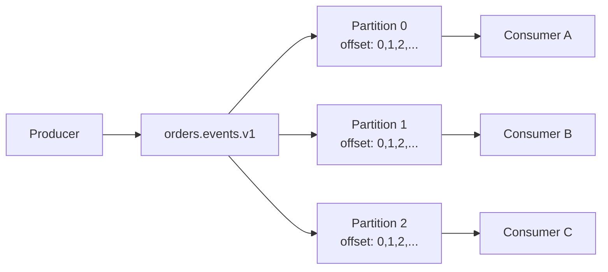
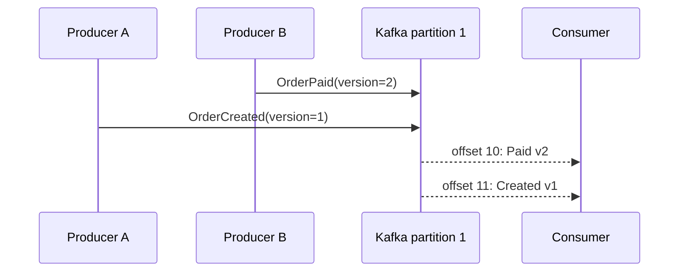
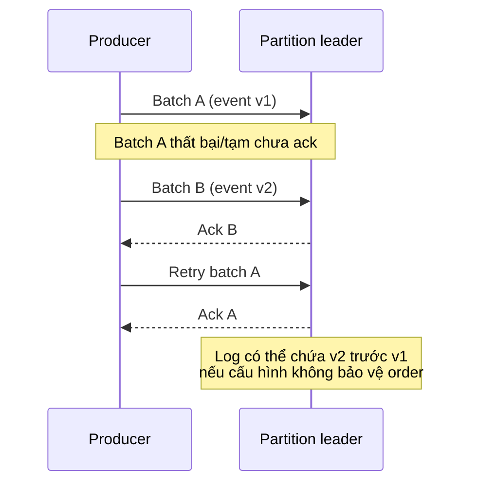
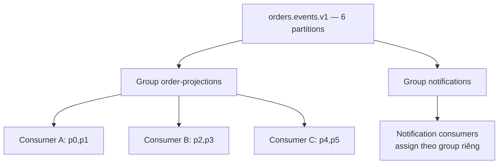
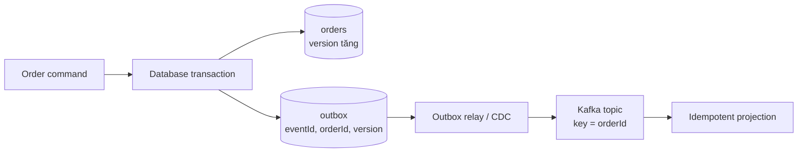

# Topic, partition, key và bảo đảm thứ tự theo khóa

## 1. Bối cảnh: vì sao thứ tự sự kiện có ý nghĩa nghiệp vụ?

Giả sử `order-service` ghi các thay đổi của một đơn hàng:

```text
OrderCreated(orderId=ORD-42, version=1)
OrderPaid(orderId=ORD-42, version=2)
OrderShipped(orderId=ORD-42, version=3)
```

`notification-service` có thể gửi thông báo sau thanh toán, còn `search-indexer` cập nhật trạng thái đơn hàng trong Elasticsearch. Nếu một consumer áp dụng `OrderShipped` trước `OrderPaid` mà không có quy tắc kiểm soát version, trạng thái hiển thị có thể bị ghi lùi hoặc một bước nghiệp vụ bị thực hiện sai thời điểm.

Apache Kafka ghi record vào **topic** được chia thành nhiều **partition**. Record có **key** tùy chọn. Khi mọi event của cùng đơn hàng dùng một key ổn định và được định tuyến vào cùng partition, consumer có thể đọc chúng theo **thứ tự offset của partition**. Đây là công cụ mạnh để tổ chức tích hợp, nhưng không phải lời hứa “mọi event trong hệ thống đều đúng thứ tự”.

Bài học thuộc chương **Apache Kafka** của module **SPRING_BOOT_INTEGRATION**: chúng ta xét cách cấu hình producer/consumer trong Spring Boot, hợp đồng event, tính nhất quán với database/outbox, retry, xử lý trùng, kiểm thử và quan sát vận hành. Mục tiêu là hiểu **Kafka bảo đảm điều gì**, đồng thời biết phải tự thiết kế thêm điều gì để business state không sai.

**Sau bài học, bạn có thể:**

1. Phân biệt topic, partition, offset, key, leader/replica và consumer group.
2. Giải thích chính xác bảo đảm thứ tự **bên trong một partition**, không phải giữa các partition.
3. Chọn message key theo aggregate/business ID, hiểu routing và các nguyên nhân cùng key có thể chuyển partition.
4. Dùng `KafkaTemplate` và `@KafkaListener` trong Spring Boot để gửi/nhận event có key.
5. Cấu hình producer idempotence, acknowledgment, retries và giới hạn in-flight để tránh đảo thứ tự do retry.
6. Thiết kế consumer tuần tự theo partition, idempotency và version guard cho redelivery/out-of-order.
7. Mở rộng số partition, theo dõi hot partition/consumer lag và kiểm thử thứ tự một cách thực tế.

> **Phạm vi phiên bản:** Ví dụ sử dụng Java 17+, Spring Boot 3.x, Spring for Apache Kafka 3.x và Apache Kafka tương thích với BOM của dự án. Spring Boot 4.x/Spring Kafka 4.x và các phiên bản Kafka client mới có thể thay đổi defaults/thuộc tính liên quan partitioner; hãy kiểm tra tài liệu phiên bản thực tế. Những topic, endpoint và business IDs trong bài là ví dụ.

## 2. Topic, partition, offset và key là gì?

| Khái niệm | Giải thích | Ví dụ |
| --- | --- | --- |
| **Topic** | Luồng/log logic của các record cùng loại hoặc cùng contract. | `orders.events.v1` |
| **Partition** | Một phần log có thứ tự offset riêng, phân bố trên broker. | Partition 0, 1, 2 |
| **Offset** | Vị trí tăng dần của một record **trong một partition**. | Partition 2, offset 184 |
| **Record key** | Chuỗi bytes tùy chọn dùng để phân vùng và/hoặc định danh bản ghi. | `ORD-42` |
| **Record value** | Nội dung event hoặc command, theo schema/hợp đồng. | JSON `OrderPaid` |
| **Leader** | Replica của partition đang tiếp nhận hoạt động ghi/đọc theo mô hình cluster. | Broker 1 là leader partition 2 |
| **Replica / ISR** | Bản sao của partition; ISR là tập replica đang đồng bộ theo tiêu chí Kafka. | Replication factor 3 |
| **Consumer group** | Nhóm consumer chia nhau các partition của cùng topic. | `order-projections` |
| **Committed offset** | Vị trí tiến độ consumer group đã lưu để tiếp tục sau restart/rebalance. | Group đã xử lý đến một offset nhất định |

Topic là **đơn vị phân loại dữ liệu**; partition là **đơn vị ghi log có thứ tự và phân phối song song**. Offset không có ý nghĩa toàn topic: offset 100 của partition 0 không có quan hệ “sớm hơn” offset 90 của partition 3.

### 2.1. Sơ đồ một topic có ba partition



Sơ đồ minh họa phân công khi group có đủ consumer/partition; **không** có nghĩa mỗi partition nhất thiết nằm trên một broker khác hoặc bắt buộc một consumer process riêng. Một consumer có thể được gán nhiều partition.

### 2.2. Record có thể chứa gì?

Một Kafka record gồm các thành phần như:

```text
topic      = orders.events.v1
partition  = 2
offset     = 184
key        = "ORD-42"
value      = {"eventId":"evt-42-2","orderId":"ORD-42",
              "version":2,"type":"OrderPaid"}
headers    = content-type, correlation-id, schema-version, ...
timestamp  = thời gian record theo cấu hình Kafka
```

Key và value đều đi qua serializer, về bản chất thành bytes. Kafka không hiểu business meaning của `orderId` hoặc `version` chỉ vì chúng xuất hiện trong JSON. **Kafka partitioner chỉ thấy key bytes và cấu hình định tuyến**, không tự sắp xếp theo field `version` bên trong payload.

## 3. Kafka bảo đảm thứ tự chính xác đến đâu?

Kafka lưu record theo **thứ tự append vào log của từng partition**. Consumer đọc partition đó theo offset tăng dần trong điều kiện tiêu thụ thông thường.

```text
orders.events.v1

Partition 0:  [offset 40, key=ORD-07, Created]
              [offset 41, key=ORD-07, Paid]
              [offset 42, key=ORD-07, Shipped]

Partition 1:  [offset 71, key=ORD-42, Created]
              [offset 72, key=ORD-42, Paid]

Partition 2:  [offset 18, key=ORD-99, Created]
              [offset 19, key=ORD-99, Cancelled]
```

Với cấu hình key routing ổn định, toàn bộ event của `ORD-42` có thể cùng nằm trên partition 1 nên consumer thấy lần lượt offset 71, rồi 72. Tuy nhiên:

1. Không có **thứ tự tổng quát giữa partition 0 và partition 1**.
2. Không có bảo đảm thứ tự xuyên **hai topic khác nhau**, ngay cả khi cùng key.
3. Kafka chỉ ghi theo **thứ tự record đến broker/partition**, không tự phát hiện `version=2` được producer gửi trước `version=1`.
4. Thứ tự **đọc record** chưa chắc là thứ tự **hoàn thành side effect**, nếu consumer tự xử lý bất đồng bộ.
5. Retry, rebalance, replay/DLT có thể làm cùng record được xử lý nhiều lần; **ordered log không đồng nghĩa exactly-once business processing**.

### 3.1. Ví dụ phản chứng: key giống nhau nhưng publish sai trước

Hai service replica cùng tạo event cho `ORD-42`:



Kafka đã làm đúng: offset 10 đến trước offset 11. Nhưng nghiệp vụ sai nếu yêu cầu Created → Paid. Cần kiểm soát **thứ tự phát hành ở nguồn** hoặc chặn ghi lùi ở consumer bằng aggregate version.

### 3.2. Ba loại “thứ tự” phải phân biệt

| Loại thứ tự | Ai chịu trách nhiệm? | Bảo đảm |
| --- | --- | --- |
| Thứ tự append trong partition | Kafka broker/log và producer protocol. | Offset tăng dần theo partition. |
| Thứ tự event được publish theo business version | Application/outbox publisher. | Phải thiết kế khi có nhiều writer/relay. |
| Thứ tự side effect đã commit | Consumer và database/business service. | Phải bảo vệ bằng xử lý tuần tự, version, transaction/idempotency. |

Tuyên bố “cùng key nên đúng thứ tự” chỉ có ý nghĩa khi **cả ba lớp** được xét.

## 4. Message key quyết định định tuyến ra sao?

Trong các cấu hình producer thông thường, khi record **có key** và không chỉ định partition rõ ràng, partitioner chọn partition theo key bytes và số lượng partition hiện có. Nhiều Kafka client Java dùng cách hash key ổn định trong điều kiện cùng cấu hình, giúp **cùng key → cùng partition**.

```text
partition = partitioner(serializedKey, availablePartitions, configuration)

Với key "ORD-42" và 6 partitions:
  "ORD-42" -> một partition cố định khi routing conditions không đổi
```

Không nên ghi công thức modulo duy nhất như một chuẩn bất biến cho mọi phiên bản/partitioner. Kafka client có thể dùng partitioner mặc định, custom partitioner, partition được chỉ định tường minh hoặc cấu hình bỏ qua key, chẳng hạn `partitioner.ignore.keys` trong những phiên bản hỗ trợ.

### 4.1. Điều kiện để cùng key ở cùng partition

1. Producer gửi record tới **cùng topic**.
2. **Key bytes** giống nhau, không chỉ nhìn giống về ý nghĩa.
3. Số partition không thay đổi trong khoảng đang cần bảo đảm.
4. Cùng chính sách partitioner; không có một producer dùng custom partitioner còn producer khác dùng mặc định.
5. Không đặt explicit partition khác nhau và không bật cấu hình làm key bị bỏ qua khi chọn partition.

Nếu bất kỳ điều kiện nào bị phá vỡ, các record cùng business key có thể ở nhiều partition; consumer group có thể xử lý chúng song song và không còn ordering per key theo cách mong đợi.

### 4.2. Key là bytes: chuẩn hóa phải nhất quán

```text
"ord-42"  !=  "ORD-42"
"ORD-42"  !=  "ORD-42 "
"00123"   !=  "123"
"tenantA:42" != "tenantB:42"
```

Ví dụ:

- Nếu business ID không phân biệt hoa/thường, tất cả producer phải áp một quy tắc canonicalization **trước khi serialize**.
- Nếu có multi-tenant, dùng composite key không nhập nhằng, ví dụ một encoding ổn định của `tenantId` và `orderId`, thay vì nối chuỗi tùy ý có thể va chạm.
- Cùng một chuỗi với hai serializer/encoding không tương thích có thể sinh bytes khác nhau.
- Không dùng random UUID mới làm record key cho mọi event nếu cần thứ tự theo `orderId`.

**Key không nhất thiết duy nhất cho từng event.** Với `OrderCreated`, `OrderPaid` và `OrderShipped` của một đơn, việc lặp lại key `ORD-42` là **đúng mục tiêu phân vùng**. Event ID phải là một field riêng và duy nhất để chống xử lý trùng.

### 4.3. Key null thì sao?

Khi key là `null`, producer có thể phân phối record qua các partition theo thuật toán của client nhằm cân bằng batching/throughput. Điều đó phù hợp cho log không yêu cầu thứ tự theo entity.

Nhưng nếu:

```java
kafkaTemplate.send("orders.events.v1", jsonValue);
```

không cung cấp key, hai event của cùng đơn hàng có thể tới các partition khác nhau. **Đừng suy luận từ việc test local vô tình nhận đúng thứ tự rằng thiết kế không key được bảo đảm**.

### 4.4. Key không phải field partition duy nhất

Kafka record có thể chỉ định partition trực tiếp:

```java
// Ví dụ ý tưởng; cần tạo ProducerRecord và dùng KafkaTemplate.send(record).
ProducerRecord<String, String> record =
    new ProducerRecord<>(
        "orders.events.v1", 0, "ORD-42", "{\"type\":\"OrderPaid\"}"
    );
```

Khi đặt partition 0 tường minh, key `ORD-42` **không buộc** record đi theo kết quả hash mặc định. Không trộn các producer có cách chọn partition khác nhau nếu contract ordering dựa trên key.

## 5. Chọn key theo đơn vị cần giữ thứ tự

Đặt câu hỏi: “Những event nào bắt buộc phải được xử lý tuần tự với nhau?”

| Nghiệp vụ | Key nên cân nhắc | Ý nghĩa |
| --- | --- | --- |
| Trạng thái một đơn hàng | `orderId` | Các cập nhật cùng đơn vào cùng partition. |
| Biến động một tài khoản | `accountId` | Giữ chuỗi biến động theo tài khoản. |
| Cập nhật tồn kho một SKU tại một kho | `warehouseId + sku` đã encode ổn định | Giữ thứ tự thay đổi cho cặp kho–SKU. |
| Một phiên làm việc | `sessionId` | Theo dõi trạng thái của session. |
| Dữ liệu multi-tenant | `tenantId + aggregateId` | Tránh va chạm ID giữa tenant. |
| Telemetry độc lập không có entity ordering | Có thể null hoặc key theo thiết bị tùy nhu cầu | Tối ưu phân phối/batching. |

### 5.1. Key quá rộng gây hot partition

Nếu mọi order của một tenant lớn dùng `tenantId` làm key, toàn bộ traffic tenant đó có thể tập trung vào **một partition**. Dù topic có 100 partition, một khóa nóng vẫn chỉ khai thác năng lực xử lý tuần tự của một partition (theo cấu hình routing ổn định).

Chọn `orderId` thay vì `tenantId` khi chỉ cần thứ tự bên trong từng đơn hàng. Đừng “salt” key ngẫu nhiên để rải traffic nếu nghiệp vụ yêu cầu giữ thứ tự của key gốc; salt sẽ phá ordering nếu consumer không bổ sung một tầng sắp xếp có trạng thái.

### 5.2. Khi key quá hẹp

Nếu nghiệp vụ yêu cầu hai đơn hàng cùng một **tài khoản thanh toán** được trừ số dư theo thứ tự, key `orderId` có thể quá hẹp: mỗi đơn đi một partition và xử lý song song. Khi invariant nằm ở account balance, cần key theo account hoặc một giao dịch DB/ledger có concurrency control độc lập.

**Chọn key theo aggregate consistency boundary**, không chỉ theo cột dễ lấy nhất. Đây là quyết định về throughput và domain design.

### 5.3. Thay đổi key là migration hợp đồng

Đổi từ `customerId` sang `orderId` sẽ thay cách chia partition, khả năng song song và ordering. Nếu topic đang có record cũ theo routing cũ, việc deploy producer/consumer mới không làm record cũ “di chuyển” sang partition mới. Cần phương án rollout, chuyển version/topic, checkpoint và version guard để tránh xử lý chồng chéo.

## 6. Thiết kế topic và số partition

### 6.1. Partition liên hệ gì với throughput?

Với một consumer group, các partition là đơn vị phân công công việc. Nếu topic có 6 partition:

- Group có 1 consumer: consumer đó có thể đọc cả 6 partition.
- Group có 3 consumer: thường mỗi consumer được gán khoảng 2 partition.
- Group có 6 consumer: mỗi consumer có thể sở hữu 1 partition.
- Group có 10 consumer: tối đa 6 consumer có partition để đọc; những instance còn lại có thể idle.

Số thread/consumer hoạt động hữu ích phụ thuộc số partition, nhưng **thêm partition không bảo đảm throughput tuyến tính** vì DB, API downstream, network và các key nóng vẫn là bottleneck.

### 6.2. Tạo topic bằng Spring Kafka `NewTopic`

```java
// KafkaTopicConfiguration.java
import org.apache.kafka.clients.admin.NewTopic;
import org.springframework.context.annotation.Bean;
import org.springframework.context.annotation.Configuration;
import org.springframework.kafka.config.TopicBuilder;

@Configuration(proxyBeanMethods = false)
public class KafkaTopicConfiguration {

    @Bean
    NewTopic orderEventsTopic() {
        return TopicBuilder.name("orders.events.v1")
            .partitions(6)
            .replicas(1) // Chỉ phù hợp môi trường local một broker.
            .build();
    }
}
```

Khi có `KafkaAdmin` từ Spring Boot auto-configuration và đủ quyền, bean `NewTopic` có thể được dùng để tạo topic. Trong production, nhiều tổ chức quản lý topic bằng IaC/cluster administration và không cấp quyền tạo topic cho runtime service.

**Không copy replication factor 1 lên production.** Với cluster có đủ broker, replication factor 3 và `min.insync.replicas` phù hợp (ví dụ 2) thường được cân nhắc để tăng độ bền; cần đánh giá khả năng sẵn sàng, chi phí và chính sách nhà vận hành.

### 6.3. Replica không tăng số partition xử lý song song

Replication factor 3 nghĩa là có ba bản sao của **mỗi partition** theo placement của Kafka. Nó **không** biến một partition thành ba partition độc lập cho một consumer group. Ordering vẫn theo offset partition logic.

| Cấu hình | Mục đích | Đừng nhầm |
| --- | --- | --- |
| `partitions` | Song song hóa đọc/ghi và phân chia key. | Không phải số broker. |
| `replication.factor` | Có bản sao để phục hồi khi broker lỗi. | Không nhân throughput consumer theo cùng một partition. |
| `min.insync.replicas` | Yêu cầu số replica đồng bộ tối thiểu để ghi thành công với `acks=all`. | Không tự tạo replica hay thay thế monitoring ISR. |
| `retention.ms/bytes` | Giữ log theo thời gian/dung lượng. | Không phải bảo đảm giữ mọi record vĩnh viễn. |
| `cleanup.policy` | Xóa theo retention hoặc compaction. | Compaction có thể loại các phiên bản cũ của cùng key. |

### 6.4. Tăng số partition có thể đổi mapping của key

Giả sử key `ORD-42` được route tới partition 1 khi topic có 3 partition. Sau khi tăng lên 6 partition, cùng key có thể được route tới partition 4 bởi thuật toán phân vùng tương ứng:

```text
Trước khi mở rộng:
  ORD-42 v1 -> partition 1, offset 100
  ORD-42 v2 -> partition 1, offset 101

Sau khi mở rộng:
  ORD-42 v3 -> partition 4, offset 1

Consumer A đọc partition 1, consumer B đọc partition 4:
  Không còn một log/consumer duy nhất giữ thứ tự xuyên v2 và v3.
```

**Quan trọng:** tăng partition count trên topic có key ordering là **thay đổi kiến trúc có rủi ro về thứ tự**, không chỉ thao tác scale “vô hại”. Kafka không tự di chuyển record cũ sang partition mới và không cho giảm partition count bằng thao tác admin thông thường.

Những lựa chọn khi cần mở rộng:

1. **Plan từ đầu:** chọn số partition đủ cho tăng trưởng dự kiến, tránh mở rộng trong lúc giữ nghiêm ngặt ordering.
2. **Chuyển sang topic version mới:** producer/consumer đổi sang topic có partition count mới, có checkpoint/cutover hợp lệ.
3. **Đóng băng ghi và drain:** nếu vận hành cho phép, đảm bảo không còn in-flight/các event cũ trước khi chuyển routing.
4. **Version guard ở consumer:** bảo vệ trạng thái khỏi event cũ ghi lùi; vẫn phải xử lý gap nếu event là delta.
5. **Custom partitioning ổn định theo key:** có thể có chiến lược riêng, nhưng phải thiết kế mapping và compatibility trước khi áp dụng.

Không có một cách chuyển partition count “tự động giữ nguyên thứ tự mọi key” cho mọi hệ thống.

## 7. Producer Spring Boot: cấu hình serialization và durability

### 7.1. Dependency

```xml
<!-- pom.xml với Spring Boot parent/BOM -->
<dependency>
    <groupId>org.springframework.kafka</groupId>
    <artifactId>spring-kafka</artifactId>
</dependency>
<dependency>
    <groupId>org.springframework.boot</groupId>
    <artifactId>spring-boot-starter-test</artifactId>
    <scope>test</scope>
</dependency>
<dependency>
    <groupId>org.springframework.kafka</groupId>
    <artifactId>spring-kafka-test</artifactId>
    <scope>test</scope>
</dependency>
```

Spring Boot auto-configures `KafkaTemplate`, producer/consumer factories và listener containers khi dependency/cấu hình phù hợp. Nếu dùng serializers typed JSON, cần cấu hình serdes/trusted packages/schema rõ ràng; ví dụ dưới dùng **key String và value JSON String** để người học nhìn thấy việc key được truyền vào Kafka.

### 7.2. `application.yml` tối thiểu có idempotent producer

```yaml
spring:
  kafka:
    bootstrap-servers: ${KAFKA_BOOTSTRAP_SERVERS:localhost:9092}
    producer:
      key-serializer: org.apache.kafka.common.serialization.StringSerializer
      value-serializer: org.apache.kafka.common.serialization.StringSerializer
      acks: all
      retries: 10
      properties:
        enable.idempotence: true
        max.in.flight.requests.per.connection: 5
        delivery.timeout.ms: 120000
        request.timeout.ms: 30000
    consumer:
      group-id: order-projections
      key-deserializer: org.apache.kafka.common.serialization.StringDeserializer
      value-deserializer: org.apache.kafka.common.serialization.StringDeserializer
      enable-auto-commit: false
      auto-offset-reset: earliest
    listener:
      ack-mode: record
```

Giải thích:

- `bootstrap-servers` là tập broker đầu tiên để client khám phá cluster, không bắt buộc liệt kê mọi broker; metadata broker trả về phải có địa chỉ `advertised.listeners` mà ứng dụng thực sự truy cập được.
- `key-serializer` và `value-serializer` xác định bytes ghi vào Kafka. Chọn kiểu ổn định giữa các producer.
- `acks=all` yêu cầu acknowledgment dựa trên các replica đồng bộ theo cấu hình; độ bền thực tế còn phụ thuộc replication, ISR và chính sách cluster.
- `enable.idempotence=true` cho phép cơ chế producer idempotence chống duplicate do producer retry trong phạm vi bảo đảm của protocol/session.
- `max.in.flight.requests.per.connection=5` tương thích với Kafka idempotent producer; kết hợp `acks=all` và retries > 0 theo yêu cầu của tính năng.
- `delivery.timeout.ms` là ngân sách của producer cho việc gửi record, có quan hệ với request timeout và retry; không phải TTL của business command.
- `enable-auto-commit=false` để listener container quản lý tiến độ theo ack mode; không commit offset theo timer độc lập với xử lý.
- `ack-mode=record` biểu thị commit/ghi nhận offset sau khi listener xử lý từng record thành công theo semantics của Spring Kafka container.

**Không suy ra** rằng những settings trên tạo thành transaction giữa PostgreSQL và Kafka. Idempotent producer và Kafka transactions có phạm vi khác với business idempotency.

### 7.3. `auto-offset-reset=earliest` có nghĩa gì?

Giá trị `earliest` chủ yếu áp dụng khi group **chưa có offset hợp lệ** cho partition. Nó không tự “replay từ đầu” cho group đã có committed offsets. Muốn replay cần nhóm mới hoặc quy trình reset/seek offset có kiểm soát, kết hợp idempotency và trách nhiệm xử lý lại.

## 8. Gửi event có key bằng `KafkaTemplate`

### 8.1. Định nghĩa event contract

```java
// OrderChanged.java
package com.example.kafka;

import java.time.Instant;

public record OrderChanged(
    String eventId,
    String orderId,
    long aggregateVersion,
    String status,
    Instant occurredAt
) {}
```

Một event thực tế nên có:

| Trường | Ý nghĩa |
| --- | --- |
| `eventId` | Định danh duy nhất của event để chống xử lý lặp. |
| `orderId` | Aggregate key dùng cho Kafka partitioning. |
| `aggregateVersion` | Thứ tự thay đổi nghiệp vụ trên đơn hàng. |
| `status` | Snapshot trạng thái đơn ở version này. |
| `occurredAt` | Thời điểm nghiệp vụ phát sinh, không phải thứ tự tin cậy tuyệt đối. |

**Không dùng timestamp làm thay thế version:** hai producer có thể lệch đồng hồ, timestamp có thể trùng hoặc event được phát trễ. Nếu nghiệp vụ cần tuần tự, version nên do nguồn dữ liệu/giao dịch sở hữu và tăng nhất quán.

### 8.2. Producer service

```java
// OrderEventPublisher.java
package com.example.kafka;

import com.fasterxml.jackson.core.JsonProcessingException;
import com.fasterxml.jackson.databind.ObjectMapper;
import java.util.concurrent.CompletableFuture;
import org.springframework.kafka.core.KafkaTemplate;
import org.springframework.kafka.support.SendResult;
import org.springframework.stereotype.Service;

@Service
public class OrderEventPublisher {
    public static final String TOPIC = "orders.events.v1";

    private final KafkaTemplate<String, String> kafkaTemplate;
    private final ObjectMapper mapper;

    public OrderEventPublisher(
        KafkaTemplate<String, String> kafkaTemplate,
        ObjectMapper mapper
    ) {
        this.kafkaTemplate = kafkaTemplate;
        this.mapper = mapper;
    }

    public CompletableFuture<SendResult<String, String>> publish(
        OrderChanged event
    ) throws JsonProcessingException {
        if (event.orderId() == null || event.orderId().isBlank()
            || event.eventId() == null || event.eventId().isBlank()
            || event.aggregateVersion() <= 0) {
            throw new IllegalArgumentException("Order event không hợp lệ");
        }

        String json = mapper.writeValueAsString(event);

        // Key là orderId; cùng order được route vào cùng partition
        // khi partition count và routing configuration giữ ổn định.
        return kafkaTemplate.send(TOPIC, event.orderId(), json);
    }
}
```

`KafkaTemplate.send(topic, key, value)` trong Spring Kafka 3.x trả `CompletableFuture<SendResult<K,V>>`. Đây là tương tác producer **bất đồng bộ**: gọi `publish` trả future không đồng nghĩa broker đã ack record.

### 8.3. Quan sát kết quả broker acknowledgment

```java
publisher.publish(event).whenComplete((result, error) -> {
    if (error != null) {
        // Phân loại lỗi/ghi audit để retry theo outbox;
        // không log raw payload chứa dữ liệu nhạy cảm.
        log.warn("Kafka publish failed for eventId={}",
            event.eventId(), error);
        return;
    }

    var metadata = result.getRecordMetadata();
    log.info("Published topic={} partition={} offset={}",
        metadata.topic(), metadata.partition(), metadata.offset());
});
```

Ở đây `publisher`, `event` và `log` là thành phần của service/caller. Callback phải được kết nối với cơ chế hoàn tất công việc bền vững nếu đây là outbox relay. **Một dòng log thành công không phải transaction commit cho outbox** và không thay việc cập nhật trạng thái publish trong database.

Nếu producer đã gửi record nhưng response acknowledgment bị mất, caller có thể không biết broker đã ghi hay chưa. Việc publish lại cùng event ID ở tầng ứng dụng vẫn có thể tạo một record thứ hai; consumer phải idempotent.

### 8.4. Nên đặt key vào header hay record key?

Để partitioner dùng ID, phải đặt nó vào **Kafka record key**, như tham số thứ hai của `send(topic, key, value)` hoặc header Kafka được adapter/serializer dịch sang key đúng cách. Chỉ đặt `orderId` trong JSON body hoặc một Spring Messaging header tùy ý **không** tự buộc Kafka producer dùng field đó làm key.

Với Spring Kafka annotations/message converters, kiểm tra chính xác mapping của `KafkaHeaders.KEY` hoặc `ProducerRecord.key()` trước khi tuyên bố có per-key routing.

## 9. Producer retries, in-flight requests và idempotence

Một câu hỏi phổ biến: “Nếu producer gửi v1 rồi v2 cùng key thì Kafka luôn có v1 trước v2 chứ?”

**Câu trả lời có điều kiện.** Với một producer và partition ổn định, Kafka client được cấu hình phù hợp để giữ thứ tự record, nhưng retries/in-flight/producer concurrency có thể ảnh hưởng kết quả nếu thiết lập sai hoặc nguồn gọi đã sắp xếp sai.

### 9.1. Rủi ro retry khi không bật idempotence



Với producer không idempotent, cho nhiều request in-flight và có retry, một batch sau có thể được ghi trước batch trước bị retry. Giảm `max.in.flight.requests.per.connection` về 1 là một cách bảo vệ thứ tự trong những cấu hình producer nhất định, nhưng giảm throughput.

### 9.2. Idempotent producer giúp gì?

Khi `enable.idempotence=true` với cấu hình tương thích:

- Kafka sử dụng producer identity/sequence numbers để nhận biết retry duplicate của producer.
- Producer giữ trật tự record trên từng partition theo những giới hạn in-flight được Kafka hỗ trợ (thông thường `max.in.flight.requests.per.connection ≤ 5`).
- `acks=all` và retries phù hợp là điều kiện của cơ chế idempotent producer.

**Không được nâng phạm vi:** producer idempotence **không** bảo đảm một business command chỉ tạo một event khi:

1. Ứng dụng gọi `publish(event)` hai lần một cách độc lập.
2. Process restart rồi outbox relay publish lại event đã ack nhưng chưa mark `DONE`.
3. Hai producer replicas cùng phát event cho một aggregate.
4. Consumer xử lý xong rồi crash trước commit offset và nhận lại record.

Những trường hợp đó cần event ID ổn định, outbox/inbox, unique constraints và xử lý event version.

### 9.3. `acks=all`, replication và durability

| Thiết lập | Tác dụng | Giới hạn |
| --- | --- | --- |
| `acks=0` | Producer không chờ broker xác nhận. | Không biết record đã được ghi hay chưa. |
| `acks=1` | Leader xác nhận khi leader ghi theo policy. | Có rủi ro khi leader mất trước khi replica kịp bắt theo. |
| `acks=all` | Chờ acknowledgment theo in-sync replicas. | Độ bền còn phụ thuộc replication factor, ISR, `min.insync.replicas`, cluster failure settings. |
| `enable.idempotence=true` | Chống duplicate do producer retry ở mức protocol. | Không tự chống app-level republish hoặc consumer redelivery. |
| `delivery.timeout.ms` | Giới hạn khoảng thời gian producer cố giao record. | Timeout không nói chắc record chưa được append. |

Một topic replication factor 1 với `acks=all` vẫn chỉ có một bản sao dữ liệu. Muốn độ bền cao cần thiết kế replication và failure domain đúng, không chỉ sửa producer config.

### 9.4. Nhiều producer cùng key

Ngay cả khi **mỗi producer đều idempotent**, hai producers A/B gửi event cùng `orderId` không được Kafka tự sắp theo `aggregateVersion`. Kafka chỉ có thứ tự append thực nhận. Nếu business yêu cầu v1 trước v2, nguồn phát cần serialized publication theo aggregate hoặc consumer version guard/buffer với quy tắc gap rõ ràng.

## 10. Consumer group, partition ownership và concurrency

Mỗi partition trong một consumer group thường được gán cho **một consumer member tại một thời điểm** theo cơ chế group assignment; một member có thể sở hữu nhiều partition. Những consumer group khác nhau có tiến độ độc lập và có thể đọc cùng event cho các mục đích khác nhau.



**Consumer concurrency không đồng nghĩa một partition bị đọc song song bởi nhiều members của cùng group**. Spring Kafka có thể tạo nhiều Kafka consumers qua `@KafkaListener(concurrency=...)`; hiệu quả song song bị giới hạn bởi partition assignments và bottleneck downstream.

### 10.1. `@KafkaListener` lấy key/partition/offset

```java
// OrderProjectionListener.java
package com.example.kafka;

import com.fasterxml.jackson.core.JsonProcessingException;
import com.fasterxml.jackson.databind.ObjectMapper;
import org.apache.kafka.clients.consumer.ConsumerRecord;
import org.springframework.kafka.annotation.KafkaListener;
import org.springframework.stereotype.Component;

@Component
public class OrderProjectionListener {
    private final ObjectMapper mapper;
    private final OrderProjectionService projections;

    public OrderProjectionListener(
        ObjectMapper mapper,
        OrderProjectionService projections
    ) {
        this.mapper = mapper;
        this.projections = projections;
    }

    @KafkaListener(
        topics = OrderEventPublisher.TOPIC,
        groupId = "order-projections",
        concurrency = "3"
    )
    public void onRecord(ConsumerRecord<String, String> record)
        throws JsonProcessingException {

        OrderChanged event = mapper.readValue(
            record.value(), OrderChanged.class
        );

        if (record.key() == null
            || !record.key().equals(event.orderId())) {
            throw new IllegalArgumentException(
                "Kafka key không khớp orderId"
            );
        }

        // Xử lý đồng bộ đến lúc DB commit hoặc ném lỗi.
        // Không tự subscribe() rồi return ngay.
        projections.apply(event);
    }
}
```

`OrderProjectionService` là thành phần do ứng dụng định nghĩa, có method `apply(OrderChanged event)` ghi projection theo version trong transaction. Ví dụ không cấu hình retry/DLT cụ thể; phải bổ sung theo chính sách từng lỗi, đặc biệt JSON malformed, database timeout và event version gap.

### 10.2. Đồng bộ bên trong listener và thứ tự hoàn tất

Nếu listener xử lý record đồng bộ, chờ database commit rồi mới trả:

```text
Partition p2:
  offset 10 -> parse -> DB commit -> return
  offset 11 -> parse -> DB commit -> return
```

Khi đó mỗi partition được xử lý theo trình tự poll/dispatch thông thường. Nhưng đoạn sau có thể phá ordering của **side effect**:

```java
// RỦI RO: fire-and-forget; listener trả về ngay.
@KafkaListener(topics = "orders.events.v1")
void handle(ConsumerRecord<String, String> record) {
    executor.execute(() -> processSlowly(record.value()));
}
```

Nếu offset 11 chạy nhanh hơn offset 10 trong executor, database có thể commit v2 trước v1. Container thậm chí có thể tiến offset trong khi task chưa xong. Nếu cần async processing, phải giới hạn và **serialize theo key/partition**, hoặc chuyển công việc sang durable inbox rồi bảo vệ version/ack rõ ràng.

### 10.3. `concurrency=3` không phải “ba thread cho mỗi key”

Khi key cố định vào partition p2, tại một thời điểm group thường chỉ có một consumer member sở hữu p2. Tăng `concurrency` lên 10 cho topic có 6 partition không thể giúp một hot key trên p2 được xử lý song song mà vẫn giữ thứ tự.

Đổi key để “rải đều” phải cân nhắc sự đánh đổi: có thể tăng throughput nhưng **mất ordering constraint** của aggregate gốc.

### 10.4. Kafka offset commit và side effect

Với listener `void` đồng bộ và ack mode phù hợp, nên để offset được xác nhận **sau** khi xử lý/commit nghiệp vụ hoàn tất. Nếu có exception, container error handler/retry/DLT quyết định xử lý tiếp theo; không được giả định cứ throw là broker sẽ replay vô hạn hoặc chắc chắn không mất message.

Nếu DB đã commit thành công nhưng consumer crash trước commit offset, record có thể được giao lại. Đây là tình huống phổ biến của at-least-once; **idempotent consumer** là bắt buộc khi side effect không được phép lặp.

## 11. Thứ tự nghiệp vụ: version guard trong database

Một thiết kế an toàn là gắn `aggregateVersion` tăng đơn điệu do database nguồn quản lý. Consumer lưu version cuối đã áp dụng và không cho event cũ ghi đè snapshot mới hơn.

### 11.1. Bảng projection

```sql
CREATE TABLE order_projection (
    order_id      VARCHAR(80) PRIMARY KEY,
    last_version  BIGINT NOT NULL,
    status        VARCHAR(30) NOT NULL,
    updated_at    TIMESTAMP NOT NULL DEFAULT CURRENT_TIMESTAMP
);
```

Nếu event chứa **snapshot trạng thái hoàn chỉnh** ở version tương ứng, có thể dùng PostgreSQL UPSERT:

```sql
INSERT INTO order_projection (
    order_id, last_version, status, updated_at
)
VALUES (:orderId, :version, :status, CURRENT_TIMESTAMP)
ON CONFLICT (order_id)
DO UPDATE SET
    last_version = EXCLUDED.last_version,
    status       = EXCLUDED.status,
    updated_at   = CURRENT_TIMESTAMP
WHERE order_projection.last_version < EXCLUDED.last_version;
```

Ý nghĩa:

- Event version 3 sau version 2 → cập nhật v3.
- Event version 2 đến lại khi DB đã v3 → không ghi lùi.
- Event version 3 lặp lại → không tạo thêm thay đổi nếu điều kiện strict `<` không thỏa.

Đây là **last-version-wins cho snapshot**, không phải lời giải cho mọi event. Nếu sự kiện là delta (ví dụ “cộng 5 vào số dư”), áp v3 khi chưa nhận v2 có thể mất thay đổi v2. Với delta/transition bắt buộc đủ bước, chỉ cho apply version kế tiếp, hoặc buffer/parking event bị gap rồi đợi event thiếu.

### 11.2. Xử lý event theo delta khác snapshot

| Kiểu event | Có thể bỏ qua version cũ? | Điều kiện |
| --- | --- | --- |
| Snapshot đầy đủ: `OrderStatusChanged(status=SHIPPED, version=3)` | Thường có, theo business contract. | Snapshot đủ để tái dựng trạng thái; không có side effect riêng của từng bước. |
| Delta: `BalanceDebited(amount=50, version=3)` | Không thể tùy ý bỏ qua v2. | Phải xử lý liên tiếp hoặc reconcile từ nguồn chân lý. |
| Notification “gửi email cho event” | Có thể bỏ lỡ thông báo nếu skip. | Cần inbox `eventId` và chính sách replay/compensation. |
| Reindex document từ event mới nhất | Có thể dùng version guard. | Có snapshot/nguồn dữ liệu đủ để rebuild. |

### 11.3. Inbox và unique event ID

Nếu consumer phải thực hiện side effect một lần cho **mỗi event**, chỉ lưu `last_version` có thể không đủ. Có thể có bảng:

```sql
CREATE TABLE processed_events (
    consumer_name VARCHAR(100) NOT NULL,
    event_id      VARCHAR(160) NOT NULL,
    processed_at  TIMESTAMP NOT NULL DEFAULT CURRENT_TIMESTAMP,
    PRIMARY KEY (consumer_name, event_id)
);
```

Trong cùng **local database transaction**, consumer thử ghi marker và áp business change. Nếu unique key đã tồn tại, kiểm tra bản ghi cũ và bỏ side effect trùng. Nếu transaction rollback, marker cũng rollback để record có thể được xử lý lại.

Kafka offset commit **không** nằm trong transaction PostgreSQL thông thường. Sau commit DB nhưng trước offset commit có thể nhận lại record; unique marker/sequence guard bảo vệ side effect.

## 12. Thứ tự ở producer: database và transactional outbox

Gửi Kafka event ngay sau khi ghi DB:

```text
BEGIN DB TRANSACTION
  UPDATE order
COMMIT
KafkaTemplate.send(event)
```

vẫn có cửa sổ lỗi: DB đã commit nhưng process crash trước `send`. Ngược lại, nếu publish trước commit rồi DB rollback, consumer thấy event “ma”.

**Transactional outbox** lưu business change và event cần phát trong cùng DB transaction. Một relay/CDC connector phát record sang Kafka sau khi giao dịch commit.



### 12.1. Outbox cần định danh và version ổn định

```text
event_id:         evt-ORD-42-3
aggregate_id:     ORD-42
aggregate_version:3
event_type:       OrderShipped
payload:          {...}
published:        false
```

Producer relay dùng `aggregate_id` làm Kafka key; không dùng `event_id` làm key nếu yêu cầu các event cùng order nằm chung partition.

### 12.2. Outbox không tự bảo đảm thứ tự khi nhiều relays chạy song song

Nếu relay A claim event v2 và chậm, relay B claim v3 rồi gửi trước, Kafka có thể ghi v3 trước v2, dù cả hai event đều nằm trong một outbox table.

Cần một trong các chiến lược:

- Chỉ một publisher có quyền phát theo từng aggregate hoặc shard được partition theo aggregate ID.
- Relay có logic claim/sequence bảo đảm không phát v(n+1) trước v(n) cho cùng aggregate.
- CDC theo transaction log với routing key và thiết kế phù hợp, nhưng vẫn phải hiểu thứ tự change events/parallelism của pipeline.
- Ở consumer, kiểm tra version và xử lý gap/late event theo semantics snapshot hay delta.

**Outbox giải quyết atomic ghi dữ liệu + event dự định phát, không tự động giải quyết mọi bài toán thứ tự, duplicate hay exactly-once.**

### 12.3. Kafka transaction không thay thế outbox PostgreSQL

Kafka producer transactions có thể giúp xử lý **read-process-write trong Kafka** cùng với offset theo các cơ chế của Kafka. Chúng **không** tạo một distributed ACID transaction giữa Kafka và PostgreSQL chỉ bằng một annotation trong Spring Boot. Nếu business DB là nguồn chân lý, outbox/inbox vẫn là giải pháp quan trọng khi phải đảm bảo không mất event qua crash.

## 13. Rebalance, replay, lỗi và dead-letter ảnh hưởng thứ tự

### 13.1. Consumer rebalance

Khi consumer gia nhập/rời group, broker thay assignment partition. Một partition có thể chuyển từ consumer A sang B. Committed offset quyết định B tiếp tục từ đâu; nếu A đã xử lý DB nhưng chưa commit offset, B có thể đọc lại record đó.

**Per-partition log vẫn có thứ tự offset**, nhưng thực thi nghiệp vụ có thể overlap nếu worker cũ còn background task sau khi mất quyền sở hữu. Nếu cần đảm bảo không ghi lùi, dùng version guard/fencing và không để tác vụ bất đồng bộ cũ commit kết quả tùy tiện.

### 13.2. Retry cùng partition

Khi offset 10 thất bại:

```text
offset 10: OrderPaid(v2) -> DB timeout
offset 11: OrderShipped(v3)
```

Nếu nghiệp vụ yêu cầu v2 trước v3, listener phải xử lý lỗi 10 phù hợp trước khi xác nhận/áp 11. Retry có backoff hữu hạn có thể xử lý tạm thời; với lỗi kéo dài, phải có chính sách parking/pause/replay để không vi phạm invariant.

### 13.3. DLT có thể làm thay đổi thứ tự xử lý nghiệp vụ

Giả sử offset 10 (v2) bị gửi tới dead-letter topic và consumer chính tiếp tục offset 11 (v3). Log gốc vẫn có 10 rồi 11, nhưng **side effect của v3 có thể hoàn tất trước v2**; khi replay DLT sau đó, v2 đến muộn.

| Chính sách | Ưu điểm | Đánh đổi |
| --- | --- | --- |
| Dừng/pause key/partition đến khi sửa lỗi | Giữ sequence chặt. | Một poison event có thể chặn nhiều key khác trong cùng partition. |
| Đẩy DLT rồi đi tiếp | Giữ throughput của phần lớn traffic. | Có thể tạo gap/out-of-order nghiệp vụ. |
| Snapshot + version guard | Có thể không ghi lùi projection. | Không phù hợp cho mọi delta/side effect theo từng event. |
| Parking có state per aggregate | Cô lập key có vấn đề, cho key khác tiến. | Tốn state, logic scheduling/ordering phức tạp. |

**Không có một chính sách retry/DLT tốt cho mọi event.** Cần định nghĩa xem mất một intermediate state có chấp nhận được không.

### 13.4. Retention và compaction

Kafka có thể xóa dữ liệu cũ theo retention. Với compacted topic, broker giữ bản gần nhất theo **record key** theo chính sách compaction, nhưng không hứa giữ toàn bộ lịch sử update mãi mãi.

- Event history yêu cầu replay từng thay đổi → thường cần log retention thích hợp (và archive nếu cần lâu hơn).
- Chỉ cần snapshot mới nhất theo key → compaction có thể phù hợp.
- Tombstone là record có key và value `null` trong compacted topics, được dùng cho delete semantics theo retention của tombstone.

Nếu ứng dụng cần `OrderCreated`, `OrderPaid` và `OrderShipped` để tái dựng mọi side effect, không được chuyển topic sang compaction mà không đánh giá mất intermediate events.

## 14. Mở rộng hệ thống mà không làm mất ý nghĩa key ordering

### 14.1. Hot partition

Một partition có thể nhận quá nhiều event vì:

- Một key nóng chiếm phần lớn traffic.
- Key distribution bị lệch, ví dụ mọi event có key `tenantA`.
- Producer dùng explicit partition hoặc custom partitioner thiếu cân bằng.
- Số partition ít so với số aggregate IDs và concurrency mong muốn.

Metric đáng xem là throughput/bytes/lag **theo partition**, không chỉ tổng topic.

### 14.2. Các cách tăng năng lực

| Biện pháp | Khi phù hợp | Điều phải giữ |
| --- | --- | --- |
| Tăng consumer instances đến số partition hữu ích | Consumer CPU/I/O là bottleneck. | Group assignment, DB pool/quota. |
| Tối ưu handler và DB writes | Query/side effect chậm. | Không biến xử lý tuần tự thành async unordered. |
| Chọn key hẹp hơn theo aggregate | Hiện dùng key quá rộng. | Invariant của domain thực sự chỉ yêu cầu per aggregate. |
| Tách traffic class/topic | Search indexing và payment ledger có SLO khác. | Không giả định có thứ tự xuyên topic. |
| Tăng partition count có migration | Đã dự trù cutover/ordering guard. | Key mapping có thể thay đổi; cần chiến lược chuyển. |
| Batching theo partition | Xử lý nhiều record tuần tự hiệu quả hơn. | Commit/ack đúng record và lỗi partial. |

Nếu **một account** cần xử lý 10.000 giao dịch/giây nhưng mọi giao dịch phải tuần tự tuyệt đối, đó là giới hạn domain cần giải quyết bằng thiết kế ledger/concurrency, không thể đơn giản thêm partition rồi giữ nguyên invariant.

### 14.3. Thứ tự giữa nhiều topics

Ví dụ:

```text
orders.created.v1   -> OrderCreated(ORD-42)
payments.paid.v1    -> PaymentCaptured(ORD-42)
shipping.sent.v1    -> OrderShipped(ORD-42)
```

Dù ba topic đều dùng key `ORD-42`, Kafka **không** cấp một offset chung hay bảo đảm consumer thấy Created → Paid → Shipped xuyên ba topics. Một orchestrator/state machine phải dựa vào business version, preconditions hoặc event-time semantics phù hợp. Nếu cần thứ tự chặt của một aggregate, cân nhắc **một event log/topic chung** với key aggregate ID và hợp đồng schema phù hợp, nhưng vẫn cần quản lý nguồn publish.

## 15. Các lỗi thiết kế key thường gặp

| Sai lầm | Hệ quả | Cách sửa |
| --- | --- | --- |
| Gửi `KafkaTemplate.send(topic, value)` mà cần thứ tự theo order | Record không có key, có thể đi các partition khác nhau. | Gửi `send(topic, orderId, value)`. |
| Dùng `eventId` làm Kafka key | Mỗi event một key, cùng order có thể chia partition. | Dùng aggregate ID làm key, eventId nằm trong payload/header. |
| Dùng `tenantId` khi chỉ cần per-order ordering | Tenant lớn gây hot partition. | Dùng composite key tenant+orderId. |
| Key có khoảng trắng/case/serializer khác nhau | Same business ID có key bytes khác. | Chuẩn hóa và contract encoding. |
| Tăng partitions từ 3 lên 6 giữa chừng | Same key có thể chuyển partition. | Migration/cutover và version guard. |
| Producer A và B dùng partitioner khác nhau | Same key route tới partition khác. | Đồng bộ client routing/serializer. |
| Trộn explicit partition với hash key | Một key nằm nhiều partition. | Chọn một chính sách partition. |
| Nhiều producer idempotent nhưng phát sai version | Kafka append đúng thứ tự đến, sai business order. | Outbox per-aggregate ordering và version checks. |
| Tăng listener concurrency rồi xử lý async tùy ý | Offset sau commit trước offset trước. | Tuần tự theo partition/key, durable inbox. |
| DLT v2 rồi áp v3 vô điều kiện | Gặp gap hoặc ghi lùi khi replay. | Chọn chính sách snapshot/delta/gap. |
| Tin producer idempotence là business exactly-once | App republish/restart vẫn có duplicate. | Event ID, inbox, unique key, replay tests. |
| Coi timestamp là sequence | Lệch đồng hồ và publish delay. | Aggregate version do nguồn quản lý. |
| Trộn compaction với yêu cầu replay từng event | Intermediate events có thể biến mất. | Chọn cleanup policy và retention theo hợp đồng. |

## 16. Kiểm thử producer: cùng key tới cùng partition

Kiểm thử nên đi từ **đơn vị định tuyến** đến **tương tác broker thật**. Unit test mock `KafkaTemplate` có thể xác minh key được truyền đúng, nhưng không chứng minh partitioner thực tế định tuyến theo mong đợi.

### 16.1. Kiểm thử với `@EmbeddedKafka`

Một ví dụ với Spring Kafka Test (cần test context có producer factory/template và topic thích hợp):

```java
// OrderKeyPartitionIntegrationTest.java
import static org.assertj.core.api.Assertions.assertThat;

import java.util.concurrent.TimeUnit;
import org.junit.jupiter.api.Test;
import org.springframework.beans.factory.annotation.Autowired;
import org.springframework.boot.test.context.SpringBootTest;
import org.springframework.kafka.test.context.EmbeddedKafka;
import org.springframework.kafka.core.KafkaTemplate;

@SpringBootTest
@EmbeddedKafka(
    partitions = 6,
    topics = "orders.events.v1",
    bootstrapServersProperty = "spring.kafka.bootstrap-servers"
)
class OrderKeyPartitionIntegrationTest {

    @Autowired
    KafkaTemplate<String, String> kafka;

    @Test
    void sameKeyGoesToSamePartitionWithIncreasingOffsets()
        throws Exception {

        var first = kafka.send(
            "orders.events.v1", "ORD-42",
            """
            {"eventId":"e-1","orderId":"ORD-42","aggregateVersion":1,
             "status":"CREATED","occurredAt":"2026-11-21T00:00:00Z"}
            """
        ).get(10, TimeUnit.SECONDS);

        var second = kafka.send(
            "orders.events.v1", "ORD-42",
            """
            {"eventId":"e-2","orderId":"ORD-42","aggregateVersion":2,
             "status":"PAID","occurredAt":"2026-11-21T00:00:01Z"}
            """
        ).get(10, TimeUnit.SECONDS);

        var a = first.getRecordMetadata();
        var b = second.getRecordMetadata();

        assertThat(b.partition()).isEqualTo(a.partition());
        assertThat(b.offset()).isGreaterThan(a.offset());
    }
}
```

**Chú ý:** `@EmbeddedKafka` trong ví dụ được import từ module `spring-kafka-test` (`org.springframework.kafka.test.context.EmbeddedKafka`). Test trên là minh họa cấu trúc; nếu project có listener xử lý cùng topic và dùng database, cần cô lập test context hoặc chuẩn bị dữ liệu nghiệp vụ đúng hợp đồng để tránh consumer test can thiệp. Với topic bean `NewTopic` trong ứng dụng, đảm bảo số partition/replicas test tương thích embedded broker.

Hai sends ở ví dụ được chờ acknowledgment **tuần tự**, chứng minh routing và offset cho producer test trong điều kiện ổn định. Nó **không** chứng minh correctness khi producer concurrency, retry, broker failover, DLT hoặc partition count thay đổi.

### 16.2. Kiểm thử consumer thực sự quan sát thứ tự

Để kiểm tra đầy đủ hơn, cần consumer test:

1. Publish nhiều event có cùng key nhưng version tăng liên tiếp.
2. Subscribe group test từ offset phù hợp và đọc record.
3. Assert tất cả records của key nằm cùng partition, offsets tăng và callback xử lý đúng sequence.
4. Trộn các key khác nhau, assert **không** yêu cầu một global order.
5. Thêm tình huống listener xử lý chậm, async executor và rebalance để kiểm tra thứ tự side effect.

Sử dụng `KafkaTestUtils`, test consumer hoặc Testcontainers Kafka để quan sát records trên broker. Khi test order nhạy với producer routing, tránh các default/rebalance/partitions thay đổi giữa các lần chạy.

### 16.3. Testcontainers Kafka

Với Testcontainers:

- Khởi động Kafka tương thích và cung cấp bootstrap servers động qua Spring Boot test properties.
- Test serializers/deserializers và topic creation thực tế.
- Tạo nhiều consumers trong cùng group, xác minh partition assignment và replay sau restart.
- Có thể mô phỏng broker unavailable/latency ở phạm vi nhất định; với failover leader/ISR thực, cần multi-broker test cluster hoặc môi trường staging phù hợp.

Một broker test đơn không chứng minh replication factor 3, ISR durability hoặc behavior khi network partition.

## 17. Kiểm thử các tình huống phá thứ tự

| Tình huống | Input | Điều cần khẳng định |
| --- | --- | --- |
| Cùng key, một producer | v1, v2, v3 gửi tuần tự. | Same partition, offsets tăng. |
| Khác key | ORD-42 và ORD-99 xen kẽ. | Không dựa vào global order. |
| Key null | Event không key. | Không hứa per-order routing. |
| Chuẩn hóa key | `ord-42` vs `ORD-42`. | Hợp đồng canonical key được thực hiện. |
| Hai producer | v2 được gửi trước v1 do race. | Consumer version guard hoặc source sequencer phát hiện. |
| Producer retry/failover | Batch retry khi in-flight. | Idempotence config giữ per-partition order trong phạm vi hỗ trợ. |
| Scale partitions | Trước/sau tăng partition count. | Nhận biết remapping và rollout có biện pháp bảo vệ. |
| Async handler | Offset 11 xử lý nhanh hơn 10. | Side effect ordering vẫn được bảo đảm hoặc chặn bằng version. |
| Rebalance | Consumer A crash trước offset commit. | Redelivery không nhân đôi business side effect. |
| DLT gap | v2 lỗi, v3 đến sau. | Không áp sai delta hoặc bỏ mất event cần xử lý. |
| Event replay | Cùng eventId/version tới hai lần. | Inbox/unique key/conditional update ngăn lặp. |
| Different topics | Created, Paid trên topic khác nhau. | Không giả định có cross-topic order. |
| Hot key | Một account chiếm đa số traffic. | Lag/skew tăng được phát hiện và xử lý. |

Đối với các luồng quan trọng (tiền, tồn kho, thông báo có tính pháp lý), nên có **fault-injection tests** chủ động làm crash sau DB commit nhưng trước Kafka ack/offset commit, thay vì chỉ unit test một consumer nhận ba record.

## 18. Quan sát vận hành: nhìn theo partition và theo business

### 18.1. Những chỉ số cần theo dõi

| Nhóm | Metric/tín hiệu | Vì sao |
| --- | --- | --- |
| Producer | Record send rate, error rate, retries, request latency, delivery timeout. | Phát hiện trục trặc gửi và batching. |
| Partition | Bytes/records per partition, leader/ISR health, skew. | Nhìn thấy hot partition hoặc phân vùng không đều. |
| Consumer group | Lag theo partition, oldest record age, rebalance count. | Dự báo SLA và replay. |
| Handler | Processing latency, concurrency, DB commit failures. | Tìm bottleneck trong consumer. |
| Business ordering | Gap version, stale event ignored, duplicate event ID. | Phát hiện publish/out-of-order lỗi logic. |
| Retry/DLT | Số message retry, DLT backlog và tuổi record lâu nhất. | Tránh giấu mất event khi chuyển DLT. |
| Consistency | Outbox backlog, CDC lag, event-to-projection latency. | Đo freshness giữa DB và các read models. |

Một số metric Kafka client được export qua Micrometer/Actuator với cấu hình phù hợp, nhưng **business version gaps/outbox lag không được Kafka tự phát hiện**: ứng dụng phải ghi nhận và đo.

Tránh dùng `orderId`/`eventId` cụ thể làm metric tag gây cardinality cao; log/traces có thể lưu ID có kiểm soát truy cập. Kafka headers có thể mang correlation ID nhưng không nên mang credential/token hoặc dữ liệu cá nhân không cần thiết.

### 18.2. Runbook khi một partition lag tăng

1. Xác định topic, partition, consumer group, lag/time lag và broker health.
2. Kiểm tra key distribution: có một hot key hay nhiều key đều dồn vào partition?
3. Kiểm tra handler/DB/API downstream: latency, transaction locks, retries, memory/connections.
4. Kiểm tra rebalance/error handler/DLT: có poison message đang chặn tiến độ không?
5. Nếu cần pause, thực hiện qua khả năng của listener container với quy trình acknowledgment/restart rõ ràng.
6. Không xóa topic, reset offset hoặc tăng partition count ngay khi chưa đánh giá dữ liệu/ordering.
7. Nếu cần reprocess, dùng eventId/version guard và đối soát snapshot/delta.
8. Sau phục hồi, xác minh consistency/freshness của projection, không chỉ thấy Kafka lag về 0.

**Lag bằng 0 không chứng minh business processing thành công** nếu listener chỉ enqueue sang in-memory executor rồi commit offset, hoặc nếu error handler đã bỏ record sang DLT. Kết hợp metric ở consumer **và** business store.

## 19. Checklist thiết kế một topic có thứ tự theo khóa

1. **Xác định invariant:** cần thứ tự theo đơn hàng, tài khoản, SKU hay tenant?
2. **Chọn key:** aggregate/business ID ổn định; chuẩn hóa bytes và tenant namespace.
3. **Chốt topic contract:** tên, event schema/version, headers, eventId, aggregateVersion, key serializer và semantics snapshot/delta.
4. **Dự tính partitions:** throughput, group concurrency, hot-key distribution và khả năng phải migrate sau này.
5. **Cấu hình producer:** `acks=all`, idempotence, retries/in-flight/timeout tương thích; kiểm tra broker replication/ISR.
6. **Kiểm soát thứ tự publish:** cùng aggregate phải được phát theo nguồn version hoặc có consumer policy giải quyết out-of-order.
7. **Gắn key trong `KafkaTemplate.send(topic, key, value)`**, không chỉ đặt key ở JSON.
8. **Thiết kế consumer:** một partition owner theo group, xử lý/commit có thứ tự, không fire-and-forget.
9. **Bảo vệ side effect:** inbox/unique event ID, aggregate version, local transaction; phân biệt snapshot và delta.
10. **Chọn retry/DLT:** quyết định xử lý gap và poison messages trước khi bỏ qua một version.
11. **Kiểm thử:** same-key routing, offset ordering, producer concurrency/retry, rebalance, replay, DLT, partition-count change.
12. **Giám sát:** per-partition lag/skew, outbox lag, duplicates, version gaps, freshness và consumer failures.

**Câu hỏi tự kiểm tra**

1. Có thể so offset 100 của partition 0 với offset 50 của partition 1 để biết event nào “đến trước” không?
2. Vì sao `send(topic, value)` không phù hợp nếu cần mọi event của `ORD-42` ở cùng partition?
3. Key `eventId` hay `orderId` phù hợp hơn để giữ thứ tự theo đơn hàng? Vì sao?
4. Hai producer cùng key nhưng gửi `version=2` trước `version=1`; Kafka có tự sửa thứ tự không?
5. `enable.idempotence=true` bảo vệ nhóm duplicate nào, và không bảo vệ nhóm duplicate nào?
6. Tăng số partition của topic đang chạy có thể thay đổi mapping key thế nào?
7. Vì sao `@KafkaListener(concurrency=10)` không làm một hot key được xử lý đồng thời mà vẫn bảo đảm ordering?
8. Nếu consumer dispatch record vào executor bất đồng bộ rồi return ngay, điều gì có thể xảy ra với order và committed offset?
9. Khi v2 bị gửi DLT rồi v3 được xử lý, khác biệt giữa event snapshot và delta là gì?
10. Vì sao database inbox/aggregate version cần thiết kể cả khi topic đã partition theo orderId?
11. Hai topic đều dùng key `ORD-42` có tạo thành một thứ tự tổng quát cho Created và Paid không?
12. Lag bằng 0 có đủ chứng minh projection database nhất quán không?

## 20. Tài liệu tham khảo

- [Apache Kafka — Documentation](https://kafka.apache.org/documentation/): topics, partitions, producer, consumer và delivery semantics.
- [Apache Kafka — Producer Configs](https://kafka.apache.org/documentation/#producerconfigs): `enable.idempotence`, `acks`, retries, in-flight requests và partitioning.
- [Apache Kafka — Consumer Configs](https://kafka.apache.org/documentation/#consumerconfigs): group ID, offset reset, poll và commit settings.
- [Spring for Apache Kafka — Reference](https://docs.spring.io/spring-kafka/reference/): `KafkaTemplate`, listener containers, concurrency và error handling.
- [Spring for Apache Kafka — Sending Messages](https://docs.spring.io/spring-kafka/reference/kafka/sending-messages.html): key, send future và broker metadata.
- [Spring for Apache Kafka — Receiving Messages](https://docs.spring.io/spring-kafka/reference/kafka/receiving-messages.html): `@KafkaListener`, record metadata và acknowledgment.
- [Spring for Apache Kafka — Exactly Once Semantics](https://docs.spring.io/spring-kafka/reference/kafka/exactly-once.html): Kafka transactions và giới hạn của EOS.
- [Spring Boot — Apache Kafka Support](https://docs.spring.io/spring-boot/reference/messaging/kafka.html): `spring.kafka.*`, KafkaTemplate auto-configuration và tests.
- [Spring Kafka — Testing Applications](https://docs.spring.io/spring-kafka/reference/testing.html): `@EmbeddedKafka` và integration tests.
- [Confluent — Kafka Message Key and Partitions](https://developer.confluent.io/learn-kafka/apache-kafka/partitions/): thực hành phân vùng và key.
