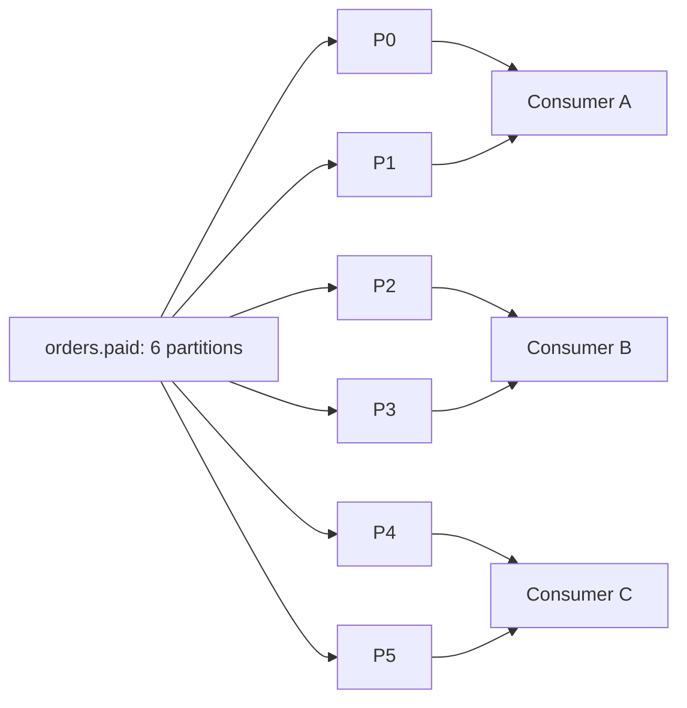
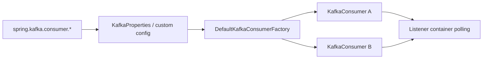
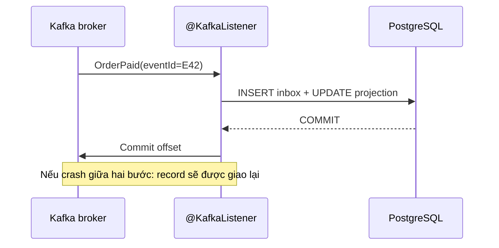
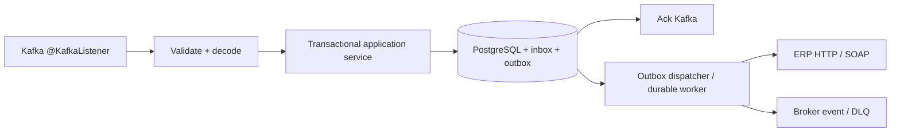

# `@KafkaListener`, `ConsumerFactory` và listener container

## 1. Tại sao ba thành phần này phải được hiểu cùng nhau?

Trong một ứng dụng Spring Boot, code xử lý Kafka có thể chỉ dài vài dòng:

```java
@KafkaListener(topics = "orders.paid", groupId = "order-projection")
public void onOrderPaid(String payload) {
    orderService.apply(payload);
}
```

Nhưng một annotation không nói hết chuyện gì xảy ra khi **consumer bị rebalance, record được giao lại, JSON không deserialize được, database commit thành công nhưng offset chưa commit, hay một listener chậm giữ tất cả partition**. Những hành vi ấy do toàn bộ pipeline của Spring Kafka và Apache Kafka quyết định.

Bài thuộc chương **Apache Kafka** trong module **SPRING_BOOT_INTEGRATION**: tổ chức tích hợp qua HTTP client, cơ sở dữ liệu, cache, broker thông điệp và Spring Integration adapters; chú trọng cấu hình, hợp đồng dữ liệu, xử lý lỗi, xử lý trùng lặp, kiểm thử và khả năng quan sát. Trọng tâm trực tiếp là **`@KafkaListener`, `ConsumerFactory` và listener container**.

Để hiểu đúng, hãy phân biệt ba trách nhiệm:

- **`ConsumerFactory`**: tạo các `KafkaConsumer` thật, thiết lập broker, deserializer, security, client properties và những customization liên quan.
- **Listener container**: quản lý vòng đời consumer, `poll()`, phân phối records cho listener, group membership, partitions, offset acknowledgment, error handling và shutdown.
- **`@KafkaListener`**: khai báo method nào xử lý message, topic/pattern/partition/group nào và container factory nào cung cấp runtime.

**Nguyên tắc:** `@KafkaListener` không tự tạo “một thread cho mỗi message”, không làm producer/consumer transaction đồng bộ với PostgreSQL và không tự bảo đảm exactly-once business effect.

### Mục tiêu bài học

1. Hiểu con đường từ `spring.kafka.*` tới `DefaultKafkaConsumerFactory`, `ConcurrentKafkaListenerContainerFactory` và method `@KafkaListener`.
2. Chọn record/batch listener, group ID, concurrency và key/partition đúng mục tiêu.
3. Thiết kế offset acknowledgment, retry, error handler và DLT an toàn.
4. Phân biệt lỗi deserialize trước listener với lỗi nghiệp vụ trong listener.
5. Phối hợp consumer với JDBC/jOOQ, HTTP/SOAP client, Redis và Spring Integration.
6. Kiểm thử bằng Kafka thật trong Testcontainers và theo dõi rebalance, lag, backlog, idempotency.

## 2. Mô hình hoạt động: container mới là thành phần chạy `poll()`

```mermaid
flowchart TD
    CFG[Spring Boot spring.kafka.*] --> CF[ConsumerFactory]
    CF --> K1[KafkaConsumer 1]
    CF --> K2[KafkaConsumer 2]
    FACTORY[ConcurrentKafkaListenerContainerFactory] --> LCC[ConcurrentMessageListenerContainer]
    LCC --> CHILD1[KafkaMessageListenerContainer A]
    LCC --> CHILD2[KafkaMessageListenerContainer B]
    CHILD1 --> K1
    CHILD2 --> K2
    K1 --> POLL[Poll records từ Kafka broker]
    K2 --> POLL
    POLL --> ADAPTER[MessagingMessageListenerAdapter]
    ADAPTER --> METHOD[@KafkaListener business method]
    METHOD --> DB[(PostgreSQL / outbox / Redis)]
    METHOD --> ERP[HTTP / SOAP dependency]
    METHOD --> RESULT[Ack / error handler / DLT]
```

Đây là mô hình rút gọn cho **record listener**. Spring Kafka sử dụng listener adapters, containers và Kafka client API tương ứng với phiên bản. Khi bật batch listener, adapter có thể chuyển cả `List<ConsumerRecord<...>>` hoặc payload list tới method.

| Thành phần | Ai tạo? | Điều thực sự được kiểm soát |
|---|---|---|
| `KafkaProperties` | Spring Boot bind từ `spring.kafka.*`. | Các nhóm cấu hình producer, consumer, listener, admin, security. |
| `ConsumerFactory<K,V>` | Boot auto-configure hoặc ứng dụng định nghĩa. | Các `KafkaConsumer<K,V>` mới với config/deserializers. |
| `ConcurrentKafkaListenerContainerFactory<K,V>` | Boot hoặc ứng dụng định nghĩa. | Mẫu cấu hình để tạo containers cho endpoints. |
| `KafkaMessageListenerContainer` | Runtime tạo cho từng consumer task. | Một Kafka consumer và polling/handling loop. |
| `ConcurrentMessageListenerContainer` | Runtime quản lý các child containers. | Concurrent consumers trong một listener endpoint. |
| `@KafkaListener` | Spring scan annotation trên bean. | Định nghĩa endpoint: method, topic, id, groupId, factory. |
| `CommonErrorHandler` | Factory/container configuration. | Xử lý exception từ listener/container theo policy. |

**Factory khác container:** đổi thuộc tính một factory sau khi containers đã start không đồng nghĩa tất cả consumer đang chạy tự cấu hình lại. Có những thuộc tính Kafka client chỉ được đọc khi tạo `KafkaConsumer`; cần rolling restart/redeploy hoặc quản lý lifecycle chủ động.

## 3. Group, partition, consumer: ba đơn vị không được nhầm

Kafka lưu record trong **topic** chia thành **partitions**. Mỗi consumer group duy trì offsets và phân phối partitions giữa những consumers trong group.

Ví dụ topic `orders.paid` có 6 partitions:



Trong **cùng một group**, tại một thời điểm mỗi partition thường chỉ thuộc về một consumer có assignment hợp lệ. Các consumer trong cùng group chia tải; các **group khác nhau** có offsets riêng và có thể đọc cùng record cho chức năng khác.

| Khái niệm | Hợp đồng vận hành |
|---|---|
| **Topic** | Luồng records có retention/compaction theo broker policy. |
| **Partition** | Đơn vị phân vùng và ordering của log; key thường ảnh hưởng routing. |
| **Consumer group** | Nhóm xử lý logic, duy trì vị trí đọc theo topic-partition. |
| **Consumer instance** | `KafkaConsumer` cụ thể với membership/poll loop. |
| **Offset** | Vị trí trong một partition, không phải ID duy nhất toàn topic. |
| **Committed offset** | Vị trí group đã ghi nhận để tiếp tục sau restart/rebalance. |
| **Kafka record key** | Có thể dùng để đưa các event của cùng aggregate tới cùng partition. |

Nếu có ba service **Inventory, CRM, Audit** cần nhận `OrderPaid`, nên dùng ba **group ID khác nhau**. Nếu ba replicas của Inventory cùng group ID, chúng chia partitions thay vì mỗi replica nhận mọi record.

### 3.1. Concurrency không thể vượt giới hạn partitions để tăng throughput vô hạn

Khi một group chỉ nhận một topic có 3 partitions, đặt `concurrency=10` sẽ không tạo 10 consumer đang có partition hữu ích; một số consumer có thể idle. Thêm replicas và số child containers còn làm thay đổi rebalance, connection load, memory và network.

Không suy ra rằng tăng `concurrency` từ 3 lên 30 sẽ làm application nhanh gấp mười. Nút thắt có thể là database pool, lock contention, HTTP quota của ERP, Kafka broker partitions hoặc CPU dành cho deserialize.

## 4. Spring Boot tự cấu hình những gì?

Ở Spring Boot 3.x với Spring Kafka trên classpath và không bị custom beans thay thế, Boot có thể cung cấp:

- `KafkaProperties` được bind từ `spring.kafka.*`.
- `ConsumerFactory` và `ProducerFactory` mặc định.
- `KafkaTemplate` cho producer.
- `KafkaAdmin` khi thích hợp.
- `ConcurrentKafkaListenerContainerFactory` mặc định với tên thường là `kafkaListenerContainerFactory`.
- `ConcurrentKafkaListenerContainerFactoryConfigurer` để tạo factory mới mà vẫn tái sử dụng customization của Boot.

Trong ứng dụng Boot bật auto-configuration phù hợp, `@KafkaListener` thường hoạt động mà không cần tự tạo Kafka consumer trong code. Với Spring Framework thuần, phải thiết lập listener infrastructure và `@EnableKafka` phù hợp. **Không đồng nhất “có dependency spring-kafka” với “mọi bean được Boot cấu hình thành công”**: custom `ConsumerFactory`/container factory có thể khiến Boot back off hoặc chọn bean khác.

### 4.1. Dependencies căn bản

Gradle Kotlin DSL:

```kotlin
dependencies {
    implementation("org.springframework.kafka:spring-kafka")
    implementation("org.springframework.boot:spring-boot-starter-jdbc")
    runtimeOnly("org.postgresql:postgresql")

    testImplementation("org.springframework.boot:spring-boot-starter-test")
    testImplementation("org.springframework.kafka:spring-kafka-test")
    testImplementation("org.springframework.boot:spring-boot-testcontainers")
    testImplementation("org.testcontainers:junit-jupiter")
    testImplementation("org.testcontainers:kafka")
}
```

Các dependencies JDBC/Testcontainers chỉ cần nếu ví dụ đi qua database/test container. Dùng **Spring Boot BOM** hoặc dependency management của dự án để giữ Kafka client và Spring Kafka tương thích; tên/package module Kafka Testcontainers thay đổi giữa các thế hệ thư viện nên chọn đúng phiên bản. Không tự nâng `kafka-clients` lên major version khác mà chưa xem tương thích container framework/broker.

## 5. Cấu hình consumer qua `spring.kafka.*`

Một ví dụ `application.yml` cho **record listener** dùng JSON string được parse tại application boundary:

```yaml
spring:
  kafka:
    bootstrap-servers: ${KAFKA_BOOTSTRAP_SERVERS}
    consumer:
      group-id: order-projection
      enable-auto-commit: false
      auto-offset-reset: earliest
      key-deserializer: org.apache.kafka.common.serialization.StringDeserializer
      value-deserializer: org.apache.kafka.common.serialization.StringDeserializer
      max-poll-records: 200
      properties:
        max.poll.interval.ms: 300000
        session.timeout.ms: 45000
    listener:
      type: single
      ack-mode: record
      concurrency: 3
      missing-topics-fatal: true
```

Đây là cấu hình **minh họa**, không phải bộ default hoặc kích thước khuyến nghị cho production. Ở ví dụ chung, `ack-mode: record` giúp container ghi nhận tiến độ sau khi method xử lý record thành công; factory chuyên biệt ở phần sau **chủ động đổi sang `MANUAL_IMMEDIATE`** cho listener có tham số `Acknowledgment`. Tên/giá trị property nên kiểm tra metadata cấu hình của **phiên bản Spring Boot đang dùng**.

| Property | Ý nghĩa | Điểm cần cảnh giác |
|---|---|---|
| `bootstrap-servers` | Danh sách địa chỉ Kafka bootstrap. | Kết nối thật còn phụ thuộc advertised listeners, DNS, TLS, ACL. |
| `consumer.group-id` | Group mặc định cho consumers theo config. | `@KafkaListener(groupId=...)` có thể ghi đè. |
| `enable-auto-commit=false` | Không để Kafka client tự động periodic commit offsets. | Phải cấu hình/hiểu container ack strategy. |
| `auto-offset-reset=earliest` | Chọn vị trí khi group chưa có valid committed offset. | **Không** rewind group đã commit offset. |
| `key/value-deserializer` | Chuyển bytes thành key/value Java. | Lỗi ở đây xảy ra trước khi method listener nhận record. |
| `max-poll-records` | Số records tối đa mỗi `poll()`. | Không tự giới hạn tổng backlog hoặc HTTP concurrency. |
| `max.poll.interval.ms` | Thời gian tối đa giữa các lần poll để consumer không bị xem là không hoạt động. | Handler blocking quá lâu có thể gây rebalance. |
| `listener.ack-mode` | Cách Spring container quyết định ghi nhận offsets. | Phải phù hợp logic commit/ack thực tế. |
| `listener.concurrency` | Số child Kafka consumers cho endpoint theo cấu hình chung. | Bị giới hạn bởi partitions và quota dependencies. |
| `listener.type` | `single` hoặc `batch` theo factory được Boot cấu hình. | Listener method signature phải khớp. |

Nếu ứng dụng khai báo một `ConcurrentKafkaListenerContainerFactory` riêng và **không** dùng Boot configurer, `spring.kafka.listener.ack-mode`/`concurrency` có thể **không được áp lên factory mới**. Đây là lỗi wiring thường gặp dù file YAML trông đúng.

### 5.1. Cấu hình security không nên bị mất khi custom factory

Nếu Kafka cần SASL/SCRAM, TLS hoặc mTLS, các thuộc tính `spring.kafka.security.protocol`, `spring.kafka.ssl.*`, `spring.kafka.properties.*` và những phần bảo mật theo consumer phải được áp vào **ConsumerFactory thực tế**. Không tạo một `DefaultKafkaConsumerFactory` từ map chỉ có `bootstrap.servers` và deserializers rồi vô tình bỏ hết security, client.id, metrics/tracing hoặc đặc tính của môi trường.

Không log full client configuration vì có thể chứa JAAS credentials, SSL key passwords hoặc token.

## 6. `@KafkaListener`: khai báo endpoint tiêu thụ message

Một record listener đơn giản:

```java
package com.example.integration.orders;

import org.apache.kafka.clients.consumer.ConsumerRecord;
import org.springframework.kafka.annotation.KafkaListener;
import org.springframework.stereotype.Component;

@Component
public class OrderPaidListener {

    private final OrderEventApplicationService application;

    public OrderPaidListener(OrderEventApplicationService application) {
        this.application = application;
    }

    @KafkaListener(
        id = "orders-paid-handler",
        topics = "orders.paid",
        groupId = "order-projection")
    public void consume(ConsumerRecord<String, String> record) {
        application.applyJson(
                record.value(),
                record.key(),
                record.topic(),
                record.partition(),
                record.offset());
    }
}
```

`OrderEventApplicationService` là bean ứng dụng tự định nghĩa. Cách truyền metadata giúp service/log theo dõi record; ứng dụng thường nên decode thành DTO trước hoặc trong adapter riêng. Với mục tiêu kiểm thử idempotency, **eventId/business key trong payload** quan trọng hơn Kafka offset, vì record có thể bị republish vào partition/offset khác.

### 6.1. Các thuộc tính annotation hay dùng

| Thuộc tính | Công dụng | Rủi ro nhầm lẫn |
|---|---|---|
| `topics` | Subscribe một hoặc nhiều topic có tên rõ. | Sai môi trường/schema hoặc topic thiếu ACL. |
| `topicPattern` | Subscribe bằng regex. | Có thể nhận topic ngoài dự kiến khi pattern quá rộng. |
| `topicPartitions` | Gán partitions/offsets theo cấu hình cụ thể. | Khác group-managed subscription và scale-out thông thường. |
| `groupId` | Group ID cho listener này. | Ghi đè group mặc định; đụng group khác sẽ chia tải. |
| `id` | Định danh listener container để quản lý/quan sát. | Ở cấu hình mặc định `idIsGroup` có thể khiến `id` dùng làm group ID khi không chỉ định `groupId`. |
| `containerFactory` | Chọn bean container factory. | Sai tên hoặc factory thiếu ack/error/config chung. |
| `concurrency` | Override concurrency cho endpoint khi được hỗ trợ. | Không vượt số partitions có việc hữu ích. |
| `autoStartup` | Bật/tắt tự khởi động endpoint. | Tắt mà không có runbook sẽ khiến lag tăng âm thầm. |
| `clientIdPrefix` | Đặt prefix client ID, hỗ trợ định danh consumers. | Không đồng nghĩa Kafka group ID. |

Một group ID nên đại diện **một logical subscriber** (ví dụ `inventory-projection`), không đặt một group ngẫu nhiên theo mỗi deployment nếu ứng dụng cần tiếp tục từ offsets cũ. Nếu cố ý tạo group mới để replay, phải thiết kế retention, offset reset và idempotency.

### 6.2. Đừng lẫn listener ID và group ID

Vì `idIsGroup` thường có giá trị mặc định `true` ở các phiên bản Spring Kafka phổ biến, một annotation chỉ có `id="orders-paid-handler"` có thể dùng chính ID đó làm group. Để tránh thay đổi group ngoài ý muốn, khai báo `groupId` rõ ràng hoặc xem quy tắc `idIsGroup` theo phiên bản.

## 7. Method signature: payload, headers, record và acknowledgment

Spring Kafka hỗ trợ nhiều cách nhận dữ liệu:

```java
@KafkaListener(topics = "orders.paid", groupId = "order-projection")
public void handlePayload(String json) {
    // Chỉ dùng payload.
}
```

Nhận Kafka metadata:

```java
import org.springframework.kafka.support.KafkaHeaders;
import org.springframework.messaging.handler.annotation.Header;

@KafkaListener(topics = "orders.paid", groupId = "order-projection")
public void handleWithMetadata(
        String json,
        @Header(KafkaHeaders.RECEIVED_KEY) String key,
        @Header(KafkaHeaders.RECEIVED_PARTITION) int partition,
        @Header(KafkaHeaders.OFFSET) long offset) {
    // Dùng metadata để trace/diagnose, không làm business dedupe duy nhất.
}
```

Hoặc nhận toàn bộ record:

```java
@KafkaListener(topics = "orders.paid", groupId = "order-projection")
public void handleRecord(ConsumerRecord<String, String> record) {
    // record.key(), value(), topic(), partition(), offset(), headers().
}
```

**Các đoạn trên là những hình thức thay thế**, không nên bật cả ba listener cho cùng một group/topic nếu mục tiêu là mỗi message qua **một** business handler; chúng có thể trở thành competing consumers hoặc duplicate logic tùy group.

### 7.1. Metadata không phải mọi thứ đều bắt buộc có

Record key có thể là `null`; đừng giả định `@Header(KafkaHeaders.RECEIVED_KEY)` luôn có giá trị. Nếu key là optional, dùng metadata với `required=false` hoặc `ConsumerRecord` để code rõ. Nội dung `KafkaHeaders` và converter behavior cần đối chiếu phiên bản Spring Kafka khi dùng những constant header chuyên biệt.

Đừng dùng topic/partition/offset làm khóa idempotency **nghiệp vụ** duy nhất: Kafka replay/republish qua topic khác sẽ tạo offset mới cho cùng event.

## 8. `ConsumerFactory` tạo Kafka consumers với những config nào?

Interface `ConsumerFactory<K,V>` thuộc `org.springframework.kafka.core`. Implementation phổ biến là `DefaultKafkaConsumerFactory<K,V>`. Factory dựa trên properties và deserializers để tạo Kafka consumer, thường khi listener container bắt đầu hoặc khởi tạo lại.



Những thông số factory cần bảo toàn:

- `bootstrap.servers` và `group.id` (nếu không override ở container).
- Key/value deserializer và serialization/schema policy.
- `enable.auto.commit`, `auto.offset.reset`, `max.poll.records`.
- `max.poll.interval.ms`, `session.timeout.ms`, `heartbeat.interval.ms`.
- SSL/SASL credentials, client ID, network request timeouts.
- `isolation.level=read_committed` nếu consumer cần đọc các transactionally committed Kafka records theo thiết kế.
- Kafka consumer interceptor/metrics/observation configuration nếu ứng dụng yêu cầu.

**ConsumerFactory không chủ động gọi `poll()` và không quyết định ack sau DB commit.** Nhiệm vụ đó thuộc listener container và application.

### 8.1. Khi nào tự khai báo `ConsumerFactory`?

Có thể cần:

- Một consumer phải đọc bytes raw, consumer khác đọc JSON/Avro.
- Đọc từ **hai Kafka clusters** có bootstrap/security/credential khác nhau.
- Tách listener nội bộ và listener từ đối tác có deserialization policy khác.
- Thay đổi cụ thể các Kafka client properties không nên áp toàn app.
- Dùng interceptor/customization có lifecycle riêng.

Nhưng nếu ứng dụng chỉ có một cluster và cùng deserializer, **ưu tiên giữ ConsumerFactory do Boot quản lý**, tùy chỉnh bằng `spring.kafka.consumer.*` và những extension points của version đang dùng thay vì tự tạo map từ đầu.

### 8.2. Ví dụ `DefaultKafkaConsumerFactory` độc lập, minh họa cơ chế

```java
import java.util.HashMap;
import java.util.Map;
import org.apache.kafka.clients.consumer.ConsumerConfig;
import org.apache.kafka.common.serialization.StringDeserializer;
import org.springframework.kafka.core.ConsumerFactory;
import org.springframework.kafka.core.DefaultKafkaConsumerFactory;

static ConsumerFactory<String, String> basicConsumerFactory(
        String bootstrapServers) {

    Map<String, Object> props = new HashMap<>();
    props.put(ConsumerConfig.BOOTSTRAP_SERVERS_CONFIG, bootstrapServers);
    props.put(ConsumerConfig.GROUP_ID_CONFIG, "order-projection");
    props.put(ConsumerConfig.ENABLE_AUTO_COMMIT_CONFIG, false);

    return new DefaultKafkaConsumerFactory<>(
            props, new StringDeserializer(), new StringDeserializer());
}
```

Đây là **ví dụ tối thiểu để nhận diện factory API**, không phải bean production đủ bảo mật: nó **không** tự mang các cấu hình SSL/SASL, quota, timeouts, monitoring hoặc customization mà Spring Boot có thể đang cung cấp. Khi tự tạo factory thực, bắt đầu từ `KafkaProperties`/configuration được quản lý của chính phiên bản Boot, rồi thêm đúng thay đổi cần thiết. Nếu ứng dụng có nhiều clusters, đặt rõ `@Qualifier` để factory không bị inject nhầm.

Không tạo một `KafkaConsumer` mới cho mỗi message. Kafka consumer là đối tượng stateful gắn với group/poll loop và **không thread-safe** cho việc gọi đồng thời từ nhiều threads.

## 9. `ConcurrentKafkaListenerContainerFactory`: “mẫu” tạo runtime containers

Spring Boot có thể auto-configure factory mặc định `kafkaListenerContainerFactory`. Nếu cần factory riêng cho các flow có ack/concurrency khác nhau, cách thuận tiện là dùng **`ConcurrentKafkaListenerContainerFactoryConfigurer`** của Boot để giữ các thiết lập chung.

```java
import org.springframework.boot.autoconfigure.kafka.ConcurrentKafkaListenerContainerFactoryConfigurer;
import org.springframework.context.annotation.Bean;
import org.springframework.context.annotation.Configuration;
import org.springframework.kafka.config.ConcurrentKafkaListenerContainerFactory;
import org.springframework.kafka.core.ConsumerFactory;
import org.springframework.kafka.listener.ContainerProperties;

@Configuration(proxyBeanMethods = false)
class OrderKafkaListenerConfiguration {

    @Bean("ordersListenerFactory")
    ConcurrentKafkaListenerContainerFactory<String, String> ordersListenerFactory(
            ConcurrentKafkaListenerContainerFactoryConfigurer bootConfigurer,
            ConsumerFactory<String, String> consumerFactory) {

        var factory =
                new ConcurrentKafkaListenerContainerFactory<String, String>();

        // Giữ những cấu hình chung mà Spring Boot cung cấp.
        bootConfigurer.configure(factory, consumerFactory);

        // Khác biệt có chủ đích cho logical subscriber này.
        factory.setConcurrency(3);
        factory.getContainerProperties()
                .setAckMode(ContainerProperties.AckMode.MANUAL_IMMEDIATE);

        return factory;
    }
}
```

Ví dụ giả định ứng dụng có một `ConsumerFactory<String,String>` phù hợp (có thể đến từ cấu hình Boot hoặc bean typed của ứng dụng). Khi có nhiều factories/cluster, phải chọn đúng bean bằng qualifier.

Dùng ở listener:

```java
@KafkaListener(
    topics = "orders.paid",
    groupId = "order-projection",
    containerFactory = "ordersListenerFactory")
public void handle(String json, Acknowledgment acknowledgment) {
    orderService.applyJson(json);
    acknowledgment.acknowledge();
}
```

`Acknowledgment` ở đây là `org.springframework.kafka.support.Acknowledgment`; chỉ sử dụng khi container ack mode hỗ trợ manual acknowledgment. Lệnh `applyJson` phải đảm bảo **đã hoàn thành công việc hoặc lưu ý định xử lý bền vững** trước khi ack.

### 9.1. Vì sao dùng Boot configurer?

Nếu tự `new ConcurrentKafkaListenerContainerFactory<>()` rồi chỉ `setConsumerFactory(...)`, factory mới có thể mất:

- `spring.kafka.listener.*` defaults đã bind.
- Message converters và batch/record selection.
- Common error handler, retry/recoverer wiring.
- Interceptors/advice/observation customization nếu có.
- Transaction-related container settings nếu dự án đã cấu hình.

**Không giả định `ConcurrentKafkaListenerContainerFactoryConfigurer` tự giữ mọi custom bean khi application đã override configuration**; phải kiểm tra factory thực, event logs và context. Tuy vậy, đây là nền tảng tốt hơn việc dựng một factory hoàn toàn tách khỏi Boot.

### 9.2. Chọn nhiều factory có chủ đích

| Bean factory | Listener phù hợp | Config khác biệt |
|---|---|---|
| `kafkaListenerContainerFactory` | Subscription mặc định. | Spring Boot listener settings. |
| `ordersListenerFactory` | Order projection cần manual acknowledgment. | Group/ack policy, concurrency, error handling. |
| `auditBatchListenerFactory` | Audit ingest batch-oriented. | Batch listener, batch size/ack strategy. |
| `rawInvalidEventFactory` | Diagnostic/quarantine input. | Raw bytes, ErrorHandlingDeserializer, restricted ACL. |

Một factory mới không nhất thiết tạo một consumer ngay. Runtime containers được tạo theo từng listener endpoint và khởi động theo lifecycle được quản lý.

## 10. Container lifecycle: start, stop, pause, rebalance

Một Kafka listener container có trạng thái runtime: được tạo từ endpoint metadata, start khi Spring context sẵn sàng theo phase, gọi `poll()`, join group/assign partitions, nhận record, xử lý, commit offsets, pause/resume và stop gracefully.

Thành phần ứng dụng có thể lấy containers bằng `KafkaListenerEndpointRegistry`:

```java
import org.springframework.kafka.config.KafkaListenerEndpointRegistry;
import org.springframework.kafka.listener.MessageListenerContainer;
import org.springframework.stereotype.Component;

@Component
public class ListenerOperations {
    private final KafkaListenerEndpointRegistry registry;

    public ListenerOperations(KafkaListenerEndpointRegistry registry) {
        this.registry = registry;
    }

    public void pauseOrders() {
        MessageListenerContainer container =
                registry.getListenerContainer("orders-paid-handler");
        if (container == null) {
            throw new IllegalStateException("Unknown listener id");
        }
        container.pause();
    }

    public void resumeOrders() {
        MessageListenerContainer container =
                registry.getListenerContainer("orders-paid-handler");
        if (container == null) {
            throw new IllegalStateException("Unknown listener id");
        }
        container.resume();
    }
}
```

`pause()` trong container thường yêu cầu xử lý ở boundary `poll()` và không đồng nghĩa một lệnh stop tức thì với mọi record đã được lấy. Quản lý start/stop/pause/resume phải được bảo vệ bằng quyền vận hành, log audit và kiểm tra `isPauseRequested()`/`isContainerPaused()` theo API version phù hợp.

### 10.1. Rebalance không phải lỗi hiếm

Rebalance có thể xảy ra khi:

- Một replica deploy/restart.
- Consumer join/leave group.
- Topic partitions thay đổi.
- Worker không poll đúng hạn.
- Broker/coordinator thay đổi hoặc kết nối gián đoạn.
- Assignment strategy thay đổi.

Trong rebalance, ownership của partition chuyển; record đang xử lý có thể được đọc lại nếu offset chưa commit. Vì thế handler cần idempotency. Không giữ một `ConsumerRecord`/`Acknowledgment` để ack tùy tiện từ thread khác sau khi partition đã được revoke mà không thiết kế rõ semantics.

### 10.2. Pause không phải DLQ

Pause giúp giảm áp lực hoặc chờ dependency phục hồi, nhưng chưa xử lý thông điệp lỗi, cũng không tự ghi failure record. Nếu có poison message, cần error handler/retry/DLT/quarantine; pause mãi khiến consumer lag tăng và ứng dụng không tiến được.

## 11. Ack modes: lúc nào Kafka offset được commit?

Với `enable.auto.commit=false`, Spring Kafka listener container quản lý acknowledgment/commit theo `AckMode`, không chỉ dựa vào client auto-commit.

| Ack mode | Ý nghĩa phổ biến | Khi cần chú ý |
|---|---|---|
| `RECORD` | Commit theo tiến độ mỗi record sau khi listener xử lý thành công. | Có overhead, phù hợp tiến độ chi tiết. |
| `BATCH` | Commit sau khi xử lý records từ một `poll()` theo container behavior. | Một record lỗi có thể làm cả batch/poll bị xử lý lại. |
| `TIME` | Commit theo thời gian sau khi các offsets được đánh dấu. | Không đồng nghĩa deadline nghiệp vụ. |
| `COUNT` | Commit theo số records đã xử lý. | Có khoảng cách giữa business commit và offset commit. |
| `COUNT_TIME` | Kết hợp ngưỡng count/time. | Cần hiểu khi nào commit được kích hoạt. |
| `MANUAL` | Listener gọi `acknowledge()`, container xử lý commit ở mốc phù hợp. | Acknowledgment có thể được queue đến cuối poll. |
| `MANUAL_IMMEDIATE` | Listener gọi ack, container có thể commit ngay khi trên consumer thread. | Ack trên thread khác có semantics khác; cấu hình sync/async commits vẫn có tác động. |

**Không dùng `enable.auto.commit=true` rồi lại giả định `Acknowledgment.acknowledge()` là nguồn điều khiển offset duy nhất.** Spring Kafka container trong nhiều phiên bản chủ động tắt client auto-commit theo defaults, nhưng hãy xác minh cấu hình thực tế và đặt rõ policy khi correctness phụ thuộc vào nó.

### 11.1. Commit offset không phải database commit

Trình tự có rủi ro:



Một bản ghi có thể được xử lý và commit DB thành công nhưng offset Kafka chưa commit. Khi consumer restart/rebalance, nó có thể nhận lại record. Đây là hành vi **at-least-once** cần thiết kế idempotent, không phải một “bug phải tăng timeout để sửa”.

Trình tự sai nguy hiểm hơn:

```text
listener nhận message
  -> acknowledge() hoặc offset commit
  -> giao task cho @Async/ExecutorChannel in-memory
  -> trả về
  -> JVM crash, task chưa ghi DB
  -> Kafka tin đã xử lý; công việc bị mất
```

Không ack theo “đã enqueue vào bộ nhớ”; chỉ ack sau khi hoàn tất hoặc **lưu durable handoff** theo contract.

## 12. Record listener và batch listener

Record listener nhận từng record/payload, dễ phân loại lỗi và xử lý idempotency theo event ID. Batch listener nhận một nhóm records đã poll, có thể tăng throughput khi business/storage hỗ trợ batch nhưng đòi hỏi policy lỗi phức tạp hơn.

Ví dụ record listener:

```java
@KafkaListener(topics = "orders.paid", groupId = "order-projection")
public void onRecord(ConsumerRecord<String, String> record) {
    applicationService.process(record.value());
}
```

Ví dụ batch listener (factory phải bật batch):

```java
@Bean("auditBatchListenerFactory")
ConcurrentKafkaListenerContainerFactory<String, String> auditBatchListenerFactory(
        ConcurrentKafkaListenerContainerFactoryConfigurer configurer,
        ConsumerFactory<String, String> consumers) {

    var factory =
            new ConcurrentKafkaListenerContainerFactory<String, String>();
    configurer.configure(factory, consumers);
    factory.setBatchListener(true);
    factory.getContainerProperties()
            .setAckMode(ContainerProperties.AckMode.BATCH);
    return factory;
}
```

```java
@KafkaListener(
    topics = "audit.events",
    groupId = "audit-projection",
    containerFactory = "auditBatchListenerFactory")
public void onBatch(java.util.List<ConsumerRecord<String, String>> records) {
    auditService.appendBatch(records);
}
```

Đoạn code minh họa một batch endpoint riêng; import thêm `ContainerProperties` từ `org.springframework.kafka.listener` cho đoạn factory. Với batch listener, chọn `AckMode.BATCH` rõ ràng thay vì dùng `RECORD` từ cấu hình record listener chung. Không đăng ký thêm cùng lúc record listener xử lý cùng logical message nếu không có chủ đích. Phải kiểm tra batch error handler, partial failures, số records đã commit, retry/reseek semantics và DB batch transaction.

### 12.1. `max.poll.records` không phải batch size nghiệp vụ cố định

`max.poll.records=200` là giới hạn trên từ consumer client, không đảm bảo mỗi invocation batch chứa đúng 200 records. Số records phụ thuộc topic traffic, partitions, fetch, poll duration và assignment. Không dùng size bằng 200 làm logic correctness.

### 12.2. Khi một record trong batch lỗi

Có nhiều hướng: rollback toàn batch DB, retry batch, xử lý từng record, hoặc dùng cơ chế như `BatchListenerFailedException` và error handler phù hợp Spring Kafka version. Không tự ack cả batch nếu chỉ xử lý thành công 199/200 records. Nếu cần commit tiến độ hạt mịn, record listener với unique event key và batch SQL bên trong service đôi khi dễ duy trì hơn batch listener phức tạp.

## 13. Deserializer, converter và DTO contract

Kafka chỉ lưu **bytes**; consumer phải chuyển key/value thành các kiểu Java mà listener nhận được. Có hai nơi khác nhau:

1. **Kafka deserializer**: `byte[]` → Java value, chạy bên trong Kafka consumer trước khi Spring listener nhận.
2. **Spring message converter/argument resolver**: chuyển payload thành method parameter type phù hợp sau khi Kafka record đã đọc được.

Cấu hình `StringDeserializer` rồi dùng `@KafkaListener void consume(String json)` là cách rõ ràng: parse JSON trong adapter. Với typed DTO, có thể dùng `JsonDeserializer`, `JsonMessageConverter` hoặc schema-aware serializer tùy hệ thống.

Ví dụ DTO:

```java
public record OrderPaidEvent(
        String eventId,
        String orderId,
        long aggregateVersion,
        String paymentReference) {}
```

Ví dụ xử lý JSON trong adapter mà không buộc Kafka client phải hiểu DTO class:

```java
import com.fasterxml.jackson.databind.ObjectMapper;
import org.apache.kafka.clients.consumer.ConsumerRecord;
import org.springframework.kafka.annotation.KafkaListener;
import org.springframework.stereotype.Component;

@Component
class OrderJsonListener {
    private final ObjectMapper mapper;
    private final OrderEventApplicationService application;

    OrderJsonListener(ObjectMapper mapper,
                      OrderEventApplicationService application) {
        this.mapper = mapper;
        this.application = application;
    }

    @KafkaListener(
        topics = "orders.paid",
        groupId = "order-projection")
    public void onRecord(ConsumerRecord<String, String> record)
            throws com.fasterxml.jackson.core.JsonProcessingException {

        OrderPaidEvent event =
                mapper.readValue(record.value(), OrderPaidEvent.class);

        application.applyOnce(event);
    }
}
```

`application.applyOnce` là method do ứng dụng định nghĩa, cần transaction/idempotency. Trường hợp exception parsing xảy ra **trong listener method**, container error handler có thể nhận exception đó. Nếu decode xảy ra tại Kafka `Deserializer` **trước** khi có record, failure path khác và cần cấu hình riêng.

### 13.1. Tránh chấp nhận class name từ message không tin cậy

Một số JSON deserializer hỗ trợ type headers hoặc trusted packages. Không mở tùy tiện `trusted.packages=*` cho message từ nhiều producer không tin cậy; có nguy cơ deserialize thành class không được phép hoặc không ổn định qua deploy.

Thường tốt hơn khi:

- Topic có **schema/version** rõ và DTO do consumer xác định.
- Producer/consumer kiểm soát compatibility (JSON Schema, Avro, Protobuf...) theo contract.
- Consumer không deserialize Java class tùy ý từ header.
- Có chiến lược chuyển đổi version để replay events cũ sau triển khai.
- DLT giữ raw payload cần thiết và metadata có kiểm soát để điều tra schema mismatch.

## 14. Lỗi deserialize trước `@KafkaListener` và `ErrorHandlingDeserializer`

Một vấn đề hay gặp:

```text
KafkaConsumer.poll()
  -> ValueDeserializer ném SerializationException
  -> Record chưa trở thành payload hợp lệ cho @KafkaListener
  -> Handler advice chỉ bọc method listener KHÔNG thấy dữ liệu gốc
```

Với cấu hình phù hợp, Spring Kafka cung cấp `ErrorHandlingDeserializer` để bao quanh deserializer thực và bổ sung thông tin failure vào Kafka record headers. Container/error handler có thể xử lý/quarantine mà không mắc kẹt ở cùng offset do deserialization failure.

Ví dụ YAML minh họa String key + JSON value:

```yaml
spring:
  kafka:
    consumer:
      key-deserializer: org.springframework.kafka.support.serializer.ErrorHandlingDeserializer
      value-deserializer: org.springframework.kafka.support.serializer.ErrorHandlingDeserializer
      properties:
        spring.deserializer.key.delegate.class: org.apache.kafka.common.serialization.StringDeserializer
        spring.deserializer.value.delegate.class: org.springframework.kafka.support.serializer.JsonDeserializer
        spring.json.value.default.type: com.example.integration.orders.OrderPaidEvent
        spring.json.trusted.packages: com.example.integration.orders
```

Đây là cấu hình minh họa khi **ứng dụng chọn typed JSON deserialization**; phải kiểm tra class package, producer serialization và Java/Kafka versions thực. Không đăng ký listener nhận `String` nếu value deserializer trả `OrderPaidEvent` mà không có converter phù hợp.

Khi dùng DLT recoverer cho bản tin deserialization lỗi, cần **producer serializer phù hợp với raw bytes hoặc recovered payload type**, không giả định producer JSON/String serializer sẽ serialize được cả `byte[]` lẫn DTO theo cùng cách. Một số Spring Kafka versions cho phép recoverer giữ original raw payload; phải test end-to-end.

### 14.1. Poison message không nên retry nóng vô hạn

Sai schema, JSON corrupt hoặc class mismatch thường không biến mất vì đợi 500 ms. Hãy phân loại **non-retryable**, đưa vào DLT/quarantine, kèm topic/partition/offset, exception category và payload reference. Đừng log raw payload chứa PII hoặc để một record sai cấu trúc chặn partition vô thời hạn.

## 15. Common error handler: `DefaultErrorHandler`

Spring Kafka 3.x dùng `CommonErrorHandler`, một implementation phổ biến là `DefaultErrorHandler`. Nó nhận lỗi từ container/listener và áp retry/backoff/recovery policy.

Ví dụ với record kiểu String, producer DLT có thể gửi cùng key/value:

```java
import org.springframework.context.annotation.Bean;
import org.springframework.kafka.core.KafkaTemplate;
import org.springframework.kafka.listener.DefaultErrorHandler;
import org.springframework.kafka.listener.DeadLetterPublishingRecoverer;
import org.springframework.util.backoff.FixedBackOff;

@Bean
DefaultErrorHandler orderErrorHandler(
        KafkaTemplate<String, String> kafkaTemplate) {

    var recoverer = new DeadLetterPublishingRecoverer(kafkaTemplate);

    // 2 retries SAU lần xử lý đầu => tối đa 3 attempts trong nhánh này.
    var handler = new DefaultErrorHandler(
            recoverer, new FixedBackOff(1_000L, 2L));

    handler.addNotRetryableExceptions(
            InvalidOrderEventException.class);

    return handler;
}
```

`InvalidOrderEventException` là exception do ứng dụng tự định nghĩa khi event sai hợp đồng **không thể tự phục hồi**. Nếu đã dùng Boot-managed factory, cần xác minh handler được gắn vào đúng factory; có thể gọi `factory.setCommonErrorHandler(orderErrorHandler)` ở custom factory hoặc dựa trên configurer theo version. Đừng khai báo bean rồi nghĩ nó chắc chắn quản lý một factory thủ công không gọi configurer.

### 15.1. `FixedBackOff` và tổng số attempts

Trong ví dụ `new FixedBackOff(1_000L, 2L)`, hai lần retry sau lần đầu có thể tạo **tối đa ba lượt xử lý** trước recovery. Thời gian hoàn tất còn gồm DB/ERP latency, queue wait, rebalance và lịch thực thi, không chỉ 2 giây backoff.

Đặt retry budget toàn luồng: nếu listener retry 3 lần, Spring Integration advice retry 3 lần và HTTP client retry 3 lần, một event có thể tạo tới 27 lời gọi downstream. Chọn một **tầng sở hữu business retry chính** và xác định ngưỡng rời sang durable retry/DLT.

### 15.2. Không phải mọi lỗi listener đều được retry giống nhau

| Lỗi | Hướng xử lý |
|---|---|
| JSON/schema không hợp lệ | Quarantine/DLT, sửa producer/consumer contract. |
| Validation/business rejection vĩnh viễn | Ghi outcome hoặc DLT theo hợp đồng; không thử mãi. |
| PostgreSQL deadlock/serialization conflict | Retry bounded nếu transaction đã rollback và idempotent. |
| DB connection pool bị cạn | Giảm consumer concurrency/backpressure; retry có giới hạn. |
| ERP 429/503 | Backoff/jitter, giảm số in-flight; có thể chuyển retry bền vững. |
| Timeout sau HTTP `POST` ghi ERP | `UNKNOWN`, đối soát; không phát lại mù với key mới. |
| Lỗi code `NullPointerException` | Thường cần sửa code, tránh nóng retry vô hạn. |
| Kafka broker tạm gián đoạn | Client/container có cơ chế reconnect/rebalance; theo dõi availability riêng. |

### 15.3. DLT không đồng nghĩa “đã hoàn tất”

Một `DeadLetterPublishingRecoverer` thường publish record lỗi tới dead-letter topic (ví dụ theo convention `<topic>-dlt` với partition tương ứng trong các cấu hình mặc định). Nếu DLT không tồn tại, thiếu partitions/ACL hoặc producer serialization sai, recovery có thể thất bại.

Cần thiết kế **điều kiện commit offset message gốc** sau recovery:

- DLT đã được publish theo mức xác nhận yêu cầu chưa?
- Nếu DLT publish thất bại, bản gốc có bị commit nhầm không?
- DLT retention đủ cho điều tra/replay không?
- Consumer DLT có dedupe và xử lý **một message có thể bị publish DLT hai lần** không?
- Ai sở hữu việc sửa lỗi và replay?

**Error handler phục hồi xong không có nghĩa business task đã thành công**. Nó có thể chỉ chuyển bản tin sang một nguồn lỗi bền vững và cho phép consumer tiếp tục.

## 16. Retry nóng, retry topic và quarantine

Ba lớp giải pháp:

| Chiến lược | Phù hợp | Rủi ro |
|---|---|---|
| `DefaultErrorHandler` + backoff trong container | Lỗi rất ngắn, ít attempts. | Giữ partition/consumer chờ, giảm throughput. |
| Delayed retry topics / `@RetryableTopic` trong phiên bản hỗ trợ | Cần retry sau hàng giây/phút mà không chặn original flow. | Tăng topics/consumer groups, có thể thay ordering của event. |
| DLT/quarantine + sửa lỗi/replay có kiểm soát | Lỗi vĩnh viễn, schema mismatch, outcome chưa rõ. | Cần owner/runbook, data retention, audit. |

Không dùng DLT như “thùng rác được coi là đã thành công”. Với sự kiện cần cập nhật sổ sách, việc record đi DLT có thể phải hiển thị trạng thái `FAILED_FINAL` hoặc `NEEDS_RECONCILIATION` cho vận hành.

### 16.1. Ordering thay đổi khi chuyển sang retry topic

Trong một partition gốc, record E1 lỗi rồi được chuyển sang retry topic; consumer có thể tiếp tục xử lý E2 của cùng aggregate trước khi E1 được retry. Nếu business yêu cầu thứ tự, dùng aggregate version, state machine hoặc lựa chọn retry mode giữ ordering theo yêu cầu, đánh đổi throughput.

`@RetryableTopic` là API của Spring Kafka theo các version hỗ trợ; không mặc định kích hoạt đồng thời với mọi transactional container configuration. Khi triển khai, kiểm tra compatibility giữa retry topics, DLT, transaction manager, batch listener và annotated endpoints đúng release.

## 17. Manual acknowledgment: chỉ ack sau mốc bền vững

Một ví dụ listener có trách nhiệm rõ:

```java
import org.apache.kafka.clients.consumer.ConsumerRecord;
import org.springframework.kafka.annotation.KafkaListener;
import org.springframework.kafka.support.Acknowledgment;
import org.springframework.stereotype.Component;
import com.fasterxml.jackson.databind.ObjectMapper;

@Component
class OrderPaidAcknowledgingListener {

    private final OrderPaidService service;
    private final ObjectMapper mapper;

    OrderPaidAcknowledgingListener(OrderPaidService service,
                                  ObjectMapper mapper) {
        this.service = service;
        this.mapper = mapper;
    }

    @KafkaListener(
        topics = "orders.paid",
        groupId = "order-projection",
        containerFactory = "ordersListenerFactory")
    public void handle(
            ConsumerRecord<String, String> record,
            Acknowledgment ack)
            throws com.fasterxml.jackson.core.JsonProcessingException {

        OrderPaidEvent event = mapper.readValue(
                record.value(), OrderPaidEvent.class);
        // Service khác sở hữu @Transactional và chỉ return sau commit.
        service.applyIdempotently(event);

        // Không ack nếu service ném exception.
        ack.acknowledge();
    }
}
```

`OrderPaidService` là Spring bean riêng, ứng dụng tự triển khai; giả định method gọi qua proxy transaction được cấu hình đúng. Nếu method chỉ đưa task vào in-memory queue rồi trả, `acknowledge()` **không** an toàn cho công việc phải bền vững.

### 17.1. `MANUAL` vs `MANUAL_IMMEDIATE`

`MANUAL` thường đánh dấu offset rồi container xử lý commit tại mốc thích hợp. `MANUAL_IMMEDIATE` có thể commit ngay khi ack được gọi trên consumer thread; nếu từ thread khác, semantics có thể thay đổi và có những hạn chế theo version.

Trong phần lớn ứng dụng, xử lý bản tin **trên listener thread** hoặc durable-handoff rồi ack rõ ràng dễ kiểm soát hơn mô hình tạo Future không có contract commit. Nếu bắt buộc xử lý async, xem cơ chế async acknowledgments/future return được hỗ trợ bởi Spring Kafka version và test ordering, out-of-order completion, rebalance, shutdown, failure propagation.

### 17.2. Ack khi handler đã catch exception?

Phản mẫu:

```java
try {
    service.applyIdempotently(json);
} catch (Exception ex) {
    log.error("Cannot process event", ex);
}
ack.acknowledge(); // Có thể làm mất work.
```

Nếu không lưu thất bại bền vững, nên propagate để container error handler can thiệp. Nếu catch để phân loại business rejection thì phải ghi kết quả rõ và chỉ ack khi hợp đồng coi đó là completion.

## 18. Idempotency: bảo vệ DB khỏi redelivery và replay

Kafka có thể giao lại cùng record khi:

- Consumer crash sau DB commit nhưng trước offset commit.
- Rebalance lúc handler đang làm việc.
- Consumer seek/reset/replay lại offsets cũ.
- Producer gửi trùng một business event ở offsets khác nhau.
- DLT/retry topic khiến event được xử lý nhiều lượt.

Do đó **topic + partition + offset** không đủ làm khóa nghiệp vụ. Cần `eventId`/`operationId` ổn định và unique constraint trong database.

Ví dụ bảng inbox:

```sql
CREATE TABLE consumed_events (
    consumer_name VARCHAR(100) NOT NULL,
    event_id VARCHAR(100) NOT NULL,
    payload_hash VARCHAR(64) NOT NULL,
    processed_at TIMESTAMPTZ NOT NULL DEFAULT now(),
    PRIMARY KEY (consumer_name, event_id)
);
```

Bảng projection:

```sql
CREATE TABLE order_projection (
    order_id VARCHAR(100) PRIMARY KEY,
    paid BOOLEAN NOT NULL,
    aggregate_version BIGINT NOT NULL
);
```

### 18.1. Transaction phải bao gồm marker và business update

Một application service dùng `JdbcClient` minh họa:

```java
import org.springframework.jdbc.core.simple.JdbcClient;
import org.springframework.stereotype.Service;
import org.springframework.transaction.annotation.Transactional;

@Service
public class OrderPaidService {

    private final JdbcClient jdbc;
    private final OrderEventFingerprint fingerprint;

    public OrderPaidService(JdbcClient jdbc,
                            OrderEventFingerprint fingerprint) {
        this.jdbc = jdbc;
        this.fingerprint = fingerprint;
    }

    @Transactional
    public void applyIdempotently(OrderPaidEvent event) {
        int inserted = jdbc.sql("""
                INSERT INTO consumed_events(
                    consumer_name, event_id, payload_hash)
                VALUES (:consumer, :eventId, :payloadHash)
                ON CONFLICT (consumer_name, event_id) DO NOTHING
                """)
            .param("consumer", "order-projection")
            .param("eventId", event.eventId())
            .param("payloadHash", fingerprint.sha256(event))
            .update();

        if (inserted == 0) {
            // Thực tế phải kiểm tra hash và outcome đã lưu.
            validatePreviouslyProcessed(event);
            return;
        }

        jdbc.sql("""
                UPDATE order_projection
                SET paid = true,
                    aggregate_version = :version
                WHERE order_id = :orderId
                  AND aggregate_version < :version
                """)
            .param("orderId", event.orderId())
            .param("version", event.aggregateVersion())
            .update();

        // Cùng transaction nếu cần tạo outbox row.
    }

    private void validatePreviouslyProcessed(OrderPaidEvent event) {
        // Helper ứng dụng cần triển khai: đối chiếu hash, state và intent.
    }
}
```

Đoạn code **minh họa**: `OrderEventFingerprint` là abstraction ứng dụng tự triển khai để tính SHA-256 từ biểu diễn payload chuẩn hóa và đáng tin cậy, không dùng một hash tùy ý do bên gửi khai báo. Cần triển khai `validatePreviouslyProcessed(...)` để so khớp hash/outcome thực tế và kiểm tra `UPDATE` trả 0: record có thể chưa tồn tại, đã được áp version mới hơn hoặc dữ liệu sai. Không copy trực tiếp rồi coi mọi tình huống đã được giải quyết.

Điểm quan trọng: insert inbox marker, update projection, outbox write phải commit/rollback **cùng transaction**. Không commit marker trước rồi mới ghi nghiệp vụ: nếu crash ở giữa, lần redelivery thấy marker và bỏ qua một sự kiện chưa hoàn thành.

### 18.2. Nhiều subscriber cần khóa khác nhau

`consumer_name` trong primary key giúp cùng `eventId` được xử lý riêng bởi inventory, CRM và audit khi mỗi bên có bảng inbox chung hoặc dùng cùng database. Không dùng một dedupe key toàn hệ thống khiến subscriber A “ăn” record của subscriber B.

## 19. Transaction Kafka và transaction database là hai phạm vi

Spring Kafka có hỗ trợ Kafka producer transactions và listener container transaction coordination trong những cấu hình nhất định. Điều này hữu ích khi tiêu thụ một record rồi **produce record khác tới Kafka** cùng với offset progression trong phạm vi Kafka.

Nhưng nếu listener đồng thời cập nhật PostgreSQL và gọi ERP:

```text
Kafka consume
  -> PostgreSQL transaction COMMIT
  -> Kafka offset/producer transaction failure
  -> source message được giao lại
```

**Kafka exactly-once semantics không tự biến thành exactly-once trên PostgreSQL hoặc ERP.** Trong trường hợp DB là nguồn dữ liệu có thẩm quyền và phải phát event sau commit, mô hình **transactional outbox + inbox/idempotency** thường dễ đối soát hơn việc dựa vào một transaction phân tán không tồn tại.

### 19.1. Khi `@Transactional` kết thúc?

Nếu listener gọi một Spring service `@Transactional` qua proxy, local DB transaction có thể commit khi service method trả về. Nếu listener method tự annotated `@Transactional` nhưng có self-invocation hoặc chạy task async rồi return, ranh giới khác đi. Để rõ, tách **consumer adapter** và **transactional application service** thành hai beans.

Nếu DB commit có outcome `UNKNOWN` do connection lost ở thời điểm commit, không retry write bằng business key mới. Dùng unique ID, tra cứu DB hoặc reconciliation để xác minh trước khi quyết định replay.

## 20. Poll interval, xử lý blocking và nguy cơ rebalance

`KafkaConsumer.poll()` phải được gọi đủ thường xuyên theo Kafka client protocol. Một listener xử lý nhiều records bằng HTTP blocking chậm hoặc giữ transaction dài có thể vượt `max.poll.interval.ms`, khiến consumer bị coi là không tiến triển và partitions bị reassigned.

Ví dụ: listener nhận 200 records trong một poll; mỗi record gọi ERP mất 3 giây đồng bộ. Nếu xử lý tuần tự, có thể mất 600 giây, vượt `max.poll.interval.ms=300000` ms — dù Kafka broker khỏe.

Các biện pháp:

1. **Giảm `max.poll.records`** theo thời gian xử lý thực.
2. Tối ưu DB/query hoặc batch operations phù hợp.
3. Tách long-running remote work sang **durable job/outbox** trước khi ack, không chỉ `@Async` queue RAM.
4. Thêm bulkhead/timeout/connection pool limits cho HTTP/ERP.
5. Chỉnh `max.poll.interval.ms` khi có cơ sở số đo, không chỉ kéo dài vô hạn.
6. Giới hạn concurrency theo quota DB/ERP và số replicas.
7. Theo dõi `consumer lag`, listener processing time, poll cadence và rebalances.

**`max.poll.records` chỉ giới hạn số records trả về mỗi poll**, không phải tổng số records Kafka đang giữ hoặc số task application đang đợi. Với multi-partition consumer, kết quả và thời gian xử lý phụ thuộc traffic thực tế.

### 20.1. Không sử dụng Kafka consumer từ thread tùy ý

`KafkaConsumer` là stateful, các thao tác như `poll()`, seek, assignment và commit phải tuân thủ thread/lifecycle của consumer. Không inject raw consumer rồi gọi `commitSync()` từ một `@Async` thread cùng lúc listener container đang poll. Khi cần pause/resume/seek, sử dụng container/`ConsumerSeekAware` hoặc callback được Spring Kafka hỗ trợ, theo hợp đồng thread và version.

## 21. Backpressure, pause/resume và bảo vệ downstream

Nếu PostgreSQL hoặc ERP không chịu được số record đến, tăng concurrency chỉ làm hết connection pool hoặc kích hoạt retry storm. Backpressure có thể áp ở nhiều điểm:

| Điểm | Cách làm | Đánh đổi |
|---|---|---|
| Kafka listener concurrency | Giảm số child consumers, replicas. | Lag có thể tăng nhưng downstream an toàn hơn. |
| `max.poll.records` | Giảm lượng việc xử lý mỗi poll. | Có thể tăng overhead nếu quá nhỏ. |
| Container pause/resume | Tạm ngừng giao thêm records khi dependency suy giảm. | Phải tiếp tục poll duy trì group, theo dõi pause state. |
| Bulkhead/semaphore tại ERP adapter | Giới hạn in-flight remote requests. | Tác vụ có thể bị từ chối hoặc chờ, cần deadline. |
| Durable job/outbox | Ack sau khi ghi job, xử lý downstream ở worker độc lập. | Thêm bảng/queue, state machine và vận hành. |
| Circuit breaker/retry policy | Tránh gọi liên tục dependency đang lỗi. | Không thay thế durable error handling. |

Một consumer pause không tạo thêm throughput; nó **bảo vệ tài nguyên và giữ khả năng khôi phục**. Nếu pause kéo dài, cần alert theo lag/age, không chỉ kiểm tra liveness pod.

## 22. Lựa chọn group, partition key và thứ tự sự kiện

Giả sử event cùng một `orderId` cần cập nhật projection theo version:

```text
OrderPaid(orderId=O42, version=7)
OrderRefunded(orderId=O42, version=8)
```

Nếu producer dùng `orderId` làm key, khi topology/partitioner ổn định các records cùng key thường vào một partition. Kafka giữ order **trong một partition**, không giữ total order cho mọi partitions hoặc mọi topics.

Dù cùng partition, application có thể làm sai thứ tự khi:

- Listener hand off records tới nhiều worker threads không kiểm soát.
- E7 được chuyển retry topic rồi E8 được xử lý trước.
- Consumer replay/DLT reprocess event cũ.
- Một record được commit DB sau record mới vì transaction/async execution.

Sử dụng `aggregateVersion`/optimistic lock:

```sql
UPDATE order_projection
SET paid = :paid, aggregate_version = :version
WHERE order_id = :id AND aggregate_version < :version;
```

Đây là mẫu minh họa, cần xử lý row chưa tồn tại/duplicate và event types phù hợp. Không dùng Kafka offset làm business version vì offset chỉ có nghĩa trong partition, producer có thể republish sự kiện vào offset khác.

### 22.1. Partition assignment tường minh

`@KafkaListener(topicPartitions=...)` có thể hữu ích cho công cụ replay hoặc ứng dụng kiểm soát partition đặc thù, nhưng khác group-managed `topics=...` thông thường. Gán tĩnh các partitions có thể làm scale-out và rebalance khó hơn; không dùng nó làm cách “tăng tốc” mặc định.

## 23. Consumer lifecycle và shutdown an toàn

Khi shutdown:

1. Application/context gửi tín hiệu stop tới listener containers theo lifecycle.
2. Consumer dừng nhận thêm hoặc hoàn tất xử lý theo policy.
3. Offset commit/ack có thể tiến hành nếu còn thời gian.
4. Consumer rời group; partitions có thể được giao lại.
5. Các tác vụ đã chạy trên external worker có thể vẫn chưa hoàn tất nếu không có durable handoff.

Điều cần kiểm tra trong deployment: Kubernetes termination grace period, thời gian xử lý record dài nhất, HTTP/client timeouts, DB transaction, producer DLT/outbox và shutdown hooks. Không giả định shutdown graceful giúp sống sót sau `SIGKILL`, process crash hoặc network partition.

### 23.1. Shutdown không nên che mất message chưa hoàn thành

Nếu listener chưa ack, broker có thể giao lại record sau restart/rebalance; đây là hành vi mong muốn khi có idempotency. Nếu listener đã ack nhưng tác vụ chỉ trong `ExecutorChannel`/`@Async` RAM, task có thể mất. Những operation cần chạy cuối cùng phải được lưu trong DB/broker trước ack.

## 24. Spring Integration và `@KafkaListener`: chọn một ranh giới xử lý

Spring Integration có Kafka inbound adapters/gateways; Spring Kafka có `@KafkaListener`. Cả hai có thể đúng, nhưng không cần trộn chúng một cách tùy tiện.

| Cách tích hợp | Điểm khởi đầu | Khi phù hợp |
|---|---|---|
| `@KafkaListener` trực tiếp | Method annotated nhận record. | Luồng đơn giản, xử lý record/service transaction rõ. |
| Spring Integration Kafka inbound adapter | Kafka record chuyển sang `MessageChannel`. | Flow routing/filter/transformer/service activator phức tạp. |
| Spring Integration Kafka gateway | Có pattern request-reply/integration gateway tương ứng. | Khi cần semantics gateway rõ và được framework hỗ trợ. |

**Rủi ro khi chuyển sang `ExecutorChannel`:** listener có thể gửi message vào queue RAM và trả về, Kafka offset được commit theo container, trong khi worker xử lý lỗi sau đó. Chuyển thread không biến message thành durable và không tự lan truyền transaction/ack.

Nếu muốn tích hợp nhiều bước:



Ở đường này, listener ack sau khi **đã lưu durable handoff**, không cần giữ Kafka poll thread trong lúc ERP mất vài phút. Hệ thống có thêm state để đối soát retry/UNKNOWN outcome và outbox idempotency.

## 25. Observability: đo container chứ không chỉ handler

Kafka integration có nhiều thước đo riêng:

| Tín hiệu | Giúp trả lời |
|---|---|
| Consumer group lag theo topic-partition | Subscriber đang chậm bao nhiêu records? |
| Records consumed/sec và bytes consumed | Traffic và throughput thực tế. |
| Poll duration/rate và max poll interval pressure | Listener có bị blocking làm chậm poll? |
| Assigned partitions / rebalances | Tại sao concurrency/lag thay đổi? |
| Processing duration per operation | Handler chậm vì DB/ERP hay decode? |
| Consumer commits/ack failures | Vị trí group có tiến triển như mong đợi? |
| Deserialization errors | Có schema drift/poison records? |
| Retry attempts, DLT publishing failures | Error policy đang cứu hay làm ngập hệ thống? |
| Hikari pending/active, JDBC slow queries | Downstream DB gây nghẽn? |
| HTTP pool/bulkhead saturation | ERP dependency có bị quá tải? |
| Inbox/outbox backlog và business UNKNOWN age | Message đã được nhận nhưng nghiệp vụ còn kẹt? |

Spring Boot Actuator, Kafka client metrics, Micrometer Observation và Spring Kafka listener observation được cấu hình theo version. **Không giả định thêm Actuator sẽ tự sinh mọi chỉ số ở trên**; nhiều chỉ số như event idempotency conflict, business completion hay DLT backlog cần đo riêng từ ứng dụng hoặc broker/exporter.

### 25.1. Tracing và correlation

Kafka message headers có thể chứa trace context/correlation ID, nhưng consumer chạy trên thread khác và có thể ở process khác. Không lấy MDC/ThreadLocal của HTTP request ban đầu làm nguồn duy nhất cho Kafka consumer. Khi xử lý:

- Đọc trusted correlation/trace headers theo policy, tạo observation span phù hợp.
- Gắn `eventId`, `operationId` trong business envelope để nối workflow qua restart.
- Propagate trace context qua outbox/producer theo cơ chế instrumentation hỗ trợ.
- Không đưa `eventId`, `orderId`, trace ID hoặc tenant ID làm high-cardinality metric tags.
- Che `Authorization`, credentials, payment reference và raw payload trước khi log.

Đối với log, giữ topic, partition, offset, event ID đã kiểm soát và error category; metric nên dùng tags hữu hạn như `listener=orders-paid-handler`, `outcome=success|retry|dlt`.

## 26. Kiểm thử `@KafkaListener`, ConsumerFactory và container thực

Unit test mock service chứng minh logic method, nhưng **không** chứng minh group assignment, offset, listener container, deserializer, rebalance hoặc DLT. Cần kết hợp:

1. Unit tests cho validation, mapping, idempotency decisions.
2. Test Spring context/wiring: bean factory, ack mode, container factory selection.
3. Integration tests với Kafka thật trong Testcontainers, DB thật nếu có transaction/outbox.
4. Contract tests cho message schema/version và producer-consumer compatibility.
5. Failure injection: redelivery, transient DB error, bad JSON, DLT publishing failure, consumer restart/rebalance.

### 26.1. Kafka Testcontainers + `@ServiceConnection` (khung minh họa)

```java
import org.junit.jupiter.api.Test;
import org.springframework.beans.factory.annotation.Autowired;
import org.springframework.boot.test.context.SpringBootTest;
import org.springframework.boot.testcontainers.service.connection.ServiceConnection;
import org.testcontainers.junit.jupiter.Container;
import org.testcontainers.junit.jupiter.Testcontainers;
import org.testcontainers.kafka.KafkaContainer;
import org.testcontainers.utility.DockerImageName;

@SpringBootTest
@Testcontainers
class OrderKafkaIntegrationIT {

    @Container
    @ServiceConnection
    static KafkaContainer kafka =
            new KafkaContainer(
                DockerImageName.parse("apache/kafka:3.8.0"));

    @Autowired
    OrderEventPublisher producer;

    @Autowired
    OrderProjectionRepository projection;

    @Test
    void consumesAndPersistsOrderPaid() {
        String eventId = "evt-" + java.util.UUID.randomUUID();

        producer.publish(new OrderPaidEvent(
                eventId, "order-42", 1L, "ref-test"));

        // Poll DB có deadline đến khi projection đã commit,
        // sau đó assert eventId/aggregateVersion/idempotency.
    }
}
```

Đây là **khung**, không phải test đầy đủ: `OrderEventPublisher`, `OrderProjectionRepository`, fixtures, topic creation, serializer/deserializer và polling assertions cần có trong dự án. **Tên class Kafka container/package và Docker image phù hợp phải kiểm tra theo Testcontainers version/BOM thực tế.** Một số version dùng `ConfluentKafkaContainer` hoặc class/package Kafka container khác; không tráo API và image không tương thích.

`@ServiceConnection` yêu cầu phiên bản Spring Boot hỗ trợ Kafka connection details và module `spring-boot-testcontainers`. Nếu không có factory tương ứng, dùng `@DynamicPropertySource` để đăng ký `spring.kafka.bootstrap-servers` từ `kafka.getBootstrapServers()`. Không hard-code `localhost:9092`, vì broker quảng bá listener/port động.

### 26.2. Đừng dùng `Thread.sleep` làm điều kiện hoàn thành

Listener chạy bất đồng bộ; producer `send` hoàn tất chỉ cho biết một mốc gửi lên Kafka, **không** chứng minh consumer commit DB. Test nên:

- Chờ listener/container partition assignment hoặc topic readiness khi cần.
- Gửi message với unique eventId.
- Poll một **business state cuối cùng** trong PostgreSQL với deadline (Awaitility/test helper).
- Gửi lại **cùng eventId**, assert idempotency.
- Kiểm tra outbox row/DLT hoặc error state khi cố tình lỗi.

Không poll một trường `AtomicBoolean` được set trước transaction commit rồi kết luận DB đã hoàn tất.

### 26.3. Ma trận test vận hành

| Tình huống | Điều cần chứng minh |
|---|---|
| Container factory được Boot configurer tạo | Concurrency, ack mode, converter và error handler được gắn đúng. |
| Không có group offset ban đầu | `auto-offset-reset` được áp phù hợp với new group. |
| Hai listeners khác group | Cùng event đến hai subscriber logic. |
| Hai instances cùng group | Partition được chia, không nhân business effect. |
| JSON sai schema trước listener | `ErrorHandlingDeserializer`/DLT xử lý không kẹt offset. |
| `String` listener parse JSON lỗi | Common error handler phân loại non-retryable phù hợp. |
| DB transient deadlock | Retry bounded, transaction lỗi rollback. |
| DB commit rồi offset commit fail | Redelivery idempotent. |
| Listener submit sang executor RAM rồi ack | Test phải phát hiện nguy cơ mất work khi crash. |
| Một partition bị poison record | DLT/quarantine giúp partition tiến triển theo policy. |
| DLT publish thất bại | Không mất original message theo cấu hình recovery. |
| Batch listener có record lỗi | Không ack nhầm toàn batch. |
| Consumer rebalance giữa xử lý | Không update sai phiên bản/duplicate. |
| Scale replicas/concurrency | Không vượt quota database/ERP. |
| Shutdown giữa workflow | Durable work có thể được tiếp tục/replay. |

### 26.4. Test lỗi không được che vì transaction test rollback

Nếu `@Transactional` đặt trên test method, Spring Test có thể rollback ở cuối test và làm sai điều kiện kỳ vọng after-commit/outbox. Với test Kafka listener, **lời gọi listener chạy thread khác**, không tự tham gia transaction test trên thread JUnit. Để chứng minh production semantics, hãy assert dữ liệu đã commit bằng connection/transaction độc lập và cleanup bằng eventId duy nhất.

## 27. Troubleshooting: từ triệu chứng đến đúng lớp cấu hình

| Triệu chứng | Nguyên nhân thường gặp | Kiểm tra |
|---|---|---|
| `@KafkaListener` không nhận message. | Bean không được scan, container không start, wrong topic/group/ACL. | Registry, startup logs, group assignment, broker metadata. |
| Container factory bean không tìm thấy. | `containerFactory` sai tên hoặc bean type không phù hợp. | ApplicationContext bean names/types. |
| Có YAML ack mode nhưng listener dùng mode khác. | Custom factory không dùng Boot configurer hoặc override config. | Inspect factory/container properties thực. |
| Nhiều replicas nhưng throughput không tăng. | Ít partitions, một replica idle, DB/ERP quota. | Partition assignment và downstream metrics. |
| Nhận record từ offset rất cũ. | Group mới/no committed offset + `earliest`. | Group ID, `auto-offset-reset`, existing offsets. |
| Không nhận record mới sau deploy. | Group offset, lag/assignment hoặc listener pause. | Consumer group state, registry pause/start status. |
| JSON lỗi khiến consumer kẹt poll. | Deserialize thất bại trước listener, chưa có error handling. | Deserializer configuration, DLT/error logs. |
| Listener ném lỗi nhưng DLT trống. | Error handler/recoverer không gắn đúng factory hoặc DLT send fail. | Container error handler, DLT topic/ACL/serializer. |
| Một event tạo business effect hai lần. | DB commit/offset commit gap hoặc producer duplicate. | Inbox key, transaction, retries. |
| Offset được commit nhưng work biến mất. | Ack sau enqueue RAM hoặc catch exception rồi ack. | Timeline ack/durable DB handoff. |
| Consumer rebalance liên tục. | Processing vượt `max.poll.interval.ms`, heartbeat/network, pod churn. | Poll cadence, processing duration, group events. |
| Listener thỉnh thoảng chậm dù CPU thấp. | JDBC/HTTP connection pool pending, backoff, retries. | Hikari metrics, ERP latency, pool quotas. |
| Typed listener không nhận DTO. | StringDeserializer vs JsonDeserializer/converter không khớp. | ConsumerFactory config và method parameter. |
| Một listener nhận event mà subscriber khác không nhận. | Hai logical subscribers dùng chung group ID. | Group IDs và topic subscriptions. |
| Batch listener chạy như record listener. | Factory chưa `setBatchListener(true)` hoặc cấu hình bị ghi đè. | Container factory đang được chọn. |
| Metrics thiếu hoặc sai tags. | Observation chưa bật/auto-bind khác version, duplicate instrument. | Actuator/Micrometer/Kafka client configs. |

### 27.1. Quy trình điều tra có thứ tự

1. Kiểm tra topic, partitions, broker ACL và `bootstrap.servers` thực tế.
2. Xác định `@KafkaListener` endpoint ID, groupId, topic/pattern và `containerFactory` được chọn.
3. Xem `ConsumerFactory` có đúng deserializer/security/consumer config không.
4. Kiểm tra KafkaListenerEndpointRegistry, container running/paused, assignment và concurrency.
5. Phân biệt exception ở Kafka deserializer, message converter, listener method hay DB/ERP.
6. Kiểm tra retry/DefaultErrorHandler, DLT publish và offset commit policy.
7. Đối chiếu business DB/outbox state với Kafka committed offsets và event IDs.
8. Xem Kafka lag, rebalances, max poll interval, Hikari/HTTP saturation.
9. Sau khi sửa, thêm integration test dùng đúng container factory đã gây lỗi.
10. Không reset consumer group offsets hoặc replay DLT trước khi xác nhận idempotency và ảnh hưởng side effect.

## 28. Những phản mẫu cần tránh

1. **Cho rằng `@KafkaListener` tạo một thread cho từng record.**
2. **Dùng cùng group ID cho các subscriber nghiệp vụ cần nhận độc lập** rồi ngạc nhiên vì mỗi bên chỉ nhận một phần events.
3. **Tăng `concurrency` cao hơn số partitions và quota DB/ERP** với kỳ vọng throughput tăng mãi.
4. **Tự tạo ConsumerFactory thiếu TLS/SASL/serializer config** rồi bỏ qua Spring Boot-managed configuration.
5. **Tự dựng custom listener factory không chạy Boot configurer**, khiến `spring.kafka.listener.*` không có tác dụng.
6. **Gắn hai listener cùng group/topic cho cùng một business operation** mà không chủ đích phân tải.
7. **Dùng Kafka offset làm business idempotency key** rồi gặp duplicate ở topic/replay khác.
8. **Ack khi chỉ enqueue công việc vào `@Async`/`ExecutorChannel` RAM**.
9. **Catch exception rồi ack dù chưa lưu failure record bền vững**.
10. **Retry mọi lỗi JSON/schema/validation vô hạn**.
11. **Cho rằng `DefaultErrorHandler` tự biết tất cả errors xảy ra trước deserializer**.
12. **Không kiểm tra serializer của DLT khi gửi raw bytes/error record**.
13. **Dùng retry topic cho events yêu cầu thứ tự mà không có version guard**.
14. **Chạy HTTP ERP blocking lâu trong listener và chỉ tăng `max.poll.interval.ms`**.
15. **Dùng Kafka transaction để giả định PostgreSQL/ERP exactly-once**.
16. **Không có trạng thái UNKNOWN/reconciliation sau write timeout**.
17. **Không đo consumer lag, rebalance, DLT và business backlog**.
18. **Dựa vào `Thread.sleep` để kiểm thử listener hoàn tất**.
19. **Đặt SQL/PII/raw payload vào metrics tags hoặc logs không kiểm soát**.
20. **Tắt listener/pause vô hạn mà không có runbook và alert**.

## 29. Checklist trước khi triển khai

- [ ] `spring-kafka` và Spring Boot/Kafka client versions tương thích theo BOM.
- [ ] Topics, partitions, retention, ACL, serializer schema và group ID được định nghĩa rõ.
- [ ] ConsumerFactory thực tế nhận đầy đủ bootstrap, deserializer, SSL/SASL và poll settings.
- [ ] Custom `ConcurrentKafkaListenerContainerFactory` dùng Boot configurer nếu muốn giữ cấu hình chung.
- [ ] `@KafkaListener` khai báo đúng topic, groupId, id và containerFactory.
- [ ] Chọn record/batch listener và method signature khớp với deserializer/converter.
- [ ] Concurrency cân đối partitions, CPU, Hikari/HTTP pool và quota upstream.
- [ ] Ack mode đã được test và gắn với mốc business/durable completion.
- [ ] Không ack sau enqueue in-memory; nếu xử lý sau, durable handoff/outbox phải commit trước.
- [ ] EventId, operationId, aggregateVersion và payload schema version được thiết kế.
- [ ] Có inbox/unique constraint/idempotency cho consumer redelivery/replay.
- [ ] Có error handling cho cả deserialization trước listener lẫn listener exceptions.
- [ ] Retry/backoff và DLT policy có tổng budget, serializer/topology/ACL hợp lệ.
- [ ] DLT/quarantine có owner, retention, audit và cơ chế replay an toàn.
- [ ] Nếu dùng Kafka transactions, phạm vi bảo đảm không bị nhầm với DB/ERP.
- [ ] Poll duration và `max.poll.interval.ms` được theo dõi trong xử lý blocking.
- [ ] Pause/resume/shutdown được quản lý và quan sát đúng lifecycle.
- [ ] Có metrics consumer lag, rebalance, processing latency, retries, DLT, inbox/outbox.
- [ ] Test broker/DB thật bằng Testcontainers, không chỉ unit mock template.
- [ ] Test duplicate, out-of-order, bad JSON, DB commit/ack gap, DLT fail và consumer restart.
- [ ] Có runbook vận hành khi backlog tăng, poison message, pause hoặc Kafka outage.

## 30. Tổng kết

**`@KafkaListener` khai báo nơi xử lý message; `ConsumerFactory` tạo Kafka clients với cấu hình broker/deserialization/security; listener container mới thực sự chịu trách nhiệm `poll()`, partition assignment, concurrency, acknowledgment, retry và lifecycle.** Spring Boot cung cấp default infrastructure để giảm boilerplate, nhưng khi tạo custom factory, phải chủ động giữ configuration của Boot và kiểm tra bean thực sự được sử dụng.

Trong **SPRING_BOOT_INTEGRATION**, một Kafka listener đáng tin cậy không dừng ở việc deserialize được payload. Nó cần **group/partition đúng, hợp đồng dữ liệu có version, commit/ack rõ, inbox idempotency, outbox cho dual-write, retry/DLT có điểm dừng, giới hạn downstream concurrency, Testcontainers và observability**. Khi hiểu đúng ba tầng annotation – factory – container, bạn mới có thể bảo đảm record được xử lý, được retry hoặc được lưu ở trạng thái bền vững để khôi phục, thay vì âm thầm mất việc hoặc tạo side effect trùng lặp.
