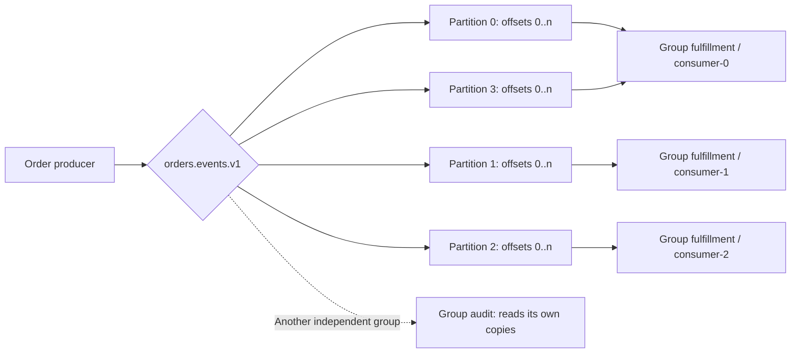
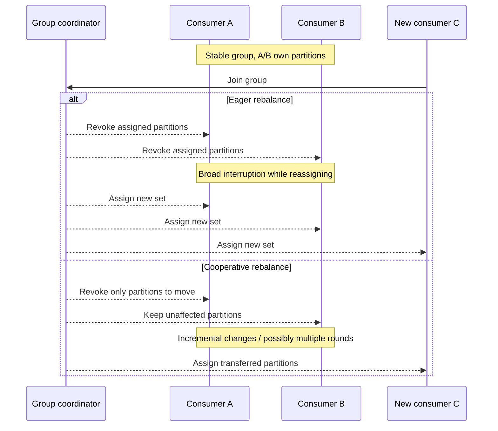
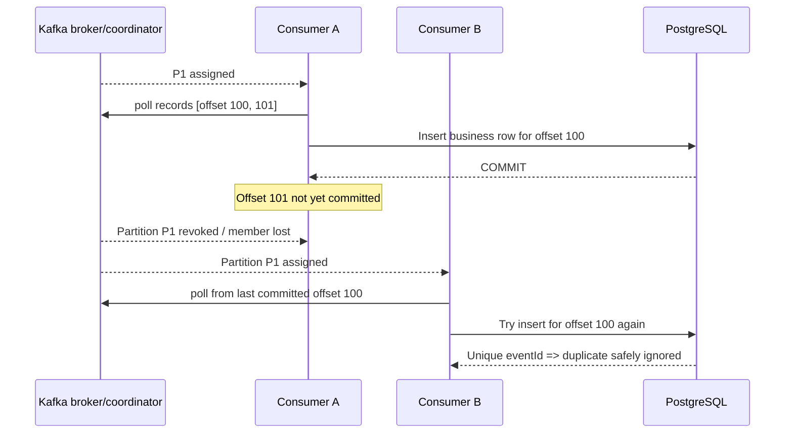
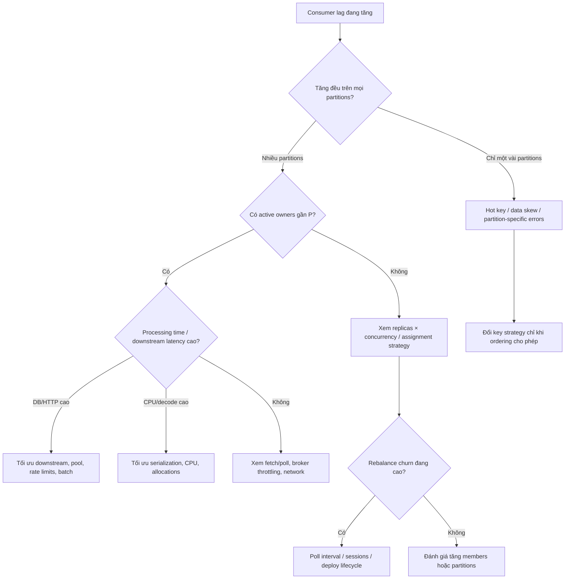
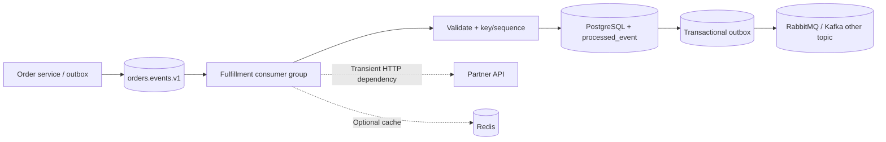
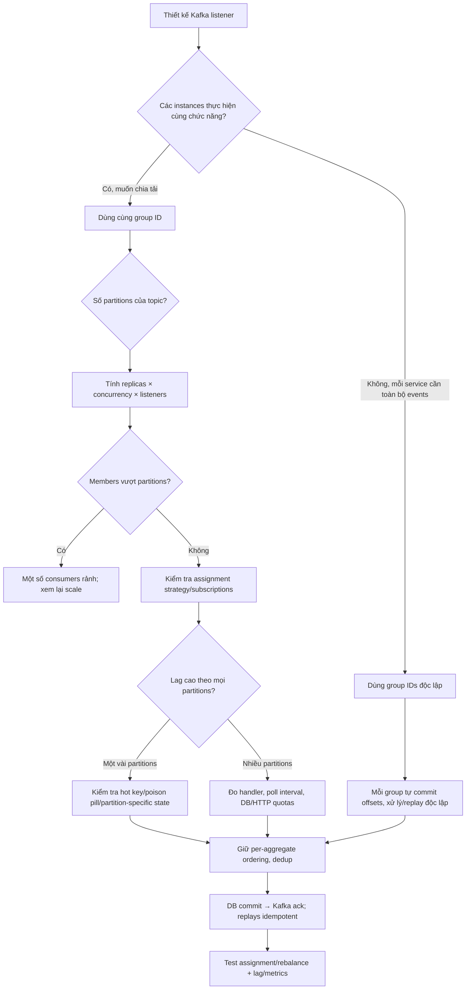

# Consumer group, concurrency và phân phối partition

> **Chương:** Apache Kafka  
> **Module:** SPRING_BOOT_INTEGRATION — tích hợp hệ thống Spring Boot qua HTTP client, cơ sở dữ liệu, cache, broker thông điệp và các adapter của Spring Integration; tập trung vào hợp đồng dữ liệu, giao dịch, lỗi, xử lý trùng lặp, kiểm thử và khả năng quan sát các luồng thực tế.

## 1. Tại sao thêm consumer không phải lúc nào cũng tăng throughput?

Giả sử một hệ thống đặt hàng có topic Kafka `orders.events.v1` gồm **6 partitions**. Một service Spring Boot nhận `OrderCreated` và ghi read model xuống PostgreSQL. Hệ thống đang dùng ba bản sao (replicas) của service, mỗi bản sao có listener container riêng.

- Nếu **cả ba consumer thuộc cùng một consumer group**, các partitions được phân chia giữa các members: mỗi partition của cùng một topic thường có **một consumer owner tại một thời điểm trong group**.
- Nếu **mỗi replica có group ID khác nhau**, mỗi group nhận bản dữ liệu của riêng mình: **ba lần xử lý logic**, không phải chia tải.
- Nếu group chỉ có một consumer nhưng listener xử lý từng record lâu, việc tăng partitions từ 6 lên 12 **không tự tăng throughput** khi chỉ có một consumer thực thi.
- Nếu một group có **10 consumers chỉ đọc một topic 6 partitions**, tối đa 6 consumers có thể sở hữu partition của topic đó; ít nhất 4 consumers không có partition để xử lý.
- Nếu một partition luôn chứa đơn hàng của khách hàng “hot”, nó có thể bị nghẽn **dù cả group còn nhiều consumers rảnh**.

Chọn sai `group.id` hoặc `concurrency` làm ứng dụng dễ bị **xử lý trùng, lệch tải, tăng chi phí, rebalance liên tục hoặc mất thứ tự nghiệp vụ**.

### 1.1. Một tình huống vận hành

```text
Topic: orders.events.v1 (6 partitions)
Group: fulfillment-service-v1

Replica A: concurrency=2  -> child consumers A-0, A-1
Replica B: concurrency=2  -> child consumers B-0, B-1
Replica C: concurrency=2  -> child consumers C-0, C-1

Total group members: 3 replicas × 2 = 6 consumers
Max active owners for this single topic: 6
```

Mô hình này phù hợp khi tải được phân bổ đủ đều giữa các partitions và mỗi consumer có khả năng xử lý records của partition được giao. Nhưng nếu tăng `concurrency=5` trên cả ba replicas, group có thể có 15 members cho chỉ 6 partitions — **không có 15 luồng đọc hữu ích**.

### 1.2. Mục tiêu học tập

Sau bài này, bạn có thể:

1. Phân biệt **topic**, **partition**, **offset**, **consumer**, **consumer group**, **group coordinator**, **group ID** và **member**.
2. Giải thích nguyên tắc mỗi partition của một topic có một consumer owner trong một group, trong khi các groups độc lập có thể đọc cùng dữ liệu.
3. Tính giới hạn parallelism từ số partitions, số ứng dụng (replicas), `@KafkaListener` concurrency và số topic được subscribe.
4. Mô tả assignment strategies, partition skew, group membership, partition revocation và rebalance.
5. Cấu hình Spring Kafka `ConcurrentMessageListenerContainer`/`@KafkaListener` cùng `group.id`, `client.id`, `concurrency`, `max.poll.records` và timeouts.
6. Thiết kế ordering dựa trên message key, offset management, idempotent consumer và transaction/outbox boundary.
7. Kiểm thử partition assignment, scale out/in, cùng group/khác group và replay bằng broker Kafka thật.
8. Theo dõi consumer lag, rebalance frequency, partition skew, duplicate processing, error handling và khả năng phục hồi.

## 2. Nền tảng: topic, partition, offset và consumer group

Kafka lưu events trong các **partition logs**. Mỗi record có topic, partition và offset; một partition sắp xếp các record theo offset tăng dần. Producer chọn partition (thường dựa vào key và partitioner). Consumer group điều phối việc các consumers cùng group chia nhau các partitions mà họ subscribe.



### 2.1. Phân biệt các khái niệm

| Khái niệm | Vai trò | Nhầm lẫn cần tránh |
| --- | --- | --- |
| **Topic** | Tên luồng records, gồm một hoặc nhiều partitions | Topic không phải một queue đơn có một con trỏ chung |
| **Partition** | Log có thứ tự offset riêng; đơn vị thường được assign cho consumer group member | Không có thứ tự toàn cục giữa các partitions |
| **Offset** | Vị trí của record **trong một partition** | Offset 10 ở partition 0 khác offset 10 ở partition 1 |
| **Consumer** | Kafka client thực hiện poll/fetch, xử lý records và offset commit | Một Spring Boot process có thể tạo nhiều consumer clients |
| **Consumer group** | Các consumers cùng `group.id` chia trách nhiệm đọc các partitions subscribe | Consumer khác group không chia tải với group hiện tại |
| **Group coordinator** | Broker điều phối membership/assignment/offset commit theo protocol | Không phải Spring bean hay consumer listener |
| **Group member** | Một consumer tham gia coordination với membership/heartbeat | Một replica không nhất thiết bằng một group member |
| **Committed offset** | Vị trí group dự kiến tiếp tục đọc trong partition | Không phải bằng chứng SQL/HTTP side effect đã commit |
| **Consumer lag** | Khoảng cách giữa vị trí đầu cuối log và vị trí tiêu thụ/commit theo định nghĩa metric | Không tự cho biết độ trễ business processing |

### 2.2. Consumer group và nhiều nhóm độc lập

```text
orders.events.v1:
  partitions: P0, P1, P2, P3

group.id=fulfillment-v1:
  consumer A <- P0, P2
  consumer B <- P1, P3

group.id=analytics-v1:
  consumer C <- P0, P1, P2, P3

Result:
  fulfillment group chia tải giữa A và B
  analytics group tự đọc cùng log theo offsets riêng
```

Như vậy **một event có thể được giao cho mỗi group**, không phải chỉ một consumer trên toàn cluster. Nếu vô tình đặt `group.id` theo random instance ID cho mỗi pod, bạn tạo **nhiều consumer groups**, khiến mọi pod đọc toàn bộ topic thay vì chia tải.

### 2.3. Quy tắc “một partition — một consumer” có điều kiện

Với subscription do Kafka group coordinator quản lý, một partition được **giao cho tối đa một member cùng group tại cùng thời điểm assignment ổn định**. Nhưng một consumer member có thể sở hữu **nhiều partitions**; nhiều topic cũng có thể cùng được assign cho một consumer.

Quy tắc này không đồng nghĩa:

- Chỉ có **một process** đọc topic trên cluster: mỗi group khác nhau vẫn đọc độc lập.
- Mỗi consumer luôn có đúng một partition: có thể có 0, 1 hoặc nhiều.
- Xử lý “exactly-once”: rebalance/crash/commit offset có thể dẫn đến redelivery.
- Records trong **nhiều partitions** có thứ tự thống nhất.
- Listener tự động rollback PostgreSQL khi consumer offset commit thất bại.

Nếu consumer sử dụng **manual partition assignment** (`assign(...)` hoặc Spring Kafka listener chỉ định partitions cụ thể) thay vì group subscription, coordinator không tự cân bằng như trên. Hai processes cấu hình thủ công cùng partition có thể đọc trùng từ những vị trí khác nhau; không dùng quy tắc group assignment để suy tính an toàn trong trường hợp này.

### 2.4. Offset được commit cho group nào?

Kafka lưu committed offsets theo bộ khóa **(group, topic, partition)**. Khi một consumer mới cùng group thay thế member cũ, nó có thể bắt đầu từ committed offset của group, không từ nơi consumer cũ đang giữ trong bộ nhớ.

```text
Topic P2:
  Record offset 100 processed in memory
  Group committed offset = 100   (next to read is offset 100)

Consumer crashes before committing 101
Replacement reads offset 100 again
Business handler must be idempotent
```

Trong Kafka, committed offset nói chung biểu thị **offset tiếp theo cần đọc**. Sau khi xử lý thành công offset 100, consumer thường commit 101. Nếu commit 101 **trước khi** PostgreSQL ghi thành công, một crash có thể làm business record bị bỏ qua mà group không đọc lại offset 100.

## 3. Tính concurrency từ partitions, replicas và group membership

### 3.1. Đơn vị concurrency của Spring Kafka

Spring Kafka `@KafkaListener` thường được quản lý bởi một `ConcurrentMessageListenerContainer`. Thuộc tính `concurrency=N` yêu cầu tạo **N child listener containers**, mỗi child thường sở hữu **một KafkaConsumer** với poll loop riêng.

Trong cùng một consumer group, nếu có:

- `R` replicas,
- mỗi replica có `L` listener containers cùng group/topic,
- mỗi listener container có `C` child consumers,

thì tổng số **consumer group members do các listener này tạo** xấp xỉ `R × L × C`, giả sử tất cả thật sự join cùng group và đang chạy. Chỉ một listener container/replica thì số members là `R × C`.

Với **một topic P partitions, không dùng manual assignment và không có topics khác**, số members có partition hữu ích bị giới hạn bởi `min(P, R × L × C)`. Những members còn lại có thể được assign **0 partitions của topic đó**.

**Không áp công thức này máy móc** cho một group subscribe nhiều topics có partition counts khác nhau: mỗi member có thể nhận nhiều partitions từ nhiều topics, assignment strategy ảnh hưởng mức độ lệch, và group membership cũng có thể khác nếu listener IDs/groups được cấu hình khác nhau.

### 3.2. Bảng tính cho topic 8 partitions

| Replicas | Concurrency/replica | Group members | Members tối đa có partition của topic 8P | Kết luận |
| ---: | ---: | ---: | ---: | --- |
| 1 | 1 | 1 | 1 | Một consumer xử lý cả 8 partitions |
| 1 | 4 | 4 | 4 | Có thể chia 8 partitions trên 4 consumers |
| 2 | 4 | 8 | 8 | Có thể đạt 8 consumer owners |
| 4 | 4 | 16 | 8 | Ít nhất 8 members rảnh với **topic duy nhất** |
| 8 | 1 | 8 | 8 | 8 replicas, mỗi replica có một consumer |
| 3 | 2 | 6 | 6 | Hai members còn thiếu so với 8 partitions, mỗi member có thể giữ nhiều |

Không phải cứ chạm `P` active owners là throughput tăng tuyến tính. Throughput còn phụ thuộc kích thước records, batch processing, CPU, network, JDBC pool, external HTTP, deserialization, broker fetch settings, hot keys và consumer lag.

### 3.3. Ví dụ partition assignment khi ổn định

```text
Topic partitions: P0 P1 P2 P3 P4 P5
Group members: C0 C1 C2

Example balanced assignment:
  C0: P0, P3
  C1: P1, P4
  C2: P2, P5

Add C3:
  Kafka triggers rebalance.
  New assignments depend on selected assignor + group protocol.
```

Đây là **minh họa một assignment hợp lệ**, không phải cam kết `RangeAssignor` hay `CooperativeStickyAssignor` phải cho đúng các mapping trên. Để kiểm tra assignment thực tế, quan sát `TopicPartition` được giao cho từng consumer/child listener, không suy từ thứ tự pod.

### 3.4. Scale out khi P không đổi

Với topic 3 partitions và một consumer group:

```text
1 pod × concurrency 1 = 1 member → 3 partitions/member
1 pod × concurrency 3 = 3 members → ~1 partition/member
2 pods × concurrency 3 = 6 members → only 3 useful owners
```

Nếu đã đạt số members bằng số partitions, thêm pods hoặc tăng concurrency **không tạo thêm parallelism trong group cho topic đó**. Cần xem xét **tăng partitions** nếu ordering/key/partitioner/throughput cho phép, hoặc giảm thời gian xử lý mỗi record, batch/async downstream hợp lý, tối ưu database, không đơn thuần tăng replicas.

### 3.5. Scale in cũng là một cuộc rebalance

Khi một pod bị hủy hoặc một child consumer dừng, coordinator có thể thu hồi partitions của member đó và giao lại cho member khác. Các partitions bị ảnh hưởng có thể tạm ngừng xử lý trong lúc chuyển ownership. Khi triển khai rolling restart, cần **graceful shutdown** cho listeners, xử lý offsets đúng và quan sát rebalance duration để tránh redelivery không mong đợi.

## 4. Assignment strategies: chia đều partitions không có nghĩa chia đều công việc

**Partition assignor** quyết định partition nào thuộc consumer member nào khi group thay đổi membership hoặc subscriptions. Với Kafka group protocol truyền thống (**classic**), client có thể cấu hình `partition.assignment.strategy`; các assignors phổ biến gồm Range, RoundRobin, Sticky và CooperativeSticky.

### 4.1. Các chiến lược thường gặp

| Strategy | Ý tưởng | Lợi ích | Giới hạn / điều kiện |
| --- | --- | --- | --- |
| `RangeAssignor` | Chia dải partitions theo từng topic cho các members subscribe topic đó | Đơn giản, assignment liên tục theo topic | Với nhiều topics có partition count nhỏ có thể dồn tải vào một số members |
| `RoundRobinAssignor` | Phân partitions của các topics theo vòng qua group members | Có thể phân bố tổng số partitions đều hơn | Cần xét subscriptions không đồng nhất, có thể chuyển ownership nhiều |
| `StickyAssignor` | Giảm số partitions bị chuyển member trong khi cố giữ cân bằng | Hữu ích cho cache locality/stateful processing | Tùy cơ chế eager/cooperative và Kafka client version |
| `CooperativeStickyAssignor` | Giữ sticky assignment với quy trình **incremental/cooperative revocation** | Thường giảm mức độ stop-the-world rebalance | Cần các members và protocol tương thích, triển khai theo giai đoạn |

**Không nhầm** partition assignor với **producer partitioner**: producer chọn partition cho record mới, còn group assignor chọn consumer nào đọc partition đã tồn tại.

### 4.2. Lệch tải với RangeAssignor khi có nhiều topics

Giả sử hai topics `orders.created` và `orders.cancelled` đều có **2 partitions**, group có ba consumers C0/C1/C2 và tất cả subscribe cả hai topics. Với một assignment kiểu Range theo topic, kết quả có thể:

```text
orders.created:    P0 -> C0, P1 -> C1
orders.cancelled:  P0 -> C0, P1 -> C1

Total:
  C0 owns 2 partitions
  C1 owns 2 partitions
  C2 owns 0 partitions
```

Điều này không chứng minh Range luôn lệch; nó cho thấy **chia từng topic** có thể làm member rảnh ngay cả khi tổng partitions là 4. Một assignor phù hợp khác có thể phân phối tổng partitions theo cách khác, phụ thuộc các members subscribe topics nào và constraints của protocol.

### 4.3. Chọn assignor không thể chỉ thay một dòng YAML

Các members trong cùng group phải **tương thích về group protocol và assignment strategy**. Khi nâng assignor:

1. Xác định Kafka broker/client versions, Spring Kafka version và group protocol hiện dùng.
2. Kiểm tra strategy mặc định của client version/BOM (không dựa theo ví dụ cũ).
3. Lập phương án rolling migration mà các members cùng group hỗ trợ.
4. Đo số partitions revocations, số lần rebalance và độ trễ trước/sau.
5. Chạy integration tests cho topics có số partitions khác nhau và nhóm subscription không đồng nhất.

Ví dụ cấu hình dành riêng cho **classic group protocol** khi client hỗ trợ:

```yaml
spring:
  kafka:
    consumer:
      properties:
        partition.assignment.strategy: org.apache.kafka.clients.consumer.CooperativeStickyAssignor
```

**Lưu ý phiên bản:** những Kafka deployments dùng **new consumer group protocol** (được giới thiệu qua KIP-848 và triển khai theo các Kafka broker/client versions thích hợp) có cơ chế **broker-side assignment**, cấu hình client/assignor khác classic. Không áp máy móc `partition.assignment.strategy` cho group đã chuyển sang protocol mới. Hãy chọn tài liệu chính xác của broker, Kafka client và Spring Kafka BOM.

### 4.4. Eager so với cooperative rebalance



Trong cơ chế cooperative, các partitions không bị chuyển có thể tiếp tục phục vụ trong nhiều tình huống; tuy nhiên **không** coi cooperative rebalance là không có pause, duplicate hoặc partition revocation. Thời điểm callback, commit và handoff vẫn phải được xử lý đúng.

### 4.5. Static membership giúp gì?

Kafka hỗ trợ **static group membership** qua `group.instance.id` để member có danh tính ổn định xuyên một số dạng restart ngắn. Trong điều kiện tương thích với protocol/broker và rollout, nó có thể giảm rebalances không cần thiết khi consumer tạm disconnect rồi trở lại.

```yaml
# Ví dụ property của một KafkaConsumer với static member ID ổn định:
spring:
  kafka:
    consumer:
      properties:
        group.instance.id: fulfillment-instance-01
```

**Tuyệt đối không cấu hình cùng một `group.instance.id` cho nhiều consumer clients đồng thời trong group.** Nếu Spring Kafka tạo nhiều child consumers khi `concurrency > 1`, cần xác định cách framework cấp/suffix IDs và mỗi replica có ID nền tảng riêng. Pod autoscaling với ephemeral identities, multi-container-per-pod và rebalance protocol version có thể khiến static membership trở nên khó vận hành; chỉ bật sau khi kiểm thử thực tế.

Static membership **không tăng parallelism vượt số partitions**, không đảm bảo không rebalance và không thay thế graceful shutdown/replay/idempotency.

### 4.6. Thêm partition vào topic có tác động

Tăng partitions (ví dụ 6 → 12) tạo thêm khả năng parallelism cho group, nhưng:

- Producer key hashing/partition mapping có thể thay đổi, khiến các events cùng key **trước/sau khi tăng partitions** không còn rơi vào cùng partition nếu partitioner dựa trên partition count.
- Những records đã nằm trong partitions cũ không tự được tái phân phối sang partitions mới.
- Có thể gây rebalance, thay đổi ownership, metrics lag và consumer cache locality.
- Nếu nghiệp vụ dựa vào ordering theo aggregate ID, cần đánh giá thay đổi routing và compatibility.
- Kafka thông thường không hỗ trợ giảm số partitions của topic hiện có theo cách “undo” tương đương; tăng P cần quyết định có kiểm soát.

Không tăng partitions chỉ để sửa một **hot key**: với cùng partitioner, hot key vẫn có thể tạo một partition nóng.

## 5. Rebalance: tại sao consumer nhận lại cùng record?

Rebalance xảy ra khi coordinator cần điều chỉnh memberships hoặc partition assignments. Nguyên nhân có thể:

- Một consumer mới join group hoặc consumer hiện tại rời group.
- Consumer chết/connection mất và vượt heartbeat/session timeout tương ứng.
- Consumer **không gọi poll kịp** so với `max.poll.interval.ms` (với classic semantics).
- Thay đổi số partitions hoặc topics mà group subscribe.
- Thay đổi subscription/assignment strategy/group protocol.
- Rolling deployment/restart gây churn.

### 5.1. Timeline rebalance khi owner thay đổi



Sơ đồ mô tả **một khả năng redelivery**. Rebalance không tự đồng nghĩa mọi record đều lặp, nhưng các records **đã xử lý ở DB mà offset chưa commit** có thể bị poll lại. Ngược lại, commit offset quá sớm trước DB commit có thể khiến business event không được thực thi lại sau crash.

### 5.2. Commit offset là “tiến độ đọc”, không phải transaction nghiệp vụ

Ví dụ xử lý:

```text
P3 offset 87: OrderCreated(eventId=evt-87)

Bad ordering:
  commit Kafka offset 88
  write PostgreSQL
  -> DB failure => record may be skipped by group

Safer at-least-once:
  write PostgreSQL transaction + unique(eventId)
  commit DB
  commit Kafka offset 88
  -> crash between commits => redelivery, dedup by eventId
```

Trong Kafka, consumer offset commit **không** giao dịch nguyên tử cùng PostgreSQL chỉ vì method có `@Transactional`. Kafka transactions/EOS có thể giải quyết một số pipeline **Kafka → Kafka** trong phạm vi cấu hình và tính tương thích; không tự biến Kafka offset + external SQL/HTTP thành một atomic distributed transaction.

### 5.3. Khi nào listener nhận revoke/assign callbacks?

Kafka client có `ConsumerRebalanceListener` để biết partitions được assign hoặc revoked (và một số protocol/versions có callback riêng cho partitions lost). Spring Kafka cũng hỗ trợ cơ chế container rebalance listener.

Ứng dụng có thể dùng callback để:

- Đo số lần partition assignment/revocation và log topic-partition identifiers.
- Giải phóng per-partition cache/locks/offset tracking khi mất ownership.
- Flush phần **đã xử lý hoàn tất** theo policy, không commit các records vẫn đang xử lý.
- Tạo/warm cache cho partitions vừa nhận nếu điều đó thực sự cần.

**Không** giữ callback trong một công việc blocking kéo dài hoặc tự commit offsets bừa bãi. Rebalance diễn ra trên critical path của group coordination; callback lâu gây chậm handoff hoặc timeout. Với asynchronous downstream workers, cần dừng nhận việc mới, chờ một budget ngắn, ghi trạng thái bền vững và để idempotent replay tiếp quản những records chưa chắc thành công.

### 5.4. Manual assignment khác auto group assignment

Spring Kafka có thể cấu hình listener trực tiếp:

```java
@KafkaListener(
        id = "fixed-orders-partition-0",
        topicPartitions = @TopicPartition(
                topic = "orders.events.v1",
                partitions = "0"))
public void onFixedPartition(String payload) {
    // Explicitly assigned P0; not coordinator load balancing.
}
```

Ví dụ fragment trên cần imports `org.springframework.kafka.annotation.KafkaListener` và `TopicPartition`. Đây là **explicit partition assignment**, hữu ích cho những yêu cầu rất đặc thù, nhưng không phải cách xây một consumer group tự động scale trong Kubernetes. Nếu hai ứng dụng cùng cấu hình listen partition 0 theo kiểu manual, cả hai có thể cùng đọc riêng bất kể bạn mong group balance.

## 6. Ordering: Kafka giữ thứ tự trong partition, không trong toàn topic

Kafka chỉ đảm bảo thứ tự offset **trong từng partition log**. Khi producer gửi records có cùng routing key và partitioner chọn cùng partition, consumer có thể xử lý chúng theo thứ tự đọc của partition **nếu ứng dụng không phá thứ tự bằng xử lý song song bất đồng bộ**.

### 6.1. Dùng business key làm record key

```java
// Producer minh họa: cùng orderId thường được partitioner đưa vào cùng P.
kafkaTemplate.send(
        "orders.events.v1",
        event.orderId(),
        event);
```

Việc key-based partitioning phụ thuộc configured partitioner, serializer và số partitions. Với một setup thông dụng, các events cho một `orderId` sẽ cùng partition **khi partitioning config ổn định**; không khẳng định điều này tuyệt đối sau khi thay đổi số partitions/partitioner.

### 6.2. Hai keys khác nhau không có global order

```text
Partition 0: Order A created  → Order A paid
Partition 1: Order B created  → Order B cancelled

No guaranteed global order:
  A created / B created / A paid / B cancelled
could be interleaved differently among consumers.
```

Nếu fulfillment yêu cầu “không xử lý Paid trước Created **cho cùng order**”, dùng cùng aggregate key, one-partition logical routing, và kiểm tra version/sequence. Nếu yêu cầu thứ tự toàn hệ thống, một topic nhiều partitions không tự cung cấp; phải thiết kế ordering/coordination bổ sung với chi phí throughput.

### 6.3. Concurrency không mặc định phá per-partition order

Khi Spring Kafka tạo nhiều child consumers trong một group, **mỗi partition vẫn có một owner**; listener xử lý tuần tự trên poll thread của child (trừ khi bạn tự offload/asynchronous processing). Vì vậy tăng `concurrency` để xử lý **các partitions khác nhau song song** thường giữ thứ tự poll trong từng partition.

Ngược lại, nếu listener:

```java
@KafkaListener(topics = "orders.events.v1")
void receive(OrderEvent event) {
    executor.submit(() -> process(event));
    // Return immediately without waiting for durable completion.
}
```

thì events trong **cùng partition** có thể hoàn tất sai thứ tự; offset cũng có thể được ACK/commit quá sớm so với DB operation. Đây là **anti-pattern minh họa**; `executor` và `process` là giả định. Nếu buộc phải offload, dùng per-key serial executor, quản lý in-flight/ack contiguous offsets và backpressure, đồng thời test rebalances/cancellation kỹ.

### 6.4. Hot partition và key skew

Nếu một khách hàng tạo 70% traffic và producer dùng `customerId` làm key, 70% records có thể dồn vào một partition. Tăng consumers từ 4 lên 12 không giúp partition đó được chia cho hai members cùng group.

Các cách xử lý tùy business contract:

- Đổi key từ `customerId` sang `orderId` nếu chỉ cần ordering theo order, không cần ordering mọi order của cùng customer.
- Tối ưu handler của hot partition (batch SQL, cache có giới hạn, tránh HTTP blocking khi có thể).
- Tách các workstreams có semantics khác nhau ra topics khác nhau.
- Nếu buộc “shard” hot key, thiết kế aggregate sequence/ordering reconciliation vì chia key thành nhiều partitions **đánh đổi thứ tự**.

Không “fix” bằng cách random key cho các events của cùng order mà vẫn tuyên bố đã giữ per-order order.

## 7. Cấu hình Spring Boot consumer group và concurrency

Các ví dụ nhắm **Java 17+, Spring Boot 3.2–3.5, Spring Kafka 3.x và Kafka client/broker tương thích**. Kafka group coordination thay đổi đáng kể giữa các dòng broker/client gần đây; khi dùng Spring Boot 4.x hoặc Kafka 4.x, cần đối chiếu dependency management và semantics của **classic group protocol so với consumer group protocol**. Không trộn phiên bản Kafka clients/Spring Kafka trái BOM chỉ để bật một thuộc tính.

### 7.1. Dependency Gradle

```groovy
// Project đã áp dụng Spring Boot Gradle plugin/BOM.
dependencies {
    implementation 'org.springframework.kafka:spring-kafka'
    implementation 'org.springframework.boot:spring-boot-starter-jdbc'
    runtimeOnly 'org.postgresql:postgresql'

    testImplementation 'org.springframework.boot:spring-boot-starter-test'
    testImplementation 'org.springframework.kafka:spring-kafka-test'
    testImplementation 'org.springframework.boot:spring-boot-testcontainers'
    testImplementation 'org.testcontainers:junit-jupiter'
    testImplementation 'org.testcontainers:kafka'
    testImplementation 'org.testcontainers:postgresql'
}
```

Chỉ thêm JDBC nếu listener lưu dữ liệu PostgreSQL như ví dụ. Nếu ứng dụng chỉ đọc và ghi Kafka, không cần dependency JDBC. Dùng `org.springframework.kafka:spring-kafka` do Boot quản lý, không khai báo Kafka client version riêng trừ khi đã kiểm tra tương thích.

### 7.2. application.yml: cấu hình một group

```yaml
app:
  kafka:
    order-topic: orders.events.v1
    order-group: fulfillment-service-v1
    order-concurrency: ${ORDER_CONCURRENCY:3}

spring:
  kafka:
    bootstrap-servers: ${KAFKA_BOOTSTRAP_SERVERS:localhost:9092}
    consumer:
      group-id: ${KAFKA_CONSUMER_GROUP:fulfillment-service-v1}
      key-deserializer: org.apache.kafka.common.serialization.StringDeserializer
      value-deserializer: org.apache.kafka.common.serialization.StringDeserializer
      enable-auto-commit: false
      auto-offset-reset: earliest
      max-poll-records: 200
      properties:
        max.poll.interval.ms: 300000
    producer:
      key-serializer: org.apache.kafka.common.serialization.StringSerializer
      value-serializer: org.apache.kafka.common.serialization.StringSerializer
    listener:
      concurrency: ${ORDER_CONCURRENCY:3}
      ack-mode: manual_immediate
```

Ý nghĩa:

| Property | Mục tiêu | Sai lầm thường gặp |
| --- | --- | --- |
| `bootstrap-servers` | Broker bootstrap endpoints | Nhầm DNS/advertised listeners trong Docker/Kubernetes |
| `group-id` | Consumer group chia tải và offsets | Tạo ID mới ngẫu nhiên theo pod khiến mọi pod đọc toàn topic |
| `enable-auto-commit=false` | Không để Kafka client tự commit theo chu kỳ ngoài ý muốn | Vẫn quên cấu hình cách listener ACK/commit |
| `auto-offset-reset=earliest` | Áp dụng khi group **không có committed offset hợp lệ** | Nghĩ rằng đổi property sẽ replay toàn bộ data của group có offsets |
| `max-poll-records` | Giới hạn số records trả về mỗi poll | Nghĩ rằng đây là giới hạn fetch bytes hoặc throughput cố định |
| `max.poll.interval.ms` | Giới hạn khoảng thời gian giữa các lần poll hợp lệ | Handler block quá lâu làm member bị coi không còn tiến triển |
| `listener.concurrency` | Số child consumers mặc định trên listener factory | Quên nhân với replicas và listener containers khác |
| `ack-mode=manual_immediate` | Listener quyết định khi nào ACK theo semantics Spring Kafka | ACK trước khi DB commit hoặc từ thread khác không được thiết kế |

**Về duplicate group configuration:** nếu annotation có `@KafkaListener(groupId=...)` thì giá trị ở annotation có thể **override `spring.kafka.consumer.group-id`** cho listener đó. Nên chọn một nguồn cấu hình rõ; ví dụ dưới dùng property `app.kafka.order-group` để thể hiện group trực tiếp trên listener.

**Về earliest:** với một group đã có committed offsets, consumer tiếp tục từ offsets đó, không tự quay về đầu chỉ vì bạn sửa `auto-offset-reset`. Muốn replay có chủ đích, dùng group mới hoặc offset reset/quản lý consumer dừng có kiểm soát và đánh giá idempotency.

### 7.3. Một listener có concurrency định rõ

```java
// OrderEventListener.java
import org.apache.kafka.clients.consumer.ConsumerRecord;
import org.springframework.kafka.annotation.KafkaListener;
import org.springframework.kafka.support.Acknowledgment;
import org.springframework.stereotype.Component;

@Component
public class OrderEventListener {
    private final OrderEventProcessor processor;

    public OrderEventListener(OrderEventProcessor processor) {
        this.processor = processor;
    }

    @KafkaListener(
            id = "fulfillment-orders-listener",
            topics = "${app.kafka.order-topic}",
            groupId = "${app.kafka.order-group}",
            concurrency = "${app.kafka.order-concurrency:3}")
    public void receive(
            ConsumerRecord<String, String> record,
            Acknowledgment acknowledgment) {

        // Method này không @Transactional.
        // Service bên dưới commit PostgreSQL trước khi trả về.
        processor.process(record.value());
        acknowledgment.acknowledge();
    }
}
```

Ở đây `processor.process(...)` là method service **được Spring proxy** quản lý transaction; nó return sau khi transaction commit hoàn tất hoặc ném exception. Chỉ sau đó listener mới gọi `acknowledge()`. Khi xử lý lỗi, Spring Kafka common error handler/container policy có thể redeliver hoặc đưa record vào DLT theo cấu hình; **không tự ACK trong catch rồi nuốt exception**.

Nếu đã khai báo `concurrency` ngay trên annotation, nó sẽ ưu tiên cho listener này so với concurrency mặc định của factory, tùy version framework; giữ một nguồn chuẩn để vận hành dễ hiểu. Concurrency là số child KafkaConsumers **mỗi application instance**, không phải số threads Kafka cluster sẽ cấp toàn cục.

### 7.4. DTO và PostgreSQL idempotency

```java
// OrderEvent.java — simplified event contract.
import java.time.Instant;

public record OrderEvent(
        String eventId,
        String orderId,
        String type,
        Instant occurredAt) {
}
```

Database schema tối thiểu cho listener:

```sql
CREATE TABLE processed_event (
    consumer_name VARCHAR(100) NOT NULL,
    event_id VARCHAR(120) NOT NULL,
    processed_at TIMESTAMPTZ NOT NULL DEFAULT CURRENT_TIMESTAMP,
    PRIMARY KEY (consumer_name, event_id)
);

CREATE TABLE order_projection (
    order_id VARCHAR(120) PRIMARY KEY,
    state VARCHAR(60) NOT NULL,
    last_event_at TIMESTAMPTZ NOT NULL
);
```

Ví dụ service dùng JDBC:

```java
// OrderEventProcessor.java
import com.fasterxml.jackson.core.JsonProcessingException;
import com.fasterxml.jackson.databind.ObjectMapper;
import java.util.Set;
import org.springframework.dao.DataIntegrityViolationException;
import org.springframework.jdbc.core.JdbcTemplate;
import org.springframework.stereotype.Service;
import org.springframework.transaction.annotation.Transactional;

@Service
public class OrderEventProcessor {
    private final JdbcTemplate jdbc;
    private final ObjectMapper mapper;

    public OrderEventProcessor(
            JdbcTemplate jdbc, ObjectMapper mapper) {
        this.jdbc = jdbc;
        this.mapper = mapper;
    }

    @Transactional
    public void process(String json) {
        OrderEvent event;
        try {
            event = mapper.readValue(json, OrderEvent.class);
        } catch (JsonProcessingException malformed) {
            throw new InvalidPartnerEventException(
                    "Invalid order event JSON", malformed);
        }

        if (event == null
                || event.eventId() == null
                || event.eventId().isBlank()
                || event.orderId() == null
                || event.orderId().isBlank()
                || event.occurredAt() == null
                || event.type() == null
                || !Set.of("CREATED", "CONFIRMED")
                        .contains(event.type())) {
            throw new InvalidPartnerEventException(
                    "Missing required fields or unknown event type");
        }

        int inserted = jdbc.update("""
                INSERT INTO processed_event
                    (consumer_name, event_id)
                VALUES (?, ?)
                ON CONFLICT (consumer_name, event_id) DO NOTHING
                """, "fulfillment-v1", event.eventId());

        if (inserted == 0) {
            // Duplicate event already processed and committed.
            return;
        }

        jdbc.update("""
                INSERT INTO order_projection
                    (order_id, state, last_event_at)
                VALUES (?, ?, ?)
                ON CONFLICT (order_id) DO UPDATE
                SET state = EXCLUDED.state,
                    last_event_at = EXCLUDED.last_event_at
                WHERE order_projection.last_event_at
                      <= EXCLUDED.last_event_at
                """,
                event.orderId(),
                event.type(),
                java.sql.Timestamp.from(event.occurredAt()));
    }
}
```

Exception riêng do ứng dụng định nghĩa:

```java
public final class InvalidPartnerEventException
        extends RuntimeException {
    public InvalidPartnerEventException(String message) {
        super(message);
    }

    public InvalidPartnerEventException(
            String message, Throwable cause) {
        super(message, cause);
    }
}
```

**Quan trọng về tính đúng đắn:** ví dụ dùng `ON CONFLICT DO NOTHING` trên `(consumer_name,event_id)` để một event chỉ cập nhật projection một lần trong **cùng PostgreSQL transaction**. Một event trùng nếu transaction trước đã commit sẽ không ghi lại projection. Nếu PostgreSQL transaction đầu rollback, marker cũng rollback và lần retry có thể xử lý bình thường.

Trong production, nên lưu thêm **schema version và payload fingerprint/hash** cùng inbox marker: nếu nhà sản xuất dùng lại cùng `eventId` cho nội dung khác, consumer phải phát hiện **ID collision/payload mismatch** chứ không bỏ qua silently. Một duplicate hợp lệ phải có cùng logical event identity.

Điều kiện timestamp ở `order_projection` chỉ là bảo vệ thô cho ví dụ; **event time không phải thứ tự nghiệp vụ đáng tin cậy** vì đồng hồ nguồn có thể lệch. Trong production, nên dùng aggregate version/sequence từ producer (và bảo đảm ordering theo key) để chống event cũ ghi đè state mới. Nếu event schema/version không hỗ trợ, phải xác định rõ rủi ro và reconciliation.

Method listener trên intentionally không `@Transactional`: service `process()` qua Spring proxy có JDBC transaction riêng, hoàn tất commit trước khi caller ACK Kafka. Nếu application có nhiều datasource/transaction managers, cần chỉ rõ manager bằng `@Transactional(transactionManager="...")`; không giả định auto wiring chọn đúng.

### 7.5. Vì sao Acknowledgment không dùng trong mọi listener?

Spring Kafka hỗ trợ nhiều **AckMode** như RECORD, BATCH, MANUAL và MANUAL_IMMEDIATE. Với `AckMode.RECORD` hoặc `BATCH`, container kiểm soát commit dựa trên việc listener trả về thành công, khác manual acknowledgment. Chọn một strategy nhất quán:

| Ack mode | Đặc điểm thường gặp | Khi phù hợp |
| --- | --- | --- |
| `RECORD` | Container tiến hành commit sau khi xử lý record theo batch/poll semantics của container | Đơn giản cho synchronous listener |
| `BATCH` | Commit khi các records trả từ một `poll()` được xử lý | Throughput tốt, tăng vùng có thể redeliver |
| `MANUAL` | Listener chủ động ACK, commit có thể được xử lý khi theo lịch/container rule | Cần chủ động kiểm soát hoàn tất |
| `MANUAL_IMMEDIATE` | ACK trên consumer thread có thể kích hoạt commit ngay theo cấu hình | Muốn xác nhận sau DB commit, giảm vùng pending |

**Không tuyên bố `MANUAL_IMMEDIATE` là Kafka exactly-once.** Kafka commit và JDBC commit vẫn là hai thao tác riêng; crash ở giữa có thể tạo redelivery. Ngoài ra, commit có thể là sync/async theo container setting, và lỗi commit phải được xử lý; không giả định `acknowledge()` luôn là broker ACK bền vững khi method trả.

### 7.6. Kiểm tra group IDs khi nhiều @KafkaListener

```java
// Hai listener sau sẽ cùng chia các partitions nếu cùng group/subscription.
@KafkaListener(
        id = "fulfillment-orders",
        topics = "orders.events.v1",
        groupId = "fulfillment-v1")
void processOrders(String json) { /* ... */ }

@KafkaListener(
        id = "fulfillment-orders-extra",
        topics = "orders.events.v1",
        groupId = "fulfillment-v1")
void processOrdersExtra(String json) { /* ... */ }
```

Đây là **fragment minh họa**; nếu hai listeners cùng group và cùng topic thì Kafka chia partitions giữa chúng: **không có chuyện cả hai listeners luôn nhận mọi event**. Nếu mục tiêu là hai **business projections độc lập**, hãy cấp **hai group IDs** (và idempotent/inbox namespace riêng). Ngược lại, nếu hai listeners là các workers cùng chức năng, một group ID có thể phù hợp để chia tải.

Với listener factory/container ID khác group ID, xem xét Spring Kafka `idIsGroup`/annotation groupId semantics. Đặt `groupId` tường minh giúp tránh lỗi đổi listener ID vô tình làm đổi consumer group và bắt đầu đọc offsets khác.

## 8. Poll loop và thời gian xử lý: concurrency không giải quyết listener block vô hạn

Kafka consumer poll loop chịu các giới hạn:

- `max.poll.records`: số records tối đa trả mỗi `poll()`, không phải giới hạn max bytes trên network.
- `max.poll.interval.ms`: khoảng thời gian tối đa cho tiến độ poll ở classic group membership; listener xử lý quá lâu dễ mất membership/trigger rebalance.
- `session.timeout.ms` và `heartbeat.interval.ms` (classic): coordinator phát hiện member không còn heartbeats trong ngưỡng; quan hệ và cấu hình khác ở protocol mới.
- `fetch.min.bytes`/`fetch.max.wait.ms`: cân bằng fetch latency và batch efficiency.
- `max.partition.fetch.bytes`/`fetch.max.bytes`: ảnh hưởng memory/network fetch, cần xử lý message lớn.
- `isolation.level=read_committed` khi chỉ muốn đọc records đã commit của Kafka transactional producer; không tác động tới PostgreSQL transaction.

### 8.1. Bẫy 500 records × 2 giây

```text
max.poll.records = 500
handler latency = 2 seconds per record, sequential
worst processing time = 500 × 2 s = 1000 seconds
max.poll.interval.ms = 300 seconds

Consequence: poll progress deadline violated;
group rebalance / failed commits / redelivery become possible.
```

Không giải bằng cách tăng `max.poll.interval.ms` lên nhiều giờ nếu bản chất handler đang gọi external HTTP vô hạn. Có thể giảm `max.poll.records`, tối ưu batch DB, chia workload sang worker queue với ACK/cursor design rõ, thêm partitions/consumers hoặc tách external operation thành durable workflow.

### 8.2. max.poll.records không phải số records commit cùng lúc

Khi consumer poll 200 records, `AckMode.RECORD` có thể quản lý commit theo record, trong khi `AckMode.BATCH` sau poll sẽ làm khác. Thực tế commit frequency còn phụ thuộc container properties (sync/async commits, ackTime/ackCount nếu mode phù hợp, transactions). Đừng suy từ `max.poll.records=200` rằng Kafka commit chính xác mỗi 200 records.

### 8.3. Pause/resume không thay rebalance hay backpressure toàn hệ thống

Spring Kafka listener containers có pause/resume support; pause một consumer/partition có thể tránh fetch thêm dữ liệu tạm thời trong khi handler xử lý quá tải. Nhưng:

- Consumer vẫn cần **poll/heartbeat** đúng protocol; pause không đồng nghĩa tắt group membership.
- Nếu backlog nằm ở database/HTTP/Redis, cần rate limit và circuit breaker ở downstream.
- Nếu đã trả về từ listener và ACK nhưng side effect còn xử lý bất đồng bộ, pause không sửa được lost records.
- Khi scale Kafka consumers, tăng active owners có thể đẩy tải quá sức vào Hikari pool hoặc HTTP partner; đo downstream capacity.

### 8.4. Một KafkaConsumer không dùng từ nhiều threads

KafkaConsumer client **không thread-safe** cho các thao tác poll/commit/seek/assignment thông thường. Spring Kafka container quản lý poll loop và consumer thread; không tự gọi `consumer.poll(...)`, `commitSync(...)` hoặc `seek(...)` từ arbitrary worker thread.

Trong listener, nếu cần asynchronous external jobs, lưu task bền vững với eventId, backpressure/in-flight limit và xác nhận offset sau ranh giới an toàn; hoặc giao cho một service/worker khác qua outbox/broker thay vì chuyển thẳng `ConsumerRecord` cho thread pool rồi ACK ngay.

## 9. Xử lý lỗi, poison pill và offset commit khi có nhiều consumers

### 9.1. Ba nhóm lỗi cần phân loại

| Loại lỗi | Ví dụ | Phản ứng phù hợp |
| --- | --- | --- |
| **Transient infrastructure** | PostgreSQL unavailable, Kafka broker mất kết nối, API trả 503 | Backoff/retry có budget, giữ record chưa ACK nếu chưa xử lý |
| **Permanent data/contract** | JSON malformed, schema version không hỗ trợ, field required null | DLT/quarantine và alert có audit, tránh retry vô hạn |
| **Business duplicate/conflict** | `eventId` đã xử lý, aggregate version cũ | Idempotent skip hoặc domain conflict theo contract, không coi là transport outage |

Một record poison pill không thể parse có thể khiến cả partition **liên tục bị đọc lại** nếu error handler retry vô hạn mà không có recovery policy. Nhưng nếu error handler tự commit vượt qua record mà **không lưu failure event ở DLT/audit**, dữ liệu nghiệp vụ có thể mất vĩnh viễn.

### 9.2. Consumer group concurrency và DLT

DLT (dead-letter topic) thường dùng cho records không thể xử lý sau số lần retry đã giới hạn. Một chiến lược điển hình trong Spring Kafka:

```java
import org.springframework.context.annotation.Bean;
import org.springframework.context.annotation.Configuration;
import org.springframework.kafka.core.KafkaTemplate;
import org.springframework.kafka.listener.CommonErrorHandler;
import org.springframework.kafka.listener.DeadLetterPublishingRecoverer;
import org.springframework.kafka.listener.DefaultErrorHandler;
import org.springframework.util.backoff.FixedBackOff;

@Configuration(proxyBeanMethods = false)
public class OrderKafkaErrorHandling {

    @Bean
    CommonErrorHandler ordersErrorHandler(
            KafkaTemplate<String, String> kafkaTemplate) {

        DeadLetterPublishingRecoverer recoverer =
                new DeadLetterPublishingRecoverer(kafkaTemplate);

        DefaultErrorHandler handler =
                new DefaultErrorHandler(
                        recoverer, new FixedBackOff(1000L, 2L));

        handler.addNotRetryableExceptions(
                InvalidPartnerEventException.class);
        return handler;
    }
}
```

Mẫu này dành cho **listener nhận `String` key/value** ở mục 7, có producer `StringSerializer` tương ứng trong application.yml; nó diễn đạt **retry có giới hạn rồi chuyển sang DLT** thay vì nuốt exception. Nếu ứng dụng dùng `JsonDeserializer`, `byte[]` hoặc `ErrorHandlingDeserializer`, hãy tạo **DLT producer/serializer tương thích từng loại value thực tế** và kiểm thử poison pill; `KafkaTemplate<String,String>` không phải template phổ quát để phát mọi payload.

Mặc định của `DeadLetterPublishingRecoverer` có cơ chế chọn topic-partition cho DLT dựa trên original topic/partition trong nhiều cấu hình; **phải bảo đảm DLT topic tồn tại với partitions phù hợp**, hoặc tự định nghĩa destination resolver. Nếu poison pill nằm ở partition 5 mà DLT chỉ có 1 partition và resolver vẫn chọn 5, việc phát DLT có thể thất bại. Không coi “handler đã gọi recoverer” là “message đã lưu an toàn”.

`FixedBackOff(1000L, 2L)` biểu thị các retry với khoảng chờ cố định theo API Spring Retry/backoff của Spring Kafka; tổng attempts và thời gian còn phụ thuộc container/error handler behavior. Cần test cả số lần business handler được gọi và khi nào record được chuyển DLT.

### 9.3. Commit offset sau DLT có được phép?

Một ứng dụng có thể coi “đã lưu record vào DLT có ACK đáng tin” là một bước recovery hoàn tất để tiến lên offset tiếp theo. Nhưng:

1. DLT publish phải có producer acks/durability phù hợp.
2. Phải xác định behavior khi DLT publish thất bại; đừng silently advance source offset.
3. Với `MANUAL_IMMEDIATE`, Spring Kafka có hỗ trợ những cấu hình commit recovered offsets như `DefaultErrorHandler.setCommitRecovered(true)`, nhưng semantics phụ thuộc listener/container version và cấu hình.
4. DLT event cần giữ original topic/partition/offset, error category đã sanitize, eventId/correlation để re-drive.
5. Re-drive DLT phải có rate limit, deduplication và ordering policy.

Không “fix” poison pill bằng cách bật `auto-offset-reset=latest` để bỏ qua toàn bộ backlog. Property này chỉ ảnh hưởng trường hợp không có committed offset hợp lệ, không phải recovery state của một partition đang lỗi.

### 9.4. Deserialization failure có thể xảy ra trước listener

Nếu Kafka consumer cấu hình `JsonDeserializer` và gặp JSON không hợp lệ, lỗi có thể xảy ra **trong deserializer trước khi `@KafkaListener` được gọi**. Một `try/catch` đặt bên trong listener sẽ **không bắt được lỗi này**.

Giải pháp trong Spring Kafka thường gồm:

- Dùng `ErrorHandlingDeserializer` bọc deserializer thực, kết hợp error handler thích hợp.
- Chọn JSON trusted packages/type headers có allowlist, tránh deserialize class tùy ý từ dữ liệu bên ngoài.
- Hoặc deserialize `String`/`byte[]` ở listener và validate trước khi lưu DB, như ví dụ mục 7; method khi đó nhận invalid JSON và phát `InvalidPartnerEventException`.
- Test poison pill tới broker thật, kiểm tra retry/DLT và không block toàn group mãi.

Không dùng `JsonDeserializer.TRUSTED_PACKAGES="*"` tùy tiện trong các môi trường có producer không tin cậy.

### 9.5. Retry và ordering trong partition

Một record tại offset 101 bị lỗi nhưng offset 102 chứa thông tin liên quan cùng order. Nếu cố chạy offset 102 trước khi xử lý hoặc quarantine offset 101, bạn có thể làm hỏng state machine. Lựa chọn phải có chính sách:

- **Stop/retry partition:** giữ order trong partition nhưng chặn các records sau; tăng consumer lag.
- **DLT/quarantine rồi advance:** giúp group tiếp tục nhưng ứng dụng phải xử lý downstream out-of-order/missing business event.
- **Retry topic:** có thể giải phóng partition chính nhưng thay đổi ordering, yêu cầu event version/sequence và dedup.

Không có một chiến lược tự động đúng cho mọi nghiệp vụ. Ví dụ báo giá realtime có thể chấp nhận bỏ record lỗi; tài chính/fulfillment có thể cần pause và can thiệp để không bỏ một transition bắt buộc.

## 10. Điều phối nhiều replicas trên Kubernetes

### 10.1. Đếm group members khi autoscaling

Một deployment với:

```yaml
apiVersion: apps/v1
kind: Deployment
metadata:
  name: fulfillment-consumer
spec:
  replicas: 3
  selector:
    matchLabels:
      app: fulfillment-consumer
  template:
    metadata:
      labels:
        app: fulfillment-consumer
    spec:
      containers:
        - name: app
          image: example.registry.invalid/fulfillment:1.0
          env:
            - name: ORDER_CONCURRENCY
              value: "2"
            - name: KAFKA_CONSUMER_GROUP
              value: fulfillment-service-v1
```

Đây là **deployment fragment**; ứng dụng còn cần bootstrap servers, TLS/SASL secrets, probes, resources, shutdown grace và network policy. Với 3 replicas, concurrency 2, một listener container, group có khoảng **6 consumer clients** khi toàn bộ pods sẵn sàng.

Không gán group ID dựa trên `HOSTNAME`/pod UID nếu mục tiêu là scale-out cùng group. Cũng không gán client ID y hệt tuyệt đối cho tất cả consumers nếu metrics/tracing cần phân biệt: Spring Kafka có thể suffix client IDs cho child containers; nên kiểm tra naming thực tế.

### 10.2. Hướng dẫn lựa chọn replicas và concurrency

| Lựa chọn | Ưu điểm | Đánh đổi |
| --- | --- | --- |
| Nhiều replicas, concurrency 1 | Isolation process/pod, memory CPU riêng, dễ scale theo HPA | Nhiều JVM, network connections, group churn khi scale |
| Ít replicas, concurrency lớn | Tận dụng JVM, ít pod overhead | Cùng failure domain, chung CPU/heap/DB pool |
| Replicas × concurrency gần P | Thường dùng hiệu quả partitions cho một topic | Chưa chắc tối ưu với hot keys/multi-topics |
| Replicas × concurrency lớn hơn P | Có dư members cho một số tình huống chuyển đổi | Consumers rảnh vẫn tốn connections/memory |
| Tăng P | Tăng trần parallelism | Thay đổi key distribution/ordering, metadata/storage overhead |

Trong mọi lựa chọn, đo **lag theo partition**, CPU, memory, processing latency, DB pool wait và rate limit của external API. Nếu consumer records cần gọi payment REST API chậm, tăng concurrency không giới hạn có thể gây **retry storm** ở đối tác.

### 10.3. Graceful shutdown và rolling deployment

Khi pod nhận `SIGTERM`:

1. Dừng nhận công việc business mới, để listener/container có cơ hội hoàn tất records đang xử lý trong shutdown grace.
2. Đảm bảo PostgreSQL commit/rollback xong trước Kafka offset ACK theo policy.
3. Không hứa mọi records đang in-flight sẽ hoàn tất nếu Kubernetes grace period bị cắt ngắn.
4. Sau khi member rời group, coordinator assign partitions cho consumers khác.
5. Những records chưa commit offset có thể đọc lại; unique eventId/inbox xử lý duplicate.

Kubernetes `terminationGracePeriodSeconds`, container `shutdownTimeout` và processing budget cần tương thích; không đặt grace 5 giây trong khi mỗi batch có thể mất 2 phút. Tuy nhiên **không tăng timeout quá lớn để che lỗi handler block**; phải đo và giảm processing time.

### 10.4. Scale-to-zero có nghĩa gì?

Nếu tất cả consumer replicas dừng:

- Kafka topic vẫn giữ records theo **retention/compaction policy**, không đợi consumers mãi mãi nếu retention hết.
- Group committed offsets vẫn có thể tồn tại trong Kafka nhưng còn phụ thuộc retention của group metadata/offsets.
- Khi consumers khởi động lại, chúng đọc từ committed offsets còn hợp lệ hoặc xử lý theo `auto-offset-reset` nếu không có offset.
- Lag tăng trong thời gian không có consumers; SLA xử lý cần tính cả khoảng thời gian đó.

Không xem “Kafka lưu được dữ liệu” là bảo đảm một consumer dừng nhiều tháng rồi vẫn đọc lại toàn bộ: retention của topic và offsets là ràng buộc quan trọng.

## 11. Monitoring đúng: lag, assignment, rebalance và processing latency

### 11.1. Consumer lag là gì?

Một cách đo thông dụng ở mỗi partition:

```text
lag = log end offset (LEO) - committed offset

Example:
  LEO = 1050
  group committed offset = 1020
  approximate lag = 30 records
```

Định nghĩa chi tiết của các metrics có thể khác (fetch position lag, committed offset lag, end offset theo isolation level). Khi dùng `read_committed`, Last Stable Offset và records đang trong transactions làm cách giải thích lag phức tạp hơn. Không áp công thức này vô điều kiện cho mọi dashboard/metric tên “lag”.

Lag gần bằng 0 **không đảm bảo business state đã cập nhật** nếu ứng dụng ACK sớm trước DB commit, hoặc đẩy công việc sang executor rời rạc rồi commit offset. Ngược lại, lag tăng có thể do consumer cố tình pause để bảo vệ downstream.

### 11.2. Metrics cần đo

| Signal | Câu hỏi | Cảnh báo |
| --- | --- | --- |
| Committed offset lag theo topic-partition/group | Group đang chậm ở partition nào? | Hot partition/backlog không giảm |
| Partition assignment count per member | Members có nhận đúng số partitions? | Active members lớn hơn P, mất assignment |
| Rebalance count/rate/duration | Group có churn không? | Rolling deploy, session timeouts, protocol mismatch |
| Records consumed/s và bytes consumed/s | Tốc độ đọc thực | Low throughput dù broker còn data |
| Listener processing p95/p99 | Handler/DB/HTTP chậm bao nhiêu? | Tiệm cận `max.poll.interval.ms` |
| Poll duration/idle ratio | Consumer đợi data hay block xử lý? | Poll loop không tiến triển |
| Commit failures/latency | Có commit offset an toàn không? | Redelivery/churn |
| Retry, DLT, poison pill count | Business records đang bị từ chối? | Quarantine backlog |
| Duplicate eventId/inbox conflicts | Có redeliver sau crash/rebalance? | At-least-once expectation tăng |
| Hikari pool wait/DB deadlocks | Downstream đang nghẽn? | Tăng consumers chỉ làm tệ hơn |
| JVM CPU, heap, GC | Client overloaded? | OOM/long pauses gây rebalances |
| Kafka broker fetch throttling/network | Broker bị bottleneck? | Producer/consumer throughput xuống |

Spring Kafka có observation/Micrometer instrumentation tùy version, Boot Actuator và config. Kafka Java clients cũng có metrics riêng. **Không mặc định** tất cả những counters/timers trên tự xuất hiện chỉ vì thêm `spring-kafka`. Cần xác định endpoint metrics, metric labels, exporter và custom business instrumentation.

### 11.3. Cardinality và bảo mật

Cho phép các labels có giá trị tương đối hữu hạn:

```text
service=fulfillment
group=fulfillment-service-v1
topic=orders.events.v1
partition=2
consumerClientId=fulfillment-orders-listener-1
outcome=SUCCESS|RETRY|DLT
```

Không dùng `orderId`, `customerId`, `eventId`, raw payload, token hoặc full error message làm metric labels. Những giá trị này có thể tạo số lượng time series khổng lồ và lộ dữ liệu cá nhân. Khi cần điều tra một event, dùng audit/inbox/outbox store có quyền truy cập, trace ID được kiểm soát và log sanitize.

### 11.4. Đọc assignment thực tế từ Spring Kafka container

```java
// Fragment trong service/diagnostics đã inject registry.
import org.springframework.kafka.config.KafkaListenerEndpointRegistry;
import org.springframework.kafka.listener.MessageListenerContainer;

MessageListenerContainer listener =
        registry.getListenerContainer("fulfillment-orders-listener");

if (listener != null) {
    var assigned = listener.getAssignedPartitions();
    // Log/metric per topic-partition and child consumer.
    // Do not assume one child owns one partition.
}
```

`registry` là bean `KafkaListenerEndpointRegistry` được inject; snippet chỉ phục vụ introspection. Trên một số Spring Kafka versions, để quan sát **từng child consumer**, dùng API của `ConcurrentMessageListenerContainer.getContainers()` cùng assigned partitions của child; kết quả khi đang rebalance có thể thay đổi. Không phát lệnh `seek` từ metrics thread để “sửa lag”.

### 11.5. Lệnh kafka-consumer-groups để điều tra

Một ví dụ CLI:

```bash
bin/kafka-consumer-groups.sh \
  --bootstrap-server localhost:9092 \
  --group fulfillment-service-v1 \
  --describe
```

Đầu ra thường có `TOPIC, PARTITION, CURRENT-OFFSET, LOG-END-OFFSET, LAG, CONSUMER-ID, HOST, CLIENT-ID` (tùy broker/client version/protocol). Đây là công cụ **read-only** để quan sát.

Không chạy `--reset-offsets --execute` khi group vẫn hoạt động hoặc chưa chuẩn bị replay/idempotency plan; reset offsets có thể tạo xử lý lại dữ liệu lớn hoặc bỏ qua records cần thiết. Ưu tiên dry-run/điều phối dừng consumers, backup/đối soát, rồi mới thực hiện thay đổi offsets có kiểm soát.

## 12. Kiểm thử consumer group và partition assignment với Kafka thật

Mock một `ConsumerRecord` rồi gọi thẳng listener method giúp kiểm tra mapping/validation, nhưng **không kiểm chứng** rằng Kafka coordinator đã chia partitions theo group, concurrency hay rebalance. Với bài này, cần ít nhất một integration test có **Kafka broker thật**. Spring Kafka cung cấp EmbeddedKafka và thư viện `spring-kafka-test`, nhưng Testcontainers cho phép kiểm tra thêm kết nối/config giống broker thực hơn trong một container độc lập.

### 12.1. Cấp broker cho Spring Boot test bằng Testcontainers

Ví dụ sử dụng Docker image Kafka thuộc Apache/Confluent thích hợp với Testcontainers version:

```groovy
dependencies {
    implementation 'org.springframework.kafka:spring-kafka'
    testImplementation 'org.springframework.kafka:spring-kafka-test'
    testImplementation 'org.springframework.boot:spring-boot-starter-test'
    testImplementation 'org.springframework.boot:spring-boot-testcontainers'
    testImplementation 'org.testcontainers:junit-jupiter'
    testImplementation 'org.testcontainers:kafka'
}
```

Với Spring Boot 3.x/Testcontainers 1.x, có thể dùng `org.testcontainers.containers.KafkaContainer` và `org.testcontainers.utility.DockerImageName`. Những dòng Testcontainers mới có thể dùng API/package khác; kiểm tra module version theo BOM đã khóa trước khi triển khai. Không kết nối vào broker production từ tests.

### 12.2. Integration test: 6 partitions, concurrency=3, assignments không trùng

```java
// KafkaAssignmentIntegrationTest.java
import java.time.Duration;
import java.util.HashSet;
import java.util.Set;
import java.util.concurrent.BlockingQueue;
import java.util.concurrent.LinkedBlockingQueue;
import java.util.concurrent.TimeUnit;
import org.apache.kafka.common.TopicPartition;
import org.junit.jupiter.api.Test;
import org.springframework.beans.factory.annotation.Autowired;
import org.springframework.boot.SpringBootConfiguration;
import org.springframework.boot.autoconfigure.EnableAutoConfiguration;
import org.springframework.boot.test.context.SpringBootTest;
import org.springframework.boot.testcontainers.service.connection.ServiceConnection;
import org.springframework.context.annotation.Bean;
import org.springframework.context.annotation.Import;
import org.springframework.kafka.annotation.EnableKafka;
import org.springframework.kafka.annotation.KafkaListener;
import org.springframework.kafka.config.KafkaListenerEndpointRegistry;
import org.springframework.kafka.config.TopicBuilder;
import org.springframework.kafka.core.KafkaTemplate;
import org.springframework.kafka.listener.ConcurrentMessageListenerContainer;
import org.springframework.kafka.test.utils.ContainerTestUtils;
import org.apache.kafka.clients.admin.NewTopic;
import org.testcontainers.containers.KafkaContainer;
import org.testcontainers.junit.jupiter.Container;
import org.testcontainers.junit.jupiter.Testcontainers;
import org.testcontainers.utility.DockerImageName;

import static org.assertj.core.api.Assertions.assertThat;

@Testcontainers
@SpringBootTest(
        classes = KafkaAssignmentIntegrationTest.TestApp.class,
        properties = {
                "spring.kafka.consumer.group-id=assignment-it",
                "spring.kafka.consumer.key-deserializer=org.apache.kafka.common.serialization.StringDeserializer",
                "spring.kafka.consumer.value-deserializer=org.apache.kafka.common.serialization.StringDeserializer",
                "spring.kafka.producer.key-serializer=org.apache.kafka.common.serialization.StringSerializer",
                "spring.kafka.producer.value-serializer=org.apache.kafka.common.serialization.StringSerializer",
                "spring.kafka.consumer.auto-offset-reset=earliest"
        })
class KafkaAssignmentIntegrationTest {

    @Container
    @ServiceConnection
    static final KafkaContainer kafka = new KafkaContainer(
            DockerImageName.parse("confluentinc/cp-kafka:7.7.1"));

    @SpringBootConfiguration
    @EnableAutoConfiguration
    @EnableKafka
    @Import(TestConsumer.class)
    static class TestApp {
        @Bean
        NewTopic ordersTopic() {
            return TopicBuilder.name("orders.events.it")
                    .partitions(6)
                    .replicas(1)
                    .build();
        }
    }

    static class TestConsumer {
        final BlockingQueue<String> seen =
                new LinkedBlockingQueue<>();

        @KafkaListener(
                id = "orders-assignment-it",
                topics = "orders.events.it",
                groupId = "assignment-it",
                concurrency = "3")
        public void receive(String payload) {
            seen.add(payload);
        }
    }

    @Autowired KafkaListenerEndpointRegistry registry;
    @Autowired KafkaTemplate<String, String> producer;
    @Autowired TestConsumer consumer;

    @Test
    void dividesSixPartitionsAcrossThreeChildConsumers()
            throws Exception {
        @SuppressWarnings("unchecked")
        ConcurrentMessageListenerContainer<String, String>
                container =
                (ConcurrentMessageListenerContainer<String, String>)
                        registry.getListenerContainer("orders-assignment-it");

        assertThat(container).isNotNull();
        ContainerTestUtils.waitForAssignment(container, 6);
        assertThat(container.getContainers()).hasSize(3);

        Set<TopicPartition> assigned = new HashSet<>();
        int totalOwnerships = 0;
        for (var child : container.getContainers()) {
            var partitions = child.getAssignedPartitions();
            assertThat(partitions).isNotNull();
            totalOwnerships += partitions.size();
            assigned.addAll(partitions);
        }
        // Every partition has one owner within this stable group.
        assertThat(totalOwnerships).isEqualTo(6);
        assertThat(assigned).hasSize(6);

        producer.send(
                "orders.events.it", "order-42", "event-42")
                .get(15, TimeUnit.SECONDS);
        assertThat(consumer.seen.poll(15, TimeUnit.SECONDS))
                .isEqualTo("event-42");
    }
}
```

**Những điều kiện của ví dụ:**

- `TestApp` là một Spring Boot test application riêng, không scan toàn bộ production `@KafkaListener`/JDBC service. Điều này giữ test assignment độc lập với PostgreSQL/Redis.
- `NewTopic` được `KafkaAdmin` khai báo khi context được tạo; test cần broker sẵn sàng và admin có quyền tạo topic.
- `@ServiceConnection` cung cấp bootstrap server cho Boot từ Kafka container; không hard-code localhost:9092.
- `ContainerTestUtils.waitForAssignment(...)` chờ assignment trước khi assert, thay vì `Thread.sleep(...)` đoán thời gian.
- Test chỉ assert **sáu assignments không trùng ở một trạng thái group ổn định**, không assert C0 phải nhận chính xác P0/P3. Assignor/version có thể đổi mapping.
- Broker test có một node và replication factor 1, **không** dùng để kết luận cluster HA/ISR/failover/durability production.

Nếu Spring Boot/Testcontainers BOM không nhận `KafkaContainer` qua service connection ở dòng cụ thể, thay bằng `@DynamicPropertySource` cung cấp `spring.kafka.bootstrap-servers` từ `kafka::getBootstrapServers`. Chỉ dùng **một** cấu hình rõ để tránh test connect nhầm broker.

### 12.3. Hai nhóm khác nhau nhận cùng record

Một test có thể dùng hai `KafkaConsumer` thật với **hai group IDs khác nhau**:

```java
// Fragment test — group khác nhau có offsets và consumption độc lập.
import java.time.Duration;
import java.util.List;
import java.util.Properties;
import org.apache.kafka.clients.consumer.ConsumerConfig;
import org.apache.kafka.clients.consumer.KafkaConsumer;
import org.apache.kafka.common.serialization.StringDeserializer;

Properties forGroup(String groupId) {
    Properties p = new Properties();
    p.put(ConsumerConfig.BOOTSTRAP_SERVERS_CONFIG,
            kafka.getBootstrapServers());
    p.put(ConsumerConfig.GROUP_ID_CONFIG, groupId);
    p.put(ConsumerConfig.AUTO_OFFSET_RESET_CONFIG, "earliest");
    p.put(ConsumerConfig.ENABLE_AUTO_COMMIT_CONFIG, "false");
    p.put(ConsumerConfig.KEY_DESERIALIZER_CLASS_CONFIG,
            StringDeserializer.class);
    p.put(ConsumerConfig.VALUE_DESERIALIZER_CLASS_CONFIG,
            StringDeserializer.class);
    return p;
}

try (KafkaConsumer<String, String> audit =
             new KafkaConsumer<>(forGroup("audit-it-unique"))) {
    audit.subscribe(List.of("orders.events.it"));
    // Poll boundedly until expected record is observed.
    // The fulfillment group may have read that record already,
    // but it does not consume audit group's offsets.
    var records = audit.poll(Duration.ofMillis(500));
}
```

Đây là **fragment hướng dẫn**, không phải assertion đủ mạnh: lần poll đầu có thể chỉ làm join group và trả 0 records. Test đầy đủ phải poll lặp **với overall deadline**, tìm event ID đã publish, không phụ thuộc offset cũ; dùng group ID riêng có no committed offsets hoặc reset offsets có kiểm soát trên broker test.

Để kiểm tra **cùng group chia tải**, tạo hai consumers cùng `group.id`, subscribe topic, poll cả hai cho tới khi coordinator assignment ổn định, rồi assert:

```text
assigned(C0) ∩ assigned(C1) = empty
assigned(C0) ∪ assigned(C1) = all 6 partitions
```

Khi đóng C1, tiếp tục poll C0 tới sau rebalance và xác minh C0 nhận lại sáu partitions. Đừng assert mapping cố định P0→C0: đó là chi tiết của assignor, không phải tính chất bắt buộc.

### 12.4. Test concurrency vượt số partitions

Ví dụ sửa test topic thành **2 partitions**, đặt concurrency=4 rồi đợi assignment ổn định. Kết quả mong đợi:

- Tổng unique partitions assigned vẫn là **2**, không phải 4.
- Ít nhất hai child consumers không có assignment cho **topic duy nhất** này.
- Không có hai members cùng group sở hữu cùng một `TopicPartition` ở trạng thái ổn định.
- Việc có consumers rảnh không được coi là test failure của Kafka; đó là cấu hình oversubscription cần review năng lực.

Nếu Spring Kafka chọn tối ưu số consumer thực được khởi tạo cho **manual assignment** hoặc các cấu hình riêng, kiểm tra implementation/version tương ứng. Với group subscription tự động như ví dụ, người viết cần tách kết quả từ config Spring container và assignment của Kafka coordinator.

### 12.5. Test rebalance, restart và duplicate handling

| Scenario | Thiết lập | Cần assert |
| --- | --- | --- |
| Member mới join | 2 → 3 consumers cùng group | Partition ownership thay đổi, tổng không trùng |
| Member rời | Đóng một consumer có assignment | Partitions cuối cùng được giao cho member còn sống |
| Rolling restart | Stop một listener/pod, khởi động lại | Offset resume đúng; không có business data loss |
| DB commit rồi crash trước ACK | Dừng consumer sau JDBC commit, trước commit offset | Redelivery eventId; inbox unique ngăn duplicate |
| Offset commit trước DB commit | Simulate bad flow | Test phơi bày có thể mất business effect |
| Hot key | Gửi phần lớn records với cùng key | Một partition lag cao dù members khác ít tải |
| Topic partition tăng | Topic metadata thay đổi | Rebalance và thay đổi key-routing risk được đánh giá |
| Poison pill | JSON invalid giữa records hợp lệ | Bounded retry/DLT, không block vô hạn |
| Manual assignment | Hai consumers cấu hình cùng partition | Có khả năng duplicate reads, không có auto group sharing |
| Multiple groups | Group A/B đọc cùng event | Hai nhóm xử lý độc lập và offsets riêng |

### 12.6. EmbeddedKafka và Testcontainers chọn thế nào?

- `@EmbeddedKafka` thuận tiện cho Spring Kafka tests, khởi broker nhúng trong test process/sandbox. Nó phù hợp logic producer-consumer nhanh, cần isolate topic và props cẩn thận.
- Testcontainers chạy broker theo container, hữu ích để gần hơn với network/advertised listeners/versions thực tế.
- Cả hai đều **không tự chứng minh** resilience của production cluster multi-broker, IAM/SASL/mTLS, rack-aware placement hay partition leader failover.
- Dùng test with actual broker cho assignment/offset, dùng controlled unit tests cho business errors và Testcontainers PostgreSQL cho DB transaction/inbox. Khi cần end-to-end, chạy cả broker+database và kiểm tra crash/replay.

Không để tests gọi broker shared staging hoặc production; offset reset, topic delete và concurrent consumers trong test có thể ảnh hưởng trực tiếp dữ liệu nghiệp vụ thật.

## 13. Thiết kế công suất: tính bottleneck trước khi tăng concurrency

### 13.1. Công suất đọc không chỉ dựa vào số consumers

Một ước lượng sơ bộ cho hệ thống xử lý tuần tự mỗi consumer:

\[
\text{capacity}_{\text{records/s}} \approx
\min(P, C_{\text{active}})
\times \text{effective throughput per active consumer}
\]

Trong đó:

- `P` là số partitions **của topic đơn** liên quan.
- `C_active` là số consumers thực sự có assignment cho topic đó.
- Throughput mỗi consumer phụ thuộc thời gian xử lý và batch hiệu quả, có thể **không bằng nhau**.
- Ước lượng chỉ hợp lệ khi tải được chia tương đối đều và downstream đủ năng lực.

Nếu một record tốn 20 ms **xử lý tuần tự** tại listener thread, một consumer tối đa xấp xỉ `50 records/s` trước khi tính poll, commit, deserialization và network. Với 8 partitions và 8 active consumers, giới hạn tuyến tính *lý tưởng* là gần `400 records/s`; nếu PostgreSQL chỉ chịu được 180 writes/s thì throughput thực sẽ thấp hơn và tăng concurrency còn có thể làm pool wait tăng.

### 13.2. Một bảng capacity planning

| Workload | Topic partitions | Consumers hữu ích | Lỗi hệ thống gặp | Nên tối ưu |
| --- | ---: | ---: | --- | --- |
| 100 records/s, processing 5 ms/record | 3 | 3 | Lag bằng 0 ổn định | Giữ cấu hình, đừng scale vô ích |
| 500 records/s, processing 30 ms/record | 6 | 6 | Lag tăng liên tục | Tối ưu handler/DB, tính capacity thực rồi cân nhắc P |
| 300 records/s, một key chiếm 80% | 12 | 12 | Một partition lag cao | Phân tích key partitioning/ordering |
| 200 records/s, HTTP partner quota 100 rps | 12 | 12 | 429, retry storm | Rate limiter/outbox, không tăng consumers |
| 50 records/s, DB pool 5 connections | 16 | 16 | Hikari wait và timeouts | Giới hạn concurrent JDBC, batch DB, pool sizing |
| 1.000 records/s, các consumer đang idle | 24 | 24 | Producer thiếu data hoặc poll/fetch config | Quan sát fetch, metadata, request rate |

**Các con số là ví dụ**, không phải benchmark Kafka. Cần load-test với payload thật, record size distribution, Kafka broker/ISR policy, network, JVM, DB indices, transaction isolation và consumer error handling.

### 13.3. Cách phát hiện bottleneck



Tăng Kafka partitions còn có **chi phí**: metadata, file handles/log segments, broker load, replication/ISR, consumer memory và quản trị vận hành. Nó không phải nút “tăng tốc vô hạn”.

### 13.4. Multiple topics trong cùng consumer group

Giả sử một group subscribe ba topics:

```text
orders.created:   6 partitions
orders.paid:      3 partitions
orders.cancelled: 3 partitions
Total topic-partitions: 12
Group consumers: 4
```

Một consumer có thể sở hữu nhiều topic-partitions, và một assignor có thể phân phối tổng 12 theo cách khác nhau. Nhưng:

- Nếu một member chỉ subscribe `orders.created`, nó **không đủ điều kiện** nhận partitions của `orders.paid`.
- Partition count/traffic mỗi topic khác nhau, cân bằng **số partitions** chưa chắc cân bằng **CPU/records/s**.
- Nếu các listeners trong một group có nhiệm vụ business khác nhau nhưng subscribe topic riêng, dùng group chung có thể khó kiểm soát rollout/failure domain và không tạo lợi ích thật.
- Nếu mỗi service có consumer group độc lập, mỗi service đọc toàn bộ những topics nó subscribe; that's intended fan-out giữa business consumers.

Không dùng tổng `P_total=12` để khẳng định tự động 4 consumers sẽ nhận 3 partitions ngang nhau nếu subscriptions không đồng nhất hoặc assignment strategy có constraints.

### 13.5. KEDA/HPA theo lag cần có giới hạn

Autoscaling theo consumer lag có thể giúp service tăng replicas khi backlog cao, nhưng:

1. Scale ceiling nên xét số partitions, CPU/memory và downstream concurrency budget.
2. Scale out/in gây membership changes và rebalances; thay đổi quá liên tục làm throughput kém.
3. Lag metrics từ group phải đáng tin; group không có offsets/không hoạt động có behavior tùy scaler.
4. Nếu bottleneck là hot partition, scale thêm replicas không xử lý được nút thắt.
5. Nếu backend PostgreSQL có connection pool/HTTP quotas, scaling quá mạnh có thể tạo cascading failure.

Chọn stabilization window/cooldown, minimum replicas và throughput SLO dựa trên tải thực. Đây là vận hành ứng dụng, không phải thuộc tính mặc định của `@KafkaListener`.

## 14. Consumer group trong hệ thống tích hợp nhiều ranh giới

### 14.1. Một KafkaConsumer có thể chạy trong cùng service với HTTP/DB/cache



Nếu listener ghi DB và gọi HTTP downstream:

- Kafka offset ACK không tự rollback HTTP side effect.
- PostgreSQL transaction không bao gồm Redis hoặc broker publish theo mặc định.
- Nếu consumer đã gọi HTTP và timeout, remote operation **có thể đã commit**: cần idempotency/reconciliation.
- Nếu consumer đã commit DB nhưng process chết trước Kafka offset commit, redelivery là **dự kiến**; inbox uniqueness giúp chống lặp.
- Nếu muốn phát event mới sau DB commit, dùng transactional outbox; không coi `KafkaTemplate.send()` “không ném exception” là đủ.

### 14.2. Producer key và consumer idempotency cùng giải quyết ordering

Một schema event đáng tin cậy nên có:

```json
{
  "eventId": "evt-order-42-v3",
  "aggregateId": "order-42",
  "aggregateVersion": 3,
  "eventType": "OrderConfirmed",
  "schemaVersion": 1,
  "occurredAt": "2026-11-21T09:30:00Z",
  "payload": {
    "state": "CONFIRMED"
  }
}
```

Producer dùng `aggregateId` làm Kafka key (nếu muốn giữ per-order order). Consumer dùng:

- `eventId` để idempotent replay/duplicate protection.
- `aggregateVersion` để từ chối event cũ hoặc phát hiện thiếu sequence.
- `schemaVersion` để parse/validate đúng hợp đồng.
- Topic, partition, offset để chẩn đoán kỹ thuật và replay.

Không dùng duy nhất `offset` làm business event ID: cùng business event có thể được publish hai lần ở **hai offsets khác nhau** khi producer retry/outbox replay. Ngược lại, `eventId` trùng ở hai topics/groups có thể cần namespace theo consumer/business operation.

### 14.3. Kafka transactions và exactly-once: giới hạn cụ thể

Kafka có cơ chế **transactional producer**, `read_committed` consumer và cách phối hợp offsets/producer transactions cho một số topology **Kafka read → Kafka write**. Khi thiết kế và cấu hình đúng, điều đó giúp xây processing semantics mạnh hơn trong phạm vi Kafka.

Nhưng:

- Consumer ghi **PostgreSQL/MongoDB** không tự được rollback nếu Kafka transaction abort.
- Consumer gọi HTTP payment không thể rollback remote service nhờ Kafka transaction.
- Kafka offset commit và JDBC transaction không trở thành một distributed ACID transaction chỉ nhờ Spring `@Transactional`.
- External side effects cần stable business IDs, idempotency và reconciliation/outbox.

**Đừng tuyên bố exactly-once end-to-end** chỉ vì sử dụng Kafka hoặc `transactional.id`. Đúng hơn là nêu rõ resource boundaries, delivery semantics và nơi dedup diễn ra.

### 14.4. Redis không phải Kafka group coordinator

Redis có thể dùng cache, rate limit, distributed lease hoặc idempotency marker; nó **không quyết định** consumer group partition assignment mặc định. Assignment do Kafka group coordination protocol và assignor xử lý.

Nếu một listener dùng Redis lease để gọi external resource, test khi Redis TTL hết trước khi xử lý xong: hai workers có thể cùng làm việc (đặc biệt sau rebalance). DB unique constraints/fencing hoặc provider idempotency key mới là lớp bảo vệ quyết định cho side effects.

## 15. Runbook: chẩn đoán consumer group và rebalance trong production

### 15.1. Ma trận triệu chứng → nguyên nhân

| Triệu chứng | Nguyên nhân có thể | Điều cần xác minh |
| --- | --- | --- |
| Mỗi pod đều xử lý mọi event | Mỗi pod có `group.id` khác nhau | Group IDs, annotation `groupId`, `idIsGroup` |
| Một số consumers không nhận record | Consumers > partitions của topic | Group assignment, số P, multi-topic subscriptions |
| Topic có records nhưng tất cả consumers idle | Sai topic name, group offsets ở end, filters, security | Topic, partitions, committed offsets, ACL |
| Một partition lag rất cao | Hot key, slow handler, poison pill | Key distribution, per-partition lag, retries |
| Rebalance tăng khi deploy | Rolling restarts/churn | Readiness, shutdown grace, session/heartbeat |
| Rebalance cứ vài phút khi load cao | Listener xử lý lâu hơn `max.poll.interval.ms` | Poll processing time, max.poll.records, DB latency |
| Mất member dù process còn chạy | Long GC pause, network partition, broker/coordinator load | JVM GC, session/heartbeat logs |
| Hai pods cùng thấy record sau restart | Offset chưa commit khi DB đã commit | Inbox/eventId dedup, Kafka commit failures |
| Record biến mất khỏi business DB | Offset commit trước DB transaction commit | ACK ordering, error handler, transaction boundaries |
| Listener retry vô hạn một record | Poison pill + handler không có DLT policy | Deserializer errors, retry budget, DLT |
| DLT publish thất bại | DLT thiếu partitions/topic hoặc serializer khác | Recoverer destination resolver, producer config |
| Lag tăng sau tăng concurrency | DB/HTTP downstream overload | Pool wait, 429, retries, CPU |
| Sai ordering cùng order | Producer key không ổn định, async listener offload | Key mapping, partitions, per-key executor |
| Offset reset không có tác dụng | Group đã có committed offsets | Group status, reset procedure |
| Topic thêm partitions nhưng throughput không cải thiện | Hot key hoặc số consumers/DB bottleneck | Partition skew, active owners, DB capacity |
| Multiple topics chia tải lệch | Assignment strategy/subscriptions | Assignor, members, topic partition counts |
| Group không join được | ACL/SSL/SASL/protocol version mismatch | Client/broker logs, advertised listeners, security |

### 15.2. Quy trình điều tra một consumer group đang lag

1. **Xác nhận group ID thực tế:** từ config và Kafka broker, không đoán theo `@KafkaListener.id`.
2. **Kiểm tra topic/partitions:** số partitions, record rate, retention, compaction policy và producer key distribution.
3. **Xem assignment:** dùng `kafka-consumer-groups --describe`, Spring listener registry và metrics per child consumer.
4. **Đối chiếu concurrency:** replicas × listeners × child consumers; có members rảnh vì vượt P không?
5. **Xem lệch tải:** mọi partitions lag hay chỉ một vài? Có hot key/poison pill không?
6. **Đo processing time:** per-record p95/p99, SQL commit time, HTTP 429/503, Redis latency, JVM GC.
7. **Đọc rebalance events:** join/leave, revoke/assign, max.poll.interval/session timeout, rolling deployments.
8. **Kiểm tra offset commit:** đang dùng RECORD/BATCH/MANUAL mode nào, commit sau DB hay trước?
9. **Kiểm tra DLT/inbox:** records lỗi có bị kẹt hoặc trùng? DLT publisher có thực sự ACK không?
10. **Đưa ra thay đổi có kiểm soát:** tối ưu hot handler, điều chỉnh concurrency/partitions/assignor, rollback config nếu xấu hơn.
11. **Tạo regression test:** reproduction bằng Kafka Testcontainers và database thật nếu bug liên quan transaction.

Không chạy reset offsets để giảm lag nếu chưa biết business effects đã commit đến đâu. Lag về 0 sau khi skip records **không có nghĩa** dữ liệu đã được xử lý.

### 15.3. Khi consumer group “ổn định” nhưng business vẫn lỗi

Assignment ổn định, heartbeat tốt và lag thấp vẫn chưa chứng minh:

- Event schema được validate đúng.
- JSON deserialize không tự bỏ qua required fields.
- PostgreSQL transaction commit đúng với offset ACK.
- HTTP partner không tạo side effect trùng do retry.
- MongoDB read model không bị event cũ ghi đè.
- DLT và outbox đang được theo dõi, không mất event khi crash.

Vì vậy monitoring phải liên kết **Kafka client health + business handler outcome + resource transaction state**. Một dashboard chỉ có `consumer_lag=0` là quá ít cho hệ thống tích hợp.

### 15.4. Reset offsets và replay an toàn

Để xử lý lại events theo một khoảng thời gian:

1. Xác nhận retention còn dữ liệu cần replay.
2. Dừng hoặc cô lập consumers của group liên quan theo quy trình vận hành.
3. Xác định partitions/offsets/timestamp cho phạm vi cần replay.
4. Chạy dry-run với Kafka CLI/tool phù hợp, đánh giá số records sẽ đọc lại.
5. Kiểm tra khả năng idempotency của PostgreSQL, Redis, HTTP partner và event handlers.
6. Lập rollback/backup plan cho business state nếu replay có thể đảo thứ tự.
7. Thực hiện reset có phê duyệt, bật consumers, theo dõi lag/duplicates/errors.
8. Đối soát dữ liệu cuối cùng; không kết luận thành công chỉ từ offsets.

Nếu cần xử lý batch replay mà **không ảnh hưởng group production**, cân nhắc group riêng/consumer application riêng, đồng thời bảo vệ side effects bằng test mode hoặc idempotency. Group mới với `auto.offset.reset=earliest` có thể đọc toàn topic còn retention, gây tải rất lớn nếu không giới hạn.

## 16. Cây quyết định khi chọn group, concurrency và cách phân phối



### 16.1. Quyết định bằng “ai cần nhận record” trước “tăng mấy threads”

Một ví dụ cùng topic:

| Business requirement | Group choice | Lý do |
| --- | --- | --- |
| Năm fulfillment workers chia nhau đơn cần xử lý một lần logic | **Một** group `fulfillment-v1` | Coordinator phân partition ownership |
| Billing và analytics đều cần mọi event | **Hai** groups `billing-v1` và `analytics-v1` | Fan-out cho hai nghiệp vụ độc lập |
| Blue/green deploy cùng business handler, tránh double side effect | Cùng group hoặc tách group **có chiến lược chuyển offsets/side effects riêng** | Hai groups blue+green cùng active sẽ cùng đọc events |
| Worker chỉ xử lý P0 vì shard đặc biệt | Explicit partition assignment khi được thiết kế | Không auto balance; cần owner và failover riêng |
| Replay lịch sử để sửa read model | Group replay riêng có idempotent projection | Không tác động committed offsets của group production |

**Blue/green đặc biệt nguy hiểm:** tạo group mới cho bản màu xanh để test song song **không** phải “không ảnh hưởng production” nếu bản xanh vẫn gửi tiền, email, shipments hoặc ghi chung database. Tất cả downstream side effects phải được sandbox/dedup/switch-over có kế hoạch.

### 16.2. Decision checklist theo mỗi listener

1. Listener này chỉ subscribe **một topic** hay nhiều topics?
2. Tất cả group members có **cùng subscriptions** không?
3. Mỗi instance có bao nhiêu listeners và bao nhiêu child consumers?
4. Topic có bao nhiêu partitions, có key skew không?
5. Có ordering invariant **theo aggregateId** không?
6. Listener block JDBC/HTTP trung bình và p99 bao lâu?
7. Ack mode nào, offset commit xảy ra trước hay sau DB commit?
8. Khi group rebalance/crash, record nào có thể được giao lại?
9. Có inbox/unique business key để chống trùng không?
10. Có DLT, monitoring, rollback và strategy sửa topology không?

Không chỉ chọn `concurrency=8` vì một node có 8 CPU cores: nếu topic có 3 partitions hoặc HTTP downstream quota thấp, đó có thể là lựa chọn tệ.

## 17. Bài tập thực hành: scale consumer group qua ba replicas

### 17.1. Bối cảnh

Một Spring Boot service đọc `orders.events.v1` có 12 partitions và ghi `order_projection`/`processed_event` vào PostgreSQL. Topic nhận khoảng 1.000 records/s. Mỗi event chứa:

```json
{
  "eventId": "evt-42",
  "orderId": "order-42",
  "aggregateVersion": 7,
  "type": "CONFIRMED",
  "occurredAt": "2026-11-21T09:30:00Z"
}
```

Producer dùng `orderId` làm Kafka key để giữ thứ tự events của cùng order trong điều kiện partitioner/số partitions ổn định. Người học cần chọn cấu hình, kiểm chứng assignment và rollback/replay khi scale.

### 17.2. Các bước thực hiện

1. Tạo Kafka topic 12 partitions trong Testcontainers và PostgreSQL container với SQL migration cho `order_projection`/`processed_event`.
2. Xây Spring Kafka `@KafkaListener` có `groupId="fulfillment-v1"`, xử lý event JSON và commit DB trong `@Transactional` service được gọi qua Spring proxy.
3. Đặt concurrency=2 trên mỗi instance, tạo ba instances/containers tương đương hoặc nhiều listener containers test với cùng group; verify tổng active members ≈6.
4. Ghi lại assignment của từng member và quan sát tổng 12 partitions không trùng ownership trong group; không assert một mapping P→member cố định.
5. Tăng concurrency=4 trên mỗi instance: tổng members ≈12. Đo throughput, CPU và Hikari pool; so sánh với baseline 6 members.
6. Tăng lên concurrency=6: tổng members ≈18. Xác minh nhiều members không được assign partition của **topic duy nhất**, throughput không tự tăng tuyến tính.
7. Gửi 100 events có cùng `orderId`; kiểm tra chúng được gửi vào cùng partition dưới cấu hình partitioner ổn định và consumer xử lý theo version tăng dần.
8. Gửi 100 events có keys khác nhau; quan sát partition distribution thay vì giả định mọi partitions chính xác bằng nhau.
9. Cho một consumer rời group (close/stop container). Đợi rebalance hoàn thành với timeout; kiểm tra partition ownership được phân lại.
10. Mô phỏng PostgreSQL commit thành công cho offset N nhưng consumer chết trước offset ACK; khởi động lại và xác minh inbox xử lý duplicate `eventId` an toàn.
11. Mô phỏng lỗi deserialize/schema với một poison pill ở partition P3; kiểm tra bounded retry và DLT, không để group stuck vô hạn.
12. Thử dùng group ID mới `analytics-it` đọc cùng records và chứng minh group mới có offsets độc lập, không chia tải với fulfillment.
13. Thử thêm partitions 12→16 trong môi trường test; kiểm tra rebalances và key-to-partition mapping thay đổi thế nào với producer partitioner đã chọn.
14. Đo processing p95, commit latency, lag per partition, rebalance count/duration, duplicate events và database pool wait.
15. Ghi runbook scale-out/in cùng các ngưỡng cảnh báo và công thức capacity planning.

### 17.3. Một kết quả mong đợi ở mức group

```text
Topic: orders.events.v1, partitions = 12

Case A: 3 replicas × concurrency=2 = 6 group members
  total ownerships = 12
  useful members <= 6
  members may own 2+ partitions

Case B: 3 replicas × concurrency=4 = 12 members
  total ownerships = 12
  useful members <= 12

Case C: 3 replicas × concurrency=6 = 18 members
  total ownerships = 12
  useful members <= 12
  at least 6 have no partition of this sole topic

When one member exits:
  rebalance changes ownership
  DB state must remain correct even if some records redeliver
```

**Tiêu chí nghiệm thu:** tổng assignments duy nhất bằng số partitions ở trạng thái group ổn định; không có hai consumers cùng group xử lý đồng thời một partition theo assignment hợp lệ; group ID phản ánh đúng business fan-out/chia tải; khi crash hoặc rebalance, processed event ID không bị áp dụng side effect hai lần; lag/retry/DLT được đo và có hướng xử lý.

### 17.4. Những câu hỏi mở rộng cho thiết kế của bạn

- Nếu `orders.events.v1` có **3 topics** cùng group chứ không chỉ một, có còn đúng số members rảnh như Case C không?
- Nếu 90% traffic là cùng một `orderId`, tăng P từ 12 lên 24 sẽ xử lý nóng như thế nào?
- Nếu một record cần gọi HTTP 5 giây và `max.poll.records=200`, giới hạn thời gian poll hiện tại có đủ không?
- Nếu manual ACK diễn ra trước database commit, bạn muốn test thể hiện loại mất dữ liệu nào?
- Nếu DLT write thất bại nhưng source offset vẫn được advance, bạn có cơ chế audit nào để phục hồi record?
- Nếu producer nâng schema trong rolling deploy, làm cách nào giữ tương thích consumer cũ với events mới?

## 18. Checklist trước khi đưa consumer group lên production

- [ ] Producer và consumer thống nhất topic name, partition count, message key và event schema/version?
- [ ] Các replicas cùng business processing role dùng **cùng group ID** ổn định?
- [ ] Các business services muốn nhận mọi event sử dụng **group IDs riêng**?
- [ ] Không tạo group ID từ pod UID/hostname ngẫu nhiên khi mục tiêu là chia tải?
- [ ] Đã tính replicas × listeners × child consumers và so với số partitions/topic subscriptions?
- [ ] Đã đo assignment thực tế thay vì dự đoán mapping P→consumer cố định?
- [ ] Assignment strategy và group protocol phù hợp Kafka broker/client/Spring Kafka version?
- [ ] Nếu dùng static membership, mọi active members có `group.instance.id` duy nhất?
- [ ] Có kiểm thử eager/cooperative rebalance hoặc group protocol đang dùng khi rolling deploy?
- [ ] Có đánh giá tác động tới key routing/ordering khi tăng số partitions?
- [ ] Concurrency chỉ dùng để song song **giữa partitions**, không vô tình làm listener async phá per-partition order?
- [ ] Không sử dụng cùng `KafkaConsumer` từ nhiều threads bên ngoài container?
- [ ] Có giới hạn `max.poll.records` và xử lý p99 phù hợp `max.poll.interval.ms`?
- [ ] Có theo dõi `session.timeout.ms`/heartbeat theo đúng group protocol?
- [ ] `enable-auto-commit` và `AckMode` được chọn rõ; ACK không xảy ra trước business DB commit?
- [ ] Khi DB commit và Kafka commit bị tách, có unique `eventId`/inbox/idempotency cho redelivery?
- [ ] Không tuyên bố Kafka EOS áp dụng tự động cho external JDBC/HTTP/Redis/MongoDB?
- [ ] Có phân loại lỗi transient/permanent, bounded retries và DLT an toàn?
- [ ] Poison pill/deserializer failure được xử lý trước khi block toàn partition vô hạn?
- [ ] DLT destination/partitions/serializer và producer acks đã được kiểm thử?
- [ ] Có graceful shutdown/budget cho workers khi pod scale in/restart?
- [ ] Không giữ long JDBC transaction qua HTTP network retry hoặc external blocking call?
- [ ] Có monitoring lag **theo partition**, processing latency, rebalance rate, commit failures, duplicate rate và downstream pool/HTTP quotas?
- [ ] Không đặt eventId/orderId/customerId/raw payload làm metric labels?
- [ ] Có integration test Kafka broker thật cho assignment, group fan-out, rebalance và replay?
- [ ] Có kế hoạch offset reset/replay/blue-green không tạo side effects trùng trong production?

### 18.1. Câu hỏi tự kiểm tra

1. Consumer group giải quyết vấn đề gì trong Kafka?
2. Vì sao hai consumers khác group cùng nhận một message logic?
3. Với một topic 6 partitions và group có 10 consumers, có bao nhiêu consumers tối đa được assign partition?
4. Vì sao `concurrency=3` trên mỗi pod không có nghĩa toàn deployment chỉ có 3 consumers?
5. Một consumer có thể được giao nhiều partitions cùng lúc không?
6. Kafka đảm bảo ordering ở cấp topic hay partition?
7. Producer partitioner và consumer assignor khác nhau thế nào?
8. Khi nào `RangeAssignor` có thể tạo lệch assignments trên nhiều topics?
9. Cooperative rebalance khác eager rebalance ở cách thu hồi partitions ra sao?
10. Static membership có làm tăng parallelism vượt P không?
11. Tăng P ảnh hưởng partition mapping của một key như thế nào?
12. Khi một member mất ownership, records đã xử lý nhưng chưa commit offset có thể xảy ra điều gì?
13. Committed offset có phản ánh chắc chắn PostgreSQL commit không?
14. `@KafkaListener(concurrency=4)` tạo bao nhiêu child consumer clients trên một replica trong mô hình auto group subscription thông thường?
15. Vì sao `auto-offset-reset=earliest` không khiến một group có offsets cũ tự replay toàn bộ topic?
16. `max.poll.records` và `max.poll.interval.ms` bảo vệ hai điều gì khác nhau?
17. Vì sao một listener submit sang executor rồi ACK ngay có thể mất dữ liệu hoặc làm sai thứ tự?
18. Consumer lag thấp có chắc business side effect đã hoàn tất không?
19. Khi một partition lag cao nhưng các partitions khác rảnh, bạn nên kiểm tra gì trước khi thêm pods?
20. Tại sao JSON deserialization lỗi có thể xảy ra trước khi listener method được gọi?
21. DLT giúp hệ thống tiến lên nhưng có thể làm mất thứ tự nghiệp vụ như thế nào?
22. Thay group ID trong blue/green deployment có thể tạo rủi ro side effects gì?
23. Tại sao transactional outbox/inbox cần thiết dù Kafka có publisher transactions?
24. Có thể dùng Testcontainers để chứng minh assignment không trùng và rebalance như thế nào?
25. Khi nào nên dùng manual partition assignment thay vì group auto-subscription?

**Ghi nhớ:** Kafka **consumer group** quyết định ai chia tải; **topic partitions** đặt trần parallelism cho một topic; **concurrency của Spring Kafka** tạo nhiều consumer members trên mỗi replica; **assignment/rebalance** thay đổi ownership khi group biến động. Per-partition ordering không bảo đảm exactly-once. Muốn consumer thực sự đáng tin cậy, phải kết hợp **stable business key, offset-after-commit, unique eventId/inbox, bounded retry/DLT, graceful rebalance, Testcontainers và metrics theo partition**. Đừng giải quyết mọi tình trạng lag bằng cách tăng threads hay đổi group ID.

### Tài liệu tham khảo chính thức

- [Apache Kafka — Consumer Configuration](https://kafka.apache.org/documentation/#consumerconfigs)
- [Apache Kafka — Consumer Groups](https://kafka.apache.org/documentation/#intro_consumers)
- [Apache Kafka — KafkaConsumer Javadoc](https://kafka.apache.org/40/javadoc/org/apache/kafka/clients/consumer/KafkaConsumer.html)
- [Apache Kafka — Delivery Semantics](https://kafka.apache.org/documentation/#semantics)
- [Apache Kafka — Consumer Group Protocol (KIP-848)](https://cwiki.apache.org/confluence/display/KAFKA/KIP-848%3A+The+Next+Generation+of+the+Consumer+Rebalance+Protocol)
- [Spring Kafka — Listener Container Properties](https://docs.spring.io/spring-kafka/reference/kafka/receiving-messages/message-listener-container.html)
- [Spring Kafka — @KafkaListener](https://docs.spring.io/spring-kafka/reference/kafka/receiving-messages/listener-annotation.html)
- [Spring Kafka — Handling Exceptions](https://docs.spring.io/spring-kafka/reference/kafka/annotation-error-handling.html)
- [Spring Kafka — Manually Committing Offsets](https://docs.spring.io/spring-kafka/reference/kafka/receiving-messages/message-listener-container.html#committing-offsets)
- [Spring Kafka — Testing Applications](https://docs.spring.io/spring-kafka/reference/testing.html)
- [Spring Boot — Kafka Messaging](https://docs.spring.io/spring-boot/3.5/reference/messaging/kafka.html)
- [Spring Boot — Testcontainers](https://docs.spring.io/spring-boot/3.5/reference/testing/testcontainers.html)
- [Testcontainers Java — Kafka Module](https://java.testcontainers.org/modules/kafka/)
