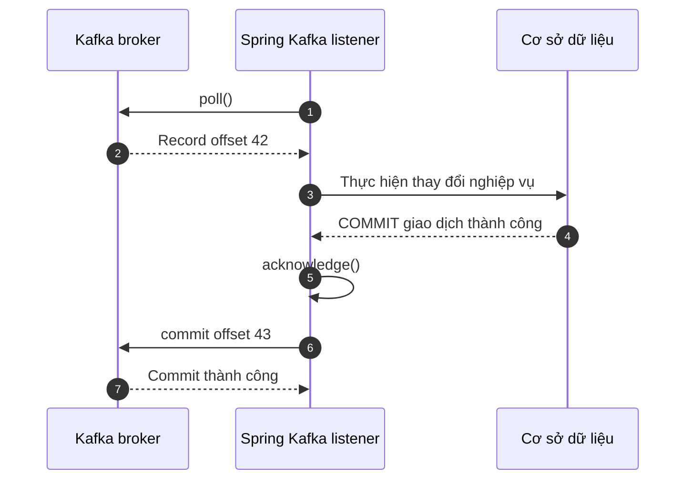
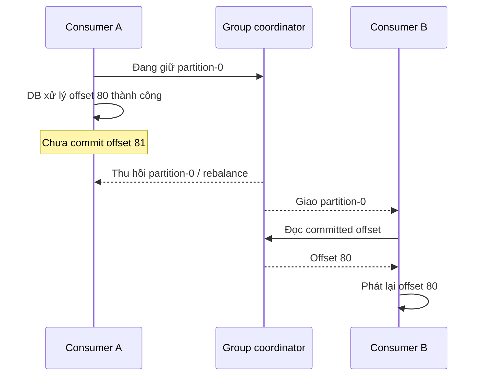

# Offset, acknowledge và thời điểm commit trong Apache Kafka

Trong ứng dụng Spring Boot tiêu thụ sự kiện từ Apache Kafka, câu hỏi quan trọng không chỉ là *đã đọc được bản tin chưa* mà còn là *đã xử lý xong chưa, có thể xác nhận tiến độ đến đâu và khi nào Kafka thực sự lưu tiến độ đó*. Ba khái niệm **offset**, **acknowledge** và **commit** liên quan chặt chẽ nhưng không đồng nghĩa. Nhầm lẫn giữa chúng có thể làm mất bản tin, xử lý trùng, kẹt consumer group hoặc khiến hệ thống báo “đã xử lý” khi giao dịch cơ sở dữ liệu còn chưa được commit.

Bài học thuộc chương **Apache Kafka** của mô-đun **SPRING_BOOT_INTEGRATION**. Bối cảnh xuyên suốt là một dịch vụ Spring Boot nhận sự kiện đơn hàng, ghi kết quả vào cơ sở dữ liệu, đôi khi phát tiếp sự kiện sang topic khác, đồng thời phải quản lý lỗi, retry, deduplication và quan sát tiến độ xử lý.

## 1. Kết quả cần đạt

Sau bài này, bạn có thể:

1. Phân biệt **offset của record**, **consumer position**, **committed offset** và **log end offset** theo từng partition.
2. Giải thích tại sao consumer commit offset `N + 1` sau khi xử lý thành công record có offset `N`.
3. Đọc đúng ý nghĩa của `enable.auto.commit` và các `AckMode` trong Spring for Apache Kafka.
4. Chọn thời điểm acknowledge phù hợp với giao dịch SQL, dịch vụ HTTP, cache, outbound Kafka và chiến lược xử lý trùng.
5. Phân tích cửa sổ mất dữ liệu hoặc xử lý lặp khi crash, retry, rebalance và commit thất bại.
6. Thiết kế kiểm thử, metric và runbook đủ để chứng minh ứng dụng hoạt động đúng trong các tình huống lỗi thực tế.

## 2. Mô hình nền tảng: một partition là một log có thứ tự

Mỗi topic Kafka gồm một hoặc nhiều **partition**. Trong một partition, broker đánh số các record bằng offset tăng dần. Offset là vị trí của record trong log, không phải mã định danh duy nhất trên toàn topic hoặc toàn hệ thống.

Giả sử partition `orders.paid-0` chứa các record sau:

```text
Topic: orders.paid, partition: 0

Offset:      40       41       42       43       44
Record:    evt-A    evt-B    evt-C    evt-D    evt-E
           |-------- đã xử lý --------| |-- đang chờ --|

Committed offset của group billing-service = 43
Điểm tiếp tục đọc của group sau khi được gán partition = 43
```

Trong ví dụ này, group `billing-service` đã xác nhận tiến độ *đến trước offset 43*. Record cuối cùng thuộc đoạn đã xác nhận là offset `42`; offset `43` là record tiếp theo cần xử lý nếu consumer khởi động lại mà không có thay đổi khác.

Điểm dễ nhầm:

> **Commit offset 43** nghĩa là “group này sẽ tiếp tục từ offset 43”, **không** có nghĩa “record 43 đã được xử lý”.

Các định nghĩa cần giữ riêng:

| Thuật ngữ | Ý nghĩa | Phạm vi |
|---|---|---|
| **Record offset** | Vị trí của một record trong log, chẳng hạn `42` | Một `topic-partition` |
| **Consumer position** | Offset kế tiếp mà consumer hiện tại sẽ lấy từ broker; thường tiến lên khi `poll()` trả về records | Một consumer đang chạy và partition được gán |
| **Committed offset** | Offset tiếp theo được consumer group lưu để dùng khi khởi động lại hoặc giao partition cho consumer khác | Một `group.id` + `topic-partition` |
| **Log end offset** | Vị trí ngay sau cuối log mà broker có, dùng để đánh giá độ trễ tiêu thụ | Một `topic-partition` |
| **Acknowledgment** | Tín hiệu ở tầng Spring Kafka cho biết record hoặc batch đã được ứng dụng chấp nhận xử lý theo chính sách được cấu hình | Listener/container |
| **Commit** | Hành động ghi tiến độ offset của group về Kafka, thông thường tại topic nội bộ `__consumer_offsets` | Consumer group |

**Không có “offset chung” cho toàn bộ consumer group.** Nếu cùng group đọc ba partition, group có ba committed offsets tương ứng. Hai record ở hai partition khác nhau có thể cùng offset `42` nhưng hoàn toàn không phải cùng bản tin.

### Position tiến trước commit là điều bình thường

Ví dụ một lần `poll()` nhận các offset `100, 101, 102`:

```text
T0: committed = 100; position = 100
T1: poll() trả về [100, 101, 102]
    position có thể đã là 103, dù ứng dụng chưa xử lý record nào
T2: xử lý thành công record 100
T3: xử lý thành công record 101
T4: commit offset 102
T5: lỗi khi xử lý record 102; container seek/retry theo error handler

Nếu mất quyền sở hữu partition sau T4:
    consumer mới tiếp tục từ offset 102
```

Vì thế, **position lớn hơn committed offset không có nghĩa đã hoàn tất xử lý**. Dùng `consumer.position()` để thay thế committed offset trong giám sát nghiệp vụ là sai.

## 3. Bốn mốc thời gian của một lần tiêu thụ

Với một bản tin cần cập nhật SQL, chuỗi sự kiện lý tưởng là:



Hai việc **commit giao dịch DB** và **commit Kafka offset** độc lập trong kịch bản thông thường. Giữa chúng luôn có một khoảng thời gian dù rất ngắn. Nếu ứng dụng crash sau khi DB commit nhưng trước khi Kafka commit offset, record có thể được phát lại. Đó là lý do **idempotency** là yêu cầu thực tế của mô hình xử lý *at least once*.

Ngược lại, nếu ứng dụng commit offset *trước* khi dữ liệu nghiệp vụ bền vững rồi crash, consumer mới bỏ qua record đó: đây là cửa sổ **mất xử lý**.

Một nguyên tắc vận hành đơn giản:

**Chỉ xem record là đã xử lý thành công khi tất cả tác động nghiệp vụ cần thiết của record đã hoàn tất theo hợp đồng của ứng dụng.** Sau đó mới cho phép offset tiến lên. Điều này giảm nguy cơ mất xử lý; còn lặp lại phải được xử lý bằng thiết kế idempotent.

## 4. “Acknowledge” có ít nhất hai nghĩa cần phân biệt

Kafka có cơ chế xác nhận ở cả phía producer lẫn consumer:

| Cấu hình/hoạt động | Bên thực hiện | Xác nhận điều gì? |
|---|---|---|
| Producer `acks=0/1/all` | Kafka producer và broker | Mức xác nhận khi **ghi bản tin mới** lên broker |
| Consumer `Acknowledgment.acknowledge()` | Ứng dụng gọi API của Spring Kafka | Báo cho **listener container** rằng bản tin đã được xử lý theo cơ chế ack đang chọn |
| Consumer `commitSync()/commitAsync()` | Kafka consumer hoặc Spring container | Lưu **vị trí tiếp tục đọc** của group tại broker |

Producer `acks=all` không làm consumer tự xác nhận xử lý. Ngược lại, gọi `ack.acknowledge()` không ghi bản tin mới lên Kafka và không tự commit giao dịch SQL.

Trong Spring Kafka, `acknowledge()` còn **không phải lúc nào cũng gây broker commit ngay lập tức**. Nó có thể chỉ đánh dấu trạng thái đã xử lý, rồi container commit ở cuối batch poll hoặc khi đủ ngưỡng. Muốn hiểu thời điểm thực tế, phải biết `AckMode`.

## 5. Hai lớp cấu hình: Kafka auto commit và Spring Kafka AckMode

Kafka Java consumer có tùy chọn:

```properties
enable.auto.commit=true
auto.commit.interval.ms=5000
```

Khi bật auto commit, Kafka client tự lưu tiến độ định kỳ theo chu trình poll và trạng thái consumer; cơ chế đó không biết một giao dịch JDBC, REST call hay ghi file đã thực sự hoàn thành hay chưa. Vì vậy không nên dựa vào auto commit để đảm bảo “xử lý xong rồi mới xác nhận” cho công việc có tác dụng phụ quan trọng.

Spring Kafka listener container có tập `AckMode` riêng. Với các phiên bản Spring Kafka hiện đại, container mặc định đặt `enable.auto.commit=false` nếu ứng dụng chưa chỉ định rõ, để chính container quản lý việc commit; mặc định container thường dùng `AckMode.BATCH`. Hãy kiểm tra version và cấu hình hiệu lực khi vận hành một dự án cụ thể.

Một cấu hình minh bạch cho ứng dụng nghiệp vụ:

```yaml
spring:
  kafka:
    bootstrap-servers: localhost:9092
    consumer:
      group-id: billing-service
      enable-auto-commit: false
      auto-offset-reset: earliest
      max-poll-records: 100
    listener:
      ack-mode: manual_immediate
```

Trong file cấu hình này:

- `enable-auto-commit: false` giao quyền kiểm soát commit cho listener container.
- `ack-mode: manual_immediate` yêu cầu listener chủ động gọi `acknowledge()`; nếu gọi trên consumer thread, container có thể commit ngay theo cơ chế `syncCommits`.
- `max-poll-records` giới hạn lượng records trả về trong một poll, giúp kiểm soát thời gian xử lý; không phải giới hạn tổng số records trong topic.
- `auto-offset-reset: earliest` chỉ quyết định vị trí bắt đầu **khi group chưa có committed offset hợp lệ** (hoặc offset đã nằm ngoài log); nó không “reset group về đầu” sau mỗi lần chạy.

Không nên bật đồng thời Kafka auto commit với chiến lược manual acknowledgement của Spring Kafka rồi kỳ vọng manual ack là nguồn chân lý duy nhất. Với công việc quan trọng, cấu hình rõ ràng `enable-auto-commit=false` và kiểm tra cấu hình cuối cùng.

## 6. Bảy AckMode của Spring Kafka

`AckMode` nằm trong `ContainerProperties` và điều khiển **khi nào container đủ điều kiện commit offset** sau khi listener xử lý dữ liệu. Các chế độ thường gặp:

| `AckMode` | Mốc cho phép commit | Điểm cần nhớ |
|---|---|---|
| `RECORD` | Sau khi listener xử lý thành công từng record | Dễ suy luận; nhiều lần commit hơn |
| `BATCH` | Sau khi hoàn tất mọi record của một `poll()` | Thường là mặc định; batch ở đây là **batch poll**, kể cả dùng record listener |
| `TIME` | Theo `ackTime` sau khi records được xử lý | Là ngưỡng kiểm tra trong chu trình container, không phải đồng hồ commit tuyệt đối |
| `COUNT` | Sau khi số records xử lý đạt `ackCount` | Đổi hiệu năng lấy cửa sổ phát lại lớn hơn |
| `COUNT_TIME` | Khi đạt `ackCount` **hoặc** `ackTime` | Kết hợp số lượng và thời gian |
| `MANUAL` | Listener gọi `acknowledge()`; container thực hiện commit theo ranh giới tương tự `BATCH` | Gọi ack không đồng nghĩa broker commit ngay |
| `MANUAL_IMMEDIATE` | Listener gọi `acknowledge()`; commit ngay khi gọi trên **consumer thread** | Thuận tiện khi cần ack sau thao tác nghiệp vụ cụ thể |

Chú ý hai phân biệt quan trọng:

1. **Record listener** (`@KafkaListener` nhận từng record) vẫn có thể chạy với `AckMode.BATCH`. Khi đó container xử lý từng lời gọi listener nhưng commit sau các records trong lần poll, chứ không phải sau từng lời gọi.
2. **Batch listener** (`@KafkaListener` nhận một `List` records) là kiểu nhận dữ liệu của listener; nó không đồng nghĩa tự động với `AckMode.BATCH`.

Với `TIME`/`COUNT`/`COUNT_TIME`, việc commit vẫn phụ thuộc tiến độ xử lý của container. Nếu một listener bị treo lâu, đặt `ackTime=5s` không có nghĩa một thread khác sẽ đúng mỗi năm giây tự commit mọi record.

### So sánh RECORD, BATCH, MANUAL và MANUAL_IMMEDIATE

Ví dụ một `poll()` trả về ba record liên tiếp:

```text
poll() -> [10, 11, 12]

RECORD:
  xử lý 10 -> đủ điều kiện commit 11
  xử lý 11 -> đủ điều kiện commit 12
  xử lý 12 -> đủ điều kiện commit 13

BATCH:
  xử lý 10, 11, 12 thành công -> đủ điều kiện commit 13

MANUAL:
  xử lý 10 -> acknowledge()
  xử lý 11 -> acknowledge()
  xử lý 12 -> acknowledge()
  container gom và commit theo ranh giới xử lý poll

MANUAL_IMMEDIATE (ack trên consumer thread):
  xử lý 10 -> acknowledge() -> có thể commit 11
  xử lý 11 -> acknowledge() -> có thể commit 12
  xử lý 12 -> acknowledge() -> có thể commit 13
```

Đây là sơ đồ lý tưởng hóa để hiểu **ranh giới commit**. Error handler, transaction, ack bất đồng bộ, rebalance và cấu hình commit có thể thay đổi thời điểm cụ thể.

### Khi nào chọn từng chế độ?

| Tình huống | Lựa chọn khởi đầu | Lý do |
|---|---|---|
| Mỗi record độc lập, listener trả về chỉ khi xử lý xong | `RECORD` | Quan hệ xử lý/commit dễ quan sát |
| Xử lý nhiều bản tin nhanh, chấp nhận replay cả phần cuối poll | `BATCH` | Chi phí commit thấp hơn |
| Sau mỗi giao dịch SQL cần quyết định ack tường minh | `MANUAL_IMMEDIATE` | Xác nhận ngay sau khi service transaction trả về thành công |
| Phải hoãn xác nhận đến khi đủ điều kiện nghiệp vụ, không cần commit từng record | `MANUAL` | Kiểm soát ack và gom commit |
| Workload lớn, đã chứng minh idempotent, muốn điều chỉnh lượng commit | `COUNT_TIME` | Tối ưu theo ngưỡng xử lý, cần đo thực tế |

Không có chế độ nào tự tạo ra exactly-once cho JDBC, HTTP hoặc đối tác bên ngoài. Quyền quyết định commit offset phải đi cùng cơ chế chống xử lý trùng tương ứng.

## 7. Ví dụ Spring Boot: ack sau khi giao dịch SQL đã commit

Giả sử dịch vụ `billing-service` nhận sự kiện `OrderPaidEvent` và đánh dấu đơn đã thanh toán. Bản tin có `eventId` bất biến, riêng biệt với `orderId`: một đơn có thể phát nhiều sự kiện hợp lệ khác nhau.

### 7.1. Tách listener và transactional service

```java
import org.springframework.kafka.annotation.KafkaListener;
import org.springframework.kafka.support.Acknowledgment;
import org.springframework.stereotype.Component;

@Component
public class OrderPaidListener {

    private final BillingService billingService;

    public OrderPaidListener(BillingService billingService) {
        this.billingService = billingService;
    }

    @KafkaListener(topics = "orders.paid", groupId = "billing-service")
    public void handle(OrderPaidEvent event, Acknowledgment ack) {
        billingService.applyPayment(event);
        // Chỉ đến đây sau khi transaction trong BillingService commit thành công.
        ack.acknowledge();
    }
}
```

Ví dụ giả định dự án đã cấu hình serializer/deserializer hoặc message converter để ánh xạ payload thành `OrderPaidEvent`. Cấu trúc DTO minh họa:

```java
public record OrderPaidEvent(
        String eventId,
        String orderId
) {}
```

### 7.2. Idempotency bằng khóa duy nhất và một transaction

Với PostgreSQL, tạo bảng inbox để lưu dấu sự kiện đã hoàn tất theo consumer nghiệp vụ:

```sql
CREATE TABLE processed_kafka_events (
    consumer_name VARCHAR(100) NOT NULL,
    event_id       VARCHAR(150) NOT NULL,
    processed_at   TIMESTAMPTZ NOT NULL DEFAULT NOW(),
    PRIMARY KEY (consumer_name, event_id)
);
```

Service thực hiện **ghi dấu deduplication và cập nhật nghiệp vụ trong cùng transaction**:

```java
import org.springframework.jdbc.core.JdbcTemplate;
import org.springframework.stereotype.Service;
import org.springframework.transaction.annotation.Transactional;

@Service
public class BillingService {

    private final JdbcTemplate jdbc;

    public BillingService(JdbcTemplate jdbc) {
        this.jdbc = jdbc;
    }

    @Transactional
    public void applyPayment(OrderPaidEvent event) {
        int inserted = jdbc.update("""
            INSERT INTO processed_kafka_events (consumer_name, event_id)
            VALUES (?, ?)
            ON CONFLICT DO NOTHING
            """, "billing-service", event.eventId());

        if (inserted == 0) {
            // Sự kiện đã được xử lý và commit trong lần trước.
            return;
        }

        int updated = jdbc.update(
            "UPDATE orders SET paid = TRUE WHERE order_id = ?",
            event.orderId()
        );

        if (updated != 1) {
            throw new IllegalStateException(
                "Order not found or unexpected update count: " + event.orderId()
            );
        }
    }
}
```

Code là ví dụ về **ranh giới transaction và deduplication**, cần điều chỉnh theo schema thật. Trường hợp cơ sở dữ liệu khác PostgreSQL phải thay `ON CONFLICT DO NOTHING` bằng cú pháp tương ứng; trường hợp nghiệp vụ cho phép nhiều thay đổi hợp lệ trên một đơn phải dùng quy tắc cập nhật thích hợp.

Điều kiện quan trọng:

1. Lời gọi `billingService.applyPayment(...)` đi qua Spring proxy của **bean khác**, vì vậy `@Transactional` hoàn thành commit trước khi phương thức trả về thành công.
2. Nếu bất kỳ SQL statement nào thất bại và transaction rollback, marker inbox cũng rollback. Listener ném exception trở lại container; **không ack**.
3. Nếu cùng event phát lại, unique key xác nhận nó đã được xử lý; service trở về thành công, sau đó listener ack lại offset hiện tại.
4. Khóa dedup phải được thiết kế theo **sự kiện nghiệp vụ**. Chỉ kiểm tra `existsById` rồi chèn ở bước khác mà không có unique constraint sẽ bị race condition giữa các consumer/retry.

### 7.3. Cái bẫy `@Transactional` đặt ngay trên listener

Đoạn sau **không an toàn về thứ tự** nếu sử dụng immediate ack:

```java
// Ví dụ để nhận diện lỗi thiết kế.
@Transactional
@KafkaListener(topics = "orders.paid")
public void wrong(OrderPaidEvent event, Acknowledgment ack) {
    repository.save(...);
    ack.acknowledge(); // Lúc này transaction bao quanh method chưa chắc đã commit!
}
```

Với Spring transaction thông thường, interceptor commit **sau khi method trả về**. Nếu offset được commit khi gọi `acknowledge()` mà commit DB sau đó thất bại, consumer group có thể bỏ qua sự kiện mặc dù dữ liệu nghiệp vụ chưa được ghi bền vững.

Thiết kế tách listener khỏi transactional service ở ví dụ trước làm ranh giới dễ kiểm chứng hơn. Nếu sử dụng transaction đồng bộ đặc thù hoặc Kafka transaction manager, hãy xác minh thứ tự commit thực tế thay vì suy ra chỉ từ annotation.

## 8. Bảng phân tích crash: thời điểm nào tạo ra replay hoặc mất dữ liệu?

Giả sử record `K` làm phát sinh tác động `E` trên database, và commit offset `K+1` là hành động `C`.

| Thời điểm lỗi | Trạng thái hiệu ứng `E` | Trạng thái commit `C` | Kết quả sau restart |
|---|---|---|---|
| Trước khi bắt đầu xử lý | Chưa có | Chưa có | Record được đọc lại; bình thường |
| Đang xử lý, transaction rollback | Không bền vững | Chưa có | Đọc lại để xử lý |
| **Sau DB commit, trước Kafka commit** | **Đã có** | **Chưa có** | **Đọc lại record; cần idempotency** |
| Sau Kafka commit thành công | Đã có | Đã có | Tiếp tục từ record kế tiếp |
| **Kafka commit trước DB commit rồi crash/DB rollback** | **Chưa có** | **Đã có** | **Record có thể bị bỏ qua; mất xử lý** |
| Kafka commit timeout, không rõ broker đã nhận chưa | Đã có hoặc chưa tùy bước | Không chắc | Phải chấp nhận khả năng replay và xử lý idempotent |

Ví dụ cụ thể:

```text
Record offset 714: order-881 đã thanh toán

10:00:00.100  DB COMMIT: orders.paid = true
10:00:00.110  Process bị kill trước khi commit Kafka
10:00:05.000  Consumer khác nhận partition
10:00:05.020  Đọc lại offset 714
10:00:05.030  Inbox thấy eventId đã tồn tại -> không ghi lại nghiệp vụ
10:00:05.040  Commit offset 715
```

Đó là cách mô hình **at least once + idempotent consumer** tạo ra kết quả nghiệp vụ đáng tin cậy. At least once nói về khả năng record được phát lại; nó không khẳng định side effect tự động chỉ xảy ra một lần.

## 9. Commit offset là “điểm cao nhất liên tục”, không phải danh sách rời rạc

Vì committed offset xác định một **điểm bắt đầu đọc lại**, nó không thể biểu diễn “đã xử lý `100` và `102` nhưng chưa xử lý `101`” bằng một con số duy nhất.

```text
Partition 1:
Offset          100       101       102       103
Đã xử lý         ✓         ✗         ✓        chưa

Nếu commit 103, consumer mới sẽ bỏ qua 101.
Điểm an toàn ở đây chỉ là committed offset 101.
```

Với xử lý song song hoặc async, chỉ có thể commit sau khi mọi offset đứng trước điểm commit trên cùng partition đã được xử lý theo hợp đồng. Không được tự động lấy `max(offsetĐãXửLý) + 1`.

Spring Kafka cung cấp tùy chọn `asyncAcks` cho một số kịch bản manual acknowledgment ngoài thứ tự: container theo dõi lỗ hổng ack, trì hoãn commit phần vượt qua lỗ hổng và có thể tạm dừng nhận thêm records đến khi các ack bị thiếu hoàn thành. Tính năng này tạo thêm áp lực quản lý các tác vụ treo và mở rộng cửa sổ replay; không nên bật chỉ để sửa một lỗi thiết kế song song hóa.

Ví dụ trực quan:

```text
ack(100)  -> có thể tiến đến 101
ack(102)  -> 101 vẫn thiếu, chưa thể commit 103
ack(101)  -> lúc này mới có thể tiến đến 103
```

Nếu sử dụng `asyncAcks`, cần kiểm tra version và cấu hình container; `nack()` không kết hợp được với out-of-order commits trong Spring Kafka. Lựa chọn đơn giản hơn là duy trì xử lý có thứ tự theo partition hoặc chuyển tác vụ sang một luồng công việc có trạng thái độc lập.

## 10. Xử lý batch, nhiều partition và partial acknowledgment

Một poll có thể trả về nhiều record từ **nhiều partition**:

```text
poll()
  orders.paid-0:  [20, 21]
  orders.paid-1:  [75, 76, 77]
```

Committed offset được lưu riêng:

```text
group=billing-service, orders.paid-0 -> 22
group=billing-service, orders.paid-1 -> 78
```

Giới hạn thứ tự chỉ có ý nghĩa **trong mỗi partition**. Hai partition có thể được xử lý với tốc độ khác nhau. Không được dùng một biến offset toàn cục rồi áp dụng cho tất cả partition.

Với batch listener, việc gọi `acknowledge()` thường biểu thị toàn bộ phần batch đã được chấp nhận theo chính sách container. Một số phiên bản Spring Kafka mới cho phép **partial batch acknowledgment** bằng `acknowledge(index)` trong những điều kiện cụ thể như `MANUAL_IMMEDIATE` và listener nhận danh sách records; chỉ nên dùng khi đã xác minh API/version cùng thứ tự tăng của index. Không giả định tùy chọn này hoạt động giống nhau trên mọi phiên bản.

Khi một record ở giữa batch bị lỗi, hãy chọn chính sách rõ ràng:

- **Retry phần chưa xử lý:** cho error handler xử lý, seek về record cần thử lại và tránh ack một cách tùy tiện toàn batch.
- **Đưa bản tin lỗi sang DLT:** chỉ xem record đó được giải quyết sau khi việc recovery thỏa chính sách (ví dụ gửi sang DLT đã thành công); sau đó mới cho phép offset tiến.
- **Bỏ qua có chủ đích:** chỉ áp dụng nếu hợp đồng nghiệp vụ cho phép và có audit trail; cần đảm bảo không biến lỗi tạm thời thành mất dữ liệu âm thầm.

## 11. Commit đồng bộ và bất đồng bộ

Ở tầng Kafka client có hai API chủ đạo:

```java
consumer.commitSync();   // Chờ kết quả commit hoặc ném exception.
consumer.commitAsync();  // Không chờ; nhận callback để xử lý kết quả.
```

Trong listener container, việc gọi `acknowledge()` **không đòi hỏi** bạn trực tiếp gọi các API trên. Spring Kafka tự commit theo AckMode và cấu hình tương ứng. Thuộc tính `syncCommits` của container quyết định cách container commit; mặc định thông dụng là commit đồng bộ (`true`).

| Thuộc tính | `commitSync` | `commitAsync` |
|---|---|---|
| Thread chờ broker xác nhận | Có | Không theo kiểu chờ blocking cho từng commit |
| Chi phí độ trễ của listener | Dễ tăng khi commit thường xuyên | Thường thấp hơn |
| Kết quả | Trả về hoặc ném lỗi theo timeout | Báo kết quả qua callback |
| Rủi ro cần xử lý | Timeout, commit failure, rebalance | Callback lỗi, commit đến muộn/khác thứ tự, thiếu theo dõi |
| Trường hợp phù hợp | Ưu tiên tính rõ ràng của điểm xác nhận | Khối lượng lớn, thiết kế đã quản lý rõ failure/replay |

Ví dụ cấu hình tại Java nếu muốn chủ động:

```java
factory.getContainerProperties().setSyncCommits(true);
```

Trong đó `factory` là `ConcurrentKafkaListenerContainerFactory` bạn cấu hình cho listener. Đừng vội chuyển sang async commit chỉ vì muốn tăng throughput; trước tiên cần đo thời gian xử lý nghiệp vụ, kích thước poll, chi phí database và số partition. Nếu dùng async commit, phải quan sát callback thất bại và chấp nhận khả năng replay; không được retry một commit cũ bừa bãi sau khi commit mới đã thành công.

### CommitFailedException không nên bị nuốt

Ví dụ một consumer bị mất quyền sở hữu partition trong lúc rebalance: commit của instance cũ có thể thất bại. Đừng ghi log rồi suy luận “message đã hoàn tất nên lần sau chắc chắn không đọc lại”. Trạng thái an toàn là **offset có thể chưa được lưu**, record có thể được phát lại, và xử lý phải idempotent.

## 12. Error handler: exception khác với không gọi ack

Với listener có manual ack, khi xử lý thất bại:

```java
@KafkaListener(topics = "orders.paid")
public void onMessage(OrderPaidEvent event, Acknowledgment ack) {
    billingService.applyPayment(event); // lỗi -> exception đi ra ngoài
    ack.acknowledge();                   // chỉ chạy nếu thành công
}
```

**Đừng tự bắt mọi exception rồi trả về bình thường mà không ack** và kỳ vọng Kafka tự phát lại ngay. Kafka client position có thể đã đi qua record; nếu không seek, retry hoặc xử lý recovery theo chính sách container, record chưa chắc được đọc lại trong phiên consumer hiện tại.

Ví dụ lỗi thường thấy:

```java
try {
    callExternalSystem(event);
} catch (Exception ex) {
    log.warn("Lỗi xử lý", ex);
    // Sai nếu bỏ qua và để listener trả về như thể xử lý đã xong.
}
ack.acknowledge();
```

Thay vào đó, để exception được chuyển đến `DefaultErrorHandler` hoặc cơ chế error handling mà dự án lựa chọn.

### Retry và DLT có chủ đích

Một ví dụ dùng `DefaultErrorHandler` và `DeadLetterPublishingRecoverer`:

```java
import org.apache.kafka.common.TopicPartition;
import org.springframework.context.annotation.Bean;
import org.springframework.kafka.core.KafkaTemplate;
import org.springframework.kafka.listener.DeadLetterPublishingRecoverer;
import org.springframework.kafka.listener.DefaultErrorHandler;
import org.springframework.util.backoff.FixedBackOff;

@Bean
DefaultErrorHandler kafkaErrorHandler(KafkaTemplate<Object, Object> template) {
    var recoverer = new DeadLetterPublishingRecoverer(
        template,
        (record, exception) ->
            new TopicPartition(record.topic() + ".DLT", record.partition())
    );

    var handler = new DefaultErrorHandler(
        recoverer,
        new FixedBackOff(1_000L, 2L)
    );

    // Với MANUAL_IMMEDIATE, cho phép commit offset đã recovery
    // theo cơ chế của DefaultErrorHandler.
    handler.setCommitRecovered(true);
    return handler;
}
```

Ví dụ áp dụng cho một cấu hình listener sử dụng `MANUAL_IMMEDIATE`; số lần thử thực tế theo quy ước `BackOff` của phiên bản đang dùng. Chọn retry ngắn cho lỗi tạm thời, DLT cho lỗi không thể xử lý ngay. Topic DLT trong ví dụ phải có partition tương ứng; serializer của producer gửi DLT phải xử lý được kiểu dữ liệu và cả tình huống lỗi deserialize nếu được cấu hình.

Phân biệt ba giai đoạn:

1. **Listener xử lý thành công:** listener ack và offset được commit theo AckMode.
2. **Listener ném exception, retry còn khả dụng:** error handler giữ/đặt lại điểm xử lý để record được thử lại; không xem là đã hoàn tất.
3. **Recovery thành công theo hợp đồng:** DLT/skip được xem là kết quả cuối cho record lỗi và offset có thể tiến; cần xác minh cấu hình commit recovered offset.

Nếu ghi DLT thất bại, hệ thống phải xem record gốc là chưa recovery xong, không được âm thầm commit rồi mất cả bản gốc lẫn thông tin lỗi. Hãy kiểm tra thiết lập producer DLT, báo lỗi gửi và chính sách phục hồi của phiên bản thư viện đang dùng.

### `nack()` dành cho tình huống nào?

Ở các phiên bản Spring Kafka có hỗ trợ, `Acknowledgment.nack(...)` yêu cầu container từ chối tiến độ của record hiện tại để phần chưa xử lý được nhận lại theo cơ chế seek/pause. Ví dụ record listener:

```java
// Chỉ minh họa với phiên bản hỗ trợ API này.
ack.nack(java.time.Duration.ofSeconds(2));
```

`nack` có những ràng buộc đáng nhớ:

- Thường phải gọi trên **consumer thread** và với AckMode thủ công thích hợp.
- Có thể làm pause/seek và phát lại phần records chưa xử lý của poll.
- Không thay thế DLT, phân loại lỗi hoặc idempotency.
- Không dùng chung với chế độ out-of-order `asyncAcks`.

Trong đa số luồng nghiệp vụ Spring Boot, **ném exception để error handler quản lý retry/DLT** dễ theo dõi hơn việc rải `nack()` khắp listener.

## 13. Rebalance: commit gắn với quyền sở hữu partition

Một partition chỉ được giao cho một consumer trong cùng consumer group tại một thời điểm, nhưng quyền sở hữu có thể thay đổi khi:

- Instance trong group tăng hoặc giảm.
- Consumer crash hoặc mất heartbeat.
- Listener xử lý quá lâu khiến vượt `max.poll.interval.ms`.
- Topic tăng partition hoặc cấu hình group thay đổi.
- Broker/group coordinator thực hiện cân bằng lại.



Ngay cả khi A đã ghi DB, B vẫn cần có khả năng xử lý record `80` lần nữa. Việc “cố gắng commit khi bị revoke” có thể giảm replay nhưng không thể loại bỏ toàn bộ cửa sổ lỗi mạng/crash. Phương án đúng vẫn là **idempotent processing**.

### `max.poll.interval.ms`, `max.poll.records` và thời gian xử lý

Kafka consumer phải tiếp tục poll trong giới hạn `max.poll.interval.ms`. Khi listener block quá lâu, group có thể coi consumer không còn tiến bộ và tái phân phối partition; bản tin đang xử lý có thể được consumer khác đọc lại.

Ví dụ:

```text
max.poll.records = 500
Thời gian xử lý xấu nhất / record = 400 ms
Tổng xử lý tuần tự tối đa ~= 500 * 400 ms = 200 giây
max.poll.interval.ms = 180 giây
```

Trong tình huống xấu nhất, lần poll tiếp theo đến quá muộn. Đây chỉ là phép tính biên thô; trong hệ thống thực tế còn có overhead của container, retry, GC và giao dịch. Biện pháp ưu tiên là giảm số records mỗi poll, giảm latency dịch vụ phụ thuộc hoặc thiết kế lại xử lý; chỉ tăng timeout sau khi đã hiểu hành vi consumer.

Không nên giữ một record đang xử lý vô thời hạn bằng cách chỉ kéo `max.poll.interval.ms` lên rất cao; điều đó làm chậm phát hiện và hồi phục khi consumer thực sự kẹt.

## 14. Consumer thread, xử lý song song và async ack

Listener Spring Kafka thông thường được gọi trên thread của consumer container. Các quy tắc an toàn quan trọng:

1. **`KafkaConsumer` không thread-safe.** Không truyền thẳng instance consumer vào worker pool để các thread cùng `poll/seek/commit`.
2. Với `MANUAL_IMMEDIATE`, gọi `ack.acknowledge()` từ consumer thread tạo hành vi commit ngay theo cấu hình. Gọi từ thread khác có thể được đưa vào hàng chờ và được xử lý vào thời điểm khác; tránh trộn hai cách gọi trong cùng ứng dụng.
3. Khi một listener đẩy tác vụ async rồi **trả về ngay**, đừng tự cho rằng container sẽ đợi `CompletableFuture` đó hoàn tất; cần dùng cơ chế async listener/ack của version đang sử dụng, hoặc tách xử lý và duy trì tracking tiến độ an toàn.
4. Nếu song song trên **cùng partition**, phải kiểm soát tiến độ offset liên tục; record hoàn thành muộn ở trước có thể chặn commit các record hoàn thành nhanh ở sau.
5. Tăng `concurrency` của listener container giúp xử lý song song **theo assignment partition** nhưng không vượt được số partition có sẵn cho group. Tăng thread không tạo ra thêm offset độc lập trong một partition.

Một pattern dễ vận hành cho sự kiện có thứ tự: phân vùng theo khóa nghiệp vụ (`orderId`), xử lý từng partition tuần tự, retry với giới hạn và bổ sung idempotency DB.

Nếu bắt buộc có outbound API chậm không đồng bộ, cân nhắc tách thành state machine/outbox với mã tác vụ bền vững rồi mới xác nhận record đầu vào. Ack khi tác vụ đã được **bền vững ghi nhận** có thể là hợp lệ nếu chính hợp đồng tiêu thụ chỉ yêu cầu tiếp nhận công việc, còn tiến trình hoàn tất được theo dõi riêng.

## 15. Exactly once: điều gì được Kafka bảo đảm, điều gì không?

Kafka có cơ chế transaction để hỗ trợ quy trình **đọc từ Kafka → xử lý → ghi sang Kafka** và đưa offset đã tiêu thụ vào cùng một Kafka transaction. Khi cấu hình đúng, record đầu ra và tiến độ offset có thể được commit hoặc abort cùng nhau trong phạm vi Kafka.

Ví dụ luồng:

```text
orders.paid (input)
   -> Kafka listener (transaction)
   -> invoices.requested (output)
   -> commit input offsets trong cùng Kafka transaction
```

Điều kiện thường gặp:

- Producer có `transactional.id` (Spring Boot thường cấu hình qua `spring.kafka.producer.transaction-id-prefix`).
- Listener container được cấu hình sử dụng Kafka transaction manager/cơ chế transaction tương ứng với version.
- Offset đầu vào được liên kết vào transaction trước khi transaction Kafka commit.
- Consumer cần tránh đọc dữ liệu đã abort sử dụng `isolation.level=read_committed` nếu hợp đồng đòi hỏi.

Phác họa cấu hình liên quan:

```yaml
spring:
  kafka:
    producer:
      transaction-id-prefix: billing-tx-
    consumer:
      enable-auto-commit: false
      properties:
        isolation.level: read_committed
```

Cấu hình trên **chỉ minh họa các thành phần liên quan**; production phải xác minh transaction manager, container factory, producer factory, transaction timeout và handler phù hợp với phiên bản Spring Boot/Spring Kafka thực tế. Khi container đã quản lý Kafka transaction, offset commit diễn ra theo transaction container; không tự ý gắn logic manual ack từ ví dụ JDBC vào mà chưa thiết kế thứ tự tương tác.

Điều Kafka transaction **không tự bảo đảm**:

| Luồng | Exactly-once Kafka có tự bao phủ? | Giải pháp thường cần thêm |
|---|---|---|
| Kafka input → Kafka output cùng transaction | Có thể, khi cấu hình đúng | Transactional producer + committed offsets + `read_committed` |
| Kafka input → SQL database | **Không** | Inbox/unique key/idempotency, transaction DB |
| Kafka input → REST API bên thứ ba | **Không** | Idempotency key, API hỗ trợ dedup, retry có kiểm soát |
| Kafka input → gửi email/thanh toán | **Không** | State machine, outbox, định danh thao tác duy nhất, reconciliation |
| SQL update + Kafka output | **Không tự động nguyên tử giữa hai hệ thống** | Transactional outbox hoặc kiến trúc nhất quán phù hợp |

Hai transaction riêng lẻ, một cho database và một cho Kafka, không tự trở thành distributed transaction nguyên tử. Một transaction commit trước, transaction còn lại thất bại vẫn tạo ra khoảng không nhất quán; thiết kế outbox hoặc quy trình bù trừ là cách giải quyết tùy mục tiêu.

## 16. Commit offset khi xử lý HTTP, cache hoặc dịch vụ ngoài

Không phải mọi “thành công” đều là một giao dịch SQL.

### 16.1. Gọi HTTP đồng bộ

Nếu hợp đồng yêu cầu dịch vụ đích đã nhận và thực hiện hành động, ack chỉ sau khi có phản hồi thành công **và** biết rõ ngữ nghĩa của phản hồi đó. HTTP 200 có thể chỉ là “đã tiếp nhận” chứ chưa hoàn tất nghiệp vụ; nếu vậy cần theo dõi trạng thái bất đồng bộ.

Đặt `Idempotency-Key: <eventId>` nếu API hỗ trợ. Retry sau timeout có thể tạo thao tác trùng do request trước đã thực hiện thành công dù client không nhận được response.

### 16.2. Cache

Nếu cache chỉ là dữ liệu dẫn xuất có thể tái tạo, không nhất thiết cần biến việc ghi cache thành điều kiện ack: hãy xác định nguồn chân lý và chiến lược tự phục hồi cache. Nếu cache là thành phần quyết định nghiệp vụ, failure của thao tác đó phải tham gia quyết định có acknowledge hay không.

### 16.3. Phát tiếp sự kiện

Nếu listener đọc đầu vào, gọi `KafkaTemplate.send()` bất đồng bộ rồi ack ngay, việc enqueue gửi vào producer **không đồng nghĩa broker đã ghi thành công**. Cần chờ xác nhận thích hợp hoặc dùng Kafka transaction nếu muốn ràng buộc đầu ra với offset đầu vào.

### 16.4. Nhiều side effects

Nếu cùng record vừa ghi SQL vừa gọi đối tác, “ack sau bước cuối” vẫn không giải quyết được trường hợp SQL đã commit nhưng đối tác timeout. Cần một mô hình có trạng thái bền vững (outbox/saga/retry task) để mỗi tác động có định danh và trạng thái độc lập.

## 17. Reset offset, seek và replay có chủ đích

`auto.offset.reset` thường được hiểu sai:

```yaml
spring:
  kafka:
    consumer:
      auto-offset-reset: earliest
```

Đặt `earliest` **không** buộc group đã có offset commit về đọc lại từ đầu. Kafka chỉ áp dụng chính sách reset khi không có điểm commit hợp lệ cho partition; các giá trị thường gặp gồm `earliest`, `latest` và `none`.

Muốn chủ động replay, có một số phương án với mục đích khác nhau:

| Mục đích | Cách tiếp cận | Điều cần kiểm tra |
|---|---|---|
| Thử nghiệm độc lập | Tạo `group.id` mới | Có thể tiêu thụ lại toàn bộ dữ liệu theo auto-offset-reset |
| Khôi phục một group production | Dừng các consumer liên quan rồi dùng công cụ quản trị consumer-group để reset offsets | Đảm bảo group không còn thành viên đang xử lý; audit phạm vi và thời gian |
| Chạy lại một dải offset trong ứng dụng | `seek`/`ConsumerSeekAware` theo version và lifecycle | Quyền sở hữu partition, thứ tự, idempotency |
| Replay bản tin đã lưu DLT | Quy trình DLT reprocessing có kiểm soát | Nguyên nhân lỗi gốc đã được sửa, chống lặp |

Không reset production group chỉ để “thử lại một record” nếu việc này sẽ làm hàng triệu sự kiện phía sau bị phát lại. Một lệnh seek/reset còn có thể tạo side effect nghiệp vụ; cần đánh giá idempotency và ghi nhận ai thực hiện, phạm vi offset nào.

## 18. Lag: nhóm đã nhận đến đâu và đã xử lý đến đâu?

Trong giám sát consumer group, “committed lag” thường được xấp xỉ bằng:

\[
\text{lag}_{partition}
= \text{logEndOffset}_{partition}
- \text{committedOffset}_{group,partition}
\]

Ví dụ log end offset là `1_000`, committed offset là `960` thì committed lag bằng `40` record. Hai lưu ý:

1. Lag cao có thể do listener xử lý chậm, commit ít thường xuyên hoặc consumer bị tạm dừng; chưa đủ để kết luận dịch vụ bị kẹt.
2. Các metric như `records-lag-max` của Kafka consumer có thể đo theo vị trí fetch/consumer hiện tại thay vì committed offsets của group. Không dùng hai loại lag này thay thế nhau mà không đọc định nghĩa metric và exporter.

Khi dùng Kafka transaction với `read_committed`, các giới hạn đọc theo last stable offset và cách exporter định nghĩa end offset có thể tạo chênh lệch khác nữa.

### Những thứ nên đo cùng nhau

| Metric/tín hiệu | Trả lời câu hỏi nào? | Dấu hiệu đáng chú ý |
|---|---|---|
| Committed group lag theo partition | Group đã ghi nhận tiến độ đến đâu? | Lag tăng liên tục |
| Tốc độ record được xử lý thành công | Có tiến bộ nghiệp vụ không? | Input tăng nhưng success đứng yên |
| Processing latency p95/p99 | Một record tốn bao lâu? | Tiệm cận `max.poll.interval.ms` khi nhân với batch |
| Commit latency / failures | Broker có nhận progress không? | Commit timeout, retry, rebalance liên tiếp |
| Retry count, DLT count | Bao nhiêu record bị lỗi? | Một key lỗi lặp vô hạn |
| Tuổi bản tin tại thời điểm hoàn tất | Dữ liệu đến người dùng muộn bao lâu? | Timestamp lag tăng dù commit lag nhỏ |
| Inbox duplicate hits | Replay/duplicate có xuất hiện? | Tăng đột ngột sau deploy/rebalance |
| Rebalance count và partition assignment | Instance có giữ ổn định partition? | Rebalance quá nhiều |

**Committed lag thấp không chứng minh mọi tác động nghiệp vụ đã thành công.** Nếu listener ack quá sớm hoặc nuốt exception, group có thể lag gần 0 mà dữ liệu DB vẫn sai.

## 19. Tối ưu throughput mà không đánh đổi tính đúng đắn

Những nút chỉnh thường tác động lẫn nhau:

- **`max.poll.records`:** giảm khi một poll xử lý quá lâu; tăng khi thao tác nhanh và đã chứng minh idempotent.
- **`concurrency` và số partition:** mở rộng theo partition và tải thực tế; thêm consumer vượt số partition không tăng số luồng đọc hữu ích.
- **AckMode:** `RECORD` hoặc `MANUAL_IMMEDIATE` giúp giới hạn vùng replay nhưng có thể tăng số commit; `BATCH`/`COUNT_TIME` giảm commit nhưng có thể phát lại nhiều records hơn sau crash.
- **`syncCommits`:** commit đồng bộ dễ suy luận, nhưng commit thường xuyên có thể làm tăng latency; async cần xử lý callback và các trường hợp commit lỗi.
- **DB batching:** nếu nhiều ghi phụ thuộc nhau, cân nhắc batch SQL hoặc thiết kế theo lô với giao dịch và idempotency rõ ràng.
- **Lỗi tạm thời:** retry có backoff để giảm áp lực dịch vụ phụ thuộc; tránh vòng retry nóng.
- **DLT:** không nên coi việc đẩy sang DLT là “thành công nghiệp vụ”; đó là đường xử lý lỗi phải có cảnh báo, owner và quy trình replay.

Phương án triển khai hợp lý là bắt đầu bằng cấu hình dễ kiểm chứng, đo latency/lag và failure behavior, rồi mới tăng batching hoặc async commit.

## 20. Kiểm thử đúng thứ tự commit và xử lý trùng

Unit test chỉ kiểm tra phương thức listener gọi `acknowledge()` là chưa đủ để chứng minh khả năng chịu crash. Nên có integration tests với broker thật hoặc Testcontainers/EmbeddedKafka phù hợp phiên bản, cùng cơ sở dữ liệu kiểm thử để xác nhận **kết quả sau restart hoặc rebalance**.

Một bộ kịch bản tối thiểu:

| Kịch bản | Cách gây lỗi | Điều phải quan sát |
|---|---|---|
| Luồng thành công | Gửi `eventId=A`, listener commit DB và ack | DB đúng, group committed offset tiến lên |
| Crash sau DB commit, trước Kafka commit | Dùng điểm chèn lỗi/test hook đúng khoảng này | Record được replay; DB không bị cập nhật trùng |
| DB transaction rollback | SQL ném exception | Inbox marker rollback, offset không bị đánh dấu hoàn tất; retry hoạt động |
| Duplicate payload | Gửi cùng `eventId=A` ở hai Kafka offsets khác nhau | Mỗi record được xử lý/ack hợp lệ nhưng tác động nghiệp vụ chỉ một lần |
| Retry hết số lần | Tạo lỗi không thể phục hồi | DLT nhận record theo hợp đồng, offset chỉ tiến sau recovery thành công |
| DLT producer thất bại | Chặn topic/đưa lỗi producer | Không mất dấu record gốc; có alert để xử lý |
| Rebalance trong lúc xử lý | Dừng/kill instance giữ partition | Instance mới đọc lại từ committed offset và kết quả vẫn đúng |
| Giới hạn thời gian poll | Tạo độ trễ > ngưỡng được cấu hình | Phát hiện rebalance, không có side effect trùng |
| Thứ tự ack bất đồng bộ | Cho offset `n+1` xong trước `n` | Không commit vượt lỗ hổng |

### Ví dụ test scenario bằng mốc trạng thái

```text
Given:
  DB chưa có eventId=evt-900
  Group đã commit offset 90
  Offset 90 chứa evt-900

When:
  Consumer A xử lý evt-900 -> DB commit
  Kill Consumer A trước Kafka commit
  Consumer B được giao partition

Then:
  Consumer B nhận lại offset 90
  Chỉ tồn tại 1 marker evt-900
  Trạng thái orders đúng đúng 1 lần về mặt nghiệp vụ
  Group sau đó commit offset 91
```

Không nên chỉ chờ một khoảng thời gian cố định rồi khẳng định test pass. Hãy poll trạng thái cụ thể với timeout, kiểm tra committed offset, số lần tác động nghiệp vụ và trạng thái DLT. Các test failure injection cần phân biệt kill **trước** và **sau** broker commit để tránh kết luận nhầm.

## 21. Runbook xử lý sự cố offset và commit

Khi một consumer group báo lag tăng hoặc phát lại bất thường:

1. **Xác nhận tọa độ:** `group.id`, `topic`, `partition`, committed offset, end offset, số consumer sống và assignment hiện tại.
2. **Đọc lỗi listener:** xác định lỗi nghiệp vụ, timeout DB/HTTP, deserialization, error handler hay commit; không chỉ nhìn metric lag.
3. **Kiểm tra rebalance/poll:** tìm dấu hiệu vượt `max.poll.interval.ms`, instance restart, consumer bị pause hoặc phân chia partition thay đổi.
4. **Kiểm tra bằng chứng nghiệp vụ:** đối chiếu `eventId` ở inbox, bản ghi DB, trạng thái giao dịch ngoài, trace và DLT trước khi quyết định replay.
5. **Chọn hành động tối thiểu:** sửa lỗi dữ liệu/mapping, giải phóng dependency, cho retry, replay DLT có kiểm soát hoặc reset dải offset đã duyệt.
6. **Xác nhận sau sửa:** tốc độ xử lý tăng, committed lag giảm, không phát sinh duplicate side effects và không còn bản tin lỗi bị bỏ quên.

Ví dụ lệnh chẩn đoán Kafka CLI (đường dẫn/tool có thể khác theo môi trường):

```bash
kafka-consumer-groups.sh \
  --bootstrap-server localhost:9092 \
  --describe \
  --group billing-service
```

Kết quả thường có `TOPIC`, `PARTITION`, `CURRENT-OFFSET`, `LOG-END-OFFSET` và `LAG`. Cần phân biệt số liệu thời điểm truy vấn với tiến độ nghiệp vụ; chúng có thể thay đổi trong khi consumer đang chạy.

## 22. Các lỗi thiết kế thường gặp và cách sửa

| Lỗi | Vì sao nguy hiểm | Cách sửa |
|---|---|---|
| Nghĩ `poll()` nhận record nghĩa là đã xử lý | Position có thể tiến trước khi listener hoàn tất | Tách position khỏi commit; quan sát ack và thành công nghiệp vụ |
| Gọi ack trước khi SQL commit | Crash sau ack có thể bỏ qua record chưa được ghi DB | Ack sau khi transactional service trả về thành công |
| Gọi ack trong `finally` | Cả lỗi xử lý cũng được đánh dấu hoàn tất | Ack chỉ trên nhánh thành công; ném exception khi lỗi |
| Bắt exception rồi return bình thường | Container có thể hiểu listener đã thành công hoặc tiếp tục poll | Dùng error handler/retry/seek rõ ràng |
| Chỉ dựa vào `enable.auto.commit=true` | Auto commit không biết nghiệp vụ đã bền vững | Tắt auto commit, để container quản lý |
| Cho rằng `MANUAL` commit tức thì | Ack có thể chờ ranh giới poll | Chọn `MANUAL_IMMEDIATE` khi cần và hiểu consumer thread |
| Commit `max(offset xử lý)+1` khi chạy song song | Bỏ qua lỗ hổng chưa xử lý trên cùng partition | Chỉ commit dải liên tục; tracking theo partition |
| Không có unique key cho inbox | Race condition và duplicate side effects | Atomic insert/constraint trong cùng DB transaction |
| Gọi `KafkaTemplate.send()` rồi ack trước khi biết kết quả | Outbound record có thể chưa được broker ghi | Chờ kết quả hoặc dùng transaction/outbox |
| Nghĩ `earliest` tự đọc lại từ đầu | Committed offset hợp lệ vẫn được ưu tiên | Reset có kiểm soát hoặc group mới |
| Chỉ nhìn consumer lag để kết luận thành công | Commit sớm có thể che giấu mất xử lý | Đo business success, dedup, retries, commit errors |

## 23. Bài tập phân tích tình huống

**Tình huống A — Phát lại sau restart.** Topic có các offsets `50..54`. Consumer đã commit offset `50`, xử lý thành công DB cho offsets `50` và `51` rồi crash trước lần commit tiếp theo. Hỏi sau restart consumer bắt đầu từ đâu, bản tin nào có thể xử lý lại, và cần cơ chế gì để không tăng tiền hai lần?

*Hướng giải:* bắt đầu tại committed offset `50`; cả `50` và `51` có thể phát lại. Inbox unique key hoặc idempotency key liên kết trong cùng giao dịch với cập nhật tiền ngăn lặp side effect.

**Tình huống B — Ack và transaction.** Listener có `@Transactional`, ghi SQL rồi gọi `ack.acknowledge()` trước khi method return. DB gặp lỗi tại lúc commit. Hỏi trạng thái xấu nhất?

*Hướng giải:* Kafka offset có thể đã được commit trước khi DB transaction rollback; khi đó record không được đọc lại theo group nhưng dữ liệu DB chưa có. Tách transactional service để ack sau khi commit thật sự hoàn tất, hoặc dùng thiết kế transaction chuyên biệt được xác minh.

**Tình huống C — Parallel processing.** Worker pool xử lý offsets `200`, `201`, `202`; `202` xong trước, `201` lỗi. Hỏi có nên commit `203`?

*Hướng giải:* không; committed offset chỉ được tiến qua **dải liên tục** đã hoàn tất. Phải xử lý/recover `201` trước khi có thể commit vượt qua nó.

**Tình huống D — Lag thấp nhưng thiếu invoice.** Dashboard báo `lag=0`, listener gọi `kafkaTemplate.send(...)` rồi lập tức ack. Một số invoice không xuất hiện ở topic đích. Cần xem gì?

*Hướng giải:* kiểm tra kết quả async send, callback failure, serializer, broker timeout, transaction boundary; chưa thể coi `send` được gọi là output đã commit. Với pipeline Kafka-to-Kafka, cân nhắc transactional processing và `read_committed`.

**Tình huống E — DLT chứa nhiều bản tin lỗi.** Nhóm vận hành muốn reset toàn bộ group về `earliest` để thử lại. Rủi ro là gì?

*Hướng giải:* phát lại cả những bản tin đã thành công, tăng tải và nguy cơ side effect trùng; ưu tiên sửa nguyên nhân, xác nhận idempotency và replay mục tiêu từ DLT hoặc dải offset có kiểm soát.

## 24. Checklist trước khi đưa consumer vào production

- [ ] Group ID, topic, partition strategy và định dạng event được công bố rõ.
- [ ] `enable.auto.commit=false` và `AckMode` được chọn có chủ đích.
- [ ] Tài liệu chỉ rõ chính xác **điều kiện nghiệp vụ nào** cho phép ack.
- [ ] Với DB, phương thức được ack sau khi transaction đã commit; có khóa dedup trong cùng transaction.
- [ ] Với HTTP/đối tác ngoài, có idempotency key hoặc trạng thái công việc bền vững.
- [ ] Retry có giới hạn, backoff và DLT có owner, alert, quy trình replay.
- [ ] Không commit vượt lỗ hổng offset nếu xử lý async/song song.
- [ ] `max.poll.interval.ms` tương thích với thời gian xử lý tệ nhất của một poll.
- [ ] Có quan sát commit failures, rebalance, lag theo partition, processing latency và business success.
- [ ] Có test crash giữa business commit và Kafka commit, test duplicate và test DLT failure.
- [ ] Đã ghi rõ cách chẩn đoán/reset offset an toàn khi xảy ra sự cố.

## 25. Tổng kết kiến thức

Offset trả lời câu hỏi **“record nằm ở đâu trong log?”**. Consumer position trả lời **“consumer hiện tại sẽ lấy tiếp từ đâu?”**. Committed offset trả lời **“group có thể tiếp tục từ đâu sau khi mất consumer hiện tại?”**. Acknowledgment là lời xác nhận từ ứng dụng cho Spring Kafka; thời điểm broker thật sự nhận commit còn phụ thuộc `AckMode`, thread, transaction, error handler và phương thức commit.

Trong luồng Spring Boot tích hợp Kafka với SQL, lựa chọn thực tế dễ kiểm chứng là **giao dịch nghiệp vụ có idempotency → transaction commit thành công → acknowledge → Kafka commit offset**. Dù thứ tự này vẫn có thể phát lại record sau crash, duplicate được xử lý một cách có chủ đích. Mọi tối ưu về batch, async ack hoặc transaction Kafka nên được đánh giá trên cùng tiêu chí: **không bỏ qua xử lý, biết rõ khi nào replay và có cách chứng minh kết quả nghiệp vụ đúng**.
