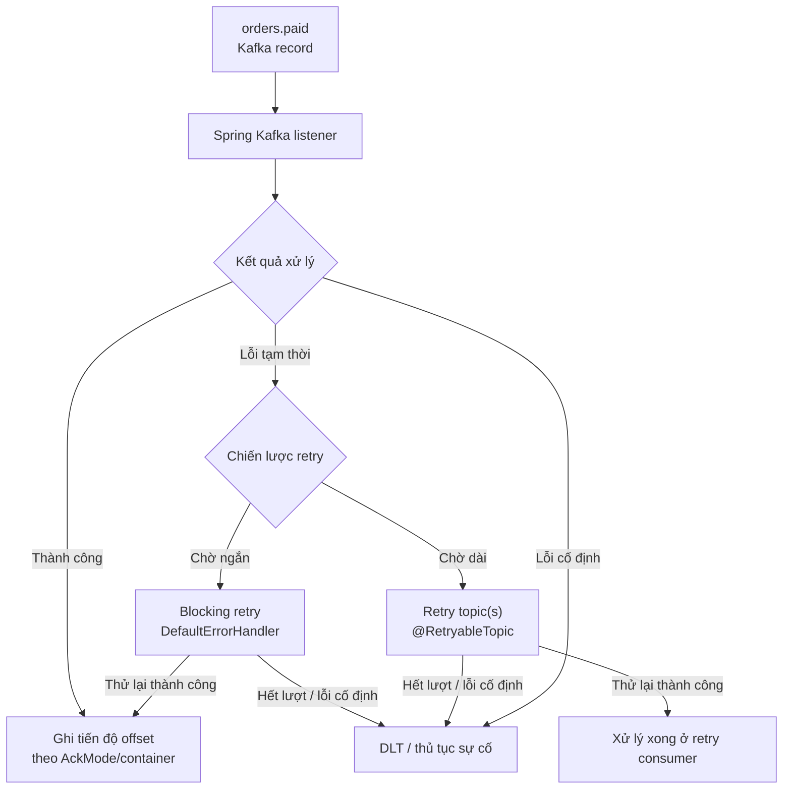
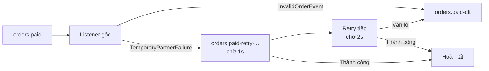

# Xử lý lỗi, retry topic hoặc dead-letter topic theo nhu cầu

## 1. Bài toán trong một luồng tích hợp Spring Boot

Trong module **SPRING_BOOT_INTEGRATION**, Apache Kafka là một kênh kết nối bất đồng bộ giữa Spring Boot với cơ sở dữ liệu, HTTP service, cache và những hệ thống nghiệp vụ khác. Một consumer Kafka đọc sự kiện, xác thực hợp đồng dữ liệu, thực hiện xử lý và có thể gọi API ngoài hoặc cập nhật database. Bất kỳ bước nào trong đó cũng có thể thất bại.

Ví dụ topic `orders.paid` nhận một event thanh toán đã xác nhận. Consumer cần kiểm tra dữ liệu, ghi trạng thái đơn hàng và gọi dịch vụ cấp quyền giao hàng. Có ba lỗi hoàn toàn khác nhau:

1. Dịch vụ bên ngoài trả HTTP 503 trong vài giây: **lỗi tạm thời**, có thể thử lại.
2. Payload thiếu `orderId` hoặc không giải mã được theo schema: **lỗi dữ liệu**, thử lại nguyên payload thường không giúp ích.
3. Sự kiện hợp lệ nhưng vi phạm ràng buộc nghiệp vụ, chẳng hạn một giao dịch thanh toán bị đối chiếu sai: cần **tra soát**, không nên tự động bỏ qua hoặc gọi lại vô hạn.

Nếu mọi exception đều được retry vô hạn, một *poison pill* có thể làm nghẽn partition. Nếu chuyển mọi exception sang dead-letter ngay lần đầu, hệ thống mất khả năng tự hồi phục khi lỗi mạng ngắn. Do đó, **retry và dead-letter là quyết định nghiệp vụ kết hợp với kỹ thuật**, không chỉ là hai annotation.

Mục tiêu của bài này là chọn một trong các chiến lược sau, triển khai bằng Spring for Apache Kafka và kiểm chứng được hậu quả đối với thứ tự, offset, idempotency và khả năng vận hành:

- **Blocking retry** trong listener container, sử dụng `DefaultErrorHandler`.
- **Non-blocking retry** qua các retry topic, thường khai báo bằng `@RetryableTopic`.
- **Dead-letter topic (DLT)** để lưu thông điệp không xử lý được và phục vụ điều tra/replay.
- **Dừng hoặc cô lập xử lý có kiểm soát** khi không được phép đi tiếp nếu một sự kiện thất bại.

## 2. Điều gì thực sự xảy ra khi consumer lỗi?

Một Kafka record có các thông tin định vị: `topic`, `partition`, `offset`, `key`, `timestamp`, headers và payload. Trong một consumer group, mỗi partition tại một thời điểm được gán cho một consumer của group. Kafka giữ thứ tự **offset trong từng partition**, nhưng không tạo thứ tự toàn cục giữa các partition.

Khi listener ném exception, kết quả phụ thuộc cấu hình `CommonErrorHandler`, chế độ ACK/commit offset, transaction và cách xử lý container. Spring Kafka có thể cho listener xử lý lại record, chuyển record sang topic khác hoặc đánh dấu record đã phục hồi rồi tiếp tục đọc record sau.



**Một điểm then chốt:** ghi nhận offset thành công không có nghĩa transaction trong database hoặc tác dụng phụ HTTP đã nguyên tử với offset. Khi ứng dụng chết giữa **DB commit** và **offset commit**, record có thể được đọc lại. Vì vậy mỗi đường retry đều phải có chiến lược **idempotency**.

### Ba khái niệm không được đánh đồng

| Khái niệm | Ý nghĩa | Điều không được suy ra |
| --- | --- | --- |
| Consumer retry | Cùng record được thử xử lý thêm một lần. | Không bảo đảm chỉ thực hiện tác dụng phụ một lần. |
| Offset commit | Broker ghi nhận tiến độ đọc của consumer group. | Không làm transaction SQL hay HTTP tự commit. |
| Dead-letter topic | Một record lỗi được publish sang topic cách ly để điều tra. | Không bảo đảm sự cố đã được giải quyết hoặc DLT đã có người xử lý. |

## 3. Phân loại lỗi trước khi chọn cơ chế

Không nên bắt tất cả exception rồi trả về bình thường: khi listener nuốt lỗi, container có thể xem record là đã xử lý. Ngược lại, không phải mọi exception đều đáng retry.

| Nhóm lỗi | Ví dụ | Cách xử lý ưu tiên |
| --- | --- | --- |
| Tạm thời và có khả năng hồi phục nhanh | HTTP 503 ngắn, SQL deadlock, kết nối tạm chập chờn | Blocking retry hữu hạn, có backoff và giới hạn tổng thời gian. |
| Tạm thời nhưng cần chờ lâu | API đối tác rate limit, dịch vụ hạ nguồn bảo trì vài phút | Retry topic với delay/backoff; lưu ý thứ tự bị thay đổi. |
| Dữ liệu không hợp lệ | JSON sai schema, thiếu field bắt buộc, ID sai định dạng | Gắn nguyên nhân, chuyển DLT hoặc kênh cách ly; không thử mãi cùng payload. |
| Lỗi hợp đồng/phiên bản | Consumer cũ không hiểu schema mới, unknown event version | Cách ly, cảnh báo, sửa compatibility rồi replay. |
| Lỗi nghiệp vụ vĩnh viễn | Đơn hàng không thuộc tenant, trạng thái bị cấm | DLT hoặc quy trình nghiệp vụ chuyên biệt; tránh retry vô hạn. |
| Lỗi trạng thái chưa rõ | Timeout sau HTTP POST có side effect; mất kết nối đúng khi DB commit | Kiểm tra idempotency và reconciliation trước khi quyết định gọi lại. |
| Lỗi hạ tầng diện rộng | DB outage kéo dài, mất Kafka ACL, topic chưa được tạo | Circuit breaker/stop tiêu thụ có kiểm soát và cảnh báo; DLT hàng loạt có thể gây quá tải. |

**Không phân loại chỉ theo HTTP status**. Ví dụ 409 Conflict có thể là lỗi cố định, nhưng cũng có thể biểu thị operation đã thành công ở lần thử trước. HTTP 429 nên tôn trọng `Retry-After` nếu hợp đồng đích cho phép. Một `TimeoutException` sau khi gọi API thanh toán không chứng minh API chưa xử lý; cần khóa idempotency ổn định hoặc truy vấn trạng thái.

Thiết kế exception rõ nghĩa giúp cấu hình:

```java
public class TemporaryPartnerFailure extends RuntimeException {
    public TemporaryPartnerFailure(String message, Throwable cause) {
        super(message, cause);
    }
}

public class InvalidOrderEvent extends RuntimeException {
    public InvalidOrderEvent(String message) {
        super(message);
    }
}

public class UncertainExternalOutcome extends RuntimeException {
    public UncertainExternalOutcome(String message, Throwable cause) {
        super(message, cause);
    }
}
```

Trên thực tế có thể tách file theo convention dự án; các class trên nhằm minh họa ý nghĩa phân loại. Khi exception được framework bọc vào exception khác, cần kiểm tra cách classifier đi theo `cause` trong phiên bản Spring Kafka sử dụng.

## 4. Chọn blocking retry, retry topic hay DLT

| Tiêu chí | Blocking retry với `DefaultErrorHandler` | Retry topic với `@RetryableTopic` | Chuyển thẳng DLT |
| --- | --- | --- | --- |
| Khoảng chờ thích hợp | Ngắn: mili giây đến vài giây, theo SLO | Dài hơn: nhiều giây/phút hoặc nhiều cấp backoff | Lỗi không thể tự hồi phục bằng retry |
| Tài nguyên | Giữ tiến độ tiêu thụ partition/chờ tại container; cần chú ý poll/liveness | Dùng thêm topics, consumers, lưu trữ và scheduler nội bộ | Dùng DLT và quy trình vận hành |
| Thứ tự theo partition/key | Dễ duy trì hơn vì không vượt record lỗi trong chuỗi xử lý tuần tự | **Có thể đảo thứ tự**: record sau đi tiếp khi record lỗi chuyển retry | Bản ghi sau tiếp tục được xử lý nếu recovery thành công |
| Lưu lượng/triển khai | Cấu hình đơn giản, phù hợp lỗi ngắn | Nhiều topic, ACL, retention và monitoring phức tạp hơn | Cần triage, ownership và replay |
| Khi hết lượt | Recoverer có thể publish sang DLT, hoặc fail/stop | Thường chuyển DLT theo cấu hình | Điều tra/sửa/replay, không tự sửa dữ liệu |

**Quy tắc chọn thực dụng:**

1. Với lỗi mạng ngắn và thứ tự quan trọng: thử **blocking retry giới hạn** trước.
2. Nếu cần chờ dài mà muốn giữ throughput của topic gốc: chọn **retry topic**, nhưng phải chấp nhận rủi ro thay đổi thứ tự.
3. Nếu payload sai hợp đồng hoặc điều kiện nghiệp vụ bất biến: **không retry**, cách ly sang DLT.
4. Nếu không được xử lý record sau khi record trước thất bại (ví dụ chuỗi bút toán bắt buộc tuần tự): cân nhắc **dừng partition/consumer và can thiệp có kiểm soát**. Không tự động xem DLT là cho phép bỏ qua.

Số lượt retry và backoff phải dựa trên **thời gian tối đa nghiệp vụ có thể chấp nhận**, tải downstream và khả năng xảy ra lỗi kéo dài. Một cấu hình luôn đúng cho mọi topic là không tồn tại.

## 5. Blocking retry bằng DefaultErrorHandler

`DefaultErrorHandler` là thành phần error handling thông dụng trong Spring Kafka cho record listener. Nó có thể thử xử lý lại record tại container và cuối cùng gọi `ConsumerRecordRecoverer` khi hết lượt. Ví dụ: nếu downstream thường hồi phục trong vài giây, thử lại hai lần với khoảng chờ 1 giây, sau đó gửi DLT.

```java
import org.apache.kafka.common.TopicPartition;
import org.springframework.context.annotation.Bean;
import org.springframework.context.annotation.Configuration;
import org.springframework.kafka.core.KafkaTemplate;
import org.springframework.kafka.listener.CommonErrorHandler;
import org.springframework.kafka.listener.DeadLetterPublishingRecoverer;
import org.springframework.kafka.listener.DefaultErrorHandler;
import org.springframework.util.backoff.FixedBackOff;

@Configuration
public class BlockingKafkaErrorConfiguration {

    @Bean
    public CommonErrorHandler kafkaCommonErrorHandler(
            KafkaTemplate<Object, Object> kafkaTemplate) {

        var recoverer = new DeadLetterPublishingRecoverer(
                kafkaTemplate,
                (record, exception) -> new TopicPartition(
                        record.topic() + ".DLT",
                        record.partition()));

        // 1 lần xử lý đầu tiên + tối đa 2 lần retry; delay 1 giây.
        var errorHandler = new DefaultErrorHandler(
                recoverer,
                new FixedBackOff(1_000L, 2L));

        // Dữ liệu sai không được giải quyết bằng retry nguyên record.
        errorHandler.addNotRetryableExceptions(InvalidOrderEvent.class);
        return errorHandler;
    }
}
```

Trong ứng dụng Spring Boot, một bean `CommonErrorHandler` có thể được tự động áp dụng vào listener container factory do Boot quản lý theo phiên bản/cấu hình. Với factory được tự tạo, cần gọi `factory.setCommonErrorHandler(errorHandler)`. Xác minh listener thực tế đang dùng factory nào; chỉ khai báo bean trong một cấu hình không được nạp sẽ không có tác dụng.

Ví dụ gửi DLT theo cùng partition:

- Topic đích `orders.paid.DLT` phải tồn tại và có **ít nhất số partition tương ứng với partition gốc**, hoặc cần một chiến lược chọn partition khác.
- Producer/template của recoverer phải serialize được **key và value thực tế**. Một `KafkaTemplate<Object, Object>` chỉ là chữ ký Java; serializer vẫn phải được cấu hình tương thích.
- Nếu publish sang DLT không thành công, **không được coi record đã recover**. Kiểm thử đường lỗi Kafka unavailable/ACL/broker timeout và chính sách xác nhận publish.
- Có thể cấu hình recoverer/handler để phù hợp transaction, ack và container hiện có. Hành vi offset phải được kiểm tra bằng integration test trên cấu hình thực tế.

### Blocking retry có thật sự “block” thread?

Với backoff ngắn, error handler có thể chờ/re-poll rồi xử lý lại, làm giảm tiến độ của partition bị lỗi. Ở Spring Kafka có các biến thể backoff handler điều khiển việc container pause/resume thay vì ngủ lâu, giúp tránh một số rủi ro liên quan `max.poll.interval.ms`. Nhưng dù triển khai cách chờ nào, consumer vẫn **chưa hoàn tất** record lỗi và không nên kỳ vọng partition đó tiếp tục tiến lên vô điều kiện.

Không dùng các vòng `while(true)` hoặc `Thread.sleep` dài trong listener để tự retry. Cách này che khuất trạng thái container, khó dừng/rebalance, dễ vượt giới hạn poll và làm tăng độ trễ của record khác.

### DLT không phải một phần của transaction SQL

Nếu listener đã ghi database rồi lỗi trước offset commit, record có thể được giao lại; cả blocking retry và DLT đều không tự đảm bảo side effect chỉ xảy ra một lần. Sử dụng **event ID/idempotency key + unique constraint**, kiểm soát transaction và khả năng phát lại an toàn.

## 6. Non-blocking retry với @RetryableTopic

Spring for Apache Kafka hỗ trợ retry qua những topic riêng: khi listener gốc lỗi, record được chuyển đến retry topic có chính sách delay, sau đó được tiêu thụ lại. Cách này thường gọi là **non-blocking retry**: không giữ listener gốc chờ xuyên suốt nhiều phút.



Tên topic cụ thể phụ thuộc cách đặt suffix, chiến lược tái sử dụng retry topics và phiên bản Spring Kafka; sơ đồ biểu diễn logic, không phải danh sách tên topic bắt buộc.

### Ví dụ listener và DLT handler

```java
import org.apache.kafka.clients.consumer.ConsumerRecord;
import org.springframework.kafka.annotation.DltHandler;
import org.springframework.kafka.annotation.KafkaListener;
import org.springframework.kafka.annotation.RetryableTopic;
import org.springframework.retry.annotation.Backoff;
import org.springframework.stereotype.Component;

@Component
public class PaidOrderListener {
    private final PaidOrderService service;
    private final DltIncidentService incidents;

    public PaidOrderListener(
            PaidOrderService service,
            DltIncidentService incidents) {
        this.service = service;
        this.incidents = incidents;
    }

    @RetryableTopic(
            attempts = "4",
            backoff = @Backoff(delay = 1_000, multiplier = 2.0, maxDelay = 8_000),
            include = {TemporaryPartnerFailure.class},
            exclude = {InvalidOrderEvent.class},
            retryTopicSuffix = "-retry",
            dltTopicSuffix = "-dlt",
            autoCreateTopics = "false")
    @KafkaListener(
            topics = "orders.paid",
            groupId = "fulfillment-projection")
    public void onPaidOrder(PaidOrderEvent event) {
        // Service phải tự bảo vệ idempotency khi event được giao nhiều lần.
        service.applyIdempotently(event);
    }

    @DltHandler
    public void onDlt(ConsumerRecord<String, Object> record) {
        incidents.recordForInvestigation(record);
    }
}
```

Ví dụ giả định `PaidOrderEvent`, `PaidOrderService`, `DltIncidentService` và converter/`Deserializer` đã được định nghĩa trong ứng dụng; đây là đoạn minh họa thiết lập retry, không phải chương trình chạy độc lập.

- `attempts = "4"` biểu thị tối đa **4 lần xử lý tổng cộng** theo cấu hình retryable topic: lần đầu và tối đa ba lần tiếp theo.
- `@Backoff` định nghĩa delay tăng dần cho những lần retry; thời gian thực tế phụ thuộc lịch poll, tải và khả năng consumer được phân công.
- `include` chỉ cho nhóm lỗi đã chọn được retry; các lỗi không thuộc nhóm đó có thể đi thẳng tới DLT nếu DLT được bật.
- `autoCreateTopics = "false"` phù hợp khi topics được hạ tầng quản lý; cần tạo sẵn đủ topic retry và DLT theo topology thực tế. Với môi trường lab có thể cho framework tạo, nhưng production nên kiểm soát partition, replication, retention và ACL.
- `@DltHandler` cho phép xử lý record đã chuyển DLT. Handler cần **lưu/hiển thị sự cố có kiểm soát**; không gọi lại cùng API lỗi vô điều kiện hoặc nuốt thất bại ghi nhận mà không có quan sát.

Các annotation và tên thuộc tính minh họa cho hệ Spring Kafka 3.x. Khi dự án dùng phiên bản khác, cần đối chiếu Javadoc/reference của đúng phiên bản, đặc biệt ở topic naming, cách xử lý exception và chính sách DLT.

### Retry topic cần hạ tầng gì?

Cần thiết kế các topic trung gian như tài nguyên Kafka thực:

| Tài nguyên | Yêu cầu |
| --- | --- |
| Retry topics | Đúng tên và số partition, replication factor, retention đủ lớn so với thời gian chờ/recovery. |
| DLT | Có chính sách retention, phân quyền, giám sát và runbook replay rõ ràng. |
| Producer của listener | Được phép `Write` vào retry/DLT, có serializer và delivery reliability phù hợp. |
| Retry consumers | Có quyền `Read`, consumer group và cấu hình deserialize tương thích. |
| Quan sát | Metric backlog, oldest record age, retry counts, DLT publish failures, lag theo topic/consumer group. |

Non-blocking retry **không giữ nguyên thứ tự xử lý của luồng gốc**. Ví dụ trong cùng partition, record A lỗi được đẩy sang retry topic; record B đến sau A có thể được xử lý xong trên topic gốc trước khi A retry thành công. Đối với state machine theo `aggregateId` hoặc thay đổi số dư phụ thuộc phiên bản, cần chiến lược xử lý thứ tự riêng: version check, optimistic locking, tách luồng tuần tự hoặc chọn blocking retry.

**Giới hạn cần nhớ:** cấu hình retry topic non-blocking của Spring Kafka không được kết hợp tùy tiện với **container transactions**; tài liệu Spring Kafka nêu hạn chế đối với non-blocking retries và transactional containers. Nếu hệ thống phụ thuộc Kafka transaction, cần chọn cơ chế retry tương thích và kiểm chứng thực tế.

## 7. Đường đi của một record lỗi qua retry topic

Giả sử event `E-204` thuộc order `O-9`, listener gọi API vận chuyển và nhận lỗi 503. Chính sách cho phép tổng cộng 4 attempts, có backoff theo `1s → 2s → 4s`.

| Mốc | Địa điểm | Kết quả |
| --- | --- | --- |
| T0 | `orders.paid` | Attempt #1 lỗi `TemporaryPartnerFailure`. |
| T1 | Retry topic cấp đầu | Sau thời gian chờ, attempt #2 lỗi. |
| T2 | Retry topic cấp sau | Attempt #3 lỗi. |
| T3 | Retry topic cấp cuối | Attempt #4 vẫn lỗi. |
| T4 | DLT | Message được chuyển để điều tra, cần ghi nhận và tránh replay mù quáng. |

Thời điểm là minh họa: delay không đồng nghĩa thời điểm xử lý tuyệt đối, và thứ tự thực thi tùy tải, poll và lịch của consumer. Các record khác trên topic gốc vẫn có thể đi tiếp trong lúc `E-204` chờ.

Khi retry thành công tại T2, record không cần đi DLT. Nếu ghi SQL đã commit ở attempt #1 nhưng listener thất bại sau đó, attempt #2 phải phát hiện đã áp dụng event nhờ idempotency.

### Không đánh đồng lỗi lần cuối với nguyên nhân gốc

Exception ở attempt cuối có thể khác exception đầu tiên; cần lưu event ID, topic/partition/offset gốc, retry count, traceback có giới hạn và trạng thái hạ nguồn ở thời điểm lỗi. Spring Kafka thường thêm metadata của record gốc và exception vào headers DLT; tên header cụ thể và điều kiện có mặt phụ thuộc version/chiến lược publish. Hệ thống quan sát nên lưu cả **nguyên nhân ban đầu** và **lỗi gần nhất** khi khả thi.

## 8. Dead-letter topic: cách ly, điều tra và replay

DLT giúp consumer gốc tiếp tục xử lý record khác sau khi record lỗi đã được chuyển đến nơi an toàn. Ví dụ `orders.paid-dlt` chứa các record không thể tự hồi phục bằng các lần retry đã cấu hình.

Một DLT tốt cần giải đáp được:

1. **Record nào lỗi?** Lưu `eventId`/business key, topic, partition, offset và timestamp gốc.
2. **Vì sao lỗi?** Nhóm exception, thông điệp lỗi và phiên bản schema/consumer.
3. **Đã làm gì?** Số attempts, trạng thái side effect, idempotency record và quyết định vận hành.
4. **Ai chịu trách nhiệm?** Team sở hữu consumer, cảnh báo và deadline xử lý.
5. **Phục hồi thế nào?** Sửa dữ liệu, deploy consumer mới, phát lại có kiểm soát, đối soát kết quả.

Ví dụ lưu sự cố trong một service riêng:

```java
import org.apache.kafka.clients.consumer.ConsumerRecord;
import org.springframework.stereotype.Service;

@Service
public class DltIncidentService {
    private final IncidentRepository repository;

    public DltIncidentService(IncidentRepository repository) {
        this.repository = repository;
    }

    public void recordForInvestigation(
            ConsumerRecord<String, ?> record) {
        // Khóa duy nhất của incident nên dựa trên định danh record gốc
        // và consumer, không chỉ dựa trên offset hiện tại của DLT.
        repository.upsertIncident(
                record.topic(), record.partition(), record.offset(),
                record.key(), record.value());
    }
}
```

`IncidentRepository` là abstraction minh họa, cần hiện thực và kiểm tra idempotency riêng. **Offset ở DLT không phải offset ban đầu của topic gốc**; để dedupe sự cố và replay cần dùng metadata nguồn được giữ trong headers hoặc event ID đáng tin cậy.

### Replay phải có kiểm soát

Quy trình phục hồi khuyến nghị:

1. **Tạm phân loại**: payload sai schema, dữ liệu thiếu, lỗi code, hạ tầng hay xung đột nghiệp vụ.
2. **Khắc phục nguyên nhân**: deploy sửa lỗi, bổ sung dữ liệu đúng hoặc khôi phục downstream.
3. **Đối chiếu side effect**: kiểm tra event đã từng cập nhật database/gọi HTTP thành công trước khi lỗi chưa.
4. **Chọn cách replay**: đọc từ DLT bằng một worker riêng hoặc publish lại vào topic phù hợp, giữ nguyên event ID và key nghiệp vụ khi có thể.
5. **Giới hạn tốc độ và số lần**: tránh dội lại hàng nghìn event lỗi khiến hệ thống mới phục hồi lại quá tải.
6. **Xác minh**: so sánh trạng thái nghiệp vụ trước/sau, cập nhật incident và ghi audit ai replay, lúc nào, lý do gì.

Không tự động publish mọi record từ DLT trở lại topic gốc theo vòng lặp vô hạn; hệ thống sẽ tạo retry storm và làm khó quan sát lỗi ban đầu.

**DLT không phải nơi lưu trữ vĩnh viễn mặc định.** Topic vẫn chịu cấu hình retention/compaction. Nếu yêu cầu audit lâu dài, cần hệ thống lưu trữ/audit riêng có bảo mật dữ liệu và chính sách lưu giữ phù hợp.

## 9. Poison pill và lỗi trước khi listener được gọi

Một số message thất bại **trước `@KafkaListener`**: value không phải JSON hợp lệ, schema không tương thích, class không nằm trong trusted packages hoặc key deserializer ném exception. Nếu consumer không thể deserialize record, chỉ bắt exception trong listener sẽ không giải quyết được.

Spring Kafka cung cấp `ErrorHandlingDeserializer` để bao lỗi deserialize và đưa thông tin lỗi vào header cho container error handler xử lý record bị lỗi. Ví dụ cấu hình:

```yaml
spring:
  kafka:
    consumer:
      key-deserializer: org.springframework.kafka.support.serializer.ErrorHandlingDeserializer
      value-deserializer: org.springframework.kafka.support.serializer.ErrorHandlingDeserializer
      properties:
        spring.deserializer.key.delegate.class: org.apache.kafka.common.serialization.StringDeserializer
        spring.deserializer.value.delegate.class: org.springframework.kafka.support.serializer.JsonDeserializer
        spring.json.trusted.packages: com.example.integration.events
        spring.json.value.default.type: com.example.integration.events.PaidOrderEvent
        spring.json.use.type.headers: false
```

Đây là **đoạn cấu hình mẫu**, giả định class `PaidOrderEvent` ở package nêu trên và JSON hợp đồng ổn định. Chỉ khai báo trusted packages cần thiết; không mở rộng `*` nếu không có đánh giá rủi ro. Với schema registry/Avro/Protobuf, cấu hình delegate deserializer phải thay đổi theo serializer thực tế.

Đối với record lỗi trước khi parse thành object, DLT có thể cần publish **raw byte[]** thay vì kiểu event mong đợi. Vì vậy producer dùng với `DeadLetterPublishingRecoverer` phải xử lý đúng cả payload thông thường và bytes khi deserialize thất bại, chẳng hạn cấu hình `DelegatingByTypeSerializer` hoặc các template riêng tương ứng. Nếu không, **chính bước gửi DLT cũng có thể thất bại**, khiến record tiếp tục bị xử lý lại.

**Consumer đọc DLT cũng cần deserializer tương thích:** đổi chữ ký handler thành `ConsumerRecord<String, Object>` không tự sửa được lỗi parse. Nếu DLT giữ cả raw bytes từ poison pill, nên dùng cấu hình consumer/DLT listener cho phép đọc raw bytes hoặc cơ chế deserialize an toàn thích hợp, rồi lưu sự cố thay vì ném cùng lỗi ở vòng xử lý DLT. Ví dụ `@DltHandler` ở mục 6 minh họa record đã deserialize được; với payload hỏng phải kiểm chứng riêng luồng DLT trong integration test.

Một số exception deserialize đã được `DefaultErrorHandler` phân loại là fatal/not retryable mặc định theo phiên bản. Kiểm chứng classifier thay vì chỉ giả định thêm `addNotRetryableExceptions(...)` là đủ; đặc biệt phải thử trường hợp JSON hỏng, unknown type, value null và key sai.

## 10. Idempotency và trạng thái ngoài Kafka

Kafka có thể giao lại record trong các tình huống consumer restart/rebalance, offset chưa kịp commit hoặc producer publish lặp. Retry topic làm số lần xử lý tăng thêm. **Không được dùng số lần delivery như số lần nghiệp vụ được phép thực hiện.**

Ví dụ bảng PostgreSQL:

```sql
CREATE TABLE processed_events (
    consumer_name TEXT NOT NULL,
    event_id UUID NOT NULL,
    processed_at TIMESTAMPTZ NOT NULL DEFAULT now(),
    PRIMARY KEY (consumer_name, event_id)
);

CREATE TABLE shipment_permissions (
    order_id UUID PRIMARY KEY,
    granted_at TIMESTAMPTZ NOT NULL DEFAULT now()
);
```

Đặt dấu vết đã xử lý và cập nhật nghiệp vụ trong cùng DB transaction:

```java
import org.springframework.jdbc.core.JdbcTemplate;
import org.springframework.stereotype.Service;
import org.springframework.transaction.annotation.Transactional;
import java.util.UUID;

@Service
public class PaidOrderService {
    private final JdbcTemplate jdbc;

    public PaidOrderService(JdbcTemplate jdbc) {
        this.jdbc = jdbc;
    }

    @Transactional
    public void applyIdempotently(PaidOrderEvent event) {
        UUID eventId = event.eventId();
        UUID orderId = event.orderId();

        int inserted = jdbc.update("""
                INSERT INTO processed_events(consumer_name, event_id)
                VALUES (?, ?)
                ON CONFLICT DO NOTHING
                """, "fulfillment-projection", eventId);

        if (inserted == 0) {
            return; // Event này đã được commit ở lần trước.
        }

        jdbc.update("""
                INSERT INTO shipment_permissions(order_id)
                VALUES (?)
                ON CONFLICT DO NOTHING
                """, orderId);
    }
}
```

Code trên dùng cú pháp PostgreSQL và giả định event ID ổn định qua retry/replay. **Cập nhật SQL và đánh dấu inbox phải nằm cùng transaction**. Nếu thực hiện HTTP call ngoài DB, cần thêm idempotency key tại dịch vụ đích hoặc transactional outbox/saga; `@Transactional` của database không biến HTTP thành transaction SQL.

Trong ví dụ `@RetryableTopic` ở trên, service này hoàn tất SQL và trả bình thường nên record thành công ngay. Để mô phỏng nhánh retry, có thể cho một bước gọi dịch vụ ngoài ném `TemporaryPartnerFailure` sau khi thực hiện các kiểm tra thích hợp. Nếu exception bị ném trong một `@Transactional` và làm rollback, dấu vết đã xử lý cũng rollback; cần thiết kế ranh giới side effect một cách rõ ràng.

### Khi Kafka transaction được bật

Kafka transactional producer có thể phối hợp việc publish record Kafka và offset trong một chuỗi **Kafka → Kafka** theo khả năng của nền tảng, nhưng không tự tạo exactly-once cho database hoặc HTTP bên ngoài. Non-blocking retry topic có giới hạn khi dùng transactional containers. Cần đánh giá riêng transaction manager, outbox/inbox và consistency model thay vì suy ra “exactly once” chỉ từ cấu hình Kafka.

## 11. Lựa chọn chiến lược theo hợp đồng thứ tự và mức độ quan trọng

Giả sử một aggregate đơn hàng phát các event `version=1`, `version=2` và `version=3` cùng Kafka key là `orderId`:

```text
Topic gốc, partition P0:
  E1(version=1) -> E2(version=2) -> E3(version=3)

E1 lỗi và bị chuyển sang retry topic.
Consumer gốc có thể hoàn thành E2, E3 trước khi retry E1.
```

Nếu backend áp dụng trạng thái theo thứ tự, replay E1 sau E3 có thể **lùi trạng thái** hoặc ghi đè dữ liệu mới. Các hướng xử lý:

- **Thứ tự tuyệt đối theo key:** giữ sự kiện trong cùng partition và dùng retry ngắn có kiểm soát, hoặc dừng partition khi record không thể xử lý, tránh bỏ qua bằng DLT tự động.
- **Dữ liệu có version:** kiểm tra `eventVersion` và chỉ áp dụng khi phù hợp; sự kiện quá cũ có thể bị bỏ qua có ghi nhận hoặc yêu cầu bù theo hợp đồng.
- **Sự kiện độc lập và idempotent:** retry topic cho phép hạ tầng hồi phục tốt hơn mà không chặn toàn bộ luồng gốc.
- **Tập sự kiện cần gom theo cửa sổ:** sử dụng cơ chế sequence/aggregator/stream processing phù hợp; DLT không giải quyết được sự kiện đến sai thứ tự.

Một lời gọi API ngoài có timeout sau khi server đích **đã thực hiện** tác dụng phụ cần quy trình xác nhận kết quả/idempotency, không đơn thuần thử lại chỉ vì nhận exception.

## 12. Kiểm thử tích hợp: phải chứng minh điều gì?

Với `@EmbeddedKafka` hoặc Kafka Testcontainers, xây dựng các kịch bản độc lập. Testcontainers có lợi thế mô phỏng broker thực hơn; chọn phiên bản Kafka/driver phù hợp với Spring Kafka đang sử dụng.

| Tình huống | Cách tạo lỗi | Assertion cần có |
| --- | --- | --- |
| Thành công lần đầu | Event hợp lệ, downstream sẵn sàng | Side effect một lần, không có record mới ở retry/DLT. |
| Lỗi tạm thời hồi phục | Dependency fail 1–2 lần rồi thành công | Tổng attempts theo cấu hình; event được xử lý, không vào DLT. |
| Hết attempts | Dependency liên tục trả lỗi retryable | Record xuất hiện ở DLT đúng key/payload/headers; số attempts có giới hạn. |
| Lỗi nghiệp vụ cố định | Listener ném `InvalidOrderEvent` | Đi DLT hoặc incident mà không chạy đầy đủ vòng retry. |
| JSON hỏng | Publish raw bytes sai định dạng | Error handler cách ly được poison pill; consumer không kẹt vô hạn. |
| Publish sang DLT thất bại | ACL thiếu hoặc broker lỗi khi recover | Record chưa bị coi là đã recover; cảnh báo và có đường retry/recovery. |
| DB commit rồi crash trước offset commit | Failpoint sau SQL commit, trước offset progress | Event có thể được giao lại; side effect DB vẫn chỉ một lần. |
| Hai event cùng key, event đầu lỗi | E1 retry dài, E2 đến ngay sau | Đánh giá thứ tự thực tế; version guard/cơ chế tuần tự hoạt động. |
| Consumer restart/rebalance | Dừng instance sau nhận record | Không mất dữ liệu, duplicate được xử lý bằng idempotency. |
| Replay từ DLT | Sửa nguyên nhân rồi phát lại có kiểm soát | Không tạo side effect trùng; incident được đóng sau đối soát. |

Ví dụ phác thảo test với fixture đã cấu hình Kafka, database, service stub và helper đọc DLT:

```java
@Test
void transientFailuresEventuallyGoToDlt() {
    // Arrange: dependency luôn ném TemporaryPartnerFailure.
    stubPartnerFailureFor("event-42");
    publish("orders.paid", "order-7", validPaidOrderEvent("event-42"));

    // Assert eventual: qua các lần retry hữu hạn, record đến DLT.
    await().atMost(Duration.ofSeconds(30)).untilAsserted(() -> {
        var dltRecord = readDltRecordByEventId("event-42");
        assertThat(dltRecord).isPresent();
        assertThat(processedCount("event-42")).isZero();
    });
}
```

Đây là **test skeleton**, các helper `stubPartnerFailureFor`, `publish`, `validPaidOrderEvent`, `readDltRecordByEventId` và `processedCount` phải được hiện thực trong test fixture. Không dùng `Thread.sleep` cứng để đoán khi nào record đã đến DLT; ưu tiên polling assertion với timeout có giới hạn. Nếu thời gian chờ retry trong test khác production, ghi rõ để tránh nhầm semantics.

Kiểm thử nên quan sát **broker** (topic, offset, key, headers) và **side effect** (database/API calls), không chỉ log rằng exception handler đã chạy.

## 13. Vận hành và quan sát retry/DLT trong production

Một hệ thống dùng retry topics cần thêm khả năng vận hành ngoài việc tạo topic:

| Nhóm tín hiệu | Cần giám sát |
| --- | --- |
| Retry | Số message vào retry, retry rate, retry attempts, thời gian chờ trước attempt tiếp theo. |
| DLT | Số event mới, tuổi event cũ nhất, tốc độ xử lý incident, số replay và tỷ lệ replay lại thất bại. |
| Broker | Lag theo consumer group, partition, under-replicated partitions, publish latency và lỗi serializer/ACL. |
| Downstream | HTTP 429/503, SQL deadlocks/timeouts, circuit breaker state, quota và latency. |
| Business | Số đơn đã cập nhật, số event bị bỏ qua do duplicate, số xung đột version và số side effect cần bù. |

Log có cấu trúc nên mang `traceId`, `eventId`, `aggregateId`, `topic`, `partition`, `offset`, tên exception, số attempt, nguyên nhân phân loại, topic đích. Tránh log toàn bộ payload nhạy cảm, token hoặc chi tiết thanh toán.

### Dấu hiệu cảnh báo cần phản ứng ngay

- DLT tăng đều trong khi team không có runbook xử lý.
- Retry backlog tăng nhanh hơn throughput xử lý thành công, báo hiệu downstream chưa hồi phục hoặc cấu hình retry quá mạnh.
- Nhiều message có cùng key bị retry, làm sai thứ tự nghiệp vụ hoặc tích tụ state chưa xử lý.
- DLQ/DLT publish thất bại do thiếu quyền, không đủ partition hoặc serializer không hỗ trợ payload.
- Số lần API side effect cao hơn số event duy nhất, cho thấy thiếu idempotency.

**Rate limiting và backoff có jitter** giúp tránh nhiều consumer cùng retry ở một thời điểm khi upstream phục hồi. Spring Kafka có các lựa chọn backoff tương ứng theo version; chọn cấu hình có kiểm thử và quan sát, không ngầm cho rằng tất cả loại backoff đều dùng được trong mọi cấu hình.

## 14. Những sai lầm phổ biến

1. **Retry vô hạn** với dữ liệu sai schema: poison pill kẹt partition và làm tăng chi phí vận hành.
2. **DLT rồi quên**: record lỗi tồn tại đến khi retention xóa nhưng không ai điều tra.
3. **Dùng non-blocking retry khi cần thứ tự nghiêm ngặt**: record sau vượt record lỗi.
4. **Nuốt exception trong listener**: container có thể ghi nhận thành công dù nghiệp vụ thất bại.
5. **Thiếu idempotency**: retry sau DB commit/HTTP success có thể ghi trùng side effect.
6. **Không kiểm thử serializer của DLT**: value lỗi deserialize là bytes, còn template chỉ serialize JSON object.
7. **Cấu hình topic DLT thiếu partition hoặc ACL**: recoverer không publish được, hệ thống lặp lỗi.
8. **Dùng cùng số lần retry cho tất cả exception**: vừa lãng phí với lỗi cố định vừa không đủ cho tình huống hạ tầng phục hồi chậm.
9. **Không phân biệt publish DLT thành công và xử lý DLT thành công**: hai mốc riêng, cần quan sát và recovery.
10. **Giả định Kafka offset và database là cùng transaction**: làm mất hoặc nhân đôi nghiệp vụ khi process chết đúng lúc.

## 15. Bài thực hành tổng hợp

**Đề bài:** một consumer `orders.paid` có 10 partition và nhận event thanh toán. Nó ghi dữ liệu SQL, sau đó gọi API cấp phép giao hàng. API đôi khi trả HTTP 503, còn một số message có payload lỗi.

Thiết kế hai cấu hình để so sánh:

**Phương án A – ưu tiên thứ tự theo đơn hàng.** Producer dùng `orderId` làm key, event cùng đơn hàng đi vào một partition. Listener dùng blocking retry ngắn; khi lỗi kéo dài, dừng hoặc cô lập tiến độ đúng policy thay vì tự động bỏ qua sự kiện bắt buộc. DB có unique constraint và idempotency key.

**Phương án B – ưu tiên throughput và chịu được out-of-order.** Dùng `@RetryableTopic` cho lỗi 503 với nhiều cấp backoff, chuyển schema/validation failure đến DLT. Handler áp dụng version guard để không cập nhật lùi trạng thái khi record cũ được retry muộn.

Kết quả cần thu:

1. Bảng log record gốc, từng retry attempt, kết quả và thời điểm tới DLT.
2. Số side effect thực tế đối chiếu với số event ID duy nhất.
3. Tình huống E1 lỗi nhưng E2 cùng key xử lý trước: chứng minh hệ thống không ghi đè trạng thái cũ.
4. Khi broker không cho publish DLT: chứng minh ứng dụng phát cảnh báo và không âm thầm đánh mất record.
5. Một runbook replay DLT có người chịu trách nhiệm, điều kiện dừng và kiểm tra sau replay.

### Checklist trước khi phát hành

- Đã phân loại exception thành retryable, non-retryable và outcome-unknown chưa?
- Đã chọn blocking hay non-blocking theo SLO và thứ tự nghiệp vụ chưa?
- Số attempts, delay, retention và tổng thời gian phục hồi có được giải thích bằng yêu cầu cụ thể không?
- Retry và DLT topics, ACL, partition, producer serializer, retention và monitoring đã sẵn sàng chưa?
- Có idempotency key, transaction SQL và kiểm thử sau crash/offset chưa?
- Có kiểm thử JSON hỏng, serializer DLT lỗi, DLT publish lỗi và replay không?
- Team đã xác định người trực DLT và chính sách phản ứng khi backlog tăng chưa?

## Tổng kết

Xử lý lỗi trong Spring Kafka gồm nhiều quyết định liên quan: **lỗi nào đáng thử lại**, **chờ ở đâu**, **được phép thay đổi thứ tự hay không**, và **khi hết lượt xử lý thì ai chịu trách nhiệm**. `DefaultErrorHandler` phù hợp cho retry ngắn có kiểm soát; `@RetryableTopic` thuận lợi khi cần backoff dài và chấp nhận tách record khỏi đường xử lý gốc; DLT dùng để cách ly và điều tra lỗi không tự hồi phục. Mọi phương án đều cần idempotency, hợp đồng dữ liệu ổn định, giám sát offset/lag và kiểm thử tình huống crash trước commit, sau commit hoặc trong lúc publish DLT. Đó là nền tảng để một luồng tích hợp Kafka trong Spring Boot có thể phục hồi mà không âm thầm làm sai nghiệp vụ.

### Tài liệu tham khảo

- [Spring for Apache Kafka — Handling Exceptions](https://docs.spring.io/spring-kafka/reference/kafka/annotation-error-handling.html)
- [Spring for Apache Kafka — Non-Blocking Retries](https://docs.spring.io/spring-kafka/reference/retrytopic.html)
- [Spring for Apache Kafka — Dead Letter Topic](https://docs.spring.io/spring-kafka/reference/retrytopic/dlt-strategies.html)
- [Spring for Apache Kafka — ErrorHandlingDeserializer](https://docs.spring.io/spring-kafka/reference/kafka/serdes.html)
- [Apache Kafka Documentation — Consumer Configuration](https://kafka.apache.org/documentation/#consumerconfigs)
