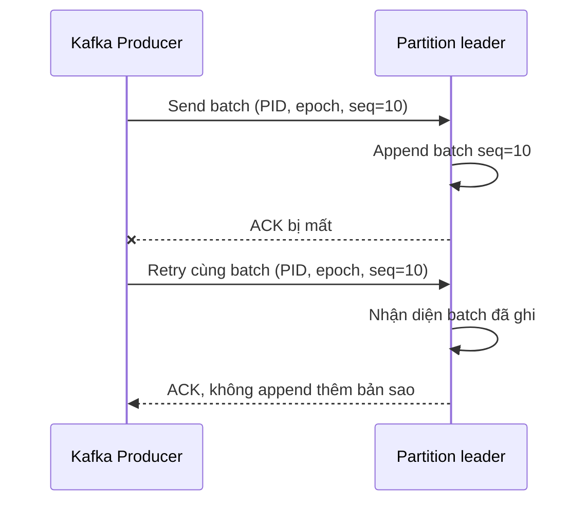
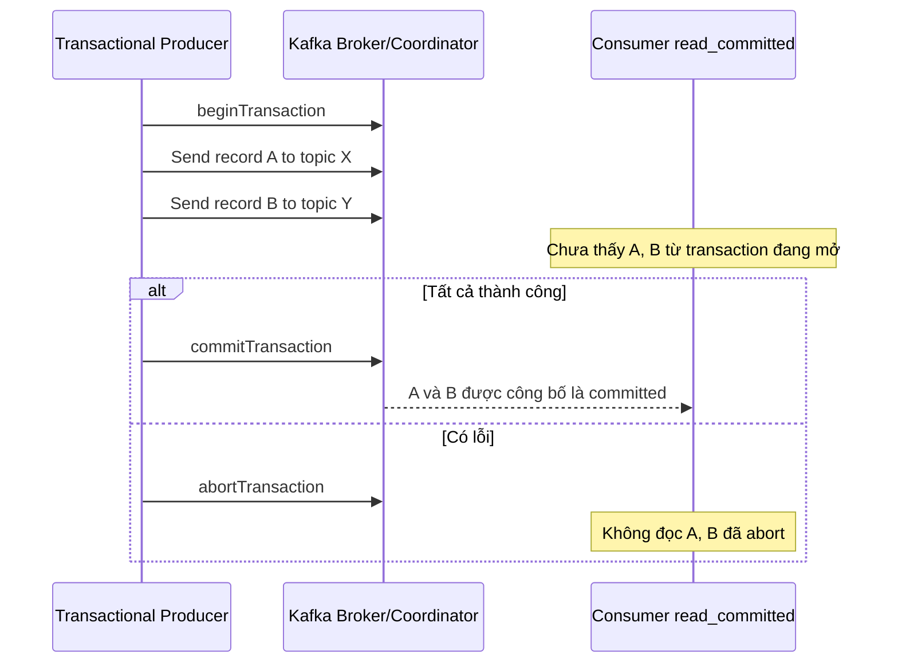
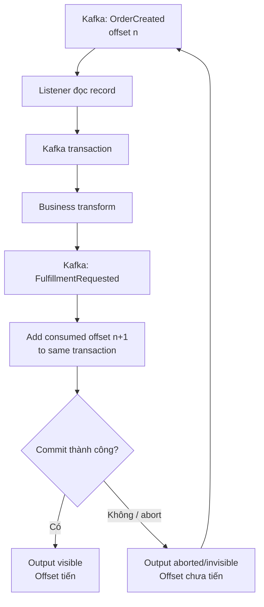
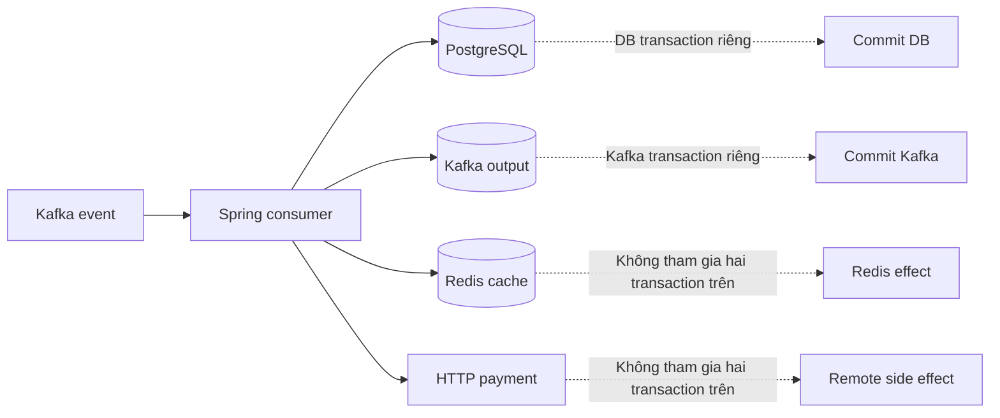

# Idempotent producer, transaction và giới hạn exactly-once

## 1. Vấn đề thực tế: gửi một sự kiện nhưng broker có thể nhận hai lần

Trong hệ thống **Spring Boot Integration**, service đặt hàng ghi PostgreSQL, gọi HTTP đến kho, cập nhật Redis cache rồi phát sự kiện `OrderCreated` sang Apache Kafka. Một consumer đọc sự kiện, gọi dịch vụ thanh toán và phát sự kiện `PaymentRequested`. Các thao tác này có thể gặp timeout, mất kết nối, consumer rebalance hoặc ứng dụng chết ngay tại ranh giới gửi/nhận.

Xét trường hợp producer gửi `OrderCreated`:

1. Broker ghi record vào partition.
2. ACK từ broker bị mất trên đường mạng.
3. Producer tưởng lần gửi thất bại và thử lại.
4. Nếu broker không nhận diện được lần thử lại, cùng dữ liệu có thể được append thành hai record.

Ngược lại, nếu một consumer đã xử lý sự kiện và ghi database nhưng chết trước khi commit offset, Kafka sẽ cho consumer nhận lại record. Chỉ cấu hình producer chống trùng **không ngăn được** nghiệp vụ consumer thực thi thêm lần nữa.

Kafka có ba cơ chế liên quan nhưng **khác phạm vi bảo đảm**:

- **Idempotent producer:** giảm/tránh trùng record do *cơ chế retry nội bộ của cùng producer* khi gửi đến một partition.
- **Kafka transaction:** nhóm nhiều thao tác ghi Kafka, và có thể cả offset đã tiêu thụ, vào một giao dịch có commit/abort.
- **Exactly-once processing trong Kafka:** phối hợp idempotent producer + transaction + offset commit cùng transaction + consumer `read_committed`, nhằm bảo đảm kết quả của luồng **đọc Kafka → xử lý → ghi Kafka** không bị công bố hai lần do retry/failure trong phạm vi Kafka.

Điều này **không tự mở rộng thành exactly-once cho JDBC, Redis, HTTP, email, thanh toán hoặc một hệ thống bên ngoài Kafka**. Bài học tập trung xác định rõ ranh giới đó và cách thiết kế tích hợp đúng khi cần nhiều hệ thống.

## 2. Phân biệt ba mức bảo đảm

| Cơ chế | Giải quyết vấn đề gì? | Phạm vi | Không giải quyết |
| --- | --- | --- | --- |
| Producer mặc định với retry | Thử gửi lại khi có lỗi tạm thời | Gửi record | Broker có thể nhận trùng nếu ACK lần trước bị thất lạc, tùy cấu hình |
| **Idempotent producer** | Broker phân biệt lần gửi lại cùng batch/sequence của producer | Producer ID + partition + sequence | Ứng dụng tự gửi hai record logic, consumer xử lý lại, DB effect |
| **Kafka transaction** | Commit/abort nguyên nhóm write Kafka; có thể kèm consumed offsets | Các topic/partition trong cùng Kafka cluster và offset tham gia transaction | Transaction DB/HTTP bên ngoài |
| **Consumer `read_committed`** | Không trả record thuộc transaction đã abort; chỉ hiện record khi transaction commit | Đọc dữ liệu Kafka | Chống trùng record độc lập không thuộc cùng transaction |
| **Idempotent consumer / inbox** | Không lặp tác dụng phụ nghiệp vụ của cùng event | Một consumer và hệ thống lưu trạng thái dedup | Tự bảo đảm dữ liệu ngoài hệ thống nếu không có commit/đối soát phù hợp |

Hai câu hỏi cần hỏi riêng là:

1. **Broker có append cùng bản ghi hai lần do producer retry không?** → Idempotent producer.
2. **Sau crash, xử lý lại một Kafka record có tạo thêm tác dụng phụ không?** → Kafka transaction cho Kafka-to-Kafka; idempotency/inbox/outbox cho hệ thống khác.

Một API client gửi hai lệnh `CreateOrder` với cùng nội dung nhưng **hai lần gọi mới** là vấn đề nghiệp vụ. Kafka idempotent producer không thể biết hai lệnh đó có cùng ý định; cần một `idempotencyKey` hoặc `commandId` ổn định và logic chống trùng ở cấp API/service.

## 3. Idempotent producer hoạt động như thế nào?

Khi bật `enable.idempotence=true`, Kafka producer sử dụng producer ID (PID), producer epoch và sequence number để broker nhận biết các lần retry của một batch trên từng partition. Broker có thể loại bỏ lần gửi lại đã ghi thành công mà không tạo thêm record mới trong log. Điều kiện cấu hình gồm `acks=all`, `retries > 0` và `max.in.flight.requests.per.connection <= 5` đối với Kafka producer hiện đại.



### 3.1. Cấu hình Spring Boot cho producer idempotent

Ví dụ cho **Spring Boot 3.x / Spring Kafka 3.x**; tên property nên đối chiếu với phiên bản cụ thể của dự án:

```yaml
spring:
  kafka:
    bootstrap-servers: "${KAFKA_BOOTSTRAP_SERVERS:localhost:9092}"
    producer:
      key-serializer: org.apache.kafka.common.serialization.StringSerializer
      value-serializer: org.apache.kafka.common.serialization.StringSerializer
      acks: all
      properties:
        enable.idempotence: true
        max.in.flight.requests.per.connection: 5
        delivery.timeout.ms: 120000
        request.timeout.ms: 30000
```

Producer Kafka phiên bản mới thường bật idempotence mặc định nếu không có cấu hình xung đột; **khai báo tường minh** giúp ý định dễ kiểm tra và tránh vô tình vô hiệu hóa bằng các property khác. `delivery.timeout.ms` giới hạn thời gian Kafka producer có thể dành cho một record, bao gồm chờ, retry và gửi; giá trị đó cần đủ cho `request.timeout.ms` và `linger.ms`. Chỉ tăng `retries` mà không kiểm soát deadline và tải không giúp hệ thống chịu lỗi tốt hơn.

Để `acks=all` có ý nghĩa về độ bền dữ liệu, topic cần replication factor, `min.insync.replicas` và bố trí broker phù hợp. Nếu số replica đồng bộ thấp hơn ngưỡng, ghi có thể bị từ chối thay vì chấp nhận thiếu bản sao. Dù broker trả ACK, vẫn phải xét khả năng mất dữ liệu khi hạ tầng hỏng nặng hoặc chính sách vận hành không phù hợp.

### 3.2. Một ví dụ gửi sự kiện từ service

```java
import java.util.UUID;
import org.springframework.kafka.core.KafkaTemplate;
import org.springframework.stereotype.Service;

record OrderCreated(String eventId, String orderId, long version) {}

@Service
class OrderEventPublisher {
    private final KafkaTemplate<String, String> kafka;
    private final com.fasterxml.jackson.databind.ObjectMapper json;

    OrderEventPublisher(KafkaTemplate<String, String> kafka,
                        com.fasterxml.jackson.databind.ObjectMapper json) {
        this.kafka = kafka;
        this.json = json;
    }

    void publish(String orderId, long version) throws Exception {
        OrderCreated event = new OrderCreated(
                UUID.randomUUID().toString(), orderId, version);

        // KafkaTemplate.send() bất đồng bộ; callback/Future thể hiện kết quả gửi.
        kafka.send("orders.created.v1", orderId,
                json.writeValueAsString(event));
    }
}
```

Ví dụ trên giải thích **idempotence transport**, chưa phải quy trình phát sự kiện tin cậy sau DB commit. Nếu method `publish()` bị gọi **hai lần**, nó tạo hai `eventId` mới và gửi hai record độc lập: producer không coi đây là một lần retry nội bộ. Trong thực tế, `eventId` nên được sinh tại thời điểm sự kiện nghiệp vụ được tạo, lưu bền vững (chẳng hạn trong outbox) và giữ nguyên khi phát lại chính sự kiện đó.

`KafkaTemplate.send()` trả `CompletableFuture<SendResult<K,V>>` trong các phiên bản Spring Kafka 3.x. Không được coi "đã gọi send" là broker đã xác nhận. Theo dõi completion/failure, cấu hình callback hoặc đợi kết quả ở nơi thực sự yêu cầu xác nhận, có timeout tổng thể và xử lý lỗi theo nghiệp vụ.

### 3.3. Giới hạn quan trọng của idempotence

- Chỉ dedup các lần retry của **cùng producer session/batch sequence** do Kafka producer quản lý; không nhận diện hai lần `send()` mới là một sự kiện logic.
- Bảo đảm này gắn với partition. Nó không tự hợp nhất record phát vào hai topic/partition khác nhau.
- Nếu ứng dụng tự retry bằng cách tái tạo record mới, đổi producer hoặc đổi key/event ID, idempotence của producer không thay thế dedup nghiệp vụ.
- Không sửa được tình huống "DB đã commit nhưng Kafka chưa nhận sự kiện", hoặc "Kafka đã nhận sự kiện nhưng DB rollback".
- Không ngăn được consumer nhận lại record khi offset chưa commit hoặc khi phải replay.
- Không thay thế validation payload, schema version, authorization hay chính sách partition key.

**Ví dụ phân biệt:** `acks=all` liên quan đến broker ACK/replication; `enable.idempotence=true` liên quan đến chống trùng do retry; `transactional.id` và transaction liên quan đến commit/abort nguyên nhóm record. Chúng bổ sung cho nhau, không đồng nghĩa.

## 4. Kafka transaction: nguyên tử hóa nhiều ghi Kafka

Kafka transaction dùng producer có `transactional.id` và transaction coordinator để quản lý trạng thái commit hoặc abort. Trong một transaction, producer có thể ghi nhiều record vào nhiều partition/topic thuộc **cùng Kafka cluster**. Consumer được cấu hình `isolation.level=read_committed` chỉ đọc các record của transaction đã commit; record bị abort không được cung cấp như dữ liệu ứng dụng.



**Atomic visibility** không có nghĩa một consumer đọc hai topic và xử lý chúng cùng một thời điểm. Nó có nghĩa các record transactional cùng commit hoặc abort theo giao thức Kafka; khi consumer đến vị trí tương ứng và dùng `read_committed`, nó sẽ không nhận record thuộc transaction đã abort/chưa commit.

### 4.1. Transactional ID và fencing

Mỗi producer giao dịch có `transactional.id`, được Kafka dùng để nhận diện producer logic qua các lần khởi tạo và **fence** một producer incarnation cũ nếu producer mới bắt đầu với cùng transactional ID. Khi bị fence, producer cũ không được tiếp tục ghi như thể nó còn sở hữu transaction.

Trong ứng dụng nhiều instance:

- Các producer giao dịch **đang chạy đồng thời** cần transactional ID không xung đột nếu chúng phải xử lý độc lập.
- Khi một logical instance được thay thế, quản lý danh tính/prefix sao cho quá trình restart có thể fence producer cũ; không sinh ID tùy tiện theo mỗi message.
- Trong Spring Kafka, `transaction-id-prefix` được factory dùng để tạo transactional IDs cho producer được quản lý; phải chọn prefix phù hợp theo instance/deployment và phương án restart.
- Fencing dẫn đến lỗi nghiêm trọng ở transaction hiện tại; **không tiếp tục dùng producer đã bị fenced** và không bắt lỗi rồi giả vờ commit.

Với môi trường Kubernetes, cần thiết kế identity theo pod/logical owner và kiểm tra rolling deployments. Nếu tất cả replica dùng cùng một prefix có nguy cơ xung đột transactional IDs trong một số cách cấu hình; nếu prefix thay đổi hoàn toàn mỗi restart, khó tận dụng fencing giữa các incarnation. Sự lựa chọn phải phù hợp với cơ chế producer caching và concurrency của phiên bản Spring Kafka đang dùng.

### 4.2. Bật transaction trong Spring Boot

```yaml
spring:
  kafka:
    bootstrap-servers: "${KAFKA_BOOTSTRAP_SERVERS:localhost:9092}"
    producer:
      key-serializer: org.apache.kafka.common.serialization.StringSerializer
      value-serializer: org.apache.kafka.common.serialization.StringSerializer
      acks: all
      # Prefix phải được chọn theo identity của instance đang chạy.
      transaction-id-prefix: "${KAFKA_TRANSACTION_PREFIX:orders-local-tx-}"
      properties:
        enable.idempotence: true
        max.in.flight.requests.per.connection: 5
        transaction.timeout.ms: 60000
    consumer:
      key-deserializer: org.apache.kafka.common.serialization.StringDeserializer
      value-deserializer: org.apache.kafka.common.serialization.StringDeserializer
      enable-auto-commit: false
      properties:
        isolation.level: read_committed
```

Trong Spring Boot, có `spring.kafka.producer.transaction-id-prefix` phù hợp, Boot có thể tự tạo `KafkaTransactionManager` và áp dụng cho cấu hình listener container mặc định. Nếu dự án tự khai báo `ConcurrentKafkaListenerContainerFactory` hoặc nhiều producer factory/transaction manager, phải **xác minh transaction manager thực sự được gắn vào container**. Chỉ đặt property rồi gọi một custom listener factory không có transaction manager sẽ không tạo exactly-once consume-process-produce.

Broker cần hỗ trợ transaction, transaction coordinator và internal transaction-state topic có replication/min ISR phù hợp. Với Kafka local **một broker**, cấu hình mặc định cho internal topic transaction có thể khiến producer không khởi tạo transaction được; môi trường test cần topology hoặc thiết lập riêng phù hợp, nhưng không sao chép giảm replication/min ISR từ local sang production.

### 4.3. Ghi nhiều record trong một transaction

```java
import org.springframework.kafka.core.KafkaTemplate;
import org.springframework.stereotype.Service;

@Service
class KafkaOnlyPublisher {
    private final KafkaTemplate<String, String> kafka;

    KafkaOnlyPublisher(KafkaTemplate<String, String> kafka) {
        this.kafka = kafka;
    }

    void publishPair(String orderId, String orderEventJson,
                     String auditEventJson) {
        kafka.executeInTransaction(ops -> {
            ops.send("orders.created.v1", orderId, orderEventJson);
            ops.send("orders.audit.v1", orderId, auditEventJson);
            return null;
        });
    }
}
```

Ví dụ này yêu cầu `KafkaTemplate` sử dụng transactional producer factory được cấu hình hợp lệ. Nếu việc gửi/commit thất bại, transaction có thể abort hoặc trả lỗi; hai record chỉ được coi là kết quả thành công khi transaction commit. `executeInTransaction` là một transaction Kafka độc lập do template quản lý, không đồng nghĩa với `@Transactional` của database.

**Không đặt HTTP call chậm, sleep/backoff dài hoặc công việc không liên quan vào transaction Kafka** vì chúng giữ transaction mở, tăng nguy cơ timeout/rebalance/fencing. Khi lỗi xảy ra, bắt lỗi để ghi log là được, nhưng không nuốt exception rồi trả thành công nếu transaction hoặc nghiệp vụ thực sự thất bại.

## 5. Exactly-once cho consume → process → produce trong Kafka

Một ứng dụng đọc `OrderCreated` từ Kafka, chuyển đổi thành `FulfillmentRequested` rồi phát lại Kafka. Nếu consumer crash, nó có thể đọc lại input. Chỉ producer idempotence vẫn có thể sinh output trùng trong **hai lần xử lý khác nhau**.

Để bảo vệ chuỗi **Kafka → Kafka** cần:

1. Consumer đọc input với `isolation.level=read_committed` nếu muốn bỏ record transactional chưa commit/đã abort.
2. Listener container mở **Kafka transaction** trước khi xử lý batch/record theo chính sách.
3. Producer transactional gửi output trong cùng transaction đó.
4. **Offset input được commit trong chính transaction Kafka**, cùng nhóm output.
5. Nếu crash/lỗi trước commit, transaction bị abort, offset không tiến và input sẽ được xử lý lại; output aborted không hiện với `read_committed` consumers.
6. Nếu commit thành công, cả output và tiến độ offset được ghi nhận theo transaction, nên một lần replay sau crash không tạo thêm output đã commit từ chính lượt xử lý đó.



### 5.1. Spring Kafka listener minh họa

Ở ví dụ dưới đây, giả định **listener container factory đang được gắn với KafkaTransactionManager** và `KafkaTemplate` sử dụng transactional producer factory trong cùng cơ chế transaction. Tác vụ chỉ biến đổi dữ liệu rồi phát sang Kafka, **không** làm side effect bên ngoài.

```java
import com.fasterxml.jackson.databind.ObjectMapper;
import org.springframework.kafka.annotation.KafkaListener;
import org.springframework.kafka.core.KafkaTemplate;
import org.springframework.stereotype.Component;

record OrderCreated(String eventId, String orderId, long version) {}
record FulfillmentRequested(String eventId, String sourceEventId,
                            String orderId) {}

@Component
class FulfillmentFlow {
    private final KafkaTemplate<String, String> kafka;
    private final ObjectMapper json;

    FulfillmentFlow(KafkaTemplate<String, String> kafka, ObjectMapper json) {
        this.kafka = kafka;
        this.json = json;
    }

    @KafkaListener(topics = "orders.created.v1", groupId = "fulfillment")
    void handle(String value) throws Exception {
        OrderCreated input = json.readValue(value, OrderCreated.class);
        if (input.orderId() == null || input.eventId() == null) {
            throw new IllegalArgumentException("Missing event identifiers");
        }

        // Ở bài toán thực tế, eventId output nên được xác định từ
        // contract/dedup logic; ở đây chỉ minh họa biến đổi đơn giản.
        String outputId = input.eventId() + ":fulfillment-requested";
        FulfillmentRequested output = new FulfillmentRequested(
                outputId, input.eventId(), input.orderId());

        kafka.send("fulfillment.requested.v1",
                input.orderId(),
                json.writeValueAsString(output));
    }
}
```

Khi listener factory được cấu hình giao dịch đúng, container có thể đưa consumed offsets vào transaction và commit cùng với output Kafka. Cần kiểm tra cụ thể với **Spring Kafka 3.x** đang sử dụng; thiết lập `transaction-id-prefix` và consumer `read_committed` ở phần 4 là điểm khởi đầu. `KafkaTemplate.send()` trả về future; transaction commit/flush vẫn phải được kiểm soát lỗi, và listener không được nuốt exception.

Ví dụ sinh output ID **quyết định từ input event ID** để minh họa tính ổn định khi reprocess. Không tự lấy `input.eventId()` làm event ID của một domain event mới nếu contract đòi ID duy nhất cho từng event type; quy ước `sourceEventId + eventType` ở ví dụ phù hợp riêng với transform một-đến-một, phải có quy tắc chặt chẽ khi một input có thể tạo nhiều output.

### 5.2. Hai thời điểm crash và kết quả khác nhau

| Thời điểm | Điều Kafka có thể quan sát | Hệ quả |
| --- | --- | --- |
| Sau đọc input, trước gửi output | Offset chưa commit, không có output committed | Lần xử lý sau có thể đọc lại input |
| Đã gửi output nhưng trước Kafka commit | Output thuộc transaction chưa commit/abort | `read_committed` không thấy output abort, offset không tiến |
| Transaction commit thành công, app chết ngay sau đó | Output visible và offset cùng được commit | Kafka không tự xử lý lại offset đó cho group vì crash |
| App lỗi sau khi ghi DB nhưng trước Kafka commit | DB đã có side effect, Kafka offset chưa tiến | DB có thể nhận tác dụng phụ lần nữa khi reprocess |
| App tự gửi hai event logic có ID khác nhau | Hai event độc lập có thể được commit | Exactly-once Kafka không tự dedup nghiệp vụ |

**Quan trọng:** Spring Kafka transactional listener bảo đảm thao tác offset/output được phối hợp theo transaction Kafka; nó không hứa một hàm handler Java chỉ **được chạy đúng một lần**. Code handler có thể được gọi lại sau crash/abort. Nếu bên trong handler có side effect không phải Kafka, phải thiết kế idempotency riêng.

### 5.3. Một số điều kiện thường bị bỏ quên

- Listener dùng **consumer group** và partition assignment; thay `group.id` có thể làm Kafka đọc lại từ offset khác theo chính sách reset, không phải sự kiện nghiệp vụ mới.
- Offset tiến khi transaction commit; `enable-auto-commit=false` là cần thiết để tránh commit offset độc lập với transaction. Spring Kafka thường tắt auto commit theo mặc định cho listener container, nhưng cấu hình rõ giúp dễ kiểm tra.
- Consumer downstream phải dùng `read_committed` để tránh nhìn thấy dữ liệu đã abort.
- Transaction có timeout và có thể abort khi producer fenced, broker đổi leader, failover/rebalance hoặc gửi thất bại.
- Các message không thuộc transaction vẫn có thể được consumer `read_committed` đọc; isolation level không phải bộ lọc dữ liệu sai hoặc chống trùng nghiệp vụ.
- Cấu hình xử lý lỗi khi listener rollback (retry, backoff, seek, DLT) phải được kiểm thử; gửi DLT hoặc ghi DB ngoài transaction có semantics riêng.
- Kafka Streams có cơ chế riêng cho exactly-once processing (ví dụ `processing.guarantee=exactly_once_v2` trên phiên bản hỗ trợ), gồm state stores/changelog và output Kafka; vẫn không atomically commit với side effect ngoài Kafka.

## 6. Vì sao không có exactly-once xuyên Kafka, DB, Redis và HTTP?

Một transaction Kafka chỉ điều khiển những bản ghi/offset Kafka tham gia transaction của nó. `@Transactional` của Spring với `DataSourceTransactionManager` điều khiển transaction JDBC riêng. Chúng là **hai nguồn commit độc lập** trừ khi có một giao thức phối hợp phân tán thật sự; cấu hình Spring thông thường không tạo một atomic commit xuyên cả hai hệ thống.



Ví dụ service nhận `PaymentConfirmed`:

1. Consumer cập nhật database `orders.status = PAID` và commit.
2. App chết trước khi commit Kafka consumer offset.
3. Record `PaymentConfirmed` được giao lại sau restart.
4. Nếu consumer cứ gửi email hoặc trừ tiền mỗi lần nhận event, tác dụng phụ bị lặp.

Kafka transaction sẽ bảo vệ các output **Kafka** do listener phát khi được cấu hình đúng, nhưng không thể rollback email đã gửi hoặc một HTTP payment đã hoàn tất. Redis `SETNX`/lock cũng không phải bảo đảm end-to-end nếu TTL hết, key bị eviction hoặc dữ liệu bị mất khi failover.

### 6.1. Phân biệt các từ thường bị lạm dụng

| Cụm từ | Diễn giải nên dùng |
| --- | --- |
| `Exactly once delivery` | Cần nêu rõ phạm vi transport/consumer, tránh khẳng định một cách chung chung |
| `Exactly once processing trong Kafka` | Kết quả Kafka-to-Kafka và offsets được commit đồng bộ theo transaction Kafka |
| `Exactly once business effect` | Một nghiệp vụ chỉ thay đổi trạng thái/đích ngoài Kafka một lần, thường cần idempotency/DB constraints và đối soát |
| `At least once` | Dữ liệu có thể được xử lý/giao lại, người tiêu thụ phải chịu được duplicate |
| `At most once` | Có khả năng mất dữ liệu nếu đánh dấu hoàn tất trước khi xử lý xong |
| `Idempotent operation` | Lặp cùng thao tác logic cho cùng trạng thái kết quả theo hợp đồng, không thêm side effect |

Thậm chí với transaction Kafka, hiệu năng chịu ảnh hưởng bởi trạng thái transaction, quorum broker, partition lag và `read_committed`; chọn exactly-once vì **yêu cầu nhất quán**, không chỉ vì tên nghe an toàn.

## 7. Transactional outbox: DB commit và phát sự kiện

Đối với yêu cầu **ghi DB rồi phát Kafka**, một mô hình thực dụng là **transactional outbox**. Cả bản ghi nghiệp vụ và bản ghi sự kiện chờ gửi cùng được commit trong một transaction database.

```sql
CREATE TABLE orders (
    order_id VARCHAR(80) PRIMARY KEY,
    status VARCHAR(32) NOT NULL
);

CREATE TABLE outbox_events (
    event_id UUID PRIMARY KEY,
    aggregate_id VARCHAR(80) NOT NULL,
    event_type VARCHAR(120) NOT NULL,
    payload JSONB NOT NULL,
    created_at TIMESTAMPTZ NOT NULL DEFAULT now(),
    published_at TIMESTAMPTZ
);
```

Trong một DB transaction:

```sql
BEGIN;
INSERT INTO orders(order_id, status)
VALUES ('ORD-421', 'CREATED');

INSERT INTO outbox_events(event_id, aggregate_id, event_type, payload)
VALUES (
  'b9b574a3-c643-4a77-b188-3929dd12fcc9',
  'ORD-421',
  'OrderCreated',
  '{"eventId":"b9b574a3-c643-4a77-b188-3929dd12fcc9","orderId":"ORD-421"}'
);
COMMIT;
```

Một publisher nền (hoặc CDC như Debezium khi phù hợp) đọc outbox và gửi Kafka. Sau khi Kafka xác nhận, nó đánh dấu `published_at` hoặc quản lý checkpoint theo cơ chế tin cậy đã thiết kế.

**Lưu ý:** Sự cố có thể xảy ra **sau khi Kafka ghi thành công nhưng trước khi DB đánh dấu outbox đã gửi**. Publisher sẽ gửi lại cùng `eventId`, vì vậy consumer phải dedup. Outbox giải quyết bài toán **không mất sự kiện khi DB đã commit**, với điều kiện publisher được vận hành phục hồi đúng; nó không tự biến luồng phân phối thành exactly-once tới mọi external sink.

Để giữ thứ tự các sự kiện của cùng aggregate, dùng record key thích hợp (thường `orderId`), kiểm soát version/sequence tại nguồn và thứ tự publish. Không giả định nhiều outbox poller đồng thời luôn giữ thứ tự theo DB timestamp; cần ordering strategy hoặc partition assignment phù hợp.

## 8. Inbox / idempotent consumer: chặn tác dụng phụ lặp

Một consumer cần chống trùng theo **event logic ID** trong phạm vi tên consumer/handler (và tenant nếu cần). Ví dụ PostgreSQL:

```sql
CREATE TABLE processed_events (
    consumer_name VARCHAR(100) NOT NULL,
    event_id UUID NOT NULL,
    processed_at TIMESTAMPTZ NOT NULL DEFAULT now(),
    PRIMARY KEY (consumer_name, event_id)
);
```

Trong **cùng DB transaction** với cập nhật nghiệp vụ:

```sql
BEGIN;
-- Chỉ người xử lý đầu tiên insert thành công mới cập nhật nghiệp vụ.
INSERT INTO processed_events(consumer_name, event_id)
VALUES ('payment_projection', 'b9b574a3-c643-4a77-b188-3929dd12fcc9')
ON CONFLICT DO NOTHING;

-- Nếu INSERT ảnh hưởng 1 dòng: cập nhật nghiệp vụ.
-- Nếu ảnh hưởng 0 dòng: bỏ qua side effect cho event đã xử lý.
-- Việc kiểm tra row count và cập nhật nằm trong cùng transaction.
COMMIT;
```

Trong ứng dụng thật, code phải **kiểm tra số dòng insert** và chỉ thực hiện update khi thành công. Nếu update lỗi, rollback **cả insert dedup và cập nhật**. Nếu gửi HTTP/email ở giữa DB transaction, không thể rollback tác động bên ngoài; nên ghi một outbox command/saga state và phát sau commit, hoặc gọi đích với idempotency key được bảo vệ ở phía đích.

### 8.1. Chọn đúng khóa chống trùng

| Khóa | Ý nghĩa | Phù hợp? |
| --- | --- | --- |
| `eventId` | Một sự kiện logic ổn định qua redelivery/replay | Có, cho event consumer |
| `(consumerName, eventId)` | Một consumer đã xử lý một sự kiện logic | Thường phù hợp, tránh consumer khác bị chặn |
| `(tenantId, consumerName, eventId)` | Dedup trong hệ thống multi-tenant | Cần khi event ID không toàn cục hoặc scope tenant bắt buộc |
| `commandId` / `idempotencyKey` | Một thao tác logic, giữ nguyên khi retry | Phù hợp cho command/API có side effect |
| `correlationId` | Một workflow gồm nhiều sự kiện/thao tác | **Không**, sẽ vô tình bỏ nhiều sự kiện hợp lệ |
| Kafka offset | Vị trí record trong một partition | Có ích cho checkpoint/điều tra, không đủ nếu event được phát lại ở offset mới |
| `traceId` | Một trace quan sát, có thể thay qua retry/replay | **Không**, không đại diện tác vụ nghiệp vụ |

Với Redis làm kho dedup, phải xem TTL, eviction, mất ghi khi failover và atomicity của nghiệp vụ. Nếu cần tính đúng đắn cao, unique constraint trong DB giao dịch cùng business update thường có bằng chứng mạnh hơn một key Redis hết hạn độc lập.

## 9. Khi kết hợp Kafka transaction với @Transactional của database

Trong Spring, `@Transactional` chọn một transaction manager cụ thể; nó **không tự kết hợp** mọi resource (Kafka và JDBC) thành một giao dịch nguyên tử.

### 9.1. Những cách làm dễ gây hiểu nhầm

```java
@org.springframework.transaction.annotation.Transactional
public void saveAndPublish(Order order) {
    orderRepository.save(order);             // DB transaction
    kafkaTemplate.send("orders.created.v1", order.getId(), "..."); // Kafka
}
```

Nếu method này sử dụng DB transaction manager, gọi `send()` không tự làm Kafka record rollback cùng database. Tùy cấu hình và cách đồng bộ Spring transaction, thứ tự commit và lỗi có thể khác; luôn có **cửa sổ một bên commit, bên kia thất bại**. Cũng không an toàn nếu Kafka commit trước rồi DB commit lỗi. Lựa chọn outbox thường dễ đối soát hơn khi yêu cầu "DB là nguồn sự thật".

### 9.2. Quy tắc áp dụng

- **Kafka → Kafka:** dùng Kafka transaction cùng consumed offsets khi đúng yêu cầu.
- **DB → Kafka:** thường dùng transactional outbox; có thể dùng cơ chế phối hợp transaction trong Spring cho một số trường hợp chấp nhận rủi ro, nhưng nó không cung cấp atomic distributed transaction thực sự.
- **Kafka → DB:** consumer idempotent/inbox + DB transaction. Commit Kafka offset sau khi DB thành công; vẫn chấp nhận redelivery và chống trùng.
- **Kafka → HTTP payment:** dùng command ID/idempotency key ở payment service, có truy vấn trạng thái và đối soát; chỉ retry khi điều kiện an toàn.
- **Kafka → Redis cache:** cập nhật cache có thể thực thi lại; version/TTL/invalidation và fallback theo nghiệp vụ.

Nếu nhiều bên cần nhất quán qua nhiều bước, thiết kế **saga**, trạng thái chuyển tiếp, compensation, outbox/inbox và giám sát đối soát. Chọn transaction manager và thứ tự commit chỉ là một phần của giải pháp.

## 10. Fencing, timeout, retry và lỗi thường gặp

| Sự cố | Ý nghĩa | Hành vi khuyến nghị |
| --- | --- | --- |
| ACK mất khi gửi record | Broker có thể đã ghi nhưng producer chưa biết | Để producer idempotent tự retry cùng batch theo deadline |
| `TimeoutException` phía producer | Không rõ record đã ghi hay chưa nếu không có kết quả cuối hợp lệ | Phân loại trạng thái; nếu tự gửi lại, giữ event ID/idempotency |
| `ProducerFencedException` | Producer transactional cũ mất quyền dùng transactional ID | Dừng producer/transaction, không tiếp tục commit |
| Transaction timeout | Transaction bị abort hoặc không commit được | Rút ngắn xử lý, điều tra broker/latency, reprocess có dedup |
| Consumer rebalance khi handler chạy lâu | Partition assignment/offset có thể thay đổi | Giới hạn thời gian xử lý, kiểm soát poll interval, idempotency |
| Broker mất quorum/ISR thấp | Không đáp ứng mức durability yêu cầu | Backoff/circuit breaker, không giảm `acks` tùy tiện |
| Lỗi serialize/schema | Dữ liệu không gửi/đọc được | Phân loại permanent error; DLT/quarantine theo contract |
| Listener throw exception | Transaction Kafka rollback/abort nếu container quản lý đúng | Retry hữu hạn, error handler phù hợp, không nuốt exception |
| DLT publisher thất bại | Không thể ghi nhận event lỗi như đã xử lý | Thiết kế recovery transaction và checkpoint hợp lệ |
| Outbox publisher crash | Event chưa được đánh dấu published dù có thể đã ở Kafka | Phát lại cùng event ID; consumer dedup |

### 10.1. Timeout không đồng nghĩa giao dịch chắc chắn thất bại

Timeout ở HTTP client, producer send hoặc một service điều khiển job chỉ cho biết **bên gọi chưa nhận kết quả trong deadline**. Một thay đổi ở phía đích có thể đã xảy ra. Retry phải phân biệt "không thực thi" với "không biết đã thực thi hay chưa". Không tự tạo `eventId` mới khi phát lại cùng outbox event.

### 10.2. Giảm retry storm

Đặt timeout và retry theo ngân sách tổng thể, có backoff+jitter và giới hạn số lần. Producer Kafka có cơ chế retry nội bộ theo delivery timeout; đừng bọc thêm vòng retry vô hạn trên `KafkaTemplate.send()`. Ở consumer, phân biệt lỗi transient (broker/DB đang chậm) với lỗi permanent (schema không hợp lệ) để tránh một record gây vòng retry nóng và chặn partition vô hạn.

## 11. Quan sát giao dịch và trùng lặp

Theo dõi tối thiểu:

- **Producer:** send success/failure rate, latency, retry rate, delivery timeout, batch size, request latency, in-flight, record errors.
- **Kafka transaction:** thời lượng transaction, abort/commit errors, fencing, tình trạng transaction coordinator và giao dịch kéo dài bất thường.
- **Consumer:** lag theo group/partition, số lần rebalance, thời gian xử lý record, rollback/retry/DLT và mức độ backpressure.
- **Business:** outbox backlog/độ tuổi event chưa phát, dedup hit, idempotency conflicts, số trạng thái cần đối soát.
- **Hạ tầng:** under-replicated partitions, ISR, broker/network errors, topic replication/min ISR, disk saturation.

Với Spring Boot, Micrometer/Actuator và Spring Kafka metrics có thể được bật theo dependency và cấu hình runtime. Không giả định mọi metric đều có tên giống nhau qua các Kafka/Spring versions; xác minh meter thật trên môi trường của dự án.

**Tránh high-cardinality metric labels**: không gắn `eventId`, `orderId`, `correlationId`, `transactional.id` biến đổi theo request, raw payload hoặc user ID làm tag. Dùng nhãn hữu hạn như `topic_family`, `consumer_group` (nếu được quản trị), `operation` và `outcome`. ID chi tiết phù hợp hơn trong structured logs/traces có phân quyền, retention và masking.

Khi debug một record, đối chiếu `eventId`, business ID, input topic/partition/offset, output topic/partition/offset và transaction outcome. `traceId`/`correlationId` giúp liên kết các bước nhưng **không phải khóa dedup**.

## 12. Kiểm thử chứng minh phạm vi exactly-once

Mock `KafkaTemplate` không thể chứng minh broker transaction, fencing và `read_committed`. Dùng một Kafka broker/test cluster thực trong Testcontainers hoặc môi trường test cách ly phù hợp. Đối với transaction, internal transaction-state topic/quorum phải được cấu hình hoạt động. Kiểm tra **đầu ra ở broker** và **trạng thái DB** sau fault injection, không chỉ kiểm tra số lần phương thức Java được gọi.

| Kịch bản | Cách tạo lỗi | Điều phải xác minh |
| --- | --- | --- |
| Idempotent producer retry | Gây mạng chập chờn/mất ACK trong điều kiện test | Một batch retry không append duplicate do producer |
| Hai lần gọi `send()` | Chủ động gửi hai record logic độc lập | Kafka có thể nhận cả hai; business dedup tùy event ID |
| Transaction commit | Gửi hai output trong một transaction | `read_committed` nhìn thấy cả hai sau commit |
| Transaction abort | Gửi record rồi abort | `read_committed` không thấy record aborted |
| Consumer crash trước commit | Dừng handler sau khi gửi output, trước offset transaction commit | Lần chạy sau xử lý lại input; output aborted không hiện |
| Crash sau commit | Dừng app sau transaction commit | Output/offset đồng bộ, không phát lại cùng input do crash đó |
| Producer fencing | Khởi động producer mới với cùng transactional ID trong test | Producer cũ bị fence và không commit được |
| DB commit trước Kafka commit | Ghi DB rồi crash trước Kafka offset commit | Input redeliver; unique constraint/dedup chặn DB side effect lần hai |
| Outbox ACK thất lạc | Kafka gửi thành công nhưng outbox chưa marked sent | Publisher có thể gửi lại cùng event ID, consumer dedup |
| Retry payment timeout | Đích xử lý xong nhưng response mất | Idempotency key ngăn trừ tiền hai lần |
| Consumer read_uncommitted | Đọc topic có aborted transactions | Thấy khác biệt so với `read_committed` theo test |
| Multiple partitions/instances | Tăng concurrency, rebalance/rolling restart | Ordering theo aggregate, prefix transactional IDs và idempotency đúng |

### 12.1. Bài tập: khẳng định "exactly once" tới đâu là đúng?

Hãy xét:

```text
Kafka orders.created
    -> Spring @KafkaListener
    -> PostgreSQL update order
    -> HTTP POST /payments/charge
    -> Kafka payments.requested
```

Ứng dụng bật `enable.idempotence=true`, `transaction-id-prefix` và `read_committed`. Sau khi HTTP payment trả success, app chết trước khi commit Kafka transaction. Khi chạy lại, input được giao lại.

**Phân tích:**

1. Record Kafka output chưa commit có thể bị abort và không xuất hiện với consumer `read_committed`.
2. Offset input chưa commit nên record có thể được nhận lại.
3. PostgreSQL update **có thể đã commit** nếu là DB transaction riêng.
4. HTTP payment **có thể đã trừ tiền**, dù Kafka transaction abort.
5. Vì vậy, bật Kafka transaction **chưa đủ** bảo đảm "chỉ trừ tiền một lần".

Một thiết kế mạnh hơn dùng một `paymentCommandId` ổn định, idempotency API ở phía payment service, inbox/unique constraint của consumer, outbox cho bản ghi phát sự kiện và đối soát trạng thái nếu phản hồi HTTP thất lạc. Việc thiết kế có thể thay đổi theo SLA và mô hình giao dịch, nhưng phải chứng minh được **tác dụng phụ** an toàn khi xử lý lại.

## 13. Những sai lầm hay gặp

- **Bật idempotence rồi quảng cáo exactly-once nghiệp vụ:** producer chỉ xử lý retry của chính producer, không ngăn redelivery hay lời gọi ứng dụng lặp.
- **Bật transaction nhưng consumer vẫn `read_uncommitted`:** có thể đọc cả output đã abort.
- **Không commit offset trong Kafka transaction của consume-process-produce:** offset và output vẫn có cửa sổ lỗi độc lập.
- **Đánh dấu offset xong rồi mới xử lý DB/HTTP:** có thể mất side effect nếu ứng dụng chết giữa đường.
- **Gộp DB và Kafka dưới một `@Transactional` rồi cho rằng atomic:** hai transaction manager không tự tạo distributed atomic commit.
- **Tạo event ID mới mỗi lần outbox retry:** consumer không thể nhận ra cùng sự kiện được phát lại.
- **Dùng correlation ID/trace ID làm dedup key:** một workflow có thể chứa nhiều sự kiện hợp lệ cùng correlation.
- **Nhiều replica chia sẻ transactional ID xung đột:** producer có thể liên tục fence nhau và làm gián đoạn luồng.
- **Giữ Kafka transaction mở khi gọi API chậm:** tăng nguy cơ transaction timeout và abort.
- **Dựa vào `exactly_once_v2` của Kafka Streams để bảo đảm HTTP charge đúng một lần:** cơ chế đó không điều khiển hệ thống thanh toán ngoài Kafka.
- **Giảm `acks`/min ISR để hết lỗi gửi:** có thể đánh đổi mất dữ liệu mà không được chấp nhận về nghiệp vụ.
- **Chỉ test happy path bằng mock:** không chứng minh fencing, abort visibility, offset transaction hoặc DB duplicate effect.

## 14. Checklist triển khai Spring Boot Integration

- [ ] Đã xác định chính xác yêu cầu: chống producer retry duplicate, Kafka-to-Kafka exactly-once hay business side effect idempotent.
- [ ] Producer dùng cấu hình idempotence hợp lệ: `enable.idempotence`, `acks=all`, `retries`, `max.in.flight <= 5`; `delivery.timeout.ms` hợp lý.
- [ ] Topic có replication factor, ISR và bảo mật phù hợp; broker transaction coordinator hoạt động.
- [ ] Nếu dùng Kafka transaction, `transaction-id-prefix` quản lý theo instance/lifecycle và có kiểm thử fencing.
- [ ] `KafkaTemplate` thực sự dùng transactional producer factory; listener factory có KafkaTransactionManager khi cần.
- [ ] Consumer cần bỏ output abort được cấu hình `isolation.level=read_committed`.
- [ ] Offset input được commit trong transaction Kafka cùng output cho luồng Kafka-to-Kafka.
- [ ] Listener không nuốt exception rồi commit giả; recovery/retry/DLT policy được xác minh dưới crash.
- [ ] Event ID/command ID ổn định qua retry; partition key và ordering theo aggregate được định nghĩa rõ.
- [ ] DB → Kafka dùng outbox khi yêu cầu nhất quán; Kafka → DB dùng idempotent consumer/inbox và unique constraint.
- [ ] HTTP/Redis/payment/email có idempotency và đối soát riêng; không dựa vào Kafka transaction để rollback external effect.
- [ ] Có timeout/backoff, bounded retries, giám sát abort/fencing/rebalance, outbox backlog và dedup hit.
- [ ] Đã kiểm thử integration với broker thật: abort/commit, crash trước/sau offset commit, producer fencing và side effect DB.

**Kết quả mong muốn:** Người thiết kế phân biệt rõ **retry của producer**, **transaction của Kafka** và **tác dụng phụ nghiệp vụ**. Hệ thống dùng Kafka transaction để phối hợp offset với output Kafka, dùng outbox/inbox và idempotency cho cơ sở dữ liệu hoặc hệ thống ngoài Kafka, từ đó có thể giải thích và kiểm chứng cụ thể lời hứa "exactly-once" của từng luồng tích hợp.
