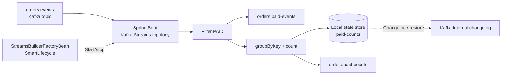
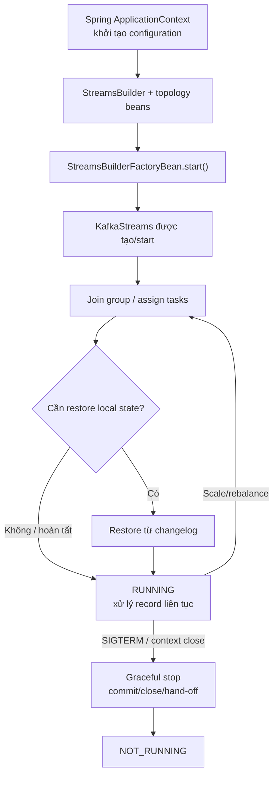

# Tích hợp Kafka Streams và vòng đời ứng dụng xử lý luồng

## 1. Vì sao Kafka Streams không chỉ là một Kafka consumer?

Trong mô-đun **SPRING_BOOT_INTEGRATION**, ứng dụng Spring Boot phối hợp HTTP client, SQL database, cache, message broker và các adapter Spring Integration. Có những nghiệp vụ không chỉ cần nhận từng record Kafka rồi gọi một service. Ví dụ, một hệ thống cần **gom trạng thái**, **đếm sự kiện theo đơn hàng**, **join dữ liệu từ nhiều topic**, hoặc **tính kết quả liên tục theo cửa sổ thời gian** để phục vụ read model.

**Kafka Streams** là thư viện xử lý luồng nhúng trong tiến trình Java. Ứng dụng khai báo **topology** các bước xử lý (filter, map, group, aggregate, join, window...) và Kafka Streams quản lý việc đọc topic đầu vào, phân công task theo partition, ghi topic đầu ra, duy trì local state store, checkpoint/recovery và rebalance.

Trong Spring Boot, Spring for Apache Kafka cung cấp tích hợp với `StreamsBuilder`, `StreamsBuilderFactoryBean` và các cấu hình liên quan. Điểm khác biệt quan trọng: **topology là công việc chạy dài hạn cùng vòng đời ứng dụng**. Không nên tạo một đối tượng Kafka Streams mới cho mỗi HTTP request, cũng không nghĩ rằng một method `@Bean` trả về `KStream` là “đã xử lý xong dữ liệu”.

### Tình huống minh họa

Topic `orders.events` có key là `orderId`; value ban đầu là một chuỗi trạng thái thử nghiệm như `PAID`, `CANCELLED` hoặc `CREATED`. Ứng dụng cần:

1. Đọc luồng sự kiện theo partition và key.
2. Đưa các sự kiện thanh toán hợp lệ sang topic `orders.paid-events`.
3. Đếm **số record PAID nhận được** theo order, lưu state cục bộ để phục hồi và xuất count sang `orders.paid-counts`.
4. Chạy liên tục cho tới khi ứng dụng bị dừng, được restart hoặc được rollout sang phiên bản khác.



**Lưu ý ngữ nghĩa:** count trong ví dụ là **số record**, chưa phải “số giao dịch thanh toán duy nhất”. Nếu producer phát lại cùng event với ID khác hoặc Kafka consumer đọc record trùng từ upstream, count vẫn có thể tăng thêm. Muốn đếm giao dịch duy nhất phải bổ sung khóa nghiệp vụ/idempotency và cách lưu dấu vết đã xử lý.

### Mục tiêu bài học

Sau khi học xong, người đọc có thể:

- Chọn đúng Kafka Streams thay vì `@KafkaListener` khi cần xử lý luồng có trạng thái.
- Cấu hình Spring Boot cho Kafka Streams, `application.id`, `bootstrap.servers`, serde và thư mục state.
- Định nghĩa topology bằng `StreamsBuilder` và phân biệt `KStream`, `KTable`, `GlobalKTable`.
- Hiểu task/partition, state stores, changelog, repartition topics, restoration và processing guarantees.
- Quản lý **startup, pause/stop, shutdown, restart, rolling deployment, lỗi thread và rebalance**.
- Kiểm thử topology riêng và kiểm thử đầy đủ với broker thực, xác định metric/health và kế hoạch recovery.

## 2. Kafka Streams nằm ở đâu so với listener và Spring Integration?

| Cách tích hợp | Dùng khi nào | Ai điều phối vòng đời? | Lưu ý |
| --- | --- | --- | --- |
| `@KafkaListener` | Xử lý record theo kiểu imperative, gọi SQL/HTTP hoặc chuyển event | Spring Kafka listener container | Tự thiết kế retry, ACK, concurrency, idempotency |
| **Kafka Streams** | Biến đổi liên tục, join, group, aggregate, window, stateful projection | Kafka Streams runtime qua `StreamsBuilderFactoryBean` | Topology, tasks, state store/changelog và offset do Streams quản lý |
| Spring Integration Kafka adapter | Kết nối Kafka với IntegrationFlow, channel, transformer, router | Endpoint/flow lifecycle của Spring Integration | Hữu ích cho enterprise integration patterns, không thay thế tự động Kafka Streams stateful DSL |
| Kafka Connect | Di chuyển dữ liệu giữa Kafka và hệ thống ngoài qua connectors | Kafka Connect worker | Tối ưu nguồn/đích, không phải DSL business processing tùy ý |

Kafka Streams là **Java client library**, không phải một cụm server chuyên biệt như Kafka Connect. Nó dùng các Kafka brokers hiện có và có thể chạy trên nhiều replica Spring Boot. Các replica có cùng `application.id` tạo nên một ứng dụng xử lý phân tán; việc phân công task và local state được thư viện quản lý.

Không đặt cả `@KafkaListener` và Kafka Streams cùng xử lý một event nghiệp vụ **mà không quy định rõ ownership**: có thể tạo hai đường side effect, hai consumer group hoặc hai chính sách offset khác nhau. Nếu phải kết hợp, tách rõ topic, group, state và trách nhiệm phát sự kiện.

## 3. Mô hình KStream, KTable và state store

### Ba abstraction quan trọng

| Abstraction | Diễn giải | Ví dụ |
| --- | --- | --- |
| `KStream<K,V>` | Chuỗi record/event; những record cùng key vẫn là các lần xuất hiện riêng | Các event `OrderPaid` theo thời gian |
| `KTable<K,V>` | Một bảng trạng thái được suy ra từ changelog; record mới cập nhật giá trị theo key | Trạng thái thanh toán mới nhất theo order |
| `GlobalKTable<K,V>` | Bảng được replicate toàn bộ tới mỗi instance tham gia xử lý | Bảng tham chiếu nhỏ dùng enrich các event |

**Không coi mọi topic là cùng ngữ nghĩa.** Với topic chứa event append-only, `KStream` là lựa chọn tự nhiên. Với topic compacted chứa latest state theo key, `KTable` có thể biểu diễn bảng cập nhật; record có value `null` thường là **tombstone** để xóa key. Với global table, mỗi instance giữ toàn bộ dữ liệu tham chiếu nên cần cân nhắc quy mô và chi phí restore.

### Vì sao state store được tạo ra?

Ví dụ `groupByKey().count()` phải nhớ số lượng từng key giữa các lần poll. Kafka Streams lưu state trong **state store** cục bộ (thường RocksDB cho store bền vững trên disk) và có thể ghi **changelog topic** để phục hồi sau crash, chuyển task hoặc khởi động trên replica khác.

```text
orders.events [partition 0]   -> Stream Task 0 -> local store shard 0
orders.events [partition 1]   -> Stream Task 1 -> local store shard 1
orders.events [partition 2]   -> Stream Task 2 -> local store shard 2
                                       |
                                       +--> changelog topic(s)
```

Một **state store không tự động là database nghiệp vụ bên ngoài**. Với local state của Kafka Streams, tính bền vững và khôi phục dựa trên log Kafka/internal topics và cấu hình state/changelog/durability. Nếu muốn HTTP API truy vấn state của mọi partition, phải tính tới **instance nào đang giữ task/key đó**, hoặc xuất kết quả sang topic/read model dùng một kho tra cứu chung.

### Repartition khi đổi key

Kafka Streams có thể tạo **repartition topics nội bộ** khi topology cần sắp xếp lại record theo key, chẳng hạn `selectKey(...)` rồi `groupByKey()`, hoặc `groupBy(...)` theo khóa khác. Repartition tiêu tốn thêm network/broker storage, tạo ranh giới luồng và có tác động đến thứ tự, throughput.

- Dùng key ổn định theo aggregate (`orderId`) ngay từ producer khi có thể.
- Không đổi key liên tục chỉ để tiện viết DSL mà không đánh giá repartition.
- Kiểm tra partition counts, data skew và những key quá “nóng”.
- Topology optimization có thể thay đổi tên/internal structure; xem tên state store và internal topics là phần cần quản lý khi nâng cấp.

## 4. Chuẩn bị dependency và cấu hình Spring Boot

Ví dụ minh họa **Java 17+, Spring Boot 3.x, Spring for Apache Kafka tương thích và Kafka Streams API cùng nhánh client được quản lý qua BOM**. Khi dùng các major version mới hơn phải đối chiếu version matrix và chạy integration tests; không ép một bản `kafka-streams` tùy ý không tương thích với `kafka-clients`.

```groovy
dependencies {
    implementation 'org.springframework.boot:spring-boot-starter'
    implementation 'org.springframework.kafka:spring-kafka'
    implementation 'org.apache.kafka:kafka-streams'

    testImplementation 'org.springframework.boot:spring-boot-starter-test'
    testImplementation 'org.springframework.kafka:spring-kafka-test'
    testImplementation 'org.apache.kafka:kafka-streams-test-utils'
}
```

Gradle sử dụng phiên bản đã được Spring Boot dependency management/BOM kiểm soát; các dependency test phải cùng phiên bản API Kafka tương ứng. Một Kafka Streams application không bắt buộc có `spring-boot-starter-web` nếu không phục vụ HTTP/Actuator, nhưng trong dịch vụ tích hợp thực tế có thể cần Actuator để health/metrics và API.

### Cấu hình ứng dụng mẫu

```yaml
spring:
  kafka:
    bootstrap-servers: ${KAFKA_BOOTSTRAP_SERVERS:localhost:9092}
    streams:
      application-id: orders-paid-projection-v1
      auto-startup: true
      state-dir: ${KAFKA_STREAMS_STATE_DIR:/tmp/orders-paid-projection}
      properties:
        num.stream.threads: 2
        processing.guarantee: at_least_once
        auto.offset.reset: earliest
```

Trong ví dụ này:

- `spring.kafka.bootstrap-servers` trỏ tới broker Kafka.
- `spring.kafka.streams.application-id` là danh tính **ứng dụng Kafka Streams**, ảnh hưởng tới consumer group, internal topic names, state stores và tiến độ xử lý. Đây không phải tên bean hoặc tên HTTP service.
- `spring.kafka.streams.auto-startup` quyết định có tự khởi động Streams cùng Spring lifecycle hay không.
- `spring.kafka.streams.state-dir` là thư mục local state cho Kafka Streams. Cần đường dẫn có quyền ghi và đủ dung lượng; `/tmp` chỉ dùng cho lab, không phải mặc định production.
- `num.stream.threads` là số stream threads trên **mỗi instance**, không phải số replica và cũng không làm một partition được xử lý song song bởi vô hạn threads.
- `processing.guarantee` lựa chọn chế độ xử lý, **không đảm bảo exactly-once cho SQL/HTTP bên ngoài Kafka**.
- `auto.offset.reset=earliest` hữu ích cho lab hay một `application.id` mới; nó **không bắt consumer group đã có committed offsets đọc lại từ đầu**. Replay cần chiến lược offset reset/versioning có kiểm soát.

Không đưa SASL password hoặc TLS private key vào YAML trong repository. Với cluster bảo mật, bổ sung `spring.kafka.properties.*` hoặc `spring.kafka.streams.properties.*` phù hợp (SASL_SSL, SASL mechanism, JAAS, SSL trust) theo chính sách tổ chức và đúng phiên bản Spring Boot/Kafka. Tránh log toàn bộ cấu hình vì JAAS chứa credential.

### application.id là một khóa vận hành

| Hành động | Hệ quả cần xem |
| --- | --- |
| Thêm **replica cùng `application.id`** | Cùng tham gia phân công task; tăng khả năng scale và rebalance |
| Đổi `application.id` từ `-v1` sang `-v2` | Kafka xem như một ứng dụng logic khác: group/offset/internal topics/state riêng |
| Nâng topology nhưng **giữ** `application.id` | Tiếp tục state/group cũ nếu topology tương thích; phải đánh giá store names/serialization |
| Chạy test cùng `application.id` với production | Có thể can thiệp group/tasks/state trong cluster chung; phải tránh |

Không đổi `application.id` như một “cách reset nhanh” trong production mà không có kế hoạch: ứng dụng mới có thể đọc lại dữ liệu, tạo đầu ra trùng, và consumer downstream có thể thấy cả hai kết quả. Quản lý `application.id` giống một phần của **migration contract**.

## 5. Tạo topology bằng StreamsBuilder

Trong Spring Boot, khai báo `@EnableKafkaStreams` để bật hỗ trợ Kafka Streams của Spring for Apache Kafka và tạo topology trên `StreamsBuilder` mà Spring cung cấp. Ví dụ dưới đây giữ value là `String` nhằm tập trung vào lifecycle và state store, tránh che các thao tác bởi JSON serializer.

```java
import org.apache.kafka.common.serialization.Serdes;
import org.apache.kafka.streams.StreamsBuilder;
import org.apache.kafka.streams.kstream.Consumed;
import org.apache.kafka.streams.kstream.Grouped;
import org.apache.kafka.streams.kstream.KStream;
import org.apache.kafka.streams.kstream.Materialized;
import org.apache.kafka.streams.kstream.Produced;
import org.apache.kafka.streams.state.KeyValueStore;
import org.apache.kafka.common.utils.Bytes;
import org.springframework.context.annotation.Bean;
import org.springframework.context.annotation.Configuration;
import org.springframework.kafka.annotation.EnableKafkaStreams;

@Configuration
@EnableKafkaStreams
public class PaidOrdersStreamsTopology {

    @Bean
    public KStream<String, String> paidOrderStream(
            StreamsBuilder streamsBuilder) {

        KStream<String, String> source = streamsBuilder.stream(
                "orders.events",
                Consumed.with(Serdes.String(), Serdes.String()));

        KStream<String, String> paidEvents = source
                .filter((orderId, status) ->
                        orderId != null && "PAID".equals(status));

        // Xuất record PAID nguyên dạng, key vẫn là orderId.
        paidEvents.to(
                "orders.paid-events",
                Produced.with(Serdes.String(), Serdes.String()));

        paidEvents.groupByKey(
                        Grouped.with(Serdes.String(), Serdes.String()))
                .count(Materialized
                        .<String, Long, KeyValueStore<Bytes, byte[]>>as(
                                "paid-counts-store")
                        .withKeySerde(Serdes.String())
                        .withValueSerde(Serdes.Long()))
                .toStream()
                .mapValues(count -> Long.toString(count))
                .to("orders.paid-counts",
                        Produced.with(Serdes.String(), Serdes.String()));

        return source;
    }
}
```

Trong ví dụ, record `("O-204", "PAID")` đi vào cả topic sự kiện đã lọc và phép đếm theo key. `count` tạo **KTable có state store**; mỗi lần count thay đổi, giá trị mới có thể được phát ra topic `orders.paid-counts`.

**Các điều kiện để chạy thực tế:**

- Broker có sẵn topics `orders.events`, `orders.paid-events`, `orders.paid-counts` hoặc ứng dụng có chính sách provision topic rõ ràng.
- Kafka principal có quyền đọc/ghi topic, consumer group, internal repartition/changelog topics và transactional IDs khi bật exactly-once.
- Key/value thực tế tuân theo serde `String`; nếu nguồn gửi JSON/Avro/Protobuf phải dùng serde tương thích. Không cố parse dữ liệu thật bằng `StringSerde` rồi cho rằng schema validation đã được thực hiện.
- Một lần `@Bean` chạy chỉ **xây dựng đồ thị topology**, không tiêu thụ hết Kafka record. Streams runtime xử lý liên tục sau khi được start.
- Nếu nhận record `PAID` nhiều lần do nghiệp vụ upstream, count tăng nhiều lần. Để xây projection tiền hoặc số thanh toán **duy nhất**, phải có thiết kế deduplication riêng; `exactly_once_v2` không loại bỏ business duplicate được producer phát như những record hợp lệ khác nhau.

### Tránh side effect ở bước xây topology

Một `@Bean` khai báo topology không nên tự gọi HTTP, ghi SQL hoặc chủ động publish Kafka ngay khi ApplicationContext được tạo. Các thao tác này thuộc runtime processor/transformer hoặc service khác với chính sách retry/transaction. Nếu đặt side effect trong lúc tạo topology, ứng dụng có thể gửi dữ liệu ngay cả khi Streams chưa bắt đầu và rất khó kiểm soát restart.

## 6. KTable, windowing và joins: khi nào cần chuyển từ stateless sang stateful?

| Phép xử lý | Ví dụ trong luồng tích hợp | Rủi ro cần kiểm soát |
| --- | --- | --- |
| `filter/mapValues` | Chuẩn hóa status/loại bỏ event không cần | Hợp đồng và xử lý malformed payload |
| `groupByKey/count` | Đếm event theo order | State store, changelog và duplicate events |
| `aggregate/reduce` | Tính tổng theo key | Overflow, event ordering, tombstone và idempotency |
| Windowed aggregation | Đếm payment trong 5 phút | Event-time, timestamp, late arrival, grace/retention |
| Stream-table join | Enrich event theo bảng trạng thái | Điều kiện key/co-partition, update lag và availability |
| Stream-stream join | Ghép sự kiện tương quan trong cửa sổ | Window state, out-of-order events, memory/disk |
| `suppress` | Chờ cửa sổ kết thúc rồi phát kết quả | Buffer sizing, latency và thời điểm kết quả cuối |

Kafka Streams quản lý state stores và internal topics cho nhiều phép xử lý có trạng thái. Tuy nhiên, **Kafka Streams không tự biết nghiệp vụ thanh toán nào phải bị bỏ qua**: code cần kiểm tra version/event ID/nguồn dữ liệu, đặc biệt với event đến sai thứ tự.

Ví dụ một KTable nhận các cập nhật `status` mới theo `orderId`: record value `null` có thể đại diện cho tombstone/xóa trạng thái. Nếu topology vô tình filter toàn bộ null trước khi materialize, hành vi xóa có thể không còn đúng. Với Kafka Streams, semantics của null value còn phụ thuộc từng operator và input source; kiểm thử rõ với fixture.

### Timestamp và event time

Windowing mặc định có thể dựa trên timestamp của record do timestamp extractor xác định, không nhất thiết là thời gian server nhận request HTTP. Một event phát lại muộn có thể rơi vào cửa sổ lịch sử. Cần quy định:

- Timestamp lấy từ Kafka record hay field trong event?
- Timezone và tính hợp lệ của timestamp được chuẩn hóa thế nào?
- Grace period cho late events là bao nhiêu?
- Cửa sổ/retention có đủ dài cho restore/replay không?
- Số kết quả “cuối cùng” và cách bù sau grace được định nghĩa ra sao?

Không dùng một cửa sổ thời gian “5 phút” như bảo đảm exactly-once nếu hợp đồng không có event ID hoặc version.

## 7. Vòng đời Kafka Streams bên trong Spring Boot

Spring for Apache Kafka quản lý `StreamsBuilderFactoryBean`, một thành phần tích hợp với cơ chế `SmartLifecycle` của Spring. Vòng đời xử lý cần hiểu theo hai mức:

1. **Vòng đời ApplicationContext**: Spring đăng ký bean/configuration, xây topology, khởi động các lifecycle beans và thực hiện graceful shutdown.
2. **Vòng đời KafkaStreams runtime**: Kafka Streams kết nối broker, phân công tasks, khôi phục state, chạy threads, rebalance và dừng.



**Không nên kết luận Streams đã sẵn sàng phục vụ truy vấn chỉ vì Spring Boot đã in “Started Application”.** KafkaStreams có thể còn ở trạng thái `REBALANCING`, restoring state hoặc chưa được gán task. Một readiness policy cần dựa trên **trạng thái runtime và khả năng đáp ứng chức năng thật**, không chỉ Java process còn sống.

### Những trạng thái cần biết

| Kafka Streams state | Ý nghĩa ở mức ứng dụng | Hành động phù hợp |
| --- | --- | --- |
| `CREATED` | Đối tượng Streams đã tạo, chưa chạy | Chờ start; kiểm tra cấu hình và topology |
| `REBALANCING` | Đang phân công tasks hoặc phục hồi state | Chưa khẳng định mọi local store truy vấn được |
| `RUNNING` | Đang xử lý sau khi đạt trạng thái vận hành | Readiness có thể pass nếu các dependency khác cũng ổn |
| `PENDING_SHUTDOWN` | Đang đóng, ngừng nhận công việc mới theo lifecycle | Rút instance khỏi traffic khi cần |
| `NOT_RUNNING` | Runtime đã dừng | Không coi là consumer đang hoạt động |
| `ERROR` và trạng thái lỗi trung gian (tùy bản Kafka) | Gặp lỗi không thể tiếp tục bình thường | Alert, điều tra, restart/recover có kế hoạch |

Các enum và đường chuyển trạng thái cụ thể có thể khác giữa các bản Kafka Streams; cần đối chiếu Javadoc của phiên bản đang sử dụng. Quan sát state transitions thay vì dùng một flag boolean cố định trong ứng dụng.

### `auto-startup: false` có tác dụng gì?

Với `spring.kafka.streams.auto-startup=false`, mục tiêu là không tự start Streams factory bean ngay cùng ApplicationContext. Topology vẫn có thể được đăng ký, nhưng **không có record nào được xử lý chỉ vì bean `KStream` tồn tại**. Cơ chế start/stop thủ công nên đi qua bean lifecycle do Spring quản lý; tránh tạo thêm một `KafkaStreams` instance ngoài Spring bằng cách gọi `new KafkaStreams(...)` khi ứng dụng đã có `StreamsBuilderFactoryBean`.

Chế độ start thủ công có ích khi:

- Phải chờ credential/certificate được cấp hoặc migration/index/state dependencies sẵn sàng.
- Muốn bật processing theo thủ tục rollout/canary.
- Cần tạm dừng một topology gây tác dụng phụ nguy hiểm để tra soát.

**Đừng lạm dụng auto-startup false để “chữa” lỗi cấu hình** rồi để ứng dụng báo healthy dù chưa tiêu thụ topic. Nếu không chạy Streams là lỗi nghiệp vụ, readiness phải phản ánh điều đó.

## 8. Điều khiển start, stop và quan sát KafkaStreams runtime

Spring Kafka cho phép cấu hình `StreamsBuilderFactoryBean`, gắn KafkaStreams listeners/customizers và truy cập instance Streams do factory quản lý. Cách hook cụ thể phụ thuộc Spring Kafka/Spring Boot version; ví dụ dưới đây mô tả ý tưởng quan sát bằng `StreamsBuilderFactoryBeanConfigurer` trong các phiên bản Boot hỗ trợ:

```java
import org.slf4j.Logger;
import org.slf4j.LoggerFactory;
import org.springframework.boot.autoconfigure.kafka.StreamsBuilderFactoryBeanConfigurer;
import org.springframework.context.annotation.Bean;
import org.springframework.context.annotation.Configuration;

@Configuration
public class KafkaStreamsLifecycleConfig {
    private static final Logger log =
            LoggerFactory.getLogger(KafkaStreamsLifecycleConfig.class);

    @Bean
    StreamsBuilderFactoryBeanConfigurer streamsStateLogging() {
        return factory -> factory.setStateListener(
                (newState, oldState) ->
                        log.info("Kafka Streams state {} -> {}",
                                oldState, newState));
    }
}
```

Đây là **một điểm mở rộng ví dụ**. Khi copy sang một dự án thực, phải xác nhận class/hook và cách auto-config được Boot version đó nạp; nếu tự tạo `StreamsBuilderFactoryBean` thì cần đăng ký listener trực tiếp ở đúng factory. Không bao giờ ghi SASL JAAS/password ra log khi chẩn đoán state changes.

Với các phiên bản Kafka Streams hỗ trợ `StreamsUncaughtExceptionHandler`, cần chọn phản ứng trước lỗi uncaught trên stream thread:

| Phản ứng khái niệm | Khi cân nhắc | Nguy cơ |
| --- | --- | --- |
| Thay stream thread | Lỗi cô lập, có khả năng hồi phục mà không đổi dữ liệu | Thay liên tục khi lỗi cố định gây retry storm |
| Dừng Streams client | Lỗi instance không thể xử lý an toàn | Process/health phải báo không sẵn sàng để orchestrator xử lý |
| Dừng cả ứng dụng Streams | Cần tránh trạng thái xử lý một phần | Ảnh hưởng những tasks khác cùng instance |

Tùy Kafka Streams version, enum response thường có các giá trị tương ứng như `REPLACE_THREAD`, `SHUTDOWN_CLIENT` hoặc `SHUTDOWN_APPLICATION`. **Không xử lý mọi exception bằng cách “log rồi CONTINUE”** nếu nó có thể làm mất event thanh toán hoặc phá invariant state store. Exception handler của Kafka Streams không tương đương `DefaultErrorHandler` của `@KafkaListener`.

### Không dùng thao tác `close` tùy tiện trên thread xử lý

Kafka Streams close/restart là thao tác lifecycle, có thể cần join/leave group, commit và đóng state store. Tránh gọi `KafkaStreams#close()` trực tiếp bên trong một stream processor hoặc trong HTTP request handler để “tạm dừng một record”: có thể gây deadlock/race hoặc phá vòng đời Spring quản lý.

Khi cần stop có kiểm soát:

1. Chặn công việc inbound mới của instance nếu ứng dụng có HTTP API liên quan.
2. Yêu cầu factory/lifecycle dừng theo chính sách và timeout đã kiểm thử.
3. Chờ threads/tasks dừng, đóng state stores và giải phóng file locks.
4. Chỉ restart bằng cơ chế được hỗ trợ; xác minh có thể tạo/reinitialize KafkaStreams instance mới trước khi nhận traffic.

Những yêu cầu pause theo partition, bảo trì state và stop toàn topology là **ba vấn đề khác nhau**. Với xử lý stateful, muốn “tạm không xử lý” thường cần cơ chế pause/stop được hỗ trợ hoặc tắt toàn deployment theo kế hoạch; không giả định Kafka Streams hỗ trợ cùng API pause/resume như mọi `KafkaListenerContainer`.

## 9. State directory, changelog và phục hồi sau crash

Trong ứng dụng stateful, vòng đời disk cũng quan trọng như vòng đời Java process:

- `state.dir` chứa local state, checkpoint và dữ liệu liên quan tới active/standby tasks.
- Changelog topics trên Kafka cho phép restore state khi instance mới nhận task hoặc local directory bị mất.
- Repartition topics là hạ tầng nội bộ phục vụ các bước group/join theo key khác.
- File locks và quyền ghi thư mục state ảnh hưởng khả năng start nhiều Streams instances trong cùng host/container.

**Lưu ý:** local state thường là dữ liệu **có thể tái dựng**, nhưng việc restore có thể rất tốn thời gian. Xóa thư mục state khi gặp lỗi không phải phương pháp sửa mặc định; trước hết kiểm tra corruption, broker changelog retention, disk đầy, quyền file, thay đổi topology hoặc version serialization.

### Ephemeral volume hay persistent volume?

| Cách lưu local state | Ưu điểm | Đánh đổi |
| --- | --- | --- |
| Ephemeral filesystem của pod | Deploy dễ, state mất khi pod bị thay | Mỗi lần migrate/restart có thể cần restore lớn từ changelog |
| Persistent volume gắn theo instance | Có thể giảm thời gian restore nếu pod quay về đúng state hợp lệ | Cần quản lý volume attachment, lifecycle, disk capacity và task reassignment |
| Standby replicas | Giữ bản sao state phục vụ failover nhanh hơn | Tốn thêm IO, disk và replica capacity |

Không để hai process cùng dùng **chung một state directory** có thể ghi: RocksDB/state locks và metadata task có thể xung đột. Mỗi instance phải có thư mục/volume riêng có khả năng ghi.

### Retention và internal topics

Một số state store được restore từ **changelog topic** có compacted records, còn các internal topics phục vụ window/repartition có chính sách retention khác tùy topology. Việc đổi policy topic một cách thủ công mà không hiểu semantics có thể làm mất khả năng phục hồi hoặc gây dữ liệu sai.

Kafka Streams có thể tự tạo internal topics theo topology; cluster phải có policy và ACL phù hợp. Trong môi trường bị khóa quyền tạo topic, cần **provision đúng tên/partition/replication/cleanup policy** hoặc có kế hoạch phân quyền phù hợp trước khi start.

Đặc biệt khi nâng topology:

- **Tên store** được materialize như `paid-counts-store` là một phần của hạ tầng phục hồi/query. Tự đổi tên có thể làm phát sinh internal changelog topic khác.
- Đổi serializer/schema của state store mà không có migration có thể làm ứng dụng không deserialize được data cũ.
- Đổi số partition của input/repartition topic có thể thay nhiệm vụ phân công và yêu cầu kiểm tra co-partitioning.
- Đặt retention quá ngắn cho nguồn replay không có bản bù có thể khiến một `application.id` mới không thể dựng lại read model lịch sử đầy đủ.

## 10. Scale-out, rebalance và rolling deployments

Kafka Streams có thể chạy nhiều instance trong cùng một ứng dụng logic. Nếu topic có 6 partitions và tổng stream threads của các replica vượt số task hữu ích, không có nghĩa throughput tăng tuyến tính: một task của một partition không được tách chạy song song tùy ý.

```text
orders.events: partitions P0 P1 P2 P3 P4 P5

Pod A: stream-thread-1 -> task P0, P1
Pod A: stream-thread-2 -> task P2
Pod B: stream-thread-1 -> task P3, P4
Pod B: stream-thread-2 -> task P5

Khi Pod C khởi động:
  group rebalance -> di chuyển task(s) và restore/activate local state
```

Đây là phân bổ minh họa, không phải bảo đảm Kafka sẽ luôn phân công chính xác như sơ đồ. Trong thực tế có standby tasks, nhiều subtopologies, partition co-location và chiến lược assignment của phiên bản Streams.

### Rollout an toàn

1. Xác minh schema, serde, internal topics và state store của phiên bản mới **tương thích** với phiên bản cũ.
2. Chạy một canary hoặc rolling update theo giới hạn số instance unavailable của deployment.
3. Khi bắt đầu shutdown, giảm readiness/stop nhận HTTP work nếu có; để Streams runtime đóng theo timeout được cấu hình.
4. Chấp nhận rebalance/restore có thể tạm tăng lag. Theo dõi `RUNNING`, lag, restoration progress, consumer group và output correctness.
5. Khi các replica mới đạt điều kiện sẵn sàng và throughput ổn định, mới rút phần còn lại.
6. Với breaking topology migration, triển khai chiến lược **blue/green hoặc application.id mới** có kiểm soát thay vì để hai version không tương thích cùng cập nhật state/changelog.

Đừng chỉ dựa vào Kubernetes `Running` của pod. Một pod có thể còn hoạt động nhưng Streams đã ở `ERROR` hoặc đang restore. Ngược lại, một replica đang REBALANCING ngắn lúc scale không nhất thiết là sự cố production; health/readiness cần ngưỡng và định nghĩa dựa trên SLO.

### Khi nào dùng cùng application.id?

Giữ `application.id` qua rollout tương thích để ứng dụng tiếp tục tiến độ và state hiện có. Đổi `application.id` khi cần **một ứng dụng logic mới**, ví dụ chạy song song topology mới và so sánh kết quả, nhưng phải:

- Tách output topics hoặc cơ chế tiêu thụ để tránh nhân đôi side effect.
- Quy định start offset của group mới và khả năng còn đủ dữ liệu lịch sử.
- Provision internal topics/state đủ quota.
- Định nghĩa thời điểm cắt traffic và cách đối soát từ v1 sang v2.
- Giữ quyền và chi phí broker trong ngân sách vì hai ứng dụng có thể đọc cùng đầu vào.

Một thay đổi tên Kafka Streams application giống một lần **migration dữ liệu**, không đơn thuần là đổi nhãn service.

## 11. Exactly-once processing: phạm vi thật sự

Kafka Streams hỗ trợ processing guarantees như `at_least_once` và `exactly_once_v2` (tùy phiên bản/broker). Với Kafka-to-Kafka topology có state stores, exactly-once được thiết kế để phối hợp **đầu ra Kafka, trạng thái xử lý và consumer offsets** bằng giao dịch Kafka theo khả năng nền tảng.

```yaml
spring:
  kafka:
    streams:
      application-id: orders-paid-projection-eos-v1
      properties:
        processing.guarantee: exactly_once_v2
```

Không bật EOS chỉ bằng cách sửa một property và mặc định hạ tầng đã sẵn sàng. Cần:

- Kafka broker và client version hỗ trợ transaction/EOS v2.
- Broker transaction state/internal topics có replication và availability phù hợp, đặc biệt khi chỉ có một broker test so với nhiều broker production.
- Producer/consumer principals có ACL phù hợp với transactional IDs, group và topics.
- Downstream consumers cần semantics phù hợp, thường dùng `isolation.level=read_committed` để không nhìn thấy aborted transactional writes.
- Test crash/rebalance thật nhằm xác nhận không có dữ liệu commit một phần trong phạm vi Kafka và state có thể restore.

### Điều exactly-once **không** tự đảm bảo

| Side effect | EOS Kafka-to-Kafka có tự bao phủ? | Cần thiết kế thêm |
| --- | --- | --- |
| Ghi output record sang Kafka từ Kafka Streams | **Có thể**, trong transaction Kafka nếu cấu hình đúng | Kiểm thử producer/consumer isolation và broker failures |
| State store/changelog Kafka Streams | Được phối hợp theo semantics Streams và transaction Kafka | State restore/migration/durability vẫn cần kiểm tra |
| `UPDATE` trên PostgreSQL | **Không** thuộc Kafka transaction | Idempotency, inbox/outbox, transaction SQL |
| HTTP POST tới hệ thống thanh toán | **Không** | Idempotency key, reconciliation, timeout policy |
| Gửi email/SMS | **Không** | Dấu vết gửi, dedupe và xử lý retry phù hợp |
| Producer upstream phát cùng business event hai lần | **Không tự loại** hai record hợp lệ | Event ID, business key, version guard |

Ví dụ cùng `OrderPaid` được producer phát ra **hai record** khác offset với event ID giống nhau: EOS có thể xử lý mỗi record theo đúng ranh giới Kafka nhưng **không biết** chúng là bản sao nghiệp vụ. Topology muốn tính tổng “số đơn được thanh toán duy nhất” phải kiểm tra và lưu key idempotency.

### Xử lý side effect ngoài Kafka

Tránh đặt một HTTP POST hoặc SQL transaction có side effect trực tiếp vào `peek(...)` và cho rằng Streams sẽ rollback nó khi transaction Kafka abort. `peek` thích hợp cho quan sát hạn chế, không phải nơi đặt side effect quan trọng cần exactly-once.

Nếu ứng dụng cần cập nhật SQL và phát event Kafka:

1. Cân nhắc **transactional outbox** khi SQL là nguồn chân lý.
2. Với Kafka → SQL, dùng khóa idempotency bền vững trong cùng transaction với side effect SQL.
3. Với Kafka → external API, dùng idempotency key và đối soát outcome chưa rõ.
4. Tách rõ ownership của transaction Kafka, transaction SQL và request HTTP.

## 12. Deserialize lỗi, poison pill và exception handlers

Kafka Streams đọc record qua key/value serde. Một record không parse được có thể thất bại **trước khi vào logic xử lý business**; một record JSON parse thành công vẫn có thể vi phạm contract (thiếu event ID, tenant sai, số tiền âm).

Phân biệt ít nhất ba nhóm:

| Vị trí lỗi | Ví dụ | Chính sách cần quyết định |
| --- | --- | --- |
| **Deserialization** | Byte không đúng JSON/Avro schema, key serde sai | Dừng hay bỏ qua/cách ly với bằng chứng? |
| **Processing** | Ném exception trong filter/transform/aggregate/state store | Fail topology, phân loại dữ liệu lỗi, retry hay repair? |
| **Production** | Publish output Kafka lỗi, transaction commit thất bại | Retry/close/restart đúng Kafka Streams semantics |

Kafka Streams có các loại handler cho deserialization/processing/production tùy version; không copy nguyên `DefaultErrorHandler` của `@KafkaListener` sang Streams và kỳ vọng tương đương. Các mặc định và API hook cần được kiểm tra theo phiên bản đang dùng.

**Lựa chọn nguy hiểm:** bỏ qua record không parse được để giữ tiến độ khi record đó thực chất là sự kiện thanh toán bắt buộc. Nếu application quyết định `CONTINUE`/skip, phải có hợp đồng xử lý lỗi, lưu bằng chứng đủ truy vết, alert và quy trình replay; không chỉ log một dòng rồi cho đó là thành công.

Với invalid payload, một chiến lược có thể là:

1. Đọc raw bytes qua serde cho phép kiểm soát parse nếu kiến trúc yêu cầu.
2. Validate schema, size, event ID, version, tenant trước phép aggregate.
3. Đưa lỗi cố định vào topic quarantine/DLT riêng có ACL/retention, tránh sao chép token/PII.
4. Đừng tạo vòng retry vô hạn giữa topic gốc và DLT.
5. Chỉ commit/đánh dấu đã xử lý khi chính sách quarantine đã được thực hiện đáng tin cậy trong ranh giới được thiết kế.

Kafka Streams không có cơ chế `@RetryableTopic` giống Spring Kafka listener một cách mặc định; nếu cần retry nhiều cấp, phải thiết kế thêm **topology/retry topics hoặc xử lý tại source** và xem xét thứ tự cùng transaction semantics.

## 13. Readiness, liveness và truy vấn state store

Một Kafka Streams process vừa chạy HTTP API vừa duy trì local state có hai nhu cầu sức khỏe:

- **Liveness:** tiến trình còn hoạt động và có khả năng hồi phục qua cơ chế vận hành không?
- **Readiness:** instance hiện có sẵn sàng nhận request/traffic mà nó chịu trách nhiệm không?

Nếu endpoint HTTP truy vấn store cục bộ, instance đang `REBALANCING` hoặc restore có thể chưa có store/partition cần thiết. Không trả “sẵn sàng” chỉ vì một bean `KStream` có mặt trong ApplicationContext.

### Queryable local state

Kafka Streams cung cấp state store query API (ví dụ `KafkaStreams#store(...)` kết hợp `StoreQueryParameters`/`QueryableStoreTypes` trong các version hỗ trợ). Nhưng một instance chỉ có **store shards của những task nó đang giữ**, không có mặc định đầy đủ dữ liệu cho mọi key trên tất cả replicas.

```text
HTTP GET /orders/O-204
   |
   v
Query key metadata / routing
   |
   +--> Pod A giữ partition của O-204 -> đọc local state
   |
   +--> Pod B không giữ partition đó -> chuyển tiếp tới instance sở hữu
```

Với interactive queries, thiết kế thêm **metadata/host routing**, readiness, trả lỗi khi task đang di chuyển và có retry giới hạn khi rebalance. Địa chỉ instance trong query metadata phải tương ứng cấu hình `application.server` và service discovery thực tế; nếu Pod A sau deploy có địa chỉ khác, client phải chịu được cập nhật topology.

Nếu không muốn xây tầng routing, một lựa chọn khác là **đẩy KTable updates sang Kafka output topic** rồi materialize vào SQL/Redis/NoSQL có khả năng tra cứu phân tán. Khi đó lại cần thiết kế riêng idempotency, ordering và eventual consistency của read model.

### Ví dụ bộ quy tắc readiness

Một dịch vụ xử lý stateful có thể quy định:

| Điều kiện | Đánh giá |
| --- | --- |
| ApplicationContext khởi động nhưng Streams chưa `RUNNING` | Không ready cho API cần local state |
| Streams `REBALANCING` ngắn | Có thể tạm không ready với endpoint state-local; tránh liveness kill-loop |
| Streams `RUNNING`, state store query được | Ready nếu downstream bắt buộc và chính sách khác cũng đạt |
| Kafka Streams `ERROR` hoặc dừng không chủ định | Not ready và alert; restart/rollback có kiểm soát |
| Broker tạm mất kết nối | Đánh giá theo lag, SLO và mức phục hồi thay vì liveness kill liên tục |

Spring Boot Actuator có thể giúp tổng hợp health, nhưng **một readiness indicator kiểm tra đúng state/runtime** có thể cần thiết kế thêm. Đừng tự nhận rằng Spring Boot luôn cung cấp chính xác health indicator Kafka Streams theo yêu cầu nghiệp vụ cho mọi version.

## 14. Observability: nhìn những gì khi Streams chậm hoặc dừng?

Kafka Streams xuất các metrics về threads, tasks, processing, poll, record, state store, commit và restoration tùy phiên bản. Nên kết hợp dữ liệu ứng dụng với Kafka broker/consumer group và JVM:

| Nhóm | Metrics và dấu hiệu |
| --- | --- |
| Kafka Streams lifecycle | Trạng thái `RUNNING/REBALANCING/ERROR`, thời điểm chuyển trạng thái, số restart |
| Threads/tasks | Số active/standby tasks, stream threads, task migration, rebalance duration |
| Consumer progress | Records lag, consumer group offsets, số message xử lý, thời gian chờ |
| State store | State size, RocksDB I/O, restore progress, disk usage, changelog lag |
| Broker | Under-replicated partitions, topic throughput, auth failures, transactional errors |
| Application | Serialization errors, invalid event rate, business duplicate count, output latency |
| JVM/host | CPU, heap, GC pauses, open files, disk latency, cgroup memory limit |

**Đừng nhầm Kafka input lag bằng 0 với hoàn tất nghiệp vụ end-to-end.** Nếu output còn đang chờ downstream xử lý hoặc HTTP read model bị lag, trạng thái nghiệp vụ có thể vẫn chưa cập nhật. Cần correlating event ID và timestamp qua các service.

### Log mẫu không lộ dữ liệu

```text
service=order-projection event=STREAMS_STATE old=REBALANCING new=RUNNING
service=order-projection event=TASK_RESTORED task=0_2 durationMs=1470
service=order-projection event=EVENT_REJECTED reason=UNKNOWN_SCHEMA_VERSION
service=order-projection event=EOS_TRANSACTION_ERROR action=SHUTDOWN_CLIENT
```

Không log raw event khi nó chứa secret, token, PII hoặc dữ liệu tài chính. Tránh đặt `orderId` nếu nó là dữ liệu nhạy cảm vào tag metric có cardinality cao. Đặc biệt với retry/poison pill, không nhân bản toàn bộ payload vào error topic/trace mà không có ACL và retention.

### Tín hiệu cảnh báo gợi ý

- Topology không đạt `RUNNING` sau khoảng restore/bắt đầu dự kiến.
- Rebalance liên tục, task migrations tăng, pod restart hoặc thay stream thread quá nhiều.
- State dir đầy disk, RocksDB compaction latency cao, restore kéo dài.
- Kafka lag tăng nhưng CPU thấp: kiểm tra blocked I/O, transaction commit, broker và task assignment.
- CPU cao, một key quá “nóng”, partition skew hoặc query không giới hạn.
- Changelog/internal topic không tồn tại, ACL từ chối, không thể tạo transactional IDs.
- DLT/quarantine tăng nhanh, invalid payload không được xử lý triệt để.

## 15. Kiểm thử topology không cần broker với TopologyTestDriver

Kafka Streams có `TopologyTestDriver` để kiểm tra topology bằng dữ liệu đầu vào giả lập, không cần Kafka broker thật. Đây là công cụ phù hợp để xác minh **filter, mapping, aggregation, state store và window semantics** nhanh chóng. Nhưng nó **không kiểm tra đầy đủ** networking, rebalance, broker transactions, ACL hoặc restore sau một process crash thật.

Đối với topology `PaidOrdersStreamsTopology` ở mục 5, test ví dụ:

```java
import static org.junit.jupiter.api.Assertions.assertEquals;
import static org.junit.jupiter.api.Assertions.assertTrue;
import java.util.Properties;
import org.apache.kafka.common.serialization.StringDeserializer;
import org.apache.kafka.common.serialization.StringSerializer;
import org.apache.kafka.streams.StreamsBuilder;
import org.apache.kafka.streams.StreamsConfig;
import org.apache.kafka.streams.TopologyTestDriver;
import org.apache.kafka.streams.TestInputTopic;
import org.apache.kafka.streams.TestOutputTopic;
import org.apache.kafka.streams.state.KeyValueStore;
import org.junit.jupiter.api.Test;

class PaidOrdersTopologyTest {

    @Test
    void filtersPaidAndCountsRecordsByOrder() {
        var builder = new StreamsBuilder();
        new PaidOrdersStreamsTopology().paidOrderStream(builder);

        Properties props = new Properties();
        props.put(StreamsConfig.APPLICATION_ID_CONFIG, "paid-orders-test");
        props.put(StreamsConfig.BOOTSTRAP_SERVERS_CONFIG, "dummy:9092");
        // Tắt cache cho test xác định từng cập nhật output ngay.
        // Tên property cần đối chiếu phiên bản Kafka Streams của dự án.
        props.put("statestore.cache.max.bytes", "0");

        try (var driver = new TopologyTestDriver(builder.build(), props)) {
            TestInputTopic<String, String> input =
                    driver.createInputTopic(
                            "orders.events",
                            new StringSerializer(),
                            new StringSerializer());

            TestOutputTopic<String, String> paid =
                    driver.createOutputTopic(
                            "orders.paid-events",
                            new StringDeserializer(),
                            new StringDeserializer());

            TestOutputTopic<String, String> counts =
                    driver.createOutputTopic(
                            "orders.paid-counts",
                            new StringDeserializer(),
                            new StringDeserializer());

            input.pipeInput("O-204", "CREATED");
            assertTrue(paid.isEmpty());
            assertTrue(counts.isEmpty());

            input.pipeInput("O-204", "PAID");
            assertEquals("PAID", paid.readValue());
            assertEquals("1", counts.readValue());

            input.pipeInput("O-204", "PAID");
            assertEquals("PAID", paid.readValue());
            assertEquals("2", counts.readValue());

            KeyValueStore<String, Long> store =
                    driver.getKeyValueStore("paid-counts-store");
            assertEquals(2L, store.get("O-204"));
        }
    }
}
```

Ví dụ test độc lập này cần `kafka-streams-test-utils`, JUnit và dependency Kafka Streams đúng version. Việc sử dụng property `statestore.cache.max.bytes` nhằm làm đầu ra dễ dự đoán ở các phiên bản Kafka hỗ trợ; cấu hình cache thay đổi giữa các nhánh Kafka. Khi test một phiên bản cụ thể, xác minh tên config được hỗ trợ và không dựa vào giá trị mặc định.

**Test cố ý chứng minh hai record PAID → count = 2.** Đó là lý do count record không thể tự thay thế deduplication theo `eventId`. Nếu nghiệp vụ muốn “một đơn chỉ được thanh toán một lần”, cần thiết kế state/table có unique business key và test hai record PAID giống nhau có kết quả chỉ một hiệu ứng.

### Những case nên bổ sung

- Key null, value null/tombstone, empty string và enum trạng thái lạ.
- Hai key khác nhau, nhiều partitions, thứ tự record khác nhau.
- Duplicate event ID, event version cũ và missing sequence.
- Window close/grace, late event, watermark/record timestamp.
- Serde error và exception trong aggregator.
- Trường hợp state store đầy hoặc không thể ghi nếu có test fault phù hợp.

Với time-windowed topology, `TopologyTestDriver` cho phép cung cấp timestamp của test records và tiến thời gian mô phỏng để kiểm tra kết quả; không nên dùng `Thread.sleep` cố định để suy ra cửa sổ đã kết thúc.

## 16. Integration test: lifecycle và recovery cần broker thật

`TopologyTestDriver` không có consumer group thực hoặc Kafka broker transactions. Vì vậy cần bài integration test với Kafka Testcontainers/Embedded Kafka phù hợp (và một process/container ứng dụng riêng khi cần test crash).

| Bài thử | Điều cần chứng minh |
| --- | --- |
| Startup bình thường | Topology khởi động, đạt `RUNNING`, đọc input và phát output đúng |
| Thiếu topic / ACL | Có lỗi rõ, startup/readiness không giả thành công |
| Scale 1 → 2 → 3 replicas | Rebalance, task redistribution và output không mất theo policy |
| Thêm replica khi có state store | Restore/changelog hoạt động, store truy vấn đúng trên owner instance |
| Stop một replica có kiểm soát | Other replicas nhận task, latency/lag hồi phục |
| Kill process khi đang xử lý | State và offsets phục hồi; không coi test đã pass nếu chưa kiểm output |
| Bật `exactly_once_v2` | Kafka output/offset trong transaction nhất quán theo semantics, consumer `read_committed` không đọc aborted data |
| Broker tạm unavailable | Thử lại/đóng theo policy, không tạo restart loop vô hạn |
| Serde/parser lỗi | Có chính sách chặn/cách ly/alert, không âm thầm bỏ sự kiện quan trọng |
| Đổi topology/store name | Migration/restore ứng xử đúng, không tự xóa state production |
| Đổi `application.id` | Ứng dụng mới có group/state riêng, replay và output được cách ly |
| Shutdown trong lúc rebalance | Không để lock/state corruption, instance có thể khởi động lại |

### Mô phỏng crash ở thời điểm nhạy cảm

Khi stream processor hoặc downstream gây tác dụng phụ ngoài Kafka, test mạnh nhất nên dùng **failpoint + process thực**:

1. Chạy Kafka và dependency bằng Testcontainers hoặc hạ tầng test cô lập.
2. Khởi động ứng dụng xử lý luồng như một **process/container riêng**.
3. Publish event có `eventId` cố định, chờ database/outbox xác nhận side effect đã commit.
4. Giữ process tại **barrier sau side effect, trước khi tiến độ Kafka được ghi nhận** trong kịch bản kiểm soát được.
5. Dừng cưỡng bức process; khởi động lại instance, chờ task assignment/state restore.
6. Xác minh record có thể được xử lý lại nhưng **business side effect duy nhất**, không mất event hoặc tạo bản ghi tiền trùng.

Không ném exception **trước khi DB transaction commit** rồi gọi đó là test “commit thành công nhưng chưa ACK”: khi đó transaction có thể rollback và là một case khác. Trong Kafka Streams, offset/commit do runtime quản lý, nên vị trí barrier cần kiểm chứng bằng telemetry/transaction state thực tế, không chỉ dựa vào một phương thức có tên `acknowledge` như trong `@KafkaListener`.

Với Kafka-to-Kafka EOS, kiểm tra kết quả bằng **consumer có `isolation.level=read_committed`** và đối chiếu transaction abort/commit khi process chết. Dòng log “send output” không chứng minh output đã commit.

## 17. Vận hành khi nâng topology và dữ liệu trạng thái

Một topology không chỉ gồm Java code; nó có thể để lại **internal topics, state stores, processor names, serde formats, local disk data và checkpoint** qua nhiều lần deploy. Khi thay logic aggregation từ đếm PAID sang tổng số tiền, phải chọn rõ:

- Giữ cùng state store chỉ khi **schema state và semantics vẫn tương thích**.
- Tạo tên store mới và migration/replay khi value schema/kiểu dữ liệu đổi.
- Nếu đổi `application.id`, dùng source replay hoặc build read model từ snapshot đủ dữ liệu.
- Nếu topic nguồn chỉ còn 7 ngày retention, không thể giả định có thể tái dựng toàn bộ kết quả từ đầu 2 năm trước.
- Nếu topology cũ và mới cùng ghi một output topic, consumer downstream có thể thấy hai dòng kết quả hoặc thứ tự khó dự đoán.

### Kịch bản blue/green

```text
Blue:  application.id=orders-projection-v1
       input=orders.events
       output=orders.projection.v1

Green: application.id=orders-projection-v2
       input=orders.events
       output=orders.projection.v2

1. Chạy Green song song để backfill/restore state.
2. So sánh kết quả theo event ID, key, window/version.
3. Chỉ đổi downstream sang output Green khi đủ tiêu chí.
4. Dừng Blue, giữ rollback plan và retention trong cửa sổ chuyển tiếp.
```

Không “chuyển xong” chỉ khi Green lag bằng 0: còn phải xác minh **độ đầy đủ dữ liệu nguồn**, state consistency, output schema và hiệu ứng nghiệp vụ đã khớp. Khi thay đổi internal topic names, cần theo đúng hướng dẫn migration của Kafka Streams và bản đang sử dụng; reset application bằng công cụ quản trị là thao tác có thể gây **reprocessing và tạo side effect**, phải được kiểm soát.

## 18. Những sai lầm thường gặp

1. **Xem `@Bean KStream` là một batch job:** topology chỉ được xây khi tạo bean; Kafka Streams runtime xử lý liên tục sau start.
2. **Không đặt `application.id` có chủ đích:** đổi ID gây group/state mới, replay dữ liệu không mong muốn.
3. **Dùng một state dir chung cho nhiều pods:** xung đột locks hoặc làm hỏng state.
4. **Cho rằng startup của Spring Boot = Kafka Streams RUNNING:** còn rebalance/restore và lỗi auth/topic.
5. **Đánh đồng `KStream` với `KTable`:** dẫn tới hiểu sai tombstone/update và aggregation.
6. **Tin KV state store là database toàn cụm:** mỗi instance chỉ sở hữu một phần active tasks.
7. **Không tạo/quản lý internal topics, ACL hoặc replication:** Streams không phục hồi hoặc EOS không chạy.
8. **Đổi tên state store tùy ý:** dẫn tới changelog mới, mất đường restore cũ hoặc cần migration.
9. **Bật `exactly_once_v2` và nghĩ SQL/HTTP cũng exactly-once:** bên ngoài Kafka transaction vẫn cần idempotency.
10. **Dùng `peek` để gọi API có side effect:** có thể bị gọi lại khi reprocessing, không rollback theo Kafka transaction.
11. **Bỏ qua malformed event vì muốn có throughput:** phá hợp đồng nghiệp vụ và che giấu dữ liệu lỗi.
12. **Phản ứng với mọi lỗi bằng replace-thread:** khi sai schema/permission, loop lỗi sẽ lặp mãi.
13. **Dùng `auto.offset.reset=earliest` để kỳ vọng group cũ đọc lại từ đầu:** committed offsets của ứng dụng đã tồn tại không biến mất.
14. **Chỉ kiểm thử bằng TopologyTestDriver:** không kiểm được rebalance, restore, ACL, broker transactions và process crash.
15. **Bật quá nhiều stream threads:** vượt khả năng partition/tasks, tăng CPU và chi phí quản lý mà không tăng throughput.

## 19. Bài thực hành: triển khai dịch vụ Kafka Streams có vòng đời rõ ràng

**Bối cảnh:** ứng dụng Spring Boot `orders-projection` nhận sự kiện theo `orderId`, tạo kết quả cho dashboard trạng thái đơn và cần duy trì service khi scale/restart. Hệ thống đang có SQL và HTTP API; các cập nhật nghiệp vụ quan trọng phải chịu được redelivery.

### Yêu cầu

1. Thiết lập `application.id`, `bootstrap.servers`, serde, `state.dir`, `num.stream.threads` và chính sách security riêng theo môi trường.
2. Tạo topology nhận `orders.events`, filter `PAID`, đếm record theo key và ghi `orders.paid-counts` như ví dụ.
3. Tạo topics đầu vào/đầu ra và quyền cho internal changelog/repartition/transactional IDs theo mode chạy.
4. Viết `TopologyTestDriver` test 0/1/2 PAID records và record trạng thái khác; xác nhận state store.
5. Khởi chạy integration test với Kafka thật; xem lifecycle từ startup qua rebalance/restore đến `RUNNING`.
6. Chạy hai replicas, tăng lên ba rồi giảm xuống một; theo dõi lag, tasks và sự di chuyển local state.
7. Chuyển từ `at_least_once` sang `exactly_once_v2` ở môi trường test; so sánh kết quả khi kill process đúng lúc publish output.
8. Thêm event ID và nguyên tắc deduplication; chứng minh duplicate business event không làm tăng đếm nghiệp vụ.
9. Với projection ghi SQL/HTTP, sử dụng inbox/outbox hoặc idempotency key để thử crash sau side effect nhưng trước Kafka tiến độ.
10. Đề xuất readiness/health policy cho `RUNNING` và restore, cùng dashboard state store, internal topic, lag, Kafka errors và disk.
11. Thử đổi store schema/tên store: lập kế hoạch migration/blue-green thay vì chỉ xóa state dir.

### Tiêu chí nghiệm thu

| Hạng mục | Kết quả kỳ vọng |
| --- | --- |
| Dependency/version | Kafka Streams và Spring Kafka tương thích, không conflict Kafka clients |
| Topology | Có dữ liệu đúng ở output, KTable/state store cập nhật đúng |
| Lifecycle | Start/stop/restore/rebalance có log và readiness phù hợp |
| Internal topics | Có cấu hình partition/replication/ACL phù hợp và khả năng restore |
| Duplicate | Business event không tạo side effect trùng; phân biệt count records với unique events |
| EOS | Kafka-to-Kafka trong phạm vi được hỗ trợ không đọc aborted output bằng read_committed |
| Failure/restart | Không mất event theo delivery semantics, recover khi process/broker gặp sự cố |
| Operations | Có metrics threads/tasks/lag/store, alert và đường rollback |

## 20. Câu hỏi tự kiểm tra

1. Kafka Streams khác `@KafkaListener` ở mô hình xử lý và quản lý offset/state như thế nào?
2. `StreamsBuilder` và `StreamsBuilderFactoryBean` làm những công việc khác nhau ra sao?
3. Vì sao `@Bean` trả về `KStream` không có nghĩa các record đã được xử lý?
4. `application.id` liên quan tới consumer group, internal topics và state directory như thế nào?
5. Một state store bị mất sau khi pod chết có thể phục hồi từ đâu? Khi nào restore thất bại?
6. `KStream`, `KTable` và `GlobalKTable` phù hợp với các bài toán nào?
7. Khi groupBy theo key mới, tại sao Kafka Streams có thể cần repartition topic?
8. Tại sao ứng dụng đang `REBALANCING` chưa chắc sẵn sàng phục vụ interactive queries?
9. `exactly_once_v2` có bảo đảm một HTTP POST chỉ diễn ra một lần không? Vì sao?
10. Khi consumer ghi SQL đã commit rồi process chết trước khi Kafka progress được commit, cần chiến lược nào?
11. Vì sao `auto.offset.reset=earliest` không bảo đảm reprocess dữ liệu của group đã có offset?
12. TopologyTestDriver kiểm thử được điều gì và chưa kiểm thử được điều gì?
13. Vì sao thay tên/materialization serde của state store có thể cần migration?
14. Khi scale từ hai lên bốn pods, những yếu tố nào giới hạn throughput có thể tăng?
15. Vì sao phải theo dõi trạng thái `RUNNING` cùng backlog, restoration, liveness và readiness riêng?

## Tổng kết

**Kafka Streams** trong Spring Boot là một **ứng dụng xử lý luồng có vòng đời và trạng thái riêng**, không chỉ một Kafka listener đặc biệt. `StreamsBuilder` mô tả topology, `StreamsBuilderFactoryBean` phối hợp với Spring lifecycle để khởi động/dừng runtime, còn Kafka Streams quản lý tasks, state stores, changelog, repartition, rebalance và phục hồi. Với các luồng tích hợp SQL, HTTP, cache và broker trong **SPRING_BOOT_INTEGRATION**, phải thiết kế rõ `application.id`, schema/serde, state-dir, exactly-once phạm vi Kafka, idempotency của hệ thống ngoài Kafka, xử lý lỗi và readiness. Kết hợp test topology với test broker/crash thật, migration plan và giám sát sẽ giúp dịch vụ hoạt động ổn định khi restart, scale và nâng cấp.

### Tài liệu tham khảo

- [Spring Boot Reference — Apache Kafka](https://docs.spring.io/spring-boot/reference/messaging/kafka.html)
- [Spring for Apache Kafka — Kafka Streams Support](https://docs.spring.io/spring-kafka/reference/streams.html)
- [Apache Kafka — Kafka Streams Documentation](https://kafka.apache.org/documentation/streams/)
- [Apache Kafka — Streams Developer Guide](https://kafka.apache.org/documentation/streams/developer-guide/)
- [Apache Kafka — Streams Configuration](https://kafka.apache.org/documentation/streams/developer-guide/config-streams.html)
- [Apache Kafka — Streams Testing](https://kafka.apache.org/documentation/streams/developer-guide/testing.html)
