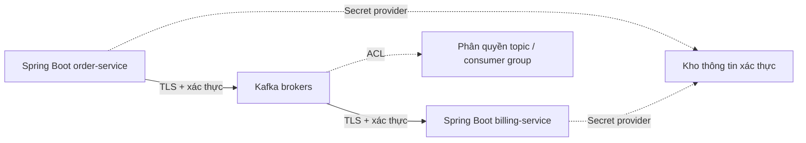
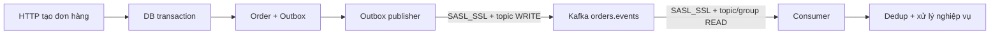

# SSL, SASL và bảo vệ thông tin xác thực trong Apache Kafka

## 1. Vì sao cần bảo vệ kết nối Kafka?

Trong module **SPRING_BOOT_INTEGRATION**, Apache Kafka đóng vai trò broker thông điệp, kết nối ứng dụng Spring Boot với các hệ thống khác: một HTTP request có thể tạo sự kiện, một transaction cơ sở dữ liệu có thể được đẩy lên topic qua outbox, hoặc một consumer nhận sự kiện rồi cập nhật cache, gọi API đối tác và ghi dữ liệu. Các luồng này thường chứa mã đơn hàng, trạng thái thanh toán, thông tin khách hàng hoặc dữ liệu vận hành cần được bảo vệ.

Giả sử dịch vụ `order-service` phát sự kiện sang topic `orders.events`, còn `billing-service` đọc sự kiện:



Kết nối an toàn phải xử lý **ba câu hỏi khác nhau**:

1. **Tôi đang kết nối đúng broker và dữ liệu có được mã hóa khi truyền không?** → TLS (Kafka dùng tên cấu hình `SSL`).
2. **Broker xác định client nào đang kết nối bằng cách nào?** → SASL hoặc chứng chỉ client trong mutual TLS (mTLS).
3. **Client đã xác thực được phép làm những thao tác gì?** → ACL/chính sách phân quyền của broker hoặc nền tảng Kafka được quản lý.

**SSL/TLS, SASL và ACL bổ sung cho nhau; không thay thế nhau.** Có kết nối TLS vẫn chưa đủ để bảo đảm client được nhận diện và giới hạn quyền. Có username/password hợp lệ vẫn chưa có nghĩa client được phép đọc mọi topic. Một ứng dụng đã cấu hình bảo mật nhưng làm lộ mật khẩu qua repository, log hoặc image container vẫn có thể bị xâm nhập.

## 2. Phân biệt TLS, SASL, ACL và các giao thức kết nối

### 2.1. Kafka dùng tên SSL nhưng triển khai bằng TLS

Tên property như `security.protocol=SSL`, `ssl.truststore.location` hoặc `ssl.keystore.location` giữ từ "SSL" vì lý do lịch sử. Khi triển khai, cần dùng phiên bản **TLS hiện đại** được broker, JVM và chính sách tổ chức hỗ trợ, tránh giao thức SSL cũ hoặc cipher yếu. TLS tạo kênh mã hóa và giúp client xác thực danh tính broker qua chứng chỉ.

| `security.protocol` | Mã hóa kênh truyền | Xác thực client điển hình | Hướng sử dụng |
| --- | --- | --- | --- |
| `PLAINTEXT` | Không | Không có ở tầng Kafka transport | Chỉ phù hợp môi trường thử nghiệm được cô lập đặc biệt |
| `SSL` | Có, qua TLS | Có thể dùng chứng chỉ client nếu broker yêu cầu mTLS | Khi hệ thống chọn xác thực bằng chứng chỉ |
| `SASL_PLAINTEXT` | Không | SASL | Tránh trong môi trường mang credential/dữ liệu thực |
| `SASL_SSL` | Có, qua TLS | SASL, ví dụ SCRAM hoặc OAuth | Lựa chọn thường gặp cho ứng dụng Spring Boot kết nối Kafka có xác thực |

Trong `SASL_SSL`, TLS bảo vệ kết nối trước, sau đó SASL xác thực client với broker. Cơ chế SASL **không tự bảo đảm mã hóa nội dung message**. Ví dụ, dùng `SCRAM-SHA-512` mà đặt giao thức `SASL_PLAINTEXT` không bảo vệ payload trên đường truyền. Dùng `PLAIN` càng cần TLS vì thông tin xác thực của cơ chế này không được mã hóa riêng ở tầng SASL.

**ACL (Access Control List)** là bước phân quyền sau xác thực: principal `User:orders-producer` được `WRITE` topic `orders.events` nhưng không được `READ` topic chứa dữ liệu thuộc hệ thống khác. Kafka cần được cấu hình authorizer/chính sách quyền phù hợp; cơ chế cụ thể phụ thuộc Apache Kafka tự quản trị hay dịch vụ managed Kafka.

### 2.2. Các ranh giới bảo vệ

| Lớp | Bảo vệ | Không tự bảo vệ |
| --- | --- | --- |
| TLS | Chống nghe lén/sửa dữ liệu trên kết nối client–broker, xác thực broker bằng chứng chỉ | Dữ liệu lưu trên đĩa broker, message đã được consumer giải mã, quyền topic |
| SASL | Xác định danh tính client theo cơ chế được broker hỗ trợ | Quyền truy cập resource, bí mật bị ghi vào log |
| mTLS | Chứng chỉ client chứng minh danh tính bên kết nối nếu broker yêu cầu | Quyền thao tác cụ thể nếu thiếu authorizer |
| ACL/RBAC | Giới hạn quyền producer, consumer, admin theo resource | Mã hóa dữ liệu truyền và lưu trữ |
| Secret management | Lưu/cấp/phân phối/thu hồi credential an toàn | Sai cấu hình hostname verification hoặc cấp quyền quá rộng |
| Bảo vệ dữ liệu nghiệp vụ | Giảm lộ PII trong message, log, DLQ, DB và cache | Không tự sửa được kết nối Kafka thiếu TLS |

## 3. TLS: xác thực broker và mã hóa đường truyền

### 3.1. Client xác thực broker như thế nào?

Khi kết nối tới `broker1.kafka.example.net:9093`, Kafka client mở kết nối TLS, kiểm tra:

- Chứng chỉ broker còn hiệu lực và có chuỗi tin cậy tới CA được cho phép.
- Tên host đang kết nối khớp với tên trong **Subject Alternative Name (SAN)** của chứng chỉ broker.
- Giao thức và cipher được broker/JVM chấp nhận.

Kafka dùng `ssl.truststore.*` hoặc cấu hình trust certificate tương đương để xác định CA tin cậy. **Truststore** chứa thông tin dùng để tin cậy broker; **keystore** chứa chứng chỉ và private key của client khi dùng mTLS. Không nhầm lẫn hai mục đích này.

Ví dụ Kafka client dùng kho tin cậy PKCS12:

```properties
security.protocol=SSL
ssl.truststore.type=PKCS12
ssl.truststore.location=/run/secrets/kafka/client-truststore.p12
ssl.truststore.password=<provided-at-runtime>
ssl.endpoint.identification.algorithm=https
```

`ssl.endpoint.identification.algorithm=https` bật kiểm tra hostname theo quy tắc HTTPS cho TLS. Đây là cấu hình cần giữ hoạt động; **không đặt giá trị rỗng** để chữa lỗi chứng chỉ trong production. Nếu hostname không khớp, hãy sửa SAN của chứng chỉ, hostname trong `bootstrap.servers` hoặc `advertised.listeners` trên broker.

Đường dẫn `/run/secrets/...` chỉ minh họa file được mount từ hệ thống quản lý bí mật; giá trị `<provided-at-runtime>` là placeholder, không phải mật khẩu thật. Không commit tệp truststore, keystore có private key hoặc mật khẩu của chúng vào repository.

### 3.2. Lưu ý `advertised.listeners` và các broker trong cluster

`bootstrap.servers` là danh sách điểm khởi đầu để client lấy metadata cluster; Kafka client thường tiếp tục kết nối tới **các địa chỉ broker được quảng bá trong metadata**. Vì vậy, bảo mật không chỉ áp dụng cho host đầu tiên.

Ví dụ client bootstrap qua `kafka-entry.example.net:9093` nhưng metadata trả các địa chỉ `broker-1.example.net:9093`, `broker-2.example.net:9093`. DNS, firewall và chứng chỉ của **từng host mà client thực sự kết nối tới** phải đúng. Không tắt hostname verification khi gặp lỗi do metadata trả tên nội bộ không có trong chứng chỉ.

Trong hệ thống có load balancer, ingress, proxy hoặc môi trường Kubernetes, cần kiểm tra cấu hình listener, SNI, DNS, SAN và đường mạng thực tế. Nếu việc kết nối sang host lạ không nằm trong phạm vi tin cậy, giới hạn egress ở tầng mạng; cấu hình `bootstrap.servers` đơn thuần không phải allowlist cho toàn bộ các broker trong metadata.

### 3.3. mTLS: khi client cũng mang chứng chỉ

Khi broker đặt `ssl.client.auth=required` cho listener TLS, client phải trình chứng chỉ hợp lệ. Khi đó Kafka client cần **keystore** chứa chứng chỉ và private key, ngoài truststore xác thực broker.

```properties
security.protocol=SSL
ssl.truststore.type=PKCS12
ssl.truststore.location=/run/secrets/kafka/truststore.p12
ssl.truststore.password=<truststore-password>
ssl.keystore.type=PKCS12
ssl.keystore.location=/run/secrets/kafka/client-keystore.p12
ssl.keystore.password=<keystore-password>
ssl.key.password=<private-key-password>
ssl.endpoint.identification.algorithm=https
```

Các giá trị trong dấu `<...>` chỉ là placeholder. `ssl.key.password` phụ thuộc cách private key được bảo vệ trong keystore; không tự đặt bằng mật khẩu chung khi không có yêu cầu. Với mTLS, broker phải tin CA cấp chứng chỉ client, có cơ chế ánh xạ certificate identity thành principal và áp chính sách phân quyền cho principal ấy.

Nếu listener xác thực bằng SASL, không mặc định cho rằng chỉ cần thêm keystore là được mTLS; broker, giao thức listener và mô hình principal phải được thiết kế thống nhất. Cách dùng `SSL` + mTLS ở trên là một cấu hình độc lập phổ biến.

### 3.4. Vòng đời chứng chỉ

Chứng chỉ TLS có thời hạn. Cần theo dõi hạn và xây dựng quy trình cấp mới/thu hồi/thay thế. Với cluster nhiều broker, dùng các CA/chứng chỉ mà client được phép tin cậy, giữ giai đoạn chồng lấp khi thay CA để tránh gián đoạn. Kiểm tra cách Kafka client và hạ tầng tải lại truststore/keystore: một số thay đổi chỉ có hiệu lực trên kết nối mới hoặc sau khi khởi tạo lại client, tùy phiên bản và cách cấu hình.

Khi có sự cố chứng chỉ, xử lý nguyên nhân ở nguồn phát hành và triển khai; không sửa bằng cách tắt TLS hay kiểm tra hostname.

## 4. SASL: xác thực client với Kafka broker

**SASL (Simple Authentication and Security Layer)** là khung cơ chế xác thực; Kafka hỗ trợ nhiều mechanism tùy cấu hình broker và client.

| SASL mechanism | Cách xác thực | Khi nào cân nhắc |
| --- | --- | --- |
| `PLAIN` | Username/password theo cơ chế PLAIN | Môi trường được bảo vệ bằng TLS, broker/provider yêu cầu |
| `SCRAM-SHA-256` / `SCRAM-SHA-512` | Thử thách–đáp ứng dựa trên thông tin bí mật đã đăng ký | Tích hợp dùng account riêng cho từng service; thường chọn SHA-512 khi được hỗ trợ |
| `OAUTHBEARER` | Bearer token do identity provider phát hành | Hạ tầng đã tích hợp OAuth/OIDC, có trình xử lý token và xác thực token đúng chuẩn |
| `GSSAPI` | Kerberos | Tổ chức có hạ tầng Kerberos |

Cơ chế nào được dùng phụ thuộc vào listener của broker và hệ thống cung cấp identity; client **không thể tự chọn một mechanism mà broker chưa bật**.

### 4.1. SCRAM trên kênh SASL_SSL

Với SCRAM, broker phải được cấu hình hỗ trợ `SCRAM-SHA-512` và account đã được tạo/cấp quyền. Client cung cấp credential qua Kafka property `sasl.jaas.config`.

```properties
security.protocol=SASL_SSL
sasl.mechanism=SCRAM-SHA-512
sasl.jaas.config=org.apache.kafka.common.security.scram.ScramLoginModule required username="orders-service" password="<injected-secret>";
```

Chuỗi JAAS này mô tả *định dạng*, không phải giá trị được phép đưa vào source code. Trong triển khai thực, inject toàn bộ cấu hình nhạy cảm hoặc dựng nó từ secret provider trong bộ nhớ. Lưu ý các ký tự `"` và dấu `\` trong secret phải được escape đúng cú pháp JAAS; không ghép chuỗi tùy ý từ đầu vào không tin cậy.

SCRAM hỗ trợ cơ chế xác thực dựa trên mật khẩu nhưng **không bảo vệ dữ liệu message thay cho TLS**. Vì vậy, dùng `SASL_SSL` ngay cả khi cơ chế SCRAM không truyền mật khẩu trực tiếp dưới dạng văn bản rõ. Không coi tên `SHA-512` là bằng chứng cả kết nối đã được mã hóa.

### 4.2. PLAIN, OAuth và Kerberos có gì khác?

- **PLAIN:** Credential xuất hiện trong trao đổi xác thực theo cơ chế PLAIN; yêu cầu TLS bảo vệ kênh truyền. Không dùng `SASL_PLAINTEXT` cho thông tin xác thực thực.
- **OAUTHBEARER:** Phải thiết lập cách lấy token, truyền token và phía broker xác thực chữ ký, issuer, audience, expiry/scope phù hợp. Cấu hình mechanism đơn lẻ không biến broker thành OAuth resource server an toàn; cần callback handler/extension tương ứng với nền tảng sử dụng. Token là secret, cần tránh log và vòng đời làm mới.
- **GSSAPI:** Cần quản lý principal, keytab/ticket và đồng bộ Kerberos. Keytab là credential nhạy cảm tương tự private key, không nhúng vào source image hoặc ghi vào log.

Nên dùng một danh tính riêng cho mỗi dịch vụ hoặc trách nhiệm nghiệp vụ thay vì chia sẻ account quản trị Kafka. Khi `order-service` chỉ cần publish `orders.events`, việc cấp tài khoản có quyền đọc/ghi mọi topic khiến sự cố lộ mật khẩu trở thành sự cố trên toàn cluster.

## 5. Cấu hình Spring Boot kết nối Kafka bằng SASL_SSL

Với Spring Boot và Spring for Apache Kafka, có thể cung cấp các property Kafka client qua `spring.kafka.properties`. Các thiết lập dùng chung áp dụng cho producer, consumer và những Kafka client liên quan mà Spring Boot khởi tạo, trừ khi có override chuyên biệt.

### 5.1. Ví dụ `application.yml`

```yaml
spring:
  kafka:
    bootstrap-servers: ${KAFKA_BOOTSTRAP_SERVERS}
    properties:
      "[security.protocol]": SASL_SSL
      "[sasl.mechanism]": SCRAM-SHA-512
      "[sasl.jaas.config]": ${KAFKA_SASL_JAAS_CONFIG}
      "[ssl.truststore.type]": PKCS12
      "[ssl.truststore.location]": ${KAFKA_TRUSTSTORE_LOCATION}
      "[ssl.truststore.password]": ${KAFKA_TRUSTSTORE_PASSWORD}
      "[ssl.endpoint.identification.algorithm]": https
    producer:
      acks: all
    consumer:
      group-id: orders-billing-sync
      auto-offset-reset: earliest
```

Các dấu ngoặc vuông trong key được đặt trong dấu nháy để **giữ nguyên key Kafka client có dấu chấm** khi Spring Boot bind map `properties`. Đây là cấu hình ví dụ, không phải thiết lập bảo mật duy nhất cho mọi nền tảng: nếu Kafka service sử dụng PEM, truststore khác PKCS12 hoặc IAM/OAuth thay SCRAM, cần cấu hình client theo đúng nhà cung cấp.

Ứng dụng cần nhận những giá trị sau từ môi trường triển khai hoặc secret provider:

| Tham số | Nội dung | Cách quản lý |
| --- | --- | --- |
| `KAFKA_BOOTSTRAP_SERVERS` | Danh sách `host:port` broker bootstrap | Config của môi trường; kiểm soát host được phép |
| `KAFKA_SASL_JAAS_CONFIG` | Chuỗi JAAS đầy đủ, chứa username/password lấy từ secret | Secret manager hoặc cấu hình bí mật được bảo vệ |
| `KAFKA_TRUSTSTORE_LOCATION` | Đường dẫn file truststore đã mount | Cấu hình đường dẫn không chứa secret |
| `KAFKA_TRUSTSTORE_PASSWORD` | Mật khẩu truststore nếu dùng | Secret manager |

Ví dụ hình dạng **giá trị của secret** `KAFKA_SASL_JAAS_CONFIG`:

```text
org.apache.kafka.common.security.scram.ScramLoginModule required username="orders-service" password="<secret-at-runtime>";
```

Không đặt dòng trên với mật khẩu thực vào `application.yml`, `application.properties`, file `.env` được commit, Gradle task, Dockerfile, ticket hoặc ví dụ tài liệu nội bộ. Nếu xuất secret thành biến môi trường, cần biết biến môi trường có thể bị xem qua công cụ vận hành/diagnostic hoặc bản dump tiến trình theo quyền truy cập; secret manager và cơ chế mount/injection của nền tảng cần được bảo vệ tương ứng.

Trong thực tế, tổ chức có thể chọn Kafka client SSL PEM thay PKCS12, ví dụ dùng `ssl.truststore.certificates` để cấp chứng chỉ CA ở định dạng PEM; khi đó không nên đồng thời áp cấu hình truststore file như ví dụ nếu không tương thích. Cấu hình chính xác phụ thuộc version Kafka client, broker và dịch vụ Kafka được quản lý.

### 5.2. Bean và producer/consumer sử dụng cấu hình nào?

Với dependency `spring-kafka`, Spring Boot có thể tự cấu hình `KafkaTemplate`, `ProducerFactory`, `ConsumerFactory` và listener container từ namespace `spring.kafka`. Ví dụ:

```java
@Service
class OrderEventPublisher {
    private final KafkaTemplate<String, String> kafkaTemplate;

    OrderEventPublisher(KafkaTemplate<String, String> kafkaTemplate) {
        this.kafkaTemplate = kafkaTemplate;
    }

    CompletableFuture<SendResult<String, String>> publish(
        String orderId, String jsonPayload
    ) {
        return kafkaTemplate.send("orders.events", orderId, jsonPayload);
    }
}
```

Đoạn mã chỉ minh họa nơi producer dùng cấu hình kết nối: ứng dụng cần serializer String phù hợp (nếu Spring Boot auto-config mặc định chưa cung cấp). Kết quả `CompletableFuture` cần được xử lý ở tầng nghiệp vụ để biết send thành công/thất bại. Nếu sự kiện phát sinh cùng transaction DB, cần thiết kế outbox hoặc phối hợp giao dịch riêng; **TLS và SASL không giải quyết tính nguyên tử DB–Kafka**.

Với consumer, một `@KafkaListener` cùng cấu hình client sẽ nhận message khi identity có đủ quyền `READ` topic và group. Consumer cần logic xử lý lặp an toàn vì delivery của Kafka/Spring Kafka có thể tạo redelivery; SSL/SASL không cung cấp idempotency cho nghiệp vụ.

Nếu producer và consumer cần **hai identity/quyền khác nhau**, cấu hình riêng bằng `spring.kafka.producer.properties`, `spring.kafka.consumer.properties` hoặc các factory có cấu hình độc lập. Đừng đưa identity có quyền cao vào `spring.kafka.properties` rồi dùng lại cho mọi client chỉ để cấu hình cho tiện.

### 5.3. Cấu hình TLS client certificate (mTLS) trong Spring Boot

Trường hợp broker dùng chứng chỉ client thay cho SASL trên listener TLS, cấu hình có thể theo mẫu:

```yaml
spring:
  kafka:
    bootstrap-servers: ${KAFKA_BOOTSTRAP_SERVERS}
    properties:
      "[security.protocol]": SSL
      "[ssl.truststore.type]": PKCS12
      "[ssl.truststore.location]": ${KAFKA_TRUSTSTORE_LOCATION}
      "[ssl.truststore.password]": ${KAFKA_TRUSTSTORE_PASSWORD}
      "[ssl.keystore.type]": PKCS12
      "[ssl.keystore.location]": ${KAFKA_KEYSTORE_LOCATION}
      "[ssl.keystore.password]": ${KAFKA_KEYSTORE_PASSWORD}
      "[ssl.key.password]": ${KAFKA_KEY_PASSWORD}
      "[ssl.endpoint.identification.algorithm]": https
```

Đây là **phương án khác** với SCRAM trong ví dụ trước, không phải yêu cầu thêm đồng loạt vào mọi triển khai SASL. Broker cần cấu hình listener có hỗ trợ xác thực client certificate và ánh xạ principal đúng. Không dùng `security.protocol=PLAINTEXT` hay `SASL_PLAINTEXT` làm cách khắc phục tạm khi TLS handshake lỗi.

## 6. Bảo vệ credential suốt vòng đời

### 6.1. Credential có thể bị lộ ở đâu?

| Bề mặt rủi ro | Tình huống | Cách phòng ngừa |
| --- | --- | --- |
| Repository và lịch sử Git | Mật khẩu nằm trong `application-prod.yml` rồi sau đó bị xóa ở commit khác | Không commit secret từ đầu; secret scan lịch sử; rotate ngay nếu đã lộ |
| Container image / build log | `ARG` hoặc `RUN` chứa credential, bản build ghi ra log | Cấp secret ở runtime qua kênh riêng; kiểm soát log CI/CD |
| File trên máy chạy | JAAS config, keytab, PKCS12 để quyền đọc rộng | Mount chỉ đọc, phân quyền file theo user chạy ứng dụng, giới hạn quyền truy cập |
| Biến môi trường | Người có quyền xem process/debug dump đọc được JAAS string | RBAC vận hành, hạn chế diagnostic/dump, ưu tiên secret injection phù hợp |
| App log và exception | Dump `KafkaProperties` hoặc raw client config, stack trace chứa secret | Mask `sasl.jaas.config`, password, token, private key; không log config thô |
| Monitoring / actuator | Endpoint `env` hoặc cấu hình giám sát hiển thị property | Giới hạn/ẩn endpoint, bật masking và kiểm soát quyền đọc |
| Backup, snapshot, crash dump | Secret bị lưu trong ảnh chụp bộ nhớ/hệ thống | Mã hóa backup, kiểm soát truy cập/retention, theo dõi tình huống lộ |

Kafka client thường xử lý một số property nhạy cảm theo loại `Password`, nhưng **không được giả định mọi công cụ logging, dashboard, debug hoặc custom code đều tự che hết**. Không in nguyên đối tượng cấu hình hoặc nội dung exception không kiểm soát.

### 6.2. Nguyên tắc quản lý secret

1. Mỗi dịch vụ/môi trường có identity độc lập; phát hành secret với quyền tối thiểu.
2. Lưu bí mật ở secret manager, cơ chế quản lý secret của nền tảng hoặc volume mount có bảo vệ; chỉ đưa vào tiến trình cần dùng.
3. Không truyền mật khẩu/token qua URL, metric label, message payload, topic name, consumer group ID, tên file hoặc command-line argument.
4. Thiết lập thời gian thay secret, quy trình rotate/thu hồi khi có dấu hiệu lộ. Sau rotate, xác minh client mở kết nối mới với credential đúng; quy trình có thể cần khởi tạo lại Kafka producer/consumer hoặc rollout ứng dụng.
5. Với chứng chỉ client: giới hạn quyền đọc private key; với OAuth: giới hạn issuer/audience/scope/expiry và tránh log bearer token.
6. Tách quyền quản trị broker/ACL khỏi quyền producer/consumer thường ngày. Audit thay đổi ACL, principal, listener và secret access.

Ví dụ khi thay mật khẩu SCRAM, không được kỳ vọng các kết nối đã mở tự nhận giá trị mới. Cần phối hợp đổi credential trên broker/provider và triển khai client, có kế hoạch chồng lấp nếu nền tảng hỗ trợ để tránh downtime. Nếu nghi lộ secret, **thu hồi/đổi credential thực**; chỉ xóa log hoặc sửa repository không làm credential cũ mất hiệu lực.

## 7. Quyền truy cập Kafka: nguyên tắc quyền tối thiểu

Xác thực thành công chỉ cho biết **ai** đang kết nối. Broker còn phải quyết định **được làm gì** với topic, group hoặc resource khác.

Một thiết kế quyền cho hai dịch vụ:

| Identity | Quyền cần thiết | Không nên cấp mặc định |
| --- | --- | --- |
| `orders-producer` | `WRITE` vào topic `orders.events`, cùng quyền metadata cần thiết theo authorizer | `READ` mọi topic, quyền tạo topic/xóa topic, cluster admin |
| `billing-consumer` | `READ` topic `orders.events`; `READ` nhóm consumer `billing-sync` (và quyền metadata cần thiết) | `WRITE` sang topic khác, quyền sửa ACL |
| `kafka-ops` | Quyền quản trị theo quy trình, có audit | Dùng chung làm account ứng dụng |

Mỗi consumer có thể cần quyền tương ứng cho **topic** và **consumer group**. Tên operation/resource chính xác và cách cấp quyền phụ thuộc authorizer, phiên bản Kafka và managed service; luôn kiểm thử bằng identity thực sau khi triển khai ACL.

Không cấp quyền wildcard rộng chỉ để "hết lỗi". Nếu thiếu quyền, kiểm tra `principal` thực tế đã xác thực, tên topic/group và policy; chỉnh đúng resource. Quyền truy cập vào broker cũng không tự đảm bảo payload không chứa dữ liệu nhạy cảm: cần kiểm soát schema, phân loại dữ liệu, retention, dead-letter topic (DLT), backup, hệ thống downstream và truy cập vào log.

## 8. Phân biệt lỗi TLS, SASL, ACL và lỗi mạng

Nhiều lỗi đều xuất hiện ở phía producer/consumer như timeout hoặc không lấy được metadata, nhưng nguyên nhân và cách xử lý khác nhau.

| Triệu chứng thường gặp | Có thể do | Hướng xử lý |
| --- | --- | --- |
| `SSLHandshakeException`, `PKIX path building failed` | Client không tin CA/chứng chỉ broker | Kiểm tra truststore, chain, hạn chứng chỉ; không tắt xác minh TLS |
| `No subject alternative DNS name matching ...` | Host client kết nối không khớp SAN | Kiểm tra `bootstrap.servers`, `advertised.listeners` và chứng chỉ broker |
| `SaslAuthenticationException` | Sai username/password, mechanism, token hết hạn hoặc broker chưa cấu hình đúng | Kiểm tra identity/method với bên quản trị; rotate nếu lộ; không log secret |
| `TopicAuthorizationException` | Principal thiếu ACL trên topic | Cấp đúng quyền topic; không chuyển sang tài khoản quản trị |
| Lỗi authorization liên quan consumer group | Thiếu quyền với group | Kiểm tra group ID và quyền group |
| `TimeoutException` khi lấy metadata hoặc gửi | Broker unreachable, DNS/firewall, broker bị quá tải, sai `advertised.listeners` hoặc policy mạng | Kiểm tra endpoint thực kết nối, DNS, route, listener, TLS/SASL và metric; không kết luận là "Kafka chậm" |
| Kết nối từ chối sau khi đổi secret | Client còn credential cũ hoặc chưa tải lại truststore | Xác minh quá trình rotate, cấu hình phiên chạy và khởi tạo lại client khi cần |

**Đừng áp retry vô hạn cho lỗi cấu hình và xác thực.** Sai truststore, sai mật khẩu, không đủ ACL thường là lỗi bền vững; retry liên tục có thể tạo tải và làm nhiễu log mà không khắc phục được vấn đề. Với lỗi mạng tạm thời, Kafka client có cơ chế reconnect/retry nội bộ; application cần giới hạn thời gian, có backoff và quan sát trạng thái thay vì chồng thêm nhiều tầng retry tùy tiện.

Đặc biệt, không cấu hình fallback `SASL_SSL → SASL_PLAINTEXT` hoặc `SSL → PLAINTEXT` khi kết nối không được. Fallback giảm bảo mật có thể làm thông tin xác thực/payload bị lộ trên đường truyền.

## 9. Bảo mật Kafka trong luồng tích hợp thực tế

### 9.1. Ví dụ giao dịch DB → Kafka

Khi xử lý đơn hàng, `order-service` ghi trạng thái vào DB và phát sự kiện `OrderCreated`. Nếu DB commit xong nhưng publish thất bại vì mất kết nối Kafka, không thể coi TLS/SASL là cơ chế bảo đảm giao dịch. Có thể dùng **transactional outbox**: transaction DB ghi bản ghi đơn hàng và outbox; worker có quyền `WRITE` topic lấy outbox để publish; consumer idempotent để xử lý phát lại.



Ở đây:

- TLS bảo vệ dữ liệu đi qua mạng từ publisher/consumer tới broker.
- SASL và ACL tách danh tính publisher, consumer và quyền tương ứng.
- Outbox, idempotency, xử lý offset và retry giải quyết tính tin cậy nghiệp vụ; chúng **không được giải quyết bởi TLS/SASL**.
- Log và DLT phải tránh ghi nguyên payload chứa PII hoặc secret; retention/DLT ACL cũng cần được quản lý.

### 9.2. Dữ liệu trên topic và hệ thống downstream

TLS chỉ bảo vệ **kết nối**, không mặc định mã hóa mọi byte ở tầng lưu trữ hoặc bảo vệ dữ liệu sau khi consumer đã nhận. Nếu yêu cầu cao hơn, cần mã hóa at-rest của broker/volume/backup, chính sách retention, quyền đọc topic/DLT và có thể mã hóa payload ở tầng ứng dụng theo hợp đồng giữa producer–consumer.

Không đưa bearer token của HTTP client, mật khẩu DB hoặc secret từ Vault vào message Kafka để "truyền cho service khác". Service nhận message nên tự lấy credential phù hợp với phạm vi quyền của chính nó. Khi xuất bản event, ưu tiên dữ liệu tối thiểu cần cho hợp đồng nghiệp vụ; tránh đưa toàn bộ object chứa trường nhạy cảm vào JSON chỉ vì serialize tiện.

### 9.3. Quan sát vận hành không lộ thông tin xác thực

Cần đo:

- Tỉ lệ kết nối thất bại theo loại (TLS, SASL, authorization, network).
- Độ trễ publish, số lần retry, số record thất bại và tình trạng metadata/connection.
- Consumer lag và thay đổi group membership; các chỉ dấu credential sắp hết hạn nếu có thể đo an toàn.
- Số lượng thay đổi ACL, hoạt động cấp/thu hồi secret, hạn chứng chỉ TLS.

Nên dùng tên dịch vụ, cluster logic, topic/group đã được đánh giá không nhạy cảm và mã lỗi đã chuẩn hóa. **Không đưa username/password, token, private key, chuỗi JAAS, nội dung message nhạy cảm vào metric tag, trace attribute hoặc log**. Log lỗi ví dụ: `service=order-service kafka_cluster=orders-prod stage=authentication result=failed`; không kèm `sasl.jaas.config`.

## 10. Kiểm thử cấu hình bảo mật trước khi triển khai

Kiểm thử unit của hàm xử lý message **không thể chứng minh** TLS handshake, SCRAM hoặc ACL hoạt động. Cần kiểm thử tích hợp với broker TLS/SASL có cấu hình tương tự production, có thể sử dụng môi trường staging hoặc container/test infrastructure được chuẩn bị trước.

| Kịch bản | Thao tác kiểm thử | Kết quả mong muốn |
| --- | --- | --- |
| Kết nối hợp lệ | Client đúng CA, host, mechanism, credential và ACL | Producer/consumer kết nối và xử lý event được phép |
| Sai CA | Dùng truststore không tin CA của broker | Handshake thất bại; không chuyển sang PLAINTEXT |
| Sai SAN/hostname | Kết nối host không nằm trong SAN | Client từ chối handshake; hostname verification vẫn bật |
| Sai username/password | Credential SCRAM không hợp lệ | Xác thực thất bại; log không hiện mật khẩu hoặc JAAS string |
| Sai mechanism | Client `SCRAM-SHA-512` nhưng listener không hỗ trợ | Kết nối thất bại có kiểm soát; không đổi mechanism tùy tiện |
| Thiếu quyền WRITE | Producer không có ACL topic | Publish bị từ chối, không có record mới |
| Thiếu quyền READ/group | Consumer không đủ ACL | Không đọc được dữ liệu; không mở rộng quyền wildcard |
| Đổi credential/chứng chỉ | Rotate theo quy trình đang dùng | Client có thể khôi phục kết nối theo kế hoạch, không cần hạ bảo mật |
| Broker metadata có host sai | Mô phỏng `advertised.listeners` sai DNS/SAN hoặc egress | Kết nối thất bại được phát hiện và định vị rõ; không tắt TLS |
| Secret không xuất hiện trong log | Dùng secret giả định có chuỗi nhận dạng duy nhất | Quét log/trace/metric/export không thấy chuỗi bí mật |

Với pipeline có giao dịch, nên bổ sung kiểm thử khi Kafka tạm ngắt: outbox còn bản ghi chưa gửi, producer phục hồi, consumer xử lý event không trùng; đây là yêu cầu tính đúng đắn **riêng** với kiểm thử bảo mật. Với managed Kafka, cấu hình IAM/SASL và quy tắc ACL có thể khác Kafka tự vận hành; kiểm thử bằng identity production-equivalent theo hướng dẫn nền tảng.

## 11. Checklist trước khi vận hành

- [ ] Dùng `SASL_SSL` hoặc `SSL` theo cơ chế xác thực đã chọn; không dùng giao thức truyền rõ credential.
- [ ] Truststore chứa đúng CA; hostname verification hoạt động; SAN phù hợp mọi broker được quảng bá.
- [ ] Nếu dùng mTLS, keystore/private key chỉ tiến trình được phép mới đọc; broker xác thực certificate identity.
- [ ] Nếu dùng SASL, mechanism đúng broker; credential/token được cấp cho đúng identity, không lưu trực tiếp trong mã nguồn.
- [ ] Secret được inject lúc runtime, có quy trình rotate, thu hồi và audit truy cập.
- [ ] Producer, consumer và admin có identity/quyền tối thiểu; topic/group ACL được kiểm thử bằng danh tính thực.
- [ ] Không log/dump `sasl.jaas.config`, mật khẩu, token, keytab, private key hoặc payload nhạy cảm.
- [ ] Có quan sát lỗi TLS/SASL/authorization và phân biệt lỗi cấu hình với sự cố mạng.
- [ ] Kế hoạch retry/reconnect không hạ cấp bảo mật và không gây lặp thao tác nghiệp vụ.
- [ ] Dữ liệu trong topic, DLQ, backup, cache và DB có chính sách bảo vệ riêng; hợp đồng dữ liệu được kiểm soát.

### Câu hỏi tự kiểm tra

1. Vì sao `security.protocol=SASL_PLAINTEXT` chưa an toàn dù client dùng `SCRAM-SHA-512`?
2. Truststore và keystore phục vụ hai mục đích nào? Khi nào cần keystore ở phía Kafka client?
3. Kafka client đã bắt tay TLS thành công nhưng producer nhận `TopicAuthorizationException`. Nên kiểm tra và sửa ở đâu?
4. Vì sao `bootstrap.servers` đúng DNS chưa đủ để kết luận các kết nối Kafka sẽ thành công?
5. Khi một mật khẩu SCRAM vô tình xuất hiện trong log, cần xử lý những gì ngoài việc xóa dòng log?
6. TLS và SASL có giải quyết bài toán DB commit thành công nhưng phát Kafka event thất bại không? Nêu cơ chế bổ sung.

**Ghi nhớ:** Đối với Kafka trong Spring Boot, xây dựng kết nối bảo mật theo chuỗi **TLS xác thực broker và mã hóa kết nối → SASL/mTLS nhận diện client → ACL giới hạn hành động → secret management bảo vệ credential**. Sau đó mới bảo đảm giao dịch, retry, xử lý trùng lặp và quan sát luồng tích hợp theo yêu cầu nghiệp vụ.
