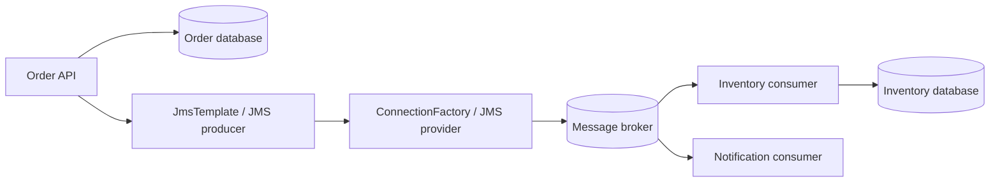
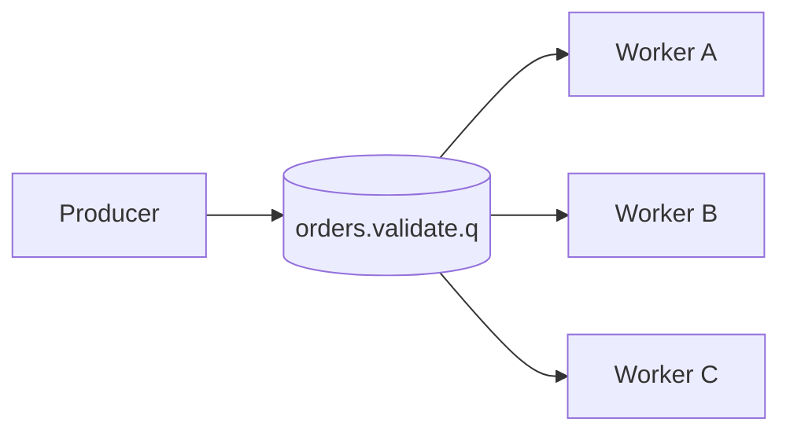
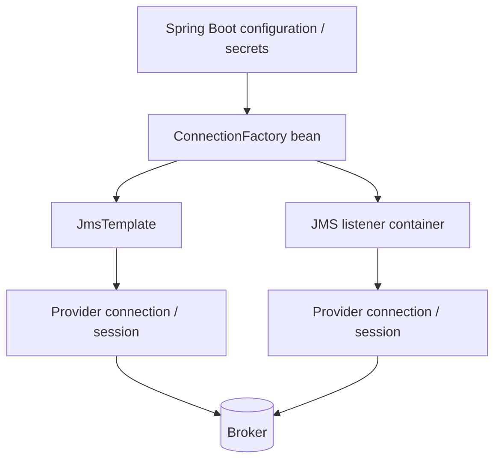

# Jakarta JMS, broker và ConnectionFactory

## 1. Bài toán tích hợp: vì sao một dịch vụ Spring Boot cần JMS?

Trong **SPRING_BOOT_INTEGRATION**, nhiều hệ thống trao đổi dữ liệu qua HTTP client hoặc cơ sở dữ liệu, nhưng không phải mọi công việc đều thích hợp với lời gọi đồng bộ. Ví dụ, khi một đơn hàng đã được ghi nhận, hệ thống có thể cần gửi thông báo, cập nhật tồn kho hoặc đẩy dữ liệu sang dịch vụ vận chuyển. Nếu gọi tuần tự từng dịch vụ qua HTTP, thời gian phản hồi và khả năng hoạt động của API đặt hàng phụ thuộc vào các dịch vụ ở phía sau.

**Jakarta Messaging (Jakarta JMS)** là API chuẩn của Java để gửi và nhận thông điệp qua một hệ thống nhắn tin. Thay vì biết trực tiếp URL HTTP của từng consumer, producer đưa message vào một **destination** do broker quản lý; consumer xử lý message khi sẵn sàng. Cách này giúp tách thời điểm gửi và thời điểm xử lý, nhưng cũng xuất hiện những câu hỏi về giao dịch, trùng lặp, thứ tự, retry, bảo mật và quan sát.

Ví dụ luồng tích hợp:



Sơ đồ minh họa những thành phần liên quan. Nếu cả tồn kho và thông báo cần nhận **mỗi sự kiện**, không thể mặc định dùng một queue với hai consumer; cần topic và subscription phù hợp, hoặc định tuyến/fan-out thành các queue riêng theo khả năng của broker.

**Mục tiêu học tập:** hiểu Jakarta JMS là hợp đồng API, phân biệt nó với message broker và giao thức mạng, biết vai trò `ConnectionFactory`, lựa chọn queue/topic, cấu hình Spring Boot, triển khai producer/consumer, kiểm soát acknowledgment, redelivery, tính idempotent và kiểm thử tích hợp.

## 2. Jakarta JMS là API, broker là hệ thống chạy thực tế

Jakarta JMS định nghĩa tập interface và ngữ nghĩa lập trình Java cho messaging, gồm `ConnectionFactory`, `Destination`, `Queue`, `Topic`, `JMSContext`, `Message`, `JMSProducer`, `JMSConsumer` và các API cổ điển như `Connection`, `Session`, `MessageProducer`, `MessageConsumer`.

**Broker** là phần mềm hoặc dịch vụ chịu trách nhiệm tiếp nhận, định tuyến, xếp hàng, lưu giữ và phân phối message. Broker còn có chính sách authentication, authorization, persistence, redelivery, dead-letter queue, giới hạn tài nguyên và giám sát. Các chi tiết này phụ thuộc sản phẩm và cấu hình thực tế.

| Thành phần | Trách nhiệm | Ví dụ |
| --- | --- | --- |
| Ứng dụng producer | Tạo nội dung message, gắn định danh và metadata | Order Service |
| Jakarta JMS API | Chuẩn hóa code Java để tạo connection, gửi và nhận message | `jakarta.jms.ConnectionFactory` |
| JMS client/provider | Cài đặt API, kết nối đến broker theo giao thức được hỗ trợ | Artemis JMS client |
| Broker | Quản lý destination, lưu và phân phối message | ActiveMQ Artemis, ActiveMQ Classic hoặc IBM MQ |
| Ứng dụng consumer | Đọc message, thực hiện nghiệp vụ, quyết định hoàn tất hay thất bại | Inventory Service |

Điểm thường nhầm:

- **JMS không phải một giao thức truyền thông chung qua mạng.** Hai broker “hỗ trợ JMS” không có nghĩa là client của broker A tự động kết nối broker B; client và giao thức wire-level phải tương thích.
- **Broker không phải dependency Maven.** Thêm starter cung cấp thư viện client và cấu hình Spring, nhưng ứng dụng vẫn cần một broker đang chạy, được cấp quyền truy cập.
- **JMS không đồng nghĩa Kafka hoặc AMQP.** Một số broker hỗ trợ nhiều giao thức, nhưng mỗi API có semantics và client khác nhau. Không được giả định một broker chỉ hỗ trợ AMQP là có thể dùng trực tiếp qua JMS nếu không có provider tương thích.
- **Spring JMS nằm trên Jakarta JMS.** Spring giúp giảm mã quản lý tài nguyên và tích hợp listener, còn bảo đảm lưu/nhận dữ liệu vẫn do broker và thiết kế nghiệp vụ quyết định.

Từ Jakarta EE 9, package JMS chuyển từ `javax.jms.*` sang **`jakarta.jms.*`**. Ứng dụng Spring Boot 3.x / Spring Framework 6 dùng namespace Jakarta; khi di chuyển từ Boot 2.x cần kiểm tra đồng thời version API, client và broker. Không trộn dependency `javax.jms` cũ vào một cấu hình dự kiến dùng `jakarta.jms` rồi coi hai hệ tương thích nhị phân.

## 3. Queue, topic và hành vi phân phối

JMS định nghĩa hai mô hình destination cơ bản:

### 3.1. Queue: chia tải giữa các consumer

**Queue** dùng cho các công việc một nhóm worker có thể chia nhau thực hiện. Nhiều consumer cùng đọc một queue thường đóng vai trò *competing consumers*: một message được giao cho một consumer để xử lý tại một thời điểm; nếu xử lý lỗi, broker có thể giao lại theo chính sách redelivery.



Số consumer tăng không có nghĩa mỗi message được phát cho cả ba worker. Consumer có thể nhìn thấy bản gửi lại sau lỗi, vì vậy cần thiết kế chống xử lý trùng ngay cả với queue.

### 3.2. Topic: phát sự kiện cho nhiều subscription

**Topic** phù hợp khi nhiều nhóm độc lập muốn nhận cùng một sự kiện. Ví dụ `orders.created.topic` phục vụ subscription tồn kho và subscription thông báo. Mỗi subscription là một nhóm nhận riêng theo cấu hình broker.

- **Non-durable subscription** thường chỉ nhận message khi subscription đang hoạt động; thời gian subscriber vắng mặt có thể làm mất các sự kiện dành cho nó.
- **Durable subscription** cho phép broker giữ message phù hợp khi subscriber ngắt kết nối theo quy tắc của durable subscription; cần cấu hình client ID, subscription name và các ràng buộc provider tương ứng.
- **Shared subscription** cho phép nhiều consumer chia tải trong cùng subscription nếu broker/provider và API hỗ trợ.

**Persistence của message** và **durable subscription** là hai khái niệm khác nhau. Message persistent không tự biến mọi subscription topic thành durable.

| Nhu cầu | Lựa chọn thường gặp |
| --- | --- |
| Một công việc do một trong nhiều worker xử lý | Queue |
| Mỗi hệ thống nghiệp vụ cần một bản sự kiện riêng | Topic với subscription phù hợp hoặc fan-out theo broker |
| Replay lâu dài và nhiều nhóm độc lập cần đọc lại lịch sử | Xem xét event log/streaming platform; JMS queue đơn thuần không mặc nhiên lưu lịch sử để replay |
| Cần mỗi message xuất hiện chính xác một lần trong database | Queue/topic chưa đủ; cần idempotency, transaction/outbox/inbox |

Destination name như `orders.created.q` hay `orders.created.topic` chỉ là quy ước đặt tên. Cách broker tạo địa chỉ, queue hoặc binding phụ thuộc provider; không nên xem việc ứng dụng “tự tạo” destination ở môi trường development là cơ chế provisioning production mặc định.

## 4. `ConnectionFactory` kết nối code Spring Boot với broker ra sao?

`jakarta.jms.ConnectionFactory` là **factory** tạo connection hoặc `JMSContext` của một JMS provider. Đối tượng factory mang thông tin cần thiết để mở kết nối: endpoint, bảo mật, timeout, chính sách reconnect/failover và những tùy chọn riêng của client. Spring Boot có thể tạo factory thông qua auto-configuration; ứng dụng inject nó như dependency.

Chuỗi trách nhiệm điển hình:



Cần phân biệt vòng đời và mức độ chia sẻ:

| Đối tượng | Vai trò | Nguyên tắc sử dụng |
| --- | --- | --- |
| `ConnectionFactory` | Cấu hình/khởi tạo kết nối đến provider | Thường là singleton bean có thể inject vào nhiều thành phần |
| `Connection` | Kết nối logic từ ứng dụng đến broker | Quản lý đóng/mở theo API/provider; Spring có thể cache hoặc reuse |
| `Session` | Ngữ cảnh gửi/nhận và acknowledgment/transaction JMS | Không chia sẻ tùy tiện đồng thời giữa nhiều thread |
| `JMSContext` | API rút gọn kết hợp Connection + Session | Có vòng đời cần đóng; không coi là singleton thread-safe dùng chung |
| `JmsTemplate` | Abstraction Spring để gửi/nhận và quản lý tài nguyên | Có thể dùng lại sau khi đã cấu hình; ứng dụng không cần mở session cho mỗi lệnh |
| Listener container | Quản lý consumer, session và vòng đời lắng nghe | Chịu trách nhiệm concurrency, acknowledge, transaction và recovery |

**ConnectionFactory không phải broker**: có factory bean không chứng minh broker đang kết nối hoặc sẵn sàng. Nhiều provider thiết lập kết nối một cách lazy; lỗi có thể chỉ xuất hiện khi producer/consumer thực hiện thao tác. Tương tự, startup thành công không đủ để khẳng định đường mạng, ACL và destination đều hợp lệ.

Khi cần nhiều broker hoặc nhiều tenant với cấu hình khác nhau, có thể định nghĩa nhiều factory có tên bean rõ ràng, rồi gán cụ thể vào từng `JmsTemplate` hoặc listener container. Không áp dụng một factory mặc định cho mọi luồng nếu các luồng có yêu cầu bảo mật, QoS hoặc quyền riêng biệt.

## 5. Tích hợp thực tế bằng Spring Boot và ActiveMQ Artemis

Ví dụ trong bài sử dụng **Spring Boot 3.x**, package `jakarta.jms` và một **ActiveMQ Artemis broker chạy độc lập**. Chọn Artemis để minh họa; các nguyên tắc JMS cũng áp dụng với broker JMS khác, nhưng thuộc tính kết nối và khả năng broker có thể thay đổi.

### 5.1. Dependency

Dự án Maven được quản lý phiên bản qua Spring Boot parent/BOM:

```xml
<dependency>
    <groupId>org.springframework.boot</groupId>
    <artifactId>spring-boot-starter-artemis</artifactId>
</dependency>
```

Starter cung cấp Spring JMS và thư viện kết nối Artemis cần thiết cho tích hợp thông thường. Không cần tự khai báo đồng thời các client JMS của nhiều broker chỉ để “chắc chắn có đủ”. Nếu tổ chức dùng ActiveMQ Classic hoặc IBM MQ, chọn provider/starter tương thích và làm theo hướng dẫn cấu hình của provider đó.

### 5.2. Cấu hình client tới broker riêng

Ví dụ `application.yml`:

```yaml
spring:
  artemis:
    mode: native
    broker-url: tcp://localhost:61616
    user: ${ARTEMIS_USERNAME}
    password: ${ARTEMIS_PASSWORD}
```

- `mode: native` nghĩa là kết nối một broker riêng đang hoạt động. Việc chạy broker và khai báo destination thuộc cấu hình hạ tầng.
- `broker-url` và cổng là giá trị minh họa; cần thay theo endpoint thực tế, network policy và giao thức provider hỗ trợ.
- Credential được cung cấp qua biến môi trường hoặc secret manager. Trong production nên bật TLS và xác thực chứng chỉ nếu kiến trúc mạng yêu cầu.
- Nếu ứng dụng chạy trong container, `localhost` là container ứng dụng, không mặc nhiên là container broker. Dùng tên DNS/service phù hợp trong mạng triển khai.
- Cấu hình `spring.artemis.*` dành riêng cho Artemis; không thể copy nguyên sang mọi JMS provider khác.

Trong Spring Boot với điều kiện auto-configuration phù hợp, ứng dụng có thể inject `ConnectionFactory` và `JmsTemplate`, đồng thời khai báo `@JmsListener`. Khi có nhiều factory, cần chỉ rõ bean nào được dùng.

### 5.3. Gửi message với `JmsTemplate`

Giao tiếp giữa các service nên truyền **hợp đồng dữ liệu có phiên bản** thay vì truyền trực tiếp Java object qua native object serialization. Ví dụ ứng dụng serialize DTO sang JSON bằng Jackson ở tầng ứng dụng, sau đó gửi `TextMessage` bằng `JmsTemplate`:

```java
import org.springframework.jms.core.JmsTemplate;
import org.springframework.stereotype.Service;

@Service
public class OrderEventPublisher {
    private final JmsTemplate jmsTemplate;

    public OrderEventPublisher(JmsTemplate jmsTemplate) {
        this.jmsTemplate = jmsTemplate;
    }

    public void publishOrderCreated(
            String eventId, String correlationId, String jsonBody) {

        jmsTemplate.convertAndSend("orders.created.q", jsonBody, message -> {
            message.setStringProperty("eventType", "OrderCreated");
            message.setStringProperty("schemaVersion", "1");
            message.setStringProperty("eventId", eventId);
            message.setJMSCorrelationID(correlationId);
            return message;
        });
    }
}
```

`jsonBody` phải được xây dựng từ DTO có schema rõ ràng và được validate. `JmsTemplate` mặc định chuyển chuỗi Java thành JMS `TextMessage` thông qua message converter cơ bản. Tránh dựa vào native `ObjectMessage` để trao đổi domain object giữa nhiều hệ thống: kiểu Java, version class, an toàn deserialize và khả năng tương tác sẽ trở thành phụ thuộc chặt.

Các header/property hữu ích:

- `JMSMessageID`: định danh do provider gán cho message, hữu ích khi truy vết việc vận chuyển nhưng không thay thế business event ID.
- `JMSCorrelationID`: liên kết message với request/luồng nghiệp vụ; có thể chủ động truyền cùng trace/correlation ID.
- `JMSReplyTo`: destination trả lời khi ứng dụng áp dụng request-reply.
- `JMSRedelivered`: cờ provider cho biết khả năng message đã được phân phối trước đó; không đủ để quyết định message có được xử lý nghiệp vụ thành công hay chưa.
- Application properties như `eventId`, `eventType` và `schemaVersion`: hỗ trợ dispatch, idempotency và nâng cấp hợp đồng dữ liệu.

Lệnh send thành công **không chứng minh consumer đã hoàn tất xử lý**. Nó chỉ phản ánh kết quả thao tác gửi ở tầng producer/provider theo cấu hình delivery và transaction tương ứng. Với nghiệp vụ đặt hàng, cần phân biệt "event đã gửi tới broker" và "kho đã trừ tồn".

### 5.4. Nhận message bằng `@JmsListener`

Một consumer cơ bản:

```java
import org.springframework.jms.annotation.JmsListener;
import org.springframework.stereotype.Component;

@Component
public class OrderCreatedListener {
    private final OrderProcessingService processingService;

    public OrderCreatedListener(OrderProcessingService processingService) {
        this.processingService = processingService;
    }

    @JmsListener(destination = "orders.created.q")
    public void onOrderCreated(String jsonBody) {
        processingService.process(jsonBody);
    }
}
```

Spring JMS listener container chuyển message phù hợp thành đối số phương thức, quản lý connection/session và tiếp nhận exception. Nếu `process` thất bại, cách message được acknowledge, rollback, retry hoặc redeliver phụ thuộc cấu hình **container và broker**, không chỉ phụ thuộc việc ném exception.

Trong ứng dụng thực tế, consumer nên parse JSON thành DTO theo `schemaVersion`, kiểm tra schema/giá trị, xác thực nguồn phù hợp, dùng business event ID để chống xử lý lặp và ghi kết quả idempotency với dữ liệu nghiệp vụ trong một ranh giới giao dịch thích hợp.

## 6. Jakarta JMS API thuần và vai trò của Spring

Ngoài Spring, Jakarta JMS cung cấp API trực tiếp. Ví dụ minh họa sau cần một `ConnectionFactory` đã được cấu hình bởi provider:

```java
import jakarta.jms.ConnectionFactory;
import jakarta.jms.JMSContext;
import jakarta.jms.Queue;

public class DirectJmsSender {
    public void send(ConnectionFactory factory, String jsonBody) {
        try (JMSContext context =
                 factory.createContext(JMSContext.AUTO_ACKNOWLEDGE)) {
            Queue queue = context.createQueue("orders.created.q");
            context.createProducer().send(queue, jsonBody);
        }
    }
}
```

`JMSContext` kết hợp cách tạo và sử dụng connection/session theo API đơn giản của Jakarta JMS. Khối `try-with-resources` đóng context để giải phóng tài nguyên theo provider. Tuy nhiên, khi dùng Spring, `JmsTemplate` và listener container phù hợp hơn cho phần lớn use case vì Spring tích hợp resource lifecycle, exception translation và giao dịch.

Không nên tạo `JMSContext` mới rồi giữ nó trong một singleton service để nhiều luồng cùng thao tác. Nếu cần kiểm soát connection pool, session cache hoặc client failover, quản lý chúng qua factory/provider và đo bằng workload thật thay vì tự triển khai cơ chế kết nối trong mỗi controller.

## 7. Acknowledgment, transaction và giao nhận lặp

Đây là phần quyết định độ tin cậy của luồng tích hợp. Messaging không nên được hiểu là “đưa message vào queue thì chắc chắn xử lý đúng một lần”.

### 7.1. Acknowledge là gì?

**Acknowledgment** báo cho provider/broker biết consumer đã nhận/hoàn tất theo chính sách đang áp dụng. Trong JMS có các chế độ session như:

| Chế độ | Ý nghĩa thực hành | Rủi ro cần chú ý |
| --- | --- | --- |
| `AUTO_ACKNOWLEDGE` | Provider/container tự thực hiện acknowledge theo ranh giới API/container | Hành vi khi listener ném exception phụ thuộc cách container quản lý session |
| `CLIENT_ACKNOWLEDGE` | Ứng dụng chủ động acknowledge qua API | Acknowledge ở mức session có thể liên quan nhiều message đã nhận; không mặc nhiên là ack từng message độc lập |
| `DUPS_OK_ACKNOWLEDGE` | Provider có thể trì hoãn acknowledgment và chấp nhận giao lại | Consumer cần idempotent |
| Transacted session | Commit/rollback quyết định kết quả gửi/nhận trong JMS session | Không bao phủ transaction của database hoặc HTTP service khác |

Các chế độ này là **khái niệm JMS cấp API**; Spring listener container có thể bổ sung transaction manager, auto-recovery và xử lý lỗi. Không được nhìn vào mỗi `@JmsListener` rồi suy đoán message sẽ bị retry theo cách nào.

### 7.2. Chọn session transacted có chủ đích

Ví dụ tạo listener container factory riêng để rõ ràng dùng JMS session transaction:

```java
import jakarta.jms.ConnectionFactory;
import org.springframework.boot.autoconfigure.jms.DefaultJmsListenerContainerFactoryConfigurer;
import org.springframework.context.annotation.Bean;
import org.springframework.context.annotation.Configuration;
import org.springframework.jms.config.DefaultJmsListenerContainerFactory;

@Configuration
public class JmsListenerConfiguration {
    @Bean
    DefaultJmsListenerContainerFactory orderListenerFactory(
            ConnectionFactory connectionFactory,
            DefaultJmsListenerContainerFactoryConfigurer configurer) {

        var factory = new DefaultJmsListenerContainerFactory();
        configurer.configure(factory, connectionFactory);
        factory.setSessionTransacted(true);
        factory.setConcurrency("2-4");
        return factory;
    }
}
```

Gắn bean này vào listener:

```java
@JmsListener(
    destination = "orders.created.q",
    containerFactory = "orderListenerFactory"
)
public void onOrderCreated(String jsonBody) {
    processingService.process(jsonBody);
}
```

Với local JMS session transaction, listener thành công dẫn đến commit session theo cơ chế container; nếu ném exception, session có thể rollback và broker áp dụng redelivery. Số lần redelivery, backoff, poison-message handling và dead-letter routing được cấu hình theo **broker/provider** và cần kiểm thử.

Giá trị concurrency là ví dụ: tăng consumer song song có thể cải thiện throughput nhưng làm yếu kỳ vọng về thứ tự xử lý liên message. Với một key nghiệp vụ có yêu cầu thứ tự, phải thiết kế partitioning/grouping hoặc cơ chế tuần tự hóa phù hợp.

**Giới hạn giao dịch quan trọng:** JMS local transaction không tự atomic với một giao dịch PostgreSQL/MySQL. Ví dụ listener commit DB rồi crash trước khi ack JMS: broker có thể phát lại message và consumer chạy lại phần cập nhật DB. Việc có thêm `@Transactional` cho database không tự giải quyết ranh giới hai hệ thống.

### 7.3. Idempotency cho consumer

Một chiến lược điển hình: producer cung cấp `eventId` ổn định cho một sự kiện nghiệp vụ; consumer lưu bản ghi processed-event/inbox với unique constraint trong **cùng transaction database** với cập nhật nghiệp vụ. Khi message được giao lại, duplicate key được nhận diện và consumer có thể kết thúc an toàn mà không cập nhật lần hai.

Các bước logic:

1. Nhận message và kiểm tra hợp đồng dữ liệu.
2. Bắt đầu transaction database.
3. Ghi dấu `(consumerName, eventId)` có unique constraint; nếu đã tồn tại thì bỏ qua side effect.
4. Thực hiện cập nhật nghiệp vụ và commit database.
5. Trả về thành công để container commit/ack JMS.

Nếu tiến trình chết giữa bước 4 và 5, lần giao lại sẽ gặp dấu đã xử lý và kết thúc an toàn. Không dùng riêng `JMSMessageID` để suy diễn business idempotency xuyên qua mọi lần producer gửi lại hoặc tạo bản message mới.

### 7.4. Outbox khi vừa ghi DB vừa gửi JMS

Giả sử API đặt hàng thực hiện:

```text
1. INSERT order vào database
2. Gửi message orders.created tới broker
```

Nếu DB commit thành công nhưng gửi broker thất bại, hệ thống có đơn hàng mà không có sự kiện. Nếu đảo thứ tự, consumer có thể nhận sự kiện cho một đơn hàng chưa commit hoặc đã rollback.

**Transactional outbox** giải quyết bằng cách ghi `orders` và `outbox_events` trong cùng database transaction, rồi một publisher riêng đọc outbox để gửi JMS, ghi trạng thái đã gửi và retry khi lỗi. Phương pháp này vẫn có thể phát ra message lặp khi publisher crash giữa send và update outbox, nên consumer vẫn cần idempotency.

Các cơ chế XA/JTA có thể điều phối distributed transactions ở một số môi trường, nhưng cần hạ tầng và provider cùng hỗ trợ, đánh đổi vận hành; không nên coi chúng là tính năng tự bật khi dùng `ConnectionFactory`.

## 8. Redelivery, dead-letter queue và retry

Consumer có thể thất bại vì network timeout, dependency không khả dụng, message sai schema hoặc bug nghiệp vụ. Các lỗi này cần xử lý khác nhau:

| Loại lỗi | Ví dụ | Chiến lược |
| --- | --- | --- |
| Tạm thời | Database tạm gián đoạn, dịch vụ downstream timeout | Redelivery/backoff có giới hạn; quan sát retry |
| Không thể xử lý | JSON sai định dạng, schemaVersion không được hỗ trợ | Đưa vào dead-letter/parking queue và cảnh báo để điều tra |
| Nghiệp vụ không hợp lệ | Order đã hủy, tham chiếu không tồn tại | Xử lý theo hợp đồng: reject, chờ dependency hoặc xác nhận bỏ qua |
| Trùng sự kiện | `eventId` đã được ghi inbox | Kết thúc thành công sau khi xác nhận không có side effect bổ sung |
| Broker/kết nối lỗi | Authentication fail, network interruption | Recovery connection, metric và cảnh báo; tránh vòng retry tự viết không giới hạn |

**Dead-letter queue (DLQ)** thường là tính năng của broker chứ không phải một destination chuẩn có tên cố định do Jakarta JMS quy định. Với Artemis, chính sách address settings có thể chỉ định max delivery attempts, redelivery delay và dead-letter address; cách cấu hình cụ thể thuộc vận hành broker.

Không tạo vòng retry vô hạn trong listener bằng `while(true)` vì nó có thể giữ thread xử lý, tăng tải và ngăn broker áp dụng redelivery đúng cách. Giới hạn retry và tách message lỗi giúp một poison message không chặn mãi các công việc khác.

Một message có TTL hết hạn ở broker không đồng nghĩa workflow nghiệp vụ đã hết hạn; TTL của message, thời hạn xử lý đơn hàng và retention của DLQ là ba chính sách cần thiết kế riêng.

## 9. Bảo mật, hợp đồng dữ liệu và observability

### 9.1. Bảo mật đường kết nối

- Dùng user/credential và quyền truy cập destination theo nguyên tắc tối thiểu; hạn chế producer quyền gửi, consumer quyền nhận theo yêu cầu.
- Bật kết nối mã hóa và xác thực chứng chỉ theo hạ tầng, quản lý secrets ngoài source control.
- Không đưa thông tin nhạy cảm không cần thiết vào payload/header, log hoặc DLQ; broker có thể lưu message trên đĩa.
- Quản lý destination và ACL bằng cấu hình triển khai/version control được xét duyệt, hạn chế cấp quyền auto-create rộng ở production.

### 9.2. Hợp đồng message

Một event envelope dạng JSON có thể như sau:

```json
{
  "eventId": "2cb309cc-a12c-43c3-8fc1-b8e778e19aa1",
  "eventType": "OrderCreated",
  "schemaVersion": 1,
  "occurredAt": "2026-11-21T03:00:00Z",
  "orderId": "ord-1024",
  "totalAmount": "125000.00",
  "currency": "VND"
}
```

Đây là ví dụ cấu trúc dữ liệu, không phải schema bắt buộc của JMS. Khi nhiều service dùng chung message, cần chuẩn hóa ý nghĩa field, mã thời gian UTC, kiểu tiền tệ/decimal, xử lý field bổ sung, tương thích ngược và quy tắc thay đổi phiên bản. `eventId` cần ổn định qua các lần gửi lại **cùng một sự kiện nghiệp vụ**.

### 9.3. Quan sát hoạt động

Gợi ý metric và log:

- **Producer:** số message gửi thành công/thất bại, send latency, timeout, lỗi xác thực và tình trạng backlog outbox.
- **Broker:** queue depth, enqueue/dequeue rates, age của message lâu nhất, số consumer, in-flight/unacknowledged, redelivery, DLQ size, disk/memory usage.
- **Consumer:** throughput, processing latency, số message lỗi, duplicate skip, retry count, thời gian chờ dependency, số lần lỗi schema.
- **Tracing:** truyền correlation/trace context qua header hoặc application property có kiểm soát; nối span producer, broker và consumer theo khả năng instrumentation.

Một dashboard queue depth thấp không tự chứng minh hệ thống khỏe: có thể producer đã ngừng gửi. Một queue depth cao chưa chắc là lỗi nếu consumer đang xử lý batch dự kiến. Nên giám sát đồng thời arrival rate, processing rate, lag/age và tỷ lệ lỗi, kèm ngưỡng cảnh báo phù hợp SLA.

## 10. Kiểm thử JMS có broker thật

Mock `JmsTemplate` là cách nhanh để unit test business logic, nhưng không kiểm tra kết nối, quyền, destination, serializer, persistence, redelivery hoặc cấu hình transaction. Đối với tích hợp Spring Boot, nên có integration test kết nối **đúng loại broker** gần với production, ví dụ broker Artemis chạy trong container riêng cho test/CI.

Một bài test smoke cơ bản trên môi trường có broker kiểm thử và `JmsTemplate` được auto-configure:

```java
import static org.assertj.core.api.Assertions.assertThat;

import org.junit.jupiter.api.Test;
import org.springframework.beans.factory.annotation.Autowired;
import org.springframework.boot.test.context.SpringBootTest;
import org.springframework.jms.core.JmsTemplate;

@SpringBootTest
class JmsRoundTripTest {
    @Autowired
    JmsTemplate jmsTemplate;

    @Test
    void canSendAndReceiveTextMessage() {
        jmsTemplate.setReceiveTimeout(2000);

        String queue = "integration.test.roundtrip.q";
        String payload = "test-" + java.util.UUID.randomUUID();

        jmsTemplate.convertAndSend(queue, payload);

        Object received = jmsTemplate.receiveAndConvert(queue);
        assertThat(received).isEqualTo(payload);
    }
}
```

Bài test trên yêu cầu một broker có quyền gửi/nhận destination `integration.test.roundtrip.q`, cấu hình template ở **queue mode**, và không có consumer khác tranh nhận message ở queue kiểm thử. Trong test suite lớn cần cách ly destination theo test (ví dụ tên queue riêng), kiểm soát cleanup, tránh thay đổi trạng thái dùng chung của `JmsTemplate` nếu các bài test chạy song song và đặt timeout phù hợp với CI.

Các ca cần kiểm tra thêm ngoài round-trip:

1. Producer gửi không thành công khi credential/ACL sai hoặc broker không sẵn sàng.
2. Consumer nhận đúng `TextMessage` và metadata event; hợp đồng version cũ vẫn được xử lý theo chính sách.
3. Listener ném exception: broker redeliver theo cấu hình; vượt số lần retry thì message đi DLQ.
4. Consumer cập nhật DB thành công rồi crash trước khi JMS ack: sự kiện gửi lại không tạo side effect trùng.
5. Topic có hai subscription độc lập: cả hai nhận bản event đúng theo durability đã cấu hình.
6. Broker restart/failover: client reconnect đúng, không treo request vô hạn và metric phát hiện gián đoạn.
7. Tải tăng: số consumer/concurrency, độ trễ, queue depth và thứ tự xử lý nằm trong yêu cầu thực tế.

Không dùng cấu hình embedded broker làm bằng chứng rằng production native broker, ACL/TLS, failover và DLQ cũng hoạt động giống hệt. Nếu dùng Testcontainers, nên khóa version image phù hợp với broker production và cấu hình address/queue rõ ràng trong test.

## 11. Khi nào JMS phù hợp và cách lựa chọn trong hệ thống tích hợp

JMS thích hợp nếu hệ thống Java/Spring Boot cần message queue hoặc pub/sub qua một broker hỗ trợ Jakarta JMS, muốn tận dụng Spring `JmsTemplate`, listener container, session transaction và các quy tắc vận hành đã có của nhà cung cấp. JMS đặc biệt thường gặp trong hệ sinh thái enterprise dùng Artemis, ActiveMQ hoặc IBM MQ.

Nếu cần log sự kiện có thể replay dài hạn, lượng dữ liệu rất lớn, nhiều nhóm consumer độc lập đọc lịch sử theo offset, nên đánh giá các hệ thống streaming như Kafka. Nếu kiến trúc yêu cầu AMQP với các công cụ định tuyến cụ thể, cần so sánh Spring AMQP/RabbitMQ hoặc giao thức broker đang triển khai. Những lựa chọn này khác API và mô hình vận hành; JMS không tự cung cấp mọi tính năng của chúng.

### Tình huống thực tế: phát sự kiện đơn hàng

Với Order Service đã ghi order vào PostgreSQL và muốn thông báo đến Inventory và Notification:

1. Ghi order và outbox event trong cùng transaction database.
2. Publisher lấy outbox event, tạo JSON có `eventId` ổn định, gửi tới JMS destination được thiết kế cho fan-out hoặc các queue riêng.
3. Broker giữ/phân phối message theo cấu hình persistence, subscription và redelivery.
4. Mỗi consumer có idempotency inbox trong transaction database của chính nó.
5. Consumer lỗi tạm thời được retry có giới hạn; lỗi vĩnh viễn được đưa DLQ để điều tra.
6. Dashboard theo dõi outbox backlog, tuổi message, delivery latency, processing error và DLQ.

**Checklist trước khi triển khai:**

- Xác nhận broker/provider và bộ client tương thích với `jakarta.jms` cùng phiên bản Spring Boot đang dùng.
- Quyết định queue hay topic theo số nhóm nhận, durability và thứ tự cần thiết; provision destination có kiểm soát.
- Dùng `ConnectionFactory` được quản lý, chọn rõ client endpoint, TLS, ACL, timeout, reconnect và session caching/pooling khi cần.
- Chuẩn hóa payload, schema version, event ID, correlation ID và các header hợp lệ.
- Định nghĩa session transaction/acknowledgment, redelivery, retry limit và DLQ bằng cấu hình cụ thể.
- Đảm bảo idempotency ở consumer và outbox nếu yêu cầu nhất quán giữa database với broker.
- Kiểm thử tích hợp trên broker thật, quan sát cả producer, broker và consumer.

**Điểm cốt lõi:** Jakarta JMS cung cấp ngôn ngữ API cho ứng dụng Java; broker hiện thực việc lưu và phân phối thông điệp; `ConnectionFactory` là cầu nối được cấu hình để Spring Boot tạo và quản lý các kết nối đến provider. Độ tin cậy của một luồng JMS phụ thuộc đồng thời vào thiết kế message, giao dịch, retry, chống trùng lặp và cách vận hành broker.
