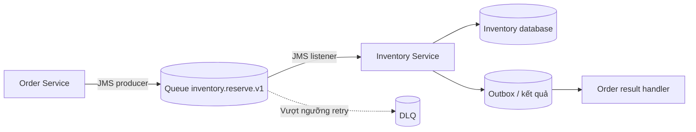
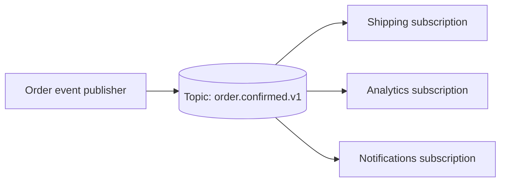
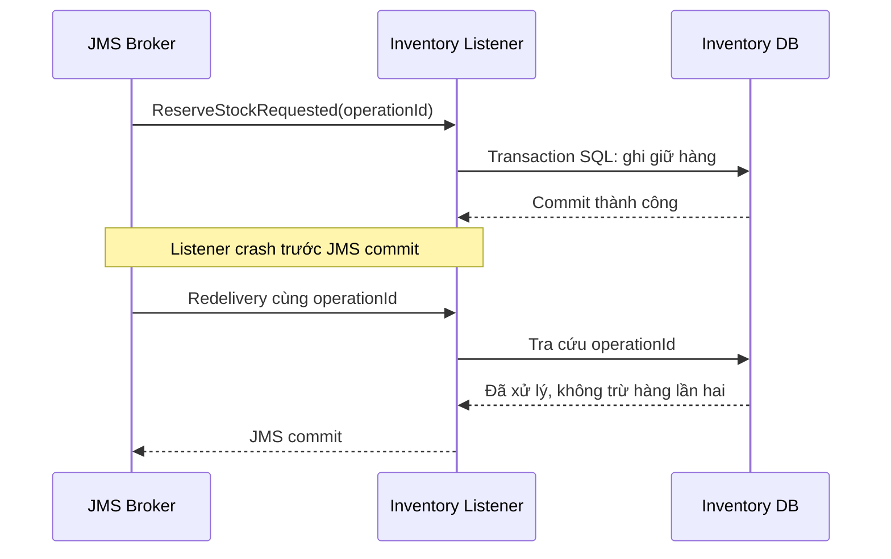
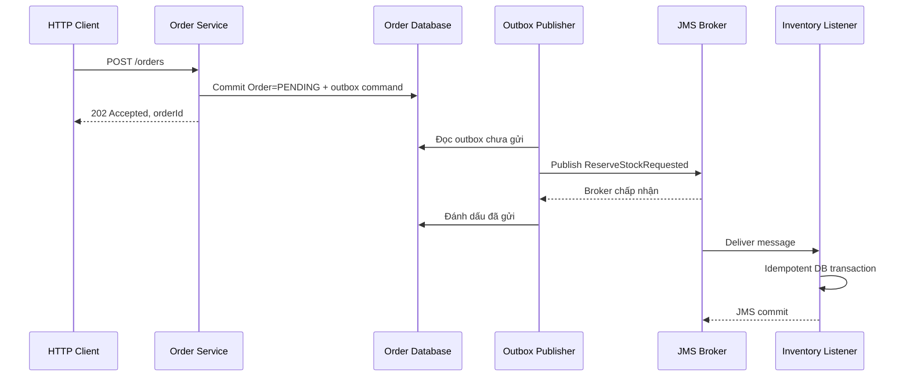

# Tích hợp ActiveMQ Classic hoặc ActiveMQ Artemis trong Spring Boot

## 1. JMS giải quyết bài toán gì?

Khi Order Service gọi Inventory Service qua HTTP để giữ hàng, Order phải phụ thuộc vào thời điểm Inventory sẵn sàng. Với tác vụ không cần phản hồi tức thời, **message broker** giúp bên gửi ghi nhận yêu cầu và bên nhận xử lý sau. **JMS (Jakarta Messaging, trước đây là Java Message Service)** là một API chuẩn trong hệ sinh thái Java để giao tiếp với broker. **ActiveMQ Classic** và **ActiveMQ Artemis** là hai dòng broker có thể thực thi các thao tác JMS, nhưng kiến trúc và cấu hình khác nhau.

Bài thuộc chương **JMS** của module **SPRING_BOOT_INTEGRATION**. Module này nghiên cứu tổ chức tích hợp hệ thống trong Spring Boot qua HTTP client, database, cache, broker và adapter Spring Integration; chú trọng **quản lý cấu hình, hợp đồng dữ liệu, giao dịch, lỗi, xử lý trùng lặp, kiểm thử và quan sát** luồng thực tế.

Sau bài học, bạn có thể:

- Phân biệt JMS API, Spring JMS, ActiveMQ Classic và Artemis; chọn đúng starter/driver và broker URL.
- Viết producer với `JmsTemplate`, consumer với `@JmsListener` và hợp đồng JSON có phiên bản.
- Hiểu queue/topic, session transaction, acknowledgment, redelivery và dead-letter queue (DLQ).
- Thiết kế xử lý lặp bằng `operationId`, unique constraint và transactional outbox.
- Thiết lập an toàn TLS, quyền gửi/nhận và kiểm thử với broker thực.

> **Phiên bản:** Ví dụ dùng Java 17+, Spring Boot 3.2+ và `jakarta.jms.*`. ActiveMQ Classic, Artemis, Spring JMS client và API Jakarta Messaging phải tương thích về phiên bản. Khi thay đổi phiên bản Boot hoặc broker, kiểm tra lại dependency, transport, cấu hình TLS và tính năng broker. Ví dụ Java lược bỏ các `import` thông dụng.

### Tình huống xuyên suốt

Order Service nhận một đơn hàng, lưu trạng thái `PENDING` và phát lệnh `ReserveStockRequested` tới queue `inventory.reserve.v1`. Inventory Service xử lý lệnh, cập nhật database và phát sự kiện kết quả. Khi Inventory tạm dừng, message có thể tồn đọng trong broker để xử lý sau theo chính sách lưu bền.



JMS giúp vận chuyển thông điệp, nhưng không tự chứng minh đơn đã được giữ hàng thành công. Ứng dụng vẫn cần trạng thái nghiệp vụ và quy trình đối soát.

## 2. Thành phần JMS và chọn broker

### 2.1. JMS là API, broker cung cấp cơ chế chuyển phát

| Khái niệm | Vai trò |
|---|---|
| Jakarta Messaging (JMS) | API cho connection, session, destination, message, producer/consumer và acknowledgement |
| `ConnectionFactory` | Tạo kết nối tới broker JMS, không phải JDBC `DataSource` |
| Queue | Point-to-point, mỗi message thường được giao cho **một** consumer trong nhóm consumer cạnh tranh |
| Topic | Publish/subscribe: mỗi subscription phù hợp có thể nhận một bản message |
| `JmsTemplate` | Spring API gửi/nhận message, quản lý tài nguyên kết nối/session |
| `@JmsListener` | Listener method được một Spring listener container gọi khi có message |
| ActiveMQ Classic / Artemis | Broker lưu, định tuyến, redeliver, chuyển DLQ và quản lý destination |

JMS có `TextMessage`, `BytesMessage`, `MapMessage` và các loại khác. Trong ví dụ, dùng **JSON trong `TextMessage`** vì có hợp đồng dữ liệu rõ ràng, tương thích giữa các phiên bản Java và có thể trao đổi với hệ thống khác. Tránh truyền đối tượng Java tùy ý qua `ObjectMessage` vì rủi ro tương thích lớp và giải tuần tự hóa.

Trong Spring Boot 3+, JMS API nằm ở namespace **`jakarta.jms`**. Client cũ chỉ hỗ trợ `javax.jms` có thể không tương thích. Không cố khắc phục bằng cách trộn ngẫu nhiên `javax.jms` và `jakarta.jms` hoặc ép các phiên bản client khác nhau trong cùng classpath.

### 2.2. ActiveMQ Classic so với ActiveMQ Artemis

| Tiêu chí | ActiveMQ Classic | ActiveMQ Artemis |
|---|---|---|
| Bối cảnh thường gặp | Hệ thống JMS truyền thống, đã có cấu hình/vận hành Classic | Hệ thống mới hoặc cần tính năng/tải phù hợp Artemis |
| Kiến trúc | Dòng broker ActiveMQ truyền thống | Dòng broker riêng với mô hình **address** và **queue** |
| Protocol | Được biết đến với OpenWire; còn tùy cấu hình transport khác | Có thể hỗ trợ Artemis Core, AMQP, OpenWire, MQTT, STOMP tùy cấu hình |
| Spring Boot starter | `spring-boot-starter-activemq` | `spring-boot-starter-artemis` |
| Namespace cấu hình | `spring.activemq.*` | `spring.artemis.*` |
| Delivery/DLQ | Redelivery policy và dead-letter strategy theo Classic | Address settings, redelivery delay và dead-letter address theo Artemis |
| Cần xác minh | Phiên bản client Jakarta, broker URL/protocol, persistence | Address/routing type, auto-create, protocol, persistence |

Nếu ứng dụng đang chạy ổn định với Classic, có thể duy trì rồi nâng cấp có kiểm soát. Với dự án mới, Artemis thường là một phương án đáng cân nhắc nếu phù hợp năng lực vận hành, protocol, clustering/HA và throughput mong muốn. **Không tự coi hai broker là thay thế tương đương** chỉ vì cả hai có thể lắng nghe cùng một số cổng, ví dụ `61616`.

Trong bài này, hãy chọn **một** starter cho **một** broker. Nếu ứng dụng cần kết nối cả hai, phải cấu hình nhiều `ConnectionFactory`, `JmsTemplate` và container factory được định danh rõ ràng; không dựa vào một auto-configuration mặc định.

## 3. Dependency và cấu hình kết nối

### 3.1. Phương án A — ActiveMQ Classic

Maven với Spring Boot parent/BOM:

```xml
<dependency>
    <groupId>org.springframework.boot</groupId>
    <artifactId>spring-boot-starter-activemq</artifactId>
</dependency>
```

```yaml
# application-classic.yml
spring:
  activemq:
    broker-url: ${JMS_BROKER_URL:tcp://localhost:61616}
    user: ${JMS_USERNAME}
    password: ${JMS_PASSWORD}

integration:
  jms:
    reserve-queue: inventory.reserve.v1
```

`tcp://localhost:61616` là ví dụ cho môi trường phát triển được cô lập; không phải cấu hình TLS production. Cần xác minh URI cùng loại transport OpenWire và client tương thích với phiên bản Classic đã triển khai.

### 3.2. Phương án B — ActiveMQ Artemis

Thay dependency và thuộc tính cấu hình:

```xml
<dependency>
    <groupId>org.springframework.boot</groupId>
    <artifactId>spring-boot-starter-artemis</artifactId>
</dependency>
```

```yaml
# application-artemis.yml
spring:
  artemis:
    mode: native
    broker-url: ${JMS_BROKER_URL:tcp://localhost:61616}
    user: ${JMS_USERNAME}
    password: ${JMS_PASSWORD}

integration:
  jms:
    reserve-queue: inventory.reserve.v1
```

`spring.artemis.mode: native` chỉ rõ kết nối đến **broker Artemis bên ngoài ứng dụng**. Embedded broker là lựa chọn khác, có dependency và yêu cầu vận hành riêng; không tự coi hai chế độ tương đương. Hai ví dụ YAML là **hai phương án thay thế**, không nên bật cả hai starter/nhóm cấu hình rồi trông chờ Spring Boot đoán đúng broker.

### 3.3. Chuẩn bị broker

Trước khi chạy ví dụ:

1. Broker hoạt động, client đến đúng host/port/protocol; schema JMS client tương thích với bản broker.
2. Tài khoản riêng của Order có quyền **send**, tài khoản Inventory có quyền **consume** queue; tránh tài khoản quản trị.
3. Destination `inventory.reserve.v1`, routing, persistence, giới hạn dung lượng, DLQ và policy redelivery được xác định ở broker.
4. Broker và client có cấu hình TLS/CA, credential và secret management phù hợp với môi trường.
5. Cảnh báo khi queue tồn đọng, DLQ tăng hoặc broker sắp hết disk được thiết lập.

ActiveMQ Artemis dùng mô hình **address + queue**. Routing `ANYCAST` gần với queue point-to-point; `MULTICAST` gần với fan-out/topic. Một số broker có chức năng tự tạo destination, nhưng production nên chủ động khai báo address/queue và quyền truy cập theo kế hoạch, thay vì phụ thuộc vào default không kiểm soát.

## 4. Hợp đồng message: version, danh tính và loại sự kiện

Ví dụ payload:

```json
{
  "schemaVersion": 1,
  "operationId": "reserve-O-1001",
  "orderId": "O-1001",
  "sku": "SKU-42",
  "quantity": 2
}
```

```java
// ReserveStockCommand.java
public record ReserveStockCommand(
        int schemaVersion,
        String operationId,
        String orderId,
        String sku,
        int quantity
) {}
```

| Trường | Ý nghĩa |
|---|---|
| `schemaVersion` | Cho consumer nhận biết cấu trúc message |
| `operationId` | Danh tính ổn định của **một lệnh nghiệp vụ** để xử lý trùng |
| `orderId` | Đơn hàng của lệnh |
| `sku` | Mã hàng hóa theo contract chung |
| `quantity` | Số lượng cần giữ, bắt buộc dương |

`JMSMessageID` thường do broker/client gán cho message được gửi; gửi lại cùng lệnh có thể nhận message ID mới. `JMSCorrelationID` giúp liên kết request, result và log. Cả hai đều **không thay thế** `operationId` bất biến lưu trong database. Hợp đồng cũng nên quy định content type, kiểu event, phiên bản schema, danh sách status/error và cách nâng cấp tương thích.

## 5. Producer và consumer trong Spring Boot

### 5.1. Cấu hình JSON converter và listener container

`MappingJackson2MessageConverter` có thể chuyển Java DTO thành JMS `TextMessage` chứa JSON. Ánh xạ type ID giới hạn giúp tránh để một header từ broker tùy ý chỉ định lớp Java được giải tuần tự hóa.

```java
// InventoryJmsConfiguration.java — imports lược bỏ
@Configuration(proxyBeanMethods = false)
@EnableJms
public class InventoryJmsConfiguration {

    @Bean
    public MessageConverter inventoryMessageConverter() {
        MappingJackson2MessageConverter converter =
                new MappingJackson2MessageConverter();
        converter.setTargetType(MessageType.TEXT);
        converter.setTypeIdPropertyName("_type");
        converter.setTypeIdMappings(Map.of(
                "reserve-stock-v1", ReserveStockCommand.class
        ));
        return converter;
    }

    @Bean
    public JmsTemplate inventoryJmsTemplate(
            ConnectionFactory connectionFactory,
            MessageConverter inventoryMessageConverter
    ) {
        JmsTemplate template = new JmsTemplate(connectionFactory);
        template.setMessageConverter(inventoryMessageConverter);
        template.setPubSubDomain(false); // queue
        template.setExplicitQosEnabled(true);
        template.setDeliveryMode(DeliveryMode.PERSISTENT);
        return template;
    }

    @Bean
    public DefaultJmsListenerContainerFactory inventoryListenerFactory(
            ConnectionFactory connectionFactory,
            MessageConverter inventoryMessageConverter,
            DefaultJmsListenerContainerFactoryConfigurer configurer
    ) {
        DefaultJmsListenerContainerFactory factory =
                new DefaultJmsListenerContainerFactory();
        configurer.configure(factory, connectionFactory);
        factory.setMessageConverter(inventoryMessageConverter);
        factory.setSessionTransacted(true);
        factory.setConcurrency("2-6");
        factory.setPubSubDomain(false);
        return factory;
    }
}
```

Các type chính đến từ `jakarta.jms.ConnectionFactory` / `DeliveryMode`, `org.springframework.jms.core.JmsTemplate`, `org.springframework.jms.annotation.EnableJms`, `org.springframework.jms.config.DefaultJmsListenerContainerFactory`, `org.springframework.jms.support.converter.*` và `org.springframework.boot.autoconfigure.jms.DefaultJmsListenerContainerFactoryConfigurer`.

`setSessionTransacted(true)` giúp listener container rollback JMS session khi xử lý thất bại và commit khi thành công; **không** đồng nghĩa transaction cùng database. `concurrency("2-6")` tạo nhiều consumer cạnh tranh nên phải tính với DB pool và yêu cầu thứ tự. `DeliveryMode.PERSISTENT` yêu cầu persistent delivery, nhưng độ bền thực tế còn phụ thuộc broker persistence/HA. Để áp explicit delivery mode trong `JmsTemplate`, ví dụ bật `setExplicitQosEnabled(true)`.

### 5.2. Producer phát lệnh

```java
// ReserveStockPublisher.java
@Service
public class ReserveStockPublisher {
    private final JmsTemplate template;
    private final String queue;

    public ReserveStockPublisher(
            @Qualifier("inventoryJmsTemplate") JmsTemplate template,
            @Value("${integration.jms.reserve-queue}") String queue
    ) {
        this.template = template;
        this.queue = queue;
    }

    public void publish(ReserveStockCommand command) {
        if (command.operationId() == null
                || command.operationId().isBlank()) {
            throw new IllegalArgumentException(
                    "operationId không được rỗng");
        }
        template.convertAndSend(queue, command, message -> {
            message.setJMSCorrelationID(command.operationId());
            message.setStringProperty(
                    "eventType", "ReserveStockRequested");
            return message;
        });
    }
}
```

Spring converter sẽ ghi `_type=reserve-stock-v1` theo mapping và serialize JSON. `JmsTemplate` có thể được Spring Boot tạo tự động, nhưng ví dụ khai báo bean riêng để minh họa cấu hình converter/delivery mode chính xác. Với nhiều bean cùng kiểu, dùng `@Qualifier` để phân biệt.

### 5.3. Listener nhận lệnh

```java
// ReserveStockListener.java
@Component
public class ReserveStockListener {
    private final ReservationApplicationService service;

    public ReserveStockListener(ReservationApplicationService service) {
        this.service = service;
    }

    @JmsListener(
            destination = "${integration.jms.reserve-queue}",
            containerFactory = "inventoryListenerFactory"
    )
    public void receive(ReserveStockCommand command) {
        if (command.schemaVersion() != 1
                || command.operationId() == null
                || command.operationId().isBlank()
                || command.sku() == null
                || command.sku().isBlank()
                || command.quantity() <= 0) {
            throw new InvalidReservationCommandException(
                    "ReserveStockCommand không hợp lệ");
        }
        service.handle(command);
    }
}
```

`ReservationApplicationService` và `InvalidReservationCommandException` là các lớp application/domain giả định cần định nghĩa riêng. Consumer cần biết điều gì là **lỗi nghiệp vụ vĩnh viễn** (đơn không hợp lệ, hết hàng) và điều gì là **lỗi tạm thời** (DB timeout). Với `setSessionTransacted(true)`, nếu listener ném exception, broker thường redeliver theo policy. Nếu catch exception, chỉ log và return, container có thể commit message như đã xử lý thành công; phải kiểm soát điều này cẩn thận.

Lỗi giải mã JSON còn có thể xuất hiện **trước khi** code `receive` chạy. Do đó, không thể chỉ xử lý malformed message bằng một `try/catch` trong method; cần chính sách redelivery và DLQ từ broker.

## 6. Queue, topic, durable subscription và thứ tự

### 6.1. Queue phù hợp cho command

`inventory.reserve.v1` là queue. Nếu Inventory Service có nhiều replica hoặc một listener factory cho phép nhiều consumer, broker có thể giao message cho các consumer cạnh tranh. Thông thường **mỗi message được một consumer nhận tại một thời điểm**, nhưng khi consumer lỗi hoặc acknowledgement thất bại, message có thể được gửi lại.

Không suy diễn rằng thứ tự hoàn tất nghiệp vụ luôn theo thứ tự enqueue. Với concurrency `2-6`, nhiều message được xử lý song song; redelivery, message priority hoặc failover càng khiến thứ tự thực tế có thể khác. Nếu cần thứ tự cho cùng một `orderId`, có thể dùng tính năng **message group** như `JMSXGroupID` khi broker hỗ trợ, hoặc thiết kế partition/khóa theo đơn hàng và test với broker thực.

### 6.2. Topic phù hợp để fan-out

Khi Order Service phát event `OrderConfirmed` cho Shipping, Analytics và Notifications, dùng topic là một phương án:



Với topic, producer và listener container phải được cấu hình `pubSubDomain=true` theo bean tương ứng. Tránh bật một cờ toàn cục mà không để ý các queue listener khác; nếu ứng dụng dùng cả queue và topic, nên tạo factory/template riêng cho từng kiểu destination.

**Durable subscription** cho phép broker lưu message theo cấu hình khi subscriber tạm offline. Cần xác định client ID, tên subscription, thời gian giữ message và chính sách subscription khi triển khai nhiều replica. Không gán một `clientId` duy nhất cho nhiều kết nối độc lập nếu broker không cho phép. Tính năng shared durable subscription có yêu cầu và hạn chế theo JMS provider, phải được kiểm tra với Classic hoặc Artemis đang chạy.

## 7. JMS transaction, acknowledgement và tính nhất quán

### 7.1. Khi nào message được xác nhận?

| Cơ chế | Ý nghĩa | Điểm cần chú ý |
|---|---|---|
| `AUTO_ACKNOWLEDGE` | Provider/container xác nhận theo ngữ nghĩa session và vòng đời callback | Hành vi lỗi phụ thuộc listener container và cách cấu hình |
| `CLIENT_ACKNOWLEDGE` | Client chủ động xác nhận; có thể xác nhận các message đã xử lý trong cùng session | Dễ sai phạm vi hoặc thời điểm acknowledge khi tự quản lý |
| JMS local transaction | `commit` khi xử lý xong, `rollback` khi gặp lỗi | Chỉ thuộc JMS session, **không tự bao trùm SQL** |
| Broker redelivery / DLQ | Broker phân phối lại hoặc đưa vào dead-letter theo policy | JMS không tự quy định chung số lần retry, delay và DLQ |

Ví dụ đang dùng `sessionTransacted=true`. Khi listener chạy thành công và container commit, message được xác nhận; khi listener ném exception và transaction rollback, broker có thể phát lại. Khi callback **nuốt lỗi rồi return**, container có thể commit, làm mất cơ hội tự động xử lý lại. Mỗi exception cần được phân loại đúng.

### 7.2. Tại sao giao dịch SQL thành công mà message vẫn có thể phát lại?



Spring `@Transactional` với JDBC/JPA chỉ quản lý transaction database; JMS local transaction chỉ quản lý message. Nếu một transaction commit thành công và transaction kia chưa commit, trạng thái có thể lệch. Vì vậy thiết kế thực tế thường dựa trên **at-least-once delivery + idempotent processing**, cùng quy trình đối soát, thay vì giả định exactly-once xuyên broker và DB.

### 7.3. Idempotency dựa vào database

Một cách đơn giản trong PostgreSQL:

```sql
CREATE TABLE stock_item (
    sku VARCHAR(80) PRIMARY KEY,
    available BIGINT NOT NULL CHECK (available >= 0)
);

CREATE TABLE reservation_request (
    operation_id VARCHAR(100) PRIMARY KEY,
    order_id VARCHAR(100) NOT NULL,
    sku VARCHAR(80) NOT NULL,
    quantity BIGINT NOT NULL CHECK (quantity > 0),
    status VARCHAR(24) NOT NULL
);
```

Trong một transaction SQL do `ReservationApplicationService.handle` điều phối:

1. Kiểm tra/ghi `operationId`. Dùng **unique constraint** làm rào chắn cuối cùng để hai consumer không cùng tạo một reservation. Khi lệnh lặp, đọc và trả kết quả cũ thay vì cập nhật tồn kho lần nữa.
2. Với lệnh mới, lưu reservation `PENDING`.
3. Giảm tồn kho bằng một SQL có điều kiện, ví dụ:

   ```sql
   UPDATE stock_item
      SET available = available - :quantity
    WHERE sku = :sku
      AND available >= :quantity;
   ```

4. Nếu affected rows = 1, ghi trạng thái `RESERVED`. Nếu = 0, ghi `REJECTED` hoặc tra cứu thêm để phân biệt không tồn tại SKU với hết hàng. Đây là **kết quả nghiệp vụ**, không nên retry vô hạn.
5. Ghi outbox event về kết quả trong **cùng transaction SQL** để gửi sau commit. Khi database gặp lỗi tạm thời, rollback và để exception propagate để JMS xử lý redelivery.

Với PostgreSQL, nếu một câu `INSERT` vi phạm unique constraint, transaction hiện tại có thể rơi vào trạng thái aborted. Dùng mẫu `INSERT ... ON CONFLICT DO NOTHING` và kiểm tra affected rows, hoặc cơ chế tương đương theo database, rồi đọc kết quả cũ. Không chỉ bắt lỗi duplicate và tiếp tục trong transaction đã hỏng.

**Một câu `UPDATE` có điều kiện không đủ tạo idempotency**: nó giúp chống race kiểm tra-ghi tồn kho, nhưng cùng một lệnh có thể bị áp dụng hai lần nếu vẫn còn hàng. Phải kết hợp với `operationId` duy nhất.

Nếu cần distributed XA transaction thực sự, phải có transaction coordinator cùng broker, DB và client hỗ trợ XA; chi phí cấu hình/vận hành cao hơn đáng kể. Với phần lớn luồng dịch vụ, idempotency, outbox, trạng thái trung gian và compensation là hướng dễ kiểm soát hơn.

## 8. Xử lý lỗi, redelivery và dead-letter queue

### 8.1. Phân loại lỗi để không retry sai

| Tình huống | Loại lỗi | Cách phản ứng |
|---|---|---|
| Database unavailable, lỗi kết nối tạm thời | Transient | Rollback JMS; redelivery giới hạn kèm backoff |
| JSON không đọc được, schema version không hỗ trợ | Contract/permanent | Sau giới hạn, đưa DLQ/quarantine để điều tra |
| Không đủ hàng | Kết quả nghiệp vụ | Lưu `REJECTED`, phát result, commit message |
| Vi phạm unique operation ID do message đã xử lý | Lệnh lặp | Đọc kết quả cũ, không trừ hàng thêm, commit |
| Broker hết disk, queue vượt giới hạn | Hạ tầng | Cảnh báo, áp flow control/backpressure, không che lỗi gửi |
| DB deadlock/serialization conflict | Có thể transient | Retry hữu hạn với cùng operation ID và transaction mới |

**Poison message** là message cứ phát lại nhưng không thể xử lý, ví dụ payload JSON hỏng. Vì lỗi converter có thể xảy ra trước khi method `@JmsListener` được gọi, chính sách DLQ ở broker rất quan trọng.

### 8.2. Redelivery thuộc trách nhiệm broker

- **Classic:** redelivery policy và dead-letter strategy phụ thuộc cấu hình client/broker; có thể dùng DLQ chung hoặc theo destination.
- **Artemis:** `address-settings` cho phép đặt redelivery delay, số lần giao tối đa và dead-letter address.
- Không giả định mọi broker có sẵn DLQ tên `DLQ`, retry ba lần hay delay cố định. Giá trị phải được triển khai, kiểm tra và ghi lại trong runbook.
- `JMSRedelivered` và `JMSXDeliveryCount` (nếu provider hỗ trợ) có thể giúp phân tích nhưng **không phải khóa idempotency đáng tin cậy cho lệnh nghiệp vụ**.

Khi DLQ tăng, cần kiểm tra lỗi gốc, schema, operation ID, trạng thái database và các lần thử đã qua. Replay phải có kiểm soát, có khả năng chống lặp và cảnh báo; không bơm toàn bộ DLQ về production khi chưa xử lý nguyên nhân.

### 8.3. Timeout, TTL và quá tải

JMS tách thời điểm gửi và nhận nhưng tài nguyên vẫn có giới hạn:

- Producer cần xử lý lỗi kết nối/gửi; không đánh dấu “đã phát” chỉ vì đã gọi một hàm nếu gửi thất bại.
- Broker cần policy về message TTL/expiry, max-size của queue/address, disk, persistence và flow control.
- Consumer concurrency cần phù hợp pool kết nối DB, số thao tác CPU và SLA xử lý.
- Command giữ hàng **có thời hạn nghiệp vụ** phải được kiểm tra timestamp/expiration theo hợp đồng; message quá cũ không thể tự ý được thực hiện chỉ vì vẫn nằm trong queue.

Queue depth tăng khi tốc độ gửi vượt tốc độ xử lý. Theo dõi **oldest message age**, enqueue/dequeue rate, processing latency và redelivery để biết lỗi nằm ở producer, broker, consumer hay database.

## 9. Bảo mật khi kết nối Classic hoặc Artemis

Username/password **không bảo đảm đường truyền đã mã hóa**. Các URI `tcp://localhost:61616` trước đó chỉ dùng làm ví dụ local. Trong production cần TLS và kiểm tra đúng hostname/certificate, kết hợp quyền broker theo destination.

| Khía cạnh | Classic | Artemis |
|---|---|---|
| TLS transport | SSL transport/connector theo tài liệu Classic | TLS connector/acceptor và SSL options của Artemis |
| Trust material | CA/truststore phù hợp client và broker | CA/truststore phù hợp client và broker |
| Mutual TLS | Client certificate khi broker yêu cầu | Client certificate khi broker yêu cầu |
| ACL | Quyền theo destination và cấu hình broker | Quyền theo address/queue và security settings |
| Secret management | Không commit mật khẩu/token/private key | Tương tự |

Cú pháp SSL URL, keystore, truststore và hostname verification khác nhau theo client Classic/Artemis và phiên bản. Cần xem cấu hình transport của **broker/client thực tế**, không sao chép nguyên `ssl://...` hoặc option SSL của dòng này sang dòng kia khi chưa thử. Test CA đúng, CA sai, hostname sai và certificate hết hạn. Không dùng trust-all hay tắt hostname verification để qua lỗi handshake.

Giới hạn quyền dịch vụ: Order thường chỉ được gửi queue lệnh; Inventory chỉ được nhận queue đó và gửi sự kiện kết quả nếu cần. Không dùng tài khoản admin broker trong ứng dụng. Không log payload nhạy cảm, thông tin đăng nhập hay full connection URL chứa secret.

## 10. Kiểm thử với broker thực

### 10.1. Ba cấp kiểm thử

| Lớp kiểm thử | Nội dung kiểm tra | Công cụ gợi ý |
|---|---|---|
| Unit test | Logic khi message hợp lệ, trùng operation ID, hết hàng, lỗi DB | Mock/fake application service và repository |
| Contract test | Queue, header, JSON schema/version, correlation ID và chuyển DTO | Converter test, broker test |
| Integration test | Kết nối broker, persistence, ack/rollback, redelivery, DLQ, TLS, concurrency | Classic/Artemis broker test, Testcontainers hoặc CI broker |

Mock `JmsTemplate` có ích để xác nhận publisher gọi đúng API nhưng **không chứng minh** broker lưu bền, gửi lại, xử lý DLQ hay xác thực TLS. Với khả năng provider-specific, phải chạy integration test trên cùng họ broker và cấu hình sát production.

### 10.2. Test gửi và đọc message từ queue test

Ví dụ dưới đây yêu cầu một broker test hoạt động với profile Classic **hoặc** Artemis. Listener tự động không chạy trong test để tránh consumer khác lấy mất message:

```java
// ReserveStockMessagingIT.java — imports lược bỏ
@SpringBootTest(properties = {
        "spring.jms.listener.auto-startup=false",
        "integration.jms.reserve-queue=it.inventory.reserve.v1"
})
class ReserveStockMessagingIT {
    @Autowired
    ReserveStockPublisher publisher;

    @Autowired
    @Qualifier("inventoryJmsTemplate")
    JmsTemplate template;

    @Test
    void sendsJsonAndCorrelationId() throws JMSException {
        ReserveStockCommand command = new ReserveStockCommand(
                1, "op-test-202", "O-202", "SKU-42", 2);

        publisher.publish(command);

        template.setReceiveTimeout(2_000L);
        Message message = template.receive("it.inventory.reserve.v1");

        assertNotNull(message);
        assertInstanceOf(TextMessage.class, message);
        assertEquals("op-test-202", message.getJMSCorrelationID());
        assertEquals("ReserveStockRequested",
                message.getStringProperty("eventType"));
        assertTrue(((TextMessage) message).getText()
                .contains("\"operationId\":\"op-test-202\""));
    }
}
```

Các import gồm `org.springframework.boot.test.context.SpringBootTest`, `org.springframework.beans.factory.annotation.Autowired`, `org.springframework.beans.factory.annotation.Qualifier`, `org.springframework.jms.core.JmsTemplate`, `jakarta.jms.*` và JUnit 5. Khi chạy thật, cung cấp URL/credential của broker test, queue riêng và chính sách tạo destination phù hợp. Có thể dùng Testcontainers với image đã pin phiên bản, đồng thời dựng cấu hình DLQ/redelivery và TLS cho từng broker; bài này không giả định broker test đã được chạy.

### 10.3. Ma trận kiểm thử tích hợp

1. **Happy path:** JSON được converter xử lý đúng; listener xử lý thành công rồi queue không còn message.
2. **DB tạm lỗi:** listener ném exception, message được redeliver với cùng operation ID.
3. **Crash sau DB commit:** message quay lại nhưng reservation không bị tạo/trừ hàng lần hai.
4. **Payload hỏng/không hỗ trợ version:** cuối cùng vào DLQ đúng cấu hình, có cảnh báo.
5. **Hết hàng:** lưu kết quả `REJECTED` và commit, không redelivery vô tận.
6. **Broker offline:** producer phát lỗi có thể quan sát; outbox còn bản ghi chưa phát.
7. **TLS/ACL:** CA đúng kết nối được; CA sai, hostname sai hoặc thiếu quyền bị từ chối.
8. **Concurrency:** nhiều lệnh cùng SKU hoặc cùng operation ID không làm tồn kho âm.
9. **Topic durable:** subscriber offline rồi kết nối lại nhận message theo contract; replica không xung đột client ID.
10. **TTL/DLQ replay:** message quá hạn không gây thao tác lỗi thời, replay không phá idempotency.

Để kiểm tra chính sách redelivery và DLQ, cần cấu hình policy **trên broker test**. Test giả `@JmsListener` hoặc mock message không thể chứng minh cách broker quyết định retry, số lần phát lại hay persistence qua restart.

## 11. Kết nối JMS với HTTP, database, cache và outbox

Một trong những lỗi thường gặp là ghi đơn hàng vào SQL rồi gọi trực tiếp `jmsTemplate.convertAndSend` trong cùng phương thức `@Transactional` và tin rằng cả hai cùng commit hoặc rollback. Thực tế, nếu DB commit rồi producer crash, message có thể chưa được gửi; nếu broker nhận message nhưng DB rollback, Inventory có thể xử lý một đơn hàng không tồn tại.

**Transactional outbox** giải quyết khoảng cách này bằng cách lưu trạng thái đơn và bản ghi cần phát vào cùng transaction SQL. Worker riêng đọc outbox và gửi message; gửi trùng vẫn có thể xảy ra khi process crash sau broker send nhưng trước lúc đánh dấu outbox đã gửi.



Đánh dấu outbox sau khi gửi **vẫn có cửa sổ phát lặp**; điều đó củng cố yêu cầu consumer idempotent. API trả `202 Accepted` nên ghi rõ đơn đang chờ kết quả, không thông báo là đã giữ hàng thành công. Sau này Order Service có thể tiêu thụ result event, hoặc client hỏi trạng thái qua HTTP.

Cache tồn kho/Redis chỉ nên hỗ trợ tra cứu nhanh với chính sách dữ liệu cũ rõ ràng; không thay thế transaction giữ hàng ở Inventory. Spring Integration có thể dùng channel, transformer, router và JMS inbound/outbound adapter để tổ chức luồng phức tạp, nhưng cũng không tự cung cấp transaction ACID xuyên JMS, SQL, Redis và HTTP.

## 12. Quan sát và vận hành

Theo dõi cả broker và ứng dụng:

| Nhóm | Chỉ số cần quan sát |
|---|---|
| Queue | Depth, oldest-message age, enqueue/dequeue rate, consumer count |
| Độ tin cậy | Redelivery rate, DLQ depth, expired messages, số operation ID trùng |
| Consumer | Thời gian xử lý p95/p99, lỗi DB, throughput, concurrency |
| Producer | Send latency, lỗi connect/auth/TLS, backlog outbox |
| Nghiệp vụ | Reservation `PENDING`, `RESERVED`, `REJECTED` và thời gian đối soát |

Spring Boot Actuator/Micrometer có thể xuất metric ứng dụng; broker có công cụ management/console/exporter riêng theo bản cài đặt. Liên kết log với correlation ID và operation ID **sau khi áp chính sách bảo vệ dữ liệu**; đừng dùng SKU, order ID hoặc operation ID làm nhãn metric có cardinality cao. Tracing qua JMS cần instrumentation và propagation phù hợp; không giả định JMS tự chuyển HTTP trace headers.

Cảnh báo khi backlog hoặc tuổi message tăng liên tục, DLQ đột biến sau deploy, broker hết disk/không sẵn sàng, producer gửi lỗi nhưng API vẫn báo thành công hoặc cùng operation ID tạo nhiều reservation.

## 13. Lỗi thường gặp và câu hỏi ôn tập

| Hiện tượng | Nguyên nhân khả dĩ | Hướng xử lý |
|---|---|---|
| Không tạo được `ConnectionFactory` | Sai starter, URL/protocol, thiếu client | Kiểm tra dependency tree, profile, broker |
| `ClassNotFound` hoặc API không khớp | Trộn `javax.jms` và `jakarta.jms` | Dùng client Jakarta tương thích Boot 3+ |
| Producer gửi nhưng listener không nhận | Sai queue/topic, routing, ACL hoặc listener dừng | Kiểm tra broker console, destination, factory |
| JSON không thành DTO | Sai `_type`, schemaVersion, converter | Kiểm tra mapping/schema và consumer contract |
| Message redeliver liên tục | Exception, poison message, retry policy | Phân loại lỗi, idempotency, DLQ và alert |
| Message không còn sau restart | Persistence/durable subscription chưa đúng | Cấu hình broker và test restart |
| Inventory xử lý một lệnh hai lần | Thiếu unique operation ID | Lưu idempotency key trong DB transaction |
| Queue tồn đọng cao | Consumer/DB chậm, concurrency hoặc broker giới hạn | Đo tải, tối ưu SQL, cân bằng concurrency |
| Lỗi TLS | CA, SAN, URI SSL, quyền sai | Kiểm tra broker/client transport, giữ validation |

### Câu hỏi tự kiểm tra

1. JMS là API hay broker? `ConnectionFactory` đóng vai trò gì?
2. Khi nào dùng queue, khi nào dùng topic? Nhiều consumer trên queue có cùng nhận một bản message không?
3. Vì sao cần chọn đúng starter Classic/Artemis và kiểm tra namespace `jakarta.jms`?
4. `MappingJackson2MessageConverter` và header `_type` dùng để làm gì?
5. Khi listener ném exception trong JMS transacted session, broker có thể làm gì?
6. Vì sao database commit thành công mà broker vẫn có thể redeliver?
7. `operationId` khác `JMSMessageID` và `JMSCorrelationID` ở đâu?
8. Một malformed JSON có thể vào DLQ như thế nào? Ai cấu hình số lần redelivery?
9. Tại sao transactional outbox vẫn cần consumer idempotent?
10. Những kiểm thử nào phải chạy trên broker thực để xác minh TLS, persistence và DLQ?

**Ghi nhớ:** Tích hợp ActiveMQ Classic hoặc Artemis trong Spring Boot cần **đúng starter/broker, `ConnectionFactory`, `JmsTemplate`, `@JmsListener`, hợp đồng message và policy vận hành**. Gửi được JSON mới là bước đầu; tính tin cậy phụ thuộc vào transaction/ack, redelivery/DLQ, **idempotency dựa vào database**, outbox, TLS, kiểm thử với broker thực và khả năng quan sát backlog/lỗi.
